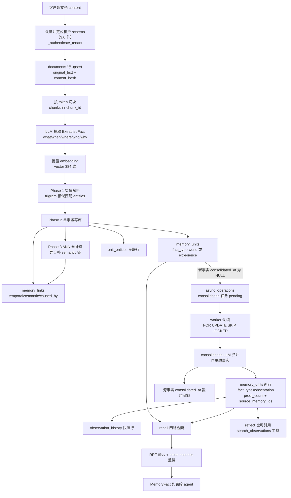
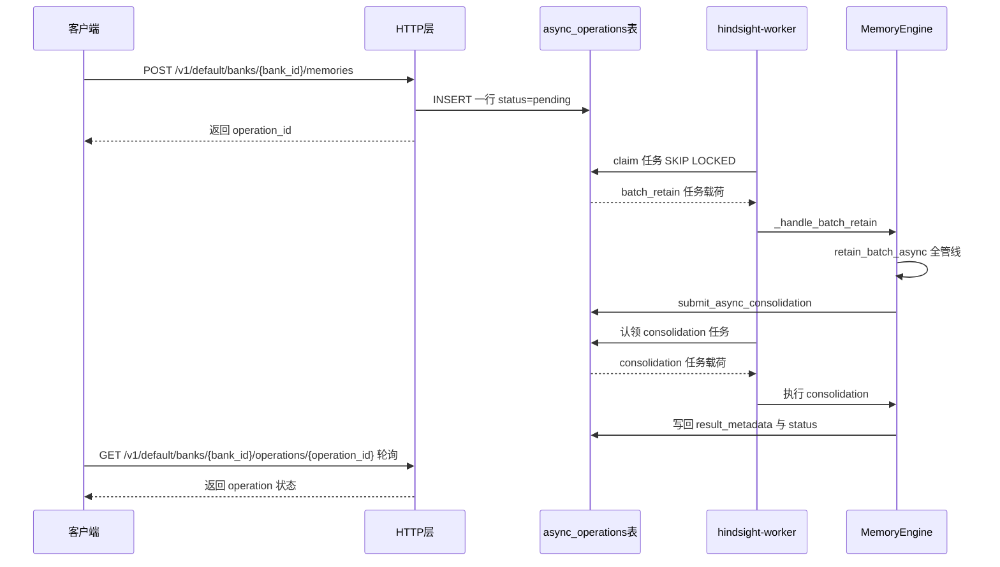
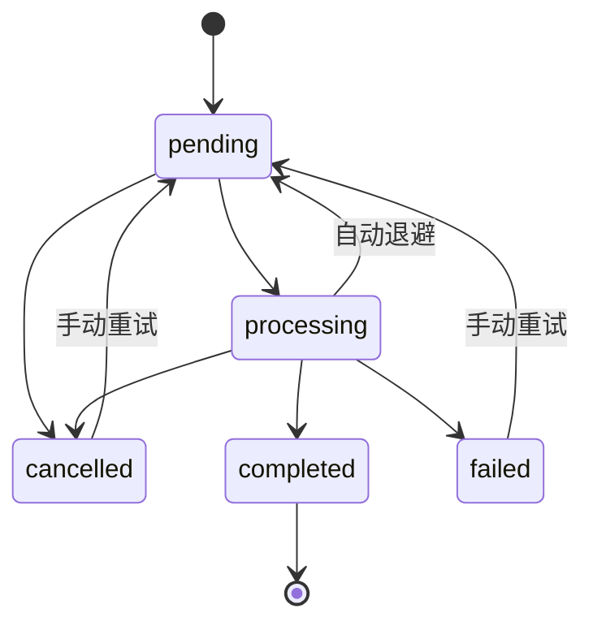

# Hindsight 源码庖丁解牛 · 01 总览与数据模型

> 研究对象：`E:\Codes\github-openSource\code-study\hindsight`（只读）
> 本篇范围：项目全景、三大操作编排骨架、PostgreSQL/Oracle 数据模型、bank 隔离与多方言分派机制。
> retain / recall / reflect / consolidation 各自**管线内部**的逐步拆解留给后续篇章，本篇只讲"骨架"与"落了哪些表"。
> 代码基线：`b4a0da1e9`（2026-10-23，含 2026-10-21 发布的 v1.1.0）；本篇已随 1.1.0 增量更新（上一版基线 `5331da2f4`/v1.0.0，增量窗口 223 提交）。本窗口涉及本篇的变更：
> - 迁移 113→116（HEAD `c7e2f9a4d1b8`）：`e8c1a4f7b2d9` 把 per-bank 后端上残留的全局向量索引按目录清干净（#5707）、`f2a9c4e7b1d3` 把两处指向 `mental_models.id` 的列加宽（#5788）、`c7e2f9a4d1b8` 只扫 `event_date` 清掉 year-1/9999 占位日期（#5820/#5922）；
> - 新 schema 的建索引不再走 `CONCURRENTLY`（`alembic/_new_schema_indexes.py`，#5700）；
> - 写序统一：`lock_document_row` / `lock_consolidation_write_set` 让 consolidation 与 retain/delete 按同一顺序取锁（#5433）；
> - 新模块 `engine/document_history.py`（每文档变更历史，**不建表**，写进 `async_operations.result_metadata`，#5638）、`engine/stored_dates.py`（占位日期语义，#5820）、`engine/bank_templates.py`（bank 模板清单，落到 `banks.config` / mental models / directives）、`schema_context.py`（tenant/bank contextvar 迁出 engine，#5993）；
> - transfer 全链路分页（`iter_keyset_pages`，导出/导入不再整表进内存，#5737/#5918）、`dump_*` 改 `iter_*`；
> - bank 删除补齐 `llm_requests` 与两张维护队列表（#5839，PR #5948；两张队列表为 #5958），`repair-bank` 增加孤儿 observation 清扫与 VectorChord 关键词索引重建（#5937/#5299）；
> - 表数量按新快照重数为 **24 张 PG 表**（外加 1 张 Oracle 专属），旧稿的 25/26 把一张早已 DROP 的表算了进去，见 3.1。

---

# 第 1 层【全景】

## 1.1 Hindsight 是什么

Hindsight 是一个**给 AI agent 用的长期记忆系统**。核心思路：agent 在与用户交互过程中产生的对话、文档、事件，不再以原始文本形式整段塞回上下文，而是先被"消化"成一条条**原子事实（fact）**存进 PostgreSQL，再通过向量检索、BM25 关键词检索、图召回、时间检索四路并行 + 融合重排，把"最相关且最省 token"的记忆还给 agent；随着时间推移，后台任务还会把零散事实**归并成观察（observation）**，形成更凝练的知识。

它不是一个进程内的玩具库，而是一套完整的客户端-服务端系统：

- 服务端核心在 `hindsight-api-slim/`（FastAPI + asyncpg（PG 的异步驱动）直连 PostgreSQL，同时支持 Oracle 23ai），以 `hindsight-api`、`hindsight-worker`、`hindsight-local-mcp`、`hindsight-admin` 四个 CLI 入口发布（`hindsight-api/pyproject.toml:21-25`，与 `hindsight-api-slim/pyproject.toml:172-176` 一致）；
- `hindsight-worker` 是独立异步工作进程，从 `async_operations` 表认领后台任务（retain 异步批量、consolidation、图维护等）；
- `hindsight-control-plane/` 是 Next.js 管理界面；
- `hindsight-cli/`（Rust）提供命令行与 `hindsight fs mount`（把记忆库当只读文件系统挂载）；
- `hindsight-embed/` 支持嵌入式部署（自动拉起本地 PostgreSQL，即 pg0 模式，`memory_engine.py` 构造函数里对 `"pg0"` URL 的解析就是入口，`hindsight-api-slim/hindsight_api/engine/memory_engine.py:2910-2918`）；
- 其余目录（`hindsight-integrations/`、`hindsight-system-tests/`、`hindsight-clients/` 等）是框架集成、黑盒测试、生成式 SDK 客户端。

## 1.2 三大操作：retain / recall / reflect

引擎对外的主接口抽象在 `hindsight-api-slim/hindsight_api/engine/interface.py:37`（`MemoryEngineInterface`），实现在 `MemoryEngine`（`engine/memory_engine.py:2792`）。三个动词对应记忆的"写入、读取、推理"：

| 操作 | 入口方法 | 位置 | 一句话定义 |
|---|---|---|---|
| retain | `retain` / `retain_async` / `retain_batch_async` | memory_engine.py:6743 / 6774 / 6824 | 把文档切块、LLM 抽取事实、生成向量、解析实体、建链，写入数据库 |
| recall | `recall` / `recall_async` | memory_engine.py:9218 / 9261 | 四路并行检索 + RRF 融合 + cross-encoder 重排 + token 预算裁剪 |
| reflect | `reflect_async` | memory_engine.py:15641 | 一个只读的 agentic loop：LLM 用 recall / search_observations / search_mental_models / expand 等工具自主取材后作答 |

此外还有一个**非对外主打但至关重要的第四操作**：consolidation（归并/巩固）。它由 retain 完成后自动排队、由 worker 在后台执行（收尾钩子 `_submit_post_insert_maintenance`，memory_engine.py:7242 定义、:7161 与 :9214 两处调用——retain 与文档导入共用同一份收尾），把同主题的 `world`/`experience` 事实喂给 LLM，产出 `fact_type='observation'` 的归并记忆。此外还有一个相关操作：mental model 刷新（`refresh_mental_model`，memory_engine.py:18803）。mental model 是用户保存下来的 reflect 产物（2.6 节详述），刷新时复用与交互式 reflect 相同的管线（:15628 的 `_llm_for_reflect_operation` 与 :15641 的 `reflect_async` 可佐证）。

## 1.3 bank 是什么

**bank = 一个完全隔离的记忆库**，相当于"某个人 / 某个 agent 的大脑"。每个 bank 有：

- 一个用户指定的 `bank_id`（字符串，即 `banks.bank_id` 主键）；
- 一组人格特质 `disposition`（怀疑度 skepticism / 字面度 literalism / 共情度 empathy，各 1-5，默认 3，见 `engine/retain/bank_utils.py:201` 的 `DEFAULT_DISPOSITION`）——只影响 reflect 的语气与推理，不影响 recall；
- 一个 `mission`（bank 的使命描述，早期叫 `background`，后被改名；v1.1.0 起 `reflect_mission` / `retain_mission` 是 `banks.config` 里的两个独立字段，见 3.5）；
- 一个 `config` JSONB（每 bank 可覆盖的层级化配置，如 chunk 大小、检索开关；层级是 全局 env → tenant 扩展 → banks.config，解析器在 `hindsight_api/config_resolver.py:5`）。

bank 行是**惰性创建**的：第一次向某 bank retain 时自动 `INSERT ... ON CONFLICT DO NOTHING`（`engine/retain/bank_utils.py:360-411` 的 `create_bank_row_on_conn`），并在创建时顺手为它建好专属向量索引（store-owned 的 bank 例外，见 3.6 的 #4659）。v0.10.2 起 bank 还可以挂**别名**：`bank_aliases` 表让一个 bank 额外响应若干旧 id，别名在 HTTP 边缘被一次性改写成真 id（3.5 节）。v1.1.0 起银行还有两条新语义：创建时先建**存储**再落行（#5763，3.5 节），以及"服务器级 bank 模板"（`HINDSIGHT_API_DEFAULT_BANK_TEMPLATE`）被抽成独立模块并扩容——它会在新 bank 首次创建时把 config / mental models / directives 一并种下（`engine/bank_templates.py`，3.5 节）。

## 1.4 仓库地图（抽查核实过的包职责）

| 目录 | 职责 | 核实依据 |
|---|---|---|
| `hindsight-api-slim/` | 核心服务端（引擎、HTTP、MCP、worker、alembic 迁移） | `pyproject.toml:172-176` 入口 |
| `hindsight-api/` | 发布壳包，转出同样 4 个 CLI 入口 | `hindsight-api/pyproject.toml:21-25` |
| `hindsight-all/`、`hindsight-all-slim/`、`hindsight-all-npm/` | 整包分发变体（npm 版内嵌本地 daemon） | 目录存在 + CLAUDE.md（未逐包核查内部代码） |
| `hindsight-control-plane/` | Next.js 管理台 | CLAUDE.md（本篇未深入） |
| `hindsight-cli/` | Rust CLI（progenitor 生成客户端） | CLAUDE.md（本篇未深入） |
| `hindsight-embed/` | 嵌入式 Python CLI / 本地 daemon 管理 | CLAUDE.md |
| `hindsight-integrations/` | 各框架/编码 agent 集成 | CLAUDE.md |
| `hindsight-system-tests/` | 黑盒 E2E：起真实服务进程走 SDK | CLAUDE.md |
| `hindsight-system-evals/` | LoComo/LongMemEval 等质量评测 | CLAUDE.md |
| `hindsight-extensions/`、`hindsight-dev/` | 服务端扩展位、开发工具 | 仓库根目录 |

引擎内部的主要子包（`hindsight-api-slim/hindsight_api/engine/`）：

- `retain/`：摄取管线（切块 `fact_extraction.chunk_text`、抽取 `fact_extraction.py`、实体 `entity_processing.py`、建链 `link_creation.py`、总装 `orchestrator.py`）；
- `search/`：检索管线（`retrieval.py` 四路编排、`fusion.py` RRF、`reranking.py`）；
- `reflect/`：agentic loop（`agent.py`、`tools.py`、`prompts.py`）；
- `consolidation/`：后台归并（`consolidator.py`）；
- `memories/`：记忆存储抽象（`base.py` 接口 + 默认 Postgres 实现 `postgres.py` 与 `pg/` 分文件 SQL——`pg/` 下按域分 `retain.py`/`recall.py`/`links.py`/`entity_resolver.py`/`link_expansion.py`/`consolidation.py`/`transfer.py`/`admin.py`/`banks.py` 等文件，0.10.2 起它还收编了原 `engine/entity_resolver.py`、`retain/link_utils.py`、`search/link_expansion_retrieval.py`；schema.py 的 `_guard` 在运行期拦截 store 之外代码对这些表的直接 SQL，见 3.6 节）。允许用 `HINDSIGHT_API_MEMORIES_EXTENSION` 换成完全外置的 store，见 `memories/__init__.py:49-79`；
- `storage/`：附件字节的文件存储后端抽象（`FileStorage` 接口 + `postgresql.py`/`s3.py`/`gcs.py`/`azure.py` 四实现，键形如 `tenants/{schema}/banks/{bank_id}/...`，见 `storage/__init__.py:22-30` 的 `bank_storage_prefix`）；
- `transfer/`：bank/文档的导出、导入与流式归档（1.6 节）；
- `db/`：数据库后端抽象与方言分派（本篇 3.7 节主角）。

v1.1.0 又给引擎层添了几个独立小模块（都不建表）：
- `engine/document_history.py`：每文档变更历史，**没有自己的表**——每次变更作为 `document_events` 列表追加到承载它的那条 `async_operations` 行的 `result_metadata` 上（模块 docstring 把"为什么不建表"讲得很清楚：observations 是派生物、重建时旧行直接删掉，记全程版本比它解释的知识贵得多）；
- `engine/stored_dates.py`：year-1 / year-9999 一律当作"未知边界"（`is_placeholder_date` / `finite_utc`，27 行）；
- `engine/bank_templates.py`：bank 模板清单（config + mental models + directives）的校验与应用，HTTP 的 import/export 端点与 `MemoryEngine` 共用；
- `schema_context.py`（在包根，不在 engine 下）：`_current_schema` 与 `_current_bank_id` 两个 contextvar 从 `memory_engine` 搬到这里，好让 config / metrics / extensions 不必 import 引擎（#5993 顺手拆掉了一批循环 import；`api/page_markdown.py` 也同期移进 `engine/page_markdown.py`，纯移动零改动）；
- `hindsight_api/operation_runs.py`（包根，不在 `engine/` 下）：一次 retain/recall/reflect/consolidation/刷新 的"运行账本"（挂钟时间、模型调用数/耗时/token、store 调用耗时、各 phase 耗时），只在内存里累加，结束时交给 sink（#6048）。

## 1.5 本模块解决什么问题

一句话：**让"agent 的记忆"在数据库里有一个既适合向量检索、又适合图遍历、又适合时间过滤、还能自我归并的结构**。本篇回答五个必答问题（速答表见第 4 节）：

1. fact 的数据形态到底是什么？
2. 实体图和记忆链接是怎么存的？
3. 一次 retain 最终落在哪几张表？
4. banks 表里除了 bank_id 还有什么？
5. 多租户/多 bank 在 DB 层怎么区分？

## 1.6 bank 可以整体带走：transfer 与 storage 子系统（0.10.2 主打）

`engine/transfer/` 回答"一个 bank 的全部记忆能否搬走"。数据模型视角的答案（`transfer/schema.py` 的 `TransferScope` docstring 原文概括）：

- **导出物是一个 ZIP 归档**（`export.py:779` 的 `export_bank` / `:918` 的 `build_bank_archive`，流式版本 `stream_export_bank` 在 :512），`data/` 目录装记忆与由它派生的一切：documents、chunks、memory_units（含 observation）、entities/links、附件及其字节（`blobs/`）、策展冷归档 `invalidated_memory_units`、异步操作日志与两个图维护队列、mental models 及其刷新历史与 knowledge_pages 树。`audit_log`/`llm_requests`（`HISTORY_TABLES`，schema.py:32）与 `mental_model_history`（`CARRIED_HISTORY_TABLES`，schema.py:31）随行——注意后者不算 `history` scope：它是 mental model 的状态而不是关于它的日志。
- **归档里刻意没有 embedding 和数据库 id**——导入端重放 retain 的确定性半程：用*目标* bank 的 embedding 模型重新生成向量、重跑实体解析（Phase 1）与事实/链接写入（Phase 2），时序/语义/因果链接按目标 bank 现有记忆重新计算，全程不调 LLM（`importer.py:1-6`）。consolidation 产物默认不导出（"它们是派生物，目标 bank 会重新归并出来"，`transfer/__init__.py:9-11`）。
- **大 bank 不再整包进内存**：`stream_archive.py` 用 PKZIP Bit 3 数据描述符手写了约 270 行流式 ZIP 写入器（头部不回填 CRC/尺寸，因此不需要 seek），替代 `zipfile.ZipFile`——后者在大 bank 导出时曾触发数 GB 内存峰值与容器 OOM（#4689）；0.10.2 后期导入侧又做了分批写入与崩溃后的干净重试（#5091）。
- **v1.1.0 把"会随 bank 长大"的每一段都改成了分页**（#5737 / #5918）：
  - 导出侧新增 `_PAGED_ROW_KEYS`（`async_operations` 按 `operation_id`、`graph_maintenance_queue` 按 `unit_id`、`audit_log` / `llm_requests` 按 `id`），每页 `_ROW_PAGE = 100` 行——小是因为一条 operation 行带着它整份 task payload，代码注释的原话是"光操作日志就可能有几百万行、每行带自己的 task payload；整份读进来曾在大 bank 上把 API 直接 OOM 杀掉"（`export.py` 的 `_PAGED_ROW_KEYS` 注释，#5737）；
  - 分页本身是 `db_utils.py:243` 的 `iter_keyset_pages`：keyset（游标即上一页最后一行的 key 值）而非 OFFSET，`select` 只写到 `WHERE` 为止，每页借一次连接再还回去；给的是一个连接而不是池时，每页复用它；
  - store 接口也随之改名：`dump_entity_maintenance_queue` / `dump_archived_memories` → `iter_entity_maintenance_queue` / `iter_archived_memories`（`memories/base.py` 里两条都是 async generator：`iter_entity_maintenance_queue` 的默认实现是 `return` 后跟一句不可达的 `yield`（:4219-4220），`iter_archived_memories` 则是 `raise NotImplementedError` 后跟 `yield`（:4236-4237）——两种写法都是为了让"首迭代才抛错/返回空"成立）；`_iter_invalidated_units` 把 `NotImplementedError` 的告警也搬进了生成器里；
  - 导入侧不再有 `ParsedBankArchive.data_rows` 这个字段：`_iter_data_rows` / `_iter_json_array` 直接从 zip 流里一条条读 JSON 数组元素，`_in_batches` 只为两处批量写的地方攒批（`entity_maintenance_queue` 的实体名解析 `importer.py:1090` 与 `restore_archived_memories` `:1127`），默认 `_RESTORE_BATCH_SIZE = 500` 行（100 是导出侧 `_ROW_PAGE` 的口径，别混）；
  - 导出子集（指定了 document_ids）不再"扫全 bank 再过滤"，而是逐文档扫（`_load_facts_from_store(..., whole_bank=False)`，每次带 `document_id` 调 `scan_memories`）；
  - 仍然整份读的只剩：每条 fact 的索引、observations、以及 bank 自己的配置行（config / mental models / knowledge pages），`stream_export_bank` docstring 明说了这条边界。
- 另外两处会改变"导出的账"的修正：`mental_model_count` 现在只数**独立** mental model（`schema.standalone_mental_models` 把 knowledge page 背后的那行剔掉，页面自己算 `knowledge_page_count`，否则同一行被数两次）；归档里的占位日期（year-1/9999）在导入时被 `finite_utc` 校验器直接当成未知（`TransferFact`/`TransferObservation` 上的 `_drop_placeholder_dates`），不会把破坏 recall 的行重建出来（#5820）。

`engine/storage/` 则是附件字节落在哪的抽象：`FileStorage` 接口（`storage/base.py`）有 `postgresql.py`/`s3.py`/`gcs.py`/`azure.py` 四个实现（基于 obstore）；`file_storage`/`attachments` 两张表只存元数据与键，字节本体在后端里。transfer 的归档文件也借这条路暂存——异步导入任务载荷里只有 `storage_key`，worker 取回归档再重放（memory_engine.py:3916 的 `_handle_import_documents`）。

机制层（导出/导入端点、归档格式细节、conflict 策略）留给 06 篇展开；本篇只关心它印证的数据模型结论：**bank 的全部状态都落在 3.1 节那张表清单里，且其中 embedding 是可重建的派生物**。

---

# 第 2 层【主流程】：一条记忆的生命周期

## 2.1 全生命周期数据流图



要点：上半部分是 retain 的三个阶段（Phase 1 读密集的实体解析、Phase 2 写事务、Phase 3 异步 ANN 语义建链，阶段划分见 `engine/retain/orchestrator.py:2934` 的三阶段注释与 `:3027`/`:3032` 的 `_process_db_batch` docstring，Phase 1 的独立连接说明在 `:685`）。memory_units 之后分出三条支路：**Q→W→C→OBS→MARK/H** 是 consolidation 的闭环——它消费的是**同一张 `memory_units` 表**里的未归并事实，产出也是**同一张表**里 `fact_type='observation'` 的新行，只是多了 `proof_count` 与 `source_memory_ids` 两本账；**MU/OBS→R→RF→OUT** 是 recall 的消费侧（2.4 节）；**OBS→RE** 表示 reflect 也能通过 search_observations 工具引用 observation。v1.1.0 起这条图还多一个不在图上的旁支：每一次 observation 的增/改/删都会被写进**承载它的那条 `async_operations` 行**（2.6 节末、3.1 `async_operations`），成为"每文档变更历史"的唯一载体。

## 2.2 异步 retain 的时序（含 worker 分工）

同步 retain 直接在 HTTP 进程里跑完管线；`async=true` 或批量文件摄取时走下面的队列路径：



入口与状态机依据：`submit_async_retain`（memory_engine.py:23027）、`_handle_batch_retain`（memory_engine.py:4338）、`submit_async_consolidation`（memory_engine.py:23445，`operation_type="consolidation"` 在 :23509）；认领使用 `FOR UPDATE SKIP LOCKED`（`engine/db/ops_postgresql.py`：consolidation 专用认领 `_claim_consolidation_tasks` :1550 起、通用认领 `_claim_shared_tasks` :1785 起）。`async_operations.status` 的 CHECK 约束为 `pending / processing / completed / failed / cancelled`（初始迁移 :225-239 定义前四种，`i4j5k6l7m8n9_add_cancelled_status` 追加 cancelled；oracle 基线 :304 汇总为五值 CHECK）：



（三条回边分属两条通道。**自动退避**：worker 把失败任务放回 `status='pending'` 并写 `next_retry_at`（`worker/poller.py:1086` 的 `_schedule_retry` 直接 SET），认领 SQL 用 `next_retry_at IS NULL OR next_retry_at <= NOW()` 作时间闸门（`engine/db/ops_postgresql.py:1648`，其余四条分支 :1665/:1706/:1748/:1774/:1845），重试计数累加在 `retry_count`。**手动重试 API**（`POST .../operations/{operation_id}/retry` → `retry_operation`，memory_engine.py:22094 起，单条条件 UPDATE 把 status 置回 pending 并把 `retry_count` 清零、`next_retry_at`/`worker_id`/`claimed_at` 一并清空）才允许 `failed`/`cancelled` 回到 `pending`；v1.1.0 起它还能让一条"延后"（deferred）的 operation 立刻跑（#5772）。取消侧：`pending` 与 `processing` 都可被置为 `cancelled`（memory_engine.py:22013 起的 `cancel_operation`，真正落 status 的 UPDATE 在 :22067；协作式取消，worker 在下一个检查点 `_check_op_alive` 才停）。另：`_find_other_pending_consolidation`（memory_engine.py:22653，旧名 `_has_other_pending_consolidation`）说明同 bank 的 consolidation 会去重排队——v1.1.0 起它多了一个用途：一次瞬时失败若发现本 bank 已有别的 pending consolidation，就不重试、把本 op 以 **cancelled + `result_metadata.superseded_by`** 关掉（`_mark_operation_superseded`，:22689——"活由别人干了，不算失败"，#5434，失败 webhook 也不发）。）

什么情况才落 `failed`？两种：错误被判定为**不可重试**（如确定性约束违规、provider 内容策略拒绝，memory_engine.py:1639 的 `_is_non_retryable_task_error`），或**重试次数达到上限**（`worker/poller.py:1494-1555` 的 `_reclaim_own_processing_tasks`：未超预算的行 `retry_count+1` 并回 pending，超预算的行移入 `failed`，"让一个会杀死 worker 的任务不能被永远重新认领"，#2675/#2834）——否则一个会杀死 worker 的任务会被永远重新认领。0.10.3 起这里多了两个**不计入重试**的延后通道：存储背压与 append 竞态失败都被 worker 归类为 `DeferOperation` 式"稍后再来"（`worker/backpressure.py`，#5396），详见 06 篇 3.3。

## 2.3 retain 的编排骨架与依赖注入

`MemoryEngine.__init__`（memory_engine.py:2803 起）接受 29 个可选参数——DB URL、四组 LLM 配置（memory/retain/reflect/consolidation 各自可独立配置 provider/model，未传则回落到 memory_llm_*）、embeddings、cross_encoder、query_analyzer、task_backend、operation_validator、tenant_extension。这是典型的**构造器依赖注入**：所有协作者都可以在进程启动时被替换，缺省时从 env 配置构建。三个值得注意的注入点：

1. **tenant_extension**：多租户认证钩子（默认 `DefaultTenantExtension` 无认证、固定 schema，`extensions/builtin/tenant.py:8-41`）；
2. **operation_validator**：每个 retain/recall/reflect 进入管线前先问一次扩展"允许吗"（异步提交路径（`submit_async_retain`）的 `validate_retain` 在 memory_engine.py:23067，真正跑管线的 `retain_batch_async` 里的那道在 :6916，reflect 的 `validate_reflect` 在 :15760，recall 读路径的 `validate_bank_read` 汇聚在 :3563；v1.1.0 起 `RequestContext.operation_id` 也被塞给 validator，好让它能对"正在裁决的这条 operation"直接动手，#5807，见 `models.py:37-43`）；
3. **task_backend**：默认 `BrokerTaskBackend`（基于数据库队列，`engine/db/base.py:288-297`），worker 与 API 共用同一张队列表。

`retain_async` 只是 `retain_batch_async` 的单项包装（memory_engine.py:6774-6820）；真正的批处理入口再委派给 `engine/retain/orchestrator.py` 的 `retain_batch`（orchestrator.py:1494）。分层方式是：**engine 方法做认证/校验/分批/会话管理 → orchestrator 做管线阶段编排 → fact_extraction / memories/pg 的写入器做单阶段实现**。引擎与存储的关系则通过 `get_memories()` 进程级单例解析（`memories/__init__.py:66-79`）：Postgres 存储是默认值，SQL 路径由 `memories/pg/` 直写；v1.1.0 起单例外面还包了一层 `time_store_calls`（`memories/__init__.py:49-63`），把每次进 store 的调用计时记到 `operation_runs` 的运行账本上——换任何 store 都自动成立。若换成"拥有存储"的外部实现（存储本体在远端，由它自己负责写库），写路径会改走 `RetainSession`：引擎把整批 retain 的部件累加进一个 session 对象、最后由外部存储一次性提交（session 类在 `memories/base.py:499`、开启钩子 `begin_retain` :1201；engine 侧在 memory_engine.py:7409 与 :7823 两处开启，orchestrator 的分支把每个批次的部件交给它）。读路径在 0.10.2 也补齐了对称性：`_store_read_conn`（memory_engine.py:6535）对 store-owned 的 bank 返回 None，读取直接交给 store 在自己的后端连接上做，不再为一次远端调用占着连接池里的 PG 连接（#4620）。

## 2.4 recall 的四路并行

`recall_async` 委派给内部检索实现 `_search_with_retries`（memory_engine.py:9712），后者的架构注释（memory_engine.py:9753-9760）自述六步（`recall_async` 本体 docstring :9303-9308 只列五步，第 5 步直接是 Token Filter；六步版在原第 4、5 步之间插入 Chunks 作新第 5 步）：

> 1. Retrieval: 4-way parallel (semantic, keyword, graph, temporal graph)
> 2. Merge: RRF to combine ranked lists
> 3. Reranking: Pluggable strategy (heuristic or cross-encoder)
> 4. Diversity: MMR with λ=0.5
> 5. Chunks: Fetch chunks from top-scored results (BEFORE token filtering)
> 6. Token Filter: Limit facts to max_tokens budget

（注意：上面第 4 步的 MMR 只存在于 docstring——全库 grep 无任何 MMR/多样性实现，仅 memory_engine.py:9307 与 :9757 两处注释残留。实际重排见下。）

四路对应：语义向量（`memory_units.embedding` 上的 HNSW——Hierarchical Navigable Small World，分层可导航小世界图——或磁盘 ANN）、BM25 关键词（`search_vector`，可换 vchord/pgroonga/pg_search 等后端）、图召回（link expansion：沿 `memory_links`/`unit_entities` 扩展，实现 `memories/pg/link_expansion.py`，原 `search/link_expansion_retrieval.py` 已移入 store）、时间臂（occurred 区间 / mentioned_at，入口 SQL 见 `memories/pg/recall.py:382` 起的 `retrieve_temporal_combined_sql`，该文件到末尾 701 行都是这一族；时间取的是 `COALESCE(occurred_start, mentioned_at, occurred_end)` 而不是 event_date——见 :321-334 的 `_coalesce_date`/`_best_date`）。融合用经典 RRF（Reciprocal Rank Fusion，倒数排名融合），k=60（签名在 `search/fusion.py:29`，累加式 `rrf_scores[doc_id] += 1.0 / (k + rank)` 在 :85）；重排是 cross-encoder（把 query 和候选句成对喂给模型打分的重排器）归一化分再乘 recency/temporal/proof_count 三重 boost（`search/reranking.py:305-306`：`combined_score = CE_normalized * recency_boost * temporal_boost * proof_count_boost`）。`budget` 参数（LOW/MID/HIGH）默认走"固定档"，100/300/1000 见 memory_engine.py:1702-1706；也可由 bank 配置切到"自适应档"——按 `max_tokens × 比例` 算再夹到 `[recall_budget_min, recall_budget_max]`（:1686-1701），注意 recall 自己的 docstring（:9319）还写着 `high=600`，与代码的 1000 不一致，是又一处注释漂移。每个 fact_type 都跑一遍四路，所以 docstring 说 "N*4-way"（memory_engine.py:9303）。v1.1.0 起 recall 还多了一条省钱路径：consolidation 批量 recall 时把 query 向量一次性算好传进来（`_query_embedding` 参数，:9296-9299，#5647/#5769）。

## 2.5 贯穿例子一：一次 retain 落了哪些表（示例数据）

> 以下所有数据均为**示例**，字段名与代码一致。

客户端调用（对应 `retain_batch_async` 的 contents 形状——per-item 的 `tags`/`metadata` 是 `RetainContentDict` 的合法键，类型定义见 `engine/retain/types.py:112` 起；memory_engine.py:6852-6856 的 docstring 只列了四个基础键）：

```text
bank_id = "alice-assistant"
contents = [{"content": "昨天 Alice 在巴黎见了 Marie。Marie 说项目 Atlas 下月上线。",
             "context": "日常对话",
             "document_id": "chat-2026-03-01",
             "tags": ["chat"],
             "metadata": {"source": "chat"}}]
```

管线的中间产物与最终落表（每张表列名以 oracle 基线迁移 `alembic/versions/o1a2b3c4d5e6_oracle_baseline.py` 与 0.10.2 起收编进 store 的写入器为准：documents 的完整列 INSERT 在 `memories/pg/retain.py:263-270`（另有一条只写四列的轻量版 :116）、chunks 的批量 upsert 入口在 `retain/chunk_storage.py:106` 的 `store_chunks_batch`（chunk_id 就在 :148 用 `build_chunk_id` 生成）、facts 批量 INSERT 在 `db/ops_postgresql.py:181-249` 的 `insert_facts_batch`）：

1. **documents** 1 行：`id="chat-2026-03-01"`, `bank_id="alice-assistant"`, `original_text=<全文>`, `content_hash=<sha>`, `tags=["chat"]`。
2. **chunks** N 行：`chunk_id` 是三元组 `(bank_id, document_id, chunk_index)` 的**可逆扁平化**字符串，只有 `~` 与 `_` 两个字符被转义（`_`→`~5F`，`~`→`~7E`，`engine/chunk_ids.py:1-17` 的模块 docstring 明确写了 naive `f"{bank}_{doc}_{index}"` 不单射导致过跨 bank 覆盖的事故 #4244；构造/解析分别是 :57 的 `build_chunk_id` 与 :68 的 `parse_chunk_id`）。示例：若 `document_id` 为 `chat_2026-03-01`（含下划线），chunk_id 为 `alice-assistant_chat~5F2026-03-01_0`；不含 `_`/`~` 的 id 原样拼接——本例输入用的 `chat-2026-03-01` 正属此类，chunk_id 即 `alice-assistant_chat-2026-03-01_0`（换 id 只为演示转义规则）。
3. **memory_units** 2 行（LLM 抽出 2 条事实）：

| 列 | 行 1（示例） | 行 2（示例） |
|---|---|---|
| id | UUID（`gen_random_uuid()`） | UUID |
| text | "Alice 昨天在巴黎见了 Marie" | "Marie 计划项目 Atlas 下月上线" |
| fact_type | `experience`（谁经历过的事） | `world`（客观事实） |
| event_date / occurred_start / occurred_end | 2026-02-28（LLM 从"昨天"解析出——发言日即 document_id/mentioned_at 所示的 2026-03-01，此处取其前一天） | occurred_start≈2026-04（"下月"的范围） |
| mentioned_at | 2026-03-01（被提及时间） | 2026-03-01 |
| embedding | vector(384) | vector(384) |
| chunk_id / document_id | 指回上面两表 | 同左 |
| tags | ["chat"] | ["chat"] |
| metadata | `'{"source":"chat"}'`（JSONB，用户自定义 str→str） | 同左 |
| consolidated_at | NULL（未归并） | NULL |

`experience`/`world` 之外的取值历史（`bank`→`experience` 改名、`opinion` 移除、`mental_model`→`observation` 改名）见 3.9 节考古（`opinion` 的移除过程见第 5 节第 1 条的定论）；当前 CHECK 为 `fact_type IN ('world','experience','observation')`（models.py:170、oracle 基线 :133）。

4. **entities** 2-3 行：`canonical_name="Marie"`、`"Paris"`…（LLM 抽出的实体串经 trigram——把字符串切成三字符片段做模糊匹配，靠 PG 的 `pg_trgm` 扩展加速——相似度与库内既有实体归并，`memories/pg/entity_resolver.py:804` 的 `_resolve_entities_batch_trigram`，trigram 工具函数在 `engine/trigram.py`；每个 bank 内 `UNIQUE (bank_id, LOWER(canonical_name))`，初始迁移 :263）。`mention_count`、`first_seen`、`last_seen` 随出现累加。
5. **unit_entities** 若干行：`(unit_id, entity_id)` 二元组主键，把每条事实与它提到的实体连起来。
6. **memory_links** 若干行（`retain/link_creation.py` 里三个 `create_*_links_batch` 现在都只是**转发壳**——真正的 SQL 在 store 里，`memories/pg/links.py:457/866/946` 一族）：
   - `temporal`：同批事实按 occurred 时间邻近互连（`link_creation.py:15-37` 转发到 `create_temporal_links`；批内候选规则见 `memories/pg/links.py:85` 的 `_within_batch_temporal_links`）；
   - `semantic`：embedding 余弦相似超过阈值的事实对（同文件 :38-82 转发；ANN 预计算放在 Phase 3 异步补链）；
   - `caused_by`：LLM 抽取的因果对——`ExtractedFact.causal_relations`（fact_extraction.py:292-294）的契约把 `relation_type` 钉死为 `Literal["caused_by"]`（fact_extraction.py:264），写入见 `link_creation.py:84-114`（:90 的 docstring：retain 只写 canonical 的 caused_by 关系）；`causes`/`enables`/`prevents` 是 CHECK 保留的历史值，retain 现已不写（见 3.4）；
   - `entity`：CHECK 保留的类型（经实体相连的事实对）——存量行已被 `e9b2c7d1f3a4` 清空且 retain 不再写，实体关联此后只走 `unit_entities`（见 3.4）。
   权重 `weight` 被 CHECK 限定在 [0,1]（初始迁移 :474）。
7. （异步路径时）**async_operations** 1 行 `operation_type='batch_retain'`，跑完后 `result_metadata` 里记录 `unit_ids`、`document_ids`（memory_engine.py:5678 的 `_write_retain_outcome_metadata`、orchestrator.py:140 的 `_persist_operation_document_id` 用 jsonb_set 追加 document_ids；流式检查点 `facts_committed_document_ids` 的写入收在独立函数 `_persist_facts_committed_checkpoint`，orchestrator.py:101，Oracle 走锁行合并路径），v1.1.0 起这里还会追加 `document_events` 变更历史（`engine/document_history.py` 的 `append_operation_events`，见 2.6 节末）。

之后 `enable_observations && enable_auto_consolidation` 时，收尾钩子再排一个 consolidation 任务（memory_engine.py:7267-7271）。

## 2.6 贯穿例子二：consolidation 把两条事实归并成一条 observation（示例数据）

worker 认领 consolidation 任务后执行 `run_consolidation_job`（memory_engine.py:13159-13163 委派，函数本体在 `engine/consolidation/consolidator.py:1603`）。归并引擎的自述（`engine/consolidation/consolidator.py:1-16`）值得全文摘录，因为它同时澄清了"observation vs mental model"这对最容易混的术语：

```python
"""Consolidation engine for automatic observation creation from memories.

The consolidation engine runs as a background job after retain operations complete.
It processes new memories and either:
- Creates new observations from novel facts
- Updates existing observations when new evidence supports/contradicts/refines them

Observations are stored in memory_units with fact_type='observation' and include:
- proof_count: Number of supporting memories
- source_memory_ids: Array of memory UUIDs that contribute to this observation
- history: JSONB tracking changes over time

NOTE: Observations are distinct from mental models (pinned reflections).
- Observations: auto-generated bottom-up by this engine from raw facts (memory_units table, fact_type='observation')
- Mental models: user-defined queries stored in the mental_models table, refreshed on demand via reflect
"""
```

- 1-5 行：定位——retain 之后由后台任务执行，产出/更新 observation；
- 7-10 行：observation 的三本账（佐证数、来源 UUID 数组、历史）；
- 12-16 行：**observation 与 mental model 是两个东西**——前者是自底向上自动归并、住在 `memory_units`；后者是用户定义查询、住在 `mental_models` 表。

继续例子一：当 Alice 与 Marie 的互动再次被 retain（如"Marie 确认 Atlas 3 月 20 日上线"），consolidation 把同主题事实成批交给 LLM 归并，产出**示例**：

| 列 | observation 行（示例） |
|---|---|
| text | "Marie 负责的项目 Atlas 预计 2026 年 3 月下旬上线" |
| fact_type | `observation` |
| proof_count | 2 |
| source_memory_ids | `["<行1 UUID>", "<行2 UUID>"]`（uuid[]，GIN 索引见 `a2b3c4d5e6f8` 迁移） |
| consolidated_at（源事实） | now()（两条源事实被打上归并时间戳） |
| observation_scopes | JSONB，按 tags 划分观察范围的口径（`z1u2v3w4x5y6`/`b4c5d6e7f8a9` 迁移）。取值是一个 mode 字符串（`combined`/`per_tag`/`all_combinations`/`shared`）或一份 `list[list[str]]` 显式 scope 表；v1.1.0 起显式 scope 里的 tag 可以是 **glob**（`topic:*`，只认 `*`，#5666），并对"自己没声明 scope"的记忆套用 bank 级 `default_observation_scopes`（见 3.5） |

写入 SQL 的实锤（0.10.2 的 store 收编后，这条 INSERT 在 `memories/pg/consolidation.py:320-347` 的 `insert_observation`；v1.1.0 把它从"按后端手写三份字面 SQL"改成了"用 `search_vector` 表达式拼一次"，见下）：

```python
    # pg_textsearch, pgroonga, pg_search and Oracle index the text column itself: no search_vector.
    sv_expr = observation_search_vector_expr("$3")
    sv_col, sv_val = (", search_vector", f", {sv_expr}") if sv_expr else ("", "")
    query = f"""
            INSERT INTO {fq_table("memory_units")} (
                id, bank_id, text, fact_type, embedding, proof_count, source_memory_ids,
                tags, event_date, occurred_start, occurred_end, mentioned_at{sv_col}
            )
            VALUES ($1, $2, $3, 'observation', $4::vector, $11, $5, $6, $7, $8, $9, $10{sv_val})
            RETURNING id
        """
```

`observation_search_vector_expr`（同文件 :37-48）给出的就是"这条 observation 的 `search_vector` 该写什么"：PG native 是 `to_tsvector('<语言>'::regconfig, COALESCE($3,''))`，VectorChord 是 `tokenize(COALESCE($3,''), 'llmlingua2')::bm25_catalog.bm25vector`，pgroonga/pg_textsearch/pg_search 与 Oracle 返回 `None`（这些后端直接索引文本列，没有这个列）。它也顺手把"observation 的全文向量只覆盖 text、不含 context"这件事写进了签名——`pg_search_vector_expr(..., context_col=None, signals_col=None)`（`db/ops_postgresql.py:25-60`，本窗口把 `context_col` 放宽成可空）。

注意这条 SQL 是**新建** observation 的首插：0.10.2 起（#5247）`proof_count` 不再从 1 起步，而是绑定 `len(source_memory_ids)`（调用方把每个存活来源传一遍，$11 即来源实数——此前恒写 1，要等下一次更新路径重算才被修正，首插与重算之间会短暂低估）；示例表里的 2 与首插值一致，更新路径仍用 `count(DISTINCT…)` 按来源数组重算（`memories/pg/consolidation.py:174`，另一处在 :245-246）。

**#5299：改写/折叠时必须重建关键词索引。** 同一文件里 `fold_sources_into_observation`、`fold_observation_into_twin`、`rewrite_observation` 三处 UPDATE 都走 `_search_vector_clause("$1")`（:22-34），它调用的还是 `observation_search_vector_expr`。这在 v1.1.0 之前只对 native tsvector 生效（`_native_search_vector_update` 里写着 `if config.text_search_extension != "native"` 就返回空串），于是 VectorChord 的 `bm25vector` 是**没人刷新的普通列**——observation 文本被改写或去重折叠后，关键词召回还在匹配旧措辞。现在这个门去掉了，任何"改了 text 的 observation 写"都会按同样的表达式重算。存量脏数据由 `repair-bank` 兜底：`memories/pg/admin.py` 的 `rebuild_observation_search_vectors` 把该 bank 所有 observation 整体重建（`bm25vector` 无法比较，分辨不出哪几行脏），且仅在 `text_search_extension == "vchord"` 时执行。

**孤儿 observation：活规则与补扫（#5937）。** 一条 observation 的 `source_memory_ids` 里的某条源事实被删掉时，它就不能再存活——否则 recall 继续吐一段"证据已经不存在"的文本，而导出又会跳过它（导出只带能解析到的源）。这条规则本身活在**每一次删除路径**里：`memories/pg/writes.py` 的 `delete_stale_observations`（:243 起）找出受影响的 observation、删掉它们、把幸存的其他来源重新排进 consolidation 队列。但历史版本漏过（delta retain 在 #3384 之前），而这些行没有任何机制会回头再看一眼。v1.1.0 因此把它做成 `repair-bank` 的一个动作：`memories/pg/admin.py` 的 `sweep_orphan_observations` 用一条 `CROSS JOIN LATERAL unnest(o.source_memory_ids)` + `NOT EXISTS` 找出"引用了不存在的源"的 observation，然后把缺失的 id 交给**同一个** `delete_stale_observations` 处理——注释特意强调"用的是活规则"，所以行为与在线删除完全一致（删行 + 重新排队），不是另一套实现。它在 `admin/cli.py` 的 `_run_repair_bank` 里**每个 bank 都跑**（与 per-bank 索引修复解耦，后者在 ScaNN 上没有可做之事、前者照样要跑）。

同一事务里还会：把每次变更快照进 **observation_history**（consolidator.py:3081 的 `_append_observation_history`，INSERT 在其内；两方言都写，受 `enable_observation_history` 配置门控，调用侧 :3232-3235）；**observation_sources** 结对表则 PG 跳过、仅 Oracle 写入（consolidator.py:3237-3250 的删+`executemany` 插；差异原因见 `db/ops.py:346` 的能力开关 `uses_observation_sources_table`——PG 用原生数组列 `source_memory_ids` 读，Oracle 用联结表）；最后触发向量索引维护（memory_engine.py:4681，consolidation 自己也是 `memory_units` 的写入者，不靠 retain 顺手发现，#3485）。

**v1.1.0 新增：observation 的"曾经存在过"记在哪（#5638）。** observation 是派生物，重建时旧行直接 DELETE——不删版本，因为存全程版本比它解释的知识贵得多。于是"某个 observation 曾经写过什么、后来被哪次重建吃掉了"在 v1.1.0 之前无处可查，一次把两件不相干事件错误合并的重建事后无法定位。新模块 `engine/document_history.py` 的答案是**不建表**：变更记在承载它的那条 `async_operations` 行的 `result_metadata.document_events` 上，只记 id 与计数（`MAX_IDS = 100` 封顶）、不记文本。写入分两半：

- 管线深处的写点（`writes.delete_stale_observations`、consolidation 的 create/update/delete、retag/delete/clear/edit 各路径）调用 `note_observations_removed` / `note_observation_written`，把碰到的东西记到 `track_observation_changes()` 绑定的 `ObservationChanges` 上；没有绑定就是 no-op（`document_history.py:167-195`）；
- 绑定它的那条 operation 知道自己对应哪个文档，提交后 best-effort 追加事件（`append_operation_events`，:197-227，锁行、Python 侧合并、写回——Oracle 重写器翻不了 PG 的原地 jsonb 追加）。所以"记录历史"永远不会失败它描述的那次变更。

读回来的路径是 `list_document_events`（:250-292）：扫该 bank 的 operations，PG 用 `result_metadata->'document_events' @> $2::jsonb`、Oracle 用 `JSON_EXISTS(... PASSING ...)`（同一个 `@>` 在 Oracle 那边会被重写成别的语义，代码里直接写明）。代价是这条历史**天然有边界**：只能回溯到 operations 保留期（`HINDSIGHT_API_OPERATION_RETENTION_DAYS`），且没有 operation 的变更（同步 retain、关掉 auto-consolidation 时的编辑）不会进历史——模块 docstring 第 12-14 行把这两条限制都摆在了明面上。

recall 时 `prefer_observations=True` 可以把"已被 observation 收编的原始事实"去重掉——实现位于检索后处理的"Step 4.8: prefer-observations dedup"（memory_engine.py:10602-10660，按 provenance 去重并回填 freed slots；参数注释 :9314-9318 说明仅当 observation 与原始类型同时被请求时生效，`None` 时取 bank 配置的 `recall_prefer_observations`，:9502-9503），v1.1.0 起该配置也可由服务端默认值 `HINDSIGHT_API_RECALL_PREFER_OBSERVATIONS` 打开。归并在喂 LLM 之前还有一道**决策模型分诊**（#5664，`engine/consolidation/triage.py`）：配置了 decision-model 的部署先用它把"明显该保留/该丢弃"的便宜事实直接裁决掉，只有真正模糊的才进 LLM 归并（`consolidator.py:2618` 的 `triage_facts` 调用位）。

---

# 第 3 层【机制深潜】

## 3.1 全部表清单与分组

按迁移树（116 个版本，HEAD=`c7e2f9a4d1b8_clear_placeholder_memory_dates`）与 oracle 基线逐条重数，当前 **PG schema 内共存 24 张表**，分三组（另有 `observation_sources` 为 Oracle 专属，按表名并集合计 25）。注意 Oracle 实际只有 23 张业务表——`bank_stats_cache` 是 PG 专属（`b57a7c9e0d13` 的 docstring："PostgreSQL only. Oracle keeps the in-process cache"，Oracle 槽位是有意留空）。这个数字在本窗口没变：新加的三个迁移一个表都不建。需要点破一处旧稿的错误——`mental_model_versions` 在 head 上**并不存在**：它由 `j5e6f7g8h9i0` 建出，随后在 `o0j1k2l3m4n5` 里 `DROP TABLE ... CASCADE`，升级路径上再没重建（`a1d3f5b7c9e2` 的 docstring 专门解释了为什么"顺手 ALTER 一下"会让启动直接 bricked）。旧稿把它算进 25 张 PG 表，故本版更正为 24；口径可用一份现成的交叉校验背书：`tests/test_delete_bank_leaves_no_rows.py` 从 `information_schema` 枚举该 schema 的全部表、并断言每张带 `bank_id` 的表都被种过一行，否则测试失败——它种下的正是上面 21 张带 `bank_id` 的表 + `unit_entities`/`entity_cooccurrences` 两张经 id 触达的联结表（`file_storage` 并不 seed，只在测试的 `NO_BANK_ID_COLUMN` 清单里说明它按存储前缀被 bank 删除扫掉）。

本窗口的三个迁移（都是修复，不建表）：
- `e8c1a4f7b2d9`（**PG-only**，Revises `d4f7a2c9e1b5`）：按 **catalog** 而不是按名字查找并 DROP `memory_units.embedding` 上所有非部分（`indpred IS NULL`）向量索引——`f2a6d8c4b1e9` 当年只按一个名字删，而启动期的 embedding 维度 resize 又用另一个名字（`idx_memory_units_embedding_<type>`）建了一个（#5707，见 3.8）；
- `f2a9c4e7b1d3`（两方言）：把两处指向 `mental_models.id` 的窄列加宽——`mental_model_history.mental_model_id`（PG `VARCHAR(64)` → `TEXT`）与 `knowledge_pages.mental_model_id`（PG → `TEXT`，Oracle `VARCHAR2(64)` → `VARCHAR2(256)`）。原始 `CREATE TABLE` DDL 也同步改正，新装与存量收敛到同一形状；不改的后果是"id 超过 64 字符的 mental model 能建出来，但永远刷不了"（每次写 history 行都 `value too long`，#5788）；
- `c7e2f9a4d1b8`（**PG-only**，HEAD）：把 year-1 / 9999 这类占位 `event_date` 置 NULL。它刻意只碰 `event_date`：`idx_memory_units_event_date` 以 event_date 打头，能把它变成两次索引区间探针；而 `occurred_start`/`occurred_end`/`mentioned_at` 的索引都以 `bank_id` 打头，旧版那种"一条 UPDATE 用四个列过滤"会在每个 schema 启动时整表扫一遍只为修几行（#5922）。

另外两个 1.0.0 时代的迁移（`b2429c65cc20` 重写服务端例程 `banks_needing_consolidation()`、`d4f7a2c9e1b5` 加 `mental_models.last_full_refreshed_at` 与定时全量刷新例程）仍在此清单内，详见本节末尾与 3.6 节。

**记忆核心**（任何方言都有，10 张）：
- `banks` —— 库的元数据与配置
- `bank_aliases` —— bank 的额外 id（别名路由表，0.10.2 新增，两方言都有，`c8d1e4f7a20b` + `d4f8b1c6e903`；PK 是 `alias` 本身、`bank_id` FK 级联删除，`is_primary` 标记 UI 展示别名，每 bank 至多一个由部分唯一索引保证；行仅用于路由——解析时在 HTTP 边缘改写回真 id，任何业务行都不会存别名，3.5/3.6 节详述）
- `documents` —— 原始文档
- `chunks` —— 文档切块
- `memory_units` —— 事实/观察（系统的中心表）
- `invalidated_memory_units` —— 策展下架事实的冷归档（`c9a1b2d3e4f5`；注释明确"recall 热路径永远看不到它们"，且刻意不存 embedding，回滚时重算，oracle 基线 :142-147）
- `entities` / `unit_entities` / `entity_cooccurrences` —— 实体图
- `memory_links` —— 事实间带类型带权边

另外，0.10.3 的 `c8e2f4a6b1d3` 是**反向**的方言专属例子：它只在 Oracle 上为 `mental_models(content)` 建 CTXSYS.CONTEXT 全文索引（`SYNC (ON COMMIT)` 免维护作业），PG 槽位有意缺席（`idx_mental_models_text_search` 早已存在），用来补齐知识库搜索 BM25 臂在 Oracle 上 `CONTAINS`/`SCORE` 查询缺索引的短板（#4804）。

**知识层**（5 张，另有 1 张 Oracle 专属）：
- `mental_models` —— 用户保存的 reflect 产物（"钉住的"模型/文档），带 `subtype`（当前插入固定写 `'pinned'`，memory_engine.py:17538-17545）与 `last_refresh_failed_at`（0.10.2 新增，`b8d3f1a6c2e4`：上次刷新失败的"墓碑"，自动触发器看到它就暂停重排刷新，#4532；0.10.3 起 #5399 又把"临时 provider 故障"从暂停条件里排除，只有非临时失败才落墓碑）
- `mental_model_history` / `observation_history` —— 变更快照（`a7b8c9d0e1f2` 把原先的 JSONB history 列拆成独立表）
- `directives` —— 行为规则（name/content/priority/is_active/tags，oracle 基线 :271-284；插入语句见 memory_engine.py:21576-21580）
- `knowledge_pages` —— 知识库树（folder/page 两类节点，`parent_id` 自关联级联删除，页面可挂到 mental_models 上，`a9b8c7d6e5f4:44-67`）
- `observation_sources` —— observation↔source 结对表（仅 Oracle 使用，`k6l7m8n9o0p1` 在 PG 侧是空实现的 no-op，表由 oracle 基线 :346-353 建；这是"PG 用数组列、Oracle 用联结表"这一分工的落点，见 3.7）

（勘误：~~`mental_model_versions`~~ **不存在**。`j5e6f7g8h9i0` 建过，`o0j1k2l3m4n5` 升级时 `DROP TABLE ... CASCADE` 且从未重建；今天承载"变更快照"职责的是 `mental_model_history`。README 级文档或旧稿若还列它，按此更正。）

**运行系统**（9 张）：
- `async_operations` —— 数据库队列（worker 认领/心跳/重试/序列化键）；v1.1.0 起它还兼职**每文档变更历史的唯一载体**（`result_metadata.document_events`，#5638，见 2.6 节末——这也意味着这份历史的可回看范围等于 operations 的保留期）
- `llm_requests` —— 逐次**模型**调用追踪：**默认开启**（默认保留 1 天，`HINDSIGHT_API_LLM_TRACE_ENABLED=false` 可关），PG 专属（`d3e4f5a6b7c8`；注意该迁移头注释写的 "Disabled by default" 是过时残留，现行默认以 config.py:2176 `DEFAULT_LLM_TRACE_ENABLED = True` 为准）；0.10.2 起多一列 `thoughts_tokens`（推理 token 数，`a6c4e8f1b203`，PG-only）。**v1.1.0 起这张表的语义从"LLM 调用"扩成"每次模型调用"**：embedding、reranker、decision-model 的调用也进同一张表（#5835）。调用种类不另设列，而是从 `scope` 反推（`llm_trace.call_type_clause`）；写入改成**按 tenant schema 批量缓冲**（每 `FLUSH_INTERVAL_SECONDS` 或 `FLUSH_MAX_ROWS` 行一次 `executemany`），否则追踪高频的 embedding/rerank 会变成"一次调用一条 INSERT"。新增 `HINDSIGHT_API_LLM_TRACE_EXCLUDE_SCOPES`（排除优先于白名单），并新增 `trace_model_call` 包住 embedding/rerank 调用（`engine/llm_trace.py` 模块 docstring）。崩溃会丢掉仍在缓冲区的行——这是有意的取舍。
- `webhooks` —— 事件订阅（投递记录复用 async_operations，`e4f5a6b7c8d9:4`）
- `file_storage` / `attachments` —— 附件字节与附件元数据（`a1b2c3d4e5f6`、`e2f4a6c8b0d1`；`a7c2e9f41b60` 把附件改为按 document 直接拥有——键为 (bank_id, document_id, attachment_hash)——并在 `_pg_upgrade` :119 DROP 了旧的 `document_attachments` 边表，该表已不存在；字节本体落在 1.6 节的 `engine/storage/` 后端里）
- `audit_log` —— 操作审计
- `graph_maintenance_queue` / `entity_maintenance_queue` —— 图维护工单（`b5a4c3e2f1d8`、`c4f7a91b2d38`）
- `bank_stats_cache` —— 统计缓存（`b57a7c9e0d13`）

一个重要的阅读提醒：`hindsight_api/models.py` 里的 SQLAlchemy ORM（7 个模型类）**并不是运行时的读写通道**。全引擎的 SQL 都是 asyncpg 手写语句；`models.py` 在运行期只贡献 `RequestContext`（各处 `from ..models import RequestContext`；v1.0.0 起 #5663 删掉了其中从未被任何代码读取的 `allowed_bank_ids` 字段——它给扩展一种"设了就隔离"的错觉，bank 级收窄只走 OperationValidator 的 `validate_*` 钩子；v1.1.0 又给它加了 `operation_id`，见 2.3），`Base.metadata` 则被 alembic `env.py:45` 挂为 `target_metadata`。而且 ORM 与迁移终态已经漂移——例如 `Bank` 模型还有 `background` 列（models.py:340），而迁移 `h3c4d5e6f7g8` 已把它改成 `mission`，`config`/`internal_id` 两列则完全没有；`MemoryUnit` 模型缺 `chunk_id/tags/proof_count/source_memory_ids/observation_scopes/text_signals/consolidated_at` 等后来加的列（0.10.2 加的 `bank_aliases` 表也完全没有 ORM 镜像）。最能说明问题的一处：`MemoryUnit` 的 `__table_args__` 里**至今仍声明着全局向量索引** `idx_memory_units_embedding`（models.py:191-196），而迁移 `d5e6f7a8b9c0`/`f2a6d8c4b1e9`/`e8c1a4f7b2d9` 已经在 per-bank 后端上把它删了三次——ORM 里那条声明纯粹是历史残留，谁拿 `Base.metadata` 建表都会建错。**看真实 schema 要看迁移与 SQL，不要只看 models.py**——这是读这个代码库最容易踩的第一个坑。

## 3.2 memory_units 逐字段意图（必答问题 1 的完整答案）

`memory_units` 是整个系统的中心表。字段全集（以 oracle 基线 :97-140 + PG 侧迁移/INSERT 为准）：

| 字段 | 类型（PG） | 意图 |
|---|---|---|
| `id` | UUID PK | 事实标识 |
| `bank_id` | TEXT NOT NULL | 所属 bank（行级隔离键） |
| `document_id` | TEXT NULL | 溯源到 documents（复合 FK `(document_id,bank_id)` 级联删除，初始迁移 :286-291） |
| `chunk_id` | TEXT NULL | 溯源到 chunks。FK 行为经历了变更：`b7c4d8e9f1a2` 建 SET NULL → `f6g7h8i9j0k1` 在 PG 上改 **CASCADE**（chunk 行删除时引用它的 memory_units 行一并删除——迁移自述：SET NULL 会留下 chunk_id=NULL 的 ghost 行；"事实保留但断链"是旧行为）。该迁移无 Oracle 槽，oracle 基线 :132 仍为 SET NULL |
| `text` | TEXT NOT NULL | 事实正文（1-2 句原子陈述） |
| `embedding` | vector(384) | 语义向量；384 是默认维度 `DEFAULT_EMBEDDING_DIMENSION = 384`（config.py:1379；:2275 的 `EMBEDDING_DIMENSION` 只是它的模块级别名） |
| `context` | TEXT NULL | "这条记忆在什么背景下形成"的用户描述 |
| `event_date` | TIMESTAMPTZ NULL（PG）/ NOT NULL（oracle 基线） | 历史主时间轴（注释"kept for backward compatibility"，models.py:138-140）。PG 侧由 `aa2b3c4d5e6f` 放开为可空（"保留没有时间戳的内容"），oracle 基线 :106 仍是 NOT NULL——方言差异之一 |
| `occurred_start` / `occurred_end` | TIMESTAMPTZ NULL | 事件发生区间（支持"去年到今年"这种跨度） |
| `mentioned_at` | TIMESTAMPTZ NULL | 该事实被提及的时间。v1.1.0 起**策展编辑可以改它**（#5750）：`memories/pg/writes.py` 的 `apply_edit` 把 `mentioned_at` 加进 SET 列表（`mentioned_at = $9`，writes.py:615），此前编辑只动 text/context/类型/occurred 窗口 |
| `fact_type` | TEXT CHECK 三值 | `world`（客观）/`experience`（经历）/`observation`（归并产物） |
| `tags` | VARCHAR[] DEFAULT '{}' | 可见性标签（recall 按 any/all/exact 匹配） |
| `observation_scopes` | JSONB NULL | observation 按 tag 组合的归并口径：一个 mode 字符串或一份 `list[list[str]]` 显式 scope 表，v1.1.0 起显式 scope 支持 tag glob（`topic:*`，只认 `*`）与 bank 级 `default_observation_scopes` 兜底（3.5） |
| `metadata` | JSONB DEFAULT '{}' | 用户自定义 str→str bag（`unit_metadata` 是 Python 名，列名是 `metadata`，models.py:141-143） |
| `proof_count` | INTEGER DEFAULT 1 | observation 的佐证事实数 |
| `source_memory_ids` | UUID[] | observation 的来源事实 id 数组（正反向索引：`a2b3c4d5e6f8` 建 GIN，`d4e5f6g7h8i9` 关 fastupdate） |
| `text_signals` | TEXT NULL | 把实体名等信号拼接进 BM25 文档的"加料串"（`a2b3c4d5e6f7` 迁移注释：避免污染事实原文） |
| `attachment_ids` | TEXT[] DEFAULT '{}' | 事实引用的附件 id |
| `consolidated_at` | TIMESTAMPTZ NULL | 该事实何时被归并进 observation（`s4n5o6p7q8r9`；未归并判定就用它 IS NULL） |
| `consolidation_failed_at` | TIMESTAMPTZ NULL | 归并失败的"墓碑"（`a3b4c5d6e7f8`；配合 `backsweep_orphan_observations` 维护例程） |
| `edited_at` | TIMESTAMPTZ NULL | 人工编辑时间（策展，`c9a1b2d3e4f5`） |
| `search_vector` | tsvector / bm25vector / TEXT | 全文检索列，形态随 `HINDSIGHT_API_TEXT_SEARCH_EXTENSION` 变化（初始迁移 :308-332：native 为 `GENERATED ALWAYS AS to_tsvector('english', COALESCE(text,'') || ' ' || COALESCE(context,''))` STORED） |
| `created_at` / `updated_at` | TIMESTAMPTZ | 时间戳 |

**四个时间列的"占位值"语义（v1.1.0 立规）。** year-1 与 year-9999 不是任何人真的想表达的日期，而是模型或导出把"自古如此 / 至今仍在"写成日期时的产物。PostgreSQL 会把 `datetime.min/max` 存成 `-infinity`/`infinity`，asyncpg 读回来时**不带时区**（其它有限值都带），于是这一行参与任何跨列日期算术或比较都会炸（时间臂 recall、consolidation 的日期归并），而"按 fact 排序的偏移量"还会把 9999 推过 `datetime.max`。新模块 `engine/stored_dates.py`（27 行）把规则集中成两句：`is_placeholder_date` 判断 `value.year in (MINYEAR, MAXYEAR)`，`finite_utc` 返回"带 UTC 的有限值，否则 None"（naive 值按 UTC 解释——Oracle 驱动返回的时间戳全是 naive）。用到它的地方覆盖了每条日期进出的路：抽取（`retain/fact_extraction.py:3715`）、retain 编排（`retain/orchestrator.py:475`）、时间臂打分（`memories/pg/recall.py:321-334` 的 `_coalesce_date`/`_best_date`）、归并的日期合并（`consolidation/consolidator.py:1402`）、归档导入（`transfer/schema.py:177`/`:226` 的字段校验器）、以及 HTTP/MCP 的出参（`api/http.py:1283`/`:1370`、`mcp_tools.py`）。**但库里已有的行仍有风险**：`event_date` 的例外在于 retain 的时序建链 SQL 会做减法，PG 16 及更早直接拒绝 `cannot subtract infinite timestamps`，让整个 bank 的 retain 失败——所以才有迁移 `c7e2f9a4d1b8` 把占位 `event_date` 清成 NULL（#5820）。

所以"fact 的数据形态"一句话概括：**一行 `memory_units` = 原子事实文本 + 三值类型 + 三段时间戳（event_date 主轴 / occurred_start-end 发生区间 / mentioned_at 提及时间）+ 384 维向量 + BM25 信号 + 标签/元数据/来源溯源（document/chunk/attachment）+（若是 observation）佐证账本**。引擎在"拥有存储"的抽象层里把同一形态建模为 `FactRecord`（`engine/memories/base.py:571` 起），注释直言"FactRecord 背后并不对应某一行已存在的数据——记录的全部内容就在这个对象里"（原话 "There is no row behind this — it is the *whole* record"，:574），并把 `entity_ids`、`causal_edges` 这些本该成为 `unit_entities`/`memory_links` 行的边一起随身携带。

抽取端（LLM 契约）与存储端（行）之间的桥是 `ExtractedFact`（`engine/retain/fact_extraction.py:269-311`）：

```python
class ExtractedFact(BaseModel):
    """A single extracted fact."""

    model_config = ConfigDict(
        json_schema_mode="validation",
        json_schema_extra={"required": ["what", "when", "where", "who", "why", "fact_type"]},
    )

    what: str = Field(description="Core fact - concise but complete (1-2 sentences)")
    when: str = Field(description="When it happened. 'N/A' if unknown.")
    where: str = Field(description="Location if relevant. 'N/A' if none.")
    who: str = Field(description="People involved with relationships. 'N/A' if general.")
    why: str = Field(description="Context/significance if important. 'N/A' if obvious.")

    fact_kind: str = Field(default="conversation", description="'event' or 'conversation'")
    occurred_start: str | None = Field(default=None, description="ISO timestamp for events")
    occurred_end: str | None = Field(default=None, description="ISO timestamp for event end")
    fact_type: Literal["world", "assistant"] = Field(
        description="'world' = objective/external facts, including user preferences, rules, corrections, and constraints even when stated during a conversation. 'assistant' = actions, experiences, or observations the assistant/agent actually performed."
    )
    entities: list[str] = Field(
        default_factory=list, description='People, places, concepts - plain strings, e.g. ["Alice", "Kubernetes"]'
    )
    causal_relations: list[FactCausalRelation] | None = Field(
        default=None, description="Links to previous facts (target_index < this fact's index)"
    )
```

（0.10.2 起类上多了一个 `model_config`（结构化输出 schema 收紧），以及一个 `from_attachments: list[int] | None` 字段——附件事实用 ATTACHMENTS 列表里的编号引用出处，fact_extraction.py:302-310。）

- `what/when/where/who/why` 五元组是给 LLM 的**结构化输出契约**；落库时 `what` 去往 `text`，`when/where/who/why` 主要用于解析出 `occurred_start/end`、实体与上下文；
- 注意抽取期 LLM 的类型词是 `world`/`assistant`，存储期的三值 `world/experience/observation` 是引擎侧归一化的结果——这是读代码时第二个容易困惑的点；
- `causal_relations` 允许事实在**同一批内**引用先前事实的下标（`target_index < 本事实下标`），随后变成 `caused_by` 边（`link_creation.py:84-114`，:90 的 docstring：retain 只写 canonical 的 caused_by 关系）。

## 3.3 一次 retain 的写入 SQL 实样

PG 的批量事实插入是单条 `INSERT ... SELECT FROM unnest(...)`（`engine/db/ops_postgresql.py:216-248`，逐字摘录，只省掉了上一行 `query = f"""` 的开引号）：

```sql
            WITH input_data AS (
                SELECT * FROM unnest(
                    $2::text[], $3::vector[], $4::timestamptz[], $5::timestamptz[], $6::timestamptz[], $7::timestamptz[],
                    $8::text[], $9::text[], $10::jsonb[], $11::text[], $12::text[], $13::jsonb[], $14::jsonb[], $15::text[],
                    $16::jsonb[]
                ) AS t(text, embedding, event_date, occurred_start, occurred_end, mentioned_at,
                       context, fact_type, metadata, chunk_id, document_id, tags_json,
                       observation_scopes_json, text_signals, attachment_ids_json)
            )
            INSERT INTO {table} (bank_id, text, embedding, event_date, occurred_start, occurred_end, mentioned_at,
                                 context, fact_type, metadata, chunk_id, document_id, tags,
                                 observation_scopes, text_signals, attachment_ids{sv_insert_col})
            SELECT
                $1,
                text, embedding, event_date, occurred_start, occurred_end, mentioned_at,
                context, fact_type, metadata, chunk_id, document_id,
                COALESCE(
                    (SELECT array_agg(elem) FROM jsonb_array_elements_text(tags_json) AS elem),
                    '{{}}'::varchar[]
                ),
                observation_scopes_json,
                text_signals,
                -- Same jsonb-array-to-text[] shape as `tags` just above: asyncpg
                -- does not bind a list-of-lists to text[][], so each row's ids
                -- travel as a JSON array and are unpacked here.
                COALESCE(
                    (SELECT array_agg(elem) FROM jsonb_array_elements_text(attachment_ids_json) AS elem),
                    '{{}}'::text[]
                ){sv_select_val}
            FROM input_data
            RETURNING id
```

- 15 个并列数组（$2–$16）一次展开成 N 行，`bank_id` 是不进 unnest 的标量参数 $1——共 16 个绑定参数：一整批事实**一次往返**写完，这是"批量 retain 远快于逐条 retain"的物理原因（retain_batch_async docstring 自述四个理由之一，memory_engine.py:6844-6848）；
- `tags`/`attachment_ids` 走 JSON 中转再 `array_agg` 展开，因为 asyncpg 不能直接绑定 list-of-list 到 `text[][]`（:236-241 注释）；
- 同一张表在 Oracle 上语义仍是逐行 INSERT（ops.py:428 原话 "Non-PG inserts row-by-row with individual RETURNING"），但驱动层用 `executemany` 把这些行打包成一次批量执行（ops_oracle.py:156-160 注释：客户端先生成 UUID，换来单次网络往返）——省的是网络往返，不是语句。

## 3.4 实体图与记忆链接是怎么存的（必答问题 2）

图一共三层，各司其职：

**第一层：实体词典 `entities`**
每个 bank 一份实体注册表：`canonical_name`（归一化名）、`mention_count`、`first_seen/last_seen`。归并的关键约束是**bank 内大小写不敏感唯一**：`CREATE UNIQUE INDEX idx_entities_bank_lower_name ON entities (bank_id, LOWER(canonical_name))`（初始迁移 :263）。新名字进来时按 trigram 相似度在库内找近亲（PG 策略 `"trigram"`，ops_postgresql.py:1329；Oracle 用 `UTL_MATCH.JARO_WINKLER_SIMILARITY` 阈值 70/100，`memories/pg/entity_resolver.py:941-1085`（阈值 70/100 在 :1018）——0.10.2 把该文件从 `engine/entity_resolver.py` 移入 store），相似则复用旧行、否则新建。`entity_kind` 列区分 `regular`/`label`（标签型实体只允许精确匹配，`b3e8d1c6f4a9` 迁移头注释解释了为什么模糊匹配绝不能合并标签值）。0.10.2 还把模糊匹配的 trigram 索引从"只覆盖 LOWER(name)"换成了**bank 内复合**的 `btree_gin (bank_id, LOWER(canonical_name))`（`7c2e5a9d1f40`，PG-only）——迁移头注释给出的实测：11.3M 实体表上一次探查原要扫全部 bank 约 0.55 秒、20 个名字 12 秒，加 bank 维度后最大 bank 降到 2.6 秒。

**第二层：事实↔实体的二部图 `unit_entities`**
`(unit_id, entity_id)` 双主键、双侧 `ON DELETE CASCADE`。它回答"哪些事实提到了 Marie"。历史上 `memory_links` 还承载 `link_type='entity'` 的行（经实体相连的事实对），后被 `e9b2c7d1f3a4` 全量删除（:56、:79 的 `DELETE FROM memory_links WHERE link_type = 'entity'`），实体关联此后只走 `unit_entities`。

**第三层：事实↔事实的带权有向边 `memory_links`**
主键是四元组 `(from_unit_id, to_unit_id, link_type, entity_id)`（entity_id 可空，用 `COALESCE(entity_id, nil-uuid)` 做唯一索引，初始迁移 :477-479）。类型被 CHECK 钉死为七种：`temporal, semantic, entity, causes, caused_by, enables, prevents`（models.py:311-315 的注释特意说明 retain 只写 `caused_by`，其余因果值保留是为了让历史行和 transfer 归档仍可查询）。`weight` ∈ [0,1]。Oracle 基线显示它后来还加了 `bank_id`、`source_memory_ids` 列（:220-236；`c5d6e7f8a9b0` 加 bank_id 的动机写在迁移头注释 :3-5：stats 端点的 JOIN 曾耗时 18 秒以上，把 bank_id 过滤下推到 link 行才能走索引）。

辅助缓存：`entity_cooccurrences` 用 `CHECK (entity_id_1 < entity_id_2)` 按固定方向只存一份（较小 id 在前，models.py:279），把"Marie 和 Atlas 常在同一事实里出现"物化成计数，供图召回用，由图维护任务更新（`engine/graph_maintenance.py`）。

**为什么事实图这样拆**：`memory_links` 是"事实间推理关系"（LLM 产物或时间/相似度启发式），`unit_entities` 是"确定性共现"（解析器产物，无权重无方向），`entity_cooccurrences` 则是 `unit_entities` 的聚合缓存（图维护任务在 `unit_entities` 行删除时按 FK 级联清掉对应 cooccurrence，见 `engine/graph_maintenance.py`）。检索时图召回沿 `memory_links` 扩展（权重≥0.1 的部分索引 `idx_memory_links_from_weight`，models.py:319-326），实体维度则用于实体状态聚合与 `include_entities` 响应。

**图视图的边上限（v1.1.0，#5703）**：控制台那张图画的是同一个三层图，而"一个 bank 几千条 observation"会从 shared source / shared entity 两个维度**推导出几十万条边**——几秒钟的 Python 跑在事件循环上，外加一份多兆的响应。上限原本是 `pg/graph.py` 里的私有常量 `_GRAPH_MAX_EDGES = 10000`，v1.1.0 提成 `memories/base.py:807` 的 `GRAPH_MAX_EDGES = 10_000`（注释原话：每种边各设上限、总量至多两倍），让 store 的 SQL 读取与引擎侧推导共用同一口径。

## 3.5 banks 表：除 bank_id 外还有什么（必答问题 4）

`banks` 的最终形态（oracle 基线 :45-61 + `d5e6f7a8b9c0` 加 internal_id + `x9s0t1u2v3w4` 加 config；初始 `personality`→`disposition` 三特质、`background`→`mission`）：

| 列 | 意图 |
|---|---|
| `bank_id` TEXT PK | 用户起的名字，即隔离键 |
| `internal_id` UUID UNIQUE | **由应用代码生成、作为参数传入 INSERT**（不靠列默认值——这样不用等 RETURNING 就能拿到它去拼索引名，bank_utils.py:374-377 注释）`idx_mu_emb_{fact_type前缀}_{internal_id 去连字符后取前 16 位}`（bank_utils.py:40-47 的 `_bank_index_name`：`replace("-","")[:16]`；`d5e6f7a8b9c0` 迁移） |
| `name` TEXT | 显示名（默认=bank_id） |
| `disposition` JSONB | `{"skepticism":3,"literalism":3,"empathy":3}` 默认；只影响 reflect |
| `mission` TEXT | bank 使命（原 `background` 列，`h3c4d5e6f7g8` 替换并把旧值拷贝过来） |
| `config` JSONB | 层级化配置的 bank 级覆盖（`x9s0t1u2v3w4`；读取方 `ConfigResolver.get_bank_config`，config_resolver.py:269）。v1.1.0 新增一个可放这儿的字段 `default_observation_scopes`——"这条记忆自己没声明 observation scope 时用哪套"，见本节末尾 |
| `created_at` / `updated_at` | 时间戳 |

（脚注：Oracle 基线里 `banks` 仍携带死列 `personality`——o1a2b3c4d5e6:54——且没有任何迁移删除它，属 Oracle 侧残留；PG 侧该列已由 `rename_personality_to_disposition` 改名收敛。）

一个细节：ORM `models.py:331-341` 的 `Bank` 仍写着 `disposition/background` 两列且没有 mission/config/internal_id——再次印证 3.1 节"ORM 是过时镜像"的结论。

bank 行创建时的完整实样（`engine/retain/bank_utils.py:391-407`，函数本体 :360-413；0.10.2 起在此之先还有一道**别名碰撞闸**：`bank_aliases.alias_exists_on_conn`（:139）检查这个 bank_id 是否已是别的 bank 的别名，是则直接抛 409——防止有人拿别名反把真 bank "创建"出来，:384-390；v1.0.0 起 bank id 本身还有一道**形状校验** `validate_new_bank_id`（:342-357），见本节末尾）：

```python
internal_id = uuid.uuid4()
inserted = await conn.fetchval(
    f"""
    INSERT INTO {fq_table("banks")} (bank_id, name, disposition, mission, internal_id)
    VALUES ($1, $2, $3::jsonb, $4, $5)
    ON CONFLICT (bank_id) DO NOTHING
    RETURNING bank_id
    """,
    bank_id,
    bank_id,  # Default name is the bank_id
    json.dumps(DEFAULT_DISPOSITION),
    "",
    internal_id,
)
```

- `fq_table("banks")` 的出现不是装饰——fq_table 是"带租户 schema 前缀的表名"助手（3.6 节详述），这里它把表名定位到当前租户 schema；
- `ON CONFLICT DO NOTHING` + `RETURNING` 的组合在 Oracle 上被 SQL 重写层特殊处理（剥 RETURNING、由 `fetchval` 用首参补偿判断是否新插入——bank_utils.py:361-372 的 docstring 讲清了补偿逻辑：INSERT 真正插入时 `fetchval` 返回第一个绑定参数 bank_id，冲突的 ORA-00001 被吞掉时返回 None——以此区分"新插入"与"已存在"）；
- "created" 标志驱动两件一次性副作用：建 per-bank 向量索引（:408-412）、触发 `HINDSIGHT_API_DEFAULT_BANK_TEMPLATE` 模板钩子（调用点在 `memory_engine.py:14830` 的 `_apply_default_bank_template`）。

别名只在 HTTP 边缘解析一次：`bank_aliases.resolve`（bank_aliases.py:75）把传入的 bank_id 改写成真 id，之后全库两百余处 `WHERE bank_id = $1` 查询完全不知道别名的存在（按字面串精确统计为 207 处，`engine/memory_engine.py` 独占 65 处）——这是文件头注释给出的"为什么解析必须发生在边缘而不是深处"的理由（深处解析会让每条查询都得多查一次别名表）。

**bank id 本身的形状校验（v1.0.0，#5673）**：`validate_new_bank_id`（`engine/retain/bank_utils.py:342-357`）对**新建**的 bank id（已有 bank 不回查）拒绝四类值：空串；超过 192 字节的 UTF-8（`BANK_ID_MAX_BYTES`，:339——存储键要对 bank id 做百分号编码、每 UTF-8 字节最多膨胀 3 倍，192×3=576 仍要塞进 S3 的 1024 字节键上限并给租户前缀/文件名留余量）；含控制字符（`unicodedata.category(ch) == 'Cc'`，换行/制表符会让日志与存储键变形）；以及 **`_` 前缀**——那是给 store-owned 后端保留的自有记账对象命名空间（`_index`/`_meta` 等，与 bank 对象并列存放），占用它会让两套对象无法区分。调用面：bank 别名创建（`bank_aliases.py:206-209`，别名本身就是路由身份，非法别名同样不该存在）、惰性创建（`memory_engine.py:14799`）与 v1.0.0 起的整库导入——`import_bank_async` 对尚不存在的目标 bank 补跑校验（restore/clone/admin CLI import-bank 全覆盖，`memory_engine.py:8218/8276/8987`），HTTP 提交侧也前置检查让调用方拿到 400 而不是一单失败的操作。这也解释了 v1.1.0 changelog 里那条 Breaking Change——"bank import 现在会拒绝非法 id 与保留的下划线前缀"。

**创建顺序：先建存储，再落行（v1.1.0，#5763）。** 对 store-owned 的 bank，"bank 行存在"就是"这个 bank 可以被读"的信号，而它自己那份存储是另一次远端往返（`ensure_bank_storage`，`memories/base.py:1393` 起，默认实现是 no-op）。旧顺序是"先落行、后建存储"，中间那段窗口（负载高时是几秒）里任何一次读都会打到一个"有行、没存储"的 bank 上直接 fault——而客户端创建完 bank 的第一件事就是读它。现在的顺序写在 `memory_engine.py:14808-14830`，注释把取舍讲透了：反过来的残留物是**没有行的存储**（惰性、幂等创建下次会认领它），而旧顺序的残留物是**没有存储的行**（每一次读都 fault，直到有什么东西把它补上）。`ensure_bank_storage` 因此也被要求"不得依赖 bank 行已存在"，并且对已存在的 bank 每次 ensure 都补跑一遍（`created=False` 不代表存储还在）。整库导入同样改成落行之前先 ensure（`transfer/importer.py:1290-1305`）；bank 行在导入里是绕过引擎创建路径直接写的，不补这一下，"导入一个没有文档的 bank"就会得到一个不可读的 bank。顺带一提，这条顺序也解释了为什么 `bank_utils.create_bank_if_missing` 的整个事务要包 `retry_with_backoff`：新 bank 的普通 `CREATE INDEX` 会对共享的 `memory_units` 取 ShareLock，可能和并发的 `CONCURRENTLY` 索引 DDL 死锁（#5830）。

**bank 模板：一个新 bank 的"出厂设置"（v1.1.0 成建制）。** `engine/bank_templates.py`（762 行）定义了一份**清单**（manifest）——`version`（当前 `"1"`，`BANK_TEMPLATE_CURRENT_VERSION`）+ 三块内容：

| 块 | 类型 | 应用语义 |
|---|---|---|
| `bank` | `BankTemplateConfig` | 只含**可配置（per-bank）字段**的扁平结构（`reflect_mission`/`retain_mission`/抽取模式/chunk 大小/四个检索开关/三档 disposition/`default_observation_scopes`/实体标签词表……）；API key、base URL 这类凭据字段**有意排除**。`get_config_updates()`（:260-262）只返回显式设过的（非 None）字段，写进 `banks.config` |
| `mental_models` | `BankTemplateMentalModel[]` | 每个含 `id`（限 `^[a-z0-9][a-z0-9-]*$`，:37-43 校验）、`name`、`source_query`、`tags`、`max_tokens`、`trigger`；`id` 是匹配键 |
| `directives` | `BankTemplateDirective[]` | `name` 是匹配键（重导入时同名更新、新名创建，:265-276） |

应用逻辑分两条路：客户端给的清单走 `apply_bank_template_manifest`（:438）——**校验由调用方负责**（Pydantic + `validate_bank_template`，:386），它负责按授权上下文建/改 bank 并持久化 config；服务器自带的默认模板走 `apply_default_bank_template_resources`（:597），**只应用资源、不写 config**（`config_applied=False`）。两条路都收敛到 `_apply_bank_template_resources`，靠 `_mental_model_matches_template` / `_directive_matches_template`（:632/:653）判断"再应用一遍会不会改到已有行"，所以对已存在的 bank 重放是幂等的。服务器级默认模板就是 `HINDSIGHT_API_DEFAULT_BANK_TEMPLATE`（一个 JSON 对象，`config.py:779` 定义名字、:3165-3182 解析：启动时只保证"是合法 JSON 且是对象"，完整的 Pydantic 校验推迟到建 bank 的那一刻，以免把 API 模型拖进 config.py），在一个 bank **首次被创建**时应用一次（`memory_engine.py:14830`，只在那条 `created=True` 的分支里）。顺带纠正一个容易记混的点：`created=True` 仍然只驱动**两件**一次性副作用（建 per-bank 索引、应用默认模板）；建存储**不**在这条分支里，它对每个 bank 每次 ensure 都跑一遍（幂等 + 每进程缓存），正是为了兼顾"行早就在、存储却不在"的存量 bank。

**删除一个 bank 时要清的东西（v1.1.0 补齐两处）。** `delete_bank`（`memory_engine.py:11987`）在一个事务里按固定顺序删：先 `FOR NO KEY UPDATE` 锁住 bank 行（与 delete_document 同序，避免反向等锁）、再按 bank 清行。0.10.x 遗漏的两类这次补上：

- **`llm_requests`**（#5839，PR #5948）：这张表存着该 bank 的 prompt 与模型输出（**包含记忆原文**），却没有指向 banks 的 FK，旧行为是"等保留期清扫"——删了 bank，记忆文本还留在请求历史里。现在只要 `delete_bank_profile` 为真且追踪开启，就随 bank 一起删（`memory_engine.py:12145-12153`，PG 专属表）。
- **两张维护队列表**（#5958）：`graph_maintenance_queue` / `entity_maintenance_queue` 只按 id 指向 unit/entity，没有 FK，什么都不会级联。现在在 `memories/pg/engine_curation.py:169-170` 的 `purge_bank_rows` 里按 bank 清掉。

这条"删干净"现在有测试盯着：`tests/test_delete_bank_leaves_no_rows.py` 不只检查上面两张表，而是**从 catalog 枚举该 schema 的所有表**，凡是带 `bank_id` 的都必须被种过一行、且删完后一行不剩（`audit_log` 是唯一有意保留的，靠 `HINDSIGHT_API_AUDIT_LOG_RETENTION_DAYS` 自己过期）；不带 `bank_id` 的表必须在该文件的 `NO_BANK_ID_COLUMN` 里说明"怎么触达"，否则测试失败。换句话说，**以后再加一张 bank 相关的表，忘了处理删除路径就会红**——这比任何清单都可靠。

**每 bank 的默认 observation scope（#5666）。** `banks.config` 里新增 `default_observation_scopes`：一条记忆**自己没声明** `observation_scopes` 时套用的口径。取值与 `observation_scopes` 同构（四个 mode 之一，或一份可带 glob 的 `list[list[str]]`），校验函数只有一处 `config.validate_observation_scopes`（`config.py:361-377`），env 解析（`_parse_observation_scopes_env`，:379-398）、bank 配置写入（`config_resolver.py:624-626`）与 retain 策略覆盖（:610-614）三处共用，所以"env 里打错一个 mode 名"在启动时就报错，而不是等到第一次 consolidation 才炸。retain 侧的应用点在 `retain/fact_extraction.py:3770-3780` 的 `_apply_default_observation_scopes`。scope 里的 glob 只认 `*`（`?` 与 `[` 在真实标签里太常见，当元字符会悄悄改变既有显式 scope 的含义），展开逻辑在 `consolidation/consolidator.py:511-543` 的 `_expand_scope_globs`：把 glob 替换成该记忆身上真正匹配的标签；**一个 scope 的 glob 全落空时整条 scope 被丢弃而不是留空**——空 scope 是"无标签、全 bank 可见"的那个 scope，把没匹配上的记忆丢进去等于让它对所有人可见。

## 3.6 bank 隔离与多租户：两层圈（必答问题 5）

**外圈：tenant = PostgreSQL schema（Oracle 里 schema 与数据库用户是同一回事）**

- 每个请求入口先跑 `_authenticate_tenant`（memory_engine.py:3868-3914）：把 `RequestContext` 交给 `TenantExtension.authenticate`，拿回 `TenantContext(schema_name)`，然后 `_current_schema.set(tenant_context.schema_name)` 存入 **contextvar**（Python 标准库的上下文变量：并发下每个 asyncio task 各有一份，互不串扰）。v1.1.0 把这两个 contextvar 从 `memory_engine` 搬到了独立的 `hindsight_api/schema_context.py`（`_current_schema` 在 :13、`_current_bank_id` 在 :18、读取函数 `get_current_schema`/`get_current_bank_id` 在 :21/:29）——这样 config、metrics、extensions、以及引擎自己的各个模块都能读租户/银行上下文而不必 import 引擎（#5993 拆循环 import 的副产品）。同一请求内还有一层小优化：认证结果缓存在 `request_context.authenticated_schema`（`models.py:65`），一次请求里若经由别名解析、`precheck_for`、端点自身等多个入口进引擎，不会重复问租户扩展（:3900-3907 注释）；
- 所有表名都经 `fq_table()` 前缀化（`engine/schema.py:46-60`，逐字如下）：

```python
def fq_table(table_name: str) -> str:
    """Get fully-qualified table name using the current schema context.

    On Oracle the schema is set at the session level (``ALTER SESSION SET
    CURRENT_SCHEMA``), so we return the bare table name.  On PostgreSQL
    we prefix with the schema from :func:`hindsight_api.schema_context.get_current_schema`.
    """
    _guard(table_name)
    return fq_store_table(table_name)


def fq_store_table(table_name: str) -> str:
    """:func:`fq_table` without the guard. Only the Postgres memories store may call it."""
    if _is_oracle():
        return table_name
    return f"{get_current_schema()}.{table_name}"
```

  PG 用显式 `"{schema}".table` 前缀；Oracle 在会话级 `ALTER SESSION SET CURRENT_SCHEMA` 后直接用裸表名（同文件 docstring 与 alembic `env.py:118-146` 一致）。0.10.2 的 store 收编还配了一把**运行期门禁**：schema.py:16-28 的 `STORE_TABLES` 集合（memory_units/memory_links/unit_entities/documents/chunks/entities/entity_cooccurrences/invalidated_memory_units 八张表）+ `_guard`（:34-38）——store 之外的代码对这八张表调 `fq_table` 会直接抛 `StoreTableAccessError`（#4969"only the memories store may touch its tables"），只有 `fq_store_table`（:57-60）无门禁、按注释约定仅限 Postgres store 调用；
- 内部后台任务跳过认证、直接读任务里带的 `_schema` 字段（memory_engine.py:3888-3892）；
- worker 靠 `TenantExtension.list_tenants()` 枚举所有要轮询的 schema（extensions/tenant.py:100-103）；
- 迁移也对齐这套机制：alembic `env.py:118-136` 在 PG 上 `CREATE SCHEMA IF NOT EXISTS` + `SET search_path TO "{target_schema}", public`，`alembic_version` 版本表按 schema 各存一份（`version_table_schema` 在 :185）；Oracle 则 `ALTER SESSION SET CURRENT_SCHEMA`（:146）。跨租户的后台例程（如 `banks_needing_consolidation`）是**数据库级唯一**的 SQL 函数，装在配置 schema 而非每个租户 schema，由 `fq_routine()`（schema.py:64-78）定位——这是"每个租户 schema 一份 DDL"与"全库一份发现函数"的有意分工。
- **v1.1.0：新 schema 的索引不走 `CONCURRENTLY`（#5700）。** 迁移里的索引 BLOCK 一律写成 `CREATE INDEX CONCURRENTLY`，好让给已有大表加索引不阻塞写入——但 `CONCURRENTLY` 的代价是等**整个数据库**里所有开着的事务结束（不止它那张表）。对一个从零建的 schema，这个等待买不到任何东西（表是空的、没人在写），代价却是实打实的：别的 schema 里一个长事务（批量 UPDATE、报表、长跑 worker 任务）会把新 schema 那几十条并发索引语句逐个堵到它结束，租户开服从秒级变成分钟级，期间所有打到这个新租户的首次请求全部超时。`alembic/_new_schema_indexes.py`（61 行）的做法是：迁移开始前若该 schema 还没有 `alembic_version` 表（`is_new_schema`，用 `to_regclass` 判断），就给 engine 挂一个 `before_cursor_execute` 监听器，把**点名了该 schema** 的索引 DDL 里的 `CONCURRENTLY` 去掉（`plain_index_ddl`）。三条例外原样保留：已有 schema、默认 schema、以及任何没有点名新 schema 的语句——所以"某张共享表上的索引"永远不会被意外地在阻塞锁下建出来。接线在 `alembic/env.py:163-176`，注释特意点明"要在 alembic 建出 `alembic_version` 之前判断，因为'新'就是靠它判断的"。

**内圈：bank = 行级 `bank_id` 列**

同一 schema 内的所有业务表都带 `bank_id` 列（含 `memory_links` 后来补的 bank_id，`c5d6e7f8a9b0`），隔离靠三道加固：

1. **复合外键防串库**：`memory_units(document_id, bank_id)` 引用 `documents(id, bank_id)`——document_id 只在同一个 bank 内有意义，跨 bank 挂不上（初始迁移 :286-291）；
2. **per-bank 部分向量索引**：`d5e6f7a8b9c0` 删掉全局向量索引，为每个 bank×fact_type 建 `idx_mu_emb_{worl|expr|obsv}_{internal_id}` 部分索引（`WHERE bank_id=... AND fact_type=...`）。迁移头注释（:17-20）给了三条理由：
   - 只按 fact_type 切的部分索引，在 WHERE 带 bank_id 时**永不被 planner 选中**——`idx_memory_units_bank_id` B-tree 在规划期恒胜；
   - bank×fact_type 双谓词部分索引两边谓词都匹配，planner 才会选它；
   - 而**不带任何谓词**的全局向量索引，在 world、observation 这两个大分区上永远竞争不过贴合查询的按类型部分索引——查询总有不带全局索引的更优选择，它只剩下写放大和维护成本，所以删掉。
   - 例外：AlloyDB ScaNN 保留全局向量索引（同迁移头注释 :21-22）——空的或极小的 per-bank 索引无法安全构建，它改用带过滤的向量搜索。

   bank 规模涨过阈值前甚至不建索引（`create_bank_vector_indexes` 的 `HINDSIGHT_API_VECTOR_INDEX_MIN_ROWS` size threshold，函数定义 bank_utils.py:104-184——阈值未设（默认）时 bank 一创建就建索引，因为空 bank 建索引零成本；设置了则推迟到维护任务按需 CONCURRENTLY 建，顺带把 `CREATE INDEX` 对共享 `memory_units` 的 ShareLock 挪出写路径。bank 侧调用点 :408-412）。0.10.2 加了第四个例外：**store-owned 的 bank 完全跳过**（`bank_indexes_are_store_owned`，bank_utils.py:59-101——它的 memory_units 行不在本库，建了也是空索引，而空索引并不免费：Postgres 对关系上每个索引都要做规划，2.7 万个 store-owned bank 留下的 8.2 万个空索引让一条"零行"查询付了约 975ms 的规划开销，#4615/#4659）；
   还有第五个例外，出现在**启动期而非建 bank 时**：embedding 维度变化触发的 resize 曾经会在"迁移已跑完的新 schema"上再建一个全局向量索引，名字是 `idx_memory_units_embedding_<type>`（#5707）。现在 `migrations.py:723-733` 的 `_create_embedding_vector_index` 在 `table_name == "memory_units"` 且后端用 per-bank 索引时直接 return；`ensure_vector_extension` 发现残留的全局索引也不再默默继续，而是打一条 warning 并给出可直接复制的 `DROP INDEX CONCURRENTLY ...` 语句——"迁移已经在 head 了，还活着的全局索引需要一个运维动作，而不是再许一个'下个迁移会处理'的愿"（`migrations.py:938-960`）；
3. **chunk_id 单射编码**：`chunks.chunk_id` 是全局主键，bank/document 名是用户任意串，`a_b_c` 类扁平化会撞（#4244 真实事故：一个 bank 的 chunk 覆盖另一个 bank 的）。现在 `build_chunk_id` 用 `~` 转义保证单射，且 upsert 撞到"属于别的 bank 的 chunk_id"会直接抛 `ChunkIdOwnedByAnotherBank`（`ops.py:28` 定义、契约写在 :368-378 的 docstring、真正抛出的地方是 `ops_postgresql.py:155` 的 upsert 冲突分支）。

还有一道**并发串行化**防线值得一提：`async_operations.serialization_key`（`d9c1a7b4e2f6`）+ `key_serialization_sql`/`bank_serialization_sql` 谓词（ops.py:91、:157）保证两件事各自串行：**同一文档**的多次 append retain 全局只有一个在跑；**同一 bank** 的 consolidation / graph_maintenance 也各自全局只有一个在跑——注释里 #3700（同 bank 两个 consolidation 重复喂 LLM）是它存在的原因。

**v1.1.0：把"取锁顺序"也变成契约（#5433）。** 串行化解决的是"同一个人别同时干"，死锁解决的是"两个人以相反顺序抢两把锁"。retain 的写路径天然是"先 `FOR UPDATE` 锁住 document 行、再动它的 facts 与 observations"；consolidation 之前是**反着来**的——先摸 facts/observations，不碰 document。两者撞上就死锁，而且在 pgvectorscale 上还会通过 DiskANN 索引的"事务级插入锁"绕开普通行锁再撞一次。修法是把顺序显式化，新增两个 store 接口方法：

- `lock_document_row`（`memories/base.py:3503` 起，默认 no-op；PG 实现就是 `lock_document_hash`，`memories/postgres.py:1199-1201`）——"动一个文档的记忆之前先锁它"成了每个写者（含 consolidation）都要走的同一条路；
- `lock_consolidation_write_set`（`memories/base.py:3797`，PG 实现在 `memories/pg/consolidation.py:66-108`）——一次 consolidation 响应要写的一切，**一次性按顺序全锁住**：先对本事务可能碰到的所有记忆（批内的 fact、要改/删/折叠的 observation、以及这些 observation 当前的来源事实）涉及的 document 做 `ORDER BY d.id FOR SHARE`（`FOR SHARE` 仍与 retain 的 document 锁冲突，但允许并行的 consolidation 组共用同一个 document），再对所有这些 memory 做一条 `ORDER BY id FOR NO KEY UPDATE`。这样"等某个 document 的 retain"发生在**什么都没拿的时候**，而这个函数返回之后本事务不再等任何 retain，也就不会出现"握着索引锁去等锁"。

**删除的跨进程语义（0.10.3，#5432）**：bank 存在性守卫读的是**进程级** `bank_info_cache`，`delete_bank` 只会使服务过该请求的那个进程的缓存失效——另一个进程在 TTL 内仍会把已删 bank 的请求放行到拥有其存储的 store，store 找不到存储而报 500。现在 `engine/memories/__init__.py:88` 提供模块级 `raise_if_bank_gone(bank_id)` 钩子：引擎启动时把自己的**无缓存**检查 `_raise_if_bank_deleted`（memory_engine.py:14699）装进 `set_bank_gone_check`（:6136，关停时清空 :6656），store 在"一次调用没找到该 bank 的存储"之后调用它——bank 确已删除则抛守卫的 404 并顺手清掉本进程的陈旧缓存条目，bank 还活着则原样返回、store 重抛自己的错误（后者是真故障而非缺 bank）。成功的调用不付任何代价；仓库内暂无调用方，它是给外置 store 扩展留的接缝。

## 3.7 多方言（PG/Oracle）分派：三层楼

**第一层：迁移期分派 —— `run_for_dialect`**

每个迁移文件把 DDL 拆成 `_pg_upgrade` / `_oracle_upgrade`，入口只做一次分发（`hindsight_api/alembic/_dialect.py:23-42`；下为节选——docstring 与 RuntimeError 消息有删节）：

```python
def run_for_dialect(
    *,
    pg: DialectFn | None = None,
    oracle: DialectFn | None = None,
) -> None:
    """Dispatch to the function matching the current bind's dialect."""
    name = op.get_bind().dialect.name
    if name not in _SUPPORTED:
        raise RuntimeError(f"Unsupported dialect for migration dispatch: {name!r}. ...")
    fn = {"postgresql": pg, "oracle": oracle}[name]
    if fn is not None:
        fn()
```

- 显式传 `None`（或不传）= 该方言上故意 no-op——CLAUDE.md 的迁移守则强调这必须是**深思熟虑**的省略。三种情形本窗口都有实例：`llm_requests` 是 PG-only、Oracle 槽位有意缺席（`d3e4f5a6b7c8:9-10`）；`c8e2f4a6b1d3` 反过来只有 Oracle 槽（PG 早有等价索引）；而 `c7e2f9a4d1b8`（清占位 event_date）与 `e8c1a4f7b2d9`（清全局向量索引）连 **downgrade 都是空的**——`c7e2f9a4d1b8` 的 `downgrade()` 直接写 `run_for_dialect()`，一个槽都不给，注释是"Data-only and lossy by design: both slots intentionally absent, nothing to undo"；`e8c1a4f7b2d9` 的 PG downgrade 也是一句 `pass`（"重建一个没人用的索引不是安全的降级"）。"故意缺席"因而有三种含义：另一方言不需要、另一方言已有、以及**根本不该回退**；
- Oracle 首次接入时没有从零重放 60 个历史迁移，而是用一份 `o1a2b3c4d5e6_oracle_baseline` 把**当时全量终态**用 Oracle DDL 一次建齐——这就是它成为"最紧凑的真实 schema 快照"的原因，也是本篇反复引用它的原因；
- pytest 里有一个 `test_migration_shape.py` lint 检查每个迁移都带分派（CLAUDE.md 声明，未逐行核对测试内容）；
- 迁移失败不再吞锁：advisory lock 的获取与释放包在同一个 try 里，"迁移怎么退场、锁就怎么释放"（`hindsight_api/migrations.py:504-526` 的说明、:535 起用 `pg_try_advisory_lock` 轮询（间隔 `_LOCK_POLL_INTERVAL_SECS = 0.5`，:213）、:611 在 finally 里 `pg_advisory_unlock`，#4623——此前迁移一旦抛错，session 级锁会一直占着，后续迁移全部干等）。这里还有个容易忽略的相互作用：迁移 worker **不能**在跑 `CREATE INDEX CONCURRENTLY` 时让另一条连接开着事务，否则 CONCURRENTLY 等所有事务结束、其它 worker 等锁，直接互锁——所以轮询用的是非阻塞版本，并在拿到锁后 COMMIT 掉那条连接上的事务（session 级 advisory lock 不随 COMMIT 释放）。

**第二层：运行期操作分派 —— `DataAccessOps`（策略模式）**

接口按"多语句执行模式"切分（`engine/db/ops.py:1-14` 模块 docstring：SQLDialect 管 SQL 片段生成，DataAccessOps 管执行模式差异，"消灭业务代码里散落的 `if backend_type == 'postgresql'`"）。选型在 `db/__init__.py:55-94`：`create_database_backend(name)` 建后端，`backend.ops` 惰性创建并**按方言缓存为进程级单例**（`_OPS_CACHE` 在 :70，无状态所以安全，注释还说明单例让测试打补丁时两个层看到同一个对象）。典型差异对照：

| 操作 | PostgreSQL | Oracle |
|---|---|---|
| 批量插入 | `INSERT ... SELECT FROM unnest($1::text[]...)` + RETURNING | `executemany` 逐行 |
| 文档写锁 | 单语句 `INSERT ... ON CONFLICT DO UPDATE ... RETURNING`（upsert 即持锁） | MERGE 不支持 RETURNING → 拆成幂等 INSERT + `SELECT ... FOR UPDATE`（ops.py:396-399） |
| 实体模糊解析 | `pg_trgm` 相似度（策略名 `"trigram"`） | `UTL_MATCH.JARO_WINKLER`（`"oracle_fuzzy"`） |
| observation 来源 | `source_memory_ids` uuid[] 数组列 | `observation_sources` 结对表（能力开关 `uses_observation_sources_table`，ops.py:346-348） |
| 部分索引/unnest/trgm | 支持（能力开关默认 True） | 不支持（后端类覆写 `supports_partial_indexes` 等能力开关，base.py:242-270） |

能力开关是关键设计：业务代码问 `backend.supports_partial_indexes`，而不是散落检查 `config.database_backend`（base.py:220-222 注释原话："Callers use these instead of checking ``config.database_backend``"）。

**第三层：兜底 SQL 重写 —— `db/oracle.py` 的正则翻译**

对无法逐个抽象的长尾 SQL，Oracle 连接层在运行期把 PG 风格 SQL 重写成 Oracle 方言（`engine/db/oracle.py:344-447` 节选）：

```python
def _rewrite_pg_to_oracle(query: str) -> RewriteResult:
    """Rewrite PostgreSQL-style SQL to Oracle-compatible SQL.

    Returns (rewritten_query, ignore_dup, returning_cols).
    - ignore_dup: True if ON CONFLICT DO NOTHING was stripped (caller should catch ORA-00001)
    - returning_cols: ...（略）
    """
    # ...（ignore_dup / returning_cols 的初始化略）
    # $N → :N
    query = _PG_PARAM_RE.sub(r":\1", query)
    # JSONB merge operator: col || :N::jsonb → JSON_MERGEPATCH(col, :N RETURNING CLOB)
    query = re.sub(
        r"(\w+)\s*\|\|\s*(:\w+)::jsonb", r"JSON_MERGEPATCH(\1, \2 RETURNING CLOB)", query, flags=re.IGNORECASE
    )
    # ……（此处省略若干条重写规则：->>、date_trunc、interval、ON CONFLICT、保留字加引号等）
    # NOW() → SYSTIMESTAMP
    query = re.sub(r"\bNOW\(\)", "SYSTIMESTAMP", query, flags=re.IGNORECASE)
    # gen_random_uuid() → SYS_GUID()
    query = re.sub(r"\bgen_random_uuid\(\)", "SYS_GUID()", query, flags=re.IGNORECASE)
```

即：占位符 `$N`→`:N`、JSONB `||`→`JSON_MERGEPATCH`（0.10.2 起带 `RETURNING CLOB`——不带它 JSON_MERGEPATCH 返回 VARCHAR2(4000)，超 4000 字节的合并结果会静默变 NULL，oracle.py:366-372 注释给了撞上 NOT NULL 的 banks.config 列这个实例）、`->>`→`JSON_VALUE`、`date_trunc`→`TRUNC`、`interval '7 days'`→`NUMTODSINTERVAL`、`NOW()`→`SYSTIMESTAMP`、0.10.3 新增 `NOW() AT TIME ZONE 'UTC'`→`SYS_EXTRACT_UTC(SYSTIMESTAMP)`（oracle.py:441-443——直译会得到带时区名的 TIMESTAMP WITH TIME ZONE，python-oracledb thin 模式拒绝解码 DPY-3022，曾让 worker 读 DB 时钟的启动查询直接杀死轮询，#5437/#5413）、`ON CONFLICT DO NOTHING` 整句剥掉并改由调用方捕获 ORA-00001、保留字 `"trigger"` 自动加引号（mental_models 正好有一列叫 trigger）等（oracle.py:344-530+）。业务代码因此**可以放心写 PG 方言**——这是"一种方言为源语言、另一种方言为目标语言"的单向翻译策略，代价是重写规则必须随 SQL 词汇表同步演进（ops.py:126 的注释特意说明谓词里不带 SQL 注释就是为了 Oracle 正则重写不踩坑）。

**两种"重写器帮了倒忙"的情形，都得在业务代码里绕开，不能靠翻译层兜底**：

1. **`@>` 不是通用的"JSON 包含"**。Oracle 那边 `result_metadata @> :N` 会被重写成 `parent_operation_id` 的查找语义（它原本是给批量操作的父子关系用的），所以任何"按 JSON 内容过滤"的查询在 Oracle 上必须把 JSON 路径显式写出来。`document_history.list_document_events`（`engine/document_history.py:250-292`）就是活例子：PG 用 `result_metadata->'document_events' @> $2::jsonb`，Oracle 用 `JSON_EXISTS(result_metadata, '$.document_events[*]?(@.document_id == $d)' PASSING $2 AS "d")`，两条分支并排写、注释直接点名"the rewriter turns any `result_metadata @> :N` into a parent_operation_id lookup"。
2. **`::regconfig` 到 Oracle 会变成未绑定占位符**。`to_tsvector('...'::regconfig, ...)` 里的 `::regconfig` 会被当成 `:REGCONFIG` 绑定参数，python-oracledb 直接 DPY-4010（#3021）。所以凡是拼 `search_vector` 的地方都得先问 `_is_oracle()`：`memories/pg/consolidation.py:37-48` 的 `observation_search_vector_expr` 在 Oracle 返回 `None`（整列不进 INSERT/UPDATE），`memories/pg/writes.py:586-592` 的策展编辑同样把 `sv_expr` 置 None。这不是可选的优化——漏一处就是整条写路径在 Oracle 上不可用。

**方言相关的"功能不对称"要显式承认，而不是假装两边一样。** v1.1.0 的一个明确取舍是 **`repair-bank` 变成 PostgreSQL-only**：以前它在 ScaNN/Oracle 上只是"跳过索引重建"，现在 Oracle 直接 `Error: repair-bank is PostgreSQL-only; Oracle backends are not supported.`（`admin/cli.py:939-943`），ScaNN（AlloyDB，本身仍是 PostgreSQL）则依旧只跳过索引重建、继续跑孤儿清扫。原因是这个命令在 v1.1.0 长出了两项只有 PG 侧语义的动作——清孤儿 observation（读 `source_memory_ids` 数组列做 `NOT EXISTS`，Oracle 那边是联结表）与重建 VectorChord 关键词索引（Oracle 走自己的文本索引，根本不需要）。这里的选择是"要么做对、要么明确拒绝"，而不是"两边都跑一半"——读这套代码时，见到"某能力在某方言上不存在"应当先找这样的显式闸门，而不是猜它被漏了。

## 3.8 索引设计速览（挑有故事的）

- **时间轴索引族**：`(bank_id, event_date DESC)`、`(bank_id, fact_type, event_date DESC)`、observation 专用部分索引 `WHERE fact_type='observation'`（models.py:174-190 / 初始迁移 :336-361）。另外 consolidation 的"未归并扫描"有自己专用的部分索引 `idx_memory_units_unconsolidated`——键 `(bank_id, created_at)`，`WHERE consolidated_at IS NULL AND fact_type IN ('experience','world')`（`t5o6p7q8r9s0:63-68` 重定义：observation 改名归并类型后，这条索引改为覆盖未归并的 experience/world），不消费时间轴索引族任何一支。recall 时间臂的入口走 occurred 区间/mentioned_at（`memories/pg/recall.py:382-701`），不消费 event_date 索引（见 2.4）；
- **实体大小写不敏感唯一索引**：`UNIQUE (bank_id, LOWER(canonical_name))`——归并正确性的最后防线（0.10.2 的 `7c2e5a9d1f40` 又给 trigram 探查索引加了 bank 维度，见 3.4）；
- **链接扩展双索引**：`idx_memory_links_from/to` + 权重部分索引 `WHERE weight >= 0.1`（models.py:319-326），加上 `d2e3f4a5b6c7` 专为此加的 expansion 索引；
- **可延迟外键**：`memory_links` 的 FK 是 DEFERRABLE（`9f8e7d6c5b4a`），配合 `delete_unit_links`（ops.py:433 起）先按全序删边再删点，避免双向链上的死锁（:446 注释引用 #4251）；
- **"全局向量索引"的三次葬礼**——这是本篇最值得单独讲的一条索引故事，因为它演示了"一个看起来无害的索引如何在三个版本里反复复活"：
  1. `d5e6f7a8b9c0` 为 per-bank 后端删掉全局 `idx_memory_units_embedding`，理由是每条向量检索都带 bank + fact_type，planner 永远选 per-bank 部分索引（3.6 节引了它列的三条理由）；
  2. 但"迁移后 reconcile"（`ensure_vector_extension`）当时发现"没有全局索引"就会**自己建回来**——于是 0.10.x 期间新开或 reconcile 过的 schema 又带上了它，付着"每次写 memory_units 多插一棵向量图"的成本。`f2a6d8c4b1e9` 因此成了一个**修复性迁移**：它明确把"DROP INDEX 这种拿 ACCESS EXCLUSIVE 锁的事"归到版本化迁移里，而不是启动期 reconcile 里；
  3. v1.1.0 又发现第二条复活路径：**启动期的 embedding 维度变化**（`_create_embedding_vector_index`）会在"迁移已跑完"的新 schema 上建一个**另一个名字**的全局索引（`idx_memory_units_embedding_<type>`，如 pgvector 下是 `_hnsw`），因为按名字查找的 `f2a6d8c4b1e9` 认不出它（#5707）。`e8c1a4f7b2d9` 于是改成**查 catalog 而不是查名字**：`pg_index` 里凡是 `memory_units` 上 `indpred IS NULL` 且访问方法是 `hnsw/vchordrq/diskann/scann` 之一的索引一律 DROP（ScaNN 例外——它按设计就用全局索引），并带 `SET LOCAL lock_timeout = '10s'` 快速失败、留给下一次迁移重试。同时在源头堵死：`migrations.py:732-737` 让 resize 在 per-bank 后端上根本不再建全局索引；`ensure_vector_extension` 发现残留时改为 warning + 可复制的 DROP 语句（见 3.6）。
  这三次的共同教训是：**"删掉一个索引"不是一次 DDL，而是一条需要同时管住所有创建者的长期约定**——迁移只是其中一个创建者，启动期 reconcile 与维度 resize 是另外两个。
- **分页要有全序（v1.1.0，#5934）**：`list_memory_units` 的默认排序从 `mentioned_at DESC NULLS LAST, created_at DESC` 改成末尾追加 `, id`。原因是同一批写入的事实**时间戳完全相同**，而 Postgres 对并列行的返回顺序在两次查询之间不保证一致——于是 `OFFSET` 翻页会重复看到某些行、同时漏掉另一些。这条修正只花一个列名，但不写进文档的话，下一次有人"优化"掉这个 `, id` 就会静默复发（`memories/pg/curation.py:234-245`，注释就写在 ORDER BY 上方）。
- **history 表化**：observation/mental model 的变更史从 JSONB 列拆成 `observation_history`/`mental_model_history` 行表（`a7b8c9d0e1f2` 头注释列举了两个事故级动机：observation 的 history 无上限增长撞到 PG 256MB jsonb 硬顶；mental model 按条数而非字节封顶 + 全量重写破坏 HOT 更新——heap-only tuples，PG 让行更新不触碰索引的优化，整列大改写会使其失效）。

## 3.9 术语漂移考古（读旧代码/旧数据必备）

迁移树里埋着四次改名，全是"概念没变、叫法迭代"：

| 旧名 | 新名 | 迁移 | 说明 |
|---|---|---|---|
| fact_type `bank` | `experience` | `d9f6a3b4c5e2` | 用户侧经历；顺带清理了 `interactions` 残值 |
| `personality` 列 | `disposition` | `rename_personality_to_disposition` → `e0a1b2c3d4e5` | 收敛为三特质 JSONB |
| fact_type `mental_model` | `observation` | `t5o6p7q8r9s0:1-13` | 自动归并的知识；`reflections` 表同期改名 `mental_models` |
| `pinned_reflections` | `reflections`（→今 `mental_models`） | `p1k2l3m4n5o6` | 用户钉住的文档 |

中间还有两个被拆除的中间态：
- `learnings` 表（自底向上归并的第一版载体，`n9i0j1k2l3m4` 建）在 `p1k2l3m4n5o6` 就被 DROP，归并产物改存 `memory_units`；
- `mental_model_versions` 表（`j5e6f7g8h9i0` 建，存 mental model 的 observation 快照、给 changelog/diff 用）在 `o0j1k2l3m4n5` 被 `DROP TABLE ... CASCADE`，升级路径上从未重建——今天"版本/变更"的职责由 `mental_model_history` 承担。**head 上这张表不存在**；旧稿或旧文档把它列进表清单是错的（3.1 节已更正，`a1d3f5b7c9e2` 的 docstring 是这条结论的硬证据）。

另外 `mental_models` 的 `subtype` 一度承担 `'directive'/'pinned'` 二值语义（oracle 基线 :267 的 CHECK；`86f7a033d372` 是修复部分部署该列缺失的补丁迁移），如今 directives 已有独立表、新插入 mental_models 固定 `subtype='pinned'`（memory_engine.py:17538-17545）。v1.1.0 还顺手修了这条谱系里的一个长度陷阱：`mental_models.id` 早在 `m8h9i0j1k2l3` 就是 `TEXT`（Oracle `VARCHAR2(256)`），但两处引用它的列还停在 64——于是"长 id 能建出来、永远刷不了"（`f2a9c4e7b1d3` 修正，见 3.1）。读历史 issue 或旧库时务必先对齐这套词表。

## 3.10 为什么这样设计（总评）

1. **一表多职的 `memory_units`**：事实与观察共用一张表（区别只是 fact_type + 三本账），使 recall 无需 UNION 两套存储、consolidation 的输入输出天然同构、`prefer_observations` 的来源去重只是一个数组包含查询。代价是行很宽、索引族庞大——从索引清单能看出团队用"部分索引按需供养"来对冲（per-bank、per-fact_type、observation 专属、weight≥0.1 各建各的）。
2. **数据库即队列，而且这个队列越长越胖**：`async_operations` 是任务表、投递记录表、操作进度 API 的三位一体，`FOR UPDATE SKIP LOCKED` + `serialization_key` 谓词把多 worker 协调压进纯 SQL，不需要额外消息中间件——部署面只剩"一个 PG"。v1.1.0 又往这张表上叠了两层：`result_metadata.document_events`（每文档变更历史，2.6 节末）与 `result_metadata.superseded_by`（"这活别人干了"的收尾标记，2.2 节）。两者都复用了同一个既有容器而不是新建表，代价是这张表的行更宽、而且它同时定义了"历史可查多久"的上限——一个典型的"把审计塞进队列"的取舍。
3. **隔离双层而非一层**：schema-per-tenant 给"租户"以物理边界（可独立迁移、可整体删除），bank_id 行隔离给"bank"以逻辑边界（一个租户可以有一万个 bank，无需 DDL）。向量索引按 bank 再切一刀，是行级隔离在 ANN 索引上的物理延伸（SQL-owned 的 bank 才有这一刀；store-owned 的 bank 由其远端存储自行组织，本库不建索引）。v1.1.0 的两处补丁都在这条线的末端：**店外存储的 bank 要先有存储再有行**（3.5，否则"行可见却读不到"会变成 500），**新租户 schema 的索引不再等全库事务**（3.6，#5700，否则开一个租户能被别的租户的长事务拖成分钟级）。
4. **方言策略三头**：迁移期每个文件显式双实现（诚实的样板代码），运行期却允许业务代码只写 PG 方言、由 Oracle 层正则翻译——前者保证两方言 schema 等价可审计，后者换取业务代码零分支。接缝处的特殊条款（RETURNING 剥除、fetchval 补偿、谓词不带注释、`@>` 不通用、`::regconfig` 会变成未绑定占位符）都被写成了注释级契约。v1.1.0 增加的是第三种态度：**某些能力干脆只做一个方言并显式拒绝另一个**（`repair-bank` 在 Oracle 上直接报错退出，3.7）。三种并存不是不一致，而是按"这功能在另一方言上到底有没有意义"逐个判断的结果。
5. **ORM 边缘化**：SQLAlchemy 只当迁移元数据和类型化 RequestContext 容器，热路径全是手写 asyncpg——对一张 25 列、索引 20+、且要同时伺候向量/BM25/图/时间四种访问模式的中心表来说，这换来了对 SQL 形态的完全控制（unnest 批写、部分索引、方言语法），代价是 models.py 会像 3.1 节那样悄悄过时，甚至**替一个已经删了三次的索引保留着声明**（models.py:191-196）。
6. **派生物的历史，记在最便宜的容器里**：observation 是可重建的派生物，重建时旧行直接删——v1.1.0 没有为"它曾经存在过"新建一张历史表，而是把 id 级摘要写在承载它的那条 operation 行上（`document_events`）。这让"能回看多久"与"operations 保留多久"绑定、让没有 operation 的变更天然缺席，换来的是零新增表、零新增写入路径、以及"清 bank 时顺手就清干净了"。这是个很典型的取舍判断：**历史的保真度可以打折，存储与维护成本不能**。

---

# 4. 必答问题速答表

1. **memory_units 与 memories 的关系？** 没有 `memories` 表。"memories" 是 API/产品词汇（`GET .../memories/list`、`RecallResult`（engine/response_models.py:507）的 `results` 里的 `MemoryFact`（:397）），存储上的唯一载体就是 `memory_units` 表。fact 形态见 3.2 节字段表：text + fact_type(world/experience/observation) + 三段时戳（event_date / occurred_start-end / mentioned_at，四个列都遵守"year-1/9999 = 未知"，3.2 节）+ embedding vector(384) + tags/metadata + document/chunk/attachment 溯源 + observation 三本账（proof_count/source_memory_ids/consolidated_at）。
2. **实体图怎么存？** 三层：`entities`（bank 内 LOWER(name) 唯一的归一化实体词典）→ `unit_entities`（事实↔实体二部边）→ `entity_cooccurrences`（实体对共现计数缓存）。事实间关系在 `memory_links`：七种 link_type（temporal/semantic/entity/causes/caused_by/enables/prevents，CHECK 钉死），四元组主键 (from,to,type,entity_id)，weight∈[0,1]。图视图的边还有硬上限 `GRAPH_MAX_EDGES = 10_000`（每类边，3.4）。
3. **一次 retain 落哪几张表？** 核心六张：`documents`、`chunks`、`memory_units`、`entities`、`unit_entities`、`memory_links`；异步路径加 `async_operations`（v1.1.0 起它还承载该文档的 `document_events` 变更历史）；随后，后台钩子再排队 `consolidation`/`graph_maintenance`/向量索引维护任务（memory_engine.py:7242-7277）；开模型追踪时另有 `llm_requests`。
4. **banks 表里有什么？** bank_id(PK)、internal_id(UUID UNIQUE，拼索引名用)、name、disposition(JSONB 三特质，默认 3/3/3)、mission(原 background)、config(JSONB bank 级配置覆盖)、created_at、updated_at。disposition 与 mission 是**独立列**；其余每-bank 配置都在 banks.config 由 ConfigResolver 解析（v1.1.0 新增的 `default_observation_scopes` 也在其中，3.5）。**表只回答"这个 bank 是什么"**——它的资源（mental models / directives）与外部存储分别由 bank 模板与 `ensure_bank_storage` 管，都不进这张表。
5. **多租户/多 bank 在 DB 层怎么区分？** 两层：tenant=PG schema（contextvar `_current_schema` 现在住在 `schema_context.py:13`，`fq_table()` 前缀化表名——store 拥有的八张表另有 `_guard` 运行期门禁；Oracle 用 `CURRENT_SCHEMA`；迁移按 schema 各自跑，新 schema 的索引额外走"非 CONCURRENTLY"通道）。bank=每张表里的 `bank_id` 行列（v0.10.2 起 bank 还可挂 `bank_aliases` 别名，HTTP 边缘一次性改写）。加固件：复合外键 (document_id,bank_id)、per-bank×fact_type 部分向量索引（store-owned 的 bank 除外）、chunk_id 单射编码 + 跨 bank 拒写、serialization_key 防同 bank/同文档并发、以及 v1.1.0 的统一取锁顺序 `lock_document_row`/`lock_consolidation_write_set` 防死锁。

# 5. 未能确认 / 留给后续模块的疑问

1. ~~疑问~~ **已定论**（独立审核用 alembic 真实执行序复核）：`opinion` 从 PG CHECK 的最后一次移除就是 `g2h3i4j5k6l7_remove_opinion_fact_type`（其 upgrade :50 直接写成三值 CHECK），终态与 models.py:170、oracle 基线 :133 一致。
2. **`entity_cooccurrences` 的写入者细节**：确认了 `graph_maintenance.py` 维护它（含级联与加锁注释），但完整触发时机（retain 时同步算 or 全靠维护队列）留给图机制篇核实。
3. **`h3c4d5e6f7g8_mental_models_v4`（第 10 个迁移）与其后第 18 个迁移 DROP 的"mental_models"并非同一张表的生命周期**——本篇按迁移头注释 reconstruct 的谱系（v4 表→DROP→reflections 改名顶替）逻辑自洽，但两次"mental_models"之间列级对应关系未逐列比对。（本窗口无新增证据；但 `mental_model_versions` 的"建了就删"已定论，见 3.9。）
4. `hindsight-all*` / `hindsight-embed` / `hindsight-cli` 内部实现本篇未读源码，职责描述沿用 CLAUDE.md 与 pyproject 入口名，属"抽查级"结论。
5. recall/reflect 管线内部的逐步拆解（四臂各自的 SQL、reflect 工具的 prompt 组装、consolidation 的 LLM 归并策略与 dedup 裁决）为后续模块主题，本篇仅到"编排层与表"为止。
6. **`async_operations` 作为历史载体的容量边界未实测**：`document_events` 让每个"改过 observation 的 operation"多出一段 JSON，而 operations 本身按保留期清理。多大 bank、多频繁的 consolidation 会让这张表的体积/写放大成为问题，本篇只按代码语义给出了"回看范围 = 保留期"的结论，没有量测。
7. **bank 模板与既有 bank 的交互只读到函数级**：`apply_default_bank_template_resources` 只在 `created=True` 时触发，之后改变服务器默认模板对存量 bank **没有**追溯效果——这是从调用点推断的语义（`memory_engine.py:14830` 的分支），没有找到"重新应用默认模板到既有 bank"的入口，也未在测试里核实这个真空是有意还是遗漏。
