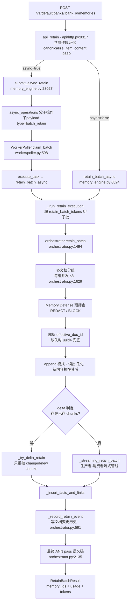
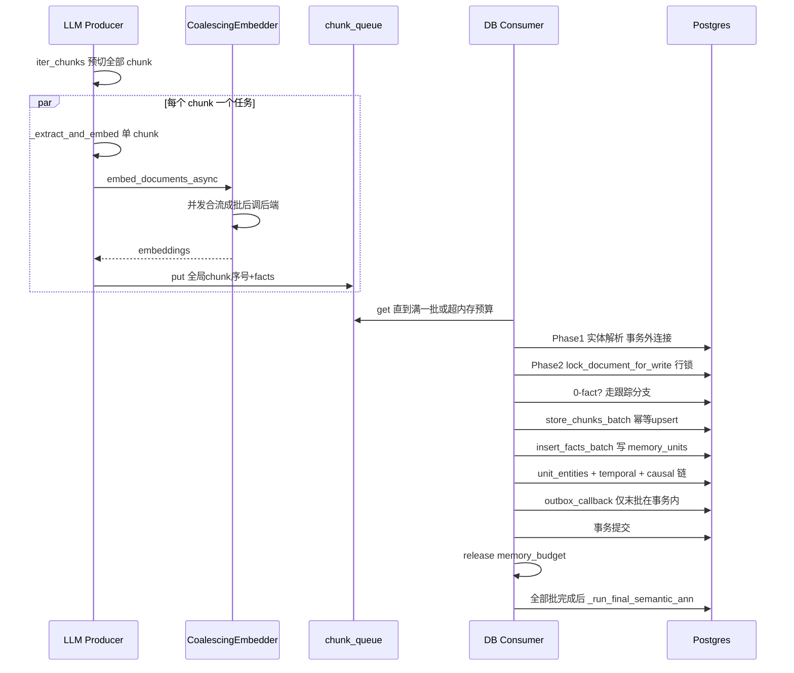
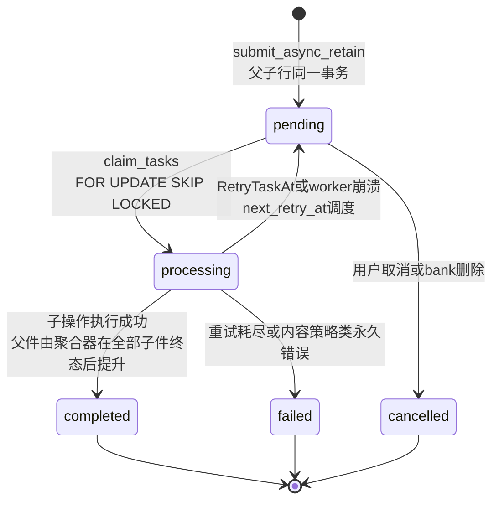

# 02 · Retain 摄取管线（庖丁解牛）

> 研究对象：`hindsight-api-slim/hindsight_api/engine/retain/` 及其入口链路。
> 代码基线：`b4a0da1e9`（2026-10-23，含 2026-10-21 发布的 v1.1.0）；本篇已随 1.1.0 增量更新（上一版基线 `5331da2f4`，即 v1.0.0；增量窗口 223 提交）。涉及本篇的变更：SQL 路径多文档扇出加界（#5740）、失败 chunk 不再替换整篇文档（#5589/#5753）、LLM key 被拒只失败一次不重放（#5644/#5749）、没有顶层 `facts` 列表的回复算错误而非 0 条事实（#5754/#5582）、store-owned 后端 delta 按文档序写 chunk id（#5920/#5919）、store-owned 与 PG 在 re-retain 标签与失败 re-retain 上对齐（#5796）、占位日期（year 1/9999）在读取与抽取处一律视为"未知"（#5820）并由迁移清理（#5922）、每文档变更历史（#5638/#5783）、per-bank 默认 observation scopes 与 tag glob（#5666/#5800）、embedding 调用进请求历史（#5835）、活跃请求抢在后台任务之前拿 LLM 槽（#5928）、worker 槽位释放即唤醒并容忍被删 schema（#5755/#5813）、markitdown 剥离 UTF-8 BOM（#5949）、delta 元数据事务死锁重试（#5752/#5784）及行号漂移。v1.0.0 那条"prose 回答视为无事实"的放宽（#5516）在发布后已整体回退（#5615），结论不变。
> 本文所有行号基于当前仓库快照（commit `b4a0da1e9`）。所有论断均给出 `相对路径:行号`，无法确认处明确标注"未确认"。

---

## 第 1 层【全景】：retain 是什么，在哪里

### 1.1 一句话定义

**Retain 是 Hindsight 的"写入侧"**：把一段（或一批）原始文本——对话记录、文章、JSONL 日志、上传文件——变成一批带向量、带时间、带实体、带图边的**结构化记忆单元（memory_units）**，并同步建好 document/chunk 两级索引和 temporal/semantic/causal 三类图链接。它是 recall（多路召回）、reflect（推理）、consolidation（把 facts 合成为 observation/心智模型）共同依赖的数据源；consolidation 产出的 `observation` 类型的 unit 也复用这张表，但那不是 retain 写的。本文所有路径都带 bank_id：**bank（记忆库）**是 Hindsight 的顶层隔离单元——一个 bank 拥有独立的记忆、实体、配置与任务队列，类似"一个大脑"，跨 bank 互不可见。

### 1.2 在整体中的位置

```
原始文本 ──retain──> documents / chunks / memory_units / entities / memory_links
                        │
                        ├──> recall    （4 路召回：semantic / BM25 / graph / temporal）
                        ├──> reflect   （读取记忆 + mental models 做推理）
                        └──> consolidation（facts → observations → 知识库文档）
```

retain 写库后触发的后续动作：`retain.completed` webhook（事务性 outbox，见 §3.9）、实体/图维护任务入队（`graph_maintenance`）、consolidation 任务等。这些属于本系列后续篇章（webhook/任务队列、consolidation）的模块，本文只标出边界。

### 1.3 核心文件地图

| 文件 | 职责 |
|---|---|
| `hindsight-api-slim/hindsight_api/api/http.py` | HTTP 入口 `POST /v1/default/banks/{bank_id}/memories`（`api_retain`，9317 行）与文件入口（`/files/retain`，9595 行起） |
| `hindsight-api-slim/hindsight_api/engine/memory_engine.py` | 引擎门面：`retain_batch_async`（6824 行）、`submit_async_retain`（23027 行）、子批切分 `_iter_raw_sub_batches`（1320 行）、任务执行器（4439 行 `_handle_file_convert_retain` 等） |
| `engine/retain/orchestrator.py` | **管线总指挥**（4631 行）：`retain_batch`（1494 行）、流式生产者/消费者（2510/3027 行）、delta retain（3772 行起） |
| `engine/retain/fact_extraction.py` | chunking（775 行 `iter_chunks`）+ LLM 抽取（prompt 模板 1066 行起、解析 2035 行 `_extract_facts_from_chunk`） |
| `engine/retain/entity_processing.py`（实体准备）+ `engine/memories/pg/entity_resolver.py`（解析/消歧；0.10.2 起从 `engine/entity_resolver.py` 迁入 memories 存储层） | 实体准备、解析与消歧 |
| `engine/retain/embedding_processing.py` / `embedding_coalescer.py` / `embedding_utils.py` | embedding 文本增强与批合并 |
| `engine/retain/link_creation.py` / `engine/memories/pg/links.py`（原 `engine/retain/link_utils.py`，0.10.2 迁入） | temporal/semantic/causal 链接创建 |
| `engine/retain/chunk_storage.py` / `fact_storage.py` / `engine/chunk_ids.py` | chunks/documents/memory_units 落库（0.10.2 起是薄封装，实际写表经 `engine/memories/` store 接口分发；documents/chunks 的 SQL 本体在 `engine/memories/pg/retain.py`） |
| `engine/retain/memory_budget.py` | 流式管线的字节预算 |
| `engine/retain/fold.py` | 队列上把同一文档的多次 append 合并成一次执行 |
| `engine/document_history.py` | **每文档变更历史**（292 行，v1.1.0 新增 #5638）：事件写在承载它的 operation 的 `result_metadata.document_events` 里；retain/re-retain 的写入点是 `orchestrator.py:591` 的 `_record_retain_event`，读端是 `GET /documents/{document_id}/history`（`http.py:7126`） |
| `engine/stored_dates.py` | **占位日期判定**（27 行，v1.1.0 新增 #5820）：year 1 / year 9999 是"开放边界"而非日期；retain 的 `parse_datetime_flexible`（`orchestrator.py:453`）、LLM 输出解析（`fact_extraction.py:3703`）与 HTTP 时间戳校验（`http.py:1283`）都以它为准 |
| `engine/retain/types.py` | 全部数据结构（`RetainContentDict`/`ExtractedFact`/`ProcessedFact`/`RetainBatchResult` 等） |
| `engine/parsers/` | 文件→markdown：markitdown / llama_parse / iris |
| `worker/poller.py` / `engine/task_backend.py` | 异步任务队列（认领/重试/折叠） |

### 1.4 触发方式：同步还是任务化？（必答验证项）

**结论：两条路径并存，由请求参数 `async` 决定；异步路径用 `async_operations` 表当队列，worker 认领执行；管线内部（同步与异步共用）另有一层"流式 mini-batch"。** 本节顺带核对一个常见印象——"retain 是按 mini-batch 落库的"。结论成立，但 mini-batch 其实有两层，职责不同：

1. **任务层（跨请求/跨进程）**：`async=true` 时，`api_retain` 调 `submit_async_retain`（`engine/memory_engine.py:23027`），按 token 预算把 items 打包成**子操作（child operation）**（`_split_contents_into_async_children`，`engine/memory_engine.py:1521`），父操作 + 子操作**同一事务**写入 `async_operations` 表（`engine/memory_engine.py:23205-23286`；子行 `operation_type='retain'`（23277 行）、task_payload 内 `"type":"batch_retain"`（23262 行），父行 `operation_type='batch_retain'` 且 task_payload 为 NULL——仅作状态聚合器）。`worker/poller.py` 的 `WorkerPoller` 轮询认领并执行（认领谓词与行号细节见 §3.9）；测试/内嵌场景用 `SyncTaskBackend` 内联执行（`engine/task_backend.py:95-124`）。
2. **管线层（单次 retain 内部）**：无论同步异步，进入 `orchestrator.retain_batch` 后都走 `_streaming_retain_batch`（`engine/retain/orchestrator.py:2510`）：预切的 chunks 由 **LLM 生产者**（2831 行起）并发抽取，经 `asyncio.Queue` 交给 **DB 消费者**（`_db_consumer`，2933 行起；每批写入 `_process_db_batch`，3027 行）按 `retain_chunk_batch_size`（默认 100，`config.py:1824-1826`）分批落库——注释原文："Even small documents go through the same path — they just end up as a single batch. This eliminates the maintenance burden of two separate retain code paths."（`engine/retain/orchestrator.py:2040-2042`）。

同步路径还有第三层粗切：提交总量超过 `retain_batch_tokens`（默认 10000 token，`config.py:1854`）时先按 token 数切成子批（`_run_retain_execution` 定义在 `engine/memory_engine.py:7347`；7445 行是 token 切分条件，带 `retain_session is None` 前置——store-owned 银行走 store 会话，不做本地子批切分）。子批默认**顺序执行**，但 `retain_subbatch_concurrency`（默认 1，`config.py:3827`/`5553`）可让同一文档的子批并发重叠 I/O。0.10.3 起这层循环在 operation 被取消/删除时**取消仍在飞的子批**（`for t in pending: t.cancel()`，`memory_engine.py:7604`，见 §3.11）。

---

## 第 2 层【主流程】：从 API 入口到落库

### 2.1 调用链总览

下图是从 HTTP 请求到落库结果的完整调用链，其中 MD（Memory Defense）/DOCID/APPEND/DELTA 均发生在 `orchestrator.retain_batch` 内部：



图末的"最终 ANN pass"：**ANN（approximate nearest neighbor，近似最近邻检索）pass**——用 pgvector 的 HNSW 索引为本 retain 产生的全部 unit 找语义近邻、补 `semantic` 链接，细节见 §3.6。`HIST` 那一步是 v1.1.0 新增（#5638）：事件写在本 retain 自己的 operation 行上，因此**同步 retain（没有 operation）不产生历史**（`orchestrator.py:602-604`）。

抽取之前还有一道扩展闸门（0.10.2 新增，per-caller tag scopes）：扩展可声明调用方的**写 tag 范围**（`OperationValidatorExtension.resolve_write_tag_scope`）——item tags、document_tags、retain 策略 entity_labels 可能加出的 tag、显式 `observation_scopes` 都必须落在范围内，越界 403，且在抽取**之前**检查、被拒的 retain 不烧 LLM 调用；对既有文档的 retain 还要求文档现有 tags 在读/写范围内（`_check_retain_writes`，`memory_engine.py:3674 起`，`#5048`）。v1.0.0 起（#5655）这道闸的拒绝路径还会**回收入口附件**：附件字节在 HTTP ingress 就已写入内容寻址存储，此前只有 operation validator 的拒绝会把它取回，紧随其后的写范围检查（不可写 tags、越界文档、越界 observation scopes、label tags）返回 403 后字节留在存储里、无任何行引用——现在异步路径的 `_check_retain_writes` 拒绝与同步路径一样走 `_discard_unreferenced_attachments`（`memory_engine.py:23076` 调用位）。

### 2.2 流式管线时序（生产者/消费者）



关键代码（生产者侧，`engine/retain/orchestrator.py:2831-2882` 摘录）：

```python
async def _extract_one(global_idx: int, chunk_text: str) -> None:
    source = contents[chunk_to_content[global_idx]] if contents else _default_content
    content = RetainContent(
        content=chunk_text,
        context=source.context,
        event_date=source.event_date,
        ...
    )
    from ..llm_trace import reset_call_metadata, set_call_metadata

    meta_token = set_call_metadata({"document_id": effective_doc_id})
    try:
        embedded = await _extract_and_embed(
            [content], llm_config, config, coalescing_embedder, ...
        )
    finally:
        reset_call_metadata(meta_token)
    ...
    chunk_bytes = estimate_chunk_bytes(processed, extracted, chunk_meta)
    await memory_budget.reserve(chunk_bytes)
    reserved_by_chunk[global_idx] = chunk_bytes
    await chunk_queue.put((global_idx, content, extracted, processed, chunk_meta, usage))
    all_pre_chunks[global_idx] = ""
```

逐点讲解：
- **每个预切 chunk 一个 `asyncio.Task`**（2884-2912 行为所有 chunk `create_task`，恢复重跑时已入库的 chunk 哈希在同一循环里直接跳过），并发的 LLM 请求数由**进程级 LLM 信号量**约束（默认 32：`config.py:1272` `DEFAULT_LLM_MAX_CONCURRENT = 32`；`engine/llm_wrapper.py:61-68`）。v1.1.0 起（#5928）这个信号量**优先服务活跃请求**：worker 在任务开头调 `mark_background_task()`（`worker/background.py:18`），`llm_wrapper._acquire_permits` 读到该标记就用 `sem.acquire(background=True)`（`engine/llm_wrapper.py:172-176`）把下一个空出的槽让给在等的 HTTP 请求——后台 retain 与 consolidation 仍然跑，只是在争用时排在交互请求后面。
- `_extract_and_embed`（1354 行起）= 单 chunk 的「LLM 抽取 → 文本增强 → embedding → `ProcessedFact` 转换」。
- **先 reserve 再入队**：`memory_budget.reserve(chunk_bytes)` 在 queue.put 之前，防止生产者跑得比消费者快导致事实堆积（2874-2878 行注释）。
- `all_pre_chunks[global_idx] = ""`：chunk 文本已复制进队列元素后立刻释放共享列表里的引用，45MB 文档峰值才压得下来（2879-2882 行注释；该内存优化动机的 `#3756` 标注现在散布 5 处，如 `orchestrator.py:2060、2604、2759、2772、2996`）。
- `set_call_metadata`：把本次 LLM 调用的 trace 绑定到 document_id，供控制台展示"这次 retain 产出了哪些记忆"。
- **第一个失败 chunk 就停（v1.1.0，#5589/#5753）**：生产者此前用 `asyncio.gather(*tasks, return_exceptions=True)` 收齐全部异常再统一处理，等于在已知要失败时还把所有 chunk 的 LLM 调用跑完；现在 `gather` 不带 `return_exceptions`——第一个异常即写入 `producer_error`，`finally` 取消其余抽取任务并关掉 coalescer（`orchestrator.py:2906-2930`）：

```python
            # Stop at the first failed chunk. The consumer commits nothing once
            # `producer_error` is set (#5589), so the remaining extractions would be
            # spend on results that are thrown away; the `finally` below cancels them.
            try:
                await asyncio.gather(*tasks)
            except Exception as exc:
                producer_error.append(exc)
```

消费者侧的批触发（`engine/retain/orchestrator.py:2971-3025` 摘录；v1.0.0 起 #5620 加了第三条触发条件，v1.1.0 起 #5589 加了失败丢弃分支）：

```python
        while True:
            # With an open batch, also wake when the producer blocks on the budget: that batch
            # may be what it is waiting on, and it can't send the next item until it is
            # written (#5296).
            item = await memory_budget.next_item_or_producer_waiting(chunk_queue) if batch else await chunk_queue.get()
            if item is None:
                # Process any remaining items
                if batch and not pipeline_aborted[0] and not producer_error:
                    ...
                break

            producer_waiting = item is PRODUCER_WAITING
            if not producer_waiting:
                batch.append(item)
                batch_bytes += reserved_by_chunk.get(item[0], 0)

            # Write on whichever comes first: the configured chunk count, an open batch
            # heavy enough that holding more would crowd out the producer (#3756), or a
            # producer already blocked on the budget with nothing left queued (#5296). The
            # count alone let a batch of fact-dense chunks grow far past any memory a
            # worker was sized for.
            if producer_waiting or len(batch) >= chunk_batch_size or memory_budget.should_flush(batch_bytes):
                if pipeline_aborted[0] or producer_error:
                    # Another request took over the document, or a chunk failed to
                    # extract — discard this batch. Committing after a failed chunk
                    # replaces the document (its first write deletes the previous
                    # memories) with a version the retain is about to report as
                    # failed (#5589).
                    log_buffer.append(
                        f"[streaming] Consumer: discarding batch of {len(batch)} chunks "
                        f"({'a chunk failed to extract' if producer_error else 'pipeline aborted due to concurrent takeover'})"
                    )
                    _release_batch(batch)
                    batch = []
                    batch_bytes = 0
                    continue
                await _process_db_batch(batch, consumer_batch_idx, is_last=False)
                consumer_batch_idx += 1
                chunks_committed += len(batch)
                await _emit_chunk_progress()
                _release_batch(batch)
                batch = []
                batch_bytes = 0
```

逐点讲解：
- 三阈值：**chunk 计数**（默认 100，`config.py:1824`）、**字节预算过半**（`memory_budget.should_flush`，`engine/retain/memory_budget.py:167-177`：`batch_bytes * 2 >= limit_bytes`，留另一半给生产者），以及 v1.0.0 新增的**生产者阻塞信号**（#5620/#5296）：消费者手持一个开放批、队列已空、而生产者正被内存预算卡住等额度——这个批可能正是生产者在等的那块内存，消费者若继续 `await queue.get()` 死等下一个 item 就是双输死锁（一个小的开放批 + 一个大的下一 chunk 会互相等）。`RetainMemoryBudget` 现在用 `_waiters` 计数 + `_producer_waiting` 事件把"reserve 被卡"广播出来（`memory_budget.py:123-124` 置位在 135-154），消费者的 `next_item_or_producer_waiting`（`memory_budget.py:179-203`）让"空队列的 get"与"预算信号"赛跑；**队列里还有 item 时不参与**——正常合批行为完全不变，只有"下一件事就是挂死"的场景才会提前落盘。
- **两条丢弃路径**：`pipeline_aborted`（文档被并发请求接管、content_hash 失配，3381-3398 行，置位在 3397）与 v1.1.0 新增的 `producer_error`（有 chunk 抽取失败）。两者都只丢弃手持批、不再提交。`producer_error` 这条是 #5589 的实质：消费批的第一次写会先删掉文档上一版记忆，若在"某 chunk 已失败、整次 retain 注定报失败"之后继续提交，文档就被替换成了一份残缺内容、而操作状态是 failed——旧记忆没了、新记忆不全。现在失败后一个批次都不写，文档保持原样，交 worker 重试（post-loop 的末批收尾同样带 `not producer_error` 条件，2980-2982 行）。
- `_release_batch` 在**写入提交之后**才归还预算——排队期间事实仍驻留内存，提前归还会让生产者挤占还在用的内存（定义 2941-2950 行，提交后调用在 3023）。
- 图中"0-fact？走跟踪分支"：某个消费批一个 fact 都没有时，若是首批仍要走文档跟踪（锁 `documents` 行、写入文档行，确立所有权防并发交错），后续批则直接跳过（0-fact 分支现展开为 per-batch 3088-3170 与 post-loop 3567-3625 两处）。

### 2.3 异步操作状态机



状态依据：INSERT 默认 `status='pending'`（子操作 INSERT `engine/memory_engine.py:23268-23286`：子行 `operation_type='retain'`（23277 行）、task_payload 内 `"type":"batch_retain"`（23262 行）；父行 `operation_type='batch_retain'` 且 task_payload 为 NULL，仅作状态聚合器，worker 不直接执行）；认领置 `'processing'`（`engine/db/ops_postgresql.py:1967`）；重试回到 `'pending'` 且 `retry_count+1`（`worker/poller.py:1086-1101`）；终态由 `_mark_completed`（937 行）与 `_mark_failed`（953 行）写入。子操作执行成功即自身 `'completed'`（`worker/poller.py:937` 的 `_mark_completed`，"then propagate to parent if needed"）；全部子件终态后由聚合器提升父操作（提升语义注释见 `worker/poller.py:1749` 起的 `_reconcile_orphaned_parents`；`engine/db/ops_postgresql.py:1481, 1541` 只认 `completed/failed/cancelled`）。

两条 v1.1.0 的 worker 行为改动直接落在这张图上：

- **槽位一空就重新认领（#5755）**：空闲轮询不再只等 `poll_interval_ms` 或关停信号，而是同时等一个 `_slot_freed` 事件（`worker/poller.py:434` 定义，任务收尾时置位 1212 行，轮询循环 1964-1968 行 `asyncio.wait(..., FIRST_COMPLETED)`）。此前一个任务结束时，空出的槽位要睡完整个轮询间隔才会被填上；现在立刻回填。**新提交刻意不唤醒轮询**——等待期正是让重复的 refresh/consolidation 提交折叠进同一个 pending 操作的前提。
- **operations 表被删则丢任务而非拖垮 worker（#5813）**：终态写失败时，先判断"是不是这张表真的没了"（`_is_missing_relation`，`worker/poller.py:237-248`；随后实际读一次 `async_operations` 确认，`_operations_table_dropped`，1469-1487 行）。确认删除就放弃这次状态写、继续跑；否则照旧重试到 `TERMINAL_WRITE_DEADLINE_S` 再自杀重启。此前租户 schema 在任务执行期间被删，worker 会为一个永远写不进的终态耗满 300 秒然后把整个进程带走。

### 2.4 贯穿例子一：一段对话走完主流程（示例数据，字段名与代码一致）

输入（一次 retain 请求，`async=false`）：

```json
{
  "items": [{
    "content": "[{\"role\":\"user\",\"content\":\"我们决定采用 PostgreSQL 而不是 MongoDB，因为团队更熟悉关系型数据库。\"},{\"role\":\"assistant\",\"content\":\"好的，我已把项目数据库迁移到 PostgreSQL 16，并写好了 Alembic 迁移脚本。\"},{\"role\":\"user\",\"content\":\"不过迁移时发现连接池超时，改成 pool_size=20 才解决。\"}]",
    "context": "工程团队的日常工作对话",
    "timestamp": "2026-10-01T09:00:00Z",
    "document_id": "conv-1024"
  }],
  "async": false
}
```

逐步追踪（每一步的形态均为"示例"）：

1. **HTTP 层**（`api/http.py:9396-9443`）：content 是字符串直接进 `content_dict`；`timestamp` → `content_dict["event_date"]`；`document_id` → `content_dict["document_id"]`。得到 `contents_dicts = [{"content": "...", "context": "...", "event_date": "2026-10-01T09:00:00Z", "document_id": "conv-1024"}]`。v1.1.0 起时间戳在请求模型层就先拒掉 year 1/9999（`MemoryItem.validate_timestamp`，`http.py:1282-1287`；文件入口另有 `FileRetainMetadata` 的同名校验，1360-1373 行），不必等到写库才炸。
2. **retain_batch_async**（`memory_engine.py:6824`）：sanitize（去 NUL/孤立代理，6950 行）、校验 append 合法性、token 总量低于 `retain_batch_tokens` → 不切子批，单次进入 `_run_retain_execution`（7347 行；调用点 7008 行），后者经 `_retain_batch_with_append_retry`（8017 行）把调用委派给 orchestrator。
3. **retain_batch**（`orchestrator.py:1494`）：`_build_contents`（4507 行）把 dict 转成 `RetainContent`，`event_date` 三分支处理：键存在且为 None → 保持 None，有值 → 解析，键缺失 → `utcnow()`（4513-4518 行）；本例只提交一个 item，不触发多文档分组（1573-1690 行；触发条件见 §3.9）。
4. **chunking**（`iter_chunks`，`fact_extraction.py:775` 起）：内容能 `json.loads` 成 dict 列表 → 判定为对话，走 `_iter_conversation_chunks`（889 行）按 **turn 边界**打包。三个 turn 序列化后约 300 字符 << `retain_chunk_size`（默认 3000 字符，`config.py:1803`）→ **1 个 chunk**（chunk_index=0）。`chunk_to_content=[0]`。
5. **生产者抽取**（`_extract_facts_from_chunk`，`fact_extraction.py:2035`）：prompt = `CONCISE_FACT_EXTRACTION_PROMPT`（模板本体 `_BASE_FACT_EXTRACTION_PROMPT` 在 1066-1181 行；1188 行经 `.format()` 生成 concise 版）+ 用户消息（`_build_user_message`，1825 行，含 `Chunk: 1/1`、`Event Date: Thursday, October 01, 2026`、`Context: 工程团队的日常工作对话`）。LLM 结构化输出（response_schema=`FactExtractionResponse`，311 行）。v1.1.0 起 prompt 还多一条：开放式事件（"since forever"、"仍在进行"）只写文本给出的那一端，**绝不**用 0001/9999 之类的占位年份（`fact_extraction.py:1315-1316`，动机见 §3.3/§3.4）。**LLM 返回（示例）**：

   ```json
   {"facts": [
     {"what": "团队决定采用 PostgreSQL 而非 MongoDB", "when": "N/A", "where": "N/A",
      "who": "user（工程团队）", "why": "团队更熟悉关系型数据库",
      "fact_kind": "conversation", "fact_type": "world",
      "entities": ["user", "PostgreSQL", "MongoDB"]},
     {"what": "助手将项目数据库迁移到 PostgreSQL 16 并完成 Alembic 迁移脚本", "when": "N/A", "where": "N/A",
      "who": "assistant", "why": "响应用户的选型决定",
      "fact_kind": "conversation", "fact_type": "assistant",
      "entities": ["assistant", "PostgreSQL", "Alembic"],
      "causal_relations": [{"target_index": 0, "relation_type": "caused_by"}]},
     {"what": "数据库连接池超时通过设置 pool_size=20 解决", "when": "N/A", "where": "N/A",
      "who": "user", "why": "N/A",
      "fact_kind": "conversation", "fact_type": "world",
      "entities": ["user", "PostgreSQL"]}
   ]}
   ```
6. **解析为 Fact**（2253-2465 行）：`fact_type` 映射 `"assistant"→"experience"`、`"world"→"world"`（2253-2261 行）；组合文本 `what | When: ... | Involving: ... | why`（2272-2289 行；"N/A" 等占位值在解析时视为空字段、不参与拼接——`get_value` 把 "N/A"/空串过滤为 None，见 `fact_extraction.py:2216-2221`，label 实体的同类过滤在 64-90 行）。**得到（示例）**：
   - `fact_text = "团队决定采用 PostgreSQL 而非 MongoDB | Involving: user（工程团队） | 团队更熟悉关系型数据库"`，`fact_type="world"`
   - `fact_text = "助手将项目数据库迁移到 PostgreSQL 16 并完成 Alembic 迁移脚本 | Involving: assistant | 响应用户的选型决定"`，`fact_type="experience"`，`causal_relations=[CausalRelation(relation_type="caused_by", target_fact_index=0)]`
   - `fact_kind=="conversation"` → 不设置 `occurred_start/end`（2292-2300 行只在 event 分支处理）；即便模型给了日期，`_parse_datetime` 也会把 year 1/9999 的占位值转成 None（`fact_extraction.py:3703-3716`）
7. **时间偏移**（`_add_temporal_offsets`，`fact_extraction.py:3743-3762`；`SECONDS_PER_FACT = 0.01`，2840 行）：`mentioned_at = 2026-10-01T09:00:00+00:00`、`+0.01s`、`+0.02s`——同一文档内事实的时间顺序靠毫秒级偏移保留。
8. **embedding**（`_extract_and_embed`，`orchestrator.py:1354`；`augment_texts_with_dates`，`embedding_processing.py:15-46`）：送入向量模型的文本（示例）= `"团队决定采用 PostgreSQL 而非 MongoDB ... (happened in October 2026) [user, PostgreSQL, MongoDB]"`——注意两处日期格式不同：embedding 增强日期**只到月**（`_format_readable_date` 返回 `"%B %Y"`，`memory_engine.py:6717` 起），prompt 内日期才**带日**（`%A, %B %d, %Y`，`fact_extraction.py:1848`，见第 5 步）——**日期和实体名进向量、不进库**，库里的 `text` 列存原始 `fact_text`（`engine/memories/pg/writes.py:77` 只写 `fact_texts`）。
9. **Phase 1 实体解析**（事务外，`_pre_resolve_phase1` 在 `orchestrator.py:673` 定义、3190 行调用 → `entity_resolver.py:804` trigram 策略）："PostgreSQL" 经 pg_trgm 索引找到库内既有实体（假设上次 retain 已建）→ 评分（§3.5）命中，返回 `ResolvedEntity(entity_id=<uuid>, canonical_name="PostgreSQL")`；"MongoDB"/"Alembic" 无候选 → 新建：resolver 调 `self._ops.bulk_insert_entities`（`INSERT ... ON CONFLICT DO NOTHING`，SQL 在 `engine/db/ops_postgresql.py:381`），冲突后兜底 SELECT `fetch_missing_entity_ids`（1433-1448 行调度，SQL 在 ops 层 415）。

   > 白话：**trigram（三元组）相似度**——把字符串拆成 3 字符片段、比较两串共享片段的占比；pg_trgm 是 Postgres 的对应扩展，GIN 是其配套索引类型。**LATERAL** 是"对每一行执行一次子查询"的 join 形式（本文多处用到）。
10. **Phase 2 写事务**（`orchestrator.py:3204-3444`）：
    - `lock_document_for_write` 拿 `documents` 行锁 + `'__pending__'` 初始 hash（3328-3333 行；0.10.2 起经 store 接口 `_ext_provider.lock_document_for_write` 调用，PG 后端内部仍是 upsert + `RETURNING`）；
    - 首批做 document tracking：旧文档不存在 → 直接插入 `documents` 行（`handle_document_tracking`，`fact_storage.py:192`；调用点 `orchestrator.py:3342` 起）；
    - `store_chunks_batch`：`chunk_id = build_chunk_id("my-bank","conv-1024",0)` = `"my-bank_conv-1024_0"`（`engine/chunk_ids.py:57-65`；bank_id/document_id 中含 `_`/`~` 时用 `~` 转义保证可逆）；
    - `insert_facts_batch` → `memory_units` 批量 INSERT，`id` 由数据库 `gen_random_uuid()` 生成（`alembic/versions/5a366d414dce_initial_schema.py:268`），INSERT 不含 id 列（`engine/db/ops_postgresql.py:181` 起的 `insert_facts_batch`；retain 侧的 `fact_storage.insert_facts_batch` 现在是 store 接口薄封装）；store-owned 路径用 `insert_facts_batch(..., defer_index=True)` 先铸 id 再写入（`fact_storage.py:66-103`；PG store 的 INSERT 本身就是铸 id，`defer_index` 只对非 SQL 的 store 实现有意义）；
    - `unit_entities` 批量插入（经 store 接口 `record_unit_entities`，`engine/memories/postgres.py:831`；resolver 调用点 `entity_resolver.py:1610-1618`）+ `entity_cooccurrences` 累积（`entity_resolver.py:1635-1660`，UPSERT 在 `flush_pending_stats` 的 580-590 行）；
    - temporal 链（867 行）、causal 链（896 行）；semantic 链在流式模式下跳过（`skip_semantic_links=True`，3439 行）留到最终 ANN。
11. **最终 ANN pass**（3677 行调用 → `_run_final_semantic_ann`，2135-2231 行）：对本 retain 产生的全部 unit 以 1000 个/批、最多 4 并发（`_ANN_PARALLELISM`，2132 行）跑 pgvector ANN，`top_k=20`、阈值 `semantic_link_min_similarity`（默认 0.7，`config.py:1424`），落 `("semantic", similarity)` 链（`engine/memories/pg/links.py:663`）。0.10.3 起该 pass 对"自己派生语义链接的 store"整体跳过（`derives_semantic_links_internally_for`，3673 行）——store-owned 的 unit 根本不在 `memory_units`，白查一张空表。
12. **响应**：`RetainResponse{success:true, async:false, usage:{...}}`（`http.py:9527`）；`retain.completed` webhook 经 outbox 投递（`memory_engine.py:5322` 的 `WebhookEventType.RETAIN_COMPLETED`；`webhooks/models.py:11-15`）。v1.0.0 起（#5675）这个 usage 是**逐字段**聚合的——cached prompt tokens 与 thinking/reasoning tokens 不再在途中丢零：同步 retain 的总量改用 `TokenUsage` 自己的 `+`（此前 HTTP 层手工重建 `TokenUsage(input/output/total)`，cached/thinking 恒为 0）；batch API 的抽取用量改为按**活调用同一条路**解析 provider 的 usage 块（`visible_token_usage`，`fact_extraction.py:3390-3393` 的 `from ..providers.openai_compatible_llm import visible_token_usage`——导入也被 #5686 延迟到用到处，进程启动不再为它加载 openai SDK）。

**落库后的数据形态（示例）**：

| 表 | 行（示例） |
|---|---|
| `documents` | `id="conv-1024"`, `original_text=<拼接全文>`, `content_hash=<sha256>`, `retain_params={"context":"工程团队的日常工作对话"}` |
| `chunks` | `chunk_id="my-bank_conv-1024_0"`, `chunk_index=0`, `content_hash=<sha256(chunk)>` |
| `memory_units` | 3 行：`id=<uuid>`, `text=<组合fact文本>`, `embedding=<vector>`, `fact_type IN {'world','experience'}`, `event_date/occurred_*`, `chunk_id`, `document_id`, `tags` |
| `entities` | "PostgreSQL"（复用），"MongoDB"、"Alembic"、"user"、"assistant"（新建） |
| `unit_entities` | (unit0→user,PostgreSQL,MongoDB), (unit1→assistant,PostgreSQL,Alembic), (unit2→user,PostgreSQL) |
| `memory_links` | temporal：unit0↔unit1↔unit2（同窗口）；causal：unit1 --caused_by--> unit0；semantic：最终 ANN 补齐 |

### 2.5 贯穿例子二：同一文档的第二次 retain → delta（示例）

三天后对同一 `document_id="conv-1024"` 重新提交整份文档（`update_mode` 缺省 = replace，即调用方重发文档的**当前全文**）。设这三天里对话经多次 append 已增至 4 个 chunk（0-3）；本次重提交又增写了一节，新全文切出 5 个 chunk（0-4）。走 `_try_delta_retain`（`orchestrator.py:3772`）：

1. 读取已存 chunks 的 `content_hash`（store 接口 `load_document_chunks`，`orchestrator.py:3869` 调用，SQL 在 `engine/memories/pg/retain.py:138`；抽取前新鲜度复查另有 `load_existing_chunks`，调用在 4052 行，SQL 在 pg/retain.py:53）；
2. 用**同一 chunker**（`_chunk_contents_for_delta`，4536-4565 行，必须读同一个 resolved config，否则边界漂移会让"每个 chunk 都像变了"）重切新全文，逐块 `compute_chunk_hash`（sha256，`chunk_storage.py:18-20`）；
3. `_classify_chunk_diff`（3753-3769 行）分类（示例结果）：`unchanged=[0,1]`（哈希相同）、`changed=[2,3]`、`new=[4]`、`removed=[]`——diff 分类是**按索引**对齐的。注意 `removed` 的生成规则：每个新索引必落入 unchanged/changed/new 之一，`removed` 只能是"超出新键集的旧尾部索引"（`_chunk_contents_for_delta` 给新 chunk 分配连续 0..N-1 索引），即重提交使文档**变短**时才出现——若这次删去末尾一节、全文只切出 3 个 chunk，则 `removed=[3]`。两侧索引都连续时 `new` 与 `removed` 不会同时出现（前者要求新文本更长、后者要求旧文本更长）；
4. **超大文档的断点续写让路（v1.0.0，#5676）**：若已存文档**整体正文哈希等于本次提交的 body 哈希、但部分 chunk 哈希不同**——即一次切了片的超大 retain 在半路被中断、现在带着同一 body 重试（`document_body_hash` 由提交侧传入，orchestrator.py:3973 判定）——delta **主动让路**（返回 None 走流式）：delta 会把整份文档所有未写 chunk 一次性抽出、最后一个 commit 才落库，重试会把成百上千个 LLM 调用一次排进队列、且再次中断就全部丢失；流式路径的恢复探针匹配同一哈希、按已提交 chunk 跳过，逐片续写（日志原文 "resuming slice by slice"，3974-3977 行）。
5. 只对 `changed+new` 构造 delta contents 重新抽取（3999 行 `_build_delta_contents`，定义在 4565 行），`unchanged` 的 chunks/facts/links 原样保留；`removed` 的 chunks 在写事务里删除并级联清理 links（`chunk_storage.delete_chunks_by_ids`，`chunk_storage.py:45`，含观察清扫 `delete_stale_observations_for_memories` 与图维护入队）；
6. 写事务内再次 `FOR UPDATE` 校验 `content_hash` 与加载时一致，不一致 → 放弃 delta 回退流式全量（4183 行起）。
7. **store-owned 的 delta 是另一条写路径**（`_delta_store_owned_write`，`orchestrator.py:1167`）：没有 `documents` 行可锁，靠 `put_document(expect_content_hash=...)` 做内容哈希 CAS。v1.1.0 修了两处（#5920/#5796）——chunk id 必须按**文档位置**而不是 delta 内位置生成（1234-1247 行；否则第一个以外的 changed chunk 写出的 fact 没有 chunk_id，下次重发替换不掉），以及未被重写的 `unchanged` chunk 上的 memory 要在写完后补一次 relabel（1324-1341 行；否则同一文档里"chunk 有没有变"会决定记忆的 tags，SQL 路径没有这个分歧）。详见 §3.10。

delta 的价值：重提一个几乎没变的文档时，LLM/token 花费只跟**变化量**成正比；且全量 replace 会孤儿化或摧毁站在旧 facts 上的 observation（`orchestrator.py:1261-1266` 注释引 `#3294`），delta 避免了这一点。走完 delta（或流式全量）之后，`retain_batch` 统一调 `_record_retain_event`（`orchestrator.py:2034`/`2121`）把这次变更记到 operation 的 `result_metadata.document_events` 上：`kind` 由 `force_reextract`/`update_mode` 决定为 `reprocess`/`append`/`retain`，`facts_added` 取返回的 memory_ids 总数、`facts_removed` 取观察清扫扫掉的 facts 数、`observations_removed` 记观察 id 样本（上限 100 条，`document_history.py:44-45`）。

---

## 第 3 层【机制深潜】

### 3.1 粒度体系与 ID 生成（必答问题 1）

retain 把文本切成三个粒度，各自 ID 来源如下：

| 粒度 | 数据结构 | ID 生成 | 代码 |
|---|---|---|---|
| **document** | `documents` 行 + store-owned 文档记录 | 调用方提供 `document_id`；缺失时取 per-item 唯一值；再缺省则 `str(uuid.uuid4())`；**混合请求**（部分 item 带、部分不带 document_id）中不带者各自生成独立文档、绝不并入带 id 者的文档（#5235，分组见 3.9）；重试时从 `async_operations.result_metadata.document_ids[0]` 恢复 | `orchestrator.py:1788-1813` |
| **chunk** | `chunks` 行 | `build_chunk_id(bank_id, document_id, chunk_index)` → `f"{escape(bank)}_{escape(doc)}_{index}"`，`~` 转义 `_`/`~` 保证三段可逆解析（`#4244`） | `engine/chunk_ids.py:57-65` |
| **unit（memory_units）** | `memory_units` 行 | 数据库默认 `gen_random_uuid()`（INSERT 不写 id）；store-owned 路径用 `insert_facts_batch(..., defer_index=True)` 先铸 id 再写入 | `alembic/.../5a366d414dce_initial_schema.py:268`；`fact_storage.py:66-103` |

chunk_index 是**文档全局序号**：超长单 item 被切成多个顺序子批时靠 `chunk_index_offset` 续号，否则后到子批的 `chunk_id` 撞车、覆盖前面的 chunks（`orchestrator.py:1530-1540` 注释引 `#1888`；切分与 offset 在 `memory_engine.py:7515-7530` 与 7650 行）。chunking 保证**幂等**：`chunk_text` 对自己产出的 chunk 再切一遍结果不变，否则 delta 的哈希比对会全部失配（`fact_extraction.py:859-863` docstring，`#2301`）。

### 3.2 chunking 策略（`fact_extraction.py:775` 起）

`iter_chunks` 按内容形态分派。分派前的入口处先做一次解码消毒（807-814 行，`#4577`）：对话判定走 `sanitize_value(json.loads(text))`——`json.loads` 会把 JSON 转义里的半码代理对（`\ud83d`，半个 emoji）变成真的孤立代理字符，而对话 chunk 随后会原样再序列化，进而炸掉 chunk 哈希、embedding 和写入的每一次 UTF-8 编码，所以在解析时统一消毒一次。

1. **图片占位符**（`attachment_content.contains_attachment`）：`_iter_image_aware_chunks`（694 行）——文本按字符预算，图片按 `retain_max_attachments_per_chunk`（默认 8，`config.py:1846`）计数，图片与引出它的正文尽量同 chunk；
2. **JSON 对话数组**：`_iter_conversation_chunks`（889 行）按 turn 边界打包，单 turn 超限在 `min(structured_limit, max_chars)` 内按句子碎片化（919-930 行）；
3. **单个 JSON 对象**：整体保留到 structured 上限，否则按文本切（821-832 行，`#2301`）；
4. **JSONL**：`_looks_like_jsonl`（974 行）判定 ≥2 行且每行是 JSON 对象 → `_iter_jsonl_chunks`（993 行）按行打包；
5. **纯文本**：`_iter_recursive_splits`（608 行）——langchain `RecursiveCharacterTextSplitter` 的惰性等价实现，分隔符优先级 `\n\n → \n → ". " → "! " → "? " → "; " → ", " → 空格 → 逐字符`（564-577 行），贪心装箱；注释明言**边界必须与 langchain 完全一致**，因为边界就是 delta 的哈希锚点（618-622 行）。

默认参数：`retain_chunk_size=3000` 字符（`config.py:1803`）、`retain_chunk_batch_size=100` chunks/消费批（`config.py:1824-1826`，注释估"每 chunk ~17 facts，100 chunks ≈ 1700 facts/批"）。

### 3.3 LLM 抽取：prompt、模式与 fact 类型判定（必答问题 2）

**模式**（`config.py:1818-1819`，`RETAIN_EXTRACTION_MODES`）：`concise`（默认）/ `verbose`（遗留）/ `custom`（银行自定义指令）/ `verbatim`（原文入库、LLM 只抽元数据）/ `chunks`（**完全不调 LLM**，每个 chunk 原文成一条 unit，`fact_extraction.py:3549` 起）。LLM provider 为 `none` 时强制 chunks 模式（`memory_engine.py:7933`，0.10.2 起同时关掉 `enable_observations`）。

**系统 prompt 骨架**（`_BASE_FACT_EXTRACTION_PROMPT`，`fact_extraction.py:1066-1181`）：选择性（"only extract facts worth remembering long-term"）→ 五维格式（what/when/where/who/why）→ 指代消解（"my roommate"+"Emily" → "Emily (user's roommate)"）→ 分类 → 时间处理 → 实体规则。时间处理在 v1.1.0 补了一条**开放边界**规则（#5820）：粗粒度日期仍展开成整段（1307-1316 行，"in 2015" → 整年、"in March 2026" → 整月），但仍在进行、没有结束时间的事件只写文本给出的那一端，明令 "NEVER write a placeholder year such as 0001 or 9999"（1315-1316 行）——占位年份在 Postgres 里会变成 `infinity`，retain 的 temporal 链 SQL 一旦做减法就直接报错。语言规则是一行式（`_DEFAULT_LANGUAGE_RULE` 常量，1061 行）：`"LANGUAGE: Write every fact in the same language and script as the input text. Never translate. Names, identifiers, code, and quoted text stay verbatim."`——注释记录了旧版"先检测语言再照做"两步式在 gpt-5.6-luna 上造成 18% 法语/俄语事实的事故。

**fact_type 的判定链**（prompt 输出 → 存储）：

- prompt 要求 `Literal["world", "assistant"]`（`ExtractedFact.fact_type`，`fact_extraction.py:286`）：world=客观/外部事实（**含用户偏好、规则、纠正、约束，即使在对话中说出**）；assistant=agent 自己做的动作。
- 解析时映射到存储枚举（2253-2262 行，batch API 路径 3233-3242 行同构）：

```python
raw_fact_type = llm_fact.get("fact_type")
if raw_fact_type == "assistant":
    fact_type = "experience"
elif raw_fact_type == "world":
    fact_type = "world"
else:
    raw_fact_kind = llm_fact.get("fact_kind")
    fact_type = "experience" if raw_fact_kind == "assistant" else "world"
```

即：**存储枚举是 `world` / `experience`**（数据库 CHECK 为 `fact_type IN ('world','experience','observation')`，`alembic/versions/g2h3i4j5k6l7_remove_opinion_fact_type.py`；`observation` 由 consolidation 写入）。`fact_type_override` 参数可整体覆盖（`orchestrator.py:1398-1400`）。

- `fact_kind`（`event`/`conversation`，283 行）决定时间字段：event 才有 `occurred_start/end`；缺失时用正则从"yesterday/last week…"相对 `event_date` 推断（`_infer_temporal_date`，97-134 行，覆盖 last night/yesterday/tomorrow/last week/last month 等）。粗粒度日期展开为整段（"in 2015" → 全年），prompt 与实现一致（1307-1316 行）；模型给出 year 1/9999 的占位值时，`_parse_datetime` 在解析处就把它归为 None（3703-3716 行）。

**占位日期为什么必须当"未知"（v1.1.0，#5820/#5922）**：year 1 / year 9999 不是谁真想要的日期，而是模型或导出写"since forever / still ongoing"的方式。留着它会出两类事故：Postgres 把 `datetime.min/max` 存成 `-infinity`/`infinity`，asyncpg 读回来**不带时区**（有限值都带），于是这一行上的任何日期比较/运算都不一致；而 retain 的 temporal 链查询正是在 SQL 里做 `event_date` 减法，PostgreSQL 16 及更早会直接以 "cannot subtract infinite timestamps" 失败，把整次 retain 拖垮。所以每个日期入口都判它：`stored_dates.is_placeholder_date`（`engine/stored_dates.py:14-16`，判定 `value.year in (MINYEAR, MAXYEAR)`）被 `parse_datetime_flexible`（`orchestrator.py:474-476`，抛 `ValueError`）、LLM 输出解析（`fact_extraction.py:3715`）与 HTTP 请求模型（`http.py:1282-1287`）共用。存量数据由迁移 `c7e2f9a4d1b8_clear_placeholder_memory_dates.py` 清理：只把 `event_date` 置 NULL（`event_date < '0002-01-01'` 或 `>= '9999-01-01'`，两个索引区间探测），刻意**不扫**另外三个日期列——它们的索引不以该列打头，为一个 bank 里少数几行去整表扫一遍不划算（#5922 把这版 `UPDATE` 从四列收窄到一列）；PG-only，Oracle 没有无限时间戳，Python 读取侧已统一忽略。不可逆：占位值本身没携带可还原的日期。

**组合 fact 文本**（2272-2289 行）：`" | ".join([what, "When: "+when, "Involving: "+who, why])`，非空维才拼。

**默认 observation 口径（v1.1.0，#5666/#5800）**：抽取收尾时，retain 从未声明 `observation_scopes` 的 fact 会被盖上**该 bank 的默认值**（`_apply_default_observation_scopes`，`fact_extraction.py:3770-3781`；两条抽取路径都在 `_inject_label_tags` 之后调用，3441/3663 行）。默认值来自 `HINDSIGHT_API_DEFAULT_OBSERVATION_SCOPES`（可 per-bank 覆盖，`config.py:1953` 的 `DEFAULT_DEFAULT_OBSERVATION_SCOPES` 默认 None，即沿用 `combined`）。**盖在存储的记忆上、而不是在 consolidation 时才解析**——这样以后改默认值，不会追溯性地把已按旧口径存下的记忆重新分组。默认口径里可以写 tag glob（如 `[["topic:*", "user:*"]]`），匹配的是记忆自己的 tags（含 retain 时由 entity labels 加上的那些）。

**说话人归因（narrator）**：`_build_user_message` 有 `narrator_section`（1857-1873 行）。真实代码（`engine/retain/fact_extraction.py:1857-1873`，摘录）：

```python
    narrator_section = ""
    if agent_name:
        narrator_section = (
            f"\nNarrator: {agent_name} (the AI agent whose memory this is). By default, "
            f'first-person statements like "I did X" are {agent_name}\'s own actions → classify as '
            f'"assistant".'
        )
        # Only defer to the Context when one was actually provided — otherwise this
        # clause points at a "Context: none" line and just adds noise.
        if context:
            narrator_section += (
                " BUT the Context above takes precedence: if it identifies a different "
                "first-person speaker (e.g. a user or customer in a transcript), attribute those "
                'statements to that speaker and classify them as "world", not "assistant".'
            )
```

逐点讲解：
- 归因规则是**默认 + 覆盖**两段式：第一人称默认算 agent 自己的动作（assistant/experience）；context 若指认别的说话人（ transcript 里的用户/客户）则改判 world。
- 但**retain 主链路从不传 agent_name**：`_extract_and_embed` 的注释（`orchestrator.py:1371-1378`）明确 "No narrator: extraction takes none from this path at all"——曾经的 "Narrator: {bank.name}" 把项目/租户名（如 `AuditProject_0825`）逐字漏进事实文本（`#3962`），已废除；想指认说话人应在 item 的 `context` 里说。
- `mentioned_at` 取 `event_date`，但调用方显式放弃时间戳时为 `None`（2403 行：`fact_data["mentioned_at"] = event_date.isoformat() if event_date is not None else None`，注释 "or None when the caller opted into no timestamp"）；入库 `event_date` 列取 `occurred_start or mentioned_at`（`engine/memories/pg/writes.py:81-83`，注释 81-82 行、赋值 83 行）。

### 3.4 解析健壮性：三层重试、纠错重问与自动切半

`_extract_facts_from_chunk` 的防御纵深：

- **外层内容重试**：`outer_attempts = llm_max_retries + 1`（2118 行，N+1 约定，`#2731`；`llm_max_retries` 在 2108-2117 行先取 `config.retain_llm_max_retries`、为 None 时回落全局 `config.llm_max_retries`）；非 dict JSON、fact 缺 `what` 系字段且存活率 <80% 时 re-prompt（2176-2192、2418-2427 行）。全灭则抛错而非返回 `[]`——"never silently commit the document with 0 facts"（`#1833`/`#3708`，2438-2465 行）。
- **纠错重问（0.10.3 新增，#5402/#5280）**：重试**不再原样重问**。OpenAI 兼容中转若接收 `response_format` 却静默丢弃，模型只能按自造 schema 回答（如 subject/predicate/object，而抽取端要 `what`），每条 fact 全被丢弃、四次相同的重问得到四次相同的丢弃。现在每次尝试失败后收集模型实际用的键（`drifted_keys`，每轮重试**重新**初始化为空集，2171 行；累加在 2248 行——v1.1.0 改成按轮收集而不是跨轮累积，因为纠错要描述的是"它刚给的那份答案"，见 2168-2170 行注释），下一次重试追加一条**USER 轮**的纠错消息（`_shape_repair_message`，`fact_extraction.py:1985`）：点名模型用过的键、列出 schema 允许的键（从 response model 读出的 `_expected_fact_keys`，1972 行——不硬编码，verbose/verbatim/taxonomy 构建的 schema 也不会让纠错说谎），要求"同样的内容、同样的键名重答"（拼进消息在 2142-2145 行）；放在 USER 轮是因为观测到丢 `response_format` 的端点往往也丢/截断 system 轮，prompt 侧修复到不了模型那里。只在已有一次失败后才构建，happy path 零成本；措辞用 "valid"/"allows" 而非 "required"——fact 模型里 entities/occurred_start/from_attachments 是可选的，把全部键说成必填会诱发编造。
- **`OutputTooLongError` 自动二分**（`_extract_facts_with_auto_split`，2525-2651 行）：输出超限时把 chunk 对半重试，JSON 数组按 turn 中点切（`_split_chunk_for_output_retry`，327 行起），500 字符以下不再切（`_MIN_SPLIT_CHUNK_CHARS`，324 行），两半并行递归（2639 行 `asyncio.gather`）。
- **provider 内层传输重试**：限流/超时在 provider 循环内处理，注释说明为何不再加第三层（2725-2734 行，issue #1412）。
- **批级失败即整体失败**：任一 chunk 重试耗尽 → 整个 retain 失败、丢弃全部成功事实，交 worker 重试（2755-2830 行：`return_exceptions=True` 收齐、`"partial extraction is not acceptable"`）。content-policy 拒答识别为永久错误直接失败（2797-2803 行，`#3690`）；配额重置错误聚合 `retry_at`（2779-2788 行）。
- **凭证被拒只失败一次（v1.1.0，#5644/#5749）**：失败的 chunk 里只要出现 HTTP 401/403，就抛 `ProviderAuthError`，不再走后面的通用 `RuntimeError`——重放用的是同一把 key，重试多少次都是同一个结果。同一判定也进了 worker 的不可重试集合（`memory_engine.py:1659-1665` 的 `_is_non_retryable_task_error`；那里同时按 `status_code_of(e)` 兜底，覆盖 consolidation/refresh 这类让 provider 原始异常直接漏上来的任务）。

```python
        # A credential rejection (HTTP 401/403) is just as deterministic: every
        # replay sends the same key (issue #5644). One is enough — the retain
        # cannot succeed while the key is rejected.
        auth_errors = [err for _, err in failed_chunks if status_code_of(err) in (401, 403)]
        if auth_errors:
            raise ProviderAuthError(
                f"Fact extraction rejected by provider authentication: {len(auth_errors)} of "
                f"{len(failed_chunks)} failed chunks ({len(chunks)} total) got HTTP 401/403; retrying with "
                f"the same credentials cannot succeed. First failures: {failed_summary}"
            ) from auth_errors[0]
```

"全灭必抛错"的真实代码（`engine/retain/fact_extraction.py:2438-2465`，摘录）：

```python
            if has_malformed_facts and not chunk_facts:
                observed = (
                    f" The model's facts used these keys instead: {', '.join(sorted(drifted_keys))}."
                    if drifted_keys
                    else ""
                )
                required = f" The schema allows: {', '.join(expected_fact_keys)}." if expected_fact_keys else ""
                raise RuntimeError(
                    f"Fact extraction failed: all {len(raw_facts)} facts returned by the LLM were "
                    f"unusable after {outer_attempts} attempts (wrong shape or missing required fields)."
                    f"{observed}{required} "
                    f"Model '{llm_config.model}' may not honour the extraction schema — consider enabling "
                    f"HINDSIGHT_API_LLM_STRICT_SCHEMA_RETAIN or using a model with strict schema support. "
                    f"If the endpoint is an OpenAI-compatible relay, check that it forwards "
                    f"response_format AND the system message: this call sent "
                    f"{usage.input_tokens} input tokens in total."
                )
```

逐点讲解：
- 抛错条件是 `has_malformed_facts and not chunk_facts`：模型正常返回 `"facts": []`（真的没有事实）不会触发；只有"返回了 fact 但全部不可用"才失败——把"模型没遵守 schema"和"内容本来无事实"区分开（`#3708`）。
- **信封不合法也算错误（v1.1.0，#5754/#5582）**：`_coerce_fact_response` 此前对任何 dict 都原样放行，于是一个**没有顶层 `facts` 列表**的回复（比如 `{"memories": [...]}` 或包了一层 `{"result": {...}}`）走到 `raw_facts = response.get("facts", [])` 就得到 `[]`，文档以 0 条事实"成功"落库。现在 dict 必须带一个 `facts` **列表**才算合法信封，否则与"非 dict"同罪（2021-2032 行）；重试时不再是原样重发，而是附一条信封纠错 USER 消息（`_ENVELOPE_CORRECTION`，2014-2018 行；拼入在 2183 行）——因为刚无视信封的模型通常会再无视一次。只有显式的 `{"facts": []}` 才表示"这段文本确实没有事实"。
- 错误文案直接给出修复路径（开 strict schema 或换模型），因为 async_operations 的 `error_message` 是 worker 侧失败后唯一的排查窗口（2430-2437 行注释）。0.10.3 起文案升级（#5280）：旧的只说缺哪个字段——那恰是运维唯一已知的事；现在报**模型实际用的键**、**schema 允许的键**与**本次调用的输入 token 总量**——输入 token 远低于 system prompt 自身大小，就是"中转吃掉了 system 轮"的判据；末尾一句直接点名查 OpenAI 兼容中转是否转发 response_format 与 system message。batch API 路径无法重问单条请求，其 extraction error 同样列出实际键名（3215-3222 行）。
- **部分丢弃也要出声**（0.10.3 新增）：重试耗尽但**部分** fact 解析成功时不再静默返回——`if has_malformed_facts and len(chunk_facts) < len(raw_facts)` 以 `logger.error` 报出 "kept N/M facts"（2465-2485 行）。刻意 log-only：流式路径没有 extraction-error 通道（`RetainExtractionErrors` 仅 batch 路径有），上抛需要改穿 `extract_facts_from_text` 的签名——注释留话"有运维需要在 API 而非日志里看到它时再做"。

**退化文本过滤**：`ProcessedFact._is_degenerate_text`（`types.py:412-447`）拒绝空串、纯标点（`"..."`、`"---"`、`"_, _,"` 等）；`from_extracted_fact` 返回 None 时，`_process_extracted_facts`（`orchestrator.py:1445-1491`）用 `retained_index_by_original` 对齐表**重排 causal 关系下标**（`_remap_causal_relations`，1413-1443 行，使用点 1474-1477），被剔除事实的关联要么消失、要么指向幸存者新下标，绝不错位。

### 3.5 实体解析与消歧（必答问题 3）

**抽取侧**：LLM 每条 fact 给 `entities: list[str]`（纯字符串，1120-1122 行强制，历史 `{"text":...}` 对象形态兼容解包，133-159 行 `#2749`）；可选 `entity_labels` 配置扩展出 `key:value` 标签实体与结构化 map 实体（`entity_labels.py`；labels 注入 prompt 1393-1469 行，解析 2225-2275 行）。0.10.2 起实体名在入口处先过滤：超过 `_MAX_ENTITY_NAME_CHARS = 512` 字符的名字直接丢弃（`entity_processing.py:54`，执行在 82 行，`#4646`）——btree 元组约 2704 字节的上限会让超长名字的 INSERT 直接报错。调用方还可传 `entities:[{text,type}]` + `resolve_entities` 开关（`http.py:1202-1210`）——**只有调用方名单可关闭消歧**：`_prepare_facts_for_entity_processing`（`entity_processing.py:89-137`）把 LLM 实体恒置 `resolve=True`（111 行），用户实体携带 `user_resolve`；重名时 `existing["resolve"] = existing["resolve"] and user_resolve`（129-133 行），`#3479`：调用方写的名字是"权威指称"而非猜测，不能被图的既有信念消歧掉。0.10.2 起（PR `#5053`，修复上游 issue `#5050`——代码 docstring 即引此号，如 `entity_processing.py:147`、`memories/base.py:477`）这份"字面名单"还会随 `names_per_unit(..., exact_only=True)`（`entity_processing.py:140-154`，调用点 `orchestrator.py:988, 1106, 1294`）作为 `exact_entity_names` 传给 store——此前 store-owned 路径会丢掉它，把 "Alice Smyth" 模糊合并到 "Alice Smith"。

**解析侧**（`EntityResolver`，`engine/memories/pg/entity_resolver.py`）三策略：
- `full`（729-802 行）：加载全 bank 实体，Python 里做包含匹配；
- `trigram`（默认，`config.py:1855` 的 `retain_entity_lookup`；804-939 行）：pg_trgm GIN 索引 LATERAL 查询，每个名字只取相似度 Top-`retain_entity_resolution_max_candidates`（默认 200，`config.py:1860`）个候选；label 实体（`entity_kind='label'`）只做精确匹配（822-850 行，`#3208`）。0.10.2 起 trigram 索引按 bank 前缀建（`entities_bank_lower_name_trgm_nonlabel_idx`，迁移 `7c2e5a9d1f40_entities_bank_scoped_trgm_index.py`），LATERAL 查询相应带 `WHERE e.bank_id = $1` 过滤（882-884 行，`#4775`），模糊探测不再跨 bank 扫描；0.10.3 起（#5395/#5367）探针的准入阈值不再低于 merge floor——`HindsightConfig.entity_trgm_probe_threshold`（config.py:4172）取 `max(entity_trgm_similarity_threshold, entity_merge_min_similarity)`，召回阈值默认从 0.15 抬到 0.3（config.py:2017/2035）：此前探针按 0.15 取回的候选约有一半注定被 0.3 的 merge floor 丢弃，纯属白取白评（探针按相似度排序后截断，0.3 的列表就是 0.15 列表的头段，结果不变）；
- `oracle_fuzzy`（941 行起）：Oracle 用 `UTL_MATCH.JARO_WINKLER_SIMILARITY > 70`——该门槛刻意保持比 trigram merge floor 松（Jaro-Winkler 与 trigram 对名字的排序不同，不存在既对齐 floor 又不丢可合并候选的 JW 截断值），floor 在其后的 `_resolve_from_candidates` 里统一施加（docstring :952-962）。

**评分**（`_resolve_from_candidates`，1138 行起，评分主体 1288-1347）：

```python
if name_trigram_similarity < self._merge_min_similarity:
    continue
if not _tokens_are_compatible(entity_text_lower, canonical_lower):
    continue

if name_trigram_similarity >= _IDENTICAL_TRIGRAMS:
    score = 1.0
else:
    score = 0.0
    # 1. Name similarity (0-0.5)
    name_similarity = SequenceMatcher(None, entity_text_lower, canonical_lower).ratio()
    score += name_similarity * 0.5
    # 2. Co-occurring entities (0-0.3), each weighted by how selective it is
    if nearby_entity_set:
        co_entities = cooccurrence_map.get(candidate_id, set())
        matched_weight = sum(nearby_weights[name] for name in nearby_entity_set & co_entities)
        score += (matched_weight / len(nearby_entity_set)) * 0.3
    # 3. Temporal proximity (0-0.2)
    ...
threshold = 0.6
if round(best_score, 6) >= threshold and best_candidate is not None:
    resolved[idx] = best_candidate
```

逐点讲解：
- **两道硬门槛**：trigram 相似度必须过 `merge_min_similarity`（默认 0.3，`entity_resolver.py:465`）——防止**名字其实并不相似**（SequenceMatcher 分高、trigram 不达标）的候选，靠共现与时间邻近两个维度把总分凑过 0.6（`#3751`："Tigran"/"Iran" SequenceMatcher 0.80 但 trigram 仅 0.20——若无此门槛，名字分 0.4 + 共现 0.3 + 时间 0.2 可达 0.9）；再加**逐词兼容**（`_tokens_are_compatible`，122-150 行）——整名相似度会被一个长共词淹没（"John Smith"/"Jane Smith" 0.80），每个词都要在对方里找到对应（前缀或 `SequenceMatcher >= 0.6`）。0.10.2 起逐词兼容还带**数字硬约束**（`_numbers_in`，105 行；判定 143-145 行，`#4643`）：两侧各有对方没有的数字即判不兼容（"Room 101"/"Room 102"、"UA123"/"UA124" 不是彼此的笔误），一方数字是另一方子集时仍交给词检查（"Q3 earnings"/"Q3 2024 earnings"、"Boeing 737 MAX"/"Boeing 737 MAX 8" 不拆）。
- **满分直通**：trigram 集合完全相同（同词异形：大小写/标点/emoji，如 "Wren 🎵" vs "Wren"）直接 1.0（1302-1308 行，`#3107`）。
- **三维加权**：名字 0.5 + **选择性加权的共现** 0.3 + 时间邻近 0.2，总分 ≥0.6（含浮点 rounding 修正，1338-1347 行）即复用既有实体。共现权重 `1/sqrt(degree)`（`_cooccurrence_weight`，190-200 行）：`user` 这类与万物共现的枢纽每票只值 0.026，避免把新人事实挂到无关实体上。
- **批内去重**（`_intrabatch_canonical_map`，1086-1134 行）：即将新建的非 label 名字做前缀过滤的集合相似度连接（`_find_intrabatch_similar_pairs`，219 行起，复杂度从 O(N²) 双循环降到 ~5% 验证量）+ 并查集聚类（`_cluster_new_entity_names`，311 行），规范名取"提及最多、最短、字典序最小"。上限 `_INTRABATCH_MAX_NAMES = 250`（74 行），超出跳过并告警。
- **统计延迟落库**：`mention_count`/`last_seen`/`entity_cooccurrences` 累积在按 **asyncio task 隔离**的 `_pending_stats`（504-505 行），`flush_pending_stats`（525 行）在事务提交后批量 UPDATE/UPSERT，且按 entity_id 排序防死锁（553-554 行注释）。
- **跨阶段保护**：Phase-1 解析结果到 Phase-2 写 `unit_entities` 之间，孤儿清理可能删掉刚解析的实体（`#2662`）——`reassert_entities_batch`（1477-1517 行，SQL 经 `_ops.bulk_reassert_entities`）在写事务内锁定/复活父实体。

### 3.6 链接创建（必答问题 4）

retain 阶段 `memory_links` 写三类（`engine/memories/pg/links.py`；DB CHECK 允许 `temporal/semantic/entity/causes/caused_by/enables/prevents`，`alembic/versions/5a366d414dce_initial_schema.py:471`）：

1. **temporal**（`create_temporal_links_batch_per_fact`，457-572 行）：同一 `fact_type` 内、`event_date` 相差 <24h 的 unit 两两连边，`weight = max(0.3, 1 - hours/24)`（547 行；批内 142 行）；邻域用 (bank_id, fact_type, event_date) B-tree 双向 LATERAL 扫描各取 K=20（LATERAL SQL 在 `engine/db/ops_postgresql.py:916` 起的 `fetch_temporal_neighbors`，`CROSS JOIN LATERAL` 在 942 行；"120x faster at 164k units" 注释在 links.py:510-514），批内再用 `_within_batch_temporal_links`（85-146 行，按 fact_type 分组（124-128 行）后组内按日期排序只走 `max_per_unit` 个后继，36K facts 的 delta 从 13 亿元组降到 O(n·K)，`#3848`）。每 unit 上限 `MAX_TEMPORAL_LINKS_PER_UNIT = 20`（47 行）。
2. **semantic**（`compute_semantic_links_ann`，581-670 行 + `compute_semantic_links_within_batch`，763 行）：cosine 相似度 ≥ `semantic_link_min_similarity`（默认 0.7）。流式模式**不在每批事务内做**（`skip_semantic_links=True`，`orchestrator.py:3439`），统一在全部批提交后由 `_run_final_semantic_ann`（2135-2231 行）一次算完——1000 seeds/批、`_ANN_PARALLELISM=4` 并发、`top_k=20`；查询按 `fact_type` 拆分，以便命中**按 bank、按 fact_type 分区建的** HNSW 索引——不加 fact_type 过滤时计划器退化为顺序扫描（约慢 50 倍）（599-601 行注释）。
3. **causal `caused_by`**（`create_causal_links_batch`，`link_creation.py:84-114` → `links.py:946`，共享写入器 `_write_causal_links_batch` 990 行）：来自抽取的 `causal_relations`（LLM 生成，`target_index < 自身下标` 强校验，`fact_extraction.py:2374-2385`），只写规范类型 `caused_by`（`engine/causal_links.py:11-16`）；`causes/enables/prevents` 是遗留类型，仅 transfer 恢复，retain 不再产出。
4. **entity 链不写**：`_insert_facts_and_links` 的 docstring 明言 "Entity edges for UI graph visualization are derived on demand from unit_entities by the /graph endpoint, so no entity rows are written to memory_links here."（`orchestrator.py:830-832`）。

所有 link 批量插入按 `(LEAST(from,to), GREATEST(from,to), link_type, entity)` **全序加锁**（`_lock_order_key`，149-166 行；`_bulk_insert_links`，169 行，排序后在 199-216 行经 `ops.bulk_insert_links` 落库），并发写死锁在这条全序上被消除。

temporal 批内连边的核心代码（`engine/memories/pg/links.py:137-145`，摘录）：

```python
        for i, (unit_id, event_date_norm) in enumerate(group):
            for other_id, other_event_date_norm in group[i + 1 : i + 1 + max_per_unit]:
                time_diff_hours = (other_event_date_norm - event_date_norm).total_seconds() / 3600
                if time_diff_hours > time_window_hours:
                    break
                weight = max(0.3, 1.0 - (time_diff_hours / time_window_hours))
                # Create bidirectional links
                links.append((unit_id, other_id, "temporal", weight, None))
                links.append((other_id, unit_id, "temporal", weight, None))
```

逐点讲解：
- 同组已按 `event_date` 排序，所以"一旦超窗，后面全部超窗"——`break` 而非 `continue` 是正确的（122-123 行注释）。
- 只向前看 `max_per_unit` 个后继；每个 unit 的前驱关系由更早 unit 写反向边补上，最终每 unit 保有双向各 ≤20 的最近邻（docstring 90 行与推导 102-108 行注释：`2 * max_per_unit` 的候选集包含 cap 要选的 `max_per_unit`）。
- `weight` 是时间差的单调递减函数，这是"按顺序取前 K 个=按权重取前 K 个"能成立的前提（102-104 行）。

### 3.7 embedding：逐条还是合并？coalescer 解决什么？（必答问题 5）

- **粒度**：流式生产者里**每个 chunk 一次 embedding 调用**（该 chunk 的全部 facts 一起），而非逐 fact、也非整文档一次（`orchestrator.py:2851-2862` 的 `_extract_and_embed` 对 `[content]` 单元素列表调用）。delta 路径则一次调用覆盖全部 delta contents（`orchestrator.py:4094-4110`，传 `embeddings_model` 而非 coalescer）。
- **增强文本**：`augment_texts_with_dates`（`embedding_processing.py:15-46`）附加 `(happened in <date>)` / `(happened from X to Y)` 与 `[entity1, entity2]`；注释点明目的是"camping in June"这类查询能按时间/实体命中。
- **CoalescingEmbedder**（`embedding_coalescer.py:100-240`）：生产者并发扇出后，每次 embedding 调用只带一个 chunk 的文本；在 `chunks` 模式下没有可与它重叠的 LLM 耗时，这一次网络往返就是单个 chunk 的全部延迟（`#3784`）。coalescer **保留扇出结构、把合批下移一层**：并发调用者挂到共享 `_pending` deque，dispatcher 抢到信号量槽后 `sleep(0)` 等一个事件循环 tick 让"已在运行中的调用者"入伙，然后整队带走（169-191 行）。没有定时器——单独调用者零额外延迟，N 个扇出自然形成批。每次 retain 一个实例（bank 级成本归因要求不跨 bank 混批，101-105 行）；批大小从后端自身 `batch_size × max_concurrent_requests` 反推（`resolve_max_batch_size`，72-97 行，TEI 用满容量会把 429 弄成常态）。失败会把异常传给同批所有等待者（216-227 行），绝不静默丢 facts。v1.1.0 起（#5835）每次 embedding 调用都包在 `trace_model_call` 里（`retain/embedding_utils.py:136-148`，scope 前缀 `embedding_`，`llm_trace.py:554`），后台请求历史因此能列出与 retain 同一条 trace 下的向量调用；`ProviderRateLimitResetError` 被显式放行、不裹进通用 `Exception`（142-145 行）——它是"等到某个时刻再跑"的控制信号，worker 靠它 `DeferOperation`，包一层就变成了失败。

dispatcher 主循环的真实代码（`engine/retain/embedding_coalescer.py:178-191`，摘录）：

```python
        while self._pending:
            await self._slots.acquire()
            try:
                await asyncio.sleep(0)
                batch = self._take_batch()
            except BaseException:
                self._slots.release()
                raise
            if not batch:
                self._slots.release()
                return
            request = asyncio.create_task(self._run_request(batch))
            self._in_flight.add(request)
            request.add_done_callback(self._in_flight.discard)
```

逐点讲解：
- **先抢槽、再取批**（`await self._slots.acquire()` 在 `_take_batch` 之前）：所有槽都忙时 pending 列表持续增长，下一个请求自然带走全部积压——这正是"合批"的机制（173-177 行注释）。
- `await asyncio.sleep(0)` 是唯一的延迟：刚好够让"已经在排队（runnable）的调用者"（生产者一次性 fan-out 的整批 chunk 任务）挤进这一批。
- `_take_batch` 按整 waiter 弹出、不拆分（193-209 行）：保持一个调用者的文本在同一个后端请求里，`_run_request` 才能仅靠长度把结果切回去（230-234 行）。
- `request.add_done_callback(self._in_flight.discard)`：完成即从 in-flight 集合移除；`_run_request` 的 `finally` 若发现 pending 又非空会重新拉起 dispatcher（238-240 行），避免收尾竞态饿死后来的调用者。

### 3.8 内存预算与双阈值消费（`memory_budget.py`）

`RetainMemoryBudget`（默认 128MB，`DEFAULT_RETAIN_MEMORY_BUDGET_MB`，`config.py:1853`；类本体在 `engine/retain/memory_budget.py:92-101`）把"最多 100 chunks"这种**计数界限**升级成**字节界限**：chunk 成本 = Σ(512B fact 开销 + fact_text/context 字节 + embedding 向量字节) + 原始 chunk 文本（`estimate_chunk_bytes`，64-89 行）。生产者 `reserve`（135-157 行）在入队前等待额度；两条防死锁规则：**管线空时任何大小都放行**（142-145 行），以及 v1.0.0 起被阻塞的 reserve 会唤醒消费者（`_producer_waiting`，145-155 行——见 §2.2 的 #5620），否则一个超富 chunk 会永远等只有它能腾出的空间。消费者 `should_flush`（167-177 行）在开放批超过预算一半时就落盘，另一半留给生产者——否则消费者会把开放批攒到接近整个预算，生产者因申请不到额度而停摆，管线退化成"先抽完、再落库"的串行执行：结果仍正确，但失去了两段重叠的吞吐。

### 3.9 mini-batch、任务化与折叠（fold）

- **同步路径三层**：token 子批（10000 token）→ 文档分组（同 document_id 合为一组顺序处理，`memory_engine.py:6997-7130`；多文档在 orchestrator 内并发分组，`orchestrator.py:1573-1690`，组并发 `_GROUP_CONCURRENCY = 8` 在 1629 行）→ 流式 chunk 批。0.10.2 后期分组条件收紧（#5235）：除"items 带多个不同 document_id"外，**部分 item 带 document_id、部分不带**也触发分组——不带者按 `doc_key = document_id or uuid4()`（1587 行）各自成为独立文档，绝不并入带 id 者的分组（否则那份文档的 upsert/replace 删除会把它们一起带走）。0.10.3 起（#4928）分组递归子批还正确转发 `attachment_loader` 与 `vlm_config`（`orchestrator.py:1678-1679`）——此前递归时两者被重置为 None，导致行内附件占位符不再解析进 prompt、多模态视觉路由丢失。v1.1.0 起组并发**在所有路径上都有界**（#5740）：此前只有 store-owned 的会话路径才拿 `Semaphore(8)`，SQL 路径无界并发——一个被 token 切开的短文档子批能同时摊开几十个组，每组占着一条池连接再去申请下一条，扇出宽过连接池就自锁（`orchestrator.py:1623-1630` 注释）。另一处 v1.1.0 修正（#5796）在 store-owned 银行：多文档分组的每一组改走 `_run_retain_execution`（`memory_engine.py:7079`）而不是 `_retain_batch_async_internal`，因为只有前者会开 retain 会话——没有会话时文档记录在抽取之前就写下去了，一次随后失败的 re-retain 会留住旧记忆、却把文档正文换成失败版本；会话让文档与它的记忆一起提交或一起不提交（`memory_engine.py:7069-7076` 注释）。
- **异步路径**：`submit_async_retain` 打包子操作（`_split_contents_into_async_children`，`memory_engine.py:1521` 起：**超限单 item 不再切**，由 worker 内部顺序处理——曾因并发兄弟操作对同一 document_id 各自 `handle_document_tracking` 互相级联删除造成 FK 违规，`#1795`）。v1.0.0 起（#5651）提交侧还多一道校验：`_validate_retain_update_modes`（memory_engine.py:23001，同步与异步共用；调用点在同步 6981、异步 23094）拒绝 `update_mode='append'` 不带 `document_id` 的 item——排队路径此前不查，提交成功后在 worker 里失败、重试几分钟才死，现在提交即 400（顺带统一拒绝 `store_document_text=false` 时的 append——没有存储正文可读，append 必然丢内容）。首次写入一个尚不存在的 bank 时，异步路径在同一事务里懒建银行行（`_ensure_bank_exists`，`memory_engine.py:23209-23214`；返回的 `created` 决定提交后要不要跑默认模板，23303-23305 行）；v1.1.0 起（#5763）把 **storage 建在行之前**（`memory_engine.py:14808-14819`）：行一提交，这个 bank 就对所有请求可见，而 store-owned 后端对"行在、storage 不在"的 bank 不是回空库而是报错，中间那段（外部服务一次往返，可达数秒）正好撞上"刚建完就读"的客户端。顺序反过来后，失败留下的是"有 storage 没行"——惰性且可被下一次 create 吸收。worker 认领：`WorkerPoller.claim_batch`（`worker/poller.py:598`）→ `ops.claim_tasks`（`engine/db/ops_postgresql.py:1880`），认领谓词 `status = 'pending' AND task_payload IS NOT NULL`、`FOR UPDATE SKIP LOCKED`（`claimable` 拼装在 1841-1848 行，`FOR UPDATE OF o SKIP LOCKED` 在 1875 行），认领置 `status='processing'`（1967 行）。队列谓词另含序列化谓词（0.10.2 起由 `document_serialization_sql` 更名 `key_serialization_sql`，`engine/db/ops.py:91` 起，排序谓词在 135-151 行）：同一 `serialization_key`（单文档 retain）的 peer 只允许最老的 pending 被认领——append 是累积写，执行顺序决定文档最终内容，因此认领按 `(created_at, operation_id)` 排序，**保证执行顺序与提交顺序一致**。
- **fold（认领时折叠）**（`fold.py` + `worker/poller.py:808-903` 的 `_fold_retain_peers`）：离线攒了 50 轮对话一次性 flush 的场景，50 次串行 retain 太慢。认领事务持 `FOR UPDATE` 时把同一文档的**连续** append-only peers 合并进一次执行（`plan_retain_fold`，151-216 行）：只折叠 append（docstring 170-176 行，代码守卫在 191 行，replace 不可折叠）、租户/key/tags/strategy 必须一致、token 预算内、默认最多 16 个 peers；**每重试一次宽度减半**（`max_fold_peers_for_retry`，132-148 行）让毒内容独自失败、不拖累同行。行不可变、不改 task_payload，所以折叠是纯优化——删掉它系统仍正确，只是慢。

peer 加入条件的真实代码（`engine/retain/fold.py:70-84`，摘录）：

```python
    if not peer.is_append_only:
        return "not an append"
    if peer.has_file_metadata:
        return "carries file metadata"
    if peer.tenant_id != primary.tenant_id or peer.api_key_id != primary.api_key_id:
        # Usage is attributed to the members of a fold, so mixing credentials
        # inside one execution would bill one caller for another's extraction.
        return "different tenant/api key"
    if sorted(peer.document_tags or []) != sorted(primary.document_tags or []):
        # The execution applies the primary's document_tags to the whole
        # document; folding a differently-tagged peer would drop its tags.
        return "different document_tags"
    if peer.strategy != primary.strategy:
        return "different strategy"
    return None
```

逐点讲解：
- 每条拒绝理由对应"执行会从 primary 的 payload 里取一次、应用到整份文档"的字段——这些字段折叠后 peer 的值会被 primary 的覆盖，所以不一致即拒绝。
- `has_file_metadata` 单列：文件上传要挂文档元数据，是每个提交各自的动作，不能合并。
- 计费注释说明 tenant/api_key 校验是**正确性**而非优化：折叠会让一次执行带多个提交的 token，混合凭据等于 A 替 B 付费。
- **事务性 outbox**：`outbox_callback` 在最后一个有事实的批次事务内入队 `retain.completed` webhook 行（`orchestrator.py:907-908`，回调类型 `RetainOutboxCallback` 在 536-537 行）；三条漏网路径（批数恰在边界、末批 0 facts、全跳过）由 post-loop 兜底补发，`outbox_fired` 标志保证恰好一次（初始化 2753 行、末批置位 3450 行、post-loop 兜底 3635-3639 行）。v1.1.0 的失败语义也延伸到这里：post-loop 兜底带 `not pipeline_aborted[0]` 条件——被接管的管线不该再发"完成"（3635 行）。

### 3.10 delta retain 的并发控制（补 2.5）

diff 分类的真实代码（`engine/retain/orchestrator.py:3753-3769`，摘录）：

```python
    diff = _ChunkDiff(unchanged=[], changed=[], new=[], removed=[])
    for idx, new_hash in new_hashes.items():
        existing = existing_by_index.get(idx)
        if existing and existing.content_hash == new_hash:
            diff.unchanged.append(idx)
        elif existing:
            diff.changed.append(idx)
        else:
            diff.new.append(idx)
    for idx in existing_by_index:
        if idx not in new_hashes:
            diff.removed.append(idx)
    return diff
```

逐点讲解：
- 分类按**索引**对齐：新内容该索引处无已存 chunk → `new`；有但哈希不同 → `changed`；已存索引在新内容中消失 → `removed`。`removed` 是 delta 里最危险的一类——它意味着删除，写路径必须级联清理其 facts/links/observation（见 2.5 第 4 步：`delete_chunks_by_ids` 含观察清扫与图维护入队）。
- 哈希两侧必须同源：新哈希由 `compute_chunk_hash`（sha256，`chunk_storage.py:18-20`）计算，已存哈希是写入时同一函数算的；store-owned 路径直接读记录里的 `chunk_hashes`（3854 行注释，0.10.3 起 #5389 该记录同时携带 CAS 要比对的内容哈希——"规划与前置条件来自同一次读取"），避免为比对把整个文档再下载一遍。
- **delta 内的 chunk 序号 ≠ 文档里的 chunk 序号**：`_build_delta_contents` 会把 `changed+new` 重新编号成 `0..M-1` 并返回一张 `delta_chunk_map`（4565-4601 行）。凡是按 chunk 落库的东西都必须先映射回文档位置——v1.1.0（#5920/#5919）修的是 store-owned 写路径漏了这一步：`cm.chunk_index` 是 delta 内的位置，直接拿去 `build_chunk_id(bank_id, doc, idx)`，于是除第一个以外的 changed chunk 写出的 fact `chunk_id` 全为空，下一次重发无法按 chunk 替换它们（`orchestrator.py:1234-1247`）。SQL 路径的同类映射在 4273 与 4295 行。

三道闸：加载后、抽取前的**新鲜度复查**（以 `doc_hash_at_load` 作 `expected_content_hash` 的元数据写，3946-3961 行，避免为并发请求已做的工作烧 LLM token）；写事务内 `FOR UPDATE` 后 `current_hash != doc_hash_at_load` 即放弃回退（4183-4191 行）；`_run_delta_db_work` 返回 False 必须真的回退（docstring 4120-4126 行：曾因 `-> None` + 裸 return 的形状错误，日志说回退而 delta 实际提交在并发写之上）。**store-owned（PG-free）银行**——记忆不落本地 Postgres、由外部 store 托管的部署形态，写路径走 store 的 RPC 而非 SQL（本文不展开其服务端实现，见文末疑问点 3）——没有 `documents` 行可锁，改用 store 的 `put_document(expect_content_hash=...)` **内容哈希 CAS**（0.10.3 起 #5389，此前比对的是存储命名空间的 WAL 水印）：期望值就是 delta 规划时所基于的 `doc_hash_at_load`，"事实只写在它被 diff 出来的那份文档之上"；且必须是本批**第一次** store 写，守卫写独自走单文档路径而非并入批量——输掉竞态时只失败自己的文档，不连坐同批共享一个前置条件的其他条目（`orchestrator.py:1204-1210` 注释）。append 侧同理：`_append_expectation`（`orchestrator.py:525`）把基线读取看到的哈希（含"`__absent__`"哨兵 = 文档尚不存在 → 期望空串）变成首写的 `expect_content_hash`，session 路径则骑在 `RetainDocumentPart.expect_content_hash` 上、由 session 保证后续写只建立在它自己写出的内容之上。CAS 也可以在**提交时刻**才输——`_retain_batch_with_append_retry` 只看管线、返回之后 commit 才撞上 `StoreWriteConflict`；0.10.3 起（#5396/#5392）这一层也原地重做（`memory_engine.py:7770-7824`，`_APPEND_CONFLICT_ATTEMPTS = 3` 在 8015 行）：进入前对 append 提交深拷贝一份"原始提交"（管线会消费掉输入），输了就 abort 会话、从深拷贝重来一个新会话（抖动 `sleep` 后），并清空未完成尝试的 pending outbox 回调——重做会记自己的事件；重试次数用尽才上抛交操作层（日志点名丢的是哪个文档），由 worker 的 `is_append_conflict` 延后接手（见 06 篇 3.3）。

**v1.1.0 在这条路上补的三处**：

- **store-owned 的 re-retain 要与 SQL 一致（#5796）**：SQL 的 delta 在同一次 `update_memory_units_metadata_and_tags` 里会把**未变化 chunk 上**的 memory 也同步成本次的 tags/metadata/observation 口径；store-owned 的 delta 原先只重写 changed/removed，于是同一份文档里"这个 chunk 变没变"决定了它的记忆带什么标签。现在 store-owned delta 在 retain 调用**之后**补一次同样的 relabel（`orchestrator.py:1324-1341`，带 `if set(existing_by_index) - set(changed_indices) - set(removed_indices)` 守卫：一个 chunk 都没留下时每个 unit 都是刚写的，再扫一遍文档纯属白跑）。放在 retain 之后而不是之前，是因为即将被替换掉的 unit 没必要先打补丁再丢掉。
- **元数据-only 的 delta 事务整体重试死锁（#5752/#5784）**：`_delta_metadata_only` 的 `UPDATE` 规划查询要拿共享 `memory_units` 上的 `AccessShare`，也就顺带对**每个 bank 的 vector 索引**取锁，另一个 bank 的 `DROP INDEX CONCURRENTLY` 可以把它选成牺牲者。现在整个事务包进 `retry_with_backoff(_update)`（`orchestrator.py:4443-4489`），回滚过的重做是安全的；outbox 回调也被移出了这个事务（4433-4437 行），重做不会重复投递。
- **失败 re-retain 不再改动文档（#5796）**：见 §3.9 的分组路由——store-owned 的每一组都必须经由带会话的执行路径，文档记录与记忆同生共死。

**reprocess/编辑与观察口径的三个 v1.0.0 修正**（都在"重发一份几乎没变的文档"这条路上）：

- **`event_date: None` 是"没有日期"而不是"没给日期"（#5670/#5473）**：`_build_retain_params`（`orchestrator.py:638`）此前跳过一切 None 值——用 timestamp "unset" 摄取的文档在 `retain_params` 里没有 event_date，reprocess/编辑重放时被当成"没给日期"、被 `_build_contents` 用 `utcnow()` 盖上重放时刻。现在 None 显式保留（`orchestrator.py:661` 的 `if value is None and key != "event_date": continue`，即 event_date 的 None 照写），只有"键缺失"才意味着"现在"；重放侧 `_build_contents` 相应改成三分支（键存在且 None → 不标日期 / 有值 → 解析 / 缺失 → utcnow()，`orchestrator.py:4513-4518`）。
- **未变更的重发不再把事实标成"编辑过"（#5630/#5614）**：metadata-only 的 relabel 此前对文档的每条 memory 无条件写 tags/metadata/observation_scopes，`updated_at` 全部刷新——控制面把"没有变化的重发"展示成一轮全量编辑。现在 relabel 先比对、不变即跳过（`engine/memories/pg/retain.py:283` 起的 `relabel_document_memories`，v1.0.0 重写为逐字段 diff）。
- **tag 变更只在移动观察口径时才重建观察（#5596/#5593）**：一次 re-retain 或 tags PATCH 改了某条 memory 的 tags，此前一律删观察 + 重排队 consolidation——即使该 bank 的 `observation_scopes` 是 `shared` 或显式 scope 列表（tags 根本不参与口径计算）。现在重排队只发生在"解析出的口径真的移动了"（`write_scopes_changed`），`RetagResult`（`engine/memories/base.py:1050-1057`）报出删了几条观察、重排了几条 memory；PATCH 改 `observation_scopes`（#5309/#5668）与它共用同一条路径。

### 3.11 错误处理与幂等矩阵（必答问题 6）

文档所有权门是并发正确性的核心，真实代码（`engine/retain/orchestrator.py:3328-3341` 与 `3381-3398`，摘录）：

```python
                    existing_hash = await _ext_provider.lock_document_for_write(
                        conn=conn,
                        ops=pool.ops,
                        fq_table=fq_table,
                        bank_id=bank_id,
                        document_id=effective_doc_id,
                    )

                    if not doc_tracking_done[0]:
                        # Append compare-and-swap, under the row lock and before any write: an
                        # append that lost its read-modify-write race must abort here rather than
                        # commit over the winner.
                        _assert_append_base_unchanged(existing_hash)
                        ...
                    else:
                        # --- Later batches: verify we still own the document ---
                        # If another request took over (cascade-deleted our doc and
                        # inserted its own), the content_hash won't match ours.
                        if existing_hash is not None and existing_hash != new_content_hash:
                            ...
                            if append_base_hash is not None:
                                raise ConcurrentAppendConflict(
                                    f"Document {effective_doc_id} was taken over by a concurrent "
                                    f"retain while this append was storing its batches"
                                )
                            # Signal the consumer to stop processing further batches
                            pipeline_aborted[0] = True
                            return
```

逐点讲解：
- `lock_document_for_write`（upsert + `RETURNING`——3319-3327 注释原文；`FOR UPDATE` 行锁语义在 ops 层实现）让同一文档的所有并发 writer 在数据库层排队——跨进程有效，不只是本进程的信号量。0.10.2 起调用经 memories store 接口（`_ext_provider = get_memories()`；PG 后端实现在 `engine/memories/pg/retain.py:101`）。
- 首批在锁内做 append CAS：读基线时的 hash 必须仍是当前 hash（新行读到 `'__pending__'`，`_assert_append_base_unchanged` 的说明在 2790-2802 行，写前校验调用在 3340 行），否则整个 append 抛 `ConcurrentAppendConflict` 重来。append 还有一道防数据摧毁的单调性闸 `assert_append_extends_stored_body`（278-317 行）：新正文必须以存储正文为前缀——0.10.2 起也接受**单调增长的 JSON 对话数组**（旧数组的每个对象按原序全保留即放行，`#4436`；带重复键的对象先被拒收）。v1.0.0 起（#5529/#5528）这个合并还覆盖**新建文档**：向尚不存在的文档 append 时，fold 会把队列里同文档的多个 JSON-array append 折进一次执行，而 retain_batch 此前只在"已有存储正文"时才把各部分数组合并成一个——落库成了 `[...]\n[...]` 的两段拼接，turn 感知切块失效；现在只要 append 执行携带多段内容就合并（`orchestrator.py:1892` 起：`len(contents_dicts) > 1` 即尝试 `merge_json_array_parts`，与切分器预测超大 append 正文用同一个函数，两边不会对产出各执一词）。
- 后续批只校验不写入：hash 失配说明另一个请求已接管文档。**replace 语义下丢弃余批是正确的**（赢家内容取代我们）；**append 语义下是数据丢失**（余批的内容没人有），所以抛错重做（3393-3396 行注释）。

失败/幂等全景：

| 失败层级 | 机制 | 代码 |
|---|---|---|
| LLM 单次调用 | provider 内传输重试 + 外层内容重试（N+1），0.10.3 起重试携带纠错轮（§3.4） | `fact_extraction.py:2108-2118, 2142-2145` |
| LLM 输出超限 | chunk 对半递归重试 | `fact_extraction.py:2525-2651` |
| LLM 回复无顶层 facts 列表 | v1.1.0（#5754/#5582）：算错误并带信封纠错重问，不再当成 0 条事实提交 | `fact_extraction.py:2014-2032, 2183` |
| LLM key 被拒（401/403） | v1.1.0（#5644/#5749）：抛 `ProviderAuthError`，失败一次即止；worker 侧同列不可重试 | `fact_extraction.py:2796-2816`；`memory_engine.py:1659-1665` |
| 单 chunk 重试耗尽 | **整体失败**，交 worker 重试（无部分提交）；0.10.3 起部分存活的丢弃会进 error 日志；v1.1.0 起生产者见首个失败即停、消费者一个批都不再提交（#5589） | `fact_extraction.py:2755-2830`；`orchestrator.py:2906-2930, 2996-3010` |
| 崩溃后重跑（chunk 级） | 文档 `content_hash` 相同 + 已存 chunk 哈希集合 → 生产者跳过匹配 chunk；0.10.3 起恢复模式还如实上报 `processed_content_tokens`（此前流式路径恒返回 None，且 None 经 `merge_processed_content_tokens` 在子批间传染——超长文档切成多个子批、只有首个可走 delta，后续子批在这里跳过已提交 chunk 却报"无去重信号"，按此字段计费的调用方每次重跑都按全文重新收费；现在条件是 `is_recovery` 而非"有 chunk 被跳过"——全部 chunks 都变了的重跑确实全量抽取了，如实报，`orchestrator.py:3728-3734`） | `orchestrator.py:2613-2636, 2884-2898` |
| 崩溃后重跑（文档级） | `async_operations.result_metadata.facts_committed_document_ids` 检查点，命中则跳过抽取直接 ANN；0.10.3 起 Oracle 走锁行合并路径持久化（#5040） | `orchestrator.py:107-129（写入器）, 3567-3580, 3677` |
| 并发同文档 replace | 每批 TXN `FOR UPDATE` 行锁 + content_hash 所有权校验，被接管即 `pipeline_aborted` | `orchestrator.py:3319-3398` |
| 并发 append | 读基线 hash → 写前 CAS（`_assert_append_base_unchanged`）；丢失抛 `ConcurrentAppendConflict`，引擎层两道抖动重试（管线 `_retain_batch_with_append_retry` 3 次 + 0.10.3 起会话提交层的 `StoreWriteConflict` 原地重做，见 §3.10）；0.10.3 起超出的竞态由 worker 以 `is_append_conflict` 识别后**延后不计重试**（#5396，见 06 篇 3.3） | `orchestrator.py:2790-2802, 3340`；`memory_engine.py:7770-7824, 8017`（`_retain_batch_with_append_retry`） |
| 被杀的 chunked retain | 0.10.3 起（#5372/#5387）`_run_retain_execution` 的 `finally` 取消仍在飞的子批（`_SUBBATCH_CANCEL_SETTLE_SECONDS = 30` 有界等待，卡死者记日志不强等，410/7691-7717 行），幸存批照常提交；显式的 operation 取消检查点另在 7594-7610 行 | `memory_engine.py:410, 7691-7717` |
| 元数据-only delta 的死锁 | v1.1.0（#5752/#5784）整个事务 `retry_with_backoff` 重做（vector 索引的 AccessShare 会与别家 `DROP INDEX CONCURRENTLY` 撞车） | `orchestrator.py:4443-4489` |
| 丢弃失败批后的文档状态 | v1.1.0（#5589/#5753）有 chunk 失败即不再提交任何消费批，文档保持上一版 | `orchestrator.py:2996-3010, 2980-2982` |
| 旧请求迟到 | `documents.updated_at > 本次 start_time` 则跳过（replace）/重试（append） | `orchestrator.py:1922-1944` |
| 实体竞态 | `INSERT ... ON CONFLICT DO NOTHING` + 冲突后兜底 SELECT；`reassert_entities_batch` 防 Phase 间隙被剪 | `entity_resolver.py:1407-1448, 1477-1517`（SQL 在 ops 层） |
| 链接死锁 | 全序排序插入 + 显式删链 | `links.py:149-216`；删链 SQL 在 `engine/memories/pg/retain.py:403-437`（`delete_chunks`） |
| 幂等重放（客户端） | 同 `operation_id` 重提交直接返回原操作（父子主键即并发权威） | `memory_engine.py:22972-23026`（`_resolve_retain_replay` 与快路径） |
| webhook 重复 | outbox 在事务内 + `outbox_fired` 恰好一次 | `orchestrator.py:2753, 3450, 3635-3639` |
| 文档变更历史 | 事件写在 operation 上，best-effort（读行锁 + 合并 + 写回；失败只告警），绝不反过来让 retain 失败 | `orchestrator.py:591-621`；`document_history.py:197-226` |

数据一致性总原则：**facts/unit_entities/链/outbox 在同一 TXN 内原子提交**（`orchestrator.py:3204-3444`），Phase 1 的读重操作（实体解析、ANN）放在事务外连接以缩短持锁时间（685-691 行注释）；占位 unit_id（`str(fact_index)`）在 facts 落库铸出真 UUID 后统一 remap（`_remap_phase1_results`，756-790 行）。

### 3.12 文件摄取入口：parsers（补充）

`POST /banks/:bank_id/files/retain`（路由装饰器 `http.py:9595`，处理函数 `api_file_retain` 在 9626 行）把文件存对象存储并投递 `file_convert_retain` 任务；worker 执行 `memory_engine._handle_file_convert_retain`（4439 行）：`FileParserRegistry.convert_with_fallback`（`engine/parsers/__init__.py`；`FileParser.convert → markdown` 抽象，`engine/parsers/base.py:10-58`）按**调用方/配置提供的解析链**依次回退（链逻辑本身是 `parsers/__init__.py:83` 的 `convert_with_fallback`，不存在固定默认链）——可用解析器：`markitdown`（本地，默认 `DEFAULT_FILE_PARSER`，`config.py:1868`；`engine/parsers/markitdown.py` 共 304 行）、`llama_parse`（远程，需配置 API key 才注册，`memory_engine.py:6444-6447`）、`iris`（远程，需 VECTORIZE 配置，6437-6441 行）——得到 markdown 后 sanitize，再**组装一个新的 retain 任务**（`full_retain_payload` 组装在 4566-4570 行，`"type": "batch_retain"` 标记在 4567 行），与主 retain 汇合于同一条管线。图片附件在 HTTP 层就被 `canonicalize_item_content` 展开为 `⟦hs-att:<id>⟧` 占位符 + 内容寻址存储（定义 `http.py:1117`，调用点 9360 行），"raw screenshot bytes never enter the pipeline"（9332 行注释）。

v1.1.0 的一处解析器修正（#5949）：markitdown 在探测纯文本文件编码时，若字节流以 UTF-8 BOM 开头就改用 `utf-8-sig`（`engine/parsers/markitdown.py:252-263`）；否则 Windows 记事本写的文件会把 U+FEFF 当作正文第一个字符留下来，进而改变 chunk 哈希、污染 embedding 文本与抽取 prompt。

### 3.13 Memory Defense 预筛查与附件生命周期（补充）

**Memory Defense**（内容安全扩展）在 LLM 抽取**之前**逐 item 筛查（`orchestrator.py:1698-1768`）。核心分支（`engine/retain/orchestrator.py:1709-1743`，摘录；`for _idx` 首行在 1709）：

```python
            for _idx, _content in enumerate(contents):
                _item_doc_id = contents_dicts[_idx].get("document_id") or document_id
                _decision = await memory_defense_extension.screen(
                    policy=_policy,
                    bank_id=bank_id,
                    document_id=_item_doc_id,
                    content=_content.content,
                    tags=_content.tags,
                )
                if _decision.action is DefenseAction.ALLOW:
                    continue
                if _decision.action is DefenseAction.REDACT:
                    _redacted = _decision.redacted_content or _content.content
                    _content.content = _redacted
                    # Mirror the redaction into the raw dict so the document
                    # body persisted further down the pipeline also stores the
                    # redacted text, not the verbatim secret.
                    contents_dicts[_idx]["content"] = _redacted
                elif _decision.action is DefenseAction.BLOCK:
                    _blocked_violations.append(
                        BlockedViolation(
                            index=_idx,
                            detector=_decision.detector,
                            message=_decision.message,
                        )
                    )
```

逐点讲解：
- REDACT 要**双写**：`RetainContent.content`（喂抽取）和 `contents_dicts[...]["content"]`（拼 `documents.original_text`），否则密文会从文档正文漏回去（1727-1733 行注释）。
- 全部 item 被 BLOCK → 抛 `MemoryDefenseAllBlockedError`，HTTP 层转 422 并携带逐条 violations（`orchestrator.py:1762`；`http.py:9556-9562`）；部分 BLOCK 则剔除后继续，但**结果槽位会对齐回提交时的下标**（0.10.2 修复 `#4744`）：剔除让后续管线看到变短的列表，而 MemoryEngine 的合并路径与 `on_retain_complete` 钩子都按**提交位置**索引 `memory_ids`，所以 `_align_result`（1771-1784 行）把幸存者的结果重展回原槽位、被 BLOCK 的槽位补 `[]`，三个返回点（旧文档迟到跳过 1962、delta 2037、流式 2124）统一过这一步。
- 非 allow 决策同时触发 `memory_defense.triggered` webhook（334-389 行）与 fire-and-forget 审计（406-442 行）；webhook 投递失败只告警，绝不阻断 retain（341-342 行注释）。0.10.3 起（#5092）这类后台写不再裸 `asyncio.create_task` 后弃之不管：审计与 LLM trace 的写任务由新的 `engine/background_writes.py` `PendingWrites` 强引用持有（事件循环对任务只持弱引用，无引用的写可能中途被 GC），并在关停前经 `AuditLogger.drain()` 以 5s 上限排空（`engine/audit.py:263` 的 `AuditLogger.drain`，排空原语在 `engine/background_writes.py:57-66`）——避免数据库池先关、写还挂在半路。

**附件生命周期**：图片在 HTTP 入口展开为 `⟦hs-att:<short_id>⟧` 占位符并写入内容寻址存储（`http.py:9360` 的 `canonicalize_item_content` 调用）；文件名记在**文档边**而非 blob 上——同一段字节可以在两个文档里叫不同名字（`types.py:185-189`）。retain 对附件行只做"对账"（`sync_document_attachments`，`fact_storage.py:405-459`）：每次文档写入时，按正文仍引用的 short_id 删掉多余的 `attachments` 行、更新重新声明的文件名；blob 字节则由调用方在 retain 前后对账回收（"`_document_attachment_keys` before the retain, `_reclaim_orphaned_attachments` after it"，`fact_storage.py:423-424` 注释）——因为回收若放在 retain 事务内，回滚会留下指向已删字节的行。

---

## 必答问题速答

1. **粒度与 ID**：document（调用方 id / `uuid4` / 操作元数据恢复；混合请求中无 id 的 item 各自成文（#5235），`orchestrator.py:1788-1813`；delta 内的 chunk 序号要经 `delta_chunk_map` 映射回文档位置才生成 chunk id（#5919/#5920））→ chunk（`{bank}_{doc}_{index}` 带转义，`engine/chunk_ids.py:57-65`；`chunk_index_offset` 跨子批续号）→ unit（`memory_units.id` 由 `gen_random_uuid()` 生成；store-owned 先 `defer_index` 铸 id）。
2. **fact 类型**：LLM 输出 `world/assistant`，映射为存储的 `world/experience`（`fact_extraction.py:2253-2261`；DB CHECK 另含 consolidation 的 `observation`）。`fact_kind`（event/conversation）控时间字段，year 1/9999 的占位日期在解析处即归为 None（`fact_extraction.py:3703-3716`）；retain 未声明 `observation_scopes` 的 fact 会被盖上 bank 的默认口径（`fact_extraction.py:3770-3781`）。narrator 机制存在但 retain 不传 `agent_name`，说话人归因交给 item 的 `context`（`orchestrator.py:1371-1378`）。
3. **实体**：LLM 抽纯字符串 + 可选 labels + 调用方名单；解析按 `full/trigram/oracle_fuzzy` 三策略取候选，名字 0.5 + 加权共现 0.3 + 时间 0.2、阈值 0.6、两道硬门槛（trigram floor + 逐词兼容，0.10.2 起逐词兼容还带数字集约束：各有对方没有的数字即判不兼容，`#4643`）；批内并查集聚类同形变体；label 实体只精确匹配。
4. **retain 写的 memory_links**：`temporal`（24h 窗口、每 unit ≤20）、`semantic`（最终 ANN pass，≥0.7）、`caused_by`（causal）；**不写 entity 链**（由 `unit_entities` 自连接按需派生）。
5. **embedding**：流式生产者每 chunk 一批；`CoalescingEmbedder` 把并发的每-chunk 调用在事件循环 tick 内合流成后端大请求（无定时器、按后端容量定批大小）；delta 路径一次全量批。
6. **失败与一致性**：三层 LLM 重试 + 输出超限自动二分；没有顶层 facts 列表算错误（#5754）、401/403 只失败一次（#5644）；单 chunk 失败即整体失败由 worker 重试，且 v1.1.0 起失败后一个消费批都不再提交、文档保持上一版（#5589）；chunk 哈希跳过 + `facts_committed_document_ids` 检查点实现断点续跑；文档所有权靠 `FOR UPDATE` + content_hash，append 靠 CAS + 最多 3 次抖动重试；fold 宽度随重试减半；outbox 恰好一次；每次 retain/re-retain 在 operation 上留一条文档变更历史（#5638，同步 retain 无 operation 故无历史）。

## 未能确认 / 疑问点

1. **`worker` 消费批的 wall-clock 上限（已核实，v1.1.0）**：`_WALL_CEILINGS` 在 `worker/poller.py:100-114`，retain 三种任务类型（`retain`/`batch_retain`/`file_convert_retain`，73 行）共用 `retain_wall_timeout`，默认 **3600 秒**（`config.py:2069` 的 `DEFAULT_RETAIN_WALL_TIMEOUT`，env `HINDSIGHT_API_RETAIN_WALL_TIMEOUT`）；`_wall_timeout_for` 在 150-161 行按任务类型解析，`0` 表示不限。只有 `extends_on_progress` 型上限（consolidation、`refresh_mental_model`）随批次提交续期；retain 类上限是**绝对时长、不按批续期**（1222 行注释 "Only an idle ceiling listens for progress; retain's stays absolute"）。
2. **`SyncTaskBackend` 的生产开关（已核实，v1.1.0）**：生产路径没有配置开关——`MemoryEngine` 默认取 `self._backend.create_task_backend(...)`（`memory_engine.py:3328`，即 `BrokerTaskBackend` + `WorkerPoller`），`SyncTaskBackend` 只能经构造函数参数 `task_backend=` 显式注入（3326 行），实际使用方是测试与内嵌场景（grep 里唯一的判断点是 `engine/graph_maintenance.py:278` 的 `isinstance(memory_engine._task_backend, SyncTaskBackend)`，用于跳过"是否还有 worker 会来跑"的检查）。
3. **store-owned（PG-free）路径的 `provider.retain` RPC 具体实现**（如 S3/外部记忆服务的 `memories/base.py` RetainDocumentPart 消费端）：真正的 RPC 调用点有两处——`orchestrator.py:1129`（`_streaming_store_owned_retain` 内，def 1029，外层调用点 3281）与 `orchestrator.py:1297`（`_delta_store_owned_write` 内，def 1167，外层调用点 4142）；session 路径的会话写入不经过 `provider.retain`。服务端实现超出本模块范围，未读。
4. **`retain.completed` webhook payload 的完整字段**：确认了事件名与构建点（`memory_engine.py:5322` 的 `WebhookEventType.RETAIN_COMPLETED`），payload 组装细节仍未逐行核验。
5. **`document_events` 的容量边界**：历史只活在 operation 行上，因此受 `HINDSIGHT_API_OPERATION_RETENTION_DAYS` 的保留期约束（默认不限期；`document_history.py:12-15` 的模块注释，`http.py:7124-7125` 的接口说明），且读端对一个 bank 的 operations 做 containment 扫描、没有专用索引（`document_history.py:255-257` 的 ponytail 注释）。超大文档被切成多个子批时，**每个切片记一条事件**（`orchestrator.py:604` 注释），所以一次 retain 在历史里可能显示为多条。
6. **`_apply_default_observation_scopes` 的覆盖面**：它只在两条抽取路径（`fact_extraction.py:3441`/`3663`）打标，verbatim/chunks 模式下 fact 是否也带默认口径、以及 store-owned delta 里未被重写的旧 unit 口径如何随默认值演进，本文未逐一跟踪。
