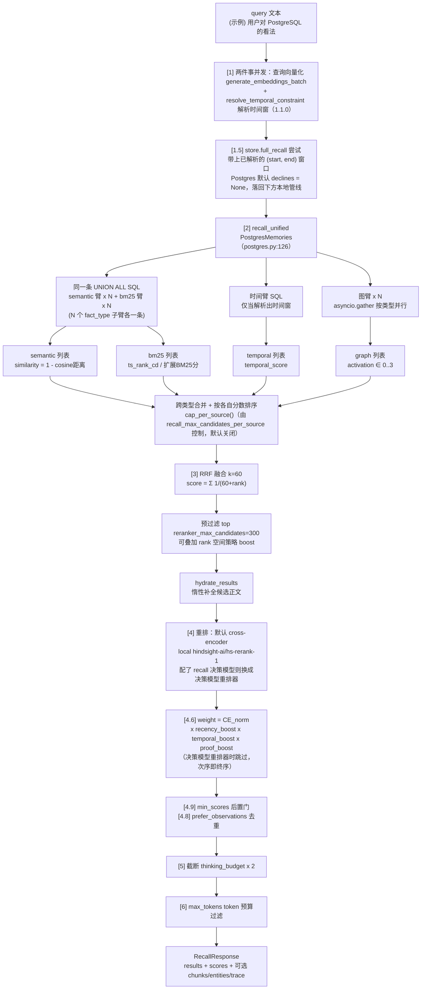
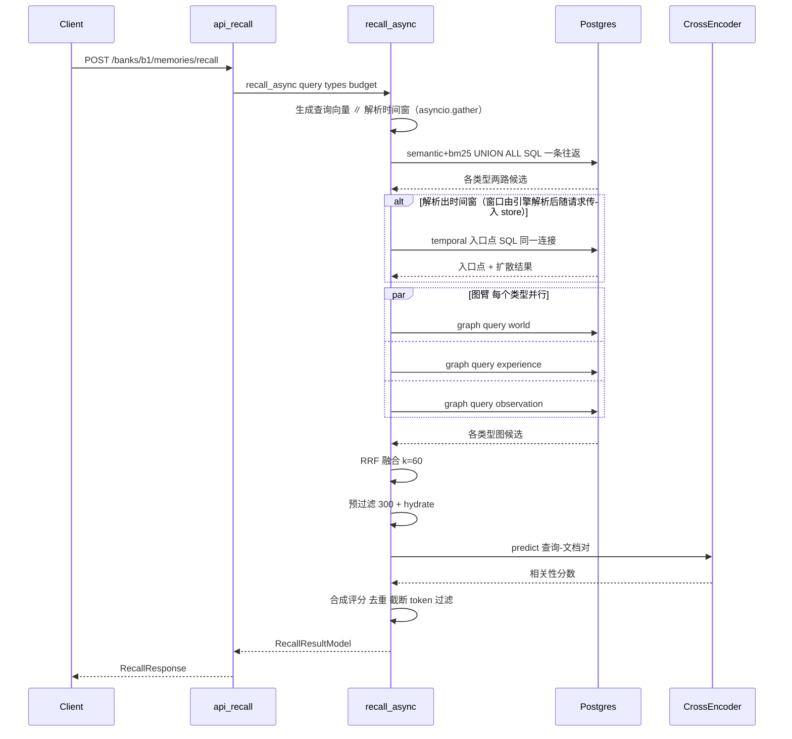

# 03 · Recall 检索系统庖丁解牛

> 代码基线：`33524bd33`（2026-11-03，v1.2.0 发布线）。本轮为 2026-11 增量更新：窗口 `bc5ea195a`（2026-11-01）→ `33524bd33`，**20 提交**（v1.2.0 的 15 + 发布后 5；清单 `commits_20261103.txt` 的是前 15 条）；此前两轮（`b4a0da1e9` → `bc5ea195a` 82 提交（含 13 个依赖锁文件）、v1.0.0 → v1.1.0 223 提交）的结论保留。
> 行号锚点：本轮新增/改写的小节逐条按 `33524bd33` 重核；全文行号按两快照的逐行 diff 机械重锚（根 `hindsight_api/`）。`engine/memories/pg/recall.py`、`engine/memories/pg/link_expansion.py`、`engine/search/fusion.py`、`engine/search/retrieval.py`、`engine/search/recall_boost.py`、`engine/db/ops_postgresql.py`、`alembic/` 在两快照间**逐字节相同**（本轮连 `engine/db/ops_postgresql.py` 也零差异），指向它们的行号一字未动；`engine/search/reranking.py` 只有一处 docstring 改掉默认模型名，行数不变、锚点未动。本轮的位移集中在两处：`memory_engine.py`（导入 +3 自 `:731` 起、删 `_may_need_refresh` 后 -18 自 `:2116` 起、附件读取重构后 -4 自 `:8701` 起、`:12612` 起回到 0，`recall_async` 全段因此只差 -4；`:21151` 之后的行号落在 -30…+6 之间因为是逐段重写）与 `engine/memories/base.py`（+28 自 `:735` 起、+66 自 `:2243` 起）。个别行号若与上下文对不上，按符号名在该文件内重定位。裸 `:行号`（承前文文件）没有全文自动换算——它们跨句承前，自动判定所属文件容易张冠李戴；但 **§2.1（主干步骤）与 §3.8（追踪）两节里的裸引用已逐条按 difflib 映射换算，并回读源行确认所指数值/区间落在对应符号上**。本文新写与改写处同样逐条回读过；其余小节若与上下文对不上，按符号名在该文件内重定位。
> 研究对象：`hindsight-api-slim/hindsight_api/engine/search/` 及其外围（四条臂的 Postgres SQL 现住在 `engine/memories/pg/recall.py` 与 `engine/memories/pg/link_expansion.py`，#4979 起归 memories store 所有；`query_analyzer.py`、`engine/trigram.py`、`_vector_index.py`、`alembic/` 的索引 DDL、`api/http.py` 的 recall 路由）。
> 所有论断均先读代码核实，标注 `相对路径:行号`；无法确认之处明确写"未确认"。示例数据一律标注"（示例）"。
> 本篇回答六个必答问题：① 四条检索臂的确切清单与数据来源（1.3）；② 并行如何实现、某一路失败会怎样（1.4 与 2.3）；③ RRF 公式与各路结果条数上限（3.5）；④ reranker 的输入输出、默认 provider、关闭时行为（3.6）；⑤ temporal 路如何从自然语言抽时间（3.4）；⑥ recall 的缓存与优化手段（3.10）。

---

## 第 1 层【全景】：recall 是什么，为什么是"多路"

### 1.1 Recall 是什么

Recall 是 Hindsight 的核心读操作：给定一条自然语言查询，从一个 memory bank 中取出最相关的记忆事实（memory_units），返回给上层 agent 使用。HTTP 入口是：

```
POST /v1/default/banks/{bank_id}/memories/recall
```

定义在 `hindsight-api-slim/hindsight_api/api/http.py:5399`（路由装饰器，`api_recall` 在 ：5401）。请求模型 `RecallRequest`（`api/http.py:574`）的关键字段：

- `query`：自然语言查询；
- `types`：要召回的事实类型，可选 `world / experience / observation`，缺省全部三种（`engine/response_models.py:22` 的 `VALID_RECALL_FACT_TYPES`）；
- `budget`：`low/mid/high`，映射为检索预算 `thinking_budget`（固定档默认 100/300/1000，`config.py:2169-2171`）；
- `max_tokens`：返回文本的 token 预算（默认 4096）；
- `prefer_observations`：观察压过其来源原始事实的去重开关，1.0.0 起（#5617）可为 `None`——缺省时解析 bank/server 级 `recall_prefer_observations` 配置（默认 false，`config.py:2149`，env `HINDSIGHT_API_RECALL_PREFER_OBSERVATIONS`，`config.py:1129`），显式传值仍优先（`memory_engine.py:9554-9568`）；
- `min_scores`：四个可选分数下限（`response_models.py:333`）；
- `tags` / `tags_match` / `tag_groups`：可见性过滤（`api/http.py:631-657`），与 `tag_groups` 互斥由模型校验器拒绝（`api/http.py:682-687`）；
- `temporal_window`：调用方直接给的时间窗（跳过查询文本里的日期解析，`api/http.py:663`，模型与"不是过滤器"的说明在 `engine/response_models.py:384-410`，那段话在 ：385-391）；
- `rerank`：`RerankOptions`（`engine/response_models.py:311-331`，字段挂在 `api/http.py:609-616`）——只有决策模型重排器会执行的两个开关：`prune` 丢掉判定"帮不上忙"的候选、`dedup` 丢掉"重复了更靠前候选"的结果（成本是多一次决策模型请求）。字段留空（`None`）时回落 bank/server 级 `recall_decision_model_prune` / `_dedup`（`config.py:4070-4071`，默认皆 false；解析在 `memory_engine.py:9556-9559`），非决策模型重排器一律忽略。MCP 的同名参数形状一致（`mcp_tools.py:1254`、`:1358-1360`）。

引擎入口是 `MemoryEngine.recall_async`（`engine/memory_engine.py:9304`），返回 `RecallResultModel`（results + 可选 trace/entities/chunks/source_facts）。

### 1.2 为什么单路向量检索不够

代码把每条检索路径称为 **arm（臂）**，下文沿用这个称呼。代码本身对这个问题给出了相当具体的回答，散落在注释与设计文档里：

1. **词面精确匹配是向量的盲区。** BM25 臂的注释直言：原生 tsvector 没有 IDF、逐行打分是负担，但它的存在价值就是 lexical 匹配（`engine/search/bm25_term_selection.py:1-29`）。反过来，一个精确的标识符（端口号、版本号）在向量空间里往往被"语义平滑"掉——这也是 recall `MinScores` 模型的 docstring 里说的 "an exact identifier the embedding scores poorly"（`engine/response_models.py:351`）。
2. **多跳关联是向量够不到的。** 图检索臂的抽象类 docstring：通过实体链接、时间链接、因果链遍历记忆图，"find relevant facts that might not be found by semantic or keyword search alone"（`engine/search/graph_retrieval.py:22-26`）。查询"用户对 PostgreSQL 的看法"时，一条没有共同词面、但与 PostgreSQL 实体相连的吐槽，只有图路能捞回来。
3. **时间语义是独立维度。** "上周做了什么"这类查询，语义相似度无法表达"时间要在窗口内"；时间臂用 occurred/mentioned 时间字段做入口点选择 + 沿时间/因果边扩散（`engine/memories/pg/recall.py:382-701`）。
4. **单一排序信号会被单臂偏差主导。** RRF 的意义在于把"各自强"的结果汇到一张榜上；而纯 RRF 又有"单臂第一被平均掉"的失败模式——`interleave_fusion` 的 docstring 记录了一个真实案例：consolidation（后台把原始事实整合为"观察"等派生记忆的流程）去重时，语义排名第 1 的"孪生"观察被 RRF 平均到预算线以下，LLM 没看见它，于是新建了重复记忆（`engine/search/fusion.py:112-130`）。

所以 recall 的设计是 **N 个事实类型 × 4 条检索臂**（引擎 docstring 原话 "N*4-way parallel retrieval"，`memory_engine.py:9348`），再融合、重排、截断。

### 1.3 四条臂的确切清单与数据来源（必答问题 1）

| 臂 | 名称 | 数据来源（表 / 索引） | 产出分数 | 代码位置 |
|---|---|---|---|---|
| 1 | semantic 语义 | `memory_units.embedding`；每个 `(bank_id, fact_type)` 一个**部分 HNSW 索引**（HNSW = 分层可导航小世界图，pgvector 的近似最近邻索引；`vector_cosine_ops`，迁移 `d5e6f7a8b9c0_add_bank_internal_id_and_per_bank_hnsw.py:103-117`）。例外：memories 由某个 store 承接的 bank（`store_owned_for`）**不建**这组索引——它的 `memory_units` 行恒为空，空索引却仍被共享表上的一切语句的计划/开锁成本摊派（#4659，见 3.1） | `similarity = 1 - (embedding <=> query)` | `engine/memories/pg/recall.py:29-306`；SQL 形状 `engine/sql/postgresql.py:320-349` |
| 2 | BM25 关键词 | 默认 native：`memory_units.search_vector`（写入路径填充的 tsvector 列——PG 全文检索的词素向量列，`engine/db/ops_postgresql.py:25-61`）+ GIN 索引（倒排索引）`idx_memory_units_text_search`（`migrations.py:1190-1197`）；可换 vchord/pg_textsearch/pgroonga/pg_search 四种扩展索引（`migrations.py:1116-1199`）。**观察行是例外**：它的 `search_vector` 只由 `text` 一列生成（`context_col=None, signals_col=None`，`engine/memories/pg/consolidation.py:37-45`），且 1.1.0 起每次改写/折叠都会重建它（#5299，见 3.2） | `ts_rank_cd(...)` 或对应扩展的 BM25 分 | `engine/sql/postgresql.py:351-468` |
| 3 | graph 图扩展 | `unit_entities`（实体共现）+ `memory_links`（semantic kNN 链、causes/caused_by/enables/prevents 因果链）+ observation 经 `memory_units.source_memory_ids` 数组列间接遍历（`observation_sources` 结对表仅 Oracle 使用） | `activation`（entity+semantic+causal 加分和，∈[0,3]） | `engine/memories/pg/link_expansion.py` |
| 4 | temporal 时间 | `memory_units` 的 `occurred_start/occurred_end/mentioned_at` 时间字段做入口点；`memory_links` 中 `temporal/causes/caused_by/enables/prevents` 边做扩散 | `temporal_score`（含 `temporal_proximity`） | `engine/memories/pg/recall.py:382-701` |

一个重要的工程事实：**semantic 与 BM25 不是两条独立 SQL，而是同一条 `UNION ALL` 查询里的两组子查询**（每个 fact_type 一条 semantic 子臂 + 一条 bm25 子臂，`memories/pg/recall.py:167-220`），一次往返同时取回两路候选，并用 `source` 列区分。所以"四路"是**逻辑上的四路**，物理上是"1 条合并 SQL + 1 条时间 SQL + 每 fact_type 一条图 SQL"。**四臂 SQL 模板到 `bc5ea195a` 仍然成立，只有 native BM25 臂多了一个排序键**：`ORDER BY ts_rank_cd(...) DESC` 改成 `... DESC, id`（`engine/sql/postgresql.py:430-436`，注释引 issue #6056，提交 #6143）。动机写在注释里：`ts_rank_cd` 的取值很少，LIMIT 的切点常常落在一个并列组内部，没有第二排序键时并行计划每次调用可能给出不同的子集——同一查询重复 recall 因此返回不同列表。**只加在 native 臂**：注释明说其余后端（vchord/pg_textsearch/pgroonga/pg_search）能从索引按分数序直接吐出 top 行，多一个排序键可能让它们失去这条路；Oracle Text 同理不加（`engine/sql/oracle.py:296-298` 的新注释把"并列在切点处保持无序"记成了已知代价）。除此之外 `engine/memories/pg/recall.py` 与 `link_expansion.py` 零差异；上一轮（1.1.0）的"`engine/sql/` 整个目录零差异"只对那个窗口成立。

**0.10.2 的路径迁移**：#4969/#4979 把"只有 memories store 能碰自己的表"立为规矩后，四条臂的 SQL 全部从 `engine/search/retrieval.py` 与 `engine/search/link_expansion_retrieval.py` 迁入 store（`retrieval.py` 只剩编排门面 `recall_unified` 的调用与时间约束提取；图臂改名 `memories/pg/link_expansion.py`）。`engine/search/` 保留的是与后端无关的部分：fusion、reranking（1.0.0 起新增决策模型重排器 `decision_reranker.py`，见 3.6）、recall_boost、tags/tag_resolution、bm25_term_selection、temporal_extraction、graph_retrieval ABC、types、tracer。

### 1.4 核心事实速查（必答问题 2/3/4 的答案预告）

- **并行方式**：不是"四路 `asyncio.gather`"。真实执行序是：**查询向量化与时间约束解析并发**（`asyncio.gather`，`memory_engine.py:9946-9956`；1.1.0 新编排）→ semantic+BM25 合并 SQL →（同一连接上）时间 SQL → 之后每 fact_type 的图查询用 `asyncio.gather` 并行（`engine/memories/postgres.py:126-253`，`asyncio.gather` 在 ：242；编排原因见 2.3）。某一路失败会怎样：合并 SQL 抛连接类错误时整个 recall 重试（指数退避，`memory_engine.py:9598-9682`）；Oracle Text 索引未同步（DRG-10599 等）时降级为纯 semantic 重发（`memories/pg/recall.py:233-280`）；图臂超时按子臂分治——非观察臂实体扩展超时只丢弃实体信号、回退 semantic+causal（`memories/pg/link_expansion.py:349-366`）；**observation 扩展臂同样受 `link_expansion_timeout` 约束（0.10.2 线内 #5231 补齐，此前这条臂没有超时）**：三信号熔在一条 CTE 里没有更便宜的回退，超时即记日志、该类型图信号整体返回空（`link_expansion.py:426-441`）；时间解析抛异常一律降级为"无时间约束"（`temporal_extraction.py:107-115`）。**请求还有一层 HTTP 准入**（1.0.0 起已存在，本窗口零改动）：`admit_for(PrecheckOperation.RECALL)` 在请求体反序列化前排队，超过 `max_wait`（默认 30s）直接 503 + `Retry-After`，而不是在引擎信号量后面无限等（`api/admission.py:1-38`，recall 车道 `:271`；基线 `5331da2f4` 的同一文件、同一行，`api/http.py` 的 `_admit` 路由依赖也在）。
- **RRF**：`score(d) = Σ_lists 1/(k + rank(d))`，`k` 默认 **60**（`fusion.py:29,85`）。含义：文档每在一条臂的榜单排第 r 名就加 1/(60+r)，多臂命中则累加——"多臂都靠前"者胜；k 越大名次差距越被抹平。
- **各路条数上限**：每臂每 fact_type 最多 `thinking_budget` 条（semantic 臂的 LIMIT 是 `semantic_fetch` 内联字面量，`recall.py:114` 与 `:177`；BM25 臂由 `$3` 参数 LIMIT，`recall.py:226`；图臂 `budget` 截断，`link_expansion.py:270`；时间臂扩散预算同 `thinking_budget`，`recall.py:579`）。融合前还有可选的 `recall_max_candidates_per_source`（每个臂最多向融合池贡献 N 条，0=不设限；默认 **0 = 关闭**，`config.py:1462`）。融合后进 cross-encoder（把 (query, 文档) 成对喂入模型直接输出相关度的重排序器）前有全局候选上限 `reranker_max_candidates` 默认 **300**（`config.py:1434`）。
- **reranker 默认启用**，provider 默认 `local`，默认模型 **`hindsight-ai/hs-rerank-1`**（`config.py:1399,1401`；`config.py:2161` `DEFAULT_ENABLE_RERANKING = True`）。**本轮的 #6263 动了这个默认值，并同批改了本地路的激活函数**（见 3.6）：provider 仍是 `local`，换的是 sentence-transformers 加载的那份权重——从英文的 `cross-encoder/ms-marco-MiniLM-L-6-v2` 换成项目自训的多语种重排器（en/es/fr/de/pt/ja/ko/zh，114M 参数、每趟前向跑一个 15M 参数的 transformer，`cross_encoder.py:269-272` 的类 docstring 原话）。同一个常量同时是 `HINDSIGHT_API_RERANKER_ONNX_MODEL_ID` 的默认值（`config.py:2933`）与 failover 链成员的 `LOCAL_MODEL` 默认值（`config.py:3136`），所以 **`onnx` provider 不点名模型时也一并换成了这个 repo**（文件仍是 `onnx/model.onnx`，`config.py:1530`）。货币代价见 3.6：激活函数被显式钉成 `torch.nn.Identity()`，本地模型因此交出原始 logits，sigmoid 统一由 recall 做一次（有效归一化仍是一次，不因这次改动而变）。bank 级 `enable_reranking=false` 会把默认策略降级为 "rrf" 直通（`memory_engine.py:1778-1789`）。**1.0.0 新增例外：给 recall 配置了决策模型（decision model）时，配置的 reranker 整个被替换成决策模型重排器，排序权彻底移交（见 3.6 末；注意全局 provider 设成 `hindsight` 时 recall 不接管，需 recall 自己的 override，`config.py:5948-5951`）。** **上一轮（`bc5ea195a`）的 provider 面三处变化，本窗口一处未动**：`typesafe` 作为 reranker provider 标记弃用（构造时打 WARNING 指向共享决策模型，类仍保留给 reflect 用，`cross_encoder.py:1223-1225, 3009-3014`）；新增 `hindsight` provider（Hindsight Inference，Cohere 兼容 `/v1/rerank`，模型 `hs-rerank-1`，`cross_encoder.py:3028-3044`，常量 `config.py:1585-1587`）；failover 链里失败的成员被"禁赛" 30 秒、排到健康成员之后重试（`MEMBER_COOLDOWN_SECONDS`，`cross_encoder.py:2694, 2763-2796`，见 3.6）。计数口径：`_create_cross_encoder_backend` 认 **17** 个 provider 别名（tei/local/cohere/openrouter/flashrank/onnx/litellm/litellm-sdk/zeroentropy/siliconflow/nvidia/google/alibaba/typesafe/hindsight/rrf/jina-mlx；方法：AST 取该函数内所有 `provider == <常量>` 比较的右值去重，两轮同法都数出 17，**本窗口未增删**）；注意 `Unknown reranker provider` 的报错文案只列了 16 个、三轮都漏掉 `openrouter`（`cross_encoder.py:3051-3052`）。

---

## 第 2 层【主流程】：一次 recall 的完整旅程

### 2.1 主干步骤（带真实代码步号）

（下文的 [1]/[1.5]/[2]/... 步号沿用引擎日志与代码注释的原始编号，便于对照源码。）

`api_recall`（http.py:5412）把请求交给 `recall_async`——0.10.2 及之前 REST 入口先做 query 长度校验（>500 token 直接 HTTP 400，PR #298），**0.10.3（#5388）删掉了这道 REST 侧检查**：按字符数自截的客户端（coding-agents 插件送 2000 字符的代码密集查询，约 1000 token）无法守住 token 上限，会整体失败；现在所有调用方（REST、consolidation、reflect 工具、MCP 工具、context 扩展）的超长查询都在引擎入口被统一截断（见步骤 1）。`recall_async` 内部：

1. **租户认证 + 取消检查点**（`memory_engine.py:9411-9422`，认证本身单独计时为 `engine_auth` 阶段：:9413）；查询净化（lone surrogate：注释 :9422-9425、`sanitize_text` 调用 :9427）与长度截断到 `recall_max_query_tokens=500`（:9438-9442，`config.py:1804`）。`recall_async` 多了一个 `_query_embedding` 参数（1.1.0，#5769）：调用方已经嵌入过同一个查询时直接复用，consolidation 一次嵌入一批查询、不再逐条付一次 embedder 调用（:9343-9348）。
2. **fact_type 校验（422）/ bank 存在校验（404）/ 模糊 tag 解析**（:9454-9459 与 `_require_bank_exists` :9522、`_resolve_fuzzy_tag_groups` :9529，fuzzy tag 见 3.9）；**min_scores.reranker 前置拒绝**（:9462-9474）——主 reranker 按**名次**打分（TypeSafe，1.0.0 起加上决策模型重排器，合称 `RANK_SCORE_PROVIDERS`，`cross_encoder.py:101`）时该下限直接 HTTP 400：名次分里"top 恒为 1.0"，一个下限只会保留固定比例的结果、与相关度无关。404 守卫的调用点在 `:9522`（`_require_bank_exists` 本身定义在 :14888；1.0.0 基线就已有这个助手——1.0.0 基线在 :14443、v1.1.0 线在 14681，本窗口只是文件位移、没有行为改动），失败路径与"空结果 + 非 store-owned"路径各补一次未缓存复查（:9675、:9745）。
3. **解析 bank 配置**，得出 `thinking_budget`（`_resolve_thinking_budget`，:1726-1756：fixed 档直接取 100/300/1000；adaptive 档按 `max_tokens × 比例` 并 clamp 到 [20, 2000]）、`reranker_max_candidates`（`_resolve_reranker_max_candidates`，:1759-1774，每档覆盖值默认 0 → 回落平值）、以及 bank 级开关 `enable_text_search / enable_temporal_retrieval / enable_graph_retrieval / enable_reranking`（:9549-9552）；`prefer_observations is None` 时再读 bank 级 `recall_prefer_observations`（:9553-9567，#5617）。
4. **背压**：`async with self._search_semaphore`（每 worker 最多 32 个并发 recall，`config.py:1749`，信号量建在 :3418、获取在 :9597），失败重试最多 3 次（仅连接类错误，指数退避 0.5s/1s/2s，:9601-9681）。**外面还有一层 HTTP 准入，1.0.0 起就有、本窗口零改动**：`admit_for(PrecheckOperation.RECALL)` 与 `precheck_for` 一起挂在路由依赖上，在请求体反序列化前排队，等不到就 503 + `Retry-After`（`api/admission.py:1-38`；recall 车道 `:271`，默认按核数 × 16 推导并发、最长等 30s，env `HINDSIGHT_API_ADMISSION_RECALL_MAX_IN_FLIGHT` / `_MAX_WAIT_MS`，`config.py:1781-1790`）。
5. 进入 `_search_with_retries`（:9805 起）。**1.1.0 的最大编排变化在 [1] 与 [1.5] 之间**：时间窗解析从"取回阶段的内部步骤"提前到引擎，与查询向量化并发：
   - **[1] 查询向量化 + 时间窗解析（并发）**：`asyncio.gather(_embed_query(), resolve_temporal_constraint(...))`（:9945-9955）。`generate_embeddings_batch` 在 :9932（input_type="query" 走 `encode_query`——0.10.3（#5155）起 Cohere 这类"检索任务随请求走"的 provider 覆写 `encode_query`/`encode_documents`，recall 查询按 `search_query` 任务嵌入、retain 文本按 `search_document`，不再共用一个配置死的 input_type，`embeddings.py:1373-1381`）；`resolve_temporal_constraint` 是 1.1.0 从 `retrieve_all_fact_types_parallel` 里提出来的公共函数（`retrieval.py:100-126`），两条 recall 路径（本地管线、整单包办的 store）共用同一份"bank 开关 + 查询日期 → 窗口"的语义。注释把并发理由写清了：日期提取是离开事件循环的纯 CPU、嵌入是网络调用，两者叠加约等于较慢那个单独的成本（:9939-9944）。
   - **[1.5] 先问 store 能否整单包办**：`get_memories().full_recall(FullRecallRequest)`（:9992-10042）。默认 Postgres store 走基类默认实现返回 `None`（`memories/base.py:1885`），于是落回本地管线；一个自持索引的 store 可以一跳返回全部结果（fusion/rerank 都在 store 侧做完）。**1.0.0（#5671）起请求带上 `reranker_provider`**（`FullRecallRequest.reranker_provider`，`memories/base.py:888-892`）：store 只能替 pointwise cross-encoder 应答，遇到 `RANK_SCORE_PROVIDERS` 成员（名次型，含决策模型重排器）应当拒绝、让引擎的管线自己排。**1.1.0 起 `temporal_window` 传的是已解析好的 `(start, end)`**（:9999-10001）：此前这里只能转发调用方显式给的窗口，查询文本里的日期与 bank 的 `enable_temporal_retrieval` 都到不了 store，一个整单包办的 store 会静默忽略它们；现在两条路径拿到同一个窗口。store 应答时它自报的每阶段耗时被摊进 trace（`store_<stage>`/`store_hop_overhead`/`full_recall`，:10065-10076）。
   - **[2] 四路取回**：`retrieve_all_fact_types_parallel`（:10113，包在 `budgeted_operation` 连接预算内，:10107）→ 把整个召回交给 store 的唯一接口 `recall_unified`（`retrieval.py:218-236`），并带 `temporal_resolved=True`（:10136）表示窗口已解析、不要再提取一次。Postgres 实现见 2.3。
   - 跨 fact_type 合并四路列表并各自按分数排序（:10187-10195）；可选 per-source 截断（:10197-10212，默认关）。
   - **[3] 融合**：`reciprocal_rank_fusion`（默认）或 `interleave_fusion`（consolidation 去重专用），3 或 4 个列表取决于时间窗是否存在（:10421-10423）。
   - **[4] 重排**：RRF 分数预过滤到 `reranker_max_candidates`（`trim_merged_candidates`，:10479，超上限时按 `boosted_rrf_score` 排序截尾；未超则原样放行）；`hydrate_results` 惰性补全候选正文（:10516-10518）；cross-encoder 打分（:10547-10554，把调用方的 `question_date` 作为 `now` 一并传入）或 rrf/interleave 直通（:10562-10575：weight=0.0 在 :10572、按 rrf_score 排的构造序 ：10574）。
     - **上一轮新增的入参（#6131/#6139）**：`rerank(...)` 多了 `prune`、`dedup` 与一个 `embeddings` 任务（`engine/search/reranking.py:376-384`）。`prune`/`dedup` 由 `recall_async` 的入参或 bank 配置解析（`memory_engine.py:9556-9559`，调用点 :10547-10554）；`dedup` 且当前重排器是决策模型时，引擎**先起一个异步任务读候选的存量嵌入**（`memory_engine.py:10538-10547` → `_candidate_embeddings` :9780-9802），让这次读与排名请求并发、dedup 不额外付一次往返（机制见 3.6）。
   - **[4.6] 合成评分**：`apply_combined_scoring` —— `CE × recency_boost × temporal_boost × proof_count_boost`（:10620；公式见 3.7）。**1.0.0 新增第一分支：served_provider 是决策模型重排器（`decision_model`）时整段跳过**——"决策模型已对全池裁决，boost 只会二次猜测它"（:10600-10603，机制见 3.6 末）；**[4.7] 策略加成**（可选，:10637）；按 `weight` 重排（:10638）。
   - **[4.9] min_scores 后置过滤**（reranker/final 门，:10643-10673；主 reranker 是名次分时入口已 400 拒绝（步骤 2）；failover 链事后落到名次分成员（含决策模型重排器）则该门被**跳过**并记日志（"ignored"，:10654-10659），且响应里不再发 reranker 分，见 2.4）；**[4.8] prefer_observations 去重**（观察压过其来源原始事实，:10704-10765）。
   - **[5] 截断**到 `thinking_budget × 2`（:10766-10768；源注释未论证为何是 2 倍）。
   - **[5.5] chunks 抓取**（独立于 max_tokens，:10771-10895；0.10.2 起（#5030）会按请求的 tag 过滤丢弃"文档本身打了读者不可见标签"的 chunk——一条 fact 可见不等于其来源文档可见，判定收拢在 `engine/source_scope.py`，缺文档/无文档的 chunk 默默失败）。
   - **[6] token 预算过滤** `select_facts_within_budget`（:10898-10910）。
   - 实体装配、`RecallScores` 组装（:11129-11138）、trace 终结。

### 2.2 数据流机制图（四路取回 + 融合，逻辑视图）

下图是整条管线的数据流。注意这是**逻辑视图**：图中的 semantic/bm25/temporal/graph 四条臂，每条实为 N 个 fact_type 子臂在 [2] 内合并而来（semantic 与 bm25 甚至合成一条 SQL）；"declines = None" 指 store 不实现 `full_recall` 时返回 None，管线原样落回本地路径。



读图要点：融合（[3]）只看四张榜单的名次，各臂内部的分数形态（相似度/BM25 分/activation/temporal_score）到这里全部退场；进入重排后才重新引入绝对分数。图中 cap_per_source 是 `fusion.py:8` 的函数名，由配置 `recall_max_candidates_per_source`（默认 0 = 关闭，`config.py:1462`）驱动，所以"跨类型合并"与融合之间通常没有额外截断。1.1.0 把时间窗解析挪到 [1] 与向量化并发（不再是取回阶段内部的串行前置步骤），因此 `[1.5]` 的 store 分支和 `[2]` 的本地分支拿到的窗口是同一份（见 2.1 步骤 5）。

### 2.3 一次 recall 的并发时序（Postgres 默认 store）



四路执行的真实编排核心在 `engine/memories/postgres.py:126-253`，摘录关键段：

```python
# Semantic + BM25 (+ temporal) share ONE connection, exactly as before: the dense/keyword
# UNION runs first, then the temporal query on the same connection, which is then released
# before the graph arm opens its own connections.
async with acquire_with_retry(pool) as db_conn:
    semantic_bm25 = await self.search(conn=db_conn, ...)

    temporal_by_ft: dict[str, list] = {}
    if temporal_window is not None:
        start_date, end_date = temporal_window
        temporal_by_ft = await self.temporal_search(conn=db_conn, ...)

# Graph per fact_type in parallel, on the pool, after the dense connection is released —
# seeded by the dense results (preselected_semantic_seeds), matching the prior path.
graph_by_ft: dict[str, list] = {ft: [] for ft in fact_types}
if enable_graph:
    ...
    graph_lists = await asyncio.gather(*[_run_graph(ft) for ft in fact_types])
    graph_by_ft = dict(zip(fact_types, graph_lists))

return {
    ft: RecallArms(
        semantic=semantic_bm25[ft].semantic,
        bm25=semantic_bm25[ft].bm25,
        graph=graph_by_ft.get(ft, []),
        temporal=temporal_by_ft.get(ft, []),
    )
    for ft in fact_types
}
```

（摘录有省略，完整实现见 `postgres.py:126-253`。）逐点讲解：

- **"并行"的准确含义**：semantic+BM25 是同一条 UNION SQL，两臂的并行发生在 Postgres 执行器内部；temporal 在**同一连接上串行**于其后；图臂在连接释放后按 fact_type 用 `asyncio.gather` 真并行。模块 docstring 声称的 "4-way parallel search"（`retrieval.py:1-8`）是逻辑分层，不是四个并发任务。1.1.0 新增的那一处并发不在 store 里，而在引擎入口：**查询向量化与时间窗解析**用 `asyncio.gather` 同时跑（`memory_engine.py:9946-9956`），因为前者是网络调用、后者是离开事件循环的纯 CPU。
- **连接纪律**：asyncpg 不允许同一连接上并发查询，所以 dense（即 semantic 向量路）+temporal 共用一个连接顺序执行，图臂另开连接——方法 docstring 明说这复刻了统一接口之前的编排，结果"byte-identical"（`postgres.py:151-152`）。
- **失败传播**：`asyncio.gather` 默认 fail-fast——某个 fact_type 的图查询抛异常会中断整个 gather，异常向上传到 `recall_async` 的重试层；只有连接类错误才重试（指数退避），其余直接失败（`memory_engine.py:9598-9682`）。臂级别的容错只在臂内部实现（图臂超时降级、时间解析降级、Oracle Text 降级），不存在"一路失败取其它路"的聚合语义。
- **`RecallArms`**（`memories/base.py:814`）是接口契约：`{fact_type: RecallArms(semantic, bm25, graph, temporal)}`，四臂候选未融合返回，"RRF/rerank happen downstream"（:817 的 docstring 原话）。

### 2.4 返回结构：一条结果带哪些分数

每条结果最终渲染为 `RecallResult`（`api/http.py:690`），其中 `scores` 字段是 `RecallScores`（`engine/response_models.py:287-330`）：

```python
scores_by_id: dict[str, RecallScores] = {
    sr.id: RecallScores(
        final=sr.weight,
        reranker=None if reranker_passthrough else sr.cross_encoder_score_normalized,
        semantic=sr.candidate.arm_scores.semantic,
        keyword=sr.candidate.arm_scores.keyword,
    )
    for sr in top_scored
}
```

（`memory_engine.py:11130-11139`。）逐点：`final` 是排序依据（合成评分后的 weight）；`reranker` 在直通模式（rrf/interleave 或 passthrough CE）下为 null——因为那时它的 CE 分是名次推导的占位符而非真实相关度（:11127-11132 注释）；#5232 起（0.10.2）主 provider 按**名次**打分的 reranker 同样发 null，1.0.0 起 `RANK_SCORE_PROVIDERS = frozenset({"typesafe", "decision_model"})`（`cross_encoder.py:101`）把决策模型重排器也纳入——它的分是"池内名次从 1.0 递减"的占位（`decision_reranker.py:109-111`），既不可跨 recall 比较、又会让 `min_scores.reranker` 语义失真，故与 passthrough 一致对待（:11129-11132 的 `reranker_passthrough` 判定）；`semantic`/`keyword` 来自 RRF 时的 `ArmScores`，该结果未被某臂命中时为 null（`types.py:135-146`）。这个四元组就是 `min_scores` 四个门的过滤对象。

### 2.5 贯穿例子（示例）：查询"用户对 PostgreSQL 的看法"

设定（示例）：bank 里有三种类型；`budget=mid` → `thinking_budget=300`；bank 未关任何臂；查询无日期词。

**步骤 1 — 查询分析（query analyzer）**：`analyze()` 先跑 `extract_period`（无 "last week"/"上个月" 等表达），再做 `_query_can_score` 快检——查询里没有数字也没有月份/星期/时段词（`query_analyzer.py:118-141`），直接跳过 dateparser，返回 `temporal_constraint=None`。**时间臂整条跳过**：1.1.0 起这一步由 `resolve_temporal_constraint` 与向量化并发执行（`retrieval.py:100-126`；`enable_temporal_retrieval` 为假直接返回 None）；提取不出约束 → `recall_unified` 收到 `temporal_window=None` → 不发时间 SQL（`postgres.py:207`）。

**步骤 2 — tokenize**：`tokenize_query` 去标点、小写、按空白切（`retrieval.py:28-34`）→ `["用户对", "postgresql", "的看法"]`（示例）。注意：native 后端的 `to_tsquery('english', ...)` 不分词中文，"用户对"会作为整词参与 OR 匹配——这是 native 后端对 CJK 的已知短板，代码用可切换扩展解决（pgroonga 的 TokenBigram、pg_search 的 `chinese_compatible`/`jieba` tokenizer，`hindsight_api/_pg_search.py:10-20`、`engine/sql/postgresql.py:395-425`）。本例假设 `postgresql` 一词命中。

**步骤 3 — 四路各自的形态**（示例数据）：

| 候选 | semantic（similarity） | bm25（rank by ts_rank_cd） | graph（activation） |
|---|---|---|---|
| obs-x "用户认为 PostgreSQL 比 MySQL 更适合复杂查询" | #1，0.82 | #2 | #2，0.91（与种子共享 2 个实体：tanh(2×0.5)=0.76 + semantic 链 0.15） |
| world-y "用户的团队主库从 MySQL 迁到了 PostgreSQL" | #2，0.76 | #1 | 未出现 |
| world-w "用户吐槽过 PostgreSQL 的内存占用" | 未进前若干名 | #3 | #1，1.52（causal 链 0.72 + 实体 0.46 + semantic 链 0.34） |
| world-z "用户在生产用 PostgreSQL 15" | #3，0.71 | 未命中 | #3，0.76 |

**步骤 4 — RRF 融合前后**（k=60，rank 从 1 起）：

- obs-x：1/61 + 1/62 + 1/62 = **0.04865**（三臂汇合）
- world-y：1/62 + 1/61 = **0.03252**
- world-w：1/63 + 1/61 = **0.03227**
- world-z：1/63 + 1/63 = 2/63 = **0.03175**（语义 #3 + 图 #3）

融合后顺序：obs-x > world-y > world-w > world-z。注意 world-w 与 world-z 咬得很紧：两者都是两臂命中，world-w 是 graph #1 + bm25 #3（0.03227），world-z 是 semantic #3 + graph #3（0.03175），差距只有约 **0.00052**——名次差一名就足以翻转。这正是多路融合的敏感处："convergent evidence" 的另一面是"少一臂就掉队"。

**步骤 5 — 重排后**（示例；本地模型输出 logits → sigmoid 归一化，`reranking.py:498-508`；recency/proof 的换算见 3.7：recency_boost = 1+0.2×(recency−0.5)，proof_norm = 0.5+ln(n)/10）：

| 候选 | CE raw | CE_norm | recency | proof | weight（合成后） |
|---|---|---|---|---|---|
| obs-x | 2.1 | 0.891 | 0.85 | proof_count=3 | 0.891×1.07×1.0×1.011 ≈ **0.964** |
| world-y | 0.9 | 0.711 | 0.40 | — | 0.711×0.98 ≈ **0.697** |
| world-w | -0.4 | 0.401 | 0.30 | — | 0.401×0.96 ≈ **0.385** |
| world-z | -1.1 | 0.250 | 0.50 | — | **0.250** |

（示例中重排保序；重排翻转排序的情形很常见——尤其 CE 对词面命中 vs 语义 paraphrase 的权衡与 RRF 不同。）

### 2.6 第二个贯穿例子（示例）：带时间的查询"上周用户对 PostgreSQL 说了什么"

与 2.5 同一个 bank，唯一区别是查询带时段词。

**步骤 1 — 时间提取**：这一步在 1.1.0 与查询向量化并发执行（`memory_engine.py:9946-9956`，函数 `resolve_temporal_constraint`，`retrieval.py:100-126`）。`analyze()` 先跑 `extract_period`（"last week"/"上周" 属于时段表达，返回区间而非单日）。假设 `question_date=2026-10-02`（示例），得 `temporal_constraint = (2026-09-21 00:00, 2026-09-27 23:59:59.999)`（示例）。这个窗口被传给 `recall_unified` 的 `temporal_window`（`retrieval.py:225`），时间臂整条激活；其余三臂照常运行——**窗口是排名信号不是过滤器**（`response_models.py:391-397` 的 docstring 明说：窗口外的记忆仍会被另外三臂召回）。

**步骤 2 — 时间臂内部**（示例）：

1. 入口点 SQL：找时间与 [09-21, 09-27] 相交、`similarity >= 0.1` 的单元，每类型取相似度前 60（pool）；假设 world 类型命中 25 条（示例）。
2. 覆盖度选择：窗口 7 天切成 8 桶（约每桶 21 小时），25 条按桶轮转取 10 个入口点——假设周一/周三/周五各贡献若干条，而不是全部取相似度最高的周一聚类（示例）。
3. 每个入口点的时间邻近度 `temporal_proximity = 1 - min(|date - window_mid| / (total_days/2), 1)`：窗口中点的条目得 1.0，边缘得趋近 0，无日期的入口点给中性 0.5（`recall.py:564-570`）。
4. 扩散：从 10 个入口点沿 temporal/causal 边走，预算 300 扣减；假设邻居 n1 经一条 `weight=0.8` 的 temporal 边从入口点 e 到达：`propagated = 1.0 × 0.8 × 0.7 = 0.56`，若 n1 自身 proximity 只有 0.2，则其 `temporal_score = max(0.2, 0.56) = 0.56`（示例）。**父分不是入口点自身的 proximity**：入口点以满强 1.0 进入传播（`recall.py:575` 把 `(similarity, 1.0)` 写进 `node_scores`，:554 取元组第二位相乘），e 自己的 proximity=0.9 只体现在它本人的 `temporal_score` 上，不作为传播起点强度。

**步骤 3 — 融合时**：这次 `result_lists` 是 4 个（temporal 非空，`memory_engine.py:10422-10424`）。假设 world-w（"用户吐槽过 PostgreSQL 的内存占用"）恰好 mentioned_at 落在窗口内且与入口点有 temporal 边，它就多拿一份 `1/(60+rank_temporal)`，RRF 分进一步上抬——单看语义/词面它只是个中游候选，时间维把它顶了上去。这就是"时间窗是排名信号"的具体形态。

对照结论（示例对比，非实测）：2.5 的无时间查询里 temporal 臂整体缺席（融合列表为 3 个、内部候选的 `temporal_score` 为 null——注意 HTTP 响应的 `RecallResult`（`api/http.py:690-758`）与 `RecallScores` 四元组都没有 temporal_score 字段，它只存在于内部 `RetrievalResult`（`types.py`）与 trace 中）；2.6 里它成为第四个投票者。两次调用共用同一套融合/重排代码，差别只在 `result_lists` 的长度。

---

## 第 3 层【机制深潜】

### 3.1 语义臂：部分 HNSW + 迭代扫描

semantic 子臂的 SQL 形状（`engine/sql/postgresql.py:320-349`，由 `memories/pg/recall.py` 调用）：

```python
return (
    f"(SELECT {cols},"
    f"        1 - (embedding <=> {embedding_param}::vector) AS similarity,"
    f"        NULL::float AS bm25_score,"
    f"        'semantic' AS source"
    f" FROM {table}"
    f" WHERE bank_id = {bank_id_param}"
    f"   AND fact_type = '{fact_type}'"
    f"   AND embedding IS NOT NULL"
    f"   AND (1 - (embedding <=> {embedding_param}::vector)) >= {min_similarity}"
    f"   {tags_clause} {groups_clause} {extra_where}"
    f" ORDER BY embedding <=> {embedding_param}::vector"
    f" LIMIT {fetch_limit})"
)
```

逐点讲解：

- **余弦距离转相似度**：pgvector 的 `<=>` 是余弦距离（0=同向），所以 `1 - distance` 即余弦相似度，与 `similarity >= sem_min`（默认 `semantic_min_similarity=0.3`，`config.py:1439`）配合做 SQL 内预剪枝。
- **为什么是 UNION ALL 而不是窗口函数**：`recall.py:54-61` 的注释记载了演进——早期用 `ROW_NUMBER() PARTITION BY fact_type`，迫使全表顺序扫描；改成"每个 fact_type 独立 ORDER BY...LIMIT 的子臂 UNION ALL"后，规划器可以选用**每个 `(bank_id, fact_type)` 的部分 HNSW 索引**（迁移 `d5e6f7a8b9c0` 的 upgrade 循环 ：103-117，CREATE 语句在 ：113：`CREATE INDEX IF NOT EXISTS idx_mu_emb_{ft_short}_{internal_id} ... WHERE fact_type = '{ft}' AND bank_id = '{bank_id}'`；:143-155 则是 downgrade 恢复旧版 fact_type-only 索引的对照物，无 bank_id 条件）。**例外**（#4659，0.10.2）：memories 由 store 承接的 bank（`get_memories().store_owned_for(bank_id)` 判定，守卫在 `engine/retain/bank_utils.py:58-100`）建 bank 时**跳过**这组索引——它的 `memory_units` 行恒为空，而空索引并不免费：Postgres 规划与 DML 要枚举/开锁共享表上的每个索引，一个 27,315 个 store-owned bank 的租户曾背着 82,795 个空 HNSW 索引，为查询零行付出每条语句 ~975ms 的规划时间（#4615）。只减不增：已存在的索引不会被自动删除（那是运维决策），`repair-bank` 对这类 bank 也返回空计划、不重建。这组索引的**覆盖策略**（可选的 `HINDSIGHT_API_VECTOR_INDEX_MIN_ROWS` 行数门槛、`vector_index_maintenance` 异步维护操作、`repair-bank` 管理命令、全部 `CREATE/DROP INDEX CONCURRENTLY`）收拢在 `engine/vector_index_health.py` 一个模块里；检索执行路径不依赖它，它只决定上面的索引在不在。
- **不多取行**：`recall.py:66-74` 解释了一个反直觉修复——曾按 `limit*5` 取回再在 Python 截断"补偿 HNSW 近似"，但行本来就是按距离有序的，多取的行只是被丢弃；真正决定 ANN 质量的是扫描候选列表大小（连接级 GUC，即 PG 会话级配置参数），不是行数。
- **迭代扫描**：连接初始化时打上 `hnsw.ef_search=200`、`hnsw.iterative_scan=strict_order`、`hnsw.max_scan_tuples=4000`（`hindsight_api/_vector_index.py:136-143` 的 `_ANN_TUNING_HIGH_RECALL` 档，经 `ann_search_tuning_settings` 分发，:227-248；注意该文件在包根 `hindsight_api/` 下而非 `engine/`；开关与上限默认值 `config.py:1660,1669`）。iterative scan 让 ef_search 从"硬上限"变成"每轮批量"，扫描可续批直到满足 LIMIT——过滤性查询（阈值+tags）不再因为候选列表耗尽而提前短路（`_vector_index.py:101-131`）。retain 侧链接探测则用低延迟档 `ef_search=60, iterative_scan=off`（:133-134）。
- **图种子复用**：semantic 臂取回的行同时充当图臂入口点池——`semantic_fetch = max(limit, GRAPH_SEED_LIMIT)`（`recall.py:106-114`，`GRAPH_SEED_LIMIT=20` 现定义在 `memories/base.py:828`），凡 `similarity >= graph_seed_min_similarity`（默认 0.3，`config.py:1440`）的前 20 条被切给 `graph_seeds`（:297-304），省掉图臂单独一次 ANN 查询。

### 3.2 BM25 臂：tsvector 真值与"IDF 自助餐"

native 子臂（`postgresql.py:426-436`）：

```python
else:  # native tsvector
    bm25_score_expr = f"ts_rank_cd(search_vector, to_tsquery('{bm25_language}', {text_param}))"
    bm25_order_by = f"{bm25_score_expr} DESC"
    bm25_where_filter = f"AND search_vector @@ to_tsquery('{bm25_language}', {text_param})"
```

- **数据侧**：`memory_units.search_vector` 是**普通 tsvector 列，由写入路径内联填充**——`to_tsvector('<配置语言>', text || ' ' || context || ' ' || text_signals)`（`engine/db/ops_postgresql.py:25-61` 的 `pg_search_vector_expr`，插入时写入 ：205-213；只有 `mental_models` 才用 `GENERATED ALWAYS ... STORED` 生成列，`migrations.py:1486-1494`），GIN 索引服务 `@@` 匹配（`migrations.py:1190-1197`）。一段历史：`memory_units` 的 search_vector 最初也是 GENERATED STORED 列，后被迁移 `p4q5r6s7t8u9` 一次性 `DROP EXPRESSION` 降级为普通列（该迁移 docstring 原话 "Drop GENERATED expression on tsvector search_vector columns"），改走写入路径内联填充——若在其它篇章看到"生成列"的口径，差异在此。打分用 `ts_rank_cd`，**没有 IDF**（`bm25_term_selection.py:1-9` 明说），所以长 OR 查询会匹配大量行并逐行打分——生产上出现过 +60s 的 BM25 挂起（同文件 docstring）。
- **词项选择**（`bm25_term_selection.py:82-118`）：超过 `bm25_max_query_terms=16`（`config.py:1453`）时，从 `pg_stats.most_common_elems`（ANALYZE 免费维护的词素频率）读每个 token 的文档频率，**保留 df 最低（最具区分度）的 16 个**而非"前 16 个"，失败时回退前 N 截断。统计是 schema 级（跨 bank），注释坦承这是设计内的近似。
- **观察行的 search_vector 是特例（1.1.0，#5299）**：它只由 `text` 一列生成（`observation_search_vector_expr`，`engine/memories/pg/consolidation.py:37-45` → `pg_search_vector_expr(..., context_col=None, signals_col=None)`），所以观察的 `context` 永远不参与关键词匹配。更要紧的是**重建时机**：三条改文本的路径（`fold_sources_into_observation` / `fold_observation_into_twin` / `rewrite_observation`，`consolidation.py:168,237,281`）在 1.0.0 就会重建 `search_vector`，但用的是 `_native_search_vector_update`——**只对 native 生效，vchord 返回空串**。vchord 的 `bm25vector` 是普通列、没人自动刷新，于是 observation 被改写或折叠后，关键词臂仍在匹配旧措辞；同一段表达式还在插入路径另写了一份。现在三条写路径与插入统一调 `_search_vector_clause`/`observation_search_vector_expr`（:22-45），按当前后端重建（native 的 tsvector 与 vchord 的 bm25vector 都覆盖；Oracle 返回 `None`，因为它的 text index 自己维护），`repair-bank` 还有一次性重建 `rebuild_observation_search_vectors`（`pg/admin.py:224-252`，vchord-only，因为 bm25vector 不可比较、无法只挑出陈旧行）。
- **floor 应用位置**：`bm25_min_score` 默认 0.0（`config.py:1446`）；因为 `ts_rank_cd` 在 WHERE 里重算要付双倍代价，floor 是套在外层切片上过滤的（`postgresql.py:454-468`），注释证明了它与内层谓词等价。
- **扩展矩阵**：`text_search_extension` 五选一（`config.py:1677`）：`native`（tsvector+GIN）、`vchord`（`<&>` BM25，返回负分取反，`postgresql.py:377-390`）、`pg_textsearch`、`pgroonga`（TokenBigram 分词，对 CJK 友好，:395-412）、`pg_search`（ParadeDB BM25 索引 + `@@@` 布尔查询，tokenizer 可配 jieba/chinese_compatible 等，:413-425 与 `hindsight_api/_pg_search.py:10-71`）。各扩展共用同一份臂生成代码与同一个 `build_bm25_query_text` 出口（`bm25_term_selection.py:121-173`），注释说这是为了让 recall 与 knowledge search 两条 BM25 路径"不能再漂移"；0.10.2 起扩展索引的 DDL 收拢在 `migrations.py:1116-1199` 的 `_create_text_search_index` 单点（此前分散在 reconcile 主体里）。**knowledge search 的 BM25 臂在 Oracle 上有第六种形态**（0.10.3，#4804）：`knowledge_bm25_arm` 新增 `backend_type="oracle"` 分支，走 Oracle Text 的 `CONTAINS`/`SCORE(1)` 查询 `mental_models(content)` 上的 CTXSYS.CONTEXT 索引（此处 label 固定 1——单条查询、不拼 UNION；recall 的 BM25 臂因为要 UNION 多个 fact_type，label 才是 `10 + arm_index`，`sql/oracle.py:277-284`） `idx_mental_models_text_search`（迁移 `c8e2f4a6b1d3_oracle_mental_models_text_index.py`，`SYNC (ON COMMIT)` 免维护作业保持同步；PG 侧同名索引自 knowledge pages 落地就有，Oracle 此前没有对应物、这条臂无索引可跑），词项连接符用 `ACCUM` 而非 OR——命中更多查询词的页面排名更高，而 OR（各项得分取 max）做不到（`sql/postgresql.py:101-113`；PG 的五种扩展在 Oracle 上不存在，这个分支优先于它们）。

### 3.3 图臂：GraphRetriever 抽象与 LinkExpansion 实现（必答问题中的继承关系确认）

确认：`GraphRetriever` 是 ABC（`graph_retrieval.py:19`），唯一抽象方法是 `name` 与 `retrieve`；`LinkExpansionRetriever(GraphRetriever)` 是当前唯一实现——0.10.2 起住在 `engine/memories/pg/link_expansion.py:114`（原名 `engine/search/link_expansion_retrieval.py`，随 #4979 迁入 memories store）。选择逻辑在 0.10.2 换了方向：`get_default_graph_retriever`（`retrieval.py:69-87`）**只问 memories store**（"图臂走的是 store 的链接，所以只有 store 知道怎么走"），store 返回 `None` 时直接 `RuntimeError`——旧版"store 没有就回退 SQL 检索器"的兜底被删了，因为对一个链接不在 Postgres 的 store，那条回退会悄悄扫空表返回零结果。`config.graph_retriever`（默认 `link_expansion`，`config.py:1748`）的裁决权下放进了 Postgres store 的 `graph_retriever()`（`memories/postgres.py:255-266`）：它读同一个配置，未知值告警后仍返回 `LinkExpansionRetriever`。这仍是清晰的扩展点：一个自管链接的 store 实现自己的 `retrieve()` 即可插入，管线其余部分不动。

LinkExpansion 的三步（`link_expansion.py:133-297`）：

1. **种子**：调用方传入 `preselected_semantic_seeds`（来自语义臂的复用切片）；否则自己跑 `_find_semantic_seeds`（阈值 `graph_seed_min_similarity=0.3`，上限 `GRAPH_SEED_LIMIT=20`，现定义在 `memories/base.py:828`）。种子不达标时整臂返回空（:199-200）。
2. **单跳 CTE 扩展**（非 observation，`link_expansion.py:299-371`）：实体信号的 CTE 由 `ops.build_entity_expansion_cte` 渲染（`engine/db/ops_postgresql.py:1016-1056`），长这样：

```sql
seed_entities AS (
    SELECT DISTINCT ue.entity_id
    FROM unit_entities ue
    WHERE ue.unit_id = ANY($1::uuid[])
),
entity_expanded AS (
    SELECT ...memory_unit_columns...,
           COUNT(DISTINCT se.entity_id)::float AS score,
           'entity'::text AS source
    FROM seed_entities se
    CROSS JOIN LATERAL (
        SELECT ue_target.unit_id
        FROM unit_entities ue_target
        WHERE ue_target.entity_id = se.entity_id
          AND ue_target.unit_id != ALL($1::uuid[])
          AND EXISTS (
              SELECT 1 FROM memory_units mu_target
              WHERE mu_target.id = ue_target.unit_id
                AND mu_target.fact_type = $2 ...
          )
        ORDER BY ue_target.unit_id DESC
        LIMIT {per_entity_limit}
    ) t
    JOIN memory_units mu ON mu.id = t.unit_id
    GROUP BY mu.id
    ORDER BY score DESC
    LIMIT $3
)
```

逐点：种子集合的实体 → 通过 `unit_entities` 反查共享这些实体的其它单元；`COUNT(DISTINCT entity_id)` 直接以"共享实体数"为分；LATERAL 里的 `per_entity_limit`（默认 200，`config.py:1812` 的 `link_expansion_per_entity_limit`）防止"所有人都和 Alice 有实体边"的高扇出实体炸掉中间行——注释强调过滤（fact_type、窗口）必须放在 cap **之前**，否则无关候选白白消耗该实体的受限扇出配额。同一条查询里还有 `semantic_expanded`（`memory_links` 中 link_type='semantic' 的 kNN 链，双向、取 `MAX(weight)`）与 `causal_expanded`（causes/caused_by/enables/prevents），三路信号（entity/semantic/causal）UNION ALL 后用 `source` 列拆开。整个查询 `asyncio.wait_for` 套 `link_expansion_timeout`，**超时回退到仅 semantic+causal**（:348-365）。

3. **评分合并**（:245-278）：

```python
for row in expanded.entity:
    fact_id = str(row["id"])
    entity_scores[fact_id] = math.tanh(row["score"] * 0.5)
...
score_map = {
    fid: entity_scores.get(fid, 0.0) + semantic_scores.get(fid, 0.0) + causal_scores.get(fid, 0.0)
    for fid in all_ids
}
sorted_ids = sorted(score_map.keys(), key=lambda x: score_map[x], reverse=True)[:budget]
```

逐点：实体分用 `tanh(count×0.5)` 把共享实体数压到 [0,1]（1 个→0.46，2 个→0.76，3 个→0.91，自然饱和，注释 ：236-238）；三信号**加法合成分 ∈ [0,3]**，多信号汇合的事实天然靠前；总分截断到 `budget`（=thinking_budget）；最终分数写进 `result.activation`，供跨 fact_type 合并后重排（:274-278 的注释解释了为什么不能只保留单一信号的原始分）。

**observation 的特殊性**（:373-444）：观察是 consolidation 产物，没有直接实体链；改为 `seed → 来源事实 → 实体 → 其它 world 事实 → 它们的观察` 的间接遍历，且三种信号融合进同一条 CTE（#3857，一次往返）。**超时语义与非观察臂不同**（0.10.2 线内 #5231）：`ops.expand_observations` 同样套 `asyncio.wait_for(config.link_expansion_timeout)`，但三信号已熔在一条查询里、没有"退回 semantic+causal"的便宜回退——超时记 warning 后该类型图信号整体返回空，recall 继续走其余策略（:423-444）。**方言差异**：PG 走 `memory_units.source_memory_ids` 数组列——`engine/db/ops_postgresql.py:83-84` 的 `uses_observation_sources_table = False`（注释"PG uses native array ops on source_memory_ids"），实现里 `unnest(source_memory_ids)`（:1186 起，另有对 `@>` GIN 的逐源探测优化，#4715）；`observation_sources` 结对表是 **Oracle 专属**（基类契约默认 True，`db/ops.py:346-352`；:612-623 的 docstring 原话 "PG uses native array ops (source_memory_ids column) for performance. Oracle uses the observation_sources junction table"）。顺带澄清一个容易误挂的常量：1.1.0 新增的 `GRAPH_MAX_EDGES = 10_000`（`memories/base.py:835`，#5703）与 #5782 的 `asyncio.to_thread(_assemble_graph_data, ...)`（`memory_engine.py:13420`）都属于**图视图 / 知识图谱读接口**，不是 recall 的四条臂——recall 的图臂没有边数上限，只有 `budget` 与 `link_expansion_timeout` 两道闸。

注意 `link_expansion.py:418-420` 处 "Both backends now use the observation_sources junction table" 的注释是过时残留，勿被误导——它下方法行调用的 `ops.expand_observations` 在 PG 侧就是走数组列。

### 3.4 时间臂：从自然语言到扩散图（必答问题 5）

**第一步：时间约束提取**（`retrieval.py:100-126` 的 `resolve_temporal_constraint`）。三档语义：bank 关了 `enable_temporal_retrieval` → 直接 `None`（连解析都不做，:114-115）；调用方给了 `temporal_window` → 原样用它（注释说明这一步是纯 CPU、串行化在单 worker 上，文档级查询可耗 1.3s，:116-121）；否则 `extract_temporal_constraint_async`（:122-126）。

**1.1.0 的编排变化**：这个函数是 1.1.0 从 `retrieve_all_fact_types_parallel` 里提出来的（窗口内提交 `1272fa2d3` 的主题正是"store-owned bank 与 Postgres 在时间召回上一致"；具体归属哪个提交未逐个二分），现在由引擎在与查询向量化**并发**的位置调用（`memory_engine.py:9946-9956`），并把结果作为 `temporal_window` 传给两条下游路径：`full_recall(FullRecallRequest)`（store 整单包办）与 `retrieve_all_fact_types_parallel(..., temporal_resolved=True)`（本地管线，:10140）。在此之前，store 分支只拿得到调用方显式给的窗口，查询文本里的日期和 bank 开关对它不可见；本地管线则要在取回阶段再解析一次。两处注释把两个理由写明了：日期提取是纯 CPU、离开事件循环（`retrieval.py:124-126`），与网络型的嵌入调用并发后总成本约等于较慢那个（`memory_engine.py:9936-9945`）。

- **执行位置**：专用的 `ThreadPoolExecutor(max_workers=1)`（`temporal_extraction.py:38-49`）。注释给出实测基准（16 次并发、文档级文本）：内联时总耗时 1318ms、事件循环最长被卡 1.3s；改单 worker 线程后总耗时 1438ms（仅多 ~9%）、循环停顿峰值 2.8ms（响应性 470 倍）；worker 加宽反而更慢（2 个 2091ms——纯 Python 持 GIL，加线程只添争抢）。注意 `retrieval.py:117-121` 说的"文档级查询可耗 ~1.3s"是单次最坏值，与本基准的 1.3s 总停顿不是同一个数。
- **解析器**：`DateparserQueryAnalyzer`（`query_analyzer.py:277`），基于 dateparser 支持 200+ 语言；所有进入 dateparser 的路径持进程级 RLock（:241 及 :220-240 的注释解释了 locale 缓存的并发 segfault 风险）。
- **防误报打分**（:164-191, :452-466）：dateparser 会把 "we/me/did" 当某语言的星期缩写（issue #2768）、把孤立四位数当年份（issue #3250）。对策是给每个匹配按"日期信号强度"打分：

```python
score = 0
if any(any(ch.isdigit() for ch in tok) for tok in tokens):
    if _is_bare_year_span(tokens, token_set):
        return 0
    score += 100
if token_set & _MONTH_WORDS:
    score += 50
if token_set & _RELATIVE_WORDS:
    score += 50
if token_set & _WEEKDAY_WORDS:
    score += 30
if token_set & _PERIOD_WORDS:
    score += 20
```

（`query_analyzer.py:179-191`。）逐点：数字是最强信号但**裸四位数直接 0 分**（端口号/工单号不是日期，:142-161）；只留得分最高的匹配、平分时取最长匹配串（:462）；结果被解析为**单日窗口**（当天 00:00:00 到 23:59:59，:465-468）——"提到某个日期"语义上就指那一天；时段（"上个月"）则由先行的 `extract_period` 解析为整段区间。

- **中文专门处理**（`engine/chinese_temporal_periods.py`）：dateparser 对中文时段（"上个月""三个月内""去年"）经常返回 None 或单日窗口，于是有一套独立的中文规则：繁简归一化（週→周 等，:16-19）、中文数字解析（`parse_chinese_number`，:171）、"一个/个" 可选量词、后缀字符白名单判断（:20-73）；`extract_chinese_period`（:97）在 `analyze()` 里先于 dateparser 执行。解析失败的兜底："十万年前" 曾让 dateparser 算出公元前年份并打挂整个 bank 的 recall（issue #3217，`temporal_extraction.py:100-115`），所以入口处 try/except 降级为"无时间约束"。
- 另有 `TransformerQueryAnalyzer`（:470-722）：规则先行（yesterday/last week/June 2024 等正则覆盖 90%+），兜底用 flan-t5-small 生成 "YYYY-MM-DD to YYYY-MM-DD"。当前 recall 主路径用的是 Dateparser 版（`temporal_extraction.py:75` 的默认）。

**第二步：入口点选择 + 扩散**（`memories/pg/recall.py:382-701`，仅当窗口存在）：

- 入口点 SQL（:475-511）：每个 fact_type 一条子臂，条件是**时间与窗口相交**（occurred 区间重叠或 mentioned_at 落窗内）且 `similarity >= 0.1`（`temporal_semantic_min_similarity`，`config.py:1441`），按向量距离排序取 pool 60 条（`_TEMPORAL_POOL_SIZE`，:310）。注释（:453-471）记载了旧版"按最近取 50"的两个坑：偏向窗口末端、日期退化时变成近乎随机的全表扫描排序（66 万行 bank 上 30s+）。
- **覆盖度选择** `_select_with_temporal_coverage`（:335-378）：

```python
def _bucket(row: Any) -> int:
    d = _coalesce_date(row)
    ...
    frac = (d - start_date).total_seconds() / span
    return max(0, min(int(frac * n_buckets), n_buckets - 1))

buckets: dict[int, list] = {}
for row in ranked:  # ranked is similarity-desc, so each bucket list inherits that order
    buckets.setdefault(_bucket(row), []).append(row)

selected: list = []
tier = 0
while len(selected) < limit and any(len(b) > tier for b in buckets.values()):
    # The tier-th best item from every bucket that still has one, strongest first.
    tier_rows = [b[tier] for b in buckets.values() if len(b) > tier]
    tier_rows.sort(key=lambda r: r["similarity"], reverse=True)
    for row in tier_rows:
        if len(selected) < limit:
            selected.append(row)
    tier += 1
```

逐点：窗口切成 8 桶（`_TEMPORAL_COVERAGE_BUCKETS`），轮转从每个桶取第 1 相似者、再第 2 相似者……凑满 10 个入口点（`_TEMPORAL_ENTRY_POINTS`）——让入口点铺满窗口的时间跨度而不是扎堆在相似度最高的一小段；日期退化（全部落在同一桶）时自然退化为纯相似度序（docstring :342-351）。
- **扩散**（:606-701）：BFS 沿 `temporal/causes/caused_by/enables/prevents` 边（weight≥0.1，LATERAL 每源节点取 top-10 邻居，SQL 在 :621-651），预算 `budget`（=thinking_budget）扣减，最多 5 轮迭代、每批 20 个节点。邻居的时间分传播公式（0.10.2 线内 #5237 重构）抽成了常量与闭包：

```python
_CAUSAL_BOOST = {"causes": 2.0, "caused_by": 2.0, "enables": 1.5, "prevents": 1.5}
_TEMPORAL_DECAY = 0.7  # per-hop decay on a propagated temporal score

def propagated_temporal(link_row, scores=node_scores):
    _, parent_temporal_score = scores.get(str(link_row["from_unit_id"]), (0.5, 0.5))
    boost = _CAUSAL_BOOST.get(link_row["link_type"], 1.0)
    return parent_temporal_score * link_row["weight"] * boost * _TEMPORAL_DECAY

combined_temporal = max(neighbor_temporal_proximity, propagated_temporal(n))
```

（`recall.py:310-318` 的常量、:547-556 的闭包、:685 的合成。）即：邻居的时间分 = max(自身时间邻近度, 父节点分×链权重×因果加成×0.7 衰减)。因果链（2.0）比使能/阻止链（1.5）和时间链（1.0）传得更远。注意父分的来源：**入口点以满强 1.0 进入传播**（`recall.py:575` 的 `node_scores[unit_id] = (similarity, 1.0)`，:554 取元组第二位），入口点自身的 proximity 只体现在它本人的 `temporal_score` 上；只有扩散中过的节点才以自己算得的 `combined_temporal` 充当后续跳的父分（:693）。**多链同目标取最强（#5237）**：同一个目标可以从同一父节点经多条合格边到达（例如一条 `temporal` 边 + 一条 `caused_by` 边）——扩展 SQL 无 ORDER BY，"取先到的一行"会让目标得分、乃至它能否越过 :692 的续扩散阈值，取决于查询计划。现在先把每个目标按**传播分**保留最强的一条路径（:660-668；只按传播部分排名即可，目标的自身日期邻近度在各行相同、不影响胜负），再按传播分**降序**处理目标（:671），使 `budget_remaining <= 0` 的截断淘汰的是最弱目标而不是规划器恰好后返回的那些。`combined_temporal <= 0.2` 的邻居不再作为前沿继续扩散（:692）。`created_after/created_before` 的 **updated_at 窗口**在扩散 SQL 里重复施加（`recall.py:593-603` 的 `spreading_window = UpdatedWindow(after=created_after, before=created_before)`，注释：否则入口点会把窗外邻居拽进结果）；**时间窗本身不约束扩散邻居**——扩散 SQL（:621-651）不含任何 start_date/end_date 谓词，窗外邻居靠 `combined_temporal` 排名自然沉底（与 2.6 的"窗口是排名信号不是过滤器"一致）。Oracle 无 `unnest`，扩散整个跳过、只留入口点（:604-610）。

**占位日期不再是日期（1.1.0，#5820/#5828/#5922）**：模型或导出会把"一直如此/仍在进行"写成 year-1 或 year-9999，Postgres 存成 `-infinity`/`infinity`，asyncpg 读回来**不带时区**，而所有有限值都带——混在一起做减法或比较直接抛 `TypeError`，整个 bank 的 temporal recall 与 consolidation 一起挂。1.1.0 新增 `engine/stored_dates.py`：`is_placeholder_date`（`value.year in (MINYEAR, MAXYEAR)`，:14-16）与 `finite_utc`（占位或 None → None；裸时间按 UTC 补齐，:19-27），时间臂的两处日期取值都改走它——`_coalesce_date`（分桶用，`recall.py:321-323`）与新的 `_best_date`（评分用的单点：occurs 区间取中点，否则取任一端点，再否则 mentioned_at，:326-332）。`_best_date` 顺带把原先在入口点与邻居两处重复的六行 if/elif 收成一个函数（:564、:676）。效果：占位日期等价于"日期未知"——分桶落 0 桶、入口点 proximity 取中性 0.5、邻居取 0.3，不再参与算术。同版本迁移 `c7e2f9a4d1b8` 只清 `event_date`（retain 的时间链接 SQL 会对它做减法，PG 16 及更早遇到 infinite timestamp 直接报错），其余三列留给 Python 侧按未知处理——迁移注释解释了为何不再全表 UPDATE：三个日期列都没有以自己打头的索引。

### 3.5 RRF 融合与每臂上限（必答问题 3 汇总）

`fusion.py:29-109` 的主干：

```python
source_names = ["semantic", "bm25", "graph", "temporal"]

for source_idx, results in enumerate(result_lists):
    source_name = source_names[source_idx] if source_idx < len(source_names) else f"source_{source_idx}"

    for rank, retrieval in enumerate(results, start=1):
        ...
        doc_id = retrieval.id

        # Store retrieval result (use first occurrence)
        if doc_id not in all_retrievals:
            all_retrievals[doc_id] = retrieval

        if doc_id not in rrf_scores:
            rrf_scores[doc_id] = 0.0
            source_ranks[doc_id] = {}
            arm_scores[doc_id] = ArmScores()

        rrf_scores[doc_id] += 1.0 / (k + rank)
        source_ranks[doc_id][f"{source_name}_rank"] = rank
```

逐点讲解：

- **公式**：`score(d) = Σ_lists 1/(k + rank)`，`k` 默认 60（`fusion.py:29` 签名默认值；调用处 `memory_engine.py:10426` 只传列表不传 k，故生产 k=60）。rank 从 1 起（`enumerate(results, start=1)`）。
- **并列去重**：同一文档被多臂命中时保留**首次出现**的 `RetrievalResult`（:76-77）——result_lists 按语义→bm25→图→时间的固定顺序遍历，文档在更靠前的列表里出现过就保留那一臂的行（与它在各臂的名次无关）；各臂名次另记入 `source_ranks`、原始分记入 `arm_scores`。
- **`ArmScores` 兜底**：因为只保留首次出现的行，行的分数字段只反映一臂；`arm_scores` 把每个臂的原始分数（semantic 相似度 / bm25 分）单独记账，最终随 `RecallScores` 返回（`types.py:135-146`；`memory_engine.py:11130-11139`）。
- **`source_ranks`**：`{"semantic_rank": r1, "bm25_rank": r2, ...}`——策略 boost、trace、interleave 全靠它。
- **可复现性（`bc5ea195a` 轮，#6143）**：RRF 自身只看名次，无关分数并列；但"名次"来自各臂的 SQL 排序，而 native BM25 臂的 `ts_rank_cd` 取值很少、LIMIT 切点常落在并列组里，此前每次调用的切法可能不同。现在该臂 `ORDER BY ... DESC, id`（`engine/sql/postgresql.py:430-436`），**该臂的切点与臂内名次因此确定**。这不是"整次 recall 可复现"：其余三臂（语义按距离、图按 activation、时间按 temporal_score）仍有并列、其余文本后端也没加第二排序键（见 1.3），融合后的并列顺序同样未钉死——边界见 03a 篇附-14。
- **interleave 变体**（`fusion.py:112-176`）：轮转取每臂第 1 名、再第 2 名……`rrf_score` 被赋成按位置递减的伪分数（`float(n - pos)`，:170）以兼容下游按分排序。仅 consolidation 去重 recall 显式指定（`reranking="interleave"`，`consolidator.py:3705`），且在合成评分处被特别跳过以保序（`memory_engine.py:10608-10613`）。
- **上限链**（每臂 → 全局）：每臂每类型 ≤ `thinking_budget`（fixed mid=300）→ 可选 `recall_max_candidates_per_source`（默认 0 关闭，`config.py:1462`）→ RRF 合并池 → `reranker_max_candidates=300` 预过滤（`memory_engine.py:10460-10484`）→ 重排后截断 `thinking_budget×2`（:10770-10772）→ token 预算。

### 3.6 Reranker：输入、输出与默认（必答问题 4）

`CrossEncoderReranker.rerank`（`reranking.py:376-555`，0.10.2 起返回 `RerankResult(results, provider_name)`——多出"这次打分由哪个 provider 产出"的记录，供 failover 链与 [4.7] 的 passthrough 判定用，:20-30；1.0.0 起签名多一个 `now` 参数——recall 把调用方的 `question_date` 传进来，决策模型重排器用它知道"问题是什么时候问的"，默认 now）。输入对的构造：

```python
pairs = []
for candidate in candidates:
    retrieval = candidate.retrieval

    # Use text + context for better ranking
    doc_text = retrieval.text
    if retrieval.context:
        doc_text = f"{retrieval.context}: {doc_text}"

    # Add formatted date information for temporal awareness
    if retrieval.occurred_start:
        occurred_start = retrieval.occurred_start
        date_iso = occurred_start.strftime("%Y-%m-%d")
        date_readable = occurred_start.strftime("%B %d, %Y")
        # Prepend date to document text
        doc_text = f"[Date: {date_readable} ({date_iso})] {doc_text}"

    pairs.append([query, doc_text])

# Get cross-encoder scores. ...
# An in-process model that runs out of wall-clock hands back what it managed
# to score (#4696); the rest keep their pre-rerank (RRF) order behind the
# scored ones rather than the recall never returning.
scores = await self.cross_encoder.predict([(a, b) for a, b in pairs])
```

（`reranking.py:425-473`。决策模型重排器有一条例外：所有候选共享同一个 context 时它不再逐条前置，而是把"当前日期 + 这份 context"作为共享上下文一次性放进问题状态（:410-423 与 `decision_reranker.py:34-36`），见本节末。）逐点：

- **喂日期给 cross-encoder 是显式的时序感知设计**：ISO 与人类可读两种格式前置，让模型能利用绝对时间做相关性判断（例如"2022 年的会议" vs 查询里的时间锚点）。
- **归一化分叉**（`reranking.py:490-508`）：分数**全体**已在 [0,1]（Cohere/Jina 等校准过的 API reranker 返回 calibrated relevance_score）则原样保留**绝对置信度**——注释强调 rank 归一化会把 0.007 的 top 候选膨胀成 1.0，抹掉弃答信号；否则一律过 `1/(1+np.exp(-x))`（:498 定义、:508 应用）。NaN 清洗为 0.0（:514-521）。
- **本轮（#6263）把这层归一化显式化了**：`LocalSTCrossEncoder.initialize` 现在给 `CrossEncoder(...)` 传 `activation_fn=torch.nn.Identity()`（`cross_encoder.py:405-411`，参数在 :410），provider 交出**原始 logits**、自己不做归一，由 recall 按值域决定是否 sigmoid——`onnx` 与远程 provider 走的也是这条判据。注释的前半句是准确的（"Raw logits, as the other providers return: recall applies the sigmoid"，:402），后半句 "sentence-transformers otherwise defaults single-label models to Sigmoid, and the second sigmoid squashes every score into 0.5..0.73"（:403-404）**与下面的代码不符**：`reranking.py:501` 先按值域判断，而 Sigmoid 的输出恒在 (0,1)，走的是**透传**分支，从来不会有第二次 sigmoid。所以准确的说法是：**改前改后都只有一次 sigmoid，变的只是它在哪里做**——改前在 provider（输出即落在 (0,1) 的"看起来已校准"分，recall 原样透传），改后在 recall（原始 logits → `_sigmoid`）。真实影响三条：① 响应里的 `cross_encoder_score`（raw）从 (0,1) 变回任意实数，`cross_encoder_score_normalized` 仍是一次 sigmoid 的结果——**分布的改变来自换权重，不是来自这次激活函数**；② 分叉判据只看值域不看来源，整池 logits 恰好都落在 [0,1] 时仍会被当外部校准分透传（既存边界，见"未能确认"第 15 条）；③ `activation_fn` 是**无条件**传的，把 `HINDSIGHT_API_RERANKER_LOCAL_MODEL` 指回 ms-marco 的老部署同样变成"provider 出 logits、recall 做 sigmoid"。测试把这条钉住了：`tests/test_local_cross_encoder.py::test_initialize_loads_the_model_returning_raw_logits` 断言构造参数里传的是 `torch.nn.Identity`。
- **默认 provider**：`local`（sentence-transformers 本地模型；**本轮起默认权重是 `hindsight-ai/hs-rerank-1`**，`config.py:1399-1401`，多语种 8 语、114M 参数，见 1.4 与 05 卷 3.5）；另有 tei/cohere/flashrank/jina-mlx/litellm/google/alibaba/siliconflow/zeroentropy 等十余种（`engine/cross_encoder.py` 的类清单）。注意 `local` 与托管 `hindsight` provider 现在指向**同一个模型家族的两份东西**：本地是 HuggingFace repo id `hindsight-ai/hs-rerank-1`，托管端点是模型名 `hs-rerank-1`（`DEFAULT_RERANKER_HINDSIGHT_MODEL`，`config.py:1587`）。provider 矩阵属于 M5 任务，此处只取接口面：`CrossEncoderModel` ABC 暴露 `provider_name`、`predict(pairs)` 与 `prunes_candidates` 标志（`cross_encoder.py:148-211`）。0.10.3（#5287）起 ABC 还带 `max_tokens_per_candidate`（:205）——每个候选文档在进任何后端前先按 token 数截断（基类 `predict` 在重试策略之前统一应用，`cross_encoder.py:212-234`；配置 `HINDSIGHT_API_RERANKER_MAX_TOKENS_PER_CANDIDATE` 及 per-member 变体，默认 None=不截断）：此前截断只有 LiteLLM 两个 provider 有，其它后端把长文档整条送出，一台 CPU-only 的 TEI 因此内存爆掉、卡死 recall（#4977）；旧的 LiteLLM 专属 `RERANKER_LITELLM_MAX_TOKENS_PER_DOC` 降级为别名、通用名优先。
- **进程内 rerank 的墙钟上限**（#4696，0.10.2 新增）：本地模型分批打分、**批间**检查 deadline（批内不中断——已在 torch 前向里的调用无法从事件循环取消，`cross_encoder.py:474-492`），超时抛 `RerankTimeoutError` 携带已得分数；`rerank` 捕获后把未打分候选记 0.0（**不是** sigmoid(0)=0.5，避免冒充通过 min_reranker_score 门的"弱分"）、按原 RRF 序排在已打分者之后（`reranking.py:474-477, 490-509`）——宁可降级到 RRF 序也不让一次误配的本地模型把 recall 挂死。上限 `reranker_local_timeout` 默认 300s（远高于健康值，是阀门不是延迟目标），0 关闭（`config.py:1415`）。
- **prunes_candidates 语义**：个别 reranker（如 TypeSafe 可配 prune）对不相关候选回 0.0，`rerank` 末尾把 weight==0 的剔除（:544-554）——"judges relevance rather than only ordering it"。0.10.2 线内 #5232/#4901 给 TypeSafe 补了一条定性：它的分数是**候选在当次池内的名次**（top 恒为 1.0），不是逐对相关度——`RANK_SCORE_PROVIDERS = frozenset({"typesafe", "decision_model"})`（`cross_encoder.py:101`）被 recall 入口用来拒绝 `min_scores.reranker`、在响应里不发 reranker 分（见 2.4/3.7）。
- **关闭 reranker 时**：bank 级 `enable_reranking=false` 把默认 `cross_encoder` 策略降级为 `"rrf"`（`memory_engine.py:1778-1789`）；此时跳过 CE 调用，直接按 RRF 序构造 `ScoredResult`（cross_encoder_score=0.0，:10566-10579）；随后的 `apply_combined_scoring` 检测到 passthrough（passthrough CE：不产生真实相关度分数的重排序器——包括显式 rrf/interleave 直通、failover 链中实际应答的是 rrf 成员、以及返回恒定分数的 CE；判定见 `recall_boost.py:215-223` 的 `stage2_passthrough`），用 RRF 名次线性映射出 [0.1, 1.0] 的伪 CE 分（`reranking.py:255-266`）——否则乘法 boost 会变成唯一的排序信号，最终排序退化为纯新鲜度排序（注释 ：229-251）。响应里 `scores.reranker` 为 null（`memory_engine.py:11124-11139`）。

- **1.1.0 的 provider 面：新增一个、修正四处**（接口没变，都是 `CrossEncoderModel` 的实现）：
  - **`onnx` provider（#5748）**：任意导出成 ONNX 的 cross-encoder 都能在进程内当重排器（`OnnxCrossEncoder`，`cross_encoder.py:1923-2104`），`onnxruntime` 会话 + `AutoTokenizer`，不需要 PyTorch 或 TEI sidecar。分数是**原始 logits**，与 `local` 同形，所以下游 sigmoid 归一与阈值语义不变（`:1924-1931` 的类 docstring）。默认 `onnx/model.onnx`、`max_tokens=512`、`batch_size=32`、`threads=0`（= 原生线程上限）、`max_concurrent=1`、`cpu_mem_arena=False`（`config.py:1530-1537`）；分批按长度降序、批间检查同一套墙钟 deadline（`:2054-2066`：排序 `:2054`、deadline `:2056`、每批开头判定 `:2060`）。
  - **Cohere 在飞上限（#5831）**：`CohereCrossEncoder` 新增 `max_concurrent`（默认 **16**，`config.py:1424`）与 `CrossLoopSemaphore`（`cross_encoder.py:884`），信号量**只罩住请求本身**、不罩排队，因此 timeout 计的是服务端时间——注释说明否则突发流量会在服务端排队、排过 timeout 再重试，恰在最饱和时加负载（:862-866）。同一个 query 的候选永远一次发完、不拆分：有的服务端返回的是名次分（`1 - rank/n`），跨请求不可比（:945-951）。
  - **取消传播到进程内批次（#5795）**：`_run_batches_in_executor`（`cross_encoder.py:128-147`）把 `threading.Event` 交给工作线程，任务被取消时置位；`LocalSTCrossEncoder._predict_sync`（:451）与 `FlashRankCrossEncoder._predict_sync`（:1848）在每批之前检查并抛 `CancelledError`。正在跑的那一批仍会跑完（批内不可中断），但不会再启动下一批——一个被放弃的 rerank 此前会继续把剩余批次跑完，后面的请求排在它后面。
  - **TypeSafe 按窗口收缩重试（#5794/#5715）**：Jev 的 token 计数在混合文字上约为我们的两倍，按我们的预算拼好的请求仍可能被判超窗（`400 {"detail": {"error_type": "max_tokens_exceeded"}}`）。`overflowed_window` 识别它（`engine/decision_model.py:88-98`），`_within_window` 把问题预算从 `MAX_QUESTION_TOKENS=26_000` 逐次减半到 `MIN_QUESTION_TOKENS=3_000`（`cross_encoder.py:1280-1283, 1377-1389`；三次减半覆盖 8 倍偏差），rank/cut/sufficiency 三处请求都走这层包装。配套地，`DecisionModel.ask_all` **不再把失败的请求"忘掉"**：未回答不等于"否"，旧行为让决策重排器把整批候选悄悄排到最后（`decision_model.py:290-300`）；单个请求仍超窗时 `ask` 会把问题对半分（:252-288）。
  - **模型调用进请求历史（#5835）**：`CrossEncoderModel.predict` 现在把一次 rerank 包成 `trace_model_call(..., RERANK_SCOPE, ...)`（`cross_encoder.py:212-234`；scope 常量 `llm_trace.py:612`），recall 的重排调用因此出现在 LLM 请求历史里。`traces_calls` 标志（:210）让已经自行逐次记录的后端不重复记：rrf（:1697）、TypeSafe（:1257）、failover 链（:2696）、决策模型（`decision_reranker.py:86`）。embedding 调用同理（`EMBEDDING_SCOPE_PREFIX`，`llm_trace.py:611`），recall 在 `memory_engine.py:9587-9590` 给"本进程内还没有 trace 上下文"的调用新建一个。
- **上一轮（`bc5ea195a`）的三处 provider 面变化，本窗口原样保留**（接口未变，都是 `CrossEncoderModel` 的实现）：
  - **`typesafe` 弃用（#6130）**：作为 reranker provider 已标记弃用，构造时打 WARNING 并指向共享决策模型（`cross_encoder.py:3009-3014`），类本身保留——reflect 的决策模型（证据裁剪与"够不够"判定）仍在用它。`RANK_SCORE_PROVIDERS` 集合没变，仍是 `{"typesafe", "decision_model"}`（`cross_encoder.py:101`）。
  - **新增 `hindsight` provider（#6169 / #6192）**：Hindsight Inference 的 Cohere 风格 `/v1/rerank`，模型 `hs-rerank-1`（`cross_encoder.py:3028-3044`；`HINDSIGHT_INFERENCE_URL` 与默认模型在 `config.py:1585-1587`），key 取 `HINDSIGHT_API_RERANKER_HINDSIGHT_API_KEY` 或 `hindsight-admin cloud login` 存下的凭据（`providers/cloud_auth.py`）。它复用 `CohereCrossEncoder`，因此分数形态、在飞上限、超时语义与 Cohere 一致。
  - **失败的 failover 成员被禁赛 30 秒（#6112）**：`MultiCrossEncoder` 给每个成员加 `_benched_until`，失败（含初始化失败）后禁赛 `MEMBER_COOLDOWN_SECONDS = 30.0`（`cross_encoder.py:2694`）。`_predict` 不再按成员顺序遍历，而是把"禁赛中的排到最后"（`cross_encoder.py:2763-2765`），于是**一次故障只让故障后的第一个请求慢一次，而不是每次 recall 都先撞一遍死成员的重试**；冷却结束后的第一个请求重新探它（成功即清零 `_benched_until`，:2786）。全部成员都被禁赛时仍按原序全试（注释："Benched members go last, not away"）。这是延迟侧的改动，不改变任何分数。
- **本窗口在 3.6 范围内的全部改动，一句话**：默认本地权重换成 `hindsight-ai/hs-rerank-1`（`config.py:1401`），同批把本地路的激活函数钉成恒等（`cross_encoder.py:410`），于是"sigmoid 由 recall 侧做那一次"从注释里的说法变成了代码保证（有效归一化改前改后都是一次，见上）；provider 清单（17）、failover、决策模型重排器、prune/dedup、超时与 NaN 清洗**一行未改**。`reranking.py` 本轮只有 docstring 里的默认模型名换字。
- **1.0.0 新增：决策模型重排器（`DecisionModelReranker`，`engine/search/decision_reranker.py`）**。给 recall 配了决策模型（`HindsightConfig.decision_model_config("recall")` 非 None，配置机制见下）时，`CrossEncoderReranker.__init__` 直接用它**替换**配置的 reranker（`reranking.py:332-338`，注释原话 "A decision model set up for recall replaces the configured reranker outright"）。工作方式（`decision_reranker.py:91-111`）：
  - 对池中**每个候选单独问一次** System One 形状的 `noul` 判定："Showing this memory to someone answering the question would help them, rather than distract them."（措辞是四次实测里校准最好的：目标候选 0.74 vs "contains information needed to answer" 的 0.59，池中位数 0.08，`decision_rerank_interface.py:30-34`）；一次批请求发完（客户端把问题按 token 预算分包，单请求上限 `MAX_QUESTIONS=700`（`decision_rerank_interface.py:46`，在 `:207` 生效；`decision_model.py:208-212` 只剩注释））。
  - **1.1.0（#5794）的两个加固**：每个候选的文本也按 `MAX_MEMORY_TOKENS = 4_000` 截断（`decision_rerank_interface.py:42`，在 `:187` 与 `:284-285` 施加），所以单个问题不可能撑爆窗口；而**请求失败现在直接抛**，不再"没有答案就排到最后"——旧行为把被 Jev 判超窗的那批候选整体压到队尾，看起来像模型认为它们无关（`decision_model.py:290-300` 的 docstring 原话）。每次决策调用的 scope 是 `decision_recall_rerank`（`decision_reranker.py:102`），在请求历史里能和 TypeSafe 的 `decision_rank`/`decision_cut` 等区分开。
  - **分数是名次不是置信度**：答案按降序映射成从 1.0 递减的位置分（`decision_rerank_interface.py:217-228`），docstring 明说选逐候选绝对分而不是"整池一次比较 Choice"——后者头部更好（recall@1 0.94 vs 0.87）但尾部更差，端到端答案质量 0.59 vs 0.79（`decision_reranker.py:70-77`）。
  - **共享上下文只发一次**：当前日期 +（恰有一个非空 context 时的）那份 context，经 contextvar `rerank_shared_context` 注入问题状态（:34-36；`reranking.py:410-423` 组装，候选各自的 context 前置在此时跳过）。查询与共享上下文各有防御性 token 上限（2000/4000，且各不超过请求预算的 1/4，:35-41）。
  - **次序即终序**：决策模型的分虽经 [0,1] 透传与 `weight` 初值，但 [4.6] 的合成评分对它整段跳过（`memory_engine.py:10601-10604`，日志 "[4.6] Decision model order kept (combined scoring skipped)"）——recency/temporal/proof boost 只会"二次猜测"它；stage-2 策略加成同链跳过。它与 TypeSafe 同列 `RANK_SCORE_PROVIDERS`（`cross_encoder.py:101`）：`min_scores.reranker` 在入口被拒、failover 时被跳过、响应 `scores.reranker=null`。
  - **决策模型的配置面**（1.0.0，#5607/#5613/#5284）：一份全局设置 `HINDSIGHT_API_DECISION_MODEL_{PROVIDER,API_KEY,MODEL,BASE_URL,TIMEOUT,MAX_CONCURRENT,MAX_REQUEST_TOKENS}`，加每操作覆盖 `HINDSIGHT_API_{RECALL,REFLECT,CONSOLIDATION}_DECISION_MODEL_*`（env 名由 `_decision_model_env` 拼出，`config.py:1647-1649`；字段 `config.py:4055-4079`）。provider 四选一（外加 `none`）：`typesafe`（Jev，System One 端点，词表 `jev`）、`hindsight`（上一轮新增，Hindsight Inference，`hs-decide-1-flash`，默认请求上限 54k，`config.py:1619-1621`）、`cloudflare`（Clef on Workers AI，同一 System One body、外包 `{"result": ...}` 信封）、`openai`（Decisions API，问题类型换名 predicate/choices/levels，`engine/decision_model.py:12-19`；`DECISION_MODEL_PROVIDERS = ("none", *DECISION_MODEL_PROVIDER_DEFAULTS)`，`config.py:1626`）；`decision_model_config()` 负责继承规则——操作用自己的 provider 时不借用全局的 key/model，可用 `"none"` 显式退出（`config.py:5929-6018`）。**recall 有一处专用 opt-out**：全局把 `HINDSIGHT_API_DECISION_MODEL_PROVIDER` 设成 `hindsight` **不会**替换 recall 的重排器——`decision_model_config()` 在 `provider == "hindsight" and operation == "recall" and own_provider is None` 时直接返回 `None`（`config.py:5948-5951`，注释：recall 上重排器实测更好），只有 recall 自己的 override 才会接管。recall 的重排器经共享 `DecisionModel` 客户端支持全部四种 provider；reflect 侧的决策模型（见 04 篇）只认 System One 方言的两种（`SYSTEM_ONE_DECISION_MODEL_PROVIDERS = frozenset({"hindsight", "typesafe"})`，`config.py:1629`；判断在 `memory_engine.py:15805`）。
  - **上一轮重写：请求构造搬进独立文件（#6128）**。问题措辞、状态拼装、token 上限、位置分、剪枝与去重全部移入 `engine/decision_rerank_interface.py`（312 行），`decision_reranker.py` 只剩"发请求 + 把答案写回分数"（`decision_reranker.py:102-129`）。文件头把三条约束钉死了：**只 import 标准库**（仓外服务可按文件路径直接加载，不装 `hindsight-api` 也能发出与 recall 完全相同的问题）；**分词器由调用方以 `count`/`truncate` 传入**（各自按所连模型的词表计数）；**不写 `from __future__ import annotations`**（按路径加载时 `sys.modules` 里没有本模块，字符串注解会让 dataclass 找不到模块）。`DecisionModel.rerank_interface()` 把客户端的词表与请求上限包成 `DecisionRerank`（`decision_model.py:322-331`）。文件头明说这是对外 API：改名字、改签名、改措辞都会改变外部调用方发出的内容。
  - **请求上限按模型自己的词表计（#6115）**：`DecisionModel` 新增 `tokenizer`（`decision_model.py:223-229`），`_split` 与每查询/每候选的 token 上限都改由 `DecisionRerank` 用该词表计数与截断（`decision_model.py:307-320`；`decision_rerank_interface.py:164-214` 的 `capped`/`state`/`questions`/`split`）。`typesafe` 默认 `jev`、`hindsight` 不设（用自己的词表，`config.py:1619-1624`）。此前一律按 o200k_base 估算，而混合文字上 Jev 的词表约为其两倍（#5715），按估算拼好的请求仍会 `max_tokens_exceeded`，只能靠打补丁式的窗口减半重试兜底（1.1.0，#5794）。
  - **每条记忆带上自己的日期（#6168）**：决策模型的候选文本在 `occurred_start` 为空时改用 `mentioned_at` 前置（`reranking.py:434-440` 的 `retrieval.occurred_start or (retrieval.mentioned_at if is_decision_model else None)`），普通 cross-encoder 不变。注释记了动机：没有日期它分不清"昨天的记忆"与"去年的记忆"，曾把一条无日期的 "went to a pottery class" 排在查询要的、有日期的"昨天的音乐会"之上。
  - **两个新开关：prune 与 dedup（#6131 / #6139）**。默认都关（`config.py:4070-4071`），可 per-request（HTTP `rerank` 对象 / MCP 同名参数）或 per-bank/server；只有决策模型重排器执行，其它重排器一律忽略（`reranking.py:417-418` 的 `prune and is_decision_model`）。两者的实现方式都是"把该候选的分数写成恰好 0.0"，再由 `rerank` 末尾统一剔除（`reranking.py:544-555`，日志 "reranker kept N/M candidates as relevant"）——与 TypeSafe 的 `prunes_candidates` 同一机制，因为 `predict()` 只回分数、看不到候选对象。
    - **prune 不额外花钱**：复用排名那一次请求的答案。判"没帮助"的线是 `max(PRUNE_BELOW, PRUNE_BELOW_BEST × 最好答案)`＝`max(0.2, 0.4×best)`（`decision_rerank_interface.py:60-61, 231-241`）。取相对线是因为答案随池子漂移：和四条 0.9 的记忆一起问，一条无关的 "staging cluster upgraded" 回了 0.26，放进弱池只回 0.07。注释还记了一条负结果——单独问"这条记忆和问题毫无关系吗"比没用更糟：模型按话题重叠作答、无视否定，结果丢掉需要的事实、留下垃圾。**第一名永不剪**（"one weak memory beats an empty recall"，:236）。
    - **dedup 要第二次请求**："B 是 A 的重复"必须两条记忆同处一个问题，而哪些对值得问要等排名答案出来才知道，所以排名之后另发一次（scope `decision_recall_dedup`，`decision_reranker.py:117-126`）。问哪些对由调用方的嵌入先收窄：`_alike` 对仍留在池中的候选算余弦，只问 `>= ALIKE_FROM = 0.65` 的对（`decision_rerank_interface.py:104`；`decision_reranker.py:131-154`）。这个嵌入读**与排名请求并发**：引擎在调 `rerank` 前先起 `asyncio.create_task(self._candidate_embeddings(...))`（`memory_engine.py:10538-10547`），重排器等排名答案落地后才 `await`（`decision_reranker.py:145`），dedup 用不上时任务在 finally 里被取消（`reranking.py:482-483`）；读失败或库不存嵌入一律退化为"每对都问"（`memory_engine.py:9781-9803`；store 契约 `memories/base.py:3765-3772` 的 `unit_embeddings`，默认实现返回空）。**为什么不用 retain 存的 semantic 链接**：retain 只保留每条记忆最近的 50 条且阈值 0.7，在"满是相似事实"的库里重复常常不在其中——1,109 条记忆的库上链接抓到 46/48 个重复，余弦抓到 48/48（`decision_rerank_interface.py:93-95`）。
    - **两条不予询问的规则**（`decision_rerank_interface.py:243-288`）：**日期不同的一对不问**（"went climbing" 在 3 号与 10 号是两件事，模型会把它们判成重复）；**fact_type 不同的一对不问**（observation 正是由它重复的那些事实合成，二者之间选谁属于 `prefer_observations` 的职责）。去重本身**按名次贪心**：只有当它重复的那条还在池里时才丢它，所以两个重复里留下更好的那个、重复链不会丢掉链头（`decision_rerank_interface.py:290-307`）。
    - **成本与上限**：prune 零额外请求；dedup 一次。对数随池内候选数平方增长，故有 `MAX_REPEAT_PAIRS = 100`、按名次从好到差问（`decision_rerank_interface.py:79-91`）。源注释的实测：不设上限时一次 recall 保留了 99 条相似记忆、问了 4,851 对 / 347k token；100 对约 7k token、一次请求约 0.25s（p90 0.30s）。三种问法在 1,147 条记忆的英文库上的去重收益也记在注释里：best-ranked-first 33/38、误删 1；most-alike-first 29/38、误删 7；全问 38/38、误删 10。
    - **一处语义缺口**：store 整单包办路径拿不到这两个开关——`FullRecallRequest` 没有对应字段（`memories/base.py:853-931`），而它本来就该拒绝名次型重排器（含决策模型），所以 prune/dedup 只在引擎自己的重排管线里生效。

### 3.7 合成评分与召回 Boost（α 家族与两级策略加成）

`apply_combined_scoring`（`reranking.py:179-309`）的公式（docstring :200-205，此处代入默认 α 值；原文为符号形式 `1 + recency_alpha * (recency - 0.5)`，并注明取值范围 [1-α/2, 1+α/2]）：

```
recency_boost     = 1 + 0.2 * (recency     - 0.5)     # ∈ [0.9, 1.1]
temporal_boost    = 1 + 0.2 * (temporal    - 0.5)     # ∈ [0.9, 1.1]
proof_count_boost = 1 + 0.1 * (proof_norm  - 0.5)     # ∈ [0.95, 1.05]
combined_score    = CE_normalized * recency_boost * temporal_boost * proof_count_boost
```

- **recency 曲线**可配：`linear`（默认，365 天线性衰减到 0.1 地板）、`exponential`（半衰期 90 天的 `0.5^(days/halflife)`）、`none`（恒 0.5）（:61-83）。未来日期 clamp 到最鲜。
- **粗粒度日期的诚实处理**（:86-176，issue #3893）："2026 年的峰会"存成 2026-01-01 的整年 span，同年 8 月看它已被"陈旧"了 8 个月——这个年龄是从 span 起点 aging 凭空发明的（原文只说到年，哪一天发生并不知道）。对策：识别"恰好一个日历月/年"的 span（容差 86400s（一天），:98/:105-125），从**span 末端**计龄且封顶在中性 0.5——"我们不知道在这个期间的哪一天"，但 2015 年照样该衰减。
- **proof_count**（仅 observation）：`proof_norm = 0.5 + ln(proof_count)/10`，clamp [0,1]，最多 ±5%（:289-299）。
- **策略 boost**（`recall_boost.py`）两级，由 `HINDSIGHT_API_RECALL_STRATEGY_BOOSTS`（如 `graph:high`）触发，默认空（`config.py:1466`）：
  - **rank 空间（重排预过滤前）**：`boosted_rrf_score` 把被 boost 臂的贡献改写为 `1/(k + rank/divisor)`——divisor 2/4/8 对应 low/medium/high（:112-118, :127-153）。docstring（:31-51）论证了为什么不做标准 weighted-RRF：k=60 的分数动态范围只有 5.9 倍（300 候选窗口内 1/61→1/360），任何更大的权重都会让排序退化为"被 boost 臂优先"的字典序，实测 recall@20 从 0.97 崩到 0.40；改成 rank 除法后"臂内第 r 名胜过他臂第 s 名 ⇔ r < divisor×s"——0.10.2 的注释补充了这句话的边界：这是单臂贡献对单臂贡献的比较，多臂求和后不再是融合榜单的整体性质（:49-51）。只在候选池**超过** `reranker_max_candidates` 时才参与截尾排序；池没超限则既不排序也不改写 `rrf_score`（`trim_merged_candidates`，:195-213；`memory_engine.py:10460-10484`）。
  - **加法（重排后，0.10.2 改为按名次衰减 #4653；0.10.3 起时间臂豁免，#5295）**：`additive_strategy_boost` 给最终 weight（~[0,1]）加的 bump 不再是平坦值，而是 `additive × rank_divisor / (rank_divisor + rank − 1)`（rank 是候选在被 boost 臂内的名次，`recall_boost.py:154-186`）：第 1 名拿满档位值 0.05/0.2/0.5，名次越深衰减越多（`high` 到第 9 名已减半，divisor=8），两个臂同时命中则相加、无合并上限。**例外是 temporal 臂**（`_FLAT_STAGE2_STRATEGIES = frozenset({"temporal"})`，:124）：它每一名都拿满档位值、不随名次衰减——时间臂的名次排的是"与查询窗口的日期邻近度"（#4494）而非相关度，按它衰减等于把 bump 优先发给离窗口中点最近的记忆、而不是 cross-encoder 排最好的那些（#4939；衰减对 graph 臂仍然正确，那里名次跟踪相关度，#4008）。动机不变——补偿"本地 CE 双峰分布把图臂结果压到近 0"的偏差（:89-107 的校准注释）——但旧平坦 bump 对臂内深排名候选给多了、还会无差别重排整个榜单；注释同时坦承这仍是绝对加法，不修复 CE 校准、不保证强直接匹配必胜。直通 recall（显式 rrf 或 failover 到 rrf）跳过此步（`apply_post_rerank_boost`，:226-254，[4.7] 日志 token 固定写 `rank_decay`、即便只 boost 了 temporal 臂而实际没有衰减；调用处 `memory_engine.py:10638`）。
- **min_scores 四门**（`response_models.py:333-381`）：`semantic/keyword` 是下推到各自 SQL 臂内的检索级下限（只约束那一臂，图/时间臂进来的结果合法地为 null）；`reranker/final` 是重排后对每条结果的后置谓词（可做"低置信弃答"）。0.10.2 线内 #5232 起 `reranker` 门多一条前置语义：其 docstring 明说"当 reranker 按名次位置打分（TypeSafe）时被 HTTP 400 拒绝"（:347-353）——名次分下限只会保留固定比例的结果。代码位置：SQL 侧 `memories/pg/recall.py:98-102`，入口拒绝与后置过滤 `memory_engine.py:9463-9475, 10644-10674`（failover 落到名次分成员时后置门跳过 reranker 分、照常应用 final 门）。

### 3.8 追踪（trace）机制

三层观测并行存在：

1. **SearchTracer**（`tracer.py:31`）：每次 recall 都构建（`memory_engine.py:9890-9898`），但 `phases_only = not enable_trace`——阶段耗时（`add_phase_metric`）**总是**采集并转发给 metrics collector（`tracer.py:211-242`），而候选明细（每臂结果、RRF 榜、重排名次变化、entry points、visits）只在 `enable_trace=true` 时构建。`memory_engine.py:9882-9887` 的注释把这条纪律上升为规范："Never guard on `if tracer:`"——曾经三次犯过"tracer 恒存在却按它判空"导致白建 payload 的同一类 bug，有守卫测试 `test_recall_tracer_payload_gating.py` 看门。trace 模型在 `trace.py:149-183`（`SearchTrace`：query/retrieval_results/rrf_merged/reranked/entry_points/visits/summary/final_results），`reranked` 里带 `rank_change`（`tracer.py:343`）方便看重排把谁提上来/压下去。
2. **OpenTelemetry spans**：`hindsight.recall` 父 span + embedding/retrieval/fusion/rerank 子 span（`memory_engine.py:9580, 9922, 10097, 10413, 10454`）。store 整单包办时不发这些子 span，改用 store 自报的 `store_*` 阶段（:10065-10076）。
3. **recall 阶段直方图**：HTTP 层 `record_recall_phase` 记 `http_to_handler/mw_and_routing/deps_total/body_parse/engine_call/post_engine`（`http.py:5430-5442, 5515, 5607`），外加依赖阶段 `dep_auth/dep_precheck`（`http.py:4807-4825`）——注意 `[RECALL HTTP]` 慢日志行里的 `pre/recall/post` 三段（`:5599-5604` 的慢日志）只是日志标签，不是阶段名；引擎内 `record_recall_phase` 记录 `bank_config/fuzzy_tags/semaphore_acquire/parallel_retrieval/rrf_merge/reranking/combined_scoring/token_filtering/...`（抽查：`parallel_retrieval` 见 `memory_engine.py:10387`、`rrf_merge` :10447、`token_filtering` :10919）——动机写在注释里：在满载的系统上，此前已有的阶段只覆盖一次 recall 墙钟的 10%（其余 90% 都是真实的 await）——所以引擎内每个未计时的 await 都是插桩候选（`memory_engine.py:9405-9409`）。
4. **`memories_backend` 标签**（#5129，0.10.2 新增，opt-in）：operation 与 recall-phase 两族直方图可选携带 `memories_backend` 标签，用于多 memories store 混部时对比各后端延迟。store 侧接口是 `backend_name_for(bank_id)`（`memories/base.py:1176-1185`，默认返回空串=不贴标签，保证存量序列不因加标签而断史；路由型 store 按银行覆写它）。`record_operation` 在操作开始时解析一次并写入 ContextVar（`metrics.py:49, 723-735`），操作内记录的 recall phase 经上下文继承同一标签，无需把 bank_id 穿透到每个 phase 调用点；解析失败一律降级为无标签，不让指标影响请求。
5. **LLM 请求历史（1.1.0，#5835）**：recall 自己不发 LLM 调用，但它的 query embedding、rerank 与决策模型调用现在都记进"请求历史"（`engine/llm_trace.py`；`embedding_` 前缀与 `rerank` scope 见 :554-555）。为了让这些调用有归属，`recall_async` 在本进程内没有 trace 上下文时新建一个 `new_trace_context(bank_id, "recall")`（`memory_engine.py:9587-9590`），在 finally 里复位——reflect 的检索工具 recall 则直接并入 reflect 自己那一条。
6. **trace 点名"真正打分的那个重排器"（#6154，opt-in）**：`SearchTrace.reranker_provider`（`engine/search/trace.py:160-168`）在 `HINDSIGHT_API_RECALL_TRACE_RERANKER_PROVIDER=true`（默认 false，`config.py:1806, 5353-5355`）时写入本次实际服务的 provider——failover 链下是应答的那个成员（如主成员失败后的 `local`），退化到融合序时是 `rrf`；未开启或没有 cross-encoder 跑过时为 `null`（写入点 `memory_engine.py:10684-10685`，tracer 字段 `tracer.py:97`，序列化 `tracer.py:426`）。同一条提交还给每次 recall 发一个**贯穿全部日志行的 id**：`[RECALL {bank_id 前 8 位}-{毫秒模 10 万}-{uuid6}]`（`memory_engine.py:9561-9568`），重排 failover 的 WARNING 前缀也带它（`cross_encoder.py:2777-2782` 的 `"[RECALL %s] Reranker member %d (%s) failed..."`），否则并发 recall 的日志无法归并。该 id 同时是 `budgeted_operation` 的 operation_id（`memory_engine.py:10110`），并在 finally 里复位 contextvar（:9778）——一个 reflect 会在同一 task 里连跑几次 recall，串味的 id 会把后一次的重排标成已结束的那次。

### 3.9 tags 过滤与模糊解析（简）

四条臂的 SQL 都拼同样的 tags 谓词：`any/any_strict` 用 `&&`（overlap）、`all/all_strict` 用 `@>`（contains）、`exact` 是 `@> AND <@`（集合相等）（`tags.py:46, 74-89`）；any/all 默认包含未打标行——机制是子句再 OR 上 `tags IS NULL OR tags = '{}'`（`tags.py:186-189`，simple 版 ：234-237）。**1.0.0（#5371/#5653）起未知 `tags_match` 值不再默默按 "any" 放宽**（那会把一个 strict scope 悄悄扩到未打标行）——`_parse_tags_match` 对五枚举之外的值直接 `raise ValueError`（`tags.py:88-89`），MCP recall/reflect 与 GET /documents、/graph 的入参也改成了类型化的 `TagsMatch`。`tag_groups` 支持嵌套 and/or/not 布尔组合；`resolve="fuzzy"` 的叶子在进 SQL 前被 `tag_resolution.py` 用 trigram 相似度（阈值 0.45，`MIN_SIMILARITY` 在 ：50）重写成精确叶子——词表超过 5000 直接 422 拒绝而不是悄悄截断（`tag_resolution.py:56`，`MAX_VOCABULARY = 5000`）。0.10.2 起 trigram 相似度抽成独立模块 `engine/trigram.py`（内存版 pg_trgm `similarity()`，#3107 校准为与 Postgres 逐字节一致），由实体解析与模糊 tag 匹配**共用**（`tag_resolution.py:44`），保证"相似名"只有一种定义。这就是 `memory_engine.py:9530` 在构建 SQL 前做 `_resolve_fuzzy_tag_groups` 的原因。同版本还加了**按调用方的 tag scope**（#5032/#5048）：recall 在校验器之后把调用方被授予的 scope 以 `tag_groups` 形式 AND 进过滤（`memory_engine.py:9511-9514`），共享 bank 的读者只能把视野收窄、不能放大；配套的 `strict_tags_match`/`tags_satisfy_groups`/`tags_writable` 等助手都在 `tags.py`。

### 3.10 缓存与优化手段清单（必答问题 6）

recall 路径上没有传统意义的"结果缓存"，但优化密度很高：

1. **索引层**：每 `(bank, fact_type)` 部分 HNSW（3.1，store-owned bank 除外）；`search_vector` GIN / 扩展 BM25 索引（3.2）；`memory_links` 的 `(from_unit_id, link_type, weight DESC)` 复合索引供 LATERAL 早停（`memories/pg/recall.py:581-584` 注释、`link_expansion.py:317-322`）；`unit_entities` 的 `(entity_id, unit_id)`；`tags` GIN。
2. **查询层**：合并 SQL 少一次往返（semantic+BM25 同船）；图种子复用语义臂结果省一次 ANN（3.1）；图臂单条 CTE 一次往返完成三信号扩展（`link_expansion.py:120-124`）；时间臂 pool/入口点常数（60→10→8 桶）都是实测调优值；BM25 词项选择防长查询扫描风暴（3.2）；query 里"没有日期就别碰 dateparser"的预检（3.4）。
3. **执行层**：`budgeted_operation` 限制单次 recall 的连接数（默认 4，`recall_connection_budget`，`config.py:1803`，`memory_engine.py:10108-10114`）；进程级 semaphore 限 32 并发 recall（:9601）；时间提取单 worker 线程化保护事件循环（3.4）；cross-encoder 懒初始化 + 初始化超时（`reranking.py:342-374`）+ 本地并发上限 `reranker_local_max_concurrent=4`（`config.py:1403`）+ 进程内重排墙钟上限 `reranker_local_timeout=300s`（3.6，#4696）+ 每候选 token 截断上限 `reranker_max_tokens_per_candidate`（3.6，0.10.3/#5287，默认关）。
4. **数据移动层**：宽臂只搬 id+分数，`hydrate_results` 只在预过滤后为幸存者取正文（`memory_engine.py:10517-10519`）；observation 的 `source_memory_ids` 被 prefer_observations 去重、chunk 抓取、source_facts 三处复用，能带就带、不再回查（去重 :10790-10808、source_facts :11012-11018 的注释）；chunks 一次抓全再在 Python 里做 token 记账（"one round-trip is always faster than multiple batched round-trips"，:10844）。这些 enrichment 查询按输入 id 列表序取回结果用的 `ORDER BY array_position($1, ...)`，0.10.3（#4805）起 Oracle 方言重写器把它展开成 `CASE col WHEN :v0 THEN 1 ... END`（`db/oracle.py:656-658, 1037-1059`）——此前 Oracle 上列表绑定以 JSON 字符串到达、直接 ORA-00932，chunk/来源抓取整条挂掉。
5. **架构层**：`full_recall` 允许自持索引的 store 把整条 recall（含融合与重排）搬到数据所在地，把 N 次往返压成 1 次（`memory_engine.py:9977-9993` 的长注释；默认 Postgres store 不实现即 declines；1.0.0 起请求还带 `reranker_provider` 让 store 判断自己能否替这个 reranker 应答，见 2.1 步骤 [1.5]）。

顺带一提 `think_utils.py`：它不在检索主链上，是 reflect/think 操作的工具——把 recall 返回的事实格式化成 LLM prompt（`format_facts_for_prompt`，:53-78；0.10.2 起 context 字段过 `truncate_context_for_prompt` 截断，#5086）并按 bank 的 disposition 三特征（skepticism/literalism/empathy 1-5）拼系统提示（`get_system_message`，:138-166），是 recall 下游的第一个消费者。

### 3.11 值得记取的工程细节（附证据）

- **查询长度双重防御**（0.10.3 起 #5388 收编为两层）：引擎入口截断（防 consolidation 用整段事实文本当查询：一次退化提取的 58k 词文本被整段召回，拼出 5.4 万词项的 OR tsquery，求值打爆 PG 栈深度（SQLSTATE 54001）、卡死该 bank 一周——源注释另记全文仅 4 个 distinct token（issue #3134，`memory_engine.py:9433-9443`））→ BM25 词项选择。此前的第一层"REST 入口 HTTP 400"已删除：按字符数自截的客户端（coding-agents 插件的 2000 字符查询）在代码密集文本下必然超 token 上限、整单被拒，截断比拒绝对所有调用方都更可用。
- **bank 不存在返回 404** 而不是空结果：空结果与健康空 bank 无法区分，还白付了整套检索扇出的钱（#4175/#4442，`memory_engine.py:9515-9523`）。0.10.2 补了一个尾洞：bank 被另一进程在缓存 TTL 内删除时，存在性守卫仍会放行、然后 recall 在 store 侧炸掉或返回空——现在失败路径与"SQL recall 返回空且 bank 非 store-owned"两条路上都会用**未缓存**的复查补发 404（:9679、:9749）。0.10.3（#5432）把同一保证推广到**任意 store 调用**：存在性缓存是每进程一份、删除只使serve 它的那个进程失效，别的进程会把已删 bank 的请求放进一个自有存储的 store；store 现在在"一次调用发现该 bank 没有存储"后调 `raise_if_bank_gone(bank_id)`（`engine/memories/__init__.py:88-104`）——引擎在启动时装入自己的未缓存检查 `set_bank_gone_check(self._raise_if_bank_deleted)`（`memory_engine.py:6180-6184`，shutdown 时清除，:6700-6702）：bank 已删则给出守卫同款 404 并顺手丢弃陈旧缓存条目，仍存活则返回、让 store 重抛它自己的错误（活 bank 无存储是真故障，不是缺 bank）；成功的调用一个子查询都不多付。
- **取消传播**：HTTP 断连在每个阶段边界检查 `request_context.raise_if_cancelled()`（:9425, 9970, 10537, 10706），重排这种不可中断的 CPU 段之前特意设卡。
- **trace 时间戳语义**：trace 的 timestamp 是"排名计算所依据的锚点"（调用方的 `question_date`），不是 trace 构建时刻（#4217）：注释在 `memory_engine.py:9885-9888`，`SearchTracer(...)` 在 :9893、`query_timestamp=_recall_scoring_now(question_date)` 在 :9899。
- **陈旧 docstring 残留**（读码时勿信）：`memory_engine.py:9362`（recall_async docstring，另见 ：9279）写 budget "high=600 units"，与实现（HIGH=1000，`config.py:2171`）矛盾；:9307 的架构注释 "4. Diversify: Apply MMR for diversity" 在当前管线无对应实现（融合后是 RRF/interleave + cross-encoder，无 MMR 步骤）；迁移过来的 `memories/pg/recall.py:60-62` 仍写 per-fact_type 索引 "created automatically by Alembic migration a3b4c5d6e7f8_add_partial_hnsw_indexes.py"——该文件名的迁移并不存在（versions/ 下只有同前缀的 `a3b4c5d6e7f8_add_consolidation_failed_at...`），且它点名的 idx_mu_emb_world/observation/experience 三个 fact_type-only 索引已被 `d5e6f7a8b9c0` 删除并按 `(bank_id, fact_type)` 重建，与上两条同类。

---

## 附：未能确认 / 留给后续模块的点

1. **`full_recall` 的非 Postgres 实现**（哪个 store 真正实现了 store-answered recall、其 per-stage 计时内容）在 `engine/memories/` 之外的扩展包里，本文只确认了接口契约与默认 declines（`memories/base.py:1885`），未逐一核对实现方。
2. cross-encoder 各远程 provider 的重试/超时矩阵（`config.py` 的常量与 `cross_encoder.py` 内部实现；0.10.2 起本地成员另有 `local_timeout` 墙钟上限与 failover 链的 `_served_provider` 记录、0.10.3 起全体 provider 共用 `max_tokens_per_candidate` 截断与 TEI 传输中断重试（`tei_retry.py:104-108` 把 `ServerDisconnectedError`/`ClientPayloadError` 也算可重试，#5150），见 3.6）按分工属于 M5，本文未展开。
3. `TransformerQueryAnalyzer` 在当前配置下是否可被选为默认（`from_env` 的选择逻辑未追到），主路径默认确认为 Dateparser 版（`temporal_extraction.py:75`）。
4. `observation_sources` 结对表为 **Oracle 专属**（PG 走 `memory_units.source_memory_ids` 数组列：契约默认 True 在 `db/ops.py:346-352`，PG 覆写 False 在 `ops_postgresql.py:83-84`）；该表在 Oracle 侧的完整 DDL 与写入时机（consolidation 侧，`consolidator.py:3432-3445` 与 `memories/pg/consolidation.py:364-370` 的同步分支）未在本文核实。
5. **HTTP 准入车道的实测效果**（机制自 1.0.0 起未变，本窗口无相关提交）：`api/admission.py` 的 docstring 引用了"1024 并发 recall、32 许可、p50 12.8s"的实测，但仓库内没有该基准脚本；recall 车道的 `max_in_flight` 默认由核数 ×16 推导（`config.py:1781-1790`），实际生产取值与 503 比例未验证。`precheck_for` 与 `admit_for` 两个依赖的执行先后（FastAPI 依赖解析顺序）也未逐行确认——只确认两者都挂在同一路由上。
6. **`_query_embedding` 复用（#5769）的调用方**：`recall_async` 的该参数注释点名 consolidation，但 consolidation 侧如何批量嵌入、是否所有 recall 调用点都传了，属于 04 篇（consolidation）范围，本文只确认参数存在与语义（`memory_engine.py:9344-9349`）。
7. **占位日期（year 1/9999）在其它读路径的覆盖度**：`stored_dates` 被 recall、consolidation、transfer/schema、fact_extraction、memory_engine 的列表/详情路径引用（grep `finite_utc|is_placeholder_date` 命中 8 个文件，`stored_dates.py` 自身不计），本文只核实了 temporal 臂与迁移 `c7e2f9a4d1b8`；Oracle 侧"year-9999 是有限值、SQL 算术可用"的判断取自迁移注释，未在 Oracle 上实测。
8. **决策模型重排器的失败语义变化对端到端的影响**：`ask_all` 从"丢答案"改为"抛异常"（#5715/#5794）后，一次决策模型故障会让整个 recall 失败（而不是悄悄降级）；这是否由调用方（HTTP 500 / 503）兜住、是否与 failover 链叠加，本文未追到调用栈顶端。
9. **prune / dedup 的真实收益与连锁影响**（#6131/#6139）：本文只核实了机制与源注释里的离线测量（1,147 条记忆的英文库、22 次 recall 的回放），没有在本地复现；`prune` 把候选压到 0 分后，`min_scores.final`、`thinking_budget × 2` 截断与 token 预算怎么受影响（结果变少、还是同样几条更早出现）未实测；`dedup` 多出的那次请求在决策模型限流（`max_concurrent=24`，`config.py:1632`）下与排名请求抢配额的影响也未测。
10. **dedup 的嵌入读取在 store-owned bank 上的代价**：`unit_embeddings` 的默认实现返回空（`memories/base.py:3765-3772`），于是 dedup 退化为"每对都问"，上限 `MAX_REPEAT_PAIRS=100`（`decision_rerank_interface.py:105`）。对这类 bank，一次 recall 的决策模型请求数从 1 变 2、问数变 100 的实际延迟未测。
11. **`reranker_provider` 在 store 整单包办路径上的值**：写入点在引擎自己的重排分支（`memory_engine.py:10684-10685`），`full_recall` 由 store 应答的分支不经过它，此时 trace 的该字段应为 `null`——本文按代码路径推断，未跑通一次 store-answered recall 验证。
12. **BM25 并列打破只覆盖 native 臂**（#6143）：vchord/pg_textsearch/pgroonga/pg_search 与 Oracle Text 明确不加第二排序键（注释给的理由是保住索引序），语义臂的 `ORDER BY embedding <=> $1`、图臂与时间臂的排序同样没有 tie-break。也就是说"重复 recall 得到同一列表"的可复现性只在 native 文本后端上被这次提交修好，其余后端仍可能因计划差异给出不同子集——本文未做跨后端的重复调用实测。
13. **`hindsight` provider 未实测**：`hs-rerank-1` / `hs-decide-1-flash` 的端点、分数形态与 `cloud login` 的凭据存储（`providers/cloud_auth.py`）本文只读了构造代码，没有凭据可跑；`DEFAULT_RERANKER_HINDSIGHT_MODEL` 与 `HINDSIGHT_INFERENCE_URL` 的取值取自 `config.py:1585-1587`，服务端是否另有版本约束未确认。
14. **决策模型 tokenizer 的准确性**：`jev` 词表的计数由 `token_encoding` 提供，`overflowed_window` 的注释仍保留"估算仍会偏"的说法（`decision_model.py:88-98`），即 #6115 把估算换成模型词表后，`_within_window` 的减半重试是否还会触发、触发频率如何，本文未测。
15. **换默认重排器后的分数分布未实测**（#6263）：本文只从代码确认了两件事——权重换代（`config.py:1401`）与激活函数显式化（`cross_encoder.py:410`）——没有跑过任何一次真实 recall 对比两个模型的分数分布，因此**无法给出**"哪些 `min_scores.reranker` 取值在新模型下等价于旧模型"的换算。注意差异来自**权重**，不来自归一化路径：改前改后都只有一次 sigmoid（改前在 provider、recall 透传，改后在 recall，见 3.6）。`hs-rerank-1` 的单条 logit 范围也未取到真实样本，所以"整池 logits 恰好都落在 [0,1] 而被当成校准分透传"（`reranking.py:501`）有多大概率仍未知。
16. **新模型的资源画像未测**：`hindsight-ai/hs-rerank-1` 的下载体积、冷启动耗时与单批前向时间，本文只从类 docstring 转述了参数量（114M，每趟 15M，`cross_encoder.py:271`）；`reranker_local_timeout`（默认 300s）与新模型的匹配度、CPU-only 部署上第一批是否更慢，均未实测。ONNX 路（`HINDSIGHT_API_RERANKER_ONNX_MODEL_ID` 默认也跟着换了，`config.py:2933`）是否真能从该 repo 取到 `onnx/model.onnx`，未下载验证——只有 `hindsight-docs/docs/developer/configuration.mdx:1550` 的文字这么说。
17. **本窗口的 store 侧变化与 recall 无关**（#6261）：`memories/base.py` 新增的 `mental_model_is_stale`（`engine/memories/base.py:2272` 起）与 `watermark_may_postdate`（`:737`）只服务心理模型/知识页的 staleness 聚合，既不进 `FullRecallRequest` 也不改 `recall_unified`/`full_recall` 的形状；本文核对了 `FullRecallRequest`（`:853-931`）与 `full_recall` 默认实现（`:1885`）未变，但**没有**逐个核对所有 store 子类是否重写了新方法或受位移影响。
