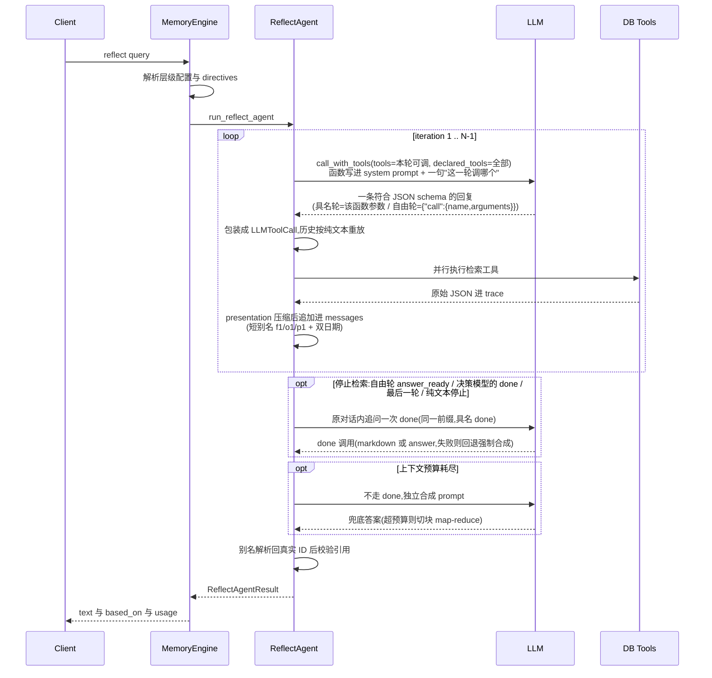
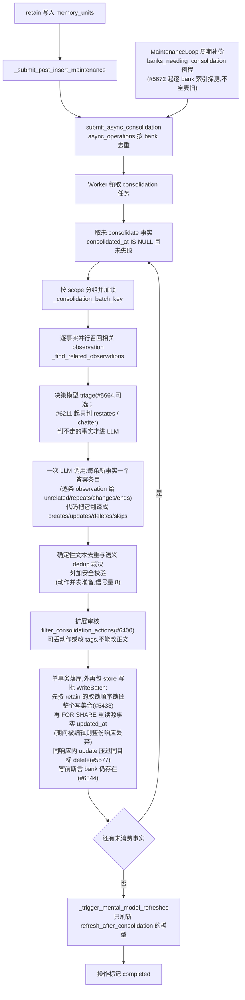
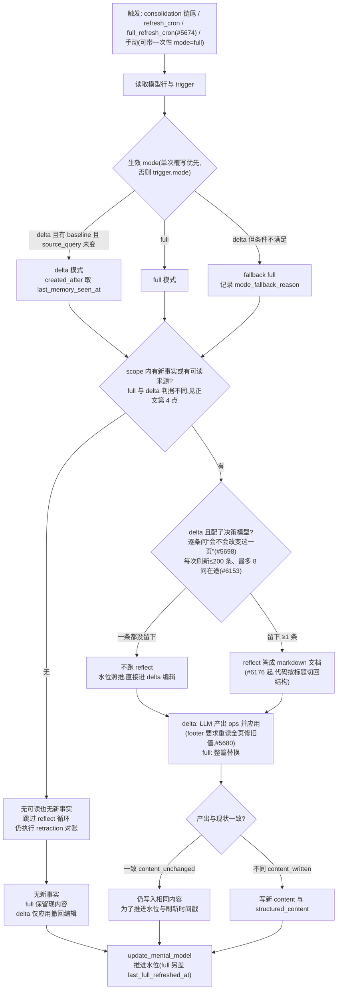

# 04 · Reflect 与 Consolidation —— 从"能背出记忆"到"能形成认知"

> 代码基线:`eebe3ab19`(2026-11,`85ab32ebe` 之后 3 个提交)。**本窗口树差分 27 个文件 / +978 −303**,但其中两个直接改到本篇的机制。① **reflect 的工具回合不再出现相邻两条 user 消息**(#6349):`as_text_messages` 现在把摊平后的连续 user 回合**合并成一条**——工具结果 + 下一次请求、问题 + 第一次请求、一次多调用的多个结果,三种情形都只剩一条;原因是 Gemma 一类模型的 chat template(在 llama.cpp / vLLM 下)以 "Conversation roles must alternate" 直接拒绝,于是**每次 reflect 都在那些部署上失败在第一次调用**。合并只往"前一条的末尾"追加,所以长对话的前缀仍是短对话的前缀,prompt 缓存不受影响(`providers/tools_via_schema.py:269-311`、`_joined_user_turns` `:318-325`);同一提交的另一半在 retain 的视觉路径(05 篇 §3.1)。② **一个回合的回复会被"结构校验"一次,错则纠正一次**(#6420/#6302):新函数 `reply_violation` 只查"这像不像一次调用"(有没有点名函数、参数是否在 `arguments` 下、参数名是否至少有该函数的一个形参),不逐字段对工具 schema;不合形状时把"哪里不对 + 再要一次"作为 assistant+user 两条追加进对话重发一次,第二次仍错则退化成"这一轮没有调用"(`llm_wrapper.py:1653-1671`)。动机是 Ollama Cloud 不强制 schema、Gemini 忽略 `additionalProperties`:一个把答案写在函数名旁边的 `done`(`{"call":{"name":"done","answer":...}}`)曾被当成**成功的调用**交给 agent,然后以"没有答案"失败。③ 第三个提交是 graph maintenance 的队列协议(#6417),它不碰 reflect/consolidation 的循环,但改写了本篇 §3.7 的整段队列语义。**上一窗口(`85ab32ebe`,73 提交,394 路径 / +18532 −4451)与本篇相关的十一处机制**,可分三组。**(一)consolidation 的答复与写前审核**:① 整份回复不合 schema 时**带错误重问一次**(#6374)——`_call_with_one_reask` 用新抽出的公共函数 `reask_messages` 追加"被拒的回复 + 逐字段错误",第二次仍失败才回到"判失败 + 自适应二分"的老路;动机是温度 0 下原样重发只会得到同一份坏回复;② 召回池按 id 建 `observations_by_id`(#6406),delete/update 的安全校验从线性扫列表变成字典查找;③ 每条 observation 的 earlier-state 注记**只留最新 3 条**(#6399,`_MAX_EARLIER_STATES = 3` 与 `_with_earlier_states`),因为无上界时同一话题反复出现会把近似注记堆成一串、小模型照着抄到输出上限;④ 扩展可在**落库前**审核抽取的记忆与 consolidation 写入(#6400,新钩子 `filter_retain_facts` / `filter_consolidation_actions` 返回 `MemoryReview{keep, tags}`——只能丢弃或改 tags,不能改正文);⑤ 写事务里加了一道"这个 bank 还活着"的断言(#6344,`assert_job_bank_alive`),防止被删 bank 的在途任务把它重建出来。**(二)mental model 刷新的发布与暂停**:⑥ 刷新产出的页面在**替换旧文档之前**可被 operation validator 拒绝并**要求重写**(#6386,`validate_mental_model_candidate`:拒绝默认终局、`retry=True` 时最多重写 3 次,终局拒绝落成 `refresh_failed_candidate_rejected` / `candidate_rejected`);⑦ 临时失败与 **LLM 槽位排队**都不再暂停自动刷新(#6140:新模块 `permit_wait.py` 把排队时间从墙钟里扣掉,`stage` 以 `.queued` 结尾时超时只记历史、不盖暂停戳);⑧ 统计里新增"自动刷新已暂停"的模型数(#6077),调度器与统计共用一条谓词 `_MM_REFRESH_PAUSED_SQL`;⑨ delta 步骤可以对**离题批次**合法地返回"无编辑",撤回 pass 的"整段删除"规则也同时收紧(#6473 与同窗口的 prompt 修整);⑩ 块正文里写的标题在应用后**提升为真 section**(`promote_embedded_headings`),让存储结构与渲染形状一致(§3.4)。**(三)待办与计数的成本**:⑪ 待办检查不再整 bank 计数(#6403,`has_pending_consolidation` 只 `LIMIT 1` 探一条)、待巩固计数让 planner 走上 unconsolidated 索引(#6415,`count_unconsolidated` 补 `ORDER BY created_at`)、页面/模型的大小改用引擎 tokenizer 计数(#6304,原来按 `len // 4` 估)、知识页 snippet 改在 Python 截断(#5986)、删除文件夹不再逐节点重扫整 bank(#6398)。**机制层不变的部分**:reflect 循环(`reflect/agent.py`、`reflect/tools_schema.py`、`presentation.py` 全文件零 diff)、consolidation 的 triage、per-scope 策略、graph maintenance、maintenance loop 都没有改动,所以 §2.1、2.2 的主体、3.1、3.2、3.5、3.6、3.7 与例 B 的机制描述不变,只重锚行号。
>
> 更早的窗口(按时间倒序,摘要):`33524bd33`(2026-11-03,v1.2.0 发布后 8 个提交;46 文件 / +394 −109)与本篇相关的只有"页/模型的 id 与 `max_tokens` 在 API 边缘被约束"(#6235 / PR #6282,§3.8 末);`bc5ea195a`→`2c00b59ae`(15 提交,735 条路径 / +6719 −4276,含 118 个 `.pyc`、16 个 `.venv` 与 825 行 `.venv` 删除)有三处机制:triage 判词不再先于那次重跑落库(#6239/#6273)、单模型 staleness 从三次分散读收成 store 的一次调用(#6261)、知识页证据图片在 store-owned bank 上按 id 读回(#6262)。正文的协议级重写仍属 2026-11 增量轮(基线 `bc5ea195a`):reflect 不用任何 provider 的 native tool calling、每次工具调用都是"对一条 JSON schema 的回复"(#6176);consolidation 输出改成"每条新事实一个答案条目"(#6164);另有双日期(#6236)、标识符内部别名不算引用(#6215)、限流重试(#6237)、delta 门有界(#6153)、delta 编辑规则(#6171)。
>
> **行号口径(本轮更新)**:本窗口树差分 394 个文件,主要文件的长度变化是 `memory_engine.py` +271、`consolidation/consolidator.py` +119、`llm_wrapper.py` +80、`api/http.py` +65、`config.py` +133、`extensions/operation_validator.py` +168、`reflect/structured_doc.py` +42、`reflect/delta_ops.py` −31——**位移不是常数**。本轮对全卷原有的 425 个 `path:line` 锚点做了两步:① 用 difflib 等值块做**内容保持的平移**——它只保证"新旧两行逐字相同",适用于函数体整体位移;② 指向**符号**的引用(定义、调用点、字段、路由)另按符号在新树 `grep` 重取,因为等值映射在重复行上会滑到无关代码——本卷自检与 R2 审计合计按符号重取 **42 处**(口径:每个改正的 `file:line` 计一处,13 个级联清扫调用点的一次重数列计 13 处;其中 R2 审计指出 15 处、自检补齐 27 处),典型如 `memories/base.py` 的 `lock_consolidation_write_set` 从 3798(实为 `delete_chunks`)改到 3915、`StrictConsolidationStrategySpec` 的 783 改到 `response_models.py:865`、`_resolve_inherited_temperature` 的调用点 `:4703` 改到 `config.py:4834`。新增段落与 R2/R3 补锚共带来 59 个新锚点,现共 484 个;`reflect/agent.py`(80 处)、`reflect/tools_schema.py`、`presentation.py`、`consolidation/prompts.py`、`triage.py`、`maintenance.py`、`graph_maintenance.py`、`retractions.py` 因文件零 diff 保持原值。**核验的边界要说清楚**:审计用的是**外部审计脚本**(`audit_anchors.py`,是审计方本机的工具,**不在本仓库里**),它只测"文件存在 + 行号不越界",**不测语义**。R3 复核实测**范围越界 3 处**:`mental_model_refresh.py:308-373`(文件 372 行)与 `engine/directives/models.py:9-38`(文件 37 行)都是区间末端各差 1 行,已在本轮改为 `:308-372` 与 `:9-37`;第三处是第 6 层第 6 条刻意保留的旧快照引用 `engine/providers/gemini_llm.py:1231-1250`(该文件 `wc -l` 为 1051 行——审计脚本按下标计会报 1052,因为文件以换行结尾;这三个行号按旧树书写)。前两处修掉之后,重跑审计**唯一**还会被报出来的越界就是这一个锚点(它在本卷出现 3 次,按 basename 解析会重复列出)。可见"不越界"远不等于"锚点全对"——R2 审计正是在全部不越界的锚点里挑出 6 组指向无关代码。因此凡引用具体行号前,仍应按符号复核一次。**本窗口(`eebe3ab19`)的新增例外**:`memories/pg/graph.py`、`graph_maintenance.py`、`llm_wrapper.py`、`providers/tools_via_schema.py`、`providers/openai_compatible_llm.py`、`engine/db/{base,postgresql,oracle,ops,ops_postgresql,ops_oracle}.py` 都有 diff,所以 §2.1 与 §3.7 的锚点已按新树逐条重取;其余段落(§3.5、3.6、例 B 等)引用到的文件零 diff,行号沿用。

> 研究对象:Hindsight 仓库 `hindsight-api-slim/hindsight_api/engine/` 下的 `reflect/`、`consolidation/`、`directives/`、`decision_model.py`、`decision_rerank_interface.py`、`providers/tools_via_schema.py`(工具调用的唯一实现)、`mental_model_refresh.py`、`graph_maintenance.py`、`maintenance.py`,以及 `memory_engine.py` 中对应的编排逻辑。
> 本文所有论断均以基线 commit `eebe3ab19` 代码为准,标注 `相对路径:行号`;无法从代码确认的地方明确写"未确认"。上一窗口(`85ab32ebe`)重写了 §2.2 的三段(答错重问、按 id 查池、写前审核)、§3.4 的三段(发布前审核、排队不暂停、delta 无编辑)与 §3.8 的两段(snippet 截断、删文件夹)。**本窗口(`eebe3ab19`)重写 §2.1 协议层两项(相邻 user 回合的合并、回复结构的纠正一次)与 §3.7 全节(队列认领从"删行"改成"盖戳",入队挪到提交前)**;其余段落不动。

---

# 第 1 层【全景】

## 1.1 这两个子系统分别是什么

**Reflect**(反思/应答):给定一个自然语言问题,基于 bank(Hindsight 的隔离记忆库:一个 bank 就是一个独立"大脑",bank 之间严格不串数据)里存储的记忆做 **disposition 感知的推理回答**(disposition 是 bank 的人格设定,见 3.2)。它不是一个"向量检索 + 拼提示词"的 RAG,而是一个带工具调用循环的 agent:模型自己决定查什么、查几层、什么时候停,最后必须为答案中的每个论断给出可校验的引用 ID。代码里的自我定位写在模块头:

```python
"""
Reflect agent - agentic loop for reflection, its tool calls made as replies to a response schema.

Uses hierarchical retrieval:
1. search_mental_models - User-curated summaries (highest quality)
2. search_observations - Consolidated knowledge with freshness
3. recall - Raw facts as ground truth
"""
```
(`hindsight-api-slim/hindsight_api/engine/reflect/agent.py:1-9`)

注意模块头这一行——"native tool calling" 在本轮被删掉了(#6176)。循环还是那个循环(模型自己决定查什么、查几层、什么时候停),但**协议换了**:没有任何 provider 再收到 `tools` 或 `tool_choice` 字段,每一轮是一次普通的结构化输出调用,详见 2.1。工具清单的自我描述也同步改了口径:`tools_schema.py` 开头现在写明 "These are OpenAI-format tool definitions; the model calls them through a response schema (see providers/tools_via_schema.py), never as native tool calls."(`reflect/tools_schema.py:4-6`)。

**Consolidation**(巩固/沉淀):一个后台异步任务,把 retain 写入的零散原始事实(world/experience)经由 LLM 合成为 **observation(观察)**——带证据溯源、带时间聚合、可被后续修正的"中间层认知"。模块头的定义非常直白:

```python
"""Consolidation engine for automatic observation creation from memories.

The consolidation engine runs as a background job after retain operations complete.
It processes new memories and either:
- Creates new observations from novel facts
- Updates existing observations when new evidence supports/contradicts/refines them

Observations are stored in memory_units with fact_type='observation' and include:
- proof_count: Number of supporting memories
- source_memory_ids: Array of memory UUIDs that contribute to this observation
- history: JSONB tracking changes over time

NOTE: Observations are distinct from mental models (pinned reflections).
- Observations: auto-generated bottom-up by this engine from raw facts (memory_units table, fact_type='observation')
- Mental models: user-defined queries stored in the mental_models table, refreshed on demand via reflect
"""
```
(`hindsight-api-slim/hindsight_api/engine/consolidation/consolidator.py:1-16`)

## 1.2 知识的三层结构(以及一次容易踩坑的术语考古)

| 层 | 存储位置 | 谁产生 | 谁消费 | 可变性 |
|---|---|---|---|---|
| 原始事实 world/experience | `memory_units` 表,本层取 `fact_type` 的 world/experience(历史值 opinion 已删除,见下方考古) | retain 时 LLM 抽取 | consolidation 的原料、reflect 的 ground truth | 删除即移入 `invalidated_memory_units` |
| **observation 观察** | 同一张 `memory_units` 表,`fact_type='observation'`,带 `proof_count`/`source_memory_ids` | **consolidation 自动合成** | reflect 的中间层(`search_observations`) | 后续 consolidation 持续 UPDATE/DELETE |
| **mental model 心智模型** | 独立的 `mental_models` 表(`name`/`source_query`/`content`/`structured_content`/`reflect_response`/`trigger`…;knowledge page 是同一张表里被 `knowledge_pages` 引用的行,见 3.8) | 用户定义查询 + **refresh 时由 reflect 生成内容** | reflect 的最上层(`search_mental_models`) | 按 trigger 自动/手动刷新 |
| directive 指令 | 独立的 `directives` 表 | 用户手写 | reflect 的**硬规则**,注入 prompt(附:硬规则层,不算知识层) | 增删改查 |

**术语考古(必读,否则读代码会迷路)**:这套名字换过两轮。迁移 `p1k2l3m4n5o6_new_knowledge_architecture.py` 曾把 mental model 存进 `memory_units(fact_type='mental_model')`、把 pinned_reflections(更早的旧表名)改名 reflections;随后迁移 `t5o6p7q8r9s0_rename_mental_models_to_observations.py` 完成现在这轮命名:`fact_type` 值 `mental_model` → `observation`,表 `reflections` → `mental_models`(`alembic/versions/t5o6p7q8r9s0_rename_mental_models_to_observations.py:34-78`)。所以今天:
- `memory_units` 里的 **observation** = 自动合成的中间层知识;
- `mental_models` 表 = 存 reflect 回答的"文档页"(旧名 reflections,refresh 时内容重写);
- `engine/reflect/observations.py` 里那个带 `ObservationEvidence`/`quote`/`Trend` 的 `Observation` 模型是**上一代设计的残留**——在 engine/ 与 api/ 目录里 grep 不到任何包外消费者(`reflect/models.py:12-46` 的 `ObservationSection`/`ReflectAction`,经 `reflect/__init__.py:20` 再 re-export `ReflectAction`/`ReflectActionBatch`,但整个 ReflectAction/ObservationSection 集群在包内没有其他消费者),现在的 observation 数据模型是 `engine/response_models.py` 的 `MemoryFact`(经 consolidator 写入)。此为代码检索结论:"当前主链路未使用"。
- 考古细节补遗(承接上表):全表 `fact_type` CHECK 现为三值 `('world','experience','observation')`——历史值 `opinion` 由迁移 `g2h3i4j5k6l7_remove_opinion_fact_type.py:34-51` 删除行并收紧(Oracle 基线同为三值,`o1a2b3c4d5e6_oracle_baseline.py:133`);`reflect_response.based_on` 至今保留 "opinion" 空键,只是历史兼容占位(`memory_engine.py:16549`、`retractions.py:35-45`)。

## 1.3 为什么说这是 Hindsight 区别于普通 RAG 的核心

1. **知识有"合成层",且可被继续修正**。普通 RAG 只有"原文 chunk"。Hindsight 的 consolidation 会把反复出现的事实折叠到同一条 observation 上——第一条建立它,后续同义或改写的证据走 repeat/update 追加进 `source_memory_ids`,`proof_count` 随之增长(#6164 之后"一条事实一个条目"的协议里,这一步由 `repeats`/`changes` 判定 + `to_actions` 完成)——并在新证据到来时 UPDATE/DELETE 它。检索时查到的是"被合并、去重、带新鲜度"的知识,而不是十条相似原文。
2. **推理与存储双向奔赴**。reflect 不只读:它的回答(mental model)会作为下一层知识存回去再被检索(自指的"经验沉淀");consolidation 也不只写:它每轮结束会触发 `refresh_after_consolidation=true` 的 mental model 刷新,让上层文档跟着新事实走(`consolidator.py:2602-2710`)。
3. **证据与推断在协议层分离**。reflect 的 `done` 工具(模型交卷时调用的工具)要求"正文与引用 ID 分开写"、`reflect_response.based_on` 按事实类型记录每条被引用的原始证据;consolidation 的 prompt 明令"不许做算术"(现写在 `_RULES` 的 `changes` 与 `new` 两条里:"A count is changed only by a fact that states the new number itself … Never calculate."与"Never calculate. "The user has 2 dogs" + "the user has a dog named Rex" → new "The user has a dog named Rex"",`consolidation/prompts.py:119, 130`)。这让"结论"永远可以被审计回"证据"(见第 3 层 3.1)。
4. **人格与使命可配置**。bank 的 disposition(怀疑/字面/共情 1-5)与 `reflect_mission` 直接注入 reflect 的 system prompt,改变同一个记忆库回答的语气与推理方式(3.2)。

> 读完结构后可直奔文末:第 5 层把六个"必答问题"汇总成速查,本文各节就地回答它们、并标注对应小节。

---

# 第 2 层【主流程】

## 2.1 Reflect:带工具契约的应答循环(工具调用 = 对 schema 的回复)

**必答问题 1 的答案**:reflect 有完整的多轮工具循环。输入是 `query`(+可选 `context`、tags、`response_schema`);LLM 被反复调用,但**每一轮都是一次结构化输出调用**,不是一次 native tool call(#6176,见下方"协议层");输出是 `ReflectAgentResult`(答案文本 + 可选结构化文档 + 引用 ID + 完整 tool/LLM trace)。它**不写任何东西**——`reflect_async` 的 docstring 明确 "Reflect is read-only: it synthesizes an answer from the bank's stored memories and persists nothing."(`memory_engine.py:16083-16084`)。

### 协议层:一次工具调用就是一条 schema 的回复(#6176)

这是本轮最底层的变化,读懂它才读得懂后面所有轮次语义。`reflect/agent.py` 仍然按 OpenAI 的 tool 定义格式拼工具清单(`tools_schema.py`),但**清单不再发给 provider 当 `tools`**:`call_with_tools` 的全部实现就是"把函数写进 system prompt、用一句用户话点名这一轮要哪个调用、把回复按 JSON schema 收回来,再包装成一个普通的 `LLMToolCall`"(`providers/tools_via_schema.py:1-17`)。

动机写在模块头,而且是实测出来的:response schema 是**每个被支持的 provider 都真正强制**的东西,而 native `tool_choice` 不是——vLLM 的 gemma4 parser 能解析 tool call,但对 `required` 与具名选择跳过语法约束,于是小模型用停止信号回应一次强制检索(Gemma 4 上 **75% 的强制步**),或者用另一个工具回应一次强制的 `done`。另一面是:"把 schema 强加给一段对话从没要过的回复"会产生退化参数,所以要加这句点名的话(`tools_via_schema.py:10-16`)。

三个细节:

```python
def response_schema(tools: list[dict[str, Any]], tool_choice: LLMToolChoice) -> ResponseSchema:
    """The schema the reply is held to for this turn."""
    if tool_choice.mode is LLMToolChoiceMode.NAMED:
        tool = forced_tool(tools, tool_choice)
        return ResponseSchema(name=_function(tool)["name"], schema=_arguments_schema(tool))
    options = [ ... ]
    return ResponseSchema(
        name="next_call",
        schema={
            "type": "object",
            "properties": {"call": {"anyOf": options}},
            "required": ["call"],
            "additionalProperties": False,
        },
    )
```
(`providers/tools_via_schema.py:98-123`,中间构造 `options` 的列表推导略)

- **具名轮**(`NAMED`):这一轮的回复就是那个函数自己的参数对象;自由轮(`REQUIRED` 与 `AUTO` 在语义上已经等价,都表示"恰好一个")的回复是 `{"call": {"name", "arguments"}}`,函数的 `name` 用 `enum` 钉死,`arguments` 是各函数参数的 `anyOf`。
- **schema 的"闭合"是必须的**:`_closed` 递归地把每个 object 变成 `required` 全列、`additionalProperties: false`,并把原本可选的属性改写成 `{"anyOf": [<原属性>, {"type": "null"}]}`,回复回来后再把 null 丢掉(`tools_via_schema.py:35-64, 171-175`)。**本窗口(#6321/#6305)把"可空"的写法从 `"type": [<type>, "null"]` 换成 `anyOf`**:MiniMax 对类型列表直接回 HTTP 400,Anthropic 在 `items` 旁边见到类型列表同样拒绝,而其余结构化调用早已是 `anyOf` 形状——统一之后同一套 schema 才能发给所有 provider(`:39-41` 的说明、`:54` 的实现)。注释专门交代**不许加字符串长度上界**:在 xgrammar 下受限字符串不允许任何转义序列,一加上界,markdown 页面就连一个换行都写不出来(`:43-45`)。
- **`reason` 被排到参数最后**(`_TRAILING_ARGUMENTS = ("reason",)`,:63-83):schema 约束下的回复按属性顺序生成,而检索工具的 `reason` 原本排第一——Gemma 4 先解释完自己,再把 query 写成一张永不闭合的关键词表("2FA mandatory MFA mandatory 2FA mandatory …"),8 次首轮强制检索里 7 次如此,把 query 放到最前面后 0 次。

回读侧(`llm_wrapper.call_with_tools`,`llm_wrapper.py:1563-1655`)有四件值得记住的事:

1. **`declared_tools` 与 `tools` 分离**(`llm_wrapper.py:1574, 1527-1531`):`tools` 是这一轮**可以调**的函数(自由轮里会把 `done` 摘掉,见下),`declared_tools` 是写进 system prompt 的**全部**函数。两者分开,是为了让同一段对话每一轮的 prompt 前缀逐字相同——provider 的缓存才认得出这个前缀,而某一轮收窄可调范围不会把前缀改掉。
2. **历史被重放成纯文本对话,且相邻的 user 回合会被合并**(`as_text_messages`,`tools_via_schema.py:269-311`,`_joined_user_turns` `:318-325`):上一轮的 assistant `tool_calls` 被写成它当时写的那段 JSON(`{"call": {...}}`),工具结果变成一条 user 轮,正文形如 "Result of `recall`:" 加结果原文(函数名从 call id 反查)。**本窗口(#6349)改的正是这里**:摊平之后连续两条 user 回合会合并成一条——工具结果 + 本轮"该调哪个"的请求、用户问题 + 第一次请求、一次回复里多个调用的多个结果,三种情形都只剩一条。原因写在 docstring 里:"OpenAI takes two user turns in a row, but the chat template of many open models (Gemma's, under llama.cpp or vLLM) refuses them with "Conversation roles must alternate", so every reflect failed on its first call there (#6349)." 合并只往**前一条的末尾**追加(文本以空行连接、图片 part 列表直接拼接,`_joined` `:328-333`),所以上一版那句 "Turns are not merged" 的保证换了实现、没有换结论:"A turn is only ever joined onto the end of the one before it, so the prefix of a longer conversation still renders to the prefix of its text."——provider 自己的前缀缓存(和一个更长的对话的前缀)仍然命中。
3. **三种失败各有出口**(`llm_wrapper.py:1632-1671`):撞输出上限(`OutputTooLongError`,回复陷进重复循环)是采样意外,再采一次,第二次仍超才抛;回复根本不是 JSON(`json.JSONDecodeError`)则返回一个**没有 tool call** 的结果并把散文塞进 `content`——于是 agent 侧那套"首轮没产出可用调用 → `ReflectToolCallError`"的老判定继续生效,而不是变成一次解析异常;**回复是 JSON 但不像一次调用**(本窗口 #6420/#6302)时,先按 `reply_violation` 给出的说法把"哪里不对"和这一轮的请求一起发回去纠正**一次**(`text_messages` 追加 assistant 的原文 + 一条 user 的 "That reply does not fit the required format: {violation}. " + 本轮请求,`:1662-1671`),第二次仍不合形状就同样退化成"没有调用"的结果(`tool_calls = []`,模型原文留在 `reply` 里,`:1656-1661`)。判定刻意只查调用的**形状**、不逐字段校验工具 schema:工具的 `required` 里有些字段 agent 本来就可以不填(`reason` 是调试注记、引用 id 默认为空),对不强制 schema 的端点逐字段追问只会白烧一轮——理由与取舍见 05 篇 §3.1。
4. **两种包装被拆开**(`_unwrapped`,`tools_via_schema.py:178-199`):Gemini 的 schema 支持会忽略 `additionalProperties: false`,模型于是把一次强制的 `done` 写成 `{"done": {...}}`(页面到手时没有 `markdown` 字段),或者写成自由轮的 `{"call": {"name": …, "arguments": {...}}}`。两者都点名了同一个函数,所以只有一种读法。

**计数(本轮重数,方法:数 `get_reflect_tools` 里 `tools.append` 的分支)**:一个 reflect 最多声明 **7 个函数**——`search_mental_models`、`read_mental_models`、`search_observations`、`recall`、`expand`、`answer_ready`、`done`(`reflect/tools_schema.py:405-482`),按配置裁剪(`expand` 在 `store_document_text=false` 时不出现,`read_mental_models` 随 mental models 层,`answer_ready` 只在收尾轮写答案时),而**某一轮可调**的还要再减一个 `done`(`loop_tools`)。

这次改造把三个旧机制一并送走了:provider 侧的 `_rejects_tool_choice` 降级(强制 `tool_choice` 被 400 拒绝时改发 `auto` 并记住,1.1.0 #5917)不再有调用点;reflect 的**增量 prompt 缓存调度**(下一轮是自由轮才建缓存、把 `tool_choice=required` 一起传进去)整段删除;`llm_supports_max_items` 这类"按 provider 能力开关 schema 关键字"的开关也退场,改由 provider 自己剥掉不认的关键字(`anthropic_llm.py:60-82`、`agent.py:2310-2315`)。

**1.0.0 的新前提(#5382):配了决策模型时,reflect 由决策模型编排。** `reflect_async` 先按 bank 配置解析 `reflect_use_decision_model`(mental model 刷新另有独立开关 `mental_model_refresh_use_decision_model`,两者都是层级可配字段,`config.py:3969-3971`、`_CONFIGURABLE_FIELDS` 含之 `config.py:4299-4301`),开关打开且服务器配了 reflect 决策模型时,把两个函数闭包传进 agent(`memory_engine.py:16208-16213` 解析开关、`16291-16292` 传闭包):

- `evidence_is_sufficient_fn`——"这些证据是否已回答问题"的一次 `Score` 判定(拿最多似然档位而不是四舍五入期望分:期望 1.43 会被舍成"部分",而"完全"才是 0.54 的最大似然档,每次误判白付两轮 LLM;`cross_encoder.py:1503-1552` 的 `evidence_is_sufficient`);
- `prune_evidence_fn`(`_prune_reflect_evidence`,`memory_engine.py:16025-16044`)——对一轮并行召回的全部候选打分、保留相关者(shortlist 25、min_keep 15,`memory_engine.py:16015-16016`)。

给了 `evidence_is_sufficient_fn`,`run_reflect_agent` 就进入 **decision-orchestrated** 模式(`agent.py:617`):检索各层不再逐层各花一轮 LLM 写查询,而是**首轮把全部强制层合成一次并行 round**(每层一个工具调用、共用同一条改写后的查询),决策模型负责"证据够不够、该不该继续";没有它,reflect 走原来的 agent 轮次。细节见下方"循环骨架"内的新条目。

被 reflect 的决策模型支持的 provider 是两个:**`typesafe`(Jev 的 System One 端点)与本轮新增的托管端点 `hindsight`**(`SYSTEM_ONE_DECISION_MODEL_PROVIDERS = frozenset({"hindsight", "typesafe"})`,`config.py:1643`;判定在 `memory_engine.py:15981-16019`,只告警一次)。cloudflare/openai 配置会让 reflect 保持 agent 轮次,而不是每次首 round 失败。本轮还给这个客户端装了 `RetryPolicy()`(#6237):注释写明没有它时,一次 429 会丢掉那一轮的 cut(全部保留)或"够不够"判定(退回 agent 轮次),在一个 LoComo 跑批上是 **30% 的 reflect** 悄悄退化成了 agent 模式(`memory_engine.py:16018-16023`)。

### 主时序图

先看一次 reflect 请求的完整时序(图 1):请求、循环、响应三段;循环里的每个环节随后逐段展开。



### 循环骨架

入口 `run_reflect_agent`(`agent.py:503`)在外层包了一层,只负责补一个 `reflect_id`(引擎已经用同一个 id 记过 "Starting",一次请求从此只有一本账)再转进 `_run_reflect_agent_inner`(`agent.py:546`)——**它现在什么也不清理**:docstring 仍写着"tears down any per-step context caches it created",而按 #6176 删掉增量缓存调度之后,循环里已经没有任何地方创建缓存(`run_reflect_agent`,`agent.py:516-529`,这是一处尚未跟上的注释,见第 6 层)。默认最多迭代 `DEFAULT_MAX_ITERATIONS = 10`(`agent.py:159`),并按 budget(请求参数,控制检索深度的档位)放缩:low=0.5x、mid=1x、high=2x(`memory_engine.py:16199-16202`)。

每一轮的关键决策——**强制分层检索**:

```python
        forced_sequence = []
        if has_mental_models:
            forced_sequence.append("search_mental_models")
        if include_observations:
            forced_sequence.append("search_observations")
        if include_recall:
            forced_sequence.append("recall")

        # A fresh mental model releases the remaining forced steps.
        forced_step_pending = not forcing_released and forced_steps_done < len(forced_sequence)
        if forced_step_pending:
            iter_tool_choice = LLMToolChoice.named(forced_sequence[forced_steps_done])
        elif follow_up_required and forced_sequence:
            ...
            iter_tool_choice = LLMToolChoice.named(forced_sequence[-1])
        elif absence_recall_forced and not recall_ran:
            iter_tool_choice = LLMToolChoice.named("recall")
        else:
            # ``required``, not ``auto``: left free, most models stopped with the answer as
            # prose, which is thrown away and written again by the closing step (#5832).
            # A provider that ignores ``required`` downgrades it to ``auto`` itself.
            iter_tool_choice = LLM_TOOL_CHOICE_REQUIRED
```
(`agent.py:1239-1265`,中间 `follow_up_required` 分支的注释略;0.10.3 线内 #5292 把这段判定挪到了每轮循环的开头——它现在还决定"上下文已满时压缩哪条消息"与"压缩后是否还允许自由轮",见下方超预算兜底)

逐点讲解:
- **自由轮不再"自由":`required` + `answer_ready`(#5832/#5916)**。强制链走完之后那一轮,1.0.0 还叫 `auto`;实测多数模型就此停下、把答案写成散文,而散文会被丢弃、结尾那一轮再写一遍——最后一条自由轮和白付一次答案同价。现在自由轮一律 `required`(在这个协议下等于"schema 要求恰好一个调用",不是发给 provider 的字段):必须调一个工具。**收尾那一轮要自己写答案的那些 reflect——没有生效的决策模型,或 `answer_as_document=True`(刷新写文档)——多给一个 `answer_ready`**(`closing_step_answers = evidence_is_sufficient_fn is None or answer_as_document`,`agent.py:644-647`;`is None` 有三种来源:根本没配、provider 不是 typesafe/hindsight(`memory_engine.py:15996-16004` 告警一次后返回 None)、bank 关了 `reflect_use_decision_model`(`memory_engine.py:16208-16215`)——后两种"配了决策模型"也照样拿到 `answer_ready`;`TOOL_ANSWER_READY`,`tools_schema.py:379-402`):它只有一个参数,从 `done` 抄来的 `answer_found` 布尔——"够了"只需一个 bool,答案由收尾那一轮写。决策编排的非文档 reflect **不**开这条路(`closing_step_answers` 为 False):那里自由轮**仍然是 `required`(恰好一个调用),但可调集合里仍有全部检索工具**(`loop_tools` 没有摘掉它们,`agent.py:670-672`、`:1361`)——模型可以再发一次检索,也可以调 `done`;真正的区别只在这个 `done` 被**原样采纳**、不再进收尾那一轮重写——决策编排下这份 done 紧跟一次已剪枝的 round,重写反而丢掉刚记录的判断(coding-agent reflect benchmark 在 Jev 端点上从 10/12 掉到 7/12);文档刷新仍走收尾重写,因为页面更新只合并答案引用到的事实,自由轮的 done 引用得更少(刷新评测 hq-count-billing 上四个新客户丢了两个,`agent.py:1516-1523`)。同一个"recall 没跑过不许报一无所知"的闸门也随之搬过去(`agent.py:1486-1501`),而任何检索都还没返回就 `answer_ready` 会被打回重来(`_SEARCH_FIRST_ERROR`,`agent.py:1466-1484`)。此时 `done` 的描述被重写成"只在被要求时调",但保留充分性闸门——把闸门连同旧描述一起删掉那次,收尾答案开始推断证据里没有的值(system eval hq-absent-2024,`tools_schema.py:472-476`)。**#6176 给这条路补了两个硬约束**:①收尾轮写答案时,`done` 从这一轮**可调工具**里整个摘掉(`loop_tools = [t for t in tools if not _is_done_tool(...)]`,`agent.py:668-672`)——自由轮只能选某个检索或 `answer_ready`,不会写出一个被丢弃的答案;但 `done` 仍留在 `declared_tools` 里,所以 prompt 前缀不变。②这一轮的输出上限被单独压到 `_SCHEMA_LOOP_TURN_MAX_TOKENS = 1024`(`agent.py:174, 652-656`):schema 约束下的回复在负载下可能陷进重复循环("ranking service squad owner ranking service squad owner …"),不封顶时跑到 12,288 token 并撞请求超时。旧世界那句"provider 忽略 `required` 就自行降级成 `auto`"随 native tool choice 一起消失——现在没有可忽略的字段,只有"回复是否满足 schema"。
- 前几轮 `tool_choice` 被**点名强制**:bank 有 mental models 就先强制查它,有 observations 就再强制查它,最后强制 `recall`——保证 agent 不会跳过任何一层知识就作答。工具清单本身按配置裁剪(`get_reflect_tools`,在 `agent.py:657` 调用),prompt 里的检索策略段落与实际工具一一对应,避免弱模型幻觉出不存在的工具(`prompts.py:326-333` 注释、#1724)。0.10.2 起 system prompt 还在强制层之上写了一段显式的 "## Search Plan"(逐层下降、新鲜即停、证据到了就 `done`,`prompts.py:437-456`;0.10.3 线内 #5250 重写了其中的 Workflow 步骤:下降条件从"没有 mental model 或它 stale"改为"**它没有 STATE 出答案**",见下方 #5250)。mental models 这一层还拆成了**搜索 + 阅读**两个工具:`search_mental_models` 按排名顺序把整页塞进一个 token 预算(**默认 16000**,`DEFAULT_MENTAL_MODELS_SEARCH_MAX_TOKENS`,`tools.py:40`;bank 或请求可经 `reflect_default_options.reflect_search_mental_models_max_tokens` 改,`memory_engine.py:16307-16311`),排名第一的页**无论多大都整页返回**,预算外的命中只给 280 字符的 `snippet`;`read_mental_models` 按需把选中的页读全(单次默认 6000 token,`tools_schema.py:117-148`、`agent.py:77-84`),放不进预算的页不读、列进 `not_read`,**第一页总是读**。1.1.0(#5787)之前是"最匹配的一页整页返回、上限固定 4000 token":一个页面普遍超过 4k 的 bank 会一页都拿不到,而答案又未必在第一名——五页全文曾测得 8.7-19k token 并在后续每轮重发,`tools.py` 注释;#4716。
- **决策模型编排的并行 round(#5382,仅当 2.1 开头的两个函数闭包传入)**:第 0 轮不再逐层点名——先把请求(每个请求都先经一次机械改写调用蒸馏成一条搜索查询;蒸馏失败就按原文搜,`agent.py:1309-1349`),然后 `_parallel_round` **一次发出全部强制层工具**(每层一个调用、共用该查询;recall 的 `max_tokens` 抬到 `_ROUND_RECALL_MAX_TOKENS=8192` 让决策模型有更大的裁剪余地,`agent.py:1152-1235, 155`)。round 落地后(`round_landed`,`agent.py:1716` 置真、1229 消费)下一轮开头问决策模型"这些证据够不够"(`_decision_says_sufficient`,`agent.py:1101-1127`)——够,直接 `_finish` 收尾,唯一的 LLM 调用就是答案本身;不够,`follow_up_required` 让模型自己写下一条查询,而那条查询**仍然作为整轮并行 round 执行**、再被裁决(`agent.py:1569-1595`,注释:decision-orchestrated 下是决策模型而非 LLM 决定证据何时够)。决策模型读页面后认为页面已答时,下层工具结果对模型隐藏(`pages_answered` + `_hide_lower_layers`,`agent.py:1687-1712, 1891-1900`)——"raw facts 放在页面旁边会诱导答案混入页面已取代的旧说法";这一轮里页面判定与剪枝是**并发**发出的(`asyncio.gather`,:1701-1706),因为两者都是决策模型调用、等一个再发另一个不划算。决策模型调用失败不炸 run:`decision_model_failed` 置真后回落到普通 agent 轮次(`agent.py:1117-1126`)。**1.1.0(#6022)拆掉了改写器"没有可搜的东西就回 `NONE`"那个出口**:它本意是让"谢谢""好的"这类请求不付检索费,但一个本地模型对真问题也回了 `NONE`,reflect 直接空手而归;现在"谢谢"只是多付一轮检索,`NONE` 这个哨兵值随其文档分支一起删除,改写结果为空就按原文搜(`distilled or query`)。
- `forcing_released` + `forced_steps_done` 是一对确定性短路状态(0.10.2 线内 #5236 重构):强制查出的 mental models 若全部"新鲜可用"(stale 指"上次刷新后 scope 内又进了新事实",见 3.4;这里还要求非空——`_all_mental_models_are_usable_and_fresh` 的两个条件是 `is_stale is False` 与 snippet/content 非空——搜索命中带 snippet、整页阅读带 content,二者任一即可,`agent.py:482-507`;1.1.0(#5787)起还要**带 `content` 的整页**——`_fresh_usable_pages` 会把只有 snippet 的命中滤掉(`agent.py:1872-1889`),否则决策模型凭一段页首就判"够了",检索在页还没被完整读过时就结束了),就把 `forcing_released` 置真、提前放开强制、进入自由轮,让模型自己决定要不要继续深挖(`agent.py:1770-1783`,判定函数在 `agent.py:482`)。注意该短路**仅在 low/mid budget 生效**:`agent.py:1775` 的 `(budget or "low").lower() != "high"` 门让 high 恒走完整强制链;decision-orchestrated 的 round 里该短路还要决策模型确认页面没答才放行(`:1774` 的 `not parallel_round or pages_answered`)。与旧版的关键差异在**步进索引**:旧版强制步按迭代轮数索引(`stop_forcing_from_iteration`),一轮报错或返回空回复也会滑到下一步、被跳过的那层从此不再执行(#4564);现在按"已产出 tool call 的强制步数"索引:出错的那一轮会**原步重问**(索引没前进),而**空回复的那一轮不会**——索引同样没前进,但循环已经走 `_finish` 结束了(见下一条),这是本轮相对 0.10.3 描述的真实差异。**0.10.3 线内(#5272/#5356)补了短路的告知义务**:放开强制只改 `tool_choice`,模型从不知道为什么——qwen3.8-flash 在新鲜页面已回答后仍继续下探 recall,把 raw facts 里翻到的细节垫进答案、页面从没说过这些(#5272);现在释放短路的那个工具结果会被附加一行 `guidance`("These pages are fresh. If they answer the question, call done now and answer from them alone; search further only for a specific detail they lack.",`_FRESH_PAGES_GUIDANCE`,`agent.py:476-480, 1814`)。
- **强制步空回复:不再原地重试(#5236 的机制在本轮被删)**。旧版对"被点名的检索步返回空回复"有一次单发重试(`forced_empty_retry_used`),本轮这段代码整个消失(新 `agent.py` 里 grep 不到该标识符)。现在空回复的处置取决于此前有没有成功调用过:从未产出过可解析调用(`saw_tool_call=False`)→ `ReflectToolCallError`,报出 provider/模型、请求的 `tool_choice` 与 `finish_reason`(`agent.py:1428-1454`);此前调过工具 → 视为"模型自己停了",走 `_finish` 收尾(`agent.py:1455`)。强制步的推进索引 `forced_steps_done` 只在**这一轮真的产出了 tool call** 时加一(`agent.py:1464-1466`),所以空回复不会滑到下一层、那一层会留在待办里——但它也不会被自动重问,这是与 0.10.3 描述的一个真实差异。
- 到达最后一轮(`is_last`)或模型停在纯文本轮次时,走统一的 `_finish` 收尾:先在**同一个对话里**追加一轮**具名 `done`** 的调用(`_ask_for_done`,trace scope `closing_done`,复用 provider 已持有的前缀),成功就按 done 处理;provider 产不出调用再回退 `_forced_final_synthesis` 独立合成(`_ask_for_done` 在 `agent.py:855-926`,`_finish` 在 `929-980`,`_forced_final_synthesis` 在 `982-1100`)。这一轮同样是"具名 done 的一条 schema 回复",函数声明与前缀复用同一条对话。实测只有约 29% 的刷新会自己调 `done`,旧版对 prose 停止直接重渲染全部工具结果开新 prompt,整份证据按全价重付一遍——收尾改走原对话是 #4656 实测 -26%~-43% per refresh 的主要来源之一。
- 工具参数有硬边界:`_TOOL_ARG_MIN_TOKENS=1000`、`_TOOL_ARG_MAX_TOKENS=16000`(`agent.py:69-70`),且单批工具调用的总预算按"剩余上下文 / 并行数"分摊(`_resolve_tool_arg_ceiling`,`agent.py:106-120`),防止一次批量拉取把上下文撑爆、触发慢速的 split-synthesis(#4239)。

**budget 的语义边界(0.10.3 线内,#5250/#4567;1.0.0 线内 #5641 补上代码级闸门)**。low/mid 档的深度指引曾写"mental models/observations 给出合理答案即停",与 fresh-mental-model 短路叠加后,reflect 可以只凭页面层就答"bank 里没有关于 X 的信息"——而同一 bank 的 recall() 拿得出事实(#4567)。修复是一组措辞与规则的收紧:预算只约束**答案长度与搜索次数**,绝不约束"要不要下探底层"——low 档现在说"保持答案简短;少花搜索,但让每次搜索都算数(换着措辞查,别重复同一个查询)"(`prompts.py:479-528` 的 RESEARCH DEPTH 段),三层检索的 MANDATORY 规则从"上层返回 0 条结果才必须 recall"改为"上层返回的结果**没有 STATE 出答案**就必须 recall",且"断言 bank 无某信息"必须先跑过以问题关键词(issue key、名字、标识符)原文查询的 recall();`done` 工具自身的描述——模型挑工具时真正权衡的那段文本——加上同一道充分性闸门(`_DONE_SUFFICIENCY_GATE`,"仅与问题同主题的结果不是答案,去搜下一层;recall 没跑过就不许报'一无所有'",`tools_schema.py:198-207, 221`)。这条规则在 prompt 里只写两份(RAW FACTS 层与 done 闸各一,深度段落只留短的覆盖行——prompt 里每一行都是每次 reflect 要付费的,#4716)。**1.0.0(#5641)把"断言无所知"从措辞升级为协议字段**:`done` 新增必填布尔 `answer_found`(`tools_schema.py:208-216, 249-251`);模型置 `false` 且 recall 尚未跑过时,循环拒收这次 done 一次、告知原因并强制下一轮 `recall`(`_answer_found` 宽松解析——缺字段或读不出都按 true 处理,跳过字段的老模型行为不变,`agent.py:1213, 1655-1673, 1703-1716, 2472-2483`;recall 之后仍答"没有"的 done 照常接受)。提交说明同时如实记录了测量的局限:gemini-3.1-flash-lite 上新旧 prompt 都过 3/3,2.5-flash-lite 上带不带改动都挂;事故模型是 gpt-5.6-luna(effort low)、页面集 54.6 万字符,载荷的体量与可信度是 fixture 模拟不了的,委托 #4567 在报告者的 bank 上继续测量。

**交卷守卫:闸门搬到了 `answer_ready` 上(#6176)**。旧版在 `done` 分支里查"这一轮到底搜过没有";现在**两条停止路径各有各的守卫**:

- **自由轮只能调 `answer_ready`**(收尾轮写答案的那些 reflect)。守卫照旧是"先搜再交卷"和"没搜过 recall 不许报一无所知",但作用对象换成了这个只有一个 bool 的调用:

```python
        ready_call = (
            next((tc for tc in result.tool_calls if _normalize_tool_name(tc.name) == "answer_ready"), None)
            if closing_step_answers
            else None
        )
        if ready_call is not None:
            rest = [tc for tc in result.tool_calls if tc is not ready_call]
            if not rest and not searched and iteration < max_iterations - 1:
                # Before any search returned: told so, as done is, rather than dropped unanswered.
                (ready_wire_id,) = _unique_tool_call_ids([ready_call], emitted_wire_ids)
                messages.append({"role": "assistant", "tool_calls": [_tool_call_to_dict(ready_call, ready_wire_id)]})
                messages.append(
                    {
                        "role": "tool",
                        "tool_call_id": ready_wire_id,
                        "content": json.dumps({"error": _SEARCH_FIRST_ERROR}, ensure_ascii=False),
                    }
                )
                continue
```
(`agent.py:1466-1484`,节选)

  什么都没查就想收尾 → 先把 `answer_ready` 调用本身连同一条**去重后的 wire id** 写回 messages(它必须进同一份请求历史,否则下一轮重放的文本对话里只有错误、没有那次调用),再伪造一条 tool error 打回去继续查——这与旧版对 `done` 做的是同一件事,只是对象换了。随后的第二道闸仍是"`answer_found=false` 且 recall 没跑过 → 强制 recall 一次"(`agent.py:1486-1501`,`absence_recall_forced`);`_answer_found` 仍是宽松解析(缺字段/读不出按 true,`agent.py:2251-2262`)。`answer_ready` 与其它调用同批出现时,其它调用照跑、这一轮不结束(`rest` 非空的分支)。
- **决策编排的自由轮仍可调 `done`**,而它不需要这两道闸:第一个并行 round 已经把每一层(含 recall)都搜过,才轮到自由轮。所以 `done` 分支只剩一个判断——这一份 done 是**原样采纳**还是**交给收尾重写**:

```python
        if not decision_orchestrated or decision_model_failed or answer_as_document:
            return await (_forced_final_synthesis if compacted else _finish)(iteration + 1)
```
(`agent.py:1522-1523`)。三个条件任一成立就走收尾:非决策编排(正常情况根本到不了这里,因为 `done` 不在可调集合里)、决策模型已失败(退回 agent 行为)、或文档模式(页面更新只合并 `answer` 引用到的事实,自由轮的 done 引用得更少)。

**其余工具调用的纪律没变**:
- 并行执行:`asyncio.gather(*tool_tasks, return_exceptions=True)`(`agent.py:1684`),结果按**模型给出的原始顺序**回填(槽位按 position 而非 tool_call_id 索引,防御返回重复/空 id 的网关,`agent.py:1595-1612`;wire id 由 `_unique_tool_call_ids` 全循环去重,`agent.py:1982-2010`)——重放成文本对话之后,这套 id 唯一性仍然必要,因为"调用 / 结果"两半靠它配对(`as_text_messages`,`tools_via_schema.py:233-271`)。
- 工具抛异常 ≠ 返回 error JSON:前者是基础设施故障,整个 run 失败(`ReflectToolExecutionError`,`agent.py:221-240`)——否则 agent 会"用不完整的证据自信作答",下游分不清"空 bank"和"坏了的 bank"。
- 幻觉出的、不在 `enabled_tools` 集合里的工具名,返回结构化 error 让模型自己改(`agent.py:1595-1646`),而不是崩溃。
- `done`/`expand` 的 id 字段不是列表(裸字符串、`true`)时按**空**处理而不是炸掉整个 reflect(`_cited_ids`,`agent.py:2323-2332`;`_expand_memory_ids`,`agent.py:2531-2544`)。

**畸形 done 载荷的修复与拒收(0.10.3 线内,#5272/#5356;细节见下方"形状拒收")**。provider 解析不出 `done` 的参数时会把它原样留在 `{"_raw": ...}`;Qwen 曾把 block 列表用 `"}` 收尾(应为 `"]}``),整个 run 死于 "no answer"。现在 `_done_arguments` 在 presenter 还原别名**之前**先经 `_decode_json_argument` 解码(`agent.py:2264-2278` 与 `agent.py:2216-2240`):JSON 语法错且 finish_reason 是完整完成时,用 `json_repair` 修复并记 warning;被截断的输出**不修**——json_repair 会凭空补上终止符,让截断的文档看起来完整;仍解析不出则抛 `DocumentSectionsInvalidError`、带着解析错误回喂重交,与 schema 拒收走同一条"重问一次"的梯子。

**工具结果为"模型"而写,presentation 层(#4656)**。检索工具返回的原始 JSON 仍进 API trace,但写入 messages 前先经 `ToolResultPresenter`(`reflect/presentation.py:69-212`)重写:`f1`/`o1`/`p1`/`c1` 短别名替代 36 位 UUID;时间戳压到分钟(时间是证据——supersession 靠它裁决——所以只缩短、不删除);常量 `fact_type`、重复的 `occurred_end`、chunk 簿记字段删除;早前轮次已展示过的条目在 `already_shown` 下只列别名。模型在 `done`/`expand` 里写回的别名在进入任何下游(工具执行、引用校验、based_on)之前经 `presenter.resolve` 还原为真实 id(`agent.py:951, 1533, 1666`)——0.10.2 线内 #5246/#4876 把还原范围扩到了**正文本身**:`resolve` 对 `done` 参数里的 `answer` 与 `markdown` 两个键改走 `_resolve_prose`(#6176 把文档键从 `document` 改名成 `markdown`),用 `_ALIAS_IN_TEXT_RE` 把自由文本与结构化文档每一层字符串里的别名 token 逐个换回真实 id(只换本次 reflect 真发过的别名,`presentation.py:133-141`);强制合成的答案也在长度预算处理前过一遍 `presenter.resolve_text`(`agent.py:1053`)。动机写在模块头:别名只在这一次 reflect 内有意义,"none may reach the caller or a stored mental model"——此前答案/文档正文里写下的 `f2`/`o1` 会原样存进 mental model 内容与 `based_on` 之外的一切读者眼前,变成无法解析的死引用。实测合成 prompt 里事实文本只占五分之一,其余都是这些"框子",且每一轮循环都重发一遍。**0.10.3 线内(#5166/#5302)补了反向的一半——模型从未见过的 UUID 不许冒充引用**:presenter 现在记两本账,`see()` 把模型读过的每段文本(开题的 query/context/mission、每个工具的原始输出)里的 UUID 收进 `_seen_uuids`(`presentation.py:79-81`;`agent.py:697-700` 在循环开始前喂入初始消息,`present` 每次喂入原始输出,`presentation.py:147`);`drop_unseen_ids()` 则把最终 answer 与 document 每一层字符串里**不在账上**的 UUID 替换成 `[unverified id]`(`presentation.py:83-85`,在 `_process_done_tool` 的长度改写之后、ID 校验之前执行,改写本身会把交给它时完好的 id 弄乱,#5166;`agent.py:2409-2411`)。调用方在问题里引用的 UUID(比如记忆里记下的请求号)在账上,原样通过。

**#6236:每一份证据都带日期,raw chunk 也不例外。** 一份 chunk 是原文:"我昨天签的"离开它被说出的那天就没有意义。改动有三处:① `tool_recall` 返回的 `chunks` 现在带上 `mentioned_at`——chunk 自己没有日期,从**引用它的第一条事实**借(按结果倒序遍历,先到先得,`reflect/tools.py:551-553, 563-566`);② `tool_expand` 返回的 `memory` 补齐 `occurred_start`/`occurred_end`/`mentioned_at`,它返回的 `chunk` 也带 `mentioned_at`(同一份记忆的日期)——否则 expand 读到的证据在时间上无法定位,而 recall 读到的可以(`reflect/tools.py:727-761`);③ 决策模型读到的每一行证据都带**两种日期**:发生的区间与"被说出的时间"(`_evidence_line`,`agent.py:1902-1916`)。旧版只取 `occurred_start or mentioned_at` 两者之一,chunk 甚至只给纯文本(旧基线的 `_evidence_line` 只取一个日期、chunk 直接 `str()`);现在 `"[occurred 2026-01-10 to 2026-01-11; mentioned 2026-01-12T09:30] …"`,因为一句"昨天"要对第二个月,一个问"什么时候发生"的问题要对第一个。

**#6215:标识符内部的别名不算引用。** 正文别名还原用的正则从 `\b[fopc]\d+\b` 换成 `(?<![\w./:@-])[fopc]\d+(?![\w/@-]|[.:]\w)`(`presentation.py:41-49`)。旧正则的 `\b` 在 `-`、`.`、`/`、`:`、`@` 处也成立,而低编号别名(`c2`、`o1`、`f5`)几乎每次 reflect 都存在,于是答案里那些**看起来像别名**的标识符被塞进了真实 id:`tra64-v1-c2-ui1`、`o1-preview`、`src/c2/x`、`c2.example`、`admin@f5-1`。新正则要求别名两侧是真正的边界,但保留"后面跟标点即结束"(`o1.`、`o1:`、`[o1]` 仍算引用)——因为没有任何 prompt 要求模型用方括号引用,只认方括号会漏掉绝大多数真实引用。

**`done` 的形状拒收:只剩"载荷解不开"这一种(#6176 之后)**。旧版这条防线守的是 `done.document` 的 section 数组:类型违规逐字段收集、一次性抛 `DocumentSectionsInvalidError` 再回喂重交。文档改成一份 `markdown` 之后,`done` 这一侧**没有形状可拒**——`split_markdown` 接受任何字符串,并按行无损切分(`reflect/structured_doc.py:258-269`)。现在 `DocumentSectionsInvalidError` 只有两个来源:

1. **载荷根本解不开**。provider 解析不出参数时把原文留在 `{"_raw": …}`;`_decode_json_argument` 先 `json.loads`,失败且 `finish_reason` 属于"完整结束"时用 `json_repair` 修一次(截断的输出**不修**——json_repair 会凭空补终止符,让截断的文档看起来完整),仍不行就抛 `DocumentSectionsInvalidError` 带着字符位置回喂(`agent.py:2216-2240`)。拒收后按 `_MAX_DOCUMENT_REJECTIONS = 1`(`agent.py:170`)在原前缀上重问一次:主循环把"被拒的 done 调用 + 逐字段错误"追加进同一对话(`agent.py:1536-1556`),收尾路径经 `_ask_for_done(feedback)` 重问,再产不出就直接失败、**绝不落到独立 prose 合成**(`agent.py:960-978`)。
2. **长度改写那条路仍然要求 section 数组**。答案超 `max_tokens` 时的缩短仍以 `{"sections": [...]}` 的形态要回来,`_document_from_rewrite` 对"非 JSON / 没有 sections / 渲染为空 / schema 拒收"逐种拒收,拒收就重问一次,仍不达则**保留原文档**并上报超预算——绝不把未校验的输出拼成一份要存进 mental model 的文档(`agent.py:2023-2055, 2098-2214`)。这条路径是 `document_from_sections` 在本仓库唯一的运行时调用点。

**正文里不许出现 id——三条写页路径共用一条规则(#5833/#5837)**。`NO_IDS_IN_TEXT_RULE` 只写一份(`reflect/prompts.py:680-685`),现在仍是三处引用,但第一处换了地方:文档模式 `markdown` 字段的描述(`reflect/tools_schema.py:267`)、文档模式的输出规则(`reflect/prompts.py:580`)、以及强制合成(full 合成与 split map/reduce)的 system prompt(模板槽 `reflect/prompts.py:1132`,代入在 `:1187`)。#6176 之后文档模式的 `done` 只剩一个 `markdown` 字符串,原先挂在 section/block 描述上的那一份随之挪到了这个字段上。此前这条规则只写在 `done` 的 `answer` 字段描述和纯文本模式的输出规则里,而文档模式根本没有 `answer` 字段,于是 #5246 把正文里的别名还原成真 UUID 之后,mental-model 页面里就填满了 36 位 id。规则带一个例外:问题显式索要 id 时照写(#4876 的报告场景)。纯文本模式的措辞不变。

**收尾:ID 校验**。`done` 的参数里,正文与引用分开;只有"真的被工具返回过"的 ID 才会被接受:

```python
    # Validate IDs (only include IDs that were actually retrieved)
    used_memory_ids = _cited_ids(args.get("memory_ids"), available_memory_ids)
    used_mental_model_ids = _cited_ids(args.get("mental_model_ids"), available_mental_model_ids)
    used_observation_ids = _cited_ids(args.get("observation_ids"), available_observation_ids)
```
(`agent.py:2413-2416`)

`available_*_ids` 三个集合在每次工具结果落地时从**原始输出**(未经 presentation)增量填充(`agent.py:1982-2032`)。1.0.0(#5474/#5677)起填充源是 `returned_memories()`(`reflect/tools.py:573-599`):**recall 与 expand 两个工具实际交还给模型的事实都算可引用证据**——此前只有 recall 的返回进了 allowlist,一个经 `expand` 读到的 context 被模型写进 done(memory_ids) 会被静默剔除,合法引用剩零条时 based_on 反而回退成"全部 recall 结果",记了账却不是答案用的那条。expand 报告 malformed/missing/越 tag scope 的 id 不带 `memory`,保持不可引用。模型引了一条没见过的 ID → 静默剔除,引用永远可校验。

**超预算兜底:压缩让路 + map-reduce 强制合成**。上下文预算(默认 `max_context_tokens=100_000`)在每轮之间检查——每轮的 token 估算走 `_count_messages_tokens`(`agent.py:1279`,底层是 `reflect/tokenization.py` 的 `count_prompt_tokens`,按配置编码对文本计数)——超了或到达最后一轮就触发收尾。**0.10.3 线内(#5292)新增第一道压缩**:主动预算检查之前,若仍有强制步未完成且消息已超预算,就把**更早的工具结果按最旧优先**替换成占位符 `_COMPACTED_TOOL_RESULT`("[Earlier tool result omitted to fit the context budget; it is kept for the final answer.]"),直到下一个强制调用塞得下(`agent.py:1280-1290`)——此前一层的大结果(比如 observations)会把仍被点名的 recall 步直接挤掉(#4563),强制分层名存实亡。只有模型面对的对话副本被压缩,`context_history` 保留全量结果;而压缩一旦发生(`compacted` 标志),收尾改走 `_forced_final_synthesis` 从完整证据合成、不再 `_finish`(模型看到的是缩短的对话,`agent.py:1274-1277`)。强制合成 `_forced_final_synthesis`(`agent.py:982-1100`)分两种装法:证据装得下就一次调用(单块情形传的是切分器产出的那一块而非原始 history——它会把装不下的整块结果 token 切开,而 `build_final_prompt` 只会丢弃它,`agent.py:1001-1011`);装不下就 `split_context_history` 按预算切块(**切分而非截断**,超预算单块沿 `observations/memories/results` 数组边界再切,而 recall 结果里那个比半份预算还大的兄弟块——通常是原始 `chunks`——会单独成块打包,不再被拷进每一个分片,#4495;`prompts.py:739-842`),每块并行做"claim 提取"(map,温度走 `_deterministic_temperature`——配置了 reflect 温度才传 0,推理模型拒绝任何温度,#5163,`agent.py:192-201, 1028`),最后一次 reduce 合成——旧版"整块丢弃"会导致引用几百条却什么都没读到的自信"没有信息"回答(#3122)。**0.10.3 线内(#5264)修正了切块的记账口径**:超预算条目的 token 裁剪 `_cut_entry_to_budget` 此前按**裸文本**计数,而该条目最终是以 JSON 字符串包进渲染块的——再包一层会转义引号与换行、块头和包装本身也占位,实际渲染常超预算,把同块的邻居挤出去;现在每轮收缩后按 `_render_history_block(cut)`(最终渲染形态)重新计数,裁剪后的条目连同转义内容一起真正放得下(`prompts.py:711-737`)。

**错误处理备忘**:
- **"模型拒绝被强制的 tool_choice"这条 fallback(#5917)随 #6176 一起退场**:既然没有任何 provider 再收到 `tool_choice`,那类 400 在 reflect 里就不存在了。**同族的回落仍然活着,只是对象换成了 structured output 本身**:Anthropic 端点在收到 `output_config` 时仍可能拒绝,`_rejects_output_format` 从错误串本身识别(`anthropic_llm.py:48-59`),认出后置 `_output_format_rejected`(`anthropic_llm.py:270, 386, 531`),后续调用改走"schema 写进 prompt"那条既有路径。**#6216 给这条回落路径补了缓存卫生**:prompt 注入的 schema 现在放进**自己独立的 system block** 并单独打 cache breakpoint(`_cached_system_blocks(system_prompt, schema_msg)`,`anthropic_llm.py:127, 393-397`)——否则一个"每次请求都不一样"的 schema 会把整段系统前缀的缓存打掉。
- 从未产出过可解析的 tool call(`saw_tool_call=False`)→ `ReflectToolCallError`,提示换"能跟随 response schema"的模型/传输(`agent.py:210-224`,raise 在 `agent.py:1448-1455`,报出 provider/模型、请求的 `tool_choice` 与 `finish_reason`)——不"打捞"自由文本,因为那可能是被截断的 done JSON。
- 不走 `_finish` 的超预算路径,都直接进强制合成:其一,轮间**主动预算检查**发现累计消息已超限——注释写明 "Not ``_finish``: asking for ``done`` appends to a conversation that is already over the budget"(`agent.py:1302-1305`;0.10.3 起这条检查之前先尝试 #5292 的压缩让路,压缩能塞下强制步就不算"超预算失败");其二,调用抛出**上下文溢出异常**——不重试,带已有证据直落强制合成,注释 "Context overflow errors must never be retried"(`agent.py:1410-1415`)。两条路共同的理由:对话本身已超预算,再追加一轮 done 追问只会更糟,独立 synthesis prompt 还会把证据切块分摊。其三(0.10.3,#5292):压缩发生后模型只见过缩短的对话,继续循环或原对话追问 `done` 都会让答案缺它没看见的部分——直接从完整 `context_history` 强制合成(`agent.py:1274-1277`)。
- 模型停在没有工具调用的轮次但之前调用过工具 → 视为合法停止,统一经 `_finish` 收尾(先原对话追问 done,失败回退强制合成,`agent.py:1428-1460` 处的 "No tool calls this turn" 分支)。
- **1.0.0(#5610,commit `01e2878f4`)客户端断连即中止在途调用**:引擎把自己的 reflect id 作为 `reflect_id` 传进 agent(`agent.py:519-520`,docstring "the engine passes the one";不传时兜底自铸,`agent.py:530`),全 run 的日志统一用这一个 id(此前引擎与 agent 各铸一个,同一请求记两本账);断连时循环在轮间检查点取消,引擎补一行 `[REFLECT <id>] Cancelled after Ns: <reason>` 让同 bank 的并发 reflects 可区分(`memory_engine.py:16496-16504`)。

### 输出结构

`ReflectAgentResult`(`reflect/models.py:138-176`):`text`(正文)、`document`(answer_as_document 模式下的结构化文档)、`structured_output`(给了 `response_schema` 时另行一次抽取调用;该抽取与 split-synthesis 的 map 调用共用"机械段温度 0"的纪律——配置了 reflect 温度才传 0,`none` 时整个链路省略该参数:推理模型拒绝任何温度,硬编码 0 会让 Bedrock GPT-6 Luna 的 mental model 刷新直接 structured_output_failed(0.10.3,#5163,`agent.py:189-192, 399`);结构化输出的 schema 还会先剥掉 Pydantic 发出的 minimum/maximum/exclusiveMin/Max/multipleOf——这些界在传输上没有收益,却让按 allowlist 校验 schema 的后端直接 400(Bedrock Converse 曾因此拒绝并暂停 131 个 mental model 里的 60 个,issue #5275;OpenAI strict 模式对任何不支持的关键字报错),而边界仍由 Pydantic 模型在响应回来后校验(0.10.3,#5401,`structured_output.py:134-171`))、`iterations`、`tools_called`、`tool_trace`(每次工具调用的 input/output/耗时/轮次)、`llm_trace`(scope 如 `agent_1`/`closing_done`/`final`/`final_map_0`/decision-orchestrated 下的 `round_query`/`decision_sufficiency`/`decision_pages_sufficiency`/`decision_prune`)、`usage`(含 cached/thoughts tokens;1.0.0 #5675 修了一个丢字段的洞——reflect 响应此前从 agent 汇总里只挑 input/output/total 重建 TokenUsage,cached/thinking 恒为 0,现在两个字段透传,`memory_engine.py:16681-16682`)、`used_memory_ids`/`used_mental_model_ids`/`used_observation_ids`、`directives_applied`。

**`done` 交卷形态的两处改动(#6176)**:

- **文档从"section 数组"变成"一份 markdown"**。`answer_as_document` 时,`done` 的参数不再是层级的 `document.sections[]`,而是一个 `markdown` 字符串,由 `split_markdown` 按标题切回结构——"losslessly" 指每个非空行逐字回来(`reflect/structured_doc.py:258-269`)。理由是实测出来的:被语法约束住之后,模型写嵌套 section 数组比写 markdown 更"薄",同一请求让评委二选一,markdown 页面赢 98 比 37(同一请求跑两遍对照是 65 比 63),所以这是"格式本身"的差别而不是随机波动(`reflect/tools_schema.py:258-270`)。系统 prompt 里那段"state the structure, do NOT write markdown"也随之删除,换成 "## Output Format: Markdown Document"(`reflect/prompts.py:574-584`);收尾的 `build_done_request_prompt` 在 `as_document` 时追加三条**页面形状**规则(首个标题之前只许有开篇摘要、同类条目归一个标题、列表项之间不留空行),因为这两种形状会让后续 delta 编辑改不干净(`_DOCUMENT_SHAPE_INSTRUCTIONS`,`reflect/prompts.py:960-969, 994`)。presenter 的正文别名还原也跟着把键名从 `document` 换成 `markdown`(`reflect/presentation.py:113-118`)。
- **`done` 的 id 字段在收尾追问里被钉成"本次真发过的别名枚举"**。`_with_cited_handles` 在每个 id 字段上写入 `enum`(本 run 已发出的 `f1…`/`o1…`/`p1…`)与 `maxItems`,并把每个 id 字段都标成 required(`reflect/agent.py:2284-2321`)。两条实测理由:裸字符串数组下模型会在正文之后**编造**句柄(一次重放里每页 9.9 个,限成枚举后 0.1 个),而且它正是"回复跑飞成 `o1234567890…` 直到 token 上限"的入口;而严格 schema 下一个可选字段就是"模型可以填 null"的字段,某 provider 的 smoke test(Bedrock Nova 2 Lite)交回的引用因此为空,页面那条(required)却没有。没有可引用项的字段**不写 `enum` 键**(而不是写一个空枚举,`agent.py:2311`),`maxItems` 为 0;并且这套约束只加在收尾追问的那次 `done` 上(`agent.py:892`),决策编排下自由轮的 `done` 不受它约束(见 2.1 末)。

memory_engine 随后把 trace 里的证据按 `used_*_ids` 过滤,组装成 `based_on` 字典(`memory_engine.py:16544-16607`),键为:

```python
            based_on: dict[str, list[Any]] = {
                "world": [],
                "experience": [],
                "opinion": [],
                "observation": [],
                "mental-models": [],
                "directives": [],
            }
```
(`memory_engine.py:16547-16555`)

这个 `based_on` 平时随响应返回;mental model 刷新时会被序列化存进 `mental_models.reflect_response`,成为后续 retraction 审计的账本(3.3)。1.0.0(#5474/#5677)起,填充循环从"只认 recall 工具的输出"改为经 `returned_memories()` 同读 recall 与 expand——expand 读到的 facts 以完整 `MemoryFact` 进账本,`used_memory_ids` 引用校验与刷新的检索计数(`_count_retrieved_facts`,`memory_engine.py:2332-2359`)同享这一个数据源,三处不再各写一套解析。**#5917(代码注释里记的是 issue #5840)还堵了一个 500**:observation 的 `text` 为空时,`_prune_nulls` 会把这个键整个删掉,于是 `MemoryFact(**obs_data)` 在**答案已经写完之后**抛校验错,整个 reflect 以 500 收场;现在按 `MemoryFact.model_validate({"text": "", "fact_type": "observation", **obs_data})` 补齐被剪掉的必填字段(`memory_engine.py:16572-16577`)。

## 2.2 Consolidation:触发时机与全流程

> 行号口径:本节已按 `85ab32ebe` 全量重取(本窗口 `consolidator.py` +119 行:`_process_memory_batch` 2689→2711、`_consolidate_batch_with_llm` 3829→3949、`run_consolidation_job` 1796→1818);本窗口在此新增三段机制(#6374 答错重问、#6399 注记上限、#6400 写前审核),并把召回池换成按 id 的字典(#6406)、在写事务里加了一道 bank 存活断言(#6344)。

**必答问题 3(触发与调度)**:三条路径——retain 后异步触发、定时补偿、手动触发。

1. **retain 后异步**:`retain_async` 完成事实写入后调 `_submit_post_insert_maintenance`(`memory_engine.py:7464`),其中:

```python
        if config.enable_observations and config.enable_auto_consolidation:
            try:
                await self.submit_async_consolidation(bank_id=bank_id, request_context=request_context)
            except Exception as e:
                logger.warning(f"Failed to submit consolidation task for bank {bank_id}: {e}")
```
(`memory_engine.py:7490-7494`)

2. **定时补偿**:维护循环(默认每 5 分钟)跑 "consolidation reconcile",扫 `banks_needing_consolidation()` 例程,给"有未调度事实且没有在途 consolidation"的 bank 重新投递——兜住上次 consolidation 终态失败后卡在 `consolidated_at IS NULL AND consolidation_failed_at IS NULL` 的事实(`maintenance.py:9-21, 425-500`)。0.10.2 起对 store-owned bank 的记忆不在 `memory_units` 表里,该例程扫不到,另经 memories store 的 backlog 计数逐 schema 补扫一遍(`maintenance.py:487-492, 497` 起)。**1.0.0(#5672)把这条 PL/pgSQL 例程本身重写成"逐 bank 探测"**:旧实现 join `memory_units` 再 GROUP BY bank,backlog 一大 planner 就弃用 `idx_memory_units_unconsolidated` 转而全表顺序扫(迁移 `b2429c65cc20` 的 docstring 记载了动机与三个探测步,全部只踩现有索引:①该 bank 是否有未 consolidate 事实;②按 `created_at DESC` 取最新 100 条未 consolidate 事实、其中任一条未失败即有活干——consolidation 按 oldest-first 干活,失败事实堆在老端;③否则比较两个部分索引各自能给出的"未 consolidate 计数 vs 失败计数"。第 ③ 步依赖"一条事实不会同时带 consolidated_at 与 consolidation_failed_at",导入器随之补了"导入时 consolidated_at 落地即丢弃 consolidation_failed_at"的规约(`memories/pg/transfer.py:434-450` 的归一化 UPDATE:consolidated_at 赢、失败戳置空)。
3. **手动**:管理 API / bank 导入模板也可触发(未逐一展开,`submit_async_consolidation` 是公共入口,`memory_engine.py:23960`)。

投递本身是**按 bank 去重**的异步操作:"Deduplicates by bank_id - if there's already a pending consolidation for this bank, returns the existing operation_id"(`memory_engine.py:23971-23972`);但带 `observation_scopes` 的定向投递**跳过去重**,避免被并进全库大扫除(`memory_engine.py:24012-24014`)。执行者是 worker 池:consolidation 配了独立的"空闲超时"(`worker/poller.py:112-116`)——计时器量的是"距上次有进展过了多久"(`consolidation_wall_timeout`),有进展就续期,所以限制的是卡死而不是总时长;每类操作的槽位保留走 `worker_slot_reservations`(未配置时默认给 consolidation 预留 2 个槽(`WORKER_SLOT_TYPE_DEFAULTS`,`config.py:1074-1075`;容量视图 `worker/poller.py:340-353`);运行时在 `worker/main.py:323-325` 读取)。

### 数据流机制图



逐点讲解主循环(`_run_consolidation_job`,`consolidator.py:1886`;公开包装 `run_consolidation_job` 在 `consolidator.py:1818`):
- **开关**:bank 级 `enable_observations=false` 直接返回 disabled(`consolidator.py:1903-1906`)。
- **取数**:`_fetch_unconsolidated_rows(conn, bank_id, ["experience", "world"], …)` 只取原始事实,每批 `consolidation_batch_size`(默认 50,`config.py:1981`)条(`consolidator.py:1685-1744`,调用点 `consolidator.py:2014`)。observation 本身不再进原料,否则会自我引用。注意两个批量的层次:取数批 `consolidation_batch_size`(默认 50)只是内存装载粒度;真正发给 LLM 的每次调用最多 `consolidation_llm_batch_size`(默认 8,`config.py:1985`)条事实。并行度大于 1 时,一轮的取数不再严格全库 oldest-first,而是读一个 5 倍窗口、按组内最老事实的顺序访问各组、每组至多取 `ceil(limit / parallelism)` 条(`_fair_group_slice`,`consolidator.py:1664-1684`)——否则最老事实全在一个组时,一轮只有一组活干,并行槽位全部空转,#4895。
- **分组是安全边界**:memory 按 `_consolidation_batch_key` 分组,"memories targeting different observation scopes must never share an LLM call"(`consolidator.py:655-664`,引文 :651 + `consolidator.py:655-695`)——key 不是原始 tags,而是**解析后的目标 scope**(1.1.0 起显式 scope 里的 glob 先按记忆自己的 tag 展开,见 3.5)(scope:按记忆 tags 划分的观察分组域,机制详见 3.5),防止 `observation_scopes="shared"` 的记忆与普通 tagged 记忆混进一个 LLM 调用造成跨 scope 泄漏(#3924)。并行的组对重叠的写 scope 按 `_scope_sort_key` 全序加锁,避免死锁(`consolidator.py:696-705`)。
- **每批内部**(`_process_memory_batch`,`consolidator.py:2711`):先给整批事实的文本**一次性算好 query 向量**(`generate_embeddings_batch(..., input_type="query")`,`consolidator.py:2768-2773`),再逐条并行召回该事实相关的已有 observation(走 `recall_async(fact_type=["observation"])`,每条把自己的向量经 `_query_embedding` 传进去),并成 union;然后是 **1.0.0 新增的 triage 关卡**(下一条);再一次 LLM 调用产出**每条事实一个答案条目**,由 `to_actions` 翻译成 `creates/updates/deletes/skips`;然后"先在事务外准备好每个动作(安全校验、嵌入、dedup 裁决),最后**一个事务**全部落库"。1.1.0 把这一段的重活改成两次批量调用:
  - **一次 embedding 覆盖整批召回**(#5769):此前每条事实的 recall 自己 embed 一次,默认(batch 8 × 并行 4)一次 consolidation 能同时打出 32 个单文本 embedding 请求。现在同一批文本、同一 `input_type="query"`,向量与各 recall 自己算的完全一致。刻意没有复用 `memory_units.embedding`:那是 document 侧、带日期与实体增广的向量,即便对称模型也与 query 向量不同。
  - **一次 embedding 覆盖一份响应的全部动作**(#5744):先跑便宜的逐动作检查(源事实是否还在、安全、空文本),再对**幸存者**发一次 `_embed_observation_texts`(重复文本只 embed 一次、空列表不调用),最后才并发跑 dedup 探针(信号量仍为 `_PREPARE_CONCURRENCY=8`)。此前每个动作各 embed 一次,`N` 个动作就是 `N` 次往返;被检查淘汰的动作现在连 embed 都不做。
  - **写事务的第一件事是加锁**(#5433/#5768,见下一条)。
  - **召回池按 id 建索引(#6406)**:本批每条事实各自召回 observation,合并时旧实现用 `seen_ids` 集合+列表做去重、之后每个 delete/merge/update 动作各扫一遍 `union_observations`;现在合并成 `observations_by_id` 字典(仍保留"首次出现"与召回首见顺序,`union_observations = list(observations_by_id.values())` 只用于需要按序展示的地方),动作装配里的三处校验全部变成一次查找(`consolidator.py:2795-2802, 2914, 2920-2922, 2962`)。批量动作下这是 O(动作数 × 池大小) → O(动作数)。
- **写集合前置锁(#5433/#5768,1.1.0)**:这个写事务过去是"共享锁住本批 → 锁它要改的 observation → 盖戳",而 delta retain 是"锁文档 → 扫掉重切事实上的 observation → 给该文档幸存的事实重贴标签"——两条在同一批行上**反向**加锁,在普通行锁上就会死锁;在 pgvectorscale 上还会额外撞上 DiskANN 索引的事务级插入锁(任何非 HOT update 都要持有它到提交)。现在事务做的第一件事是 `lock_consolidation_write_set`(`memories/pg/consolidation.py:66-109`,基类默认无操作 `memories/base.py:3915`):先把本次可能触碰的全部 memory——本批事实、要 update/delete/merge 的 observation、以及这些 observation 现有的源事实(update、merge 与 dedup 路径会重新检查它们)——所属的**文档**按 id 排序 `FOR SHARE`,再把所有这些行按 id 排序一条 `FOR NO KEY UPDATE`(仍允许别人对它们建 FK 引用)。效果是:一次 retain 若占着其中某份文档,consolidation 在**什么都没持有**时等它;等到了之后本事务不再等任何 retain,绝不会持着索引锁去等。文档上的 `FOR SHARE` 与 retain 的文档锁冲突、但并行的 consolidation 组之间可以共享;没有 advisory lock,也没有 bank 级锁,不同文档的 retain 仍并行。提交说明同时交代了配套改动:`delete_document` 改为先取自己的文档行、再做清扫,以对齐这个顺序。
- **1.0.0 新增:决策模型 triage(#5664,`engine/consolidation/triage.py`)——简单事实在 LLM 看到它们之前就被判走**。配了 consolidation 决策模型且 bank 未用 `consolidation_use_decision_model=false` 退出时(`triage_model`,`triage.py:103-114`),每条事实先发一次 System One 请求(逐事实并行、每事实最多 10 个候选 observation——即该事实自己 recall 的头部,`MAX_CANDIDATES=10`,`triage.py:35`),问题是一组类型化 choice:`relation`(restates/new/changes/chatter 四选,`_RELATION`,`triage.py:43-62`)、多候选时的 `match`、每候选的 `covers_{k}`/`touches_{k}` yes/no。**#6211 起 `keep_as` 那一问被删掉,`TriageResult.new` 也一并消失**——决策模型不再有机会写 observation 的文本:一条"按原句存下"的事实会跳过只有 LLM 才做的事(和同批其它事实合并、套用 bank mission、去掉噪声、换算相对日期),而 triage 的判断题根本看不到同批的其它事实(`triage.py:1-14, 85-94`)。同时,"没有可比对的 observation 的事实"干脆不问:它没东西可以 restates,值不值得留是 LLM 的判断(`pending = [... if c]`,`triage.py:200-209`)。裁决纪律是**答案间互证而非置信度阈值**——此前按 Nouls 和 0.8-0.95 置信条调出来的判据只适配 jev-latest,对回答总在 0.3-0.7 的犹豫模型一事无成;现在只要 `touches` 任一为 yes(且 observation 不比事实新,"旧新闻不改写新信念")就走 LLM;relation 说成 restates 且 covers 确认才 attach 为证据;chatter 在无 mission 时丢弃——有 mission 时什么也不丢(#525,mission 说了算),`triage_facts`,`triage.py:193-246`。同批两条共享实体的事实(同一事件讲两遍)也不再由 triage 合并:它们现在都进 LLM,由"每条事实一个答案条目"里的 `same_as_fact` 收口(见下)。

**#6239/#6273:失败的批次不写任何东西,triage 判词也一样。** consolidation 的恢复路径是"二分重跑":`_consolidate_batch_with_llm` 用尽重试后返回 `_BatchLLMResult(failed=True)`(`consolidator.py:1134-1146` 的字段、`:4173-4179` 的返回),调用方在 `:2191-2196` 把子批二分重新入队,单条仍失败才标 `consolidation_failed_at`。这条契约本来只覆盖"LLM 响应产生的动作":失败时 `stamp_ids` 为空、事务无事可做(`:3110-3112` 的注释写明"盖章会把这些事实永远排除出待巩固队列")。但修复前 `_apply_triage` 是在拿到 `llm_result` 之后、进事务之前**无条件**执行的(修复后同一位置才是条件调用,`:2857-2861`),它把 triage 的 `restates` 追加成 `_UpdateAction`(`:3586-3614`)——于是失败批也会有一批写入落库,而且**不带 `consolidated_at`**:第二遍二分重跑会把这些事实再判一次,而候选池已经被第一遍的"加证据"改过,`touches`/`covers` 的答案会随两遍执行的先后翻转。修法是把 triage 也纳入"失败即不写":`if not llm_result.failed: _apply_triage(...)`(`:2858-2861`),失败批连 `begin_write_batch()` 都不会开(`tests/test_consolidation_triage.py::test_a_batch_whose_llm_call_fails_writes_no_triage_verdict` 直接断言 store 的 `begin_write_batch` 未被调用)。取舍是失败批的 triage 成本白付一次——但 triage 是每条事实一次廉价的 System One 请求,而让判词先落一半会得到一个**取决于重试时序**的知识状态,后者无法事后修复。**triage 判走的只剩两类动作**,在 `_apply_triage` 里被写成普通 action 走同一条落库/审计路径(restates→update 加证据,`consolidator.py:3586-3614`;chatter→记 `triage_chatter` skip,但那一步在 `_process_memory_batch` 的结果组装处,`consolidator.py:3271-3272`);LLM 调用只在还有没被判走的事实时发生,全批判走则整次调用省掉(`consolidator.py:2825-2861`)。triage 的每次请求也进 LLM 记账,但 1.1.0 起记账**搬进了决策模型客户端**:`DecisionModel.ask` 多了必填关键字 `scope`,`_ask` 只传 `scope="decision_consolidation_triage"`(`triage.py:166`),由 `record_decision_call` 统一落一条 `decision_*` scope 的调用记录——请求作为结构化的 `structured_input`,而不是 `triage.py` 自己 `json.dumps` 成一条 chat 消息(`decision_model.py:180-206, 328-352`)。同一处还改了两件事:窗口溢出(`400 max_tokens_exceeded`,Jev 的 tokenizer 在混排文本上约为我们的两倍)时 `ask` 把问题**对半拆开重问**直到单个问题仍超窗才抛(`overflowed_window`,`decision_model.py:88-97, 262-284`);`ask_all` 不再"记一条 warning、把这条请求的答案丢掉"——一个没答的问题不等于"否",recall 的决策重排曾因此把一整批候选悄悄排到后面(`decision_model.py:290-305`)。事务里同时给本批源事实打 `consolidated_at` 戳——"writes derived from one LLM response are now all-or-nothing"(`consolidator.py:3117-3261`,#3876:半应用的批次曾把 observation 删了、替代品没写、源事实还被盖了戳,知识永久丢失)。0.10.2 起写事务开头还有一道**读后变更检查**:在 `FOR SHARE` 下重读每条源事实的 `updated_at`(只有真正的编辑会盖它,consolidation 自己的簿记不盖),与批次读取时不一致就把整份 LLM 响应连同戳一起丢弃、事实留在 pending 队列里按现状重做——否则 LLM 调用期间的一次 retag 会让响应按旧 tags 重建 observation,并把重排队标记冲掉(#4893,`_sources_changed_since_read`,`consolidator.py:730-753, 2920`)。0.10.2 线内(#4897)给 update 动作补了同族的另一半:**tags 合并的基准不再是批次快照**,而是 `FOR NO KEY UPDATE` 行锁下重读的观察**当前 tags**(新 store 接口 `lock_observation_tags`,PG 实现 `memories/pg/consolidation.py:112-125`,基类默认为无锁读 `memories/base.py:3937-3945`;观察已消失则整个 update 跳过,`consolidator.py:3460` 附近)——召回先于 LLM/embedding 工作,快照里的 tags 可能已过时,按它合并会丢掉新加的 tag、还会把已删的 tag 找回来。语义 dedup 默认开启:新 observation 与既有行的余弦相似度达到 `consolidation_dedup_threshold`(默认 0.97,`config.py:1990` "set to 1.0 to disable")即触发一次 1-by-1 LLM 裁决合并;置 1.0 关闭,Oracle 上无条件跳过(merge 路径用 Postgres-only SQL,`_dedup_active`,`consolidator.py:226-238`)。**0.10.3 线内把"准备"重排为响应级并发、把"写"包进 store 写批**(#5420/#5421):准备不再逐动作串行——update/create 各自的准备协程(嵌入、dedup 探测与 LLM 裁决)经 `_gather_or_cancel` 以 `asyncio.Semaphore(_PREPARE_CONCURRENCY=8)` 并发执行、列表保持响应原序供落库步骤依赖(`consolidator.py:95-104, 2714-2900`);动作的存活预检也从"每个动作一次读"改为**一次读回答整个响应**——`_live_source_ids` 把本批全部事实 id 交给 `lock_live_memory_ids` 一趟查回,各动作拿返回集合做成员判断(#5421,`consolidator.py:754-770, 2869`);写事务外再开一层 **store 写批**:`begin_write_batch()` 的 `WriteBatch` 是给"每次写都是独立原子调用"的 store 的契约——SQL store 的事务已保证 all-or-nothing、批是空操作,逐调用原子 store 没有它,会把一组决定拆成 N 次独立写、半途失败留下"删了没建"(`memories/base.py:535-567`;`write_batch.prefetch()` 预告批内动作将要读的全部 id、`commit()` 在 SQL 事务内部提交、异常 `abort()`,`consolidator.py:3121-3257`)。**1.0.0(#5577)又给同一条 all-or-nothing 链补了一枚裁决:同一份 LLM 响应既 update 又 delete 同一个 observation 时,delete 让位**——旧序先执行 delete、update 扑空,新状态随源事实一起被盖上 consolidated_at 永久丢失;现在丢弃 delete、保留 update(#2550;裁决落在 `_process_memory_batch` 装配 delete 的那一步(`consolidator.py:2888-2898`),而 triage 的 restates 在 `_apply_triage` 里对已删目标另有一套处置:merge 掉的跟着 survivor 走,retired 的就地消失(`consolidator.py:3599-3605`))。
- **LLM 调用**(`_consolidate_batch_with_llm`,`consolidator.py:3949`):结构化输出(`response_format=` 本批专用的 `_FactBatchResponse` 子类,见 2.2 末节),温度用 `llm_temperature_consolidation`,支持 strict schema;失败时**自适应二分**:子批减半重试直到单条,单条仍失败打 `consolidation_failed_at` 标记,绝不静默丢弃(`consolidator.py:2077` 起的自适应切分)。系统 prompt 与 bank 无关、可跨 bank 共享一个上下文缓存;bank 的 mission/容量提示/数据都在 user message(`consolidator.py:4034-4054`)。模型产出的 `source_fact_ids` 在解析时**去重**——一个循环抽风的模型能把同一个 id 重复上千次,重复项曾被存进 `source_memory_ids` 并在下一次 prompt 里按次数重复整段事实文本(#4867,`_unique_source_ids`,`consolidator.py:771-777`)。**#5273/#5307 把 id 钉死在批内,而 #6164 换了钉的位置**:schema 现在钉的是答案条目的 `fact_id`(本批 `F1..Fn` 的枚举)与 `effect`/`adds`/`kind` 三个判定(`_build_fact_response_model`,`consolidator.py:1501-1521`),不再是 `source_fact_ids`——因为动作已经不由模型直接写,批外 id 这条攻击面随之消失;真正落库的 `source_fact_ids` 由 `to_actions` 从 `fact_id` 填。兜底仍由代码侧裁决:引用了零个批内事实的 create/update 现在会记一条带原文的 warning 并计入 `unresolved_actions` 统计,不再无声消失进 `no_durable_knowledge`(`_log_unresolved_action`,`consolidator.py:1595-1612`)。0.10.2 线内(#5247)补了落库侧的账:**insert 即写 `proof_count = len(source_memory_ids)`**(`memories/pg/consolidation.py:361`、基类 `memories/base.py:4016, 4074`;`_apply_create_observation` 先对存活源 id 去重,`consolidator.py:4220-4222`)——此前 INSERT 硬编码 1,多源观察要等下一次 update 才被纠正。**1.1.0(#5938/#5966)把"哪条更新"从模型手里拿走了一半**:consolidation 按 oldest-first 处理,但事实是乱序到达的(导入与回填会把旧对话晚送、并行送),小模型会把"新到的一批"当成"最新的事",让更旧的一条覆盖更新的修正(eval `recency-same-day-amendment-arrives-first`)。修法是三件事叠起来:① prompt 里有独立的 `## TIME` 段,放在主体规则 `_RULES` **之前**(#6164 之后它前面只剩语言规则)——"什么时候到达你手上毫无意义,算数的是它最后一次为真的时间,即 `mentioned_at` 与 `occurred_*` 中最晚的那个"(`consolidation/prompts.py:142-148`);② 代码替模型做比较:一条 observation 若比本批**所有**输入事实都新,序列化时就带上 `"newer_than_input_facts": true`(用 `_latest_time` 取它 `mentioned_at`/`occurred_*` 的最大值与本批最大值比,`_build_observations_for_llm`,`consolidator.py:3806-3849`),TIME 段则说明这个标记意味着"它保持现状,输入事实最多只能给它补历史";而"新旧以 `mentioned_at` 裁决"这条措辞**故意保留**——把它改写成与新段落一致在 flash-lite 上测得反而更差(noisy-bank evals 2/6)。③ 所有时间在 prompt 里只剩**一种格式** `2026-10-21T09:48Z`(`_prompt_time`,`consolidator.py:1620-1632`):此前事实是 `2026-10-21 09:48:00.010000+00:00`、observation 是 `2026-10-21T10:48:00+00:00`,gemini-3.1-flash-lite 有一半的调用把 09:48 读成晚于 10:48,那个改动把这一项从 5/10 拉到 10/10。配套的 schema 也收紧了,但**这一条在 #6164 之后换了对象**:旧的 `_UpdateAction` 曾把 `reason` 移到 `text` 之前、并用 `json_schema_extra` 把 `reason`/`current_text` 声明成 required(语法约束型模型会跳过可选字段)。现在 `_UpdateAction` 是**代码内部构造**的类型,模型根本看不到它——它只剩 `observation_id`/`reason`/`text`/`source_fact_ids` 四个字段,既没有 `model_config`,也**不再有 `current_text`**(`consolidator.py:811-823`)。模型面对的是答案条目 `_FactDecision`,而 `_advertise_required` 现在管的是 `fact_id`/`about`/`kind`/`existing`/`adds`/`new` 这六个字段(`consolidator.py:779-789, 923-941`)。"field order is generation order"这条教训本身仍然成立:条目里的 `existing` 排在 `new` 之前,模型先判旧观察、再写新句子。**同一轮还删掉了 observation 的源事实所带的 `context`**(#5996/#6018):在一个所有文档共用同一段 retain context 的 bank 里,同一句话会在每条源记忆上重复,占 prompt 约 11%,而 observation 自己的文本已经说了源事实意味着什么——新事实那一侧本来也不带 context(`consolidator.py:3838-3845`)。另外,**改写或合并 observation 必须同步重建 `search_vector`**(#5299):VectorChord 的 `bm25vector` 是一个没人替你刷新的普通列,不重建的话关键词检索会一直匹配旧措辞;表达式由 `observation_search_vector_expr` 统一给出(与 repair-bank 的重建共用),Oracle 上返回 None(Oracle 自己维护文本索引,PG-only 的 `::regconfig` 会以未绑定占位符打到 CLOB 上),`memories/pg/consolidation.py:22-48`。

**本窗口(#6374):整体不合 schema 时,带错误重问一次——这是自适应二分之前的第一道、也是唯一一道补救。** `_call_with_one_reask`(`consolidator.py:3920-3946`)把原来那一句 `llm_config.call(**call_kwargs)` 换成三步:

```python
    first = (await llm_config.call(**call_kwargs, skip_validation=True)).content
    if isinstance(first, _FactBatchResponse):  # a provider (or test double) that built it already
        return first
    try:
        return response_model.model_validate(first)
    except ValidationError as exc:
        errors = "\n".join(f"- {'.'.join(map(str, e['loc'])) or '(top level)'}: {e['msg']}" for e in exc.errors()[:10])
        ...
        messages = reask_messages(call_kwargs["messages"], first, correction)
        return (await llm_config.call(**call_kwargs | {"messages": messages})).content
```
(`consolidator.py:3932-3946`,节选,`logger.warning` 与 `correction` 的措辞略)

docstring 把"为什么必须换输入"写在第一段:逐条目的小错已经由 `_validate_items` 各自丢掉,走到这里的只有**整体形状**错——最常见的是两个 JSON 对象背靠背、被 `json_repair` 缝成了一个数组(#5572),或者一个坏掉的 delete。温度钉在 `llm_temperature_consolidation`(默认 0.0)时,原样重发只会得到同一份坏回复,所以第二次必须把"被拒的回复 + 逐字段错误"追加进去。三条纪律与其他几条重问同源:① **只追加、不改写**,原请求仍是逐字前缀,prompt cache 继续命中;② 回复以**文本**回放,共用本窗口抽出的 `llm_wrapper.reask_messages`(`llm_wrapper.py:459-482`)——设了 `response_format` 的调用返回的是解析后的对象,原样塞回 `messages[N].content` 会被严格请求体校验拒成 422(#4965);③ **只有一次**。第二次仍不合规就抛 `ValidationError`,`_classify_batch_failure` 判成 `FAIL_FAST`、交回调用方二分,分类函数的 docstring 为此补了一句:"A schema-invalid reply has also already had its one re-ask with the errors (``_call_with_one_reask``), which does vary the input; failing that too, it lands here."(`consolidator.py:3898-3900`)。取舍:坏批多付一次生成;换来的是"整体形状错、内容其实可用"的批次不必等二分批到单条才成功——而二分本身要重付 N 次生成。

**本窗口(#6400):动作在落库前先过一遍扩展审核。** 位置是刻意的——在所有慢步骤之后(所以扩展看到的是最终决定,含 dedup 折叠的结果)、在事务之前(所以慢扩展不持有任何锁):

```python
    # --- Review: the extension may drop an action or replace its tags ---------
    # After every slow step (so it sees the final decision, folds included) and before the
    # transaction (so a slow extension holds no locks).
    if (validator := memory_engine._validator_with_hook("filter_consolidation_actions")) is not None:
        reviewed = await _review_actions(validator, bank_id, request_context, prepared_updates, prepared_creates)
        prepared_updates, prepared_creates = reviewed.updates, reviewed.creates
```
(`consolidator.py:3101-3105`)

`_review_actions`(`consolidator.py:3287-3337`)把 prepared 动作摊成 `ReviewedConsolidationAction`(`kind`/`text`/`tags`/`source_memory_ids`/`observation_id`/`merge_into` 六个字段,`operation_validator.py:432-449`),调用钩子后按序收 `MemoryReview`,再把结果映射回动作对象:被丢的整条不进事务,`tags` 非 None 就替换 `source_fact_tags`。**审核的能力被刻意压到两个字段**(`keep` 与 `tags`,`operation_validator.py:390-404`;docstring:"an extension may drop the item or replace its tags, nothing else. Rewriting text is not offered — the text is what the embedding, entities and links are built from, and a rewrite would have to redo all of them")。两条并行语义:
- **丢弃不等于退回队列**:被丢动作的源事实照旧与本批其余事实一起盖 `consolidated_at`(钩子 docstring:"Dropping an action does not send its source memories back to the queue: they are marked consolidated with the rest of the batch",`operation_validator.py:451-462`)——否则一条被稳定拒绝的动作会让这批事实永远待办。
- **返回值的形状是硬契约**:每个动作恰好一条 review;`None` 表示"全保留",长度不符直接 `ValueError`(`resolve_reviews`,`operation_validator.py:464-469`)——少返回一条的扩展会把整批弄挂,而不是把后半段动作静默当成保留。
同一轮加的姊妹钩子 `filter_retain_facts` 把同一套 `MemoryReview` 用在 retain 侧的抽取结果上(丢弃时按序号重编 causal relations,`retain/orchestrator.py:1497-1535`),细节属 02 篇。另有一处成本考量:`_validator_with_hook`(`memory_engine.py:8247-8260`)直接比较类型上的实现与基类的 no-op,**没实现钩子的扩展在热路径上连 context 都不构造**。**计数(本窗口重数)**:`OperationValidatorExtension` 的可选钩子从 25 个增至 **28** 个——新增的三个正是 `filter_retain_facts`、`filter_consolidation_actions` 与 `validate_mental_model_candidate`(数 `    async def ` 的缩进方法即得)。

- **1.0.0(#5627):按 consolidation 评测补的一组 prompt 规则与代码侧安全网**(41/57 → 57/57,gemini-3.1-flash-lite):prompt 侧新增第 10-12 条规则(见 3.1(d) 的规则清单)、规则 5/8/9 各加一句、Example 3 改写为"update + merge delete"示例,观察改为每行一条的紧凑 JSON;代码侧——①批响应没处理到的事实先集体、再单独**重问**(不是失败,`consolidator.py:2215-2235` 附近的 re-ask);②update 允许指向**模型见过的任何** observation,不再要求是"该事实召回回来的那几条";③把 update 误指成 fact id 的动作转成 create(`to_actions` 里"`current is None and oid in fact_ids`"那一支,`consolidator.py:1040-1044`;**"抄错但前 13 字符能唯一匹配的 observation id 被纠正回来"这条已随 #6164 删除**——`_resolve_miscopied_ids`/`_as_pool_id` 在新树里 grep 不到,`consolidator.py:3446` 现在是 `if not live_source_memory_ids:`);④delete 可带 `merged_into`:证据移交给幸存 observation,merge 目标无 id 时把证据重新排队而不是丢掉(`consolidator.py:2919-2921`);普通 delete 仍等于退休该论断;⑤(旧协议)update 可带 `current_text`,让模型在旧文本上做编辑而非整篇覆写——**这条机制随 #6164 删除**:`_UpdateAction.current_text` 已不存在(`consolidator.py:811-823`)。新协议里相近的概念是 `_ObservationChange.observation_text`(`consolidator.py:918-922`),但语义不同:模型把**被触碰的那条 observation 的原文抄回来**供代码比对(主要用于识别"模型把本答案刚建的 observation 当成已有"的情形),不是让它在这段文本上做编辑。**1.1.0(#6024)再加一条兜底:文本为空的 create/update 直接丢弃**(记一条 warning),不进准备阶段——空 observation 什么也没说,而 embedder 会拒绝空输入,那会**把整批弄失败**(`_check_create`/`_check_update`,`consolidator.py:2946-2951, 2999-3004`)。
- **round 限流与链式续跑**:`consolidation_max_memories_per_round` 用尽则重新投递 consolidation,并把本轮触及的 tags 累积透传(`pending_refresh_tags`),保证 mental model 刷新在**链条最后一轮**精确触发一次而不是每轮都触发/被丢(#3411,`consolidator.py:1987-1989, 2074, 2236-2276`);0.10.2 起这组 tags 随每个批次的见证事务持久化进操作的 `task_payload`,中途崩溃的轮次重试后也不丢(`_persist_pending_refresh_tags`,`consolidator.py:1770-1802`)。**1.1.0(#5756)给续跑加了一道开关**:`enable_auto_consolidation=false` 之后,一条自动链撞到 round 上限就**不再自我续投**——关掉自动 consolidation 的运维意图就是"别再自己跑",而旧行为会让一条已经开始的链把整个 backlog 排空(`consolidator.py:2476-2479`)。区分靠 `caller_requested`:显式 `/consolidate` 触发的运行把该标志随 task payload 逐轮透传,即使自动开关关着也照旧排空(`consolidator.py:2476, 2273-2276`;入口 `memory_engine.py:23960-23967`)。
- **收尾触发刷新**:调 `_trigger_mental_model_refreshes`(`consolidator.py:2602-2710`):查 `trigger->>'refresh_after_consolidation' = true` 的 mental models,先用 tags 预筛、再用 `compute_mental_model_is_stale` 按模型自己的 scope 精确确认,然后 `submit_async_refresh_mental_model(skip_if_in_flight=True)` 投递刷新;上次刷新失败、已被暂停的模型会被跳过并记日志(`consolidator.py:2688-2699`,暂停机制见 3.4 第 6 点)。staleness 判定的廉价半边 `watermark_may_postdate`(`memories/base.py:737-749`;本窗口从 `memory_engine.py` 搬进 memories 基类,#6261,engine 侧以 `_may_need_refresh` 别名导入,`memory_engine.py:694`)在 Oracle 上还有一处方言修正:TIMESTAMP 列返回 naive 值而 bank 写水位是 aware,直接比较会抛 "can't compare offset-naive and offset-aware datetimes",0.10.2 起两侧都归一到 UTC 再比(#4627;此前曾把 Oracle 后端的 search_mental_models 与 knowledge page 创建整个打挂)。

### 一份答案条目如何变成动作(#6164)

**输出协议整个换了。** 旧版让模型直接写 `{"creates": [...], "updates": [...], "deletes": [...]}`;现在它写 `{"facts": [每条新事实一个条目], "deletes": []}`(`consolidation/prompts.py:150-196` 的 OUTPUT FORMAT 与示例)。一个条目长这样:

```jsonc
{"fact_id": "F1", "about": "ledger-sink", "kind": "lasting",
 "existing": [{"observation_id": "O1", "observation_about": "billing-sink",
               "effect": "unrelated", "text": ""}],
 "adds": "yes", "new": ["ledger-sink listens on port 8444."], "same_as_fact": null}
```
(`consolidation/prompts.py:179-181`,逐字取自 prompt 里的示例)

**计数(本轮重数)**:答案条目有 **7 个字段**、按 prompt 的 7 步依次填(`fact_id`/`about`/`kind`/`existing`/`adds`/`new`/`same_as_fact`,`consolidation/prompts.py:104-132` 的编号列表,数编号即得);`effect` **4 档**(`unrelated`/`repeats`/`changes`/`ends`,`consolidation/prompts.py:116-120`,与 `_build_fact_response_model` 的 enum 一致,`consolidator.py:1510`);`kind` **2 档**(`momentary`/`lasting`,同上 `:1515`);每条事实的 prompt 行最多点名 **3 条** closest observation(`_CLOSEST_SHOWN = 3`,`consolidator.py:3615`)。

条目里的字段语义(`consolidation/prompts.py:98-136` 的 `## HOW TO WORK`):
- `kind`:`momentary`(几分钟内就不再成立/相关的寒暄与当前活动,什么都不记)/ `lasting`;
- `existing[]`:该事实的**每条 closest observation 都要判一次**(含 `unrelated`),再加上扫全表发现的它 repeat/change/end 的其它 observation;
- `effect` 四选:`unrelated` / `repeats` / `changes` / `ends`;
- `adds` + `new[]`:这条事实说了什么现有 observation 都还没说的;
- `same_as_fact`:与本批更早的某条事实同义时,指向它的 id 而不是再写一句 `new`。

**为什么换**:小模型。prompt 顶部注释把测量写得很直白——同一套 consolidation 评测,gemma-4 在旧的"直接写三数组"上是 **29/40**,在这版上是 **36-38/40**,且不需要额外的代码检查、也不需要第二次调用(`consolidation/prompts.py:86-97`)。三个具体失败被点名:让它先判"这条 observation 与主题相不相关"时 **99% 的条目都是 unrelated**,输出 token 还是动作格式的 2 倍;只列"被触碰的"又丢掉陷阱(一只具名的狗把计数顶掉,37 → 30/40),所以 closest 仍然要判;而直接要 creates/updates 时,gemma-4 会在第一条过期 observation 后就把 updates 数组闭合、把不同 facet 合成一句、改掉一个形近实体的值。id 也从 UUID 换成 `F1`/`O1`:一个 uuid 约 20 token,短 id 约 2 个。

**代码侧翻译**(`_FactBatchResponse.to_actions`,`consolidator.py:987-1092`)——这正是"模型答什么"与"写什么"之间的那层:

```python
        for f in self.facts:
            if not f.fact_id:
                continue
            if f.kind == "momentary":
                skips.append(_SkipAction(fact_id=f.fact_id))
                continue
            history = False
            for change in f.existing:
                oid = change.observation_id
                current = pool_text.get(oid)
                if change.effect not in ("repeats", "changes", "ends"):
                    continue
                ...
                later = stated_after(f.fact_id, oid)
                if change.effect == "repeats" or (later and not marked(f.fact_id, oid)):
                    text = base
                elif later:
                    history = True
                    notes.setdefault(oid, []).append(f"({earlier_states[f.fact_id]})")
                    head = heads.setdefault(oid, base)
                    text = _with_earlier_states(head, notes[oid])
                elif not change.text.strip():
                    text = base
                else:
                    text = change.text
```
(`consolidator.py:1029-1068`,节选,中间的"模型把本批新建的 observation 当成已有"分支略;`notes` / `heads` 的初始化在循环之前(`:1009-1011`),`_with_earlier_states` 在 `:1492-1499`)

翻译规则逐条:
- **`momentary` → `_SkipAction`**,而不是"什么都没写"。这个显式的 skip 是有账可查的:没有它,一条既没被引用也没被跳过的闲聊事实看起来就像被漏掉了,于是被重问一次、然后被存下来(`consolidator.py:872-879`)。
- **`repeats` → 对该 observation 的一次 update,文本不变**,只把事实追加进 `source_fact_ids`(证据 +1)。
- **`changes` / `ends` → 用模型给的 `text` 改写**;但**时间比较由代码做**:`stated_after(fact, observation)` 为真(observation 比事实更新)且 prompt 也标过(`(stated after this fact)` 或 `newer_than_input_facts`)时,代码不采纳模型的文本,而是把这条事实作为**更早的状态**注在 observation 现有文本之后,括号里是日期加原句(`earlier_states`,模型只提供事实本身、不提供措辞——语言因此仍是 observation 自己的)。**本窗口(#6399)给这条注记加了上界**:一条 observation 只保留最新 **3** 条(`_MAX_EARLIER_STATES = 3`),重写时由 `_with_earlier_states` 把"现有正文里已有的注记"与"本批新注记"合起来、去重、按日期倒序取前 3 条再拼回——无上界时同一话题反复被修正会把近似注记堆成一串,小模型照着抄直到输出上限(#6264)。被丢掉的注记所对应的源事实仍留在 `source_memory_ids` 里,证据不丢(`consolidator.py:1484-1499`)。注释写明:让模型自己写这条注记时,gemini-3.1-flash-lite 会把更旧的规则写成"直到它被移除",或者把整条 observation 重复一遍。
- **`adds: "yes"` → 每个 `new` 句子一条 create**;`same_as_fact` 命中本批已建的 create 时,只把事实追加进它的 `source_fact_ids`。
- **一个 observation 至多一条 update**,后到的事实并进同一条(重复是"对这次修改的更多证据",不是把旧文本再写一遍)。
- `deletes`(罕见)只在两条**已有** observation 说同一件事时出现,且必须带 `merged_into` 指向幸存者;prompt 明令"绝不因为某个东西变了或结束了就删"(`consolidation/prompts.py:136`)。

**schema 只钉住能钉的**:`_build_fact_response_model` 把 `fact_id` 钉成本批的 id 枚举、`effect`/`adds`/`kind` 钉成枚举,但**故意不钉 `observation_id`**——gemma-4 会给"本答案自己刚创建的 observation"编一个 id,代码靠它抄来的文本认领;钉死在池里的 id 上,一个守 schema 的模型就只能去挑一个真实但错误的 observation(`consolidator.py:1501-1521`)。

**旧协议的安全网仍然在,只是换了位置**:`source_fact_ids` 不再由 schema 枚举约束,仍由代码裁决——引用零个批内事实的 create/update 记 warning 并计入 `unresolved_actions`(`_log_unresolved_action`,`consolidator.py:1595-1611`,调用点 `2957, 3030`);`source_fact_ids` 仍去重(`_unique_source_ids`,`consolidator.py:771-777`);同一响应里 update 压过同目标 delete 仍成立(`consolidator.py:2888-2898`);一批响应仍是**一个事务、外加一层 store 写批**(#3876/#5420)。

**本窗口(#6344):写事务里加一道 bank 存活断言。** 被删 bank 的在途 consolidation 会在写事务里把 bank 行重新造出来(它的 INSERT 与被删掉的 bank 行冲突),于是"删掉的 bank 又回来了"。现在事务在**取完写集合锁之后**读一次 `assert_job_bank_alive(conn, bank_id)`(`consolidator.py:3141`):顺序是刻意的——`delete_bank` 先锁 bank 的各行、再 DELETE bank 行,这条断言正是它唯一会阻塞的语句,提前取就可能与删除互相等待成环。抛出 `BankDeletedError` 时 `execute_task` 走专门分支:**丢弃任务、不重试、不标操作**——操作行已随 bank 删除消失,无可标记(`memory_engine.py:5286-5290`)。配套的一半在调度侧:`_TASKS_BOUND_TO_BANK` 的六类任务(`batch_retain`、`file_convert_retain`、`import_documents`、`consolidation`、`graph_maintenance`、`refresh_mental_model`)在执行前 `bind_job_bank` 绑定 bank 的生命周期,bank 已删就直接跳过(定义 `memory_engine.py:1735-1749`,调用 `:5198-5208`);`import_bank`/`clone_bank` 刻意不在集合里,它们的目标 bank 正是自己创建的。

**没被任何条目处理的事实会被重问**(#5627 的机制,#6164 之后语义更清楚):`_process_memory_batch` 收集 return 里 `reason == "no_durable_knowledge"` 的事实,同一批里剩下的**集体再问一次**,已经在重问里的则**每条单独再问**,每条事实最多重问 2 次(`consolidator.py:2207-2228`);单独一条被 skip 是模型的答案(闲聊),不再重问。

# 第 3 层【机制深潜】

## 3.1 evidence vs inference:证据与推断的分离

**必答问题 5**。这是项目宣称的核心卖点,代码里至少有四处结构性体现:

**(a) 数据模型层——每条合成知识都背着账本。**
- observation 行携带 `proof_count INT`、`source_memory_ids UUID[]`(`alembic/versions/p1k2l3m4n5o6_new_knowledge_architecture.py:96-110`),时间边界由 `_aggregate_source_fields` 从源事实**确定性聚合**(取 min(occurred_start)/max(occurred_end)/max(mentioned_at),`consolidator.py:1160-1184`),不是 LLM 编的。
- 每次 UPDATE 前把旧状态快照写进 `observation_history` 表(`_append_observation_history`,`consolidator.py:3362-3407`):`previous_text`/`previous_tags`/`previous_occurred_*`/`previous_mentioned_at`/`new_source_memory_ids`,行数按 `max_entries` 截断。
- mental model 刷新把本次实际用到的证据按类型序列化进 `reflect_response.based_on`(每条 `{id, text, type, context}`,`memory_engine.py:18631-18658`)——文档被谁支撑、支撑它的原文是什么,永远可查。

**(b) reflect 协议层——引用与正文物理分离。**
`done` 工具的 schema(`reflect/tools_schema.py:216-256`)里 `answer` 的描述是 "NEVER include memory IDs, UUIDs, or 'Memory references' in this text - put IDs only in memory_ids array"。加上 2.1 的 `available_*_ids` 校验,`based_on` 里的每一条都指向一个真实存在、且被工具返回过的记忆行。

**(c) prompt 层——把"可推断"和"不可推断"写成硬边界。**

```python
_GROUNDING_BOUNDARY = (
    "## What Counts As Inference\n"
    "Infer freely about what the retrieved data covers. Never produce a value (number, date, name, "
    "status, amount) for a period, entity or person the data does not cover: extrapolating a trend, "
    "interpolating between dated facts, or borrowing from a similar entity is invention. If no fact "
    "states the value for the thing asked, say the data does not record it (a complete answer), then "
    "give what IS recorded, labelled with the period or entity it belongs to. Never call a derived "
    "value exact, reliable, deduced or confirmed; label any derivation an estimate. Qualitative "
    "inference is unaffected."
)
```
(`reflect/prompts.py:661-672`)

注释把边界讲得极清楚:"inference may CHARACTERISE what the data covers; it may not MANUFACTURE a value for something the data does not cover"——按趋势外推一年后的人数、报出一个"可靠推导"的具体数字,是**编造**,不是推断。

**(d) consolidation prompt 层——推断被降级为"只综合、不计算"。**
旧版的"第 8 条 NO COMPUTE 规则"随 #6164 的整份 prompt 重写一起消失了(不再有 `_PROCESSING_RULES` 清单),禁令改写成**判定口径**分散在 `_RULES` 的两处:
- `changes` 那一档:"A count is changed only by a fact that states the new number itself: one member arriving, leaving or dying ("adopted a puppy", "Shadow died") is NOT a new count — the count observation is "unrelated" and keeps its number. Never calculate."(`consolidation/prompts.py:119`)
- `new` 那一档:"Never calculate. "The user has 2 dogs" + "the user has a dog named Rex" → new "The user has a dog named Rex"; the count observation is "unrelated" and stays 2."(`consolidation/prompts.py:130`)

这比旧版更彻底:旧版是一句抽象的"不许算",新版把**计数**单独拎出来,规定"一只具名的狗"与"用户有 2 只狗"是两条互不相干的 observation——连"这两条有关"这个推断都不许做。数字状态只随用户显式陈述更新。也就是说:**推断发生在 reflect(回答时),consolidation(沉淀时)只做忠实合并**——两层职责被刻意切开。

## 3.2 disposition 与 mission 如何注入 prompt

**必答问题 4 的前置**:bank 的 disposition 是 `banks.disposition` JSONB 列,三个特质各 1-5,默认 `{"skepticism": 3, "literalism": 3, "empathy": 3}`(迁移 `e0a1b2c3d4e5_disposition_to_3_traits.py:57-75`:迁移注释声明折算意图,实现直接统一重置为 3——62 行注释 "Default all to 3 (neutral) for simplicity")。`reflect_mission` 存在 bank config,解析优先级 `reflect_mission > mission > background`(`api/http.py:2172-2173`)。

注入路径:`reflect_async` 取 `ensure_bank_profile` 得到 `bank_profile` → 传给 `build_system_prompt_for_tools`。disposition 的渲染在 `bank_disposition_line`(`reflect/prompts.py:172-202`):
- 全中性(都为 3)时只保留一行 `Disposition: skepticism=3, ...` 数字,**不加**逐级行为描述,与未配置该功能时的 prompt 保持一致("no bank pays for a feature it did not configure");
- 否则在 `skepticism=5` 这样的数值行下,还要把每个等级**翻译成行为描述**:

```python
    return f"""Your disposition traits:
- Skepticism ({describe_trait_level(disposition.skepticism)}): {skepticism_desc.get(disposition.skepticism, skepticism_desc[3])}
- Literalism ({describe_trait_level(disposition.literalism)}): {literalism_desc.get(disposition.literalism, literalism_desc[3])}
- Empathy ({describe_trait_level(disposition.empathy)}): {empathy_desc.get(disposition.empathy, empathy_desc[3])}"""
```
(`engine/search/think_utils.py:47-49`;各等级文案在 25-45 行,如 skepticism=5 → "You are highly skeptical and critically examine all information for accuracy and hidden motives.")

注释里给了实测理由(`reflect/prompts.py:188-192`):只写数字时弱模型会把 `skepticism=5` 当元数据读,回答与 `=1` 无别(test_high_skepticism_response_is_more_hedged_than_low 在 gemini-2.5-flash-lite 上反复抓到);逐级行为描述直接复用非工具 think 路径(`think_utils.build_disposition_description`)的文案,不另造一套。

**位置也是设计**:system prompt 的静态主体之后、bank 定制内容之前,先放"当前时间",再依次 `Mission: …`、disposition、Additional Context(`reflect/prompts.py:599-621`)——把易变的放尾部、保持前缀可被 prompt cache 复用。CLAUDE.md 也强调"Dispositions only affect reflect, not recall"(召回是纯检索,不做人格化)。

**Directives 的双重注入**(见 3.6):开头 `## DIRECTIVES (MANDATORY)` 段(`reflect/prompts.py:73-88`),结尾再放 `## REMINDER: MANDATORY DIRECTIVES`(`reflect/prompts.py:92-119`,"Your response will be REJECTED if it violates any directive above")——首尾夹击保证长上下文里规则不掉权。开题的用户消息只放 query(`build_agent_user_prompt`,`reflect/prompts.py:136-160`):"问题在 system prompt 之后到达、优先级高于它",并把语言指令也挂在用户消息上而不是 system prompt 里,免得与 directive 冲突(#3776;0.10.2 起语言指令还以变量互斥的形式落在 done 工具自身——配置了输出语言时,done 的描述会追加 "Write the answer exclusively in {language}",`tools_schema.py:301-318`)。

## 3.3 observation 与事实的修正/删除:retraction 链路

**必答问题 4(一条事实被修正/删除,依赖它的知识怎么更新)**。分两段:observation 层的即时处理,mental model 层的异步"撤回"。

**(1) 事实失效 = 移表,不设状态位。**

```
Invalidation keeps the recall hot-path clean by *moving* the row between
tables rather than flagging it: live facts live in ``memory_units``,
invalidated ones in ``invalidated_memory_units``. Recall/consolidation/
graph queries therefore need no state predicate.
```
(`memory_engine.py:12941-12945`,curate_memory_unit 的 docstring)

**(2) observation 的级联清扫**:删除/失效/重摄取路径都会调 `_delete_stale_observations_for_memories`(定义 `memory_engine.py:17444`;调用点散布于 11627, 11673, 12018, 12047, 12247, 12277, 12422, 12447, 12851, 13274, 13366, 13376, 13389 等编辑/失效/导入/清除路径(13 处,本窗口按 `85ab32ebe` 重数;方法是 grep `_delete_stale_observations_for_memories(` 的定义外调用行))。合同是"任一"而非"全部":引用了**任一**被删/失效源事实的 observation 整条删除——docstring 原文 "For each observation referencing any of ``fact_ids``: 1. Delete the observation (its text is stale once even one source memory disappears). 2. Reset the consolidated marker on the surviving source memories so they get re-consolidated"(`engine/retain/fact_storage.py:164-168`;同文 `engine/memories/pg/writes.py:260-264`);幸存的共源 facts 重置 `consolidated_at = NULL` 等待下轮再巩固(`writes.py:327-338`);observation_history 快照在同一事务里显式清理(历史表的外键被显式断开后改为手动清理,`writes.py:318-325` 与 `consolidator.py:3647`)。历史上文档重摄取曾造成孤儿 observation(FK 级联删了源却没通知 observation),迁移 `c4x5y6z7a8b9_backsweep_orphan_observations_v2.py:6-14` 记录了这次补课;1.1.0(#5937)在 `repair-bank` 里补了一把兜底扫帚:`sweep_orphan_observations` 用**与活路径同一条规则**找出"引用了已不存在的源事实"的 observation 并删掉(顺带重置幸存共源事实的标记),因为任何绕过 `delete_stale_observations` 的历史数据都没有别的机会被清理(`memories/pg/admin.py:189-222`)。

**(2b) 显式清除:删不到东西也要重置(#5731/#5775)。** `DELETE /memories/{id}/observations` 的合同是"清掉这条记忆派生的观察并让它重新巩固",但旧实现只在**真的删掉了至少一条** observation 时才重置 `consolidated_at` 并投递 consolidation——一条被 consolidation 判为"没留下任何观察"的记忆于是一直停在"已巩固",再也不会被处理。现在清除路径无条件做两件事:重置该记忆的巩固标记(`requeue_source_memory`,簿记字段,不动 `updated_at`)并按 bank 配置投递 consolidation(`memory_engine.py:12811-12889`);**只有真的删掉了 observation 时**才在文档变更史里记一笔 `observations_cleared`(`memory_engine.py:12863-12884`)。

**(2c) 删掉的知识去哪了:文档变更史(#5638,1.1.0)。** observation 是派生数据,重建时旧行被**直接删掉**——保留每个版本比它解释的知识还贵——所以在 1.1.0 之前没有任何东西记录它们存在过,一次把两个不相关事件合并了的重建事后无从查起。现在没有新表:每次变更写成操作 `result_metadata` 里的 `document_events` 列表(只有 id 与计数,没有正文,每个 id 列表上限 `MAX_IDS=100`)。管线深处的写入点(失效清扫、consolidation 的 create/update/delete)把碰到的 observation 记在 `track_observation_changes()` 绑定的 `ObservationChanges` 上(没绑定时是空操作),由**知道这份文档是谁的**那个操作在提交后 best-effort 追加——历史绝不能让它所描述的变更失败(`document_history.py:1-30, 167-249`;consolidation 侧在 `run_consolidation_job` 的 `finally` 里落,失败的轮次照样记,因为已经提交的批次是真的写过了,`consolidator.py:1863-1880`)。代价是设计上的:它只能回溯到操作保留期(`HINDSIGHT_API_OPERATION_RETENTION_DAYS`),同步 retain 或"自动 consolidation 关着时的编辑"没有操作行,也就不在史里。

**(3) mental model 的 retraction:靠主动对账把"行不存在"翻出来。** 难点在于:文档引用的某条事实被删后,三个现成信号全都探测不到它——staleness 只回答"上次刷新后有没有新写入",delta prompt 只喂"新增事实",而撤回掉的是一行的"缺席":它既不会推进水位,也进不了任何 prompt(`reflect/retractions.py:1-27` 的模块 docstring 把这点讲得最透)。先对齐两个词:"水位"是 mental model 记住的"已读到哪"标记,"delta"指只看新增变化的增量刷新,其编辑动作列表叫 delta ops——都在 3.4 展开。所以刷新管线主动对账:

```python
        if use_delta:
            stored_based_on = (mental_model.get("reflect_response") or {}).get("based_on")
            cited_ids = based_on_fact_ids(stored_based_on)
            if cited_ids:
                ...
                    live_ids = await store.live_memory_ids(
                        conn=conn, fq_table=fq_table, bank_id=bank_id, unit_ids=cited_ids
                    )
                    retracted = partition_retracted(stored_based_on, live_ids)
                    if retracted:
                        ...
                        freshness = await store.consolidation_freshness(conn=conn, fq_table=fq_table, bank_id=bank_id)
                        if freshness.get("pending"):
                            retraction_deferred_reason = (
                                f"{freshness['pending']} fact(s) are still pending consolidation"
                            )
```
(`memory_engine.py:18693-18717`,节选)

要点:
- `MEMORY_BACKED_FACT_TYPES = frozenset({"world", "experience", "observation"})`(`retractions.py:44`)是**允许清单**——`based_on` 里的 `mental-models`/`directives` 指向别的表,误算会把健康文档"撤"到只剩渣。`opinion` 也被排除,因为今天没有这种 fact_type 落库,把无法解析的 id 当撤回是此模块绝不能犯的错(`retractions.py:34-45`)。
- **全灭 = 断链而非撤回**:`unresolvable` 属性(`retractions.py:66-84`)——引用的每一条都不在时,多半是整库导入把 `mental_models` 行原样搬来、记忆却是新 id 的场景;这时只剪悬空引用、不动正文(不可恢复的误删 vs 暂留一句旧话,取后者)。
- **延迟撤回**:文档重摄取会先删后补,旧 id 短暂消失、替代品要等 consolidation 跑完才出现;此时撤回会删掉"仍为真的句子"且 id 已离开 based_on、永远无人再发现。所以看到 pending consolidation 就挂起,staleness 每轮重提(`memory_engine.py:18706-18718` 注释)。**两处 pending 检查在窗口里分了工**(#6403/#6415):这里要的是**条数**(写进 `deferred_reason` 给人看),仍走 `consolidation_freshness` 的一次 `GROUP BY`;而"删掉记忆后要不要顺带排一次刷新"那处只问"有没有",改走 `has_pending_consolidation` 的 `SELECT 1 … LIMIT 1`(`memories/pg/counts.py:59-81`,按 `created_at DESC` 取第一条——consolidation 从最老端干活,永久失败的事实堆在老端,正序取会被它们一条条绊住;调用点 `memory_engine.py:21530`)——旧实现为了回答一个布尔问题把整个 bank 的待办数了一遍。同一个索引问题在计数那条 SQL 上也有读数:`count_unconsolidated` 补了 `ORDER BY created_at` 之后,354k 行的 bank 上从 756 ms 降到 2.5 ms(#6415,`memories/pg/reads.py:417-451`)。
- 撤回本身由 `STRUCTURED_RETRACTION_SYSTEM_PROMPT` + delta ops 执行(`reflect/prompts.py:1650+`),操作结果记录在 `MentalModelRetraction`(`mental_model_refresh.py:206-236`):fact_ids、**fact_texts(行已删,文档记下的文本是唯一幸存记录)**、applied、deferred_reason。

## 3.4 mental model 刷新:full vs delta、水位与幂等

**必答问题 6**。mental_models 表的关键列(沿迁移链拼出):`name`、`source_query`(刷新时喂给 reflect 的问题)、`content`(markdown)、`embedding`、`tags`、`structured_content`(`b3w4x5y6z7a8`)、`reflect_response`(`r3m4n5o6p7q8`)、`trigger` JSONB 与 `max_tokens`(`v7q8r9s0t1u2`,trigger 默认 `{"refresh_after_consolidation": false}`)、`last_refreshed_at`、`last_memory_seen_at`(`e7c3a91f4b62`)、`last_refreshed_source_query`(`a2v3w4x5y6z7`)、`last_refresh_failed_at`(`b8d3f1a6c2e4`,0.10.2 新增——失败"暂停"的落点,见第 6 点)、**1.0.0 新增 `last_full_refreshed_at`**(迁移 `d4f7a2c9e1b5`,partial 索引;`full_refresh_cron` 的独立时钟,见下)。历史独立成 `mental_model_history`(`a7b8c9d0e1f2`)。

**触发器有四种**:consolidation 链尾的 `refresh_after_consolidation`(2.2);MaintenanceLoop 的 `refresh_cron` 定时检查——"refresh mental models whose trigger.refresh_cron schedule is due, but only when the model is stale … so a scheduled tick never burns an LLM call to regenerate identical content"(`maintenance.py:16-21`);**1.0.0(#5674)新增 `full_refresh_cron`**——delta 模型的独立"整页重建"时刻表,可与 refresh_after_consolidation/refresh_cron 组合,以 `last_full_refreshed_at`(而非随每次 delta 前进的 `last_refreshed_at`)判定到期,最小间隔与失败暂停照常适用(`maintenance.py:563-629`);用户手动(dry run 也走同一条管线,`POST /mental-models/{id}/refresh` 还接受一次性 `{"mode": "full"}` 覆写)。

**刷新管线** `_execute_mental_model_refresh`(`memory_engine.py:18352` 起)的决策序列:

0. **模式可以单次覆写(#5674)**:`mode` 参数覆盖 `trigger.mode` 跑这一轮("full refresh now" 或 full_refresh_cron tick)而不碰存储的 trigger,失败的 full 刷新保留旧内容;一次显式 full 提交折进已排队的普通刷新时会**升级**它(a full covers what a delta would have done),反向则搭车(`memory_engine.py:18138-18139` 的 docstring、`_REFRESH_MODE_KEY` 常量 `memory_engine.py:306`,折并升级 `_upgrade_queued_refresh_to_full` 在 `memory_engine.py:24503-24542`)。
1. **full/delta 抉择**(`memory_engine.py:18409-18474`):请求 delta 但没有可用 baseline(空内容或占位 "Generating content...")→ fallback `no_baseline_content`;有 baseline 但 `last_refreshed_source_query != source_query`(话题换了)→ fallback `source_query_changed`;首次 delta(无 tracking 行)仍用现有 markdown 当 baseline——"users who write a doc and then enable delta mode expect their content to be the starting point"(用户先写了文档、再开 delta 模式,期望的起点是自己写的内容,而不是被一次全量重建推倒)。0.10.2 起 refresh 的 reflect 预算也由 trigger 自己声明:trigger 新增 `budget`(low/mid/high),**未配置时默认 MID**(`DEFAULT_MENTAL_MODEL_REFRESH_BUDGET`,`memory_engine.py:1787, 17972-17974`)——过去不传时 reflect 按 LOW 处理、把 `reflect_max_iterations` 减半,文档合成的两腿(full 与 delta)都会提前跑断(#4856;#4894)。同一提交里,refresh 也**不再继承** bank 的 `reflect_default_options`:检索 token 覆盖直接取 trigger 自带字段(缺省落到 shipped 默认),因为那套默认是为"回答问题"调的,不该悄悄改写文档合成。**1.1.0(#5787)另给刷新钉了一个页面预算**:`REFRESH_MENTAL_MODELS_SEARCH_MAX_TOKENS = 1`(`reflect/tools.py:46-50`)——只有排名第一的页整页返回、其余全是 snippet。理由是一份刷新(尤其带兄弟页时)会把整页当证据重发,按 reflect 的 16000 预算测下来输入涨约 50%(full 79k→120k token,delta 69k→100k),而多出来的多是刷新根本不需要的兄弟页(`memory_engine.py:18508`)。
2. **快照与水位**(`memory_engine.py:18486` 取快照上界、`:18149-18171` 算水位;落库在 `:19913-19919`):`refresh_cutoff` 取数据库当前时间做快照上界,reflect 只读 `created_before` 之前提交的事实;水位 `last_memory_seen_at` 持久化为**快照时刻可见的最大 in-scope `updated_at`** 而不是 `now()`。为什么不能记 `now()`:一行事实的 `updated_at` 在写入事务内就已生成,但外界要等事务 COMMIT 后才看得见它。若把水位记成快照那一刻的 now(),这种"生成于快照前、提交于快照后"的事务就会被当作"已处理"——从此任何刷新窗口都读不到它,永久丢失;把水位锚在"本次实际看到的最大 `updated_at`"上,下次刷新的窗口仍会把它圈进来(读数经 memories store 的 `newest_memory_updated_at` 获得,scope/tag/窗口过滤都已在查询内,#4968)。
3. **delta 窗口**(`memory_engine.py:18527-18539`):`created_after = last_memory_seen_at`(不是上次刷新的墙钟时间——两次之间写入的都算新信息),传给 reflect 后所有工具的时间谓词统一收窄。
4. **空 scope 不烧 LLM**(`memory_engine.py:18586-18628`,#3875):水位查询本身就回答了"有没有东西可读"(它已按 tags/tag_groups/fact_types 过滤);没有新事实且 bank 里没有可读的兄弟文档(排除占位行;兄弟文档也是 agent 能检索的证据源,所以只有连它们都没有时才真跳过)→ 直接跳过 reflect 循环,但**管线继续走**——"A retraction is a reason to edit the document all by itself",把撤回和"有无新事实"解耦,否则一个安静的 bank 上退休的论断会永远活着。新建 bank 曾因此把 LLM 预算全烧在五个空 reflect 上。**1.1.0(#5728/#5802)给"兄弟文档算不算证据源"加了条件**:兄弟页只允许驱动一份**没什么可输的**文档——空文档,或一份"从来没有在有记忆的 scope 下被刷新过"的文档(`last_memory_seen_at` 为空)。一份由记忆建起来的文档,在它的 scope 已经空了(delta 窗口里没有新东西,或某个 tag 已经没有任何记忆)时曾被兄弟页重写成"没有任何记录",而兄弟页根本不覆盖它的主题;现在它保持原样,这次刷新记成 `reflect_skipped=no_sources_in_scope`(`_siblings_are_a_source`,`memory_engine.py:18289-18350`)。判据选 `last_memory_seen_at` 而不是存下来的 `based_on`,是因为后者只记模型**选择引用**的东西——一份从记忆写出来的文档可以只引用了另一页。同时兄弟查询改用 `search_mental_models` 施加的同一个 scope(模型自己的 tag 过滤 + 它完整的 `exclude_mental_model_ids` 列表):**agent 读不到的页不算证据源**,按旧口径数进去会让刷新带着一份它取不到的证据进入循环。
4b. **delta 刷新前的决策模型门(#5698,1.1.0)**:delta 需要的只是"上次刷新之后写进来的事实",而那一个读就够——scope 与窗口正是水位扫描用的那个。模型配置了决策模型、且 bank 没有用 `mental_model_delta_use_decision_model=false` 退出时(默认 true,`config.py:2154`、`ENV_MENTAL_MODEL_DELTA_USE_DECISION_MODEL`),刷新把这些新记忆**逐条**发给 System One 问一句"这条记忆会不会改变这一页"(`could_change_page`,`cross_encoder.py:1554-1600`),只有答"会"的才进 delta LLM 调用,**reflect 循环完全不跑**;一条都没留下就**不再有 reflect 的 LLM 调用**(门自己仍按记忆条数各发一次 System One 请求),水位照样推过它们。判据刻意写成"存疑即 yes":一个错的 no 是静默且永久的(刷新从此越过这条记忆),一个错的 yes 只多花一次 LLM 调用——那正是没有这道门时每次刷新都要付的钱(`_PAGE_IMPACT_OPTIONS`,`cross_encoder.py:1200-1203`)。它的退路全都指向"照旧跑 reflect":没有决策模型、bank 退出、store 不能列记忆、窗口内记忆数超过 `HINDSIGHT_API_MENTAL_MODEL_DELTA_GATE_MAX_MEMORIES`(默认 **200**,`config.py:1136`(ENV)、`:2157`(默认)、`:5812-5815`(from_env);旧版是硬编码常量 `_DELTA_GATE_MAX_MEMORIES = 200`,#6153 改成可配)、或**在任何一个问题答出来之前**就失败。

**#6153 给这道门加了两条边界**,都写在 `_gate_delta_refresh` 里(`memory_engine.py:18176-18295`):
- **每次刷新有界**:一条刷新同时最多把 `_DELTA_GATE_MAX_CONCURRENT = 8` 个问题挂在路上(`memory_engine.py:2063`,信号量在 :18023)。动机是资源而不是礼貌:决策模型自己的并发上限(`HINDSIGHT_API_DECISION_MODEL_MAX_CONCURRENT`)是**进程级、与 recall / consolidation 共用**的,没有这道闸时一次 200 条记忆的刷新就能把它占满,在一个有限流的端点上**一半请求回 429**(#6103)。注释同时记下"为什么一条记忆一问、不打包":打包问时模型会把记忆混在一起、丢掉切题的(20 条里只留 1-13 条,单独问是 20/20)。
- **迟到的失败保留它自己的记忆**:门用一个 `answered` 标志区分两种失败。**第一问就崩** → 当"模型挂了"处理,取消其余(`asyncio.TaskGroup` 的语义)、整道门放弃、照旧跑 reflect;**已经答过至少一问** → 那一问的重试用尽就算 **yes**(和"存疑即 yes"同一条理由),它的记忆进 LLM,其余判定照原样保留,并记一条 "{failed} of {n} questions failed; kept their memories"(`memory_engine.py:18232-18260`)。旧版是"任一问题失败 → 整道门作废",于是一次限流会把已经问出来的 199 个判定一起扔掉。被留下的记忆按 `based_on` 的形状带上,并在有内容时**一并带上 bank 的 directives**(scope 与记忆相同),否则一次被门筛过的 delta 编辑就不再遵守指令。运行结果记进 `reflect_response_payload["delta_gate"]`(`{memories, kept}`),而 `facts.retrieved` 用门列出的条数而不是工具 trace(`memory_engine.py:18176-18287, 18346-18383, 18420, 18501-18507`)。
5. **delta 落地为结构化操作,不是重写**。reflect 以 `answer_as_document=True` 运行,但 #6176 之后它交的已经是一份 **markdown**(`done.markdown`),由 `split_markdown` 按标题**无损**切回结构——旧口径"模型声明结构、markdown 由代码渲染"因此反转:现在是模型写 markdown、代码切结构,而结构仍然是后续 op 的寻址单位(理由见 2.1 末节:被 schema 约束时,模型写的 section 数组比 markdown 薄)。`split_markdown` 是逐行无损切分(每个非空行原样回来、只在 block 之间归一空行),所以 #3361 担心的"解析式 round-trip 把表格永久焊成一行"不成立:一张表仍在同一个 block 里,渲染回去逐字相同。delta 模式下,另一次 LLM 调用按 `STRUCTURED_DELTA_SYSTEM_PROMPT` 产出操作列表,`reflect/delta_ops.py:133-177` 定义了 `append_block`/`insert_block`/`replace_block`/`remove_block`/`add_section` 等 op。模块 docstring(`delta_ops.py:1-40`)给出三条设计公理:
   - 未被任何 op 提及的 section/block **物理原样拷贝**——"prose drift is structurally impossible";
   - 用 **id 而非索引**寻址:索引要靠模型数数,差一仍在界内会静默改错块;id 是复制来的,错了不解析、跳过并上报(#3273);
   - 失败即零变更:"The structure can only get better or stay the same per refresh, never get worse."

   **0.10.3 线内(#5272/#5356)把"合成草稿"从 delta prompt 里整个拿掉了**:此前 `build_structured_delta_prompt` 还带一段 `candidate_markdown`——reflect 按新事实写出的散文草稿,prompt 标注 UNTRUSTED 并配了"批内缺席不是矛盾"的规则(#4304);但 gemini-3.1-flash-lite 与 qwen3.8-flash 仍会把草稿里的"没有部署过 release""共 4 个客户"当成对整个话题的陈述、覆写文档里早前一波记录的产线状态(0/2)。删掉之后同一评测 5/5、计数用例不变——操作可以依据的只有 SUPPORTING FACTS,草稿本来就不该是依据(1.0.0 起参数已从 `build_structured_delta_prompt` 签名移除,`reflect/prompts.py:1521-1530`;腾出的预算让文档份额从 55% 升到 85%,`prompts.py:1465` 的 `doc_share`)。**1.0.0(#5680)又给 task footer 加了一条"重读全页"指令**:delta 刷新只改了新事实指向的块,开头的 opening summary 还写着旧值("no owner change recorded");footer 现在要求模型从第一个块重读到最后一块(preamble、Sources/Dated changes/Information gaps、每张表),凡仍把旧值当现状(或否认变化)的块补一条只改那部分的 replace_block,日期史不动(`prompts.py:1597-1621`)。实测:gemini-2.5-flash-lite 陈旧页 10/16→3/16、3.1-flash-lite 2/16→0/16;写成 system 规则反而让 3.1 重写未被反驳的 release(4/4→0/4),只有 footer 行有效。

   0.10.2 补了两类"引用错了也不静默"的缺口:op 列表解析通过、但**每个 section_id/block_id 都在文档里找不到**时——全部悬空,或只有一枚打错的 block id 混在正确 op 里(那会让它想替换的块原样留在文档里)——模型会被**再问一次**,错误引用连同真实的 section/block id 清单一起引述回来,而修正轮只是追加在原对话之后(前缀不变,provider 的 prompt cache 仍然命中);重试后仍不达,才按公理零变更。retraction 的编辑 pass 不开这道闸:对它"什么都没改"是合法回答(#4206、#4829、#4578,`request_delta_operations`,`delta_ops.py:491-576`)。0.10.2 线内(#4999/#4965)又堵了一个重试本身的洞:那轮被追加回去的"模型自己的回复"必须以**文本**重建(`_replayed_reply_text`,该函数本窗口已删除、按文本重建的职责抽成公共函数 `reask_messages`,`llm_wrapper.py:459-482`;delta 的调用点 `delta_ops.py:557`)——delta 调用带 `response_format`,provider 返回的 `content` 是解析后的对象(或 skip_validation 下的 dict),原样回放进 `messages[N].content` 会被严格请求体校验器拒以 422、根本发不出去,调用方的重试梯子随后原样重发同一份 body,delta 就这样在一次"报成功"的刷新里被丢掉;现在按 `BaseModel → model_dump_json()`、`dict/list → json.dumps()` 序列化(已是文本则原样透传),模型读回的是它写的文档而不是对象的 repr。**1.0.0(#5669)补了同一族的最末一种形态**:`skip_validation` 下 provider 可能已经把 delta 解析成**裸数组**(对象 dict 早已被接住),此前它落到 `(raw or "").strip()` 直接 AttributeError、重试梯子接不住、刷新死于 `delta_ops_failed`;现在裸数组按文本形态同样校验,其余非文本回复抛 TypeError 让重试梯子照常兜住(`parse_delta_operation_list`,`delta_ops.py:370-378`)。链式锚点(#4768,0.10.2 基线内)则让 `add_section` 之后同批的 op 能用模型自己写过的标题寻址新建的 section:代码按"精确 id → 本批新建 section 的 id → slug → 标题原文"逐级解析(`delta_ops.py:645-654`)。

**#6171:delta 编辑的三条"别把当前态改错"规则,以及"溢出的操作整份拒绝"**。这一轮改的是**编辑质量**,不是新机制,但每条都能追到一次具体的坏页面:

- **表格永远不重打**。旧 prompt 教的是"要给已有表加行,就用 `replace_block` 重发整张表"。重放实测里这等于丢行:模型重排、合并、按日期插队时把原行漏掉。新规则反过来——新行用 `insert_block` 紧跟在表格 block 之后(`append_block` 用于表格是本节最后一块时)单独发,**只带新行、不带表头与分隔行**,它们自动接到表尾;行序按到达顺序,哪怕新行的日期夹在旧行之间也不重排(`reflect/prompts.py:1253-1261` 的 RULES、`1356-1366` 的 BLOCK TEXT RULES,两处都配了 ✅/❌ 例子)。
- **离开列表的成员要从列表里拿掉**。旧行为是"保留该项、加一句括号注记",而列表项在读者眼里就是当前成员,注记拦不住误读。现在要么把成员从列表删掉、在列表外用一句带日期的话记这次变动,要么——列表在存储上本来就是"一项一个 block"时——对**那个 block** 发 `remove_block`(`reflect/prompts.py:1262-1273`)。
- **结束了的状态不能再以现在时留着**。事实说某人离职、某服务下线时,呈现它的那句必须被 `replace_block` 改写,而不是在旁边补一句(`reflect/prompts.py:1274-1281`)。同一批还加了"文档已经写着的事实不需要任何 op"(否则长批次会被一条条重加、直到回复被截断而全批不落地,`reflect/prompts.py:1222-1233`),以及把 SUPPORTING FACTS 的表头从"new since last refresh"改成"**recorded** since last refresh — integrate what the document does not already say"(`reflect/prompts.py:1451, 1456, 1644`)——门筛过的批次里,"新记录"与"新信息"根本不是一回事。
- **溢出的操作整份拒绝,而不是悄悄丢**。模型有时把某个 op 的键直接写在 `operations` 旁边(顶层多出 `"op"/"section_id"/"text"`),旧解析只读 `operations`,那个 op 就此消失、而刷新仍然报成功。现在 `_operations_of` 见到 `operations` 之外的任何顶层键就抛错,把整份回复送进"带着错误再问一次"的既有路径(`reflect/delta_ops.py:346-363`,`parse_delta_operation_list` 的两个入口都改走它,`:369-377, 395-406`)。同时每个 op 的 docstring 与字段描述被改写成**给模型看的**说明(`SectionId`/`BlockId` 直接点名常犯的错:把 block id 抄进 `section_id`、9 位 block id 抄成 8 位、给 `append_block` 塞 `after_block_id`、把 op 写成裸数组),但作者自己标注"三次重放 92 条 prompt 只多换来大约一次干净回复,质量的大头在 prompt 而不在这里"(`reflect/delta_ops.py:82-102`)。
- **事实的预算不再被一个固定 reserve 卡死**。`_fit_structured_delta_prompt_parts` 过去给事实留固定 reserve(512-4096 token),一份把版面用掉十分之一的页面后面,门筛出来的新记忆会被截到约 3k token——更糟的是**被截掉的事实下一轮不会再进窗口**(水位已越过它们),于是永远到不了页面。现在事实拿到"reserve 与'文档和候选没用完的余额'中的较大者"(`reflect/prompts.py:1473-1479`)。

**本窗口(#6473):"无编辑"第一次成为被明说的合法答案。** delta prompt 的 RULES 里原来只允许一种空操作:"Output ``{"operations": []}`` only if the new facts are already reflected in the document (e.g., from a concurrent update)"。一批**离题**事实既不在文档里、也不该改动文档——照字面读,模型没有合法答案,于是改用散文作答,JSON 解析失败、刷新卡死(issue #6352)。现在这一条改成:

```text
- Output ``{"operations": []}`` when the new facts are already covered by the
  document, are off-topic for it, or change nothing it states. That is a normal,
  expected answer.
```
(`reflect/prompts.py:1325-1327`)

只有 prompt 变、代码没变:`request_delta_operations` 本来就把空 op 列表当合法结果,`apply_operations` 对空列表返回原文档。实测场景是 `hindsight-system-evals` 的 test_01——每个页面在每一波里都看到整个语料,其中大部分对它是离题的;把一个反复出现的正常状态从"没有答案"改成"答案是空",比任何后处理都便宜(系统测试 `hindsight-api-slim/tests/test_delta_off_topic_batch_llm.py` 用 LLM 评委钉住这条)。

**同窗口的撤回规则收紧(`fc111e38f` 的 prompt 修整)。** 撤回 pass 原来写的是"删到一个块会让 section 空、且该 section 只为这段内容存在时,改成删整个 section"。这句话在实践中被读成"可以同时 `remove_block` 和 `remove_section`",而 `apply_operations` 的 `remove_section` 是**整段弹出**、连同模型没打算删的块一起(`reflect/delta_ops.py:783-789`)。现在:

```text
- Remove a whole section only when you remove every block in it. A section that still
  has a block you keep stays, so never pair ``remove_block`` with ``remove_section`` on
  the same section.
```
(`reflect/prompts.py:1687-1689`)

**本窗口(#6379):块正文里写的标题,应用后提升为真 section。** 模型有时把标题写进块文本(`"### History\n\n- …"`)。存成一块时,结构说它属于被加进去的那个 section,而渲染(以及任何读渲染结果的读者)从那个标题起就显示成一个新 section——下一次对旧 section 的编辑于是落在读者看到的"嵌入标题"下面。`promote_embedded_headings`(`reflect/structured_doc.py:324-360`)在应用 op 之后把这种块拆开:标题行开一个真 section、其后的块移进它,没有标题的块保留原 id,新块用 `reserved_ids` 去重,于是 `split_markdown(render_document(doc))` 在 section 层与结构相等。两个入口都过它:`apply_operations` 的返回值(`delta_ops.py:812`)与 `document_from_sections`(`structured_doc.py:490`)。**来源注记**:该函数不是一次独立提交——它随本窗口的一次批量修复提交带入,提交标题并未单列;issue 号写在 docstring 里(`reflect/structured_doc.py:331`),边界由 `hindsight-api-slim/tests/test_structured_doc_embedded_heading.py` 的 3 个用例钉住(append 后结构=渲染切分、done 文档里的块内标题被拆开、代码围栏里的 `#` 不算标题)。

图 3 把刷新管线的分支收敛画出来:content_written、content_unchanged 与"无新事实"三条分支最终汇到同一个 `update_mental_model` 调用——差别只在 content 参数,水位都推进。



6. **幂等与成本控制汇总**:
   - **水位不回退**:成功刷新持久化 `max(newest_in_scope, current_watermark)`,注释明确 "never moves backwards"(`memory_engine.py:2096-2099`;`max(...)` 在 `:18169`,落库在 `:19917-19919`);full 刷新成功还会盖 `last_full_refreshed_at`(写入在 `memory_engine.py:19915`,full_refresh_cron 的到期判定在 `maintenance.py:575-620`)。
   - **空跑免费**:第 4 点的空 scope 检查让定时 tick 不花一次 LLM;
   - **事务一致性**:刷新结果落库有守卫——run 失败/无答案(`ReflectNoAnswerError`,#2959:占位句曾被当真答案存进文档)或工具抛错时,调用方"never reach the write",文档与水位原地保留;
   - **失败即暂停,不再按 tick 付费**(#4618,0.10.2):刷新失败时先落一行 `UPDATE mental_models SET last_refresh_failed_at = now()`(迁移 `b8d3f1a6c2e4`;先盖戳再写可选的历史行,保证守卫一定落地,`memory_engine.py:20129-20150`)。此后几个自动触发器——cron 扫描、full_refresh_cron 与 consolidation 链尾——都跳过该模型(`_automatic_refresh_paused`,`memory_engine.py:24550-24568`;"只有显式刷新能解开暂停,因为只有它把 `last_refreshed_at` 推过 `last_refresh_failed_at`"),worker 的重试用完为止,不再每个 tick 给同一份 prompt 重付一次 LLM 账单(#4532)。**0.10.3 线内(#5399,issue #5394)给暂停加了"暂时性"豁免**:`_record_mental_model_refresh_failure` 新增 `pause_automatic` 参数(默认 True),调用侧传 `not is_transient_remote_error(e)`——瞬时的 provider 故障(限流、5xx、超时)**只写历史行、不盖 `last_refresh_failed_at` 戳**(判定在 `_record_mental_model_refresh_failure` 的 `pause_automatic` 参数,`memory_engine.py:20087-20150`;调用侧 `pause_automatic=not is_transient_remote_error(e)`,`memory_engine.py:5090`;`ProviderRateLimitResetError` 更是与取消一样直接 raise、什么都不记:provider 已告知配额何时恢复,worker 会把操作停到那时,`memory_engine.py:5059`);否则一次限流曾让页面在配额恢复后仍冻结数天。**1.1.0(#5745)把这条豁免扩到"超时正好落在重试退避里"**:worker 的墙钟上限先于刷新自己的失败处理取消它,`on_task_wall_timeout` 记失败时一律暂停;但若超时发生时 stage 以 `.backoff` 结尾,耗掉时间的是"等一个挂掉的 provider",不是"一份永远跑不完的 prompt"——那正是 #5394/#5399 已经决定不暂停的临时故障。现在 poller 把超时那一刻的 stage 传给 hook,`on_task_wall_timeout` 只在**调用正在跑**时暂停,退避中则只写历史行(`on_task_wall_timeout` 在 `memory_engine.py:5401`,`pause_automatic=not stage.endswith((".backoff", ".queued"))` 在 `:5433`)。**本窗口(#6140)把这条豁免扩到"排队"**,两层保险:① **排队不再吃掉墙钟**——`refresh_mental_model` 的墙钟声明 `excludes_permit_wait=True`(`worker/poller.py:99-121`),`_acquire_permits` 的整个等待段被包进 `waiting_for_permit()`(`llm_wrapper.py:167-186`),新模块 `permit_wait.py` 在排队开始时把 deadline 往后推 `max_wait`、结束时把没用掉的部分推回来,并发的多个调用只持仓一次(`permit_wait.py:1-16, 60-78`);单次等待真的超过 `max_wait` 时时钟照走,所以"永远拿不到许可"仍会被抓;② **即便在 `.queued` 阶段被取消,也只写历史行不暂停**——`stage` 由 `set_stage(f"{base_stage}.queued")` 打出(`llm_wrapper.py:1433, 1694`),判据因此从 `.backoff` 扩成 `(".backoff", ".queued")`。动机是一次成批提交:refresh 的 LLM 许可按操作类型限流,一批刷新同时排队时,排队时间全记在第一个刷新的墙钟上,健康刷新被取消、页面被暂停——而排队时间不是这个操作的工作。。配套的护栏:后台刷新有了自己的 worker 墙钟上限 `HINDSIGHT_API_REFLECT_WALL_TIMEOUT`,超时按失败计(#4581,`worker/poller.py:110-112`);刷新的 LLM 超时不再继承 reflect 面向交互请求的 30s 默认,而是 `HINDSIGHT_API_MENTAL_MODEL_REFRESH_LLM_TIMEOUT` 回落 `HINDSIGHT_API_LLM_TIMEOUT`(env `config.py:528`,回落点 `memory_engine.py:3198`);失败的刷新不盖 `last_refreshed_source_query`,source_query 改过之后的重试仍会走 full(#4579)。失败同时记入模型历史(kind=failure,与成功 trace 分开计数、分别截断,"version snapshots and failure records are capped independently"——单一上限会让坏检索器的一串失败把模型所有内容版本挤光,`memory_engine.py:20040-20085, 19636-19644`),control plane 显示 Paused/Retrying 状态。**1.0.0(#5500/#5683)又拆出一档温度**:delta 与 retraction 两次 LLM 调用的温度改读 `HINDSIGHT_API_LLM_TEMPERATURE_MENTAL_MODEL_REFRESH`(env `config.py:233`,字段 `config.py:3467`),未配置时继承已解析的 consolidation 温度、默认行为不变(`_resolve_inherited_temperature`:def `config.py:331`,调用点 `config.py:4834`);调用点 `memory_engine.py:18914`(retraction)、`19049`(delta)。
   - **dry run 可重复**:`MentalModelDryRunRefreshResult`(`mental_model_refresh.py:308-372`)跑同一条管线但不持久化,"a delta dry run is repeatable: it reads the same window the next real refresh would";每次刷新的决策(模式、fallback 原因、outcome、retraction、token 用量、warnings)都结构化上报,不再只进日志;
   - **based_on 累积去重**:delta 模式把上次的 based_on 并进来(按 id 去重,`memory_engine.py:18721-18734`),文档的账本覆盖全部历史证据;而发给 delta LLM 的 supporting facts **只用本次的**,避免把历史证据重发一遍撑爆输入上限(`memory_engine.py:18662-18672` 注释,Z.ai 1261)。

**本窗口(#6386):刷新产出的页面,在替换旧文档之前可被 operation validator 拒绝,并可要求重写。** 这是操作校验器第二个"看内容"的钩子——第一个 `validate_mental_model_refresh` 只看请求、不看结果。签名是 `validate_mental_model_candidate(ctx: MentalModelCandidateContext) -> ValidationResult`(`extensions/operation_validator.py:1225-1252`):

- **只审核"会被写"的候选**:`run.outcome` 不是 `content_written` / `content_unchanged` 时直接跳过——空候选、delta 没落地、出错这些情形本来就保留了旧文档,轮不到扩展说话(`memory_engine.py:19357-19360`)。
- **ctx 是完整的一份待发布稿**:`candidate_content` 是最终 markdown(已应用 delta ops、已渲染),`candidate_structured` 是同一份的结构,`current_content` 是它将要替换掉的现文档,`attempt` 与 `previous_rejections` 说明这是第几稿、前几稿被什么理由拒过(12 个字段,`operation_validator.py:674-697`)。

执行在"生成之后、落库之前"的循环里(`memory_engine.py:19312-19380`,节选):

```python
            while True:
                try:
                    run = await self._execute_mental_model_refresh(
                        bank_id, mental_model,
                        # A redraft is always full: a delta run only edits the rejected
                        # document, and the delta gate can skip the reflect pass that
                        # carries the feedback altogether.
                        mode="full" if rejections else mode,
                        rejection_feedback="\n".join(f"- {r}" for r in rejections) or None,
                        request_context=request_context,
                    )
                ...
                verdict = await self._operation_validator.validate_mental_model_candidate(...)
                if verdict.allowed:
                    break
                if not verdict.retry or len(rejections) >= _MAX_CANDIDATE_REDRAFTS:
                    rejected = verdict
                    break
                rejections.append(verdict.reason or "no reason given")
```

四条设计决定:

1. **重写一律走 full**。delta 只改"新事实指向的块",而且 delta 门把新记忆全筛掉时连 reflect 都不跑——反馈没有地方注入。注释就写在 `mode` 参数上(`memory_engine.py:19319-19322`)。
2. **反馈进 context,不进 system prompt**。`rejection_feedback` 拼在 `build_mental_model_refresh_context` 的结果之后:"Earlier drafts of this page were rejected by the page's publication rules: … Write a new version that fixes all of this."(`memory_engine.py:18557-18561`),而且每一稿带的是**全部**历史理由——修好第 2 条规则可能碰坏第 1 条。
3. **上界 3 次重写**(`_MAX_CANDIDATE_REDRAFTS = 3`,`memory_engine.py:1781-1783`)。之后拒绝即终局:`ValidationResult.reject(reason, retry=True)` 的 `retry` 字段(默认 False)只在"重写还有意义"时置位(`operation_validator.py:47-49, 85-90`)。
4. **终局拒绝不重试、并暂停自动刷新**。`_preserve_and_fail` 以 `reason="candidate_rejected"` / `outcome="refresh_failed_candidate_rejected"` 记失败并抛 `MentalModelRefreshError(retryable=False)`(`memory_engine.py:19507-19516`),`_is_non_retryable_task_error` 据此把整类判成确定性失败、worker 不重试(`memory_engine.py:1750-1776`)——同一份输入只会写出同一类文档。暂停沿既有失败路径:自动触发器跳过该模型,直到一次显式刷新成功;文档、`structured_content`、水位全部原样保留。钩子抛异常时同样不写(docstring:"If this hook raises, the candidate is not stored either.")。

**取舍**:校验发生在 structured-output 抽取**之前**(`memory_engine.py:19511` 的注释:"It runs before the structured-output call so a rejected document costs no extra LLM call"),被拒的稿不白付一次抽取;代价是扩展看不到 `structured_output`,只能对 markdown 与结构本身立规。

**本窗口(#6077):"暂停"第一次成为可见指标,而且与调度器共用同一个判据。** `BankStatsResponse` 新增 `paused_mental_models`(`api/http.py:3166-3175`,响应模型里给了语义:"Number of mental models whose last refresh failed, so the automatic triggers (`refresh_after_consolidation`, `refresh_cron`, `full_refresh_cron`) skip them until an explicit refresh succeeds. Their content stops updating, so alert on this being above 0."),统计查询在 `memory_engine.py:17140-17174`。关键不在计数而在**只有一份定义**:`_MM_REFRESH_PAUSED_SQL = "last_refresh_failed_at IS NOT NULL AND (last_refreshed_at IS NULL OR last_refresh_failed_at > last_refreshed_at)"`(`memory_engine.py:285-287`),调度侧的 `_automatic_refresh_paused`(`:24550-24568`)与统计共用它,注释写明"so the two can never disagree about what 'paused' means"。缓存兼容也做了一手:`stats.get("paused_mental_models", 0)`——旧版本写进 `bank_stats_cache` 的行没有这个键(`api/http.py:5955-5961`)。

**#6261:一次 staleness 判定 = store 的一次调用。** 单模型的 staleness 由三个读拼成(`compute_mental_model_is_stale`,`memory_engine.py:21400-21449`):bank 的最新写入水位(`latest_memory_write_at`,一次索引探测)、作用域内"水位之后有没有记忆被写"(`any_memory_updated_since`)、以及文档引用的事实是否还有不存在的(`live_memory_ids`)。三者只有一处依赖——水位回答"没有"时后一问不必问——所以对把每次读都变成一次网络往返的 store(store-owned 后端)来说,串行三次就是三次往返。此前这段逻辑写在 engine 里:先 `_bank_write_watermark`,再 `any_memory_updated_since`,最后 `_has_retracted_grounding` 另发一次 `SELECT reflect_response`。现在整问交给 store 的 `mental_model_is_stale`(`memories/base.py:2272-2308`),基类默认仍在同一条连接上串行执行——注释写明这是"读共享一条连接的 store 唯一正确的形状",能并发的 store 覆盖它即可;`watermark_may_postdate` 的廉价半边也一并搬进 `memories/base.py:737-749`,成为 store 可以自己用的工具函数。engine 侧只留两件事:从行里取引用 id(`_cited_fact_ids`,`memory_engine.py:21452-21476`;若调用方已选了 `reflect_response` 就直接用,否则回查一次,省掉一次无谓 fetch),以及把两者拼起来(`:21441-21446`)。批量变体 `compute_mental_models_are_stale`(`:21572-21620`)仍是一次批量作用域查询 + 一次共享水位、不逐模型取证据——轮询列表页不能为此每个模型多付一次 grounding 读;**本窗口(#6325)又把"同一过滤条件的页"合并成一次提问**:按 `(排序后的 tags, 排序后的 fact_types)` 分组(`_ScopeFilterKey`,`memories/pg/reads.py:728-738`),每组只问一次"这个过滤条件下最新的一条写入是什么",各页拿自己的 cutoff 在 Python 里比(`:852-880`);旧实现每页扫一遍同样的行,53 个共享 tag 的页付 53 次扫描。

## 3.5 per-scope consolidation strategies(commit 4133ae85c)

**必答问题 3 的后半(按什么 scope 分)**。commit 4133ae85c(2026-09-22,#4619)引入层级配置 `consolidation_strategies`(env `HINDSIGHT_API_CONSOLIDATION_STRATEGIES`,`config.py:991` + 可按 bank 覆盖):一个 bank 可以按 user/team/company tag 域"联邦化",每个 scope 用自己的观察 mission 和容量。0.10.2 起(#4654)该配置是**类型化的**:`ConsolidationStrategySpec`/`ConsolidationScopePattern` 进入 OpenAPI 与各生成 SDK(`engine/response_models.py:799-867`,写路径校验用的是禁止未知键的 `StrictConsolidationStrategySpec`,`engine/response_models.py:865`),bank-config 写路径在保存时校验形状、以 400 拒绝畸形值并指名第几个条目的哪个字段——过去一个 typo("scope" 写成 "scopes")会被默默存下、策略终身不生效且无处可查;不完整的草稿(还没填 tags 的规则、还没设任何 override 的策略)仍被接受,因为控制台按类型保存、consolidation 会忽略不可用的条目(`config_resolver.py:858-881`)。

数据结构(`consolidator.py:1298-1360`,节选——`_ScopePattern` 的 docstring 中段略去):

```python
@dataclass(frozen=True)
class _ScopePattern:
    tags: tuple[str, ...]
    tags_match: str = _DEFAULT_STRATEGY_TAGS_MATCH

    def matches(self, fact_tags: list[str]) -> bool:
        return _STRATEGY_TAGS_MATCH[self.tags_match](self.tags, fact_tags)


@dataclass(frozen=True)
class _ConsolidationStrategy:
    scopes: tuple[_ScopePattern, ...]
    observations_mission: str | None = None
    max_observations_per_scope: int | None = None
    consolidation_source_facts_max_tokens: int | None = None
    consolidation_source_facts_max_tokens_per_observation: int | None = None

    def claims(self, fact_tags: list[str]) -> bool:
        return any(pattern.matches(fact_tags) for pattern in self.scopes)
```
(`consolidator.py:1298-1360`)

- **匹配语义**:`tags_match="all"`(默认)是包含式——每个 glob 都要命中某个 tag,允许多余 tag,如 `("company:*", "team:*")` 命中 `{company:acme, team:exec, user:dana}`;`"exact"` 是精确覆盖式(旧 `observation_scope_limits` 沿用此语义;精确覆盖匹配函数 `_scope_matches_globs` 在 `consolidator.py:1246-1268`,包含式 `_scope_contains_globs` 在 `consolidator.py:1276-1283`、`tags_match` 模式映射表 `_STRATEGY_TAGS_MATCH` 在 `consolidator.py:1286-1294`)。模式按 pattern 逐个声明,同一策略可混用;策略的多个 pattern 是**或**关系。
- **首中即整份(win whole)**:`_strategy_for_scope` 返回列表序第一个 claims 该 scope 的策略,"its settings, and for anything it leaves unset, the bank-wide value. A later strategy never fills in the earlier one's gaps"(`consolidator.py:1402-1422`)。刻意不同于初版"逐设置各自找首个设置者"的方案——那会让两个策略静默混在同一 scope 上。
- **整份配置下放**:`_config_for_scope` 返回一个浅拷贝配置(`consolidator.py:1443-1479`),让下游所有读取者(相关 observation 召回的 source-facts 限额、prompt 里的 mission)无感知地拿到 scope 值;调用点在 `_process_memory_batch` 开头,这正是 #4619 修复的核心——"the related-observation recall now takes that config instead of re-resolving the bank config, so per-scope source-facts limits actually apply"。
- **旧配置仍在**:`observation_scope_limits` 被标记 DEPRECATED,在策略之后兜底生效(`consolidator.py` 的 `_effective_scope_limit`,`:1423-1440`)。
- **新端点**:`POST /v1/default/banks/{bank_id}/consolidation-strategies/preview`——预览草稿策略会命中哪些现存 observation scope(上限 10,000,超出置 `complete=false`;#4619 提交说明,请求体自 #4654 起是类型化的 `ConsolidationStrategySpec` 列表,路由 `api/http.py:8923`、handler `:8937`)。

**scope 的另一维:每条记忆的 `observation_scopes` 模式**(`consolidator.py:501-620`):默认 `combined`(用自己的 tags);`per_tag`(每个 tag 一个 pass);`all_combinations`(所有非空子集);`shared`(解析为空 scope——所有记忆不管 tags 都汇进一条无 tag 的共享观察,用于跨易变 session tag 去重);或显式 `list[list[str]]`。一次记忆可以多 pass 写多个 scope,每个 pass 有独立的 `_config_for_scope` 和 LLM 调用。

**1.1.0(#5666):显式 scope 里的 tag 通配,以及 per-bank 默认 scope。** 默认的 `combined` 用整份 tag 集,而客户端一旦加上 session/source 这类易变 tag,每条记忆的 tag 集就独一无二——每条记忆独占一次 LLM 调用,同一主题、不同 agent 写下的笔记永远见不到面。现在显式 scope 里的条目可以是 glob:`[["topic:*", "user:*"]]` 表示"用这条记忆自己的 topic 与 user tag 做 scope,其余(`session:`、`source:`…)忽略",于是客户端——或 bank 的 `default_observation_scopes`——可以点名一个**只有服务端才知道取值**的 scope(例如 retain 时从实体标签补进来的 `topic:` tag)。三条纪律写在 `_expand_scope_globs` 里(`consolidator.py:519-549`):① **只有 `*` 是元字符**——`?` 与 `[` 在字面 tag 里太常见,当通配符会静默改掉已有的显式 scope;② 一个 scope 的 glob 全都没命中时**整条丢弃**而不是留空——空 scope 就是那条无 tag 的 bank 级共享 scope,模式没命中的记忆绝不能因此变成所有人可见;③ 故意写空的 `[[]]` 没有 glob,照旧保留。所有 scope 都被丢光时结果是 `[]`,调用方按"对记忆自己的 tags 做 combined"处理。**写侧必须用同一套解析**:`_resolve_write_scopes` 也走 `_expand_scope_globs`,否则分组会给一个它实际并不写的 scope 加锁(`consolidator.py:583`)。
`default_observation_scopes`(bank config / `HINDSIGHT_API_DEFAULT_OBSERVATION_SCOPES`,默认 `combined`)在 retain 时**盖到没有自带 scope 的条目上**;bank-config 写入与启动时都做形状校验,带 tag scope 的调用方其写权限检查也覆盖这个默认值(`config.py:362-379` 的 `validate_observation_scopes`,bank-config 写入时在 `config_resolver.py:611-627` 调用;字段与默认值见 `config.py:3869, 4292, 5591`)。

## 3.6 Directives 系统

**directives 是什么、与 mental model 的区别**:directives 是用户手写的**硬规则**,存独立 `directives` 表(建表见 `p1k2l3m4n5o6_new_knowledge_architecture.py:70-88`),模型定义 `engine/directives/models.py:9-37`:name/content/priority/is_active/tags。docstring 一句话分野:"Unlike mental models which are automatically consolidated from memories, directives are explicit instructions that are always included in relevant prompts."(这句代码注释的 "automatically consolidated" 用得宽:mental model 的内容确实由管线自动生成,但分工见 1.2——observation 是存储层自动合成的知识行,mental model 是其上由 reflect 生成内容的文档页。)典型例子:"Always respond in formal English"、"Never share personal data with third parties"。

运行机制:
- reflect_async 按请求的 tag scope 加载 active directives(`memory_engine.py:16396-16422`):`apply_all_directives=True` 时无视 tags 全量应用;否则"untagged directives always apply, tagged ones only when the reflect tags match",且开 `isolation_mode` 防止 tagged directive 泄漏进未打标的 reflect。
- 注入三重保险:system prompt 开头 MANDATORY 段(`reflect/prompts.py:73-88`)+ 结尾 REMINDER 段(`reflect/prompts.py:92-119`)+ **done 工具内置 compliance 字段**——有 directive 时,`done` 的 schema 会追加一个必填字段,强迫模型在交卷前逐条确认合规(`_build_done_tool_with_directives`,`reflect/tools_schema.py:319-379`:"Your answer will be REJECTED if it violates any directive")。
- `directives_applied` 随 `ReflectAgentResult` 返回(`reflect/models.py:174-176`),刷新文档时 directives 的 id/text 进入 `based_on["directives"]`,但**不参与** retraction 对账(3.3 的允许清单刻意排除了它们)。
- **delta 决策模型门也要拿到 directives(#5698)**:一次被门筛过的 delta 刷新不跑 reflect,如果就这么把留下的记忆交给 delta LLM,那次编辑就不再遵守 bank 的指令。所以 `_gate_delta_refresh` 在留下任何记忆时,用与记忆相同的 tag scope 读一遍 active directives,以 `fact_type="directives"` 塞进 `kept`,形状与 reflect 的 `based_on` 一致(`memory_engine.py:18271-18284`)。

## 3.7 graph_maintenance 与 maintenance loop

`engine/maintenance.py` 是**单一周期循环**(默认 60s tick + 每 job 独立间隔),驱动:保留期清扫(默认每小时)、consolidation reconcile(默认 5 分钟)、`refresh_cron`/`full_refresh_cron` 到期的 mental model 刷新(默认 5 分钟检查)。循环**在每个 API/worker 进程都跑、无选主**,所以所有入队必须幂等("a job that enqueues work must make that enqueue idempotent or the fleet queues one wave per process",`maintenance.py:32-38`);首个 tick 加 jitter 防止整队 pod 同时开火(`maintenance.py:49-54`)。跨租户发现走服务端 PL/pgSQL 例程(`banks_needing_consolidation`/`schemas_with_expired_rows`),一次往返替代每 schema 一次的查询风暴。

`engine/graph_maintenance.py` 与记忆巩固互补,管的是**图结构卫生**:两个队列驱动的 pass——relink top-up(`graph_maintenance_queue`:某 unit 的出边邻居被删后补链)和 entity prune(`entity_maintenance_queue`:清理失去 `unit_entities` 引用的孤儿实体、无见证的 cooccurrence 行(见证:两个实体仍共同出现在至少一个存活的记忆单元里))。设计要点是"queued work, not sweeps":队列行在**删除事务内**填入,每次只处理这次删除真正触碰的东西——旧的全库扫在百万行 bank 上连 asyncpg 命令超时都过不去(#3222)。同一 bank 的 graph maintenance 串行(#3230),240s 时间预算到点即停、后续 run 接着排空(`_JOB_TIME_BUDGET_SECONDS`,`graph_maintenance.py:70`)。v1.1.0 窗口里这两条 pass 的清理口径与 240s 预算都没有改动(该文件本轮只有 import 整理),1.1.0 对"陈旧数据"的处理落在别处:observation 改写后的关键词索引重建与 repair-bank 的孤儿 observation 清扫,分别是 2.2 与 3.3。

**本窗口(#6417):认领从"删行"改成"盖戳",入队挪到提交前——队列行锁不再把同 bank 的写者串成 convoy。** 旧协议里"认领 = 在同一个事务里删掉队列行"(PG 是 `DELETE ... RETURNING`,Oracle 是先 SELECT 再按 id DELETE),而 #3034 又要求重复入队必须对已存在的行取锁(`ON CONFLICT DO UPDATE` / `MERGE WHEN MATCHED`)。两者相叠,一个 relink worker 从认领到**整个 relink 结束**都持有这些队列行的锁;同 bank 的任何一个 writer(下一次 retain / 编辑)只要 re-queue 到其中一行,就得等那次 relink 提交。迁移 docstring 把动机写得很直白:"A relink worker used to claim queue rows by deleting them and keep those row locks for the whole relink, so writers re-queuing an overlapping unit waited on it (#6417)." 现在拆成三步:

1. **认领盖戳,单独一个短事务。** `claim_graph_maintenance_batch` 不再删行,而是把最老一批行的 `claimed_at` 写成这一刻(`ops_postgresql.py:574-611`):PG 先用 `MATERIALIZED` 的 `chosen` CTE 按 `enqueued_at` 选出最老的一批,再 `FOR UPDATE OF q SKIP LOCKED` 并按 `q.unit_id` 升序取锁,最后 `UPDATE ... SET claimed_at = $3 ... RETURNING q.unit_id`。`SKIP LOCKED` 让"正在被 re-queue 的那一行"直接留给下一次认领,而不是让认领去等它。Oracle 的多行 `UPDATE` 不保证加锁顺序,所以是"选 → 按 unit_id 升序逐行 `UPDATE`(带再次可认领的条件)→ 按本次戳读回"(`ops_oracle.py:400-438`)。
2. **relink 在另一个事务里跑,结束时才删。** `finish_graph_maintenance_batch` 只删"戳仍是自己那一个"的行(`ops_postgresql.py:616-623` / `ops_oracle.py:440-447`)。relink 期间 worker 手里没有任何队列行锁。
3. **re-queue 清戳。** 入队变成 `ON CONFLICT ... DO UPDATE SET claimed_at = NULL`(`ops_postgresql.py:568`;Oracle `MERGE ... WHEN MATCHED THEN UPDATE SET q.claimed_at = NULL`,`ops_oracle.py:392`):既保留 #3034 的"重复入队锁住已存在的行",又让"worker 正在 relink 这个 unit"时它的收尾 DELETE 落空——行留在队列里,下一轮按**变更后**的状态再补一次。`enqueued_at` 不动(它只用于选最老)。

`relink_pass` 因此变成"claim 事务 → 若空则退出 → relink 事务(`_relink_batch` + finish)"(`memories/pg/graph.py:696-710`),注释写明:"Claim and relink in separate transactions (#6417): the claim's row locks last milliseconds, so writers re-queuing these units never wait out a relink, and the relink holds no queue lock until its final delete — a writer it waits on can always reach its own commit."

**光改认领不够:writer 的入队语句本身也会把锁持到它自己的事务提交,而 retain / 编辑的事务很长。** 新方法 `DatabaseConnection.add_before_commit(key, ids, flush)`(`db/base.py:121-139`)让调用方把一个写操作挂到"提交前":同一个 key 的多次登记合并成一次、id 排序去重,`_run_before_commit` 按 key 排序依次执行(`:142-147`)——于是每个事务在**最后一条语句**上才去拿队列行锁,且并发事务拿锁顺序一致(不会成环);代价写在 docstring 里:"A savepoint rolled back after the call does not drop the ids: use it only for writes that are harmless to repeat." PG 侧只在最外层事务提交前跑(`postgresql.py:109-119`,`is_in_transaction()` 判外层),Oracle 侧在 `acquire()` / `transaction()` 块关闭、`conn.commit()` 之前跑(`oracle.py:1546/1549` 与 `:1566/1567`)。业务入口是 `enqueue_graph_maintenance_at_commit`(`memories/pg/graph.py:553-576`),`enqueue_relink_victims`(`:579`)与 `restore_memory`(`memories/pg/writes.py:534-536`)都改走它;拿到的若不是 `DatabaseConnection`(pool 层的裸驱动连接没有提交钩子),就立即 flush(`graph.py:573-575`)。

**陈旧认领有一个 10 分钟的重试窗。** `_CLAIM_STALE_AFTER = timedelta(minutes=10)`(`graph.py:74`):一批 relink 在一秒内就跑完,所以比这更老的戳只可能来自失败的一批或中途死掉的 worker,可以被再次认领;`stale_before = claimed_at - _CLAIM_STALE_AFTER` 由 `relink_pass` 每次算好传下去(`:703-705`)。取舍是"失败的批次十分钟内不重试":最坏把那些 unit 推迟十分钟,换来的是不需要租约表、心跳或 worker id 列——一行时间戳就够了。迁移 `d3e8a1f5c7b2` 只加这一列、**无索引**(PG `TIMESTAMPTZ` / Oracle `TIMESTAMP WITH TIME ZONE`,Oracle 侧把 ORA-01430 吞成 no-op 以便部分失败后重跑),详见 01 篇 §3.1。transfer 的导入端在新库里把该列显式置 NULL(`transfer/importer.py:1078-1079`:"A claim belongs to a worker on the source deployment; here the row is just queued.")——否则一份从别的部署导出的归档会把"在别处被认领"的状态一起搬过来。

**这条改动留下了两处没跟上的注释。** `bank_serialization_sql` 的 docstring 仍写着 "`claim_graph_maintenance_batch` locks queue rows `FOR UPDATE` *without* `SKIP LOCKED` (it is written assuming a single runner per bank), so concurrent runs also convoy on each other's row locks"(`db/ops.py:165-168`),而它下方同一个类的 `claim_graph_maintenance_batch` docstring 已是 "Run it in a transaction of its own and commit before the relink, so the row locks it takes last milliseconds (#6417)",PG 实现里也已 `SKIP LOCKED`;`relink_pass` 的 docstring 同样还留着 "We rely on at most one job per bank running, so no need for SKIP LOCKED"(`memories/pg/graph.py:671-676`)。串行化的**结论**没变(同一 bank 一次只跑一个 graph_maintenance,`bank_serialization_sql` 仍然需要),所以功能不受影响,但"同 bank 的第二个 run 会 convoy"这个理由已经不成立——这是本轮的第一处"注释滞后"(第 6 层)。

## 3.8 Knowledge Base:auto-refreshing 合成文档树

`knowledge_pages` 表(`a9b8c7d6e5f4_add_knowledge_pages.py`)是一棵自引用树:`parent_id` 指向父节点,`kind` 分 `folder`(纯容器,`mental_model_id` NULL)与 `page`(**内容托管在 `mental_models` 行上**——"Content stays in mental_models — this table is metadata + tree structure only")。页面内容由 refresh 管线生成(遗留占位 "Generating content...",`memory_engine.py:225`;bank 模板导入时逐页创建并投递刷新,`engine/bank_templates.py:462`(manifest 入口)/`:686`(资源落地)/`api/http.py:8139`),由 trigger(cron / refresh_after_consolidation)持续保鲜。bank 模板(`apply_bank_template_manifest` → `_apply_bank_template_resources`,`engine/bank_templates.py:451, 664`)是这套默认页面的主要播种途径。遗留占位串 `_LEGACY_PENDING_PLACEHOLDER`(`memory_engine.py:225`)。CLAUDE.md 描述的"hindsight fs mount"只读挂载在 hindsight-cli 侧,本模块未展开(未确认其挂载实现细节)。

**1.1.0:页面与独立 mental model 终于是两种东西(#5665/#5759)。** 页面把内容寄生在 `mental_models` 行上,而在 1.1.0 之前没有任何字段告诉调用方"这一行是页面还是模型":Mental Models 标签页把每个页面都列成模型、统计卡把两者算在一起、bank 模板导出把页面当独立模型抄出去、transfer 归档也把页面算进 mental model 数。现在三类接口都能区分:`list_mental_models`/`get_mental_model` 每行返回 `is_knowledge_page`(SQL 侧就是一次 `EXISTS (SELECT 1 FROM knowledge_pages kp WHERE kp.bank_id = mm.bank_id AND kp.mental_model_id = mm.id)`,`_backs_knowledge_page_sql`,`memory_engine.py:2313-2317`),列表还接受 `exclude_knowledge_pages`(默认 false)只列独立模型(`memory_engine.py:17464-17560`);模板导出与 transfer 归档都把"背页面的行"排除在 mental model 计数之外(它们仍随归档一起走,只是记在 pages 名下)。注意这个判据是**关系**而不是字段:一行是不是页面,取决于树里有没有节点指向它——同一张表、同一套 refresh 管线,这也是为什么 3.4 的刷新逻辑对两者完全共用。

**#6262:页面证据里的图片,在 store-owned bank 上读得回来。** 刷新把证据存成**裸 id**:`reflect_response.based_on` 按 fact_type 列 memory id(`memory_engine.py:21452-21476` 的 `based_on_fact_ids`),不存附件、也不存文档 id。附件归属在记忆行上,所以读取时要按 id 反查:Postgres 托管的 bank 读 `memory_units.attachment_ids`;**store-owned bank 里 `memory_units` 一行都没有**,`attachments_for_memories` 只解析调用方"携带"进来的 `carried`(store 返回行时顺手带上的 `unit id -> (document_id, attachment_ids)`,`:8852-8883`)。而知识页持有的是 id、不是行,没有任何东西可携带,于是页面上的图片静默消失——#6217 只让 `GET /mental-models/{id}` 在读取时回填证据(`api/http.py:6308-6325`),那条路对 store-owned bank 仍然读不出附件。修法是给 `attachments_for_memories` 加一个显式的 `read_uncarried`(`memory_engine.py:8861, 8886-8891`):**只在调用方明说"我这里只有 id"时**,把既不在 `carried` 里、也不是 observation 的 id 交回 store 的 `memory_attachment_refs` 按 id 查(`:8917-8936`);默认关,因为 recall 渲染的是 store 已经返回的行,开着就等于每次召回多一次 store 往返。HTTP 侧只有单条 mental model 读取传 `read_uncarried=True`(`api/http.py:6324`),其余三处列表/详情调用保持默认(`:5178, 5348, 5410`)。测试把三条边界钉住:`test_stored_evidence_ids_read_their_attachments_from_the_store` 断言只读"未携带"的那一个 id、已携带但 ids 为空的不重读、默认路径仍一次 store 都不读(`tests/test_attachments_store_owned.py`)。

**本窗口的三处读/删成本,以及一处编码陷阱。**
- **snippet 在 Python 里截断(#5986)**。知识页搜索的片段原来由 SQL 的 `LEFT(content, 280)` 给出——在 `SQL_ASCII` 编码的库上,Postgres 的 `LEFT()` 按**字节**数,会把一个多字节字符劈开,整个查询直接报错。现在 SQL 只取 `content`,截断在 `_knowledge_snippet` 里做(`KNOWLEDGE_SNIPPET_CHARS = 280`,`memory_engine.py:244-273`),三条读路径共用一处(`:20903, :21058`);`reflect/tools.py` 里那份本地常量 `_SNIPPET_CHARS` 随之删除,`search_mental_models` 的片段也走这个函数(`reflect/tools.py:300-306`)——于是"搜索知识页"与"reflect 搜页面"给出的片段逐字一致(同一个空页提示、同一个 280 字符上限)。
- **删文件夹不再逐节点重扫整 bank(#6398)**。`delete_knowledge_node` 先把整 bank 的 `knowledge_pages` 一次读进 `by_parent` 映射,再用**行**而不是 id 做栈(`memory_engine.py:21265-21293`);旧实现按 id 把 `all_rows` 重扫一遍来展开每个节点,代价是 O(bank 页数 × 文件夹节点数)。`visited` 集合仍保留:一棵在 bank 锁出现之前就被写坏的树(或从这样的导出恢复的树)可能含父指针环,而外键并不禁止,无界遍历会持着连接与事务空转(`:21276-21282` 的注释)。
- **页面读/刷新的大小改用引擎 tokenizer(#6304)**。两处 post-op hook 报给扩展的 token 数原先是 `len(text) // 4` 的估算,现在与 retain/recall 共用 `count_tokens`:刷新的 `query_tokens` / `output_tokens`(`memory_engine.py:5116-5120`)、单页读取的 `output_tokens`(`:15619`,未写正文按 0)。理由是扩展拿这个数做计费或配额,而"4 字符 ≈ 1 token"在中文与代码上会差出数倍。

**本窗口(#6235 / PR #6282):页与模型的 id、生成预算,在"建"的那一刻就被约束。** 这一段是**入口契约**而不是刷新机制,放在 3.8 是因为它同时管着 knowledge page 与独立 mental model 这两类 `mental_models` 行。两件事:

1. **id 规则统一。** 页面与模型共用同一张表、同一个 `id` 主键,而 id 也是 URL 路径段(`/mental-models/{id}`、`/knowledge-base/pages/{page_id}`)。此前 HTTP 层对 `id` **完全不校验**(`CreateMentalModelRequest.id: str | None = None`,描述里只写"alphanumeric lowercase with hyphens",但没有任何 validator),MCP 的 `create_mental_model` 把它原样递给引擎;唯一真正拦过它的是 **bank 模板清单**上的正则 `^[a-z0-9][a-z0-9-]*$`(`bank_templates.py` 旧 `validate_id`)。两边不一致的后果是双向的:带 `/` 的 id 存得进去、但 `GET/DELETE /mental-models/{id}` 的路径段匹配不上,这行数据从此只能靠 SQL 读;反过来,一个合规于 HTTP(大写、空格)却不合模板正则的 id,会让**整份模板导出 500**——导出会把库里的 id 重新灌进 `BankTemplateMentalModel`(`api/http.py:8251-8258`),Pydantic 抛错后落进 `except Exception` → `_internal_error`(`:8287-8288`)。现在三处入口共用一个判定 `id_problem`(`engine/response_models.py:971-985`,详见 01 篇 §3.5):非空、≤192 字节 UTF-8、无控制字符、**无 `/`**。旧正则被整段删掉——大写、空格、`?`/`#` 都合法了,系统测试因此专门钉了 `id="Team Notes"` 建→读→导出这条链(`hindsight-system-tests/tests/test_30_mental_models.py::test_a_chosen_id_stays_reachable_and_exportable`),并断言 `team/standup` 在建的时候就拿到 422、列表里不留痕。
2. **`max_tokens` 收紧为 256–8192。** 它是这个模型/页面在**刷新时最终答案的可见长度目标**——不是一个 provider 的输出上限:refresh 把它作为 `max_tokens` 转给 `reflect_async`(`memory_engine.py:18523-18525`,注释原话 "Forward the per-model max_tokens so the final synthesis is capped at the user-configured limit"),reflect 内部再把它当"提示词 + 超长改写"的目标执行(`reflect/agent.py:620, 997`),并作为 structured-output 抽取调用的 `max_completion_tokens`(`reflect/agent.py:401`,调用点在 `memory_engine.py:19411`)。四个入口里,`CreateMentalModelRequest`、`UpdateMentalModelRequest`、`BankTemplateMentalModel` 早就写着 `ge=256, le=8192`,**只有 knowledge page 的两个请求模型没有**(`CreatePageRequest` / `UpdateNodeRequest` 是裸 `int | None`)。于是 `max_tokens=2^40` 会穿过 API、走到 `mental_models.max_tokens` 的 PG `INT` 列,以 `value out of range` 变成 500——调用方看不出是自己给的参数不对。现在四个入口一致(`api/http.py:3501` / `:3523`),越界由 Pydantic 给 422。**取舍**:选 8192 不是因为 int32 的上界(`le=2147483647` 也能挡住溢出),而是因为这是 mental model 那条早已写进文档的范围——一套"生成多少 token"的语义只该有一个数;代价是 MCP 的两个知识页工具(`create_knowledge_page` / `update_knowledge_node`)仍然把 `max_tokens` 原样透传、不做范围检查,所以同一个溢出现在只能从 MCP 触发(见 06 篇 §2.3 与第 5 层第 16 条)。


---

# 第 4 层【贯穿实例】

## 例 A:三条事实 → 三条 observation → 一条 mental model

*(以下数据均为示例,字段名与代码一致。)*

**Step 0:bank 里的三条原始事实**(retain 已写入 `memory_units`,`consolidated_at IS NULL`):

```jsonc
// memory_units 行(示例,节选字段)
[
  {"id": "f1111111-...", "bank_id": "alice", "fact_type": "world",
   "text": "用户在生产环境只使用 PostgreSQL。",
   "tags": ["user:alice"], "mentioned_at": "2026-01-05T10:00:00Z",
   "occurred_start": null, "occurred_end": null},
  {"id": "f2222222-...", "fact_type": "experience",
   "text": "用户把团队的报表系统从 MySQL 迁到了 PostgreSQL。",
   "tags": ["user:alice"], "mentioned_at": "2026-01-12T09:30:00Z",
   "occurred_start": "2026-01-10", "occurred_end": "2026-01-11"},
  {"id": "f3333333-...", "fact_type": "world",
   "text": "用户说选数据库工具时最看重生态和扩展性。",
   "tags": ["user:alice"], "mentioned_at": "2026-02-02T14:00:00Z"}
]
```

**Step 1:retain 完成触发**。`_submit_post_insert_maintenance` 投递 consolidation(去重后一个 bank 一个在途操作)。

**Step 2:批次组装**。取数 → 分组 key 为 `("combined", "user:alice")` → LLM 批(每次调用最多 8 条——与取数批 50 的区别见 2.2 的"两个批量")。每个事实先并行召回相关 observation;首次为空 → `observations_text = "[]"`(`consolidator.py:3993`)。事实按 `_latest_time` **从旧到新**排序后依次编成 `F1..Fn`(observation 编 `O1..On`),uuid 在 prompt 里一个都不出现(`consolidator.py:3972-3975`)。LLM 收到的 user message 形如(`build_consolidation_input` + `_fact_line`,拼装在 `consolidator.py:3992-4020, 3922-3927`):

```text
## MISSION

Track anything notable in the new facts — names, numbers, dates, ...

## INPUT

### New facts

[F1] 用户在生产环境只使用 PostgreSQL。 (mentioned_at=2026-01-05T10:00Z)
[F2] 用户把团队的报表系统从 MySQL 迁到了 PostgreSQL。 (occurred_start=2026-01-10T00:00Z, occurred_end=2026-01-11T00:00Z, mentioned_at=2026-01-12T09:30Z)
[F3] 用户说选数据库工具时最看重生态和扩展性。 (mentioned_at=2026-02-02T14:00Z)

### Existing observations

[]
```

*(时间格式按 `_prompt_time` 写:一律 `%Y-%m-%dT%H:%MZ`,分钟精度、单一形状——源事实的 `occurred_start` 只存日期时也渲染成 `2026-01-10T00:00Z`,所以这里三段时间都是同一形状——两套形状并存曾让 flash-lite 把 09:48 读成晚于 10:48。每个事实若召回到 observation,下一行会是 `  closest existing observations: O1 (stated after this fact), O2`——**这一行是 #6164 新增的**,排过序的头部三条,时间比较由代码先做。源事实的 `context` 不出现在这里,见 2.2。)*

**Step 3:LLM 的结构化输出——每条事实一个答案条目**(`_FactBatchResponse`,示例):

```jsonc
{"facts": [
  {"fact_id": "F1", "about": "the user's production database", "kind": "lasting",
   "existing": [], "adds": "yes",
   "new": ["The user's production database is PostgreSQL."], "same_as_fact": null},
  {"fact_id": "F2", "about": "the team's reporting system", "kind": "lasting",
   "existing": [], "adds": "yes",
   "new": ["The team's reporting system moved from MySQL to PostgreSQL in January 2026."],
   "same_as_fact": null},
  {"fact_id": "F3", "about": "the user's database-tool preference", "kind": "lasting",
   "existing": [], "adds": "yes",
   "new": ["The user values ecosystem and extensibility most when choosing database tools."],
   "same_as_fact": null}],
 "deletes": []}
```

**Step 4:代码把它翻译成动作并落库**。`to_actions` 对每个条目:没有 `existing` 判定 → 每个 `new` 句子一条 CREATE,`source_fact_ids` 只含**它自己那条事实**(`consolidator.py:1079-1083`)。于是三条事实落成**三条 observation**,不是一条合并观察——这是 #6164 与旧协议最实质的差别:旧版让模型把三条事实揉进一句 canonical observation(`proof_count=3`),新版让模型"一条事实一个条目、一个 facet 一句话",**多源合并基本只发生在 update 上**(一条已有 observation 被多条事实反复引证时 `proof_count` 才涨)——唯一的例外是 `same_as_fact`:两条同义的新事实命中同一条 create 时,第二条把 `source_fact_id` 追加进去(`consolidator.py:1077-1079`),所以新 observation 的 `proof_count` 也可以是 2+(本例三条事实互不同义,`same_as_fact` 全为 null,才是各 1)。示例第一行:

```jsonc
{"id": "o1...", "fact_type": "observation",
 "text": "The user's production database is PostgreSQL.",
 "tags": ["user:alice"],                  // 标签继承自源事实,非 LLM 决定(consolidator.py:3567 传 `tags=prepared.source_fact_tags`;标签默认取首个源记忆的 tags,`_aggregate_source_fields`,`consolidator.py:1160-1184`)
 "proof_count": 1,                        // #5247 起 INSERT 即写 len(source_memory_ids);本例只有一条源事实
 "source_memory_ids": ["f1111111-..."],
 "occurred_start": null,                  // 源事实聚合:min(start)/max(end)/max(mentioned_at)
 "occurred_end": null,
 "mentioned_at": "2026-01-05T10:00:00Z"}
```

同一事务内三条源事实被打上 `consolidated_at`(下次不再进原料,#3876)。

**Step 5:后续修正**。两周后 retain 进来 `[f4444444-...] "用户准备把数据仓库从 PostgreSQL 迁到 Snowflake。"`,以及一条把 Step 4 第一条又说了一遍的 `[f5555555-...] "生产库就是 PostgreSQL。"`。下一轮:

- f5555555 与 `o1` 同义。**它可能根本不进 LLM**:triage 的 `relation=restates` + `covers` 确认后,`_apply_triage` 直接把它写成一条"文本不变、只加证据"的 update(`consolidator.py:3586-3614`),`proof_count` 因此从 1 变 2。
- f4444444 讲的是**数据仓库**,与 `o1`/`o2`/`o3` 都不是一个 facet(前三者分别是生产库、报表系统迁移、选型偏好);LLM 对它给 `adds: "yes"`,于是多出第四条 observation `o4`("The user plans to move the data warehouse from PostgreSQL to Snowflake.")。
- 若某条事实**改**了 `o1` 的值(比如"生产库换成 Aurora 了"),条目里写 `{"observation_id": "O1", "effect": "changes", "text": "The user's production database is Aurora, migrated from PostgreSQL in March 2026."}`,代码据此发一次 UPDATE:文本改写、`source_memory_ids` 扩展、时间边界放宽、并写一条 `observation_history` 快照。

**时间裁决在这一步才真正吃紧,而且现在是两次**:假设一条修正事实 f6666666 的 `mentioned_at` 是 2026-03-01、比本批所有 observation 都新——`_build_observations_for_llm` 不会给它 `newer_than_input_facts`,prompt 里的 closest 行也不带 `(stated after this fact)`,模型按 `changes` 改写。反过来,若 f6666666 的 `mentioned_at` 是 2026-01-20(比 `o1` 的 2026-01-05 新、但比另一条 observation 旧),代码在 prompt 的 closest 行上按**每一对**打标;而若整批事实都比某条 observation 旧,prompt 的 observation 上带 `"newer_than_input_facts": true`,并且**代码在 `to_actions` 里再比一次**——即使模型给了 `changes` 和一段文本,只要 `stated_after(fact, observation)` 为真且 prompt 也标过,代码就用 observation 原文本 + 一条"(2026-01-20 10:00: 原句)"的更早状态注记,把这条事实作为历史收下(`consolidator.py:1048-1063`;注记每条 observation 最多留 3 条,#6399)。这与 #5938 的思路一致,只是从"告诉模型"升级为"告诉模型 + 不信模型也照样做对"。

**Step 6:mental model**。在修正事实(f4444444)到来之前,用户(或 bank 模板)就已建了 mental model:`{name: "数据偏好", source_query: "用户在数据库与数据仓库上的偏好与现状", trigger: {"refresh_after_consolidation": true}}`,初始 `content="Generating content..."`。首次 consolidation(即 Step 4 那轮)收尾时,`_trigger_mental_model_refreshes` 就判定其 stale(占位行 + scope 内已有新事实,同样满足 stale 判定)并投递刷新 → `_execute_mental_model_refresh` → reflect 以该 source_query 为问题、`answer_as_document=True` 跑完 agent 循环 → 模型交的是**一份 markdown 页面**(`done.markdown`,#6176),代码用 `split_markdown` 无损切出 `structured_content`(sections/blocks),同时存下 `content`(markdown 渲染文本)与 `reflect_response.based_on`(示例,节选):

```jsonc
{"reflect_response": {"based_on": {
    "world":   [{"id": "f1111111-...", "text": "用户在生产环境只使用 PostgreSQL。", "type": "world", "context": null}],
    "experience": [{"id": "f2222222-...", "text": "用户把团队的报表系统从 MySQL 迁到了 PostgreSQL。", ...}],
    "observation": [{"id": "o1...", "text": "The user's production database is PostgreSQL.", ...},
                    {"id": "o2...", "text": "The team's reporting system moved from MySQL to PostgreSQL in January 2026.", ...}],
    "mental-models": [], "directives": []}}}
```

之后若 `f2222222` 被删除,下一次 delta 刷新会通过 `partition_retracted` 发现该 id 不在 live 集合,用"撤回"操作把对应句子从文档里拿掉并剪掉 based_on 引用——除非当时还有 pending consolidation,则挂起等待替换事实到位。

## 例 B:一次 reflect 请求的完整回合

*(示例。)* 请求:`POST /v1/default/banks/alice/reflect`,`{"query": "用户现在偏好什么数据库?", "budget": "mid"}`。时间锚:本请求发生在 f4444444 刚 retain 完、尚待下一轮 consolidation 吸收的窗口——所以 observation 层仍是例 A Step 4 之后的形态,而 `is_stale`/`freshness` 也正因这份 pending 而亮起(2.1)。

1. `reflect_async` 解析配置、加载 directives(本例 bank 有一条:`{"name": "语言", "content": "始终用中文回答"}`)、确认 bank 有 mental models(即例 A 建的那一个);`max_iterations = 10 * 1.0 = 10`(`memory_engine.py:16198-16202`)。
2. **iteration 1**:`tool_choice` 是**具名** `search_mental_models`(`agent.py:1248-1250`)。在这个协议下,这一轮发出的请求是:system prompt 里带全部函数声明(`_declarations`)+ 一句 user 轮 "Call `search_mental_models` now (…). Reply with only its arguments, as one JSON object."(`turn_request`,`tools_via_schema.py:136-148`;本窗口 #6349 起它不再是单独的一条 user——摊平前追加、与前面的用户问题合并成同一条,见 2.1 第 2 条),回复被 `search_mental_models` 自己的参数 schema 约束。工具闭包生成查询向量,`tool_search_mental_models` 语义检索 + 逐模型 stale 计算(`reflect/tools.py:134-330`);本例只有一个模型,作为 top hit 整页返回(其余命中只给 snippet、要靠 `read_mental_models` 按需读全,见 2.1)。**结果进对话的形态也变了**:不再是一条 `role: tool` + `tool_call_id`,而是下一位用户看到的 "Result of `search_mental_models`:" 加上 presentation 之后的 JSON(`as_text_messages`,`tools_via_schema.py:262-264`),其中 id 已是 `p1` 别名、时间戳到分钟:
   ```jsonc
   {"mental_models": [{"id": "p1", "name": "数据偏好", "content": "…",
     "updated_at": "2026-02-18T…", "is_stale": true,
     "staleness_reason": "new in-scope memories ingested since last refresh"}]}
   ```
3. **iteration 2**:具名 `search_observations`。`tool_search_observations` 走 `recall_async(fact_type=["observation"])`,返回观察数组(每条已经过 `_drop_unread_fields` 剪掉 scores/metadata 等检索内部字段、`_prune_nulls` 剪空字段,`reflect/tools.py:88-110`)+ 汇总的 `"is_stale"`/`"freshness"`(由 `pending_consolidation` 推导,`reflect/tools.py:469-486`)。
4. **iteration 3**:具名 `recall` 取原始事实 ground truth(可能带 chunk 原文,chunk 现在自带 `mentioned_at`,#6236)。之后进入**自由轮**:`tool_choice=REQUIRED`,schema 是"恰好调一个函数"的 `{"call":{name,arguments}}`(`response_schema`,`tools_via_schema.py:103-123`)。本例的 bank 没有配 reflect 决策模型,所以 `closing_step_answers = True`(`agent.py:644-647`),工具清单里**有** `answer_ready`,而 **`done` 已被从这一轮的 `loop_tools` 摘掉**(`agent.py:668-672`)——模型这一轮只能选某个检索或 `answer_ready`,不会写出一个注定被丢弃的答案。若这个 bank 配了 typesafe/hindsight 决策模型,`closing_step_answers` 为 False:不给 `answer_ready`,`done` 留在可调集合里,模型这一轮直接调 `done` 且被原样采纳。
5. **iteration 4(自由轮)**:模型看到 mental model 的 `is_stale=true`(staleness_reason 即"上次刷新后 scope 内又进了新事实"),且时间规则要求以"最新 `mentioned_at` 的陈述为权威"(observation 的 `mentioned_at` 定义即"其源事实 mentioned_at 的最大值",`consolidation/prompts.py:32-37` 的 `_OBSERVATION_FIELDS`;同一条规则也写进了 reflect 的 Temporal Reasoning 段,`reflect/prompts.py:286-312`)。本例没有决策模型,于是这一轮调 `answer_ready`(`{"answer_found": true}`)——它的 schema 只有一个必填 bool,和 `done` 的 `answer_found` 同一个字段、同一道充分性闸门(`TOOL_ANSWER_READY`,`tools_schema.py:385-402`)。收尾那一轮 `_ask_for_done` 再让模型交卷:同一段对话、**具名 `done`**、并且 `done` 的 id 字段被 `_with_cited_handles` 换成"本 run 已发出的别名枚举"(`agent.py:2284-2321`)——但这个函数**只**用在收尾追问 `_ask_for_done` 里(`agent.py:892`):决策编排下自由轮那个 `done` 走 `loop_tools`(`agent.py:670-672`,调用点 `:1361`),**不受枚举约束**。另外,没有可引用项时不是写一个空枚举,而是**整条 `enum` 键都不写**(见 `agent.py:2311` 的条件展开)。下面这份 `done` 参数就是那一刻写的(示例;模型写的是 `f2`/`o1`/`p1`,进入处理前由 `presenter.resolve` 还原成真实 id;`answer` 正文里若写了"见 f2"也会被 `resolve_text` 还原,见 2.1):
   ```jsonc
   {"answer": "**PostgreSQL**。…数据仓库方面,2026-02 的说法是准备迁往 Snowflake。…",
    "memory_ids": ["f2"], "observation_ids": ["o1"], "mental_model_ids": ["p1"]}
   ```
   (若答案违反"始终用中文"指令,done 的 compliance 必填字段会迫使模型先逐条确认;若它是文档模式,这里会是 `markdown` 而不是 `answer`,id 字段仍照旧。)
6. `_process_done_tool`:剔除"未在工具结果里出现过的" ID → `used_*_ids`(被枚举约束过之后这一步理应恒等,但它仍是唯一的真相来源——模型可以无视 schema);若有 `max_tokens` 软目标且超长,先做一次改写(`_rewrite_to_length_budget`;文档模式下改写响应仍须是 section 数组,否则重问一次,仍不达则保留原文,见 2.1);memory_engine 组装 `based_on` 与 trace,返回 `ReflectResult`。全程零写入。

若第 4 步模型直接调了 `done`(决策编排的情形)而**一次检索都还没返回**,同一道守卫会打回(2.1)——注意判据是"检索跑过没有",所以本例第 3 步的 recall 即使返回空数组,这一步的 done 也照收;若它把答案写成 `"answer": "…见 memory_id f2…"`,就违反了输出规则——正文与 ID 分离是协议级要求。

# 第 5 层【必答问题速查】

1. **reflect 完整流程**:输入 query(+context/tags/schema)→ 层级配置解析、directives 加载、决策模型解析(#5382)→ `run_reflect_agent` 的检索循环——**是工具循环,不是单轮;但"工具调用"在本轮换了协议(#6176)**:没有任何 provider 收到 `tools`/`tool_choice`,函数清单写进 system prompt、每轮用一句用户话点名,回复被一条 JSON schema 约束(具名轮=该函数的参数对象,自由轮=`{"call":{name,arguments}}`),回来再包装成普通 `LLMToolCall`(2.1"协议层")。轮次语义照旧:强制分层(search_mental_models → search_observations → recall)→ **自由轮**;收尾轮要自己写答案的 reflect(没有生效的决策模型,或文档模式)另给一个 `answer_ready` 布尔作停止信号,并且这一轮**不能**调 `done`(已从可调集合摘掉,但仍在 prompt 声明里);决策编排下自由轮直接调 `done` 并被原样采纳(#5832/#5916);默认 10 轮 ×budget 系数;工具结果经 presentation 层压缩成短别名、每条证据带发生与陈述两种日期(#6236)再进 prompt;上下文已满但强制步未完时,压缩最旧的旧工具结果给强制步让路、压缩过的 run 从完整证据强制合成(#5292)。**给 reflect 配了决策模型且 bank 开着 `reflect_use_decision_model` 时改为 decision-orchestrated(#5382)**:首轮全部强制层合成一条并行 round,决策模型判"证据够不够"决定收尾或追加 round,页面已答则下层结果对模型隐藏;失败回落 agent 轮次;决策模型的"够不够"与"会不会改这一页"两类问题都在限流时重试(#6237)。停止时优先在原对话内追问一次**具名 done**(同一前缀),provider 产不出调用或上下文已超预算才走强制合成(超预算 map-reduce,切块预算按最终渲染块计(#5264))→ `ReflectAgentResult`(text/document/structured_output/引用 ID/trace/usage)。**别名——含 `answer`/`markdown` 正文里写下的——在返回或落库前全部还原为真实 id(#5246/#4876),且标识符内部的别名不算引用(#6215);模型从未见过的 UUID 被替换成 `[unverified id]`(#5302);`done` 的 id 字段被 schema 钉成本次发出的别名枚举(#6176);Qwen 式畸形 done JSON 在 finish_reason 完整时用 json_repair 修复、否则带着解析错误回喂重交(#5356)**;文档模式交的是 markdown,按标题无损切回结构(#6176),长度改写那条路仍按 section 数组校验、拒收就重问一次、仍不达则保留原文档并上报超预算(#5631);done 声明"bank 里没有"但 recall 没跑过会被拒一次并强制 recall(#5641 的 `answer_found` 协议字段);done 守卫从"手上有没有证据 id"改成"检索跑过没有",空结果也算搜过(#5702);done/expand 的非列表 id 字段按需降级而不是炸掉整个 reflect(#5952/#5954 的 `_cited_ids`/`_expand_memory_ids`);改写器不再用 `NONE` 提前收场(#6022)。**强制步返回空回复不再原地重试**:这一轮按"模型自己停了"进收尾,而推进索引只在真产出调用时前移(2.1)。整个操作只读不写。

2. **observation 是什么、和 memory_unit 什么关系**:observation 就是 `memory_units` 表里 `fact_type='observation'` 的一行(不是独立表),由 consolidation 在 retain 之后异步生成——配了决策模型时,**restates 与 chatter 两类**简单事实先被 triage 的类型化判定就地处置(#5664;#6211 起 triage 不再产出 new、也不再写 observation 文本),剩下的才进 LLM;**LLM 的输出是"每条新事实一个答案条目"**(`facts[]`,逐条 observation 给 `unrelated/repeats/changes/ends`,代码经 `to_actions` 翻成 creates/updates/deletes/skips,#6164)——每条 create 只引证它自己那条事实,多源合并只发生在 update 上;`fact_id`/`effect`/`adds`/`kind` 被 schema 钉成枚举,而真正落库的 `source_fact_ids` 仍由代码裁决:引用零个批内事实的动作单独计数上报(#5307,`_log_unresolved_action`);同一响应里 update 压过同目标 delete(#5577);动作先做便宜的检查、幸存者一次 embedding(#5744)、再并发跑 dedup 探针(信号量 8)、存活预检一次读覆盖整个响应(#5421),落库是一个 SQL 事务外加一层 store 写批 `WriteBatch`(#5420),事务第一件事是按 retain 的取锁顺序锁住整个写集合(#5433);空文本的 create/update 直接丢弃(#6024);一条事实的时效由代码判定并写进 `newer_than_input_facts`(#5938);行上带 `proof_count`、`source_memory_ids`、聚合时间字段,变更写 `observation_history`。**本窗口又加四件**:动作在准备完成之后、进事务之前过一道扩展审核(`filter_consolidation_actions`,只能丢弃或改 tags,`consolidator.py:3101-3105`);召回池按 id 建索引(#6406);earlier-state 注记每条 observation 只留最新 3 条(#6399);写事务里加 bank 存活断言,被删 bank 的动作整批丢弃而不是把 bank 写回来(#6344)。
3. **触发与调度**:retain 完成钩子 + MaintenanceLoop 5 分钟补偿 reconcile(1.0.0 起该例程逐 bank 用现有索引探测,不再全表扫 memory_units,#5672)+ 手动;投递按 bank 去重;worker 池执行;round 限流后链式续跑(自动链在 `enable_auto_consolidation=false` 时不再续投,显式 `/consolidate` 仍排空整个 backlog,#5756),链尾统一触发 `refresh_after_consolidation` 的 mental model 刷新。**per-scope 策略**按记忆的 tag scope(支持 fnmatch 通配,`tags_match: all|exact`)匹配 `consolidation_strategies` 列表,首中者整份生效,可覆盖 mission / 每域观察上限 / source-facts token 预算;配置已类型化、bank-config 写入即校验(#4654);文档的 observation_scopes 可经 PATCH 整体改写(#5668,改动的记忆按新 scope 重新排队)。
4. **事实被修正/删除后**:失效=移入 `invalidated_memory_units`(无状态谓词);依赖它的 observation 由 `_delete_stale_observations_for_memories` 级联删除(带历史表清理),显式清除即使一条都没删到也会重置该记忆的巩固标记并重投 consolidation(#5731),被删掉的 observation 只在文档变更史里留 id 与计数(#5638);mental model 在下次 delta 刷新时经 `partition_retracted` 对照 `reflect_response.based_on` 发现死引用,结构化撤回(有 pending consolidation 则延迟,全灭则只剪引用)。
5. **evidence vs inference**:见 3.1 四处——observation 的 source_memory_ids/proof_count/history、reflect 的 done 协议与 based_on(1.0.0 起 expand 读到的 facts 也进账本与引用 allowlist,#5474/#5677)、`_GROUNDING_BOUNDARY` prompt、consolidation 的"不许算"禁令(#6164 之后不再是一条独立规则,而是拆进 `_RULES` 的 `changes`/`new` 两档判定口径:计数只由"自己说出新数字"的事实改变,一只具名的狗不算一次计数,`consolidation/prompts.py:119, 130`)。沉淀只合并陈述,推断只发生在应答,且推断不得给数据未覆盖的东西造值。
6. **mental model 刷新的幂等与成本**:水位锚定"快照内实际看到的最大 updated_at"且不回退;delta 用 `created_after` 收窄窗口,且 prompt 不再携带 reflect 的合成草稿、操作只依据 SUPPORTING FACTS(#5356),task footer 还要求重读全页把改值修到每个块(#5680);provider 已解析的裸数组 delta 也被接受(#5669);空 scope 免 LLM;未提 section 物理拷贝、引用悬空先追问一次、失败零变更、水位/文档在 run 失败时不写;**delta 刷新前还有一道决策模型门(#5698,`mental_model_delta_use_decision_model` 默认开)**:逐条问"这条新记忆会不会改变这一页",全否就一次 LLM 调用都不发生、水位照推;而"兄弟页算不算证据源"只对本来就没内容的文档成立(#5728);**delta 模型可定时整页重建(full_refresh_cron / 一次性 mode=full,#5674,以独立的 last_full_refreshed_at 计时)**;delta/retraction 两次调用温度独立可配(#5683);刷新失败盖 `last_refresh_failed_at` 并让自动触发器暂停到下次显式成功(#4618),但**瞬时 provider 故障(限流/5xx/超时)只记历史、不暂停**(#5399);dry run 与真实刷新共用管线;based_on 累积去重而 delta LLM 只喂本次事实。**本窗口再补六条**:① 产出的页面在替换旧文档之前可被 operation validator 拒绝并最多重写 3 次(#6386,终局拒绝不重试且暂停自动刷新);② 排队等 LLM 许可的时间不再计入刷新的墙钟,`.queued` 阶段超时也不暂停(#6140);③ 离题批次可以合法返回"无编辑"(#6473);④ 块正文里的标题应用后提升为真 section(#6379);⑤ "已暂停"成为 `BankStatsResponse.paused_mental_models`,与调度器共用 `_MM_REFRESH_PAUSED_SQL`(#6077);⑥ 批量 staleness 把同一过滤条件的页合并成一次提问(#6325)。

# 第 6 层【存疑与未确认】

1. `engine/reflect/observations.py`(Observation/Trend/evidence-quote 模型)与 `reflect/models.py` 的 `ReflectAction`/`ObservationSection` 在主链路无引用——判断为上一代"observation 内嵌于 mental model"设计的残留,但未确认是否有外部包(如 hindsight-tools)依赖。
2. `knowledge_pages` 的 CLI 只读挂载(`hindsight fs mount`)属 hindsight-cli,本模块未读其实现,挂载细节未确认。
3. `run_consolidation_job` 对 Oracle 方言的 `observation_scopes` 相关 SQL 兼容性(语义 dedup 在 Oracle 上被 `_dedup_active` 无条件跳过——merge 路径的 `unnest`/`array_agg`/`UPDATE ... FROM` 是 Postgres-only,`consolidator.py:226-238`;其余 Oracle 兼容性)未逐行核对。
4. **决策模型门的两处口径未确认**:① `closing_step_answers` 在"配了决策模型但决策模型失败、回落到 agent 轮次"时仍为 False——那一刻实际已退回 agent 模式却没有 `answer_ready`,是否有意如此,代码注释没说;② delta 门的决策模型调用按注释刻意**不计入**刷新的 usage / `llm_calls`(`_gate_delta_refresh` 的 ponytail 注记,`memory_engine.py:18250-18251`),所以一次被门大量提问的刷新在账单视图里看不到这部分成本。200 条上限之外的量走原路,这个阈值是按 System One 的窗口与延迟拍的,没有实测数据支撑。
5. **1.1.0 的"文档变更史"依赖操作保留期**:`document_history` 只把事件写在 operation 的 `result_metadata` 上,因此同步 retain、或自动 consolidation 关着时的一次编辑都不在史里;`HINDSIGHT_API_OPERATION_RETENTION_DAYS` 之外的历史不可见。这是设计取舍(见模块 docstring),但它意味着"这份文档为什么变了"的回答有时间边界。
6. **旧稿第 6 条(per-step rolling cache)已随 #6176 整机制消失,不再是"未确认"**。本轮之前在 `HINDSIGHT_API_REFLECT_PROMPT_CACHE_ENABLED` 下跑的增量缓存,连同它的接口一起被删掉了:新快照里 `supports_incremental_prompt_cache` 与 `create_incremental_cache` 在整个仓库 grep 不到(旧基线的 `engine/llm_interface.py:360-380`、`engine/providers/gemini_llm.py:1231-1250` 与 `engine/reflect/agent.py:579-818`;这三个行号一律按旧树书写,其中 `gemini_llm.py:1231-1250` 已超出新树文件长度(1051 行),是刻意保留的历史引用),`HINDSIGHT_API_REFLECT_PROMPT_CACHE_ENABLED` 也一并消失。**保留下来的是另一套东西**:consolidation 的 `PromptCachePrefix(system_instruction=…)`(系统前缀跨 bank 共享,`consolidator.py:4055` 附近)与 provider 侧的 `gemini_cache.py` 显式缓存管理器——它们服务的是"一次调用一个大前缀",不是"一轮一建、下一轮用一次"的 rolling cache。所以旧稿那条约 4.6% 的成本测量、以及"缓存里带 required 的支持矩阵"都不再有对象。

7. **#6194(PR 标题里的 "fix reflect done() crash")的具体崩溃点未确认**。窗口里这一条目和 lint 提速同 PR,快照树里没有留下可指认的痕迹(新代码全文 grep 不到 6194/6199,changelog 也没有这一条),而 `done` 相关代码本轮被 #6176 重写,候选改动太多(`_with_cited_handles` 新增 `tool.get("function", {})` 的防御、`_decode_json_argument` 去掉第三参数、`args.get("markdown") or args.get("answer", "")`)。**能确认的是它没有留下新的显式守卫**:`_summarize_input` 仍在 `answer[:30]` 上假设 `answer` 是字符串(`agent.py:2764-2768`),`_decode_json_argument` 的 `json.loads` 若返回数组,`_done_arguments` 会把一个 list 当 args 交下去——这两处在当前代码里仍会抛,说明它们不是这次被修的那个点。逐条比对提交内容需要 GitHub 上的 diff,本轮未取。

8. **三处注释与代码不同步(均为本轮读到的现状,不是新引入的机制问题)**:
   - `run_reflect_agent` 的 docstring 仍说它"tears down any per-step context caches it created"(`agent.py:517-528`),而缓存调度已被 #6176 删除,该函数现在只补 `reflect_id`;
   - `reflect_async` 的 docstring 仍写 "On the last iteration, tools are removed to force a final text response"(`memory_engine.py:16086-16088`),而循环在 `is_last` 时直接返回 `_finish`、根本不发这一轮(`agent.py:1270-1272`);这句在旧基线里就已经不准,属于存量漂移;
   - `delta_ops.py` 的注释说"delta 调用把 schema 附在 system prompt 上(text mode)"(`reflect/delta_ops.py:81-85`),而 `memory_engine.py` 的调用点仍传 `response_format=DeltaOperationList` + `skip_validation=True`(`memory_engine.py:19041-19050`)。二者只有一种对;按调用点读,delta 仍是结构化输出调用。

9. **本轮未逐行核对的部分**:① `decision_rerank_interface.py`(新文件,recall 的决策重排问题集,312 行)只读了头部的常量与 `KEEP_INSTRUCTIONS`,它与 `cross_encoder.py` 里 reflect 用的 `evidence_is_sufficient`/`could_change_page` 是两套并存的问答定义,两者是否会合并、以及 recall 与 reflect 在同一端点上共用配额的实际影响未核;② `consolidation` 的 `to_actions` 里"模型把本批新建的 observation 当作 existing"的认领逻辑(`consolidator.py:1043-1056`)只按文本精确匹配,文本被模型改写一个字就认不回——这条路径的真实命中率没有测量数据;③ `_settle_skips` 与 `no_durable_knowledge` 重问的组合在"同一事实既被 skip 又被别的动作引用"时的计数口径,只按代码读到"引用优先",未跑用例验证。

10. **上一轮重锚的一处更正(历史记录)**。上一轮审核指出"3.3/3.5 六处抽检全中"的说法不成立:当时 §3.3 的级联清扫调用点仍是更早的旧树行号,且其中有 8 处误留了 `next2` 的行号(各差 4-5 行)。本窗口已按 `85ab32ebe` 重数这 13 处(见 §3.3),该问题随之消失;§3.5/§3.7 的行号仍只是机械平移,未逐条回读(见第 15 条)。

11. **上一窗口(`bc5ea195a`→`2c00b59ae`)的重锚与未覆盖面**:只逐条回读了该窗口改动的三节——2.2 的 triage 段(含失败语义)、3.4 的 staleness 段、3.8 的 knowledge page 段——以及它们直接引用的 `consolidator.py`、`memories/base.py`、`memory_engine.py`、`api/http.py` 行号。**其余各节当时仍是 `bc5ea195a` 的行号**:该窗口 `consolidator.py` 在 2836 行附近删 1 增 4、净 +3(其后行号 +3);`memory_engine.py` 总长 24350→24356,但漂移不是常数——`_may_need_refresh` 搬走让 2182 附近提前 18 行,`_cited_fact_ids` 拆分让 21297 附近提前 9 行,`submit_async_retain` 一带则 +6。凡引用 `memory_engine.py` 具体行号的段落(3.4 的批量 staleness、3.8 的 list_mental_models、例 B)都需按新树复核。

12. **#6262 的边界未实测**:`read_uncarried` 的注释说"store 每返回一行就已经携带了附件、再读一次是白付一次往返",但**没有测量**store-owned 后端的 `memory_attachment_refs` 单次延迟;若某后端的按 id 批量读很便宜,"默认关"这个取舍就只剩正确性理由(recall 不需要它)而没有成本理由。已核对的对照项:知识页的 **observation** 证据走 `_observation_attachment_refs`(`memory_engine.py:2688-2715`),它经 `store.get_memories` 取 observation 行、再对 sources 调 `store.memory_attachment_refs`——**本来就是 store 感知的**,不需要 `read_uncarried`;这也是为什么修复只针对非 observation 的裸 id。

13. **上一窗口(`7daa4969e`→`33524bd33`)的重锚与未覆盖面**:该窗口(v1.2.0 发布之后那 8 个提交)只改了 5 个 `.py`,与本篇有关的是 `api/http.py`(+11)、`engine/memory_engine.py`(+3)、`engine/response_models.py`(+31,新增 30 行的 `id_problem` 块)、`engine/bank_templates.py`(−1);`consolidation/`、`reflect/`、`memories/`、`mental_model_refresh.py` **一行未动**,所以本卷的机制描述不受影响。已重锚的部分:§3.8 的 #6262 段(其中 `based_on_fact_ids` 的行号出现两处——3.4 与 3.8——那轮已把两处统一为 `21179-21203`,本窗口再按符号重取为 `21452-21476`)、§3.8 末新增的那一段、以及第 12 条里的 `_observation_attachment_refs`。**未重锚**:2.2、3.4 的其余段落、3.5、3.7、例 A/B 的 `memory_engine.py` 行号那轮仍停在该窗口起点的口径(当时记的换算规则是 `:747` 之前不变、`:747`–`:17805` +1、`:17806` 之后 +3;`api/http.py` 一律 +11)。引用这两节的具体行号前请先按此复核。(那条换算规则已被本窗口的全量重映射取代,见第 15 条。)
14. **知识页 `max_tokens` 的边界只在 HTTP 请求模型上**:引擎的 `create_knowledge_page` / `update_knowledge_node` 不校验这个值,模板清单有 `ge/le`、MCP 的 `create_mental_model` 走 `_validate_mental_model_inputs`(`mcp_tools.py:1790-1800`,同样 256–8192),但 MCP 的 `create_knowledge_page`/`update_knowledge_node`(`mcp_tools.py:2999` 与 `:3130` 起的两个签名)把 `max_tokens: int | None` 原样透传,**没有任何范围检查**。也就是说 `POST` 走 REST 已被挡在 422,同一个值走 MCP 仍会打到 `mental_models.max_tokens` 的 `INT` 列。这是有意的"边界只加在公开 REST 契约上"还是漏了一处,本轮无法从代码判断(没有注释解释),也没在 MCP 上实测溢出行为。
15. **本轮重锚的范围与残余风险(方法透明化)**。做法:对全卷原有的 425 个 `path:line` / `path:a-b` 引用,用 difflib 的等值行块在 `33524bd33`→`85ab32ebe` 之间做**内容保持**的平移,文件零 diff 的引用不动;写成 `(`:N-M`)` 这类无文件名的续引单列处理。**等值映射只保证内容相同的行**,指向符号的引用必须另按符号 grep 重取;本轮按符号重取 42 处(口径见卷首),其中 6 组共 15 处由 R2 审计发现——它们的共同点是行号"不越界"却指向无关代码(`lock_observation_tags` 的默认读落在 `get_memories` 上、`_resolve_write_scopes` 指到 `write_scopes_changed`、温度调用点指到 retraction 那一支)。已逐条回读的段落:§2.1 的 schema 段、§2.2 全节(含两处新机制与一个重写的代码摘录)、§3.3 的撤回段、§3.4 的 4b/5/6 与新增两段、§3.8 全节、例 A 的 Step 4-5。**只做机械平移、未逐条回读**的:§3.5(per-scope 策略)、§3.6(directives)、§3.7(graph maintenance)、例 B 的行号——它们的代码在本窗口零 diff(`maintenance.py`、`graph_maintenance.py`、`triage.py`、`reflect/agent.py` 全文件不变),但 `consolidator.py`/`memory_engine.py` 的整体位移仍可能让个别锚点落在"内容相同但不是原意"的重复行上。这种失败模式本轮实际发生过一次:批量 staleness 的 `:21297-21345` 被平移到 `:21497-21545`(一段 docstring 中间),已发现并改正为 `:21572-21620`;判别方法是看新锚点所在行是否仍支持原句。下一轮若要引用 3.5/3.6/3.7 的具体行号,建议按内容抽查而不是直接沿用。

16. **本窗口三处新机制的未测量项**。(a) `_MAX_CANDIDATE_REDRAFTS = 3` 是拍出来的:每次重写都是一整轮 full reflect(一次刷新的 LLM 成本因此可能乘上 1-4),而"第三次之后仍被拒"是否值得再多给一稿、这个上界对刷新延迟的影响,都没有测量;注释只说它 "Bounds a validator that never accepts"。(b) `permit_wait` 的"排队不吃墙钟"同时作用于两层时间限制——worker 的 `_WallCeiling`(`worker/poller.py:1245-1267`)与引擎内 refresh 那一支的 `asyncio.timeout(wall_timeout)`(`memory_engine.py:16461-16462`)——两层各持一个 `_HeldLimit`,同一段排队会把两个 deadline 各推一次。语义上正确(两层都不该把排队算成工作),但 `tests/test_permit_wait.py` 读起来只覆盖单层,两层同时持有的情形没有测试。(c) #6400 的 `_review_actions` 在所有慢步骤之后、事务之前执行,扩展的延迟于是直接计入 consolidator 的批次耗时;注释只说 "so a slow extension holds no locks",没有超时或熔断——一个慢扩展会把 consolidation 吞吐按比例拖慢,这个代价没有测量。
17. **`ops.py` / `graph.py` 的两处注释仍描述旧的认领协议（本窗口新发现）**。`bank_serialization_sql` 说 claim "locks queue rows `FOR UPDATE` *without* `SKIP LOCKED` ... so concurrent runs also convoy on each other's row locks"（`db/ops.py:165-168`），`relink_pass` 说 "We rely on at most one job per bank running, so no need for SKIP LOCKED"（`memories/pg/graph.py:671-676`）；而 #6417 之后 claim 已 `SKIP LOCKED`，且 claim 与 relink 拆成两个事务、认领也不再删行。串行化的**结论**仍然成立（`claim_tasks` 的 `bank_serialization_sql` 照旧只放一个 run 进来），本窗口的 `tests/test_claim_bank_serialization.py` 还把理由从"会 convoy 在队列行锁上"改成了"两个 worker 会各 relink 重叠邻域"——所以这是注释滞后，不是逻辑回退。未确认的是：既然 claim 已经 `SKIP LOCKED` 且认领后不再持锁，这层串行化现在防的是"重复计算同一批 relink"（成本）而不是"互相阻塞"（正确性），这一点没有测试直接钉住。
