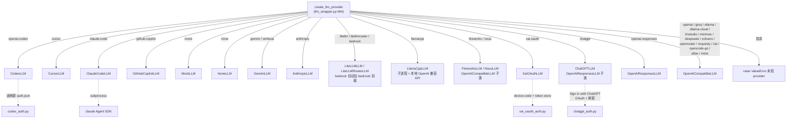
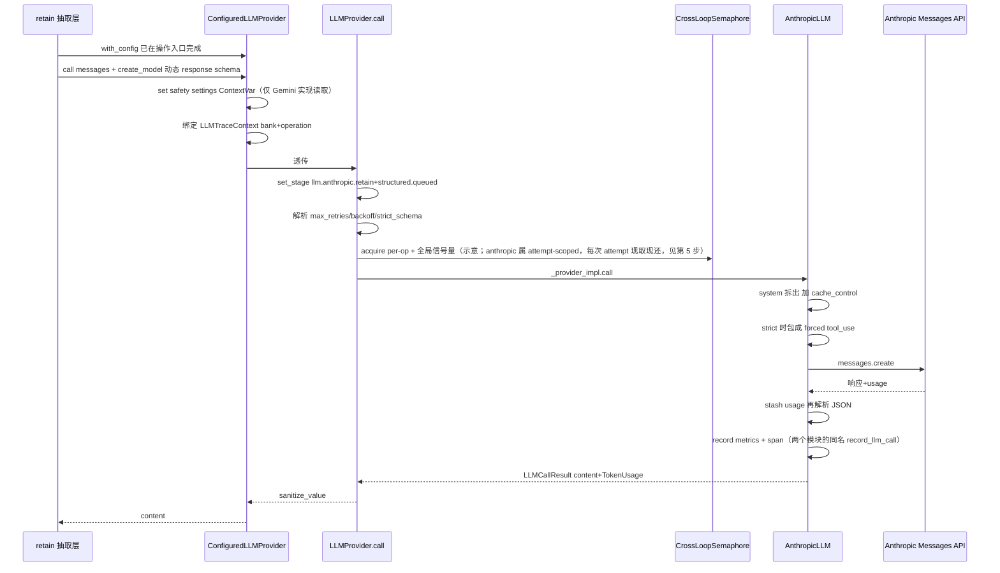
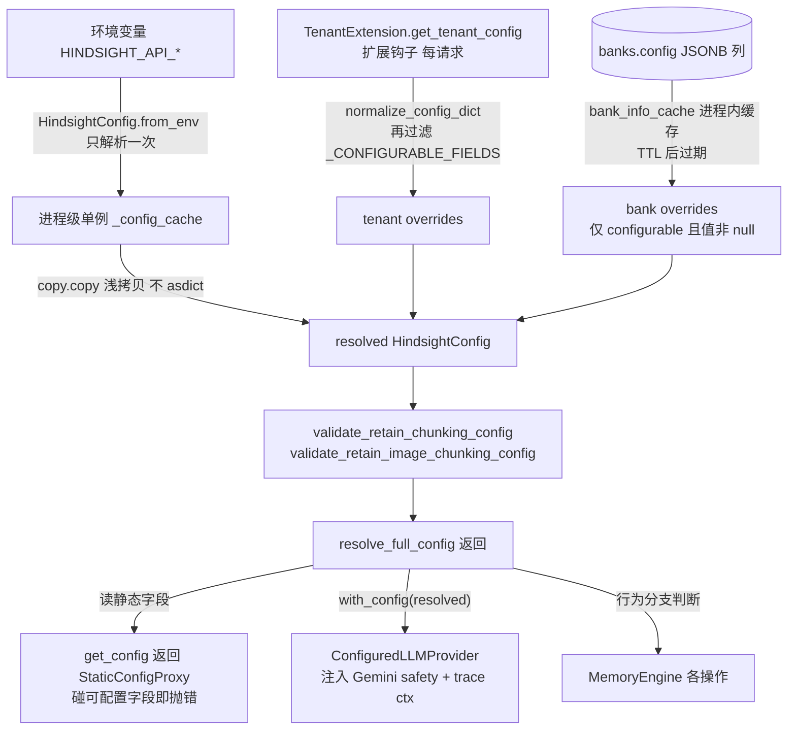

# 05 · 基础设施抽象层：LLM / Embeddings / Reranker / 文件存储与分层配置

> 研究对象：`hindsight-api-slim/hindsight_api/`（下文相对路径均以 `hindsight-api-slim/` 为基准）
> 代码基线：`b4a0da1e9`（v1.1.0，2026-10-23；增量窗口 223 提交（`5331da2f4..b4a0da1e9`，按 GitHub compare 的提交口径），v1.1.0 于 10-21 发布）；上一基线 `5331da2f4`（v1.0.0，2026-10-16，本篇已随其更新）。本窗口要点：**调用公平性** #5928（实时请求可越过后台任务取 LLM 许可）、#5742（故障链成员失败后冷却，而不是每次请求都先撞它一次）、#5561（重试退避中被墙钟打断的 refresh 不再暂停自动刷新）、#5780（mental-model refresh 继承全局 failover 链）；**重试语义** #5612（200 + `finish_reason=error` 当传输失败重试，并单独记一次被重试的尝试）、#5644（401/403 变成 `ProviderAuthError`，retain 一次失败而不是逐 chunk 重放）、#5738/#5917（模型拒绝强制 `tool_choice` 时回退 `auto` / schema-in-prompt）；**provider 细节** #5761（codex 用 call id 回放工具历史）、#5718（MiniMax M3.1 要 `thinking=adaptive`）、#5821（Gemini 内容拦截快速失败）、#5950（embedding 与文件解析器补发 hindsight User-Agent）；**reranker** #5748（新 `onnx` provider）、#5831（Cohere 在飞上限）、#5795/#5722（取消后不再启动新批）、#5794/#5715（TypeSafe 窗口收缩重试、不再丢弃决策答案）；**embedding** #5746（OpenAI 额度耗尽延后操作）、#5951（provider 不报 `prompt_tokens` 不再失败）、#5588（OpenAI embedding 显式 60s 超时）；**观测面** #5835（embedding/rerank/decision 调用进入 `llm_requests`，写入改批量）、#5936（`ModelCallExtension`）、#6048（operation runs）；**配置** #5800（`default_observation_scopes` 与 tag glob）、#5698（`mental_model_delta_use_decision_model` 页面影响闸门）；**运行时** #5725/#5779（尊重 systemd CPUQuota、限制 ONNX Runtime 线程）、#5770（Python 3.14 可安装）、#5993（engine 不再 import API 层：`schema_context` / `_cross_loop` / `_thread_limits` 迁到包根，`fq_table` 移进 `engine/schema.py`）。历史基线：`12f2d54f6` → `f7dd3f4fd` → `5b8356bb2`（0.10.2 全量更新）→ `6d8b09678`（0.10.3）→ `5331da2f4`（1.0.0）。
> 本文所有论断均逐条回代码核对于新快照 `b4a0da1e9`（不是本地 clone 的 HEAD），未确认之处已显式标注。

---

# 第 1 层【全景】：为什么要有一个可插拔的 provider 层

## 1.1 三个抽象，一个形状

Hindsight 的记忆引擎有三处必须"调用模型"：

| 能力 | 抽象基类 | 代码位置 | 典型实现数 |
|---|---|---|---|
| LLM（抽取/反思/固化） | `LLMInterface` | `hindsight_api/engine/llm_interface.py:78` | 32 个 provider 名字，17 个实现类 |
| Embedding（向量检索） | `Embeddings` (ABC) | `hindsight_api/engine/embeddings.py:147` | 13 个 provider 分支 |
| Reranker（重排） | `CrossEncoderModel` (ABC) | `hindsight_api/engine/cross_encoder.py:141` | 16 个 provider 分支 + failover 链 |

三者形状高度一致，都是同一个模式的实例化：

1. **抽象接口**声明最小能力面（`call` / `encode` / `predict`）；
2. **工厂函数**按配置字符串分派到具体实现（`create_llm_provider` / `create_embeddings_from_env` / `create_cross_encoder`）;
3. **默认值**全部落在 `config.py` 的 `ENV_*` / `DEFAULT_*` 常量里，实现类不读环境变量（LLM 侧甚至被注释明确要求"构造函数不读全局 config"——`llm_wrapper.py:928-931`）。

除此之外还有第四个同形状的可插拔面——**文件存储**（上传附件的 `engine/storage/`，`create_file_storage` 工厂 + `FileStorage` ABC），它不调模型但同属基础设施抽象，0.10.2 起获得流式读写能力，见 3.10。

1.1.0 还多了第五个面，但它不提供后端、只**观察**后端：`ModelCallExtension`（`hindsight_api/extensions/model_call.py`，#5936/#6048）在每次模型调用（LLM / embedding / rerank / decision）结束时收到一条 `ModelCall`，在每次操作（retain / recall / reflect / consolidation / refresh）结束时收到一条 `OperationRun`。它挂在与 `llm_requests` 表同一套 GenAI recorder 上，所以"能看到什么"与追踪表完全一致——机制见 3.12。

为什么必须可插拔？从代码里可以直接读出三个动机：

- **本地/离线运行是一等公民**。`llamacpp_llm.py:1-12` 的 docstring 写明 "fully offline operation"：provider 会自己下载 GGUF（llama.cpp 的单文件模型格式）模型、起 `llama-cpp-python` 子进程；embedding/reranker 默认就是本地模型（`DEFAULT_EMBEDDINGS_PROVIDER = "local"`，`config.py:1319`；`DEFAULT_RERANKER_PROVIDER = "local"`，`config.py:1381`）。
- **订阅账号复用**。`openai-codex`、`chatgpt`、`claude-code`、`cursor`、`github-copilot`、`xai-oauth`、`nous` 这一批 provider 的存在，说明项目要"用你已有的 ChatGPT Plus / Claude Pro / Copilot / SuperGrok 订阅"跑记忆管线，而不是强制 API key（`hindsight_api/provider_auth.py:16-35` 明确列出了无需 API key 的 provider 集合；其中 `chatgpt` 走 OpenAI 的 "Sign in with ChatGPT" OAuth 流——见 3.3.4）。
- **测试与降级**。`mock` provider 让 600+ 个测试文件（hindsight-api-slim/tests 实测 677 个 `test_*.py`）不碰网络；`none` provider 让系统退化成"纯 chunk 存储 + 向量检索"（`none_llm.py:1-8`）。

## 1.2 分层配置解决什么问题

配置体系是三级：**全局 env → 租户（扩展钩子）→ bank（数据库）**（`config_resolver.py:1-9` 的模块 docstring 原话；路径说明：`config_resolver.py` 与 `config.py` 同在 `hindsight_api/` 根目录、不在 `engine/` 下，本文下文裸写同此约定）。

> **术语约定**：bank 是 Hindsight 的隔离与配置单元——一个 bank 即一个独立记忆库（相当于某个用户/agent 专属的一颗"脑"），对应数据库 `banks` 表的一行；下文"bank 级覆盖"即按记忆库覆盖配置。

它解决的问题分两类：

- **多租户/多 bank 的行为隔离**：不同 bank 可以有不同的 retain 策略、召回预算、disposition（1-5 的怀疑/字面/共情度）——这些是"行为字段"，落在 `banks.config` JSONB 里，逐 bank 解析。
- **防误用**：全局配置单例被一个代理包住——`get_config()` 返回 `StaticConfigProxy`，访问任何 bank 可配置字段直接抛 `ConfigFieldAccessError`（`config.py:62-90`），强制开发者去走 `ConfigResolver.resolve_full_config(bank_id, context)`。这是一个用类型系统之外的运行时手段实现的"你在热路径上读错配置了"的警报。

**一个必须先纠正的常见误解**：CLAUDE.md 的通用指引说"LLM settings (provider, model, API key) 是 hierarchical 可逐 bank 覆盖的"，但**当前代码并不是这样**：

- `llm_provider` / `llm_model` / `llm_base_url` / `llm_api_key` **不在** `_CONFIGURABLE_FIELDS`（可被 bank/租户覆盖的行为字段白名单，详见 3.7）里（`config.py:4091-4169` 全量枚举里没有任何 provider/model 字段；`config.py:4088-4090` 的注释原话："Excludes credentials, infrastructure config, **provider/model selection**, and performance tuning"）。
- `llm_api_key`、`llm_base_url` 反而显式列进 `_CREDENTIAL_FIELDS`，禁止通过 API 写入（`config.py:4010-4086`；写入侧在 `config_resolver.py:525-531` 直接 `raise ValueError`）。
- bank 级唯一能动的 LLM 链路参数类字段是 `llm_gemini_safety_settings`（`config.py:4166`；decision model 的三个"用不用"开关是行为字段而非链路参数，见 3.7）。

也就是说：**provider/model 的切换发生在两个层级——进程级 env（全局默认）与操作级 env（`HINDSIGHT_API_RETAIN_LLM_MODEL` 等，仍是服务器级）**，bank 只能影响"行为参数"。这是本文后面所有例子的前提。（1.0.0 新增的两个"例外通道"都不破坏这一前提，但值得点名：其一，decision model 的 `*_use_decision_model` 开关进了可配置白名单——bank 能决定"要不要用决策模型"，但选不了是哪个（见 3.7）；其二，#5578 的 LLM request extension 让操作员代码在**服务端**逐调用替换 LLM 与凭据——同样不经 bank 配置（见 3.7 末段）。1.1.0 又添两个同属"行为字段"一列的白名单项：`default_observation_scopes`（bank 决定"没声明 scope 的条目"归到哪个观察 scope，`config.py:4134`）与 `mental_model_delta_use_decision_model`（bank 决定 delta 刷新要不要先过决策模型的"这一页会不会变"闸门，`config.py:4143`）——它们改的是行为，不是模型链路。#5936/#6048 的 ModelCallExtension 连行为都不改，只是观测通道（见 3.12）。）

---

# 第 2 层【主流程】

## 2.1 一次 LLM 调用的完整路径

### 静态骨架：谁在什么时候创建了 provider

`MemoryEngine.__init__` 在进程启动时为 retain / reflect / consolidation 三个操作各建一条 LLM 链（`memory_engine.py:3093 / 3189 / 3312`）；第四条——mental-model-refresh——0.10.2 起改为**按需解析的 property**（`memory_engine.py:15565-15580`，issue #4463）：没有 `MENTAL_MODEL_REFRESH_LLM_*` 覆盖时它**就是**当前 `_reflect_llm_config` 这个对象本身（连测试在 `__init__` 后换掉的 provider 也一并生效）；override 只为"给 refresh 一个更长 timeout"时同样让位给被换入的 reflect provider：

1. 先解析"操作级请求默认值"：`_op_defaults()`（`memory_engine.py:2988-3009`）把 `HINDSIGHT_API_RETAIN_LLM_TIMEOUT` / `..._MAX_RETRIES` / `..._INITIAL_BACKOFF` / `..._MAX_BACKOFF` 逐字段落到"没配就回落全局 `llm_*`"。`mental_model_refresh_` 这一组仍以 reflect 的已解析值为 fallback（`memory_engine.py:3008`），但 0.10.2 起有一处刻意的例外：**timeout 永不继承 reflect 的**（reflect 默认 30s 是给"调用方在线等"定的，refresh 是后台任务、最终答案要过 3 万-9 万 token 的 prompt，30s 每次重试都超时，动机注释 `memory_engine.py:3009-3015`、replace 覆写 `:3016-3019`，issue #4532）——refresh 取自己的 `mental_model_refresh_llm_timeout`，否则回落全局。
2. 用静态配置构造 `LLMConfig`（即 `LLMProvider` 的向后兼容别名，`llm_wrapper.py:1951`）作为链首成员（member 0——多链场景下 `MultiLLMProvider` 的主成员，机制见 3.2 末段），再交给 `_build_llm()`：如果配置了 `llm_members` + `llm_strategy`，就把 indexed 成员（`HINDSIGHT_API_<OP>LLM_<n>_*`）包成 `MultiLLMProvider`（failover / round-robin / metadata 三种路由，`multi_llm.py:1-33`；加权轮询用 nginx 的 SWRR（Smooth Weighted Round-Robin，平滑加权轮询）算法，`multi_llm.py:87-111` 的 `_WeightedRoundRobin`）。1.1.0 修了一处继承断链（#5780）：操作级 slot 为空时，`_build_llm` 原来只读 `fallback_prefix` 的**原始**成员表，于是"全局声明了 failover 链、refresh 没单独声明"的部署里 refresh 永远停在裸主成员上、从不 failover——现在回落读的是 fallback 的**有效**链，fallback 也空则再落到 `config.llm_members` / `config.llm_strategy`（`memory_engine.py:956-961`）。
3. `LLMProvider.__init__` 里真正的分派只有一行：`self._provider_impl = create_llm_provider(...)`（`llm_wrapper.py:1103`）。

`create_llm_provider`（`llm_wrapper.py:464-833`）是整个 LLM 层的分派中枢。1.0.0 起它的开头只有一行惰性导入——`from . import providers`（`llm_wrapper.py:548`，上一行 :547 注释原话 "Each provider (and its SDK) loads only when chosen; see providers/__init__.py"）——每个 provider 类经 `providers.X` 按需取（PEP 562，见 3.2）。它的完整清单（以代码枚举为准）：



> 图注：实线 `-->` 是分派关系；虚线 `-.->` 是运行期辅助依赖（凭据读取、子进程），不是分派。所有 provider 类都经 `providers.X` 惰性取用（`providers/__init__.py` 的 PEP 562 `__getattr__`），图中不逐一画出。

`LLMProvider` 构造函数里还内置了第二层校验（`valid_providers` 列表，`llm_wrapper.py:982-1013`）和各 provider 的默认 base_url 表（`llm_wrapper.py:1030-1052`，如 ollama → `http://localhost:11434/v1`、deepseek → `https://api.deepseek.com`）。

### 动态路径：一次 `call()` 的九步

以**示例 A** 为准：全局配置 `HINDSIGHT_API_LLM_PROVIDER=anthropic`、`HINDSIGHT_API_LLM_MODEL=claude-sonnet-4-...`、`HINDSIGHT_API_LLM_API_KEY=sk-...`，retain 一次 chunk 抽取。即使没有任何 bank 覆盖，操作入口也无条件走 `with_config`——trace 绑定就需要它（`memory_engine.py:7948`）。

**示例 A：`provider=anthropic` 的一次 chat 调用走向**



关键步骤逐条对应代码（图内各消息标签为缩写示例，完整 stage 命名见第 1 步与第 4 步）。1.0.0 起列表之前多了一道**第 0 步**：`call()` 一进来先问 LLM request extension——操作员注册的扩展槽可以只换凭据（网关虚拟 key）或整条换掉 LLM，被拒绝的调用在创建任何东西（比如 provider 侧缓存）之前就短路（`llm_wrapper.py:1249-1268` 的 `bind_llm_request`，扩展契约在 `extensions/llm_request.py`，#5578；详见 3.7 末段）：

1. **stage 面包屑**：进入 `LLMProvider._call` 先打 `.queued`，拿到并发许可后才切到真实 stage（`llm_wrapper.py:1326-1330, 1394-1402`）。这是为了解决 issue #3002 ——一个在信号量前排队太久的调用，以前看起来像 provider 慢。
2. **重试参数三级解析**：显式 per-call 参数 > provider 构造时的配置（per-op env 回落全局）> 方法默认（`call` 是 10/1.0/60.0，`call_with_tools` 是 5/1.0/30.0）（`llm_wrapper.py:1332-1345`）。
3. **strict_schema 一次性解析**：per-call 显式 `True/False` 双向都赢，否则读 `HINDSIGHT_API_LLM_STRICT_SCHEMA`（`llm_wrapper.py:1352-1360`；注释强调"`or` 会把 per-call False 和未设置混在一起"）。
4. **并发许可**：`scope` 字符串前缀映射到操作桶（`retain` / `reflect` / `consolidation` / `mental_model_refresh`——中文对照：写入抽取 / 问答推理 / 观察固化 / 心智模型刷新，`llm_wrapper.py:117-134`），先拿 per-op 信号量再拿全局信号量（"先窄后宽"排队，`llm_wrapper.py:137-158`）。1.0.0 起（#5597）桶的判定多了一层：refresh 后台跑的是 reflect agent、其调用 scope 仍是 `reflect*`，所以 `_semaphores_for_scope` 先看当前 trace 绑定的操作、再回落 scope 前缀（`llm_wrapper.py:150-153`；refresh 的 scope 白名单本身也扩成了 `_MENTAL_MODEL_REFRESH_SCOPES` 三元组：`refresh_mental_model` / `dry_run_refresh_mental_model` / `mental_model_delta_ops`，`llm_wrapper.py:109-113`）。全局默认 32（`DEFAULT_LLM_MAX_CONCURRENT`，`config.py:1272`），信号量是 `CrossLoopSemaphore`——进程内多事件循环共享的信号量，因为模块级 `asyncio.Semaphore` 会绑死在第一个等待它的循环上（实现已从 `engine/` 上移到 `hindsight_api/_cross_loop.py`，#5993）。

   1.1.0 给这个队列加了优先级（issue #5926，PR #5928）：`_acquire_permits` 先问 `worker.background.in_background_task()`（一个由 poller 在任务开头 `mark_background_task()` 置位的 ContextVar，`worker/background.py:18-29`），后台任务走 `sem.acquire(background=True)`，其票据进 `_background_waiters` 队列；`release()` 的 `_hand_on` 先服务前台队列、只有前台空时才发给后台（`_cross_loop.py:88-142`）。动机不是吞吐而是尾延迟：一个 32 槽的池被长跑的 consolidation 占满时，一次交互 recall 要排在它们后面，而它只差一个槽就能在毫秒级返回。代价写在注释里——前台持续有负载时后台可能饿死（`_cross_loop.py:138-140`），换的是"实时请求永远先走"。
5. **attempt-scoped 并发**：自带重试循环的 provider（anthropic、openai 兼容系、gemini、codex、claude-code、cursor、copilot、litellm、llamacpp、xai-oauth、openai-responses 全部实现了 `supports_attempt_scoped_concurrency`）不走第 4 步的整体持有，而是每个上游 attempt 用 `attempt_context` 现取现还，让退避睡眠不占许可（`llm_wrapper.py:182-204, 1392-1404`）。
6. **provider 内部**：`AnthropicLLM.call` 把 OpenAI 风格 messages 拆成 `system` + Anthropic messages，system 块加 `cache_control: ephemeral` 内联缓存标记（`anthropic_llm.py:100-131`）；strict 模式把 response schema 包成一个强制 `tool_use` 工具做约束解码（`anthropic_llm.py:362-388`）；然后进自己的重试循环（401/403 立即失败，429/5xx/连接错误/超时指数退避 + 20% 抖动，`anthropic_llm.py:403-570`）。1.0.0 起循环里多一个立即失败的分支：SDK 响应的 `stop_reason` 是 `refusal`/`content_filter` 时直接抛 `ProviderContentPolicyError`——以前这会被当成 invalid JSON 重试到耗尽（#5616，`anthropic_llm.py:56-64`）。1.1.0 又补了反方向的例外（#5738/#5917）：有些模型（Claude Opus 5.5 / Sonnet 5.5）对命名或 `any` 的 `tool_choice` 直接 400 "tool_choice: type "tool" and "any" are not supported for this model"，而 reflect 的每次检索都靠强制工具——现在从**错误本身**识别（不维护模型名单），置一个进程内粘性标记 `_forced_tool_choice_rejected`，之后的工具调用改发 `auto`、strict 结构化输出退回 schema-in-prompt，并立即重发一次（`anthropic_llm.py:45-53`、`_create_with_tool_choice_fallback` `:816-841`、结构化路径判定 `:365-372`）。每次 SDK 调用还包了一层 `asyncio.wait_for` 墙钟上限——SDK 的分相位 read timeout 每收一个字节就重置，上游"滴漏式" keep-alive 永远触发不了它，调用会把 worker 槽位钉死（issue #4763，`anthropic_llm.py:410-414`）。
7. **usage 先 stash 再解析**：`stash_response_usage` 在本地 JSON 解析/校验**之前**记录 token 数，这样解析失败也能把已计费的成本记进 trace（`anthropic_llm.py:416`，issue #2387）。
8. **成功上报**：metrics 采集器与 OTel span recorder 各有一个**同名**的 `record_llm_call` 方法（分属 `metrics.py` 与 `tracing.py`，前者记指标、后者记分布式 span），外加慢调用日志（>10s 带 token 明细）（`anthropic_llm.py:463-510`）。
9. **出口消毒**：`LLMProvider.call` 最后统一 `sanitize_value(result)`（`llm_wrapper.py:1458`）——剥掉模型输出里可能存在的孤立代理对（`\udXXX`）和控制字符，否则 asyncpg 写库、cross-encoder 的 Rust tokenizer（3.5 的本地重排模型分词用）、stdout 全都可能炸（issue #3729）。

### bank 级覆盖如何注入（示例 B）

**示例 B：bank 覆盖 `llm_gemini_safety_settings`**。操作入口（如 retain，`memory_engine.py:7948`、`:13487`）会执行：

```python
retain_llm = self._retain_llm_config.with_config(resolved_config, bank_id=bank_id, operation="retain")
```

`with_config` 生成一个轻量代理 `ConfiguredLLMProvider`（`llm_wrapper.py:1753-1784` 是 `with_config` 方法体，`ConfiguredLLMProvider` 类体在 1841-1948），每次 `call` 前把 bank 解析出的 safety settings 塞进 ContextVar、同时绑定 trace 上下文，调用后复位（`llm_wrapper.py:1874-1887`）。该注入对所有 provider 无条件发生，非 Gemini 的 provider 直接忽略这个值（ContextVar 只有 GeminiLLM 会读）：

```python
# hindsight_api/engine/llm_wrapper.py:1874-1882
async def call(self, messages: list[dict[str, Any]], **kwargs: Any) -> LLMCallResult:
    from .providers.gemini_llm import _safety_settings_ctx

    token = _safety_settings_ctx.set(object.__getattribute__(self, "_gemini_safety_settings"))
    trace_token = self._bind_trace_context()
    try:
        return await object.__getattribute__(self, "_provider").call(messages=messages, **kwargs)
    finally:
        _safety_settings_ctx.reset(token)
        self._reset_trace_context(trace_token)
```

- 代码里的 `object.__getattribute__(self, ...)` 是刻意为之（`llm_wrapper.py:1860` 注释原话 "Use object.__setattr__ to avoid triggering __getattr__"）：直接读取代理对象自己的真实属性（`_provider` / `_gemini_safety_settings`），避免属性缺失等场景下落入本类 `__getattr__` 的透传。
- `ContextVar` 是 Python 的任务级局部存储——比 `threading.local` 更细，同一事件循环内每个 asyncio task 各一份。之所以用 ContextVar 而不是直接传参：provider 实例是全 bank 共享的长命单例，bank 级状态不能挂在它身上，只能在调用边界现场注入、调用后复位，嵌套安全且不泄漏（`llm_wrapper.py:1759-1772` 的 docstring 明确说"不更换底层 provider 或其长连接"）。
- attribute 全部 `__getattr__` 透传给底层 provider，调用方无感（`llm_wrapper.py:1869-1870`）。
- `trace_id` / `operation_span_id` 每次 `with_config` 生成一次，同一次操作的所有 LLM 调用共享，在 `llm_requests` 表里复现 OTel 的 父(操作)→子(LLM call) 层级（`llm_wrapper.py:1777-1780`、`llm_trace.py:74-105`）。1.1.0 起这个生成收口在 `llm_trace.operation_trace_context`（`llm_trace.py:344-362`）：**同一 bank、同一 operation、且本次调用不带 metadata** 三条同时成立时，wrapper 才**加入**已绑定的那条运行级 trace，否则新开一条。所以 refresh 的 reflect pass（operation 标签同为 `refresh_mental_model`）与外层 trace 合并；带 `mental_model_id` metadata 的 delta-ops 调用仍是自己的 trace（`memory_engine.py:18401-18406`）；页面写入那次 embedding 不走 wrapper，而是靠 `operation_run` "已绑定就不重绑"落在 refresh 的 trace 上。注意这是 **trace 归属**，与"计时 run"是两套东西，见 3.12 开头对这两层的区分。
- 对于 `MultiLLMProvider`，`route_for(metadata)` 能在保持同一 trace 上下文的前提下换到 metadata 路由选中的成员（`llm_wrapper.py:1903-1923`）。

## 2.2 一次 recall 中 embedding 与 reranker 的调用点

`recall_async`（`memory_engine.py:9261` 起）的管线里，模型相关调用只有两处，且都在请求路径上：

**调用点 1 —— 查询向量化（Step 1）**（`memory_engine.py:9837-9845`）：

```python
# hindsight_api/engine/memory_engine.py:9840-9844
query_embeddings = await embedding_utils.generate_embeddings_batch(
    self.embeddings,
    [query],
    input_type="query",
)
query_embedding = query_embeddings[0]
```

`generate_embeddings_batch`（`engine/retain/embedding_utils.py:114-158`）做三件事：按 `HINDSIGHT_API_EMBEDDINGS_MAX_INPUT_TOKENS`（默认 8192，`config.py:1663`）截断输入（并把非对称前缀——见 3.6——的 token 数从预算里扣掉、且计数与截断都用 backend 自己声明的 tokenizer 词表，见 3.6 与 #5234，`embedding_utils.py:45-60, 79`）；调 `encode_query`；然后**逐条校验向量维度 == backend.dimension**，且返回数量必须与输入 1:1（`embedding_utils.py:155-164`，issue #1037）。随后向量字符串化进 SQL，供四臂并行检索（semantic / BM25 / graph / temporal，下称"检索臂"；`search/retrieval.py:129` `retrieve_all_fact_types_parallel`）中的 semantic 臂使用。

**调用点 2 —— 融合后重排**（`memory_engine.py:10433-10456`）：

```python
# hindsight_api/engine/memory_engine.py:10437-10456（节选；注释为意译）
if reranking == "cross_encoder":
    # 取消检查点：cross-encoder 重排是最耗 CPU 的阶段……
    if request_context is not None:
        request_context.raise_if_cancelled()
    await reranker_instance.ensure_initialized()
    reranked = await reranker_instance.rerank(query, merged_candidates)
    scored_results = reranked.results
    # provider 名从"产出这份分数的那次调用"上抄下来——不要回头读
    # cross_encoder.provider_name：failover 链上那是个别的请求也会动的游标
    served_provider = reranked.provider_name
else:
    # "rrf" / "interleave"：跳过 cross-encoder，保持融合序
```

0.10.2 起 `rerank` 的返回值是 `RerankResult`（`results` + `provider_name`，`search/reranking.py:20-29`）：分数与"是谁打出来的"作为一个整体返回，because 并发请求会移动 failover 链的共享游标（详见 3.8）。`CrossEncoderReranker.rerank`（`engine/search/reranking.py:373-512`）把每个候选拼成 `[query, doc_text]` 对（doc 前面带 `[Date: ...]` 人类可读日期），调 `cross_encoder.predict(pairs)`，然后做分数归一：外部 API reranker（Cohere/Jina 等）返回的已经是 [0,1] 就直接用；本地模型输出 logits 则过 sigmoid（`reranking.py:462-475`）。NaN 一律清洗为 0。之后才是 recency / temporal / proof（证据条数）三个乘性 boost 的合成——代码是纯乘法 `combined_score = CE_normalized × recency_boost × temporal_boost × proof_count_boost`（`reranking.py:200` 公式注释、`:305` 实现），不是加权和——再按 `fact_budget` 做 token 预算截断。

`reranking` 参数有三个合法值：`"cross_encoder"`（默认）、`"rrf"`、`"interleave"`（`memory_engine.py:784`），bank 级 `enable_reranking=false` 时 `cross_encoder` 自动降级为 `rrf`（`memory_engine.py:1725-1734`）。1.0.0 侧注：给 recall 配置了 decision model 时（`HINDSIGHT_API_RECALL_DECISION_MODEL_*`），这里的 reranker 整个换成 `DecisionModelReranker`、重排语义不同——机制归 03 卷，本卷只涉及它的配置入口（`search/reranking.py:330-333` 按 `get_config().decision_model_config("recall")` 装配，见 3.7）。

## 2.3 bank 级配置覆盖如何生效：ConfigResolver

分层配置解析的数据流（`config_resolver.py:230-267`）：



几个有代码依据的细节：

- **浅拷贝而非 `asdict()`**：`_with_overrides` 用 `copy.copy` + `setattr`，注释里给出量级——config 有 400+ 字段、解析在每请求热路径上，旧实现的全量深拷贝曾主导 recall 耗时（`config_resolver.py:211-228`，issue #4209）。
- **bank 覆盖的读取**：`_load_bank_config` 查 `SELECT config FROM banks WHERE bank_id=$1`，走 `bank_info_cache` 进程内缓存；**缓存的是原始 JSONB 列而不是解析后的 overrides**，因为权限过滤因调用方而异，缓存解析结果会把一个调用方的权限漏给另一个（`config_resolver.py:389-459`）。
- **缓存一致性**：`_persist_bank_config` 写完立刻 `bank_info_cache.invalidate(bank_id, "config")`（`config_resolver.py:720`；批量改名路径 :750 同样失效）；而 `get_bank_config(cached=...)` 的默认值区分了两种调用方——读路径可以容忍一个 TTL 的滞后，"用户读回自己配置"的端点必须传 `cached=False` 读库，否则没执行写的那只 pod 会把刚写进的值读回旧值（`config_resolver.py:269-307`）。
- **写的原子性**：bank 配置写路径在事务里 `SELECT ... FOR UPDATE` 锁行、对"跨字段约束"（`retain_chunk_size` vs `retain_max_completion_tokens`、`recall_budget_min <= max` 等，`config_resolver.py:59-70`）用"投影后的完整配置"重验一遍再 `COALESCE(config,'{}') || $1::jsonb` 合并写入（`config_resolver.py:666-723`，COALESCE 合并在 :709）。注意这个跨字段复验**只在更新触及 `_CROSS_FIELD_CONSTRAINED_FIELDS` 集合内的字段时才执行**（`config_resolver.py:639-651, 697-703`）——不触及即不可能改变约束两侧，无需重验。注释解释了为什么用悲观锁：校验会跑租户配额钩子，必须只跑一次，乐观锁的重试方案做不到。
- **写校验漏斗**：`validate_bank_config_updates`（`config_resolver.py:486-655`）依次做 key 归一化（接受 `HINDSIGHT_API_*` env 风格或 Python 字段风格）→ 拒绝 credential 字段 → 拒绝非 configurable 字段（static 字段与未知字段分开报错）→ 租户权限检查 → 逐字段类型校验（从 dataclass 注解反推运行时类型；个别字段接受形态比注解更宽，由手工放宽表 `_WIDENED_FIELD_TYPES` 放行，`config_resolver.py:757-761`；类型校验本体 `_configurable_field_types`/`_value_matches_type`，`config_resolver.py:783-803`，针对 issue #3218"对象存进字符串字段后 bank 固化永久失败"）→ 各领域校验（entity_labels、recall budget、disposition 1-5 整数、**consolidation_strategies 形状校验**——0.10.2 新增 `_validate_consolidation_strategies`（`config_resolver.py:847-869`，调用点 :621-623）：config 侧类型只是 plain list，没有这一步时把 "scope" 写成 "scopes" 或把字符串塞进 tag 列表会被原样存库然后被固化阶段静默忽略，现在用 `StrictConsolidationStrategySpec` 在写入时按 shape 拒绝；不完整的草稿（还没填 tags 的规则）仍然放行，因为控制平面按 typed 保存、固化阶段会跳过不可用的策略）→ 跨字段投影校验。1.1.0 在这条漏斗里插了一处形状校验（#5800）：`default_observation_scopes` 的类型注解只是 `str | list`，把 "per_tags" 拼错、或写成 `"topic:*"` 而不是 `[["topic:*"]]` 都能通过类型检查然后让每次固化静默失效——现在顶层与 `retain_strategies.*` 里的同名键都过 `validate_observation_scopes`（`config.py:358-378`；调用点 `config_resolver.py:610-626`），同一函数也被 env 解析器复用，所以启动时就能拦下拼写错误。
- **读容错**：历史脏数据由 `_coerce_stored_bank_overrides` 兜底——字符串字段里的 JSON 对象会被 `json.dumps` 成文本（保住意图），其他类型错误直接丢弃回落全局（`config_resolver.py:891-941`）。

---

# 第 3 层【机制深潜】

## 3.1 LLMInterface：接口设计、structured output 与 token 计数

> **structured output** 指让模型按调用方预定义的 schema 返回可机器解析的数据（而非自由文本）。本层的做法：调用方传一个 pydantic 模型作 `response_format`，provider 层负责把它变成各家 provider 的约束机制，并把回复解析/校验回同一个模型实例。

### 核心方法签名

`LLMInterface` 的两个抽象方法（`llm_interface.py:156-202, 204-240`）：

```python
# hindsight_api/engine/llm_interface.py:156-171（节选）
@abstractmethod
async def call(
    self,
    messages: list[dict[str, str]],
    response_format: Any | None = None,
    max_completion_tokens: int | None = None,
    temperature: float | None = None,
    scope: str = "memory",
    max_retries: int = 10,
    initial_backoff: float = 1.0,
    max_backoff: float = 60.0,
    skip_validation: bool = False,
    strict_schema: bool = False,
    cached_prefix: str | None = None,
    attempt_context: Callable[[], AbstractAsyncContextManager[None]] | None = None,
) -> LLMCallResult: ...
```

返回值是 `LLMCallResult`（`engine/response_models.py:177-205`）：`content: Any`（传了 `response_format` 时是已校验的 pydantic 实例，否则是文本）+ `usage: TokenUsage`。签名里的 `scope` 默认 `"memory"`，决定并发归入哪个操作桶——不属于 retain/reflect/consolidation/mental_model_refresh 四桶的 scope（验证探针、memory_think 等）只吃全局上限（`llm_wrapper.py:119-123, 155-156`）。docstring 里记录了一段演进史：`call` 曾经按 `return_usage: bool` 布尔参数返回两种形状，导致 14 个实现都标 `-> Any`，现在无条件返回命名模型，与 `call_with_tools -> LLMToolCallResult` 对齐。

**prompt 缓存的两级参数**（0.10.2 增量窗口内由 #5123/#5245 引入）：接口层的 `cached_prefix` 传的是**句柄**（`get_or_create_cached_prefix` 返回的 cache 名）；而编排层 `LLMProvider.call` 另收一个 `prompt_cache: PromptCachePrefix | None`——一个 frozen dataclass（`system_instruction` + 可选 `response_schema`，`llm_interface.py:57-71`），只声明"**什么内容**想被缓存"。之前 retain/consolidation 自己找链首成员要句柄再传 `cached_prefix=`，多链 failover 到 Gemini 时 fallback 成员永远没缓存（主成员的句柄落到别的账号上也不可用）；现在调用方只传 `PromptCachePrefix`，`LLMProvider.call` 在进入重试/并发区之前用 `_cached_prefix_for`（`llm_wrapper.py:1209-1223`，调用点 `:1381`）让**实际服务本次调用的那个成员**自己解析句柄——provider 不支持缓存返回 None，缓存侧异常只记日志并退化为不缓存（软失败，不阻塞调用）。retain 侧在 `fact_extraction.py:2104`、consolidation 侧在 `consolidation/consolidator.py:3763` 构造它（1.0.0 把 consolidator 从 `engine/` 挪进了 `engine/consolidation/` 子包）。

基类还定义了一组**可选能力探针**（全部默认 False/None，provider 按需覆写）：

| 能力 | 方法 | 谁实现了 True |
|---|---|---|
| Batch API | `supports_batch_api`（`llm_interface.py:241`） | openai/groq 系（OpenAICompatibleLLM）、anthropic（Message Batches API，`anthropic_llm.py:782-786`）、gemini、fireworks |
| attempt 级并发 | `supports_attempt_scoped_concurrency`（:278） | 几乎所有 SDK provider（见 2.1） |
| 请求级凭据替换 | `supports_request_overrides`（:282-293，1.0.0 新增，#5578） | openai 兼容族（ollama 除外——它的原生 HTTP 路径不走 SDK client，`openai_compatible_llm.py:2499-2501`）、anthropic、litellm、litellmrouter、nous。False 的 provider（OAuth/CLI 会话系、router 每部署一套 key）收到扩展的改写请求时**直接拒绝**而不是用服务器凭据发出去 |
| 视觉 | `supports_vision` 三值 `bool \| None`（:294） | `None` = 该 provider 是网关（如 litellm/openrouter），不知道背后接的具体模型，无法自证；retain 遇到带图 item 时把 `None` 当 False 拒绝；操作员可用 `HINDSIGHT_API_LLM_VISION` 强制覆盖（`llm_wrapper.py:1173-1186`） |
| 显式 prompt 前缀缓存 | `supports_prompt_caching` + `get_or_create_cached_prefix`（:312-336） | Gemini（`CachedContent`，`gemini_llm.py:1181-1189`）；Anthropic 用内联 `cache_control` 标记不需要句柄；OpenAI 自动缓存透明受益。0.10.2 增量窗口起句柄由**服务的那个链成员**自己从 `PromptCachePrefix` 解析（见上文两级参数，#5245） |
| 增量对话缓存 | `supports_incremental_prompt_cache` + `create_incremental_cache`（:360-380） | Gemini（探针 `gemini_llm.py:1231`、`create_incremental_cache` :1243 起），供 reflect agent 循环逐步滚动缓存。1.1.0 起接口多了 `tool_choice` 参数（`llm_interface.py:364-380`）：Gemini 拒绝在带 `cached_content` 的请求上再发 `tool_config`（400 "CachedContent can not be used with ... tool_config"），所以工具选择必须**存进缓存**、由缓存带回（`gemini_cache.py:247-285`、`:322-381`、`gemini_llm.py:1268-1272`），普通请求则照旧现场发（`gemini_llm.py:963-968`） |
| batch 账户指纹 | `batch_account_key`（:251-276） | 基类实现 = `provider|base_url|sha256(key)[:12]`，用于崩溃恢复时确认"这个 batch id 确实是我的账号创建的"（issue #3671） |

异常类型也是接口的一部分（`llm_interface.py:450-495`）：`OutputTooLongError`（450）、`ProviderContentPolicyError`（462，内容政策拒绝＝确定性失败）、1.1.0 新增的 `ProviderAuthError`（477，401/403＝凭据被拒，每次重放都是同一个结果，#5644）、`ProviderRateLimitResetError`（488，带 `retry_at`，让 worker 把任务 park 到那个时刻）。`ProviderAuthError` 的传播链是完整的：`extract_facts_from_text` 发现某批 chunk 里有 401/403 就把它上抛（`retain/fact_extraction.py:2805-2815`），worker 的 `_is_non_retryable_task_error` 认它（顺带认裸的 401/403 状态码，覆盖 consolidation/refresh 这类不经过抽取层的任务，`memory_engine.py:1655-1665`），于是 retain 失败一次而不是按退避表把每个 chunk 重放一遍。

`constructor` 里有两个值得注意的防御性设计（`llm_interface.py:86-145`）：`reasoning_effort` 为空串/None 一律归 None 并且**不发明默认值**（历史上曾默认 "low"，导致 #3449 的静默降级），不支持的 provider 必须调 `_warn_reasoning_effort_unsupported()` 在启动时喊出来；`timeout` 即使 provider 不用也必须存到 `self.timeout`（#3898——Codex 曾连这个属性都没有，请求挂死后无从区分" honoring"和"dropping"）。

### structured output 的三条路

以 OpenAI 兼容 provider 的组装逻辑为例（`openai_compatible_llm.py:1352-1382`）：

```python
# hindsight_api/engine/providers/openai_compatible_llm.py:1353-1382（节选；注释为意译，省略处以 … 标注）
if response_format is not None:
    schema = None
    if hasattr(response_format, "model_json_schema"):
        # strict / 非 strict 都先过 structured_output 的统一序列化器（含数值边界剥离，见下）
        schema = strict_json_schema(response_format) if strict_schema else provider_json_schema(response_format)
    if strict_schema and schema is not None:
        # OpenAI 的 strict JSON schema 语法强制
        call_params["response_format"] = {
            "type": "json_schema",
            "json_schema": {"name": "response", "strict": True, "schema": schema},
        }
    else:
        # 软模式：schema 文本注入 prompt……
        if schema is not None:
            schema_msg = f"\n\nYou must respond with valid JSON matching this schema:\n{json.dumps(schema, ...)}"
            # 注入首条消息……
        …  # 注入 if/elif 分支体省略（:1289-1296）
        if self._supports_json_mode():
            call_params["messages"] = _ensure_json_word_in_user_message(call_params["messages"])
            call_params["response_format"] = {"type": "json_object"}
```

三条路总结：

1. **软模式**（默认）：schema 文本拼进首条消息，且（默认）再发 `response_format={"type":"json_object"}`。是否真的发 json_object 由 `_supports_json_mode()`（`openai_compatible_llm.py:2327-2340`）决定：三态配置 `HINDSIGHT_API_LLM_OPENAI_COMPATIBLE_JSON_MODE`（`config.py:213`，与 `HINDSIGHT_API_LLM_VISION` 同款三态——None=按 provider 默认，True/False 强制覆盖）——`lmstudio/ollama/volcano` 默认不发（这些后端不能可靠支持 json_object），`llamacpp` 跟随 `HINDSIGHT_API_LLAMACPP_NO_GRAMMAR`，其余默认发；显式 False 时软路径只把 schema 拼进 prompt。开关的动机（#5261/#4935）：`provider=openai` 指向一个无法约束输出的本地服务器时，json_object 会让服务器改写 prompt、thinking 模型会在改写后的 prompt 上死循环。0.10.3 前这是硬编码的 `skip_grammar = provider in ("lmstudio", "ollama", "volcano")` + llamacpp 分支，现在收拢进这一个方法（1.0.0 起名单里又添了 `zai`，但原因不同：z.ai 在 json_object 模式下会**删掉生成文本里的字面 token "json"**——`fleet --json` 被存成 `fleet --`、`latest.json` 成 `latest.`，仍是合法 JSON、被静默损坏（#5175，`openai_compatible_llm.py:2337-2341` 的注释原话）；名单其余三家的理由仍是"不能可靠支持"）。
2. **strict 模式**：`json_schema strict:true` 语法强制（OpenAI 兼容系）；Anthropic 走 forced `tool_use`（input_schema 即 schema，`anthropic_llm.py:346-372`，解决 #1002 的 invalid-JSON 重试风暴）；Gemini 原生 `response_schema` 天生强制；LiteLLM 系可选 `structured_output_forced_tool`。schema 序列化由 `engine/structured_output.py` 统一：`UnionSafeSchemaGenerator` 把 pydantic discriminated union 的 `oneOf+discriminator` 改写成 `anyOf` 并把 tag 字段补进 `required`（没有任何目标 provider 接受 `oneOf`，`structured_output.py:11-67`）；0.10.3 起（#5401/#5275）两条序列化路径（`strict_json_schema` / `provider_json_schema`，`:160-171`）还统一剥离**数值边界关键字**——pydantic 为 `Field(ge=/le=/gt=/lt=/multiple_of=)` 生成的 `minimum` / `maximum` / `exclusiveMinimum` / `exclusiveMaximum` / `multipleOf`（`_strip_numeric_bounds`，`:138-158`）。动机（注释原话大意）：这些关键字在请求线上买不到任何东西——没有目标后端替你强制它们，而边界仍在 pydantic 模型上、响应回来照样校验；但**按白名单校验 schema 的后端会直接 400**：Bedrock Converse 报 "For 'integer' type, properties maximum, minimum are not supported"（issue #5275——一个在线部署的 131 个心智模型因此暂停了 60 个），OpenAI 在 strict 模式下对任何不支持的关键字报错。当时的两个肇事字段是 `reflect/delta_ops.py:154` 与 `reflect/structured_doc.py:85` 的 `level`（`Field(default=2, ge=1, le=6)`），但选择在序列化层统一剥而不是逐模型改，是为了下一个带边界的字段不再重开此洞。`maxItems` / `minItems` / `pattern` 刻意**不**剥：consolidation 与 retain 有意发送它们（接受它们的后端会做语法强制），由 `HINDSIGHT_API_LLM_SUPPORTS_MAX_ITEMS` / `HINDSIGHT_API_LLM_SUPPORTS_STRING_PATTERN` 门控。剥离只动 schema 节点自己的关键字，`properties` 这类"名字映射"的键是用户数据——一个字面叫 `minimum` 的属性会幸存。因为 anthropic（forced tool 的 input_schema）、gemini、codex、claude-code、cursor、copilot、litellm 全都从这两个函数取 schema，剥离一处生效、全部 provider 受益；`has_tagged_union`（`:181`，`lru_cache(maxsize=256)`，:180）两侧比较也都过剥离——否则"只差一个被剥掉的 minimum"的模型会被误判成 union 改写、无谓推离 Gemini 的原生 response_schema 路径。同提交还把它从无界 `lru_cache` 改为 `maxsize=256`：consolidation 每批构造一个新 response model（schema 钉住该批 fact id），无界缓存会把每一个都钉在内存里。
3. **解析兜底**：`parse_llm_json`（`llm_wrapper.py:384-455`）三级火箭——剥 markdown 围栏 → 控制字符转义（字符串内的换行保留为 `\n`，围栏外的丢成空格，#3361）→ `json_repair` 结构性修复；每次成功解析后再过一遍 `sanitize_value`（JSON 解码正是孤立代理对"出生"的地方，#3729）。

### token 计数

- **LLM 侧以 provider 报告值为主**：`TokenUsage` 有 `input_tokens / output_tokens / total_tokens / cached_tokens / thoughts_tokens` 五个字段（`response_models.py:134-175`），`thoughts_tokens` 单列是因为推理 token 按 output 计费但不属于可见输出；支持 `__add__` 聚合。0.10.2 起 `thoughts_tokens` 还被持久化进 `llm_requests` 表（迁移 `a6c4e8f1b203_add_reasoning_tokens_to_llm_requests`，历史行保持 NULL），`LLMProvider.call` 的错误路径上报也补齐了这一字段（`llm_wrapper.py:1420-1436`）。1.0.0 补齐了三个"假账"provider 的真实用量（#5693，issue #5541）：Codex 两个流解析器都改从 `response.completed` SSE 事件的 usage 块读 input/cached/reasoning/可见输出（此前是 char/4 估算加一堆 0；流里没有 usage 块时 `call()` 仍回落估算，`codex_llm.py:261-291`）；Claude Code 改用 Agent SDK 上报的 usage（`call()` 读 ResultMessage、工具轮读 AssistantMessage，cache 读/写折进 input_tokens、cache 读另记 `cached_tokens`，`claude_code_llm.py:53-80`）；Anthropic 把 `cache_read/cache_creation_input_tokens` 折进 input_tokens 并记 `cached_tokens`（`anthropic_llm.py:67-95`）。同窗口 #5675 修的是**聚合侧**：reflect 响应与同步 retain 的 HTTP total 原来按字段逐个重建 TokenUsage、把 cached/thinking 丢成 0，batch-API 抽取则根本不读 provider 的 usage 块——现在三处都透传。严格的"没有任何客户端估算"不再成立：Codex（无 usage 块时）与 Claude Code（无 usage 时）各保留一个 char/4 的兜底估算。
- **文本预算侧才有客户端计数**：`engine/token_encoding.py` 是全引擎唯一的 tokenizer 封装（也是全仓库唯一 import toktok 的地方，刻意收口——换实现只改这一个文件）：`count_tokens` / `truncate_to_tokens`（+批量形式 `truncate_many_to_tokens`）两个操作，服务于 chunk 大小、`fact_budget`、embedding 输入截断等场景。词表由 `HINDSIGHT_API_TOKENIZER_ENCODING` 选择（默认 `o200k_base`），加载结果 lru_cache 单例缓存。增量窗口（0.10.2 窗口，#5243/#5234）起 `count_tokens`（`token_encoding.py:121`）与批量形式 `truncate_many_to_tokens`（`:170`）接受显式 `encoding` 参数：**调用方若确知模型自己的词表就绕过全局配置**——目前唯一使用者是 embedding 输入上限（OpenAI `text-embedding-*` 按 `cl100k_base` 计数，见 3.6）；单条 `truncate_to_tokens`（`:146`）没有这个参数，仍用全局词表。按名加载走 `_encoding_by_name`（`:70-75`，同样 lru_cache、上界为内置的 3 个词表 `o200k_base / cl100k_base / o200k_harmony`），选择逻辑收在 `_encoding_for`（`:110-118`）。

## 3.2 Provider 清单与本地/远程的区分

以 `create_llm_provider` + `LLMProvider.valid_providers` 两处枚举为准，LLM provider 共 **32 个名字**（分派 `llm_wrapper.py:464-833`，`valid_providers :982-1013`；1.1.0 名单未增减），按分派目标分组：

- **OpenAI 兼容族**（→ `OpenAICompatibleLLM`，14 名）：`openai`、`groq`、`ollama`、`ollama-cloud`、`lmstudio`、`minimax`、`deepseek`、`volcano`、`openrouter`、`requesty`、`zai`、`opencode-go`、`atlas`、`meta`
- **订阅/OAuth 凭据系**：`openai-codex`、`chatgpt`、`claude-code`、`cursor`、`github-copilot`、`xai-oauth`、`nous`
- **网关/路由系**：`litellm`、`litellmrouter`、`bedrock`
- **Google 系**：`gemini`、`vertexai`
- **独立云端**：`anthropic`、`openai-responses`、`fireworks`
- **本地自管**：`llamacpp`
- **特殊**：`mock`（测试）、`none`（chunk-only 模式）

**实现类怎么加载**（1.0.0 变化，#5479/#5686）：`providers/__init__.py` 不再在 import 期拉起任何 provider——14 个实现类登记在 `_MODULES` 表里（`providers/__init__.py:31-46`），模块级 `__getattr__`（PEP 562）在首次访问 `providers.CodexLLM` 时才 `importlib.import_module` 对应子模块并把类缓存进 globals（`:66-71`）。动机写在文件 docstring 里：每个 provider 拖着自己的 SDK（google-genai 一个约 4s、openai 约 2s），而任何 import 了本包子模块的代码（`http.py` import `none_llm`）都会先跑这个 `__init__.py`——eager 导入让每个进程为用不到的 SDK 买单。配套有三个共同构成"启动不吃重模块"的措施：`provider_auth.py` 从 `engine/` 迁到包根（`hindsight_api/provider_auth.py`，并在 `llm_wrapper.py:35` 原位 re-export 兼容旧导入——迁出原因见 3.7）；sentence_transformers/onnxruntime 是否安装用 `importlib.util.find_spec` 探测而非 import（`config.py:4460-4496`——import sentence_transformers 要拉 torch、约 15s，连 `--help` 都得付）；OTel SDK 与 OTLP exporter 的导入移进 `initialize_tracing()`（`tracing.py:150-198`——tracing 默认关，模块顶层只留轻量的 `opentelemetry.trace` API）。同提交还新加了 `tests/test_config_import_cost.py` 守住这条启动成本线。

1.1.0 在这条线上又加了一层，方向从"少 import"变成"import 了也别把 CPU 全占住"：`hindsight_api/_thread_limits.py` 在 `hindsight_api/__init__.py` 的最顶端（`:39-41`）被调用，用 `os.environ.setdefault` 把 `OMP_NUM_THREADS` / `OPENBLAS_NUM_THREADS` / `MKL_NUM_THREADS` / `NUMEXPR_NUM_THREADS` 压到 `min(16, 可用 CPU 数)`（#5725/#5779）。"可用"刻意不是 `os.cpu_count()`：取 CPU 亲和集、cgroup（v2 `cpu.max` / v1 `cfs_quota_us`）配额、`os.cpu_count()` 三者的最小值，且 cgroup 配额是从 `/proc/self/cgroup` 指到的**本进程 cgroup 及其各级父目录**读出来的——只读挂载根会漏掉 systemd 单元的 `CPUQuota=`，于是每个线程池仍按宿主核数开（`_thread_limits.py:95-142`）。ONNX Runtime 的 CPU 池不认 `OMP_NUM_THREADS`（它按物理核数自己开），所以每个 `ort.SessionOptions` 都要过 `bound_onnx_session`（`:181-189`：intra-op 线程数、inter-op 固定 1、`session.intra_op.allow_spinning=0`），否则空闲 worker 在 CFS 配额下自旋烧掉真正工作要用的预算。

代码里**没有一个统一的 "local vs remote" 标志位**，而是三个互补的信号：

1. **是否要 API key**（`hindsight_api/provider_auth.py:16-33`）：`ollama/lmstudio/llamacpp/openai-codex/chatgpt/claude-code/cursor/github-copilot/mock/none/vertexai/litellm/litellmrouter/bedrock/nous/xai-oauth` 不需要——这个集合混合了"本地无鉴权"与"用 OAuth/订阅凭据"两类。还有一个 env 条件分支（`:36-42`）：`anthropic` 配置了 `ANTHROPIC_FEDERATION_RULE_ID` 时也免 key——SDK 自己拿平台身份令牌换短时访问令牌（Workload Identity Federation，issue #5502，#5690）。
2. **本地子进程 / 外部子进程 / 远程**：真正本地自管的只有 `llamacpp`——自己下载 GGUF、起一个 llama-cpp-python 服务器**子进程**并对它的本地 OpenAI 兼容 API 说话（`llamacpp_llm.py:1-5` docstring 原话 "Manages a llama-cpp-python server as a subprocess"；:48-53 的模块级单例 `_shared_server` + `CrossLoopLock` 让 retain/reflect/consolidation 各自的 provider 共享同一个进程）；`claude-code` 是起 claude CLI 的外部子进程；其余全部是远程 SDK/HTTP 调用。
3. **本地端点归一化**：`_V1_PATH_LOCAL_PROVIDERS`（frozenset）`{"lmstudio", "ollama"}` 会被 `_ensure_v1_base_url` 补 `/v1`（集合定义 `openai_compatible_llm.py:109`、补全调用 `:989`）——代码用"知道端点形状"来标记本地。

**mock 与 none**（必答问题 3）：

- `MockLLM`（`providers/mock_llm.py:32`）：测试 provider。记录每次调用到 `_mock_calls` 供断言，`set_mock_response` / `set_response_callback` 控制返回值/异常；`supports_vision()` 返回 True 使多模态抽取路径可测（`mock_llm.py:87-93`）。`LLMProvider` 里专门保留了 mock 调用同步的向后兼容层（`llm_wrapper.py:1128-1130, 1442-1450`）。增量窗口（0.10.2 窗口，#5245）起 `call` 还接受一个 `prompt_cache: PromptCachePrefix | None` 参数并**忽略之**——consolidation 测试把裸 MockLLM 直接当 LLM 配置传入，不收下这个 kwarg 所有 mock 的固化调用都会炸（`mock_llm.py:115-121`）。
- `NoneLLM`（`providers/none_llm.py:26`）：`HINDSIGHT_API_LLM_PROVIDER=none` 时的占位。语义是"**chunk-only 存储模式**"——retain 走 chunks 模式不做事实抽取，reflect/consolidation 被禁用；它的 `call` 永远抛 `LLMNotAvailableError`，作为"任何意外走到 LLM 的代码路径会得到清晰错误而非连接失败"的安全网（`none_llm.py:1-8`）。注意 provider=none **并不跳过 LLM 链的构建**：`memory_engine.py:2898-2899` 只是 `self._skip_llm_verification = True`（跳过连接验证），retain/reflect/consolidation 三条操作链仍在 `memory_engine.py:3093 / 3189 / 3312` 无条件构建（此时包的是 `NoneLLM`），mental-model-refresh 链按需解析为同一批 property（见 2.1）；真正的短路发生在各操作入口的 `provider == "none"` 检查——retain 强制 `retain_extraction_mode="chunks"` 并关闭 observations 产出（`enable_observations=False`，即固化阶段的观察条目生成，`memory_engine.py:7933-7935`），consolidation 直接跳过（`memory_engine.py:4646-4649`）。

**MultiLLMProvider**（`engine/multi_llm.py:115`）在单 provider 之上叠加：`failover`（按声明序）、`round-robin`（SWRR 加权轮询，成员内部重试耗尽才推进下一成员；`OutputTooLongError` 不 failover 因为换 provider 也装不下）、`metadata`（仅 retain，按被抽取 item 的 metadata 路由，`multi_llm.py:70-85` 的 `_metadata_matches`支持列表任一元素命中、bool 归一为 "true"/"false"）。batch retain 固定落在第一个支持 batch 的成员上且不 failover。prompt 缓存按成员各自解析：调用方只声明要缓存什么（`PromptCachePrefix`），failover 落到谁、谁就用自己的账号建缓存句柄（见 3.1，#5245）。

## 3.3 三个代表 provider 深讲

### 3.3.1 OpenAICompatibleLLM：公共骨架

这是覆盖面最大的实现（14 个 provider 名共用一个类），也是理解其他 provider 的模板。要点：

- **客户端构造**（`openai_compatible_llm.py:1040-1056`）：`AsyncOpenAI(max_retries=0)`——SDK 重试一律关掉，重试统一由 Hindsight 自己的循环管（这样退避、日志、metrics、跨 provider 行为一致）；timeout 用 `build_sdk_timeout` 生成**分相位** httpx.Timeout——connect 相位被 `HINDSIGHT_API_LLM_CONNECT_TIMEOUT`（默认 10s，`config.py:1282`）封顶，防止"永不完成握手的端点烧掉整个 120s 预算"（issue #3881，`llm_transport.py:52-71`）。默认头里始终带 `User-Agent: hindsight/openai-compatible/<版本>`（`openai_compatible_headers.py:5-17`，操作员显式设了就不覆盖），1.1.0 把这套身份头也补给了 embeddings、markitdown 解析器和 Nous（#5950），让网关侧能把这类流量归到 Hindsight。
- **请求组装的差异点开关**：`_supports_reasoning_model`（按模型名家族识别 o1/o3/GPT-5/6，`openai_compatible_llm.py:1168`）、`_max_tokens_param_name`（`max_completion_tokens` vs `max_tokens`，:1202）、MiniMax 的 temperature 钳位 (0,1]、Groq 的固定 `seed=4242` + service_tier、`_TOOL_CHOICE_REQUIRED_UNSUPPORTED_PROVIDERS`（frozenset）`{"lmstudio","ollama"}`（这些实现声称支持 `tool_choice=required` 却静默忽略，导致 reflect 拿不到工具调用、误答"我没有信息"——用显式黑名单而**不是**从 URL 推断：自定义 OpenAI 兼容端点可能真的实现了 required 语义，静默降级会改变请求行为，`openai_compatible_llm.py:102`）。1.0.0 补了一处遗漏（#5652）：`HINDSIGHT_API_LLM_OPENAI_SERVICE_TIER` 原来只有 Responses provider 发送，OpenAICompatibleLLM 存了字段却从不发送——现在 `provider=openai` 时作为原生顶层参数 `service_tier` 发出（:1338-1339；Groq 仍走 `extra_body`，:1342-1344）。同一版本还修了 MiniMax 的一处硬编码（#5718）：`_apply_provider_extra_body_defaults` 原来无条件发 `thinking={"type":"disabled"}`，而 MiniMax-M3.1 恒常思考、这个值直接 400——现在模型名含 `m3.1` 时发 `adaptive`，其余仍 `disabled`（`openai_compatible_llm.py:1233-1238`）。
- **Ollama 双轨**：带 schema 或配置了 `ollama_num_ctx` 的调用走 `_call_ollama_native`（Ollama 原生 `/api/chat`），因为 OpenAI 兼容端点会静默丢弃 `num_ctx`，而 Ollama 按 context size 区分已加载的模型实例——size 一变就整个重新加载，共享主机上的其他使用者一起遭殃（#3599）（分派与缘由注释 `openai_compatible_llm.py:1284-1305`，实现 :2041 起）。
- **响应侧清洗**（`openai_compatible_llm.py:166-271`）：`_strip_code_fences`（围栏剥离失败时回退"最外层可解析 JSON span"，:166）+ `_strip_reasoning_tags`（:217-271，`<think>` 等 5 对标记），后者处理三个 case——增量窗口（0.10.2 窗口，#4926/#4927）新增第 1 个：**孤儿闭合标签**。Qwen3 thinking 系、DeepSeek-R1-0528、Spark-X2.5 这类聊天模板把 `<think>` **预填进生成 prompt**，服务端又没开 reasoning parser 时，补全里只剩 `reasoning</think>answer`——开标签在 prompt 里、闭合标签悬空，旧逻辑对此不设防，推理文本原样漏进存储的记忆/心智模型。现在的处理：找到首个闭合标签后，若其前面没有配对的开标签、且前缀（lstrip 后）**不以** `{`、`[` 或代码围栏开头，就丢弃闭合标签及之前的全部内容；前缀以这三种字符开头说明闭合标签是被引用的字面量而非推理边界，保留。守卫刻意收窄——更严的版本（前缀里出现过任意围栏就不剥）会漏掉"推理正文自己起草了一个围栏块"的常见情形；代价是"以散文开头、正文里引用了闭合标签"的回答会被切断，注释明说这是接受的取舍（需要模型主动谈起闭合标签才会误伤，对比的是这一族模板**每份**心智模型都漏推理）。原有两个 case 不变：闭合块 `<think>...</think>` 任意位置移除；截断产生的悬空开标签只在**行首**出现时才剥到串尾，保护 JSON 值里的内联字面量。这个清洗不止 OpenAI 兼容族在用：独立的 `OpenAIResponsesLLM` 也导入同一函数处理 `/v1/responses` 的输出文本（`openai_responses_llm.py:64-65` import、`:521, :524` 调用），openai-responses provider 同样受益于此次修复。
- **重试循环**（`openai_compatible_llm.py:1406-1715`）：

```python
# hindsight_api/engine/providers/openai_compatible_llm.py:1603-1607, 1679（节选）
except APIStatusError as e:
    # Fast fail only on 401 (unauthorized) and 403 (forbidden)
    if e.status_code in (401, 403):
        logger.error(f"Auth error (HTTP {e.status_code}), not retrying: {str(e)}")
        raise
    ...
    if attempt < max_retries:
        ...
        await asyncio.sleep(jittered_backoff(attempt, initial_backoff, max_backoff))
```

  1.1.0 在这条循环上加了一类"看起来成功、其实是传输失败"的判定（#5612）：OpenRouter 把上游生成中途死亡报成 **HTTP 200 + `finish_reason="error"`**，错误原因挂在 choice 上；LiteLLM 会把该 finish_reason 改写成 `stop` 而把原值留在 `provider_specific_fields.native_finish_reason`。两种形态都由 `_raise_if_generation_failed` 转成 `ProviderResponseError(retryable=True)`（`openai_compatible_llm.py:355-372`），于是它按 5xx 重试，而不是被当成"模型这次没选任何工具"读掉——后者会让 reflect 在工具循环里凭空少一步。同一个改动补了可观测性：一次**被重试**的尝试以前只留一行日志，现在经 `record_retried_attempt` 单独记一条 metrics + trace 行（它同样被计费，常常还是推理 token；按上游统计这些行是找出"哪条网关路由在抖"的办法，`openai_compatible_llm.py:395-437`），并且每次调用都带上 `served_by`（网关实际把请求发给了哪个上游，取自 OpenRouter response 的 `provider` 字段，`_served_by` `:347-350`）。要说明它**落在哪里**：`llm_requests` 表**没有**这一列——`_INSERT_COLUMNS`（`llm_trace.py:608-618`）里没有 `served_by`，`record_llm_call` 用 `**_extra` 把它静默丢掉；它只出现在两个出口，OTel span 的 `hindsight.provider.served_by` 属性（`tracing.py:511-512`）与 `ModelCall.served_by`（`model_call.py:72`，取值处 `:185`）。所以"按上游拆分"要看 span 或 ModelCallExtension，不能看 `llm_requests`。LiteLLM 侧复用同一组函数（`litellm_llm.py:137-141, 405-408, 551-565`）。

  分类规则：401/403 永久失败；400+`tool_use_failed` 有一次"把 failed_generation 转回结构化结果"的抢救；400 且错误体提及 `tool_choice` → 删掉该参数原样重试一次（`attempts_allowed += 1`，降级点 `:1988-1997`，#5356）——静态黑名单覆盖不了"只在某种模式下拒绝"的端点：阿里 Qwen 3.8 宿主（直连或经 OpenRouter）在 thinking 模式下报 "The tool_choice parameter does not support being set to required or object"，而 vLLM/Groq 跑同一权重却接受（`_rejects_tool_choice` 探测器，`:672-682`）；命名 choice 本已收窄到单个工具，退到 `auto` 实际仍近乎强制——reflect 强制第一个检索调用，没有这层降级每次 reflect 第一发就失败（静态的一侧是发请求前的 `_rejects_non_auto_tool_choice` 前置检查——meta/zai 连 `auto` 以外的 choice 都整段 400，:1101/:1778）。连接错误与 `asyncio.TimeoutError` 同类处理（SDK 每次调用都包了 `asyncio.wait_for` 墙钟上限，#4763）；其余（429/5xx/连接错误/`ProviderResponseError.retryable`）指数退避 + 20% 抖动——1.0.0 起退避公式收口到 `engine/remote_retry.py` 的 `jittered_backoff`（`remote_retry.py:152-155`，公式不变但抖动从 `time.time()` 相位改为 `random.uniform(0.8, 1.2)`，#5662 顺手用 ruff 禁掉了 `time.time()` 计时，全 provider 改单调时钟），anthropic/copilot/cursor/gemini 等各自循环里的同款内联公式也一并换成了这个函数。4xx 可选地触发 `llm_debug.dump_request_on_4xx` 的请求转储。quota 到点重试通过 `_raise_provider_quota_defer` 转成 `ProviderRateLimitResetError`（带 `retry_at`，`llm_interface.py:474-482`）。
- **OpenRouter 路由收窄**（0.10.3 新增，#5304）：请求带 `response_format` 且 provider 是 `openrouter`（或 `provider=openai` 但 base_url 指向 openrouter.ai，`_is_openrouter`，`:441`）时，注入 `extra_body.provider.require_parameters=True`（`:1386-1391`）——OpenRouter 把一个模型负载均衡到多个上游，不支持 `response_format` 的上游不报错、而是回答空 content + `finish_reason=stop`（#3494，对调用方来说就是解析失败）；`require_parameters` 把路由限制到"尊重每个发送参数"的上游。操作员已设置的 provider 路由键优先（dict 合并而非覆盖），provider dict 是拷贝、不原地改。
- **json_object 跳过**：软模式的 `response_format` 由 `_supports_json_mode()` 决定（三态配置，见 3.1 三条路第 1 条，#5261/#4935）。
- **prompt-cache 亲和**：见 3.6。

### 3.3.2 AnthropicLLM：格式转换 + 内联缓存

- **消息转换**：system 消息合并成单 system prompt；OpenAI 内容部件词汇表（`image_url`/`file`）翻译成 Anthropic 原生 `image`/`document` block，data URI 解析出 `media_type`，非 data URI 直接交给 Anthropic 自己去 fetch（`anthropic_llm.py:147-163`）。
- **max_tokens 必填**：Messages API 强制要求，caller 没给时用 `_DEFAULT_MAX_TOKENS = 64000`（注释：4096 曾静默截断 reflect 的长 `done` payload，#4437；作者的取舍是"一个平数代替每模型表"——超限让 API 报 400 而不是静默截断）（`anthropic_llm.py:90-97`）。
- **prompt 缓存策略**：system 块打 `cache_control: ephemeral`（工具+系统前缀一起缓存）；工具循环路径再给最后一条消息打标记——本请求的末端标记就是下一轮的缓存读点，共用 4 个断点中的 2 个（`anthropic_llm.py:100-131`）。
- **无静态 key 也能跑**（1.0.0 新增，#5690）：设了 `ANTHROPIC_FEDERATION_RULE_ID` 时构造 client 不传 `api_key`——SDK 自己用平台身份令牌走 Workload Identity Federation 换短时访问令牌；显式 key 仍然优先（`anthropic_llm.py:262-274`；免 key 判定在 `provider_auth.py:38-42`，见 3.2）。该提交同时把 anthropic SDK 的版本下限抬到 0.99.0。
- **结构化输出**：strict 时单工具强制（见 3.1）；模型罕见地忽略 forced tool 时回退文本解析而不是硬失败（`anthropic_llm.py:419-432`）。1.1.0 起"模型根本不接受强制 `tool_choice`"也有出路（#5738/#5917，机制见 2.1 第 6 步）：`_forced_tool_choice_rejected` 一旦置位，结构化输出改走 schema-in-prompt，工具循环改发 `auto`——判定从错误文本里读（`"tool_choice"` 与 `"not supported"` 同时出现），不维护模型名单，新模型自然受益（`anthropic_llm.py:45-53`）。1.0.0 起拒绝另有专用出口：SDK 响应的 `stop_reason` 为 `refusal`/`content_filter` 时抛 `ProviderContentPolicyError` 立即失败，不再按 invalid JSON 重试到耗尽（#5616，`_raise_on_refusal`，`anthropic_llm.py:56-62`，调用点 :417/:728）。

### 3.3.3 ClaudeCodeLLM：把订阅当后端

- **隔离环境**（`claude_code_llm.py:80-108`）：spawn `claude` CLI 子进程前注入 `CLAUDE_CONFIG_DIR=<临时目录>`——否则操作员装的插件（包括 hindsight 自己的记忆 Stop hook）会在 LLM 子进程里再次触发 retain，形成"子进程转写递归入库"的反馈循环（issue #1751）；`CLAUDE_SECURESTORAGE_CONFIG_DIR=""` 把 keychain 服务名扳回规范名，否则 OAuth 查询会因目录哈希后缀而失败。1.0.0 补上了这条防线的缺口（#5691，issue #5542）：`CLAUDE_CONFIG_DIR` 只挪**用户级**设置，CLI 仍会从 cwd 加载 `./.claude/settings.json` 当项目设置——daemon 恰好从 `$HOME` 启动时那个文件就是 `~/.claude/settings.json`、宿主机 hooks 复活、#1751 循环回归。现在 SDK options 里同时钉 `cwd=<隔离目录>` + `setting_sources=[]`（一个都不加载，`call()` 与工具循环两处 :425-426/:754-755）。
- **双轨认证**（0.10.3 新增 server-held token，#4796）：默认仍是宿主机的 `claude auth login`（构造时 api_key 被忽略）；但当 `HINDSIGHT_API_LLM_API_KEY`（或操作级/bank 级 LLM key）配置了 `claude setup-token` 生成的 token 时，`_claude_env()`（`:111-129`）在隔离 env 之上再加 `CLAUDE_CODE_OAUTH_TOKEN=<token>`——服务器自己持有 auth 会话，不依赖操作员宿主机的登录状态。一个刻意的细节：CLI **优先用已存储的登录**而非该环境变量，所以 token 路径反而要**删掉** `CLAUDE_SECURESTORAGE_CONFIG_DIR=""` 这个覆盖——让 storage 查找留在空隔离目录的命名空间里、找不到宿主机登录，才会落到 token 上（注释原话大意）。env 是"拷贝隔离 env 再删那一个键"而不是重列要保留的键——上面若再加第三个隔离变量，重列法会让它只漏在 token 路径上。认证失败的报错文案也按两种模式给出不同的修复指引（setup-token 重新生成 vs `claude auth login`，`:243-251` 附近）。
- **错误分类**（`:134-143` + `:149-170`）：CLI 报错时 `subtype` 可能仍是 "success" 而真话在 `result` 字段（配额："You've hit your weekly limit"），所以优先取 `result`（#2702）；内容政策拒绝通过匹配 `anthropic.com/legal/aup` 链接识别为 `ProviderContentPolicyError`——**永久错误不重试**（匹配链接而不是道歉文案，避免误伤普通瞬时错误，#3690；该异常在 `llm_interface.py:459-474` 有完整语义定义，worker 层也把它标记为不可重试任务错误）。0.10.3（#5399，issue #5394）新增第三类：**带重置时间的订阅限流**解析成 `ProviderRateLimitResetError(retry_at=...)`——CLI 打的是命名时区的墙钟时间（"resets 12:20am (UTC)"、"resets Oct 9, 5pm (Europe/Rome)"），`_LIMIT_RESET_RE` + `_limit_reset_at`（`:157-170`）把"裸时间"取 `now` 之后的下一次出现、带日期的按年滚动；重试循环对它与内容政策拒绝同样立即上抛（限流在退避窗口内不会解除，`:205-215`），worker 把任务 park 到 `retry_at`——在此之前一个限流会把知识页刷新**永久暂停**（`last_refresh_failed_at` 一落，自动刷新不再排程）。
- **1.0.0 的三处补充**（#5516 窗口）：① 结构化输出在重试预算耗尽后还有**最后一次结构性修复**——`parse_llm_json`（3.1 的三级火箭）兜底解析整段输出（`claude_code_llm.py:478-484`，注释 "Retry budget spent: structural repair as a last resort"，#5472）；② 成功调用补记 trace span——此前只记 metrics，成功的调用在 OTel 里没有对应 span，`call()` 与 `call_with_tools` 两条路径各补一处（`claude_code_llm.py:509-527 / :835-853`，#5381；同窗口还加了家族级 AST 守卫：任何 provider 记了成功 metric 却没记 span 直接测试失败）；③ 构造时若用 OAuth 登录路径，启动即警告"自动化调用可能与 Anthropic 条款冲突，超个人本地用途先读文档说明"（`:254-258`，#5444——该提交同时不再为 headless/Docker 宿主推荐 setup-token）。

### 3.3.4 其余 provider 盘点

| Provider | 文件 | 一句话机制 |
|---|---|---|
| `GeminiLLM` / vertexai | gemini_llm.py (1589 行) | google-genai SDK；原生 response_schema 强制；唯一的显式 `CachedContent` 管理者（gemini_cache.py 421 行，1.1.0 起缓存里还存 `tool_config`，见 3.1）；safety settings 走 ContextVar 注入；消息转换时，没有 thought signature 的 functionCall part（工具循环中途 failover 从别家 provider 重放过来的工具调用就属此类）打上 Google 文档给的字面旁路 `skip_thought_signature_validator`（`gemini_llm.py:54`，施加点 :268）——Gemini 3 要求当前轮每个 functionCall part 都带签名，否则整轮 400（#5241）。1.1.0 把"内容被拦"从"空响应重试"里拆出来（#5821）：`prompt_feedback.block_reason` 或候选的 `finish_reason` 落在 `SAFETY / BLOCKLIST / PROHIBITED_CONTENT / SPII / IMAGE_SAFETY / IMAGE_PROHIBITED_CONTENT / JAILBREAK` 时直接抛 `ProviderContentPolicyError`——拦截是 prompt 的函数，重试只会得到同样的拦截（`gemini_llm.py:74-92`，调用点 :616/:1003） |
| `CodexLLM` | codex_llm.py (1308 行) | ChatGPT 后端 + Codex auth.json OAuth；structured output 走 forced function tool（Responses API 语法，#2504）；`_repair_invalid_json_escapes` 修复 `\d` 类非法转义。账户 id 请求头在增量窗口（0.10.2 窗口，#5239）从 `OpenAI-Account-ID` 改名为 **`ChatGPT-Account-ID`**（`codex_llm.py:406-412`）——后者才是官方 Codex CLI 发的拼写（codex-rs 的 bearer_auth_provider.rs）；此前后端对旧拼写返回 429 `usage_limit_reached`，而同一凭据在 CLI 里同账号同模型同路由可用，仅改头名即修复，说明后端根本不理会旧拼写。1.0.0 两处修正（#5658）：默认模型 `gpt-5.4-mini` → `gpt-5.6-luna`（旧默认对 ChatGPT 账号 400 "model is not supported"，未配置的部署此前每发必败，`config.py:1215`）；每请求不再现造 uuid4 当 `prompt_cache_key`、改发操作级 cache-affinity id（`codex_llm.py:132-140`，`cache_affinity_id(messages) or uuid.uuid4().hex`——仅无 affinity id 时才兜底随机 uuid），同一 retain 的每个 chunk 才能复用缓存的抽取 prompt；也不再请求 reasoning summary 与 `reasoning.encrypted_content`（无人读、白烧配额）。同窗口 #5516（#5505）：流内 `error` / `response.failed` SSE 事件包装成 `CodexStreamError`（`aiohttp.ClientPayloadError` 子类，`codex_llm.py:207-232`），按瞬态错误进退避重试，而不是把半截流当正常失败。1.1.0 修的是工具历史回放（#5761）：`call_with_tools` 原先把历史摊平成"一条空 assistant 消息 + 一条 `Tool result: ...` 用户消息"，`call_id` 一丢，模型看不出"这个结果对应我上次那个调用"，于是 reflect 会把已经搜过的查询再搜一遍；现在走与 Responses provider 共享的 `_messages_to_responses_input`，历史以 `function_call` / `function_call_output` 成对、按 `call_id` 回放（`codex_llm.py:1065-1078`） |
| `ChatGPTLLM` | chatgpt_llm.py (276 行) + chatgpt_auth.py (1128 行) | 1.0.0 新增（#5688）：公开 `/v1/responses` 端点、账单走用户自己的 ChatGPT 套餐——凭据来自 OpenAI "Sign in with ChatGPT" OAuth 流（动态客户端注册 + loopback PKCE 登录 + 轮换 refresh token + JWKS 验 ID token，登录/状态/导入命令在 `hindsight-admin chatgpt login`）。类体只改传输层：继承 `OpenAIResponsesLLM`，每请求 `store:false` + `stream:true` 且只在 `response.completed` 算成功；preview 路由不认的字段（`temperature`/`top_p`/`service_tier` 等 **17 个**，`chatgpt_llm.py:48-68`）剥离、system 消息改发 developer；每次调用前刷新 token、401 再刷一次；`usage_limit` 类错误映射成 `ProviderRateLimitResetError`（defer）。安全细节：端点焊死为常量 `_API_BASE_URL`、**绝不**继承 `HINDSIGHT_API_LLM_BASE_URL`，防止 ChatGPT bearer token 发去操作员配的代理（`chatgpt_llm.py:42-44`）；凭据目录 `llm_chatgpt_home` 列入 `_CREDENTIAL_FIELDS`（`config.py:4085`） |
| `XaiOAuthLLM` | xai_oauth_llm.py (1135 行) | SuperGrok 订阅：device-code OAuth + 自有 token store（token 存储与刷新，见 3.4）；xAI 的 403 语义分类本卷未展开 |
| `CursorLLM` | cursor_llm.py (584 行) | Cursor 订阅凭据；无需 API key |
| `GitHubCopilotLLM` | github_copilot_llm.py (868 行) | Copilot 订阅凭据 |
| `LiteLLMLLM` / `LiteLLMRouterLLM` | litellm_llm.py (759) / litellm_router_llm.py (191) | litellm 统一网关；router 接收 `HINDSIGHT_API_LLM_LITELLMROUTER_CONFIG` JSON 原样传 `litellm.Router(**config)`；`bedrock` 是 LiteLLM 别名（自动加 `bedrock/` 模型前缀，`llm_wrapper.py:680-690`）。1.0.0 修正重试判定（#5604）：litellm 会把各家 SDK 异常映射成带 `status_code` 的异常，此前按错误**消息关键词**匹配"rate limit"决定重试，现在按映射出的 HTTP 状态分类（408/409/425/429 与 5xx 重试、其余 4xx 快速失败，`litellm_llm.py:551-556`）。1.1.0 把重试判定从"只看异常"扩成 `_is_retryable`：`ProviderResponseError.retryable`（那条 200+finish_reason=error）与瞬态传输错误并列（`litellm_llm.py:137-141`） |
| `FireworksLLM` | fireworks_llm.py (409 行) | OpenAI 兼容在线推理 + Fireworks 原生（非 OpenAI 形状的）batch API，控制面在另一个 host |
| `NousLLM` | nous_llm.py (164 行) + nous_auth.py (430 行) | OpenAI 兼容线上 + 轮换 `inference:invoke` JWT，从 `~/.hermes/auth.json` 读（与 Codex 同构）；1.1.0 起自建 client 时也带 hindsight User-Agent（`nous_llm.py:100-104`） |
| `OpenAIResponsesLLM` | openai_responses_llm.py (688 行) | `/v1/responses`：reasoning 与 function tools 可同开，reflect 工具循环因此能用真 reasoning_effort |
| `LlamaCppLLM` | llamacpp_llm.py (502 行) | 全离线：自己下载 GGUF（HuggingFace）→ 起 llama-cpp-python 服务器子进程 → 对其本地 OpenAI 兼容 HTTP 说话（非 in-process） |
| `OpenAICompatibleLLM` 子类复用 | — | fireworks/nous 通过 `**kwargs` 透传复用 `OpenAICompatibleLLM` 全部参数逻辑（`llm_wrapper.py:716-750`：fireworks 分支 716-730、nous 分支 732-750）；`chatgpt` 复用的是 `OpenAIResponsesLLM`（`ChatGPTLLM(OpenAIResponsesLLM)`，`chatgpt_llm.py:155`；后者直接继承 `LLMInterface`，`openai_responses_llm.py:178`），分派分支 :769-782。三处均为分支内惰性 import，不走 `_MODULES` 表 |

## 3.4 OAuth 类 provider 的 token 管理

四个 OAuth 后端共享一套存储约定，但所有权不同（`xai_oauth_auth.py:11-22` 的 docstring 总结："codex_auth.py 和 nous_auth.py 读一个 vendor CLI 创建的凭据文件并保鲜；本模块连登录也自己做"；1.0.0 的 chatgpt_auth.py 同样连登录自己做——见 3.3.4）：

- **Codex**：读 `$CODEX_HOME/auth.json`（默认 `~/.codex`），解码 access_token JWT 的 `exp`，到期前 ~60s 主动刷新 `POST https://auth.openai.com/oauth/token`，401/403 时再被动刷新一次；请求形状镜像 `@openai/codex` CLI 的 Rust 实现（`codex_llm.py:1-16`，账户 id 头的拼写也照抄 CLI——见 3.3.4 #5239）。`codex_home` 可以按 multi-LLM 链的成员分别配置，让"主成员限流后 failover"真正落到另一个 ChatGPT 账号（`llm_wrapper.py:916-919`）。
- **xai-oauth**：`HINDSIGHT_API_XAI_OAUTH_TOKEN_PATH`（默认 `~/.hindsight/xai_oauth.json`）存 access/refresh token、`expires_at`、`obtained_at`、scope 和发现的 `token_endpoint`；登录是显式的 `python -m hindsight_api.engine.providers.xai_oauth_auth login`（RFC 8628 device-code 流），请求路径永不触发登录。xAI **每次刷新都发新 refresh token 并作废旧 token**，所以 store 必须可写、多进程必须共读同一文件；manager 的刷新状态刻意放在 store 而非内存——每次刷新先抢锁、抢到后**重读 store**，发现兄弟进程刚刷过就跳过，防自旋的最小间隔也从 store 的 `obtained_at` 取（`xai_oauth_auth.py:38-39, 716`）。
- **双锁 `oauth_store_lock`**（`providers/oauth_store_lock.py:57-121`）：

```python
# hindsight_api/engine/providers/oauth_store_lock.py:72-83, 109（节选；注释为意译，省略处以 … 标注）
key = store.expanduser().resolve(strict=False)
async with _loop_lock(key):          # 第 1 层：本事件循环内的 asyncio.Lock
    if fcntl is None:                # Windows：只有第 1 层
        …  # logger.debug 与 yield/return 省略（:74-77）
    lock_path = store.with_suffix(".lock")
    …  # try/open、只读 store 降级分支与 with/while 循环壳省略（:80-104）
    …
    fcntl.flock(lock_file.fileno(), fcntl.LOCK_EX | fcntl.LOCK_NB)  # 第 2 层：跨循环/线程/进程
```

  为什么两层：刷新要 await 网络，持锁跨挂起点；`asyncio.Lock` 绑定第一个等待它的循环（一个 manager 可能被多个循环触达），`threading.Lock` 会阻塞循环而不是让出。所以循环内用 per-(loop, path) 的 `asyncio.Lock`（`LoopLocal` 管理，机制见 3.6），跨循环/进程用 `<store>.lock` 上的 `fcntl.flock`（POSIX 文件锁）——flock 在同进程的不同打开文件描述之间也冲突，恰好覆盖"同进程两个循环"的场景。非阻塞 flock + 50ms `asyncio.sleep` 轮询，超时报 `TimeoutError`；store 只读（如 K8s Secret 卷）时降级为仅循环内锁并打 debug，因为"有外部写者发布凭据"的场景里写者本来就不走这把锁（`oauth_store_lock.py:84-99`）。

## 3.5 本地模型：加载、设备选择与内存卫生

`engine/local_device.py` 集中管理所有 in-process torch 模型（`LocalSTEmbeddings`、`LocalSTCrossEncoder`）的三个问题，每个都有 issue 号背书：

1. **MPS 永不选择**（决策说明在模块 docstring `local_device.py:6-38`，`select_local_device` 在 :142）：只返回 `"cpu"` 或 `None`（让 sentence-transformers 自动选 CUDA / XPU——Intel GPU）。Apple Silicon 的 MPS（Apple 的 Metal GPU 后端）按输入张量形状缓存编译图和分配池且从不释放——在"文档长度各不相同"的 embedding/rerank 负载下无界增长（实测空闲 20GB），且并发 encode 会撞 Metal command buffer 直接杀进程（#4412）。曾经存在的 `*_LOCAL_ALLOW_MPS` 开关被删除，残留设置会被警告"已无效果"；Apple Silicon 的 GPU 路线是 MLX（Apple 的数组计算框架）reranker（`HINDSIGHT_API_RERANKER_PROVIDER=jina-mlx`）。
2. **权重对齐**（`local_device.py:293`）：safetensors 零拷贝 mmap 的参数继承文件头的字节偏移，`8 + len(json_header)` 不保证按 dtype 对齐——`ms-marco-MiniLM-L-6-v2` 的 12090 字节头让每个参数落在 `ptr % 4 == 2`，float32 matmul 返回 NaN/垃圾，reranker 把 NaN 清洗成 0 后**看起来一切正常**，实则排序退化。对策是加载时克隆错位张量（`align_local_model_weights`，只复制错位的），再跑冒烟测试 `assert_finite_local_output`——NaN 在启动时就炸而不是静默污染 recall。
3. **批后内存释放**（`local_device.py:262`）：每批推理后 `malloc_trim`（glibc）/`malloc_zone_pressure_relief`（macOS）把分配器高水位还给 OS（#1717），GPU 上 `torch.<backend>.empty_cache()`，MLX 上 `mx.clear_cache()`（MLX 默认缓存上限是整个设备内存）。

1.0.0 给本地 torch 模型加了一把**串行构建锁**（#5609，issue #4420）：transformers 5.x 在整个模型构建期间翻转进程级全局状态（`PreTrainedModel.tie_weights` 变 no-op、torch 默认 dtype 被改），而 embedder 和 reranker 原本在启动时于两个重叠的线程里构建——结果是 tied 权重留在 meta 设备上（"Cannot copy out of meta tensor"）或 reranker 冒烟测试混到 float/bfloat16。现在构建持有 `LOCAL_MODEL_BUILD_LOCK`（`local_device.py:93`，`embeddings.py:391` 与 `cross_encoder.py:374` 持锁），下载则先在锁外并行完成（`prefetch_local_model`）。**维度读取**也随 1.0.0 换了方法：sentence-transformers 5.4 把 `get_sentence_embedding_dimension` 改名 `get_embedding_dimension` 并对旧名发 FutureWarning——现在优先取新名、5.0-5.3（local-ml 仍允许）回落旧名（`embeddings.py:422-427`，#5660）。

**ONNX 路线**（`embeddings.py:496-765`）：ONNX 是跨运行时的本地推理格式（模型以 `.onnx` 单文件分发）。`OnnxEmbeddings` 支持显式 `dimensions` 配置并在 `initialize` 时比对模型自检输出——**不一致直接抛 `ValueError` 拒绝初始化**（`embeddings.py:667-673`），有自己的 query/passage 前缀对（E5 类模型）。0.10.2 起新增 **CUDA 设备支持**：`HINDSIGHT_API_EMBEDDINGS_ONNX_DEVICE`（`cpu`/`cuda`，默认 cpu）+ `HINDSIGHT_API_EMBEDDINGS_ONNX_CUDA_DEVICE_ID`（默认 0；常量 `config.py:549-550, 1338-1339`）。路径上的失败面被逐层封死：请求 cuda 但装的还是 CPU 版 onnxruntime → 初始化即 `RuntimeError`（在下载大模型图之前就拒绝）；CUDA wheel 加载库失败时 ORT 可能**不抛错地**回退成 CPU-only session——初始化会主动核对 `session.get_providers()`，没激活 `CUDAExecutionProvider` 就拒绝，并 `session.disable_fallback()` 防止 run() 时再回退（`embeddings.py:650-663`）；自检 warm-up 失败时把 `_session/_tokenizer` 复位为 None，避免下一次 `initialize()` 误判已就绪（`embeddings.py:674-678`）。GPU 镜像没有现成 extra 可装（`local-onnx` 只含 CPU runtime），仓库提供了自定义镜像配方 `docker/docker-compose/cuda-onnx/`（CUDA 分支 ImportError 的错误信息里直接指路，`embeddings.py:575-580`）。

**ONNX reranker**（1.1.0 新增，#5748）：`OnnxCrossEncoder`（`cross_encoder.py:1878-2056`）是 `OnnxEmbeddings` 的重排孪生——一个 `onnxruntime` session 加一个 `AutoTokenizer`，于是**任何导出成 ONNX 的 cross-encoder** 都能在进程内跑，不需要 PyTorch、也不需要 TEI sidecar；分数取模型原始 logits（与 `local` provider 同口径），所以两者互换不改变排序、也不改变下游的 sigmoid。三个刻意的取舍：① 两个 logit 的二分类头取 `logit[1] - logit[0]`（"相关"的对数几率），它的 sigmoid 恰好等于模型自己的 softmax 概率（`:2042-2049`）；② 一次 forward 一个 pass——executor 的 worker 数就是并发上限（默认 1），因为一个 pass 已经铺满所有线程，第二个并发只会争抢（`DEFAULT_RERANKER_ONNX_MAX_CONCURRENT = 1`，`config.py:1512-1519`）；③ 与本地重排共用墙钟预算和取消检查（#4696/#5722）。配置走 `OnnxRerankerConfig`（`config.py:2864-2895`，`HINDSIGHT_API_RERANKER_ONNX_*`，可逐成员配），并且它和 flashrank 一样**没有进 `HindsightConfig`**、在 `_parse_reranker_members` 里直接从 env 读（`config.py:4233-4234` 的注释原话）。

**线程上限与取消**（#5725/#5779/#5722）：`bound_onnx_session` 让每个 ORT session（embedding / FlashRank / ONNX reranker）都按可用 CPU 数而不是宿主核数开 intra-op 线程，并关掉空闲自旋（`_thread_limits.py:181-189`；FlashRank 现在**无条件**重建 session，不再只在 arena 关闭时重建，因为 FlashRank 自带的 session 会按物理核数开池并开着自旋，`cross_encoder.py:1756-1790`）；嵌入侧同样把 `ort.SessionOptions` 从"只有关 arena 才建"改成总是建再交给 `bound_onnx_session`（`embeddings.py:635-640`）。取消面则是另一件事：`asyncio` 取消不了已经在线程池里跑的批循环，所以被放弃的 rerank 会继续把剩下的批算完、下一个请求排在它后面（#5722）。现在 in-process 后端（local / flashrank / onnx）统一经 `_run_batches_in_executor`（`cross_encoder.py:121-136`）进入线程池，拿一个 `threading.Event`，**每批开头**检查一次；取消时置位，正在跑的那一批照常结束、后面不再开始（调用点 `:2008-2009` 等）。

**FlashRank / Jina-MLX**：flashrank 是 in-process 轻量 reranker（无 HindsightConfig 字段、直接读 env，`config.py:4221-4236`）；jina-mlx 是 Apple Silicon 上的 MLX reranker（`engine/jina_mlx_reranker.py`，144 行）。

## 3.6 Embeddings 的批量、并发与"缓存"辨析

**批量与 fan-out**：所有远程 provider 共用 `Embeddings._encode_batched`（`embeddings.py:240-296`）：

```python
# hindsight_api/engine/embeddings.py:262-295（节选；注释为意译，省略处以 … 标注）
size = batch_size if batch_size is not None else getattr(self, "batch_size", 0)
…  # size<1 兜底与空批提前返回省略（:263-267）
batches = [texts[i : i + size] for i in range(0, len(texts), size)]
slots = self._get_request_slots()
async def run(batch):
    # 批数多于槽位时就在这里排队——是上限在干活，不是放宽它的理由
    async with slots:
        return await encode_batch(batch)
concurrency = min(max(self.max_concurrent_requests, 1), len(batches))
if concurrency == 1:
    # 单批（如 recall 查询）内联执行：无 task——但仍过槽位，
    # 否则并发调用方会绕开上限（#5011）
    return [vector for batch in batches for vector in await run(batch)]
# create_task 会把调用方的 contextvars 带进每个 task……
tasks = [asyncio.create_task(run(batch)) for batch in batches]
…  # try/except：失败时取消全部 task 并收集结果省略（:285-291）
results = [await task for task in tasks]   # 按输入序 await，最早失败者胜出
```

并发上限 `max_concurrent_requests` 对 in-process 后端保持 1（没有往返可重叠），远程 provider 由 `HINDSIGHT_API_EMBEDDINGS_MAX_CONCURRENT_REQUESTS` 统一设置（`embeddings.py:2373-2381` 的 `_with_request_concurrency`）。信号量是**每 backend 实例一份、per-loop 创建**（`LoopLocal[asyncio.Semaphore]`）——注释强调它描述的是 embedding 服务的容量而非调用方：四个并发 retain 不能在网络上压 4×上限的请求（`embeddings.py:207-238`）。`LoopLocal`（`engine/aiohttp_session.py:84-124`）是"每运行循环一个懒建实例"的通用容器，因为 aiohttp session、asyncio.Semaphore、SDK 连接池都绑死创建它们的循环。增量窗口修了一处绕过（#5011/#5242）：单批内联路径原来**连信号量都不碰**——一次 recall 查询只发一个请求时"内联、无任务、无信号量"，字面上与旧循环逐字节一致；但"一次调用一批"不等于"同一时刻只有一批在飞"，多个并发 caller（比如同时到达的几个 recall）合计就超了共享上限。现在内联路径也走 `run()`，照样过槽位。

**非对称前缀与输入上限的词表**：E5/embeddinggemma 类模型查询与文档要用不同指令前缀，纯 text-in/vector-out 的 provider（TEI——HuggingFace Text Embeddings Inference 推理服务——及 OpenAI 兼容端点）只能由客户端拼——`encode_query`/`encode_documents` → `_encode_prefixed`（`embeddings.py:306-314`）；SentenceTransformers（自身 prompts）与 ZeroEntropy（`input_type` 字段）有原生通道则覆写。0.10.3 起（#5155）Cohere 也加入原生通道一组：v3 系模型的检索任务本来就是请求参数（`input_type=search_query/search_document/...`），`CohereEmbeddings` 现在覆写 `encode_query`/`encode_documents` 分别发 `search_query`/`search_document`，`encode()` 保持显式配置的 `input_type`（`embeddings.py:1327-1331`）——此前它把构造时的 `input_type`（默认 `search_document`）读在共享属性上，recall 的查询向量也被当成文档任务嵌入。任务随请求走而不是换 `self.input_type`，因为 recall 与 retain 并发共享同一个 provider 实例，换共享属性会让一个 retain 批被当成 query 嵌入（docstring 明说这个竞态）。前缀 token 还会从截断预算里扣除（`embedding_utils.py:45-60`）。增量窗口（0.10.2 窗口，#5243/#5234）给这条链补了另一半"预算算给谁"的问题：截断与前缀计数原来一律用 `HINDSIGHT_API_TOKENIZER_ENCODING` 的全局词表（默认 o200k_base），但 OpenAI 官方 `text-embedding-*` 自己按 `cl100k_base` 分词且在英文/markdown 上数得略多——按全局词表截到恰好的 8192 到了 provider 那边仍超限、直接 400。现在 `Embeddings` ABC 有了可选能力字段 `tokenizer_encoding`（`embeddings.py:200`，None = 未知，回落全局词表）；`OpenAIEmbeddings` 只对 `MODEL_DIMENSIONS` 认得出的官方模型设 `cl100k_base`（`embeddings.py:1005-1008`——同一个类也服务 OpenAI 兼容服务器上的其他模型，不认识就不设）；`embedding_utils` 侧因为 duck-typed Protocol 不声明该字段，用 `getattr` + isinstance 探测（`embedding_utils.py:30-40`），前缀计数与 `truncate_many_to_tokens(texts, budget, encoding)` 两处都把词表传下去（`:58, :79`，见 3.1 的 token_encoding 说明）。

**cache_affinity.py 到底是干嘛的**（必答问题 7 的直接回答，详见文末速查）：它**不是** embedding 缓存，也**不缓存任何向量**。它是 OpenAI 兼容系 provider 的**服务端 prompt-cache 亲和提示**：prompt cache 只有"同一会话落到同一后端副本"才命中，xAI 靠 `x-grok-conv-id` 头做会话粘滞、OpenAI 靠 `prompt_cache_key` 请求字段做路由（`cache_affinity.py:1-40`）。四种模式 `none / xai_conv_id / openai_prompt_cache_key / auto`（`CacheAffinityMode`，:61-67）；`auto` 是**白名单**而非探测——按 base_url host 匹配 `x.ai/grok.com` → xai 头，`openai.com`（且排除 Azure，因为同一 `*.openai.azure.com` 端点也挂 DeepSeek/Llama 等会拒绝该字段的模型）→ prompt_cache_key，其余一律 `none`（`resolve_cache_affinity`，:98-125）。亲和 id 的取值优先用本次操作的 `trace_id`（每次 `with_config` 生成的 uuid 的 sha256 前 32 hex），所以一次 retain/reflect 的所有调用共享一个 id；无 trace 时退回首条消息指纹（:127-170）。`apply_opencode_session` 是同文件的兄弟（:173-215）：`opencode.ai` host **要求** `x-opencode-session` 头（协议要求而非优化），与 cache_affinity 模式无关，host 级判定——0.10.2 起该 id 的来源除了 `messages` 还有 Responses API 的 `input` 字段：启动验证探针走 Responses 形状、只读 `messages` 会让这次调用无 id 可带，opencode-go 直接 400 MissingSessionID。配置在 `LLMProvider.__init__` 里解析一次（`llm_wrapper.py:890-897` docstring "Used verbatim"——per-op/global 回落是调用方的责任；`openai_compatible_llm.py:1029-1032` 在构造期调 `resolve_cache_affinity` 解析 "auto"，因为 base_url 构造后不可变），错值在启动时抛错——因为该设置的效果在响应里不可见，静默失效无法被发现（`llm_wrapper.py:973-979`，解析发生在 `LLMProvider.__init__`）。

Embedding 侧**真正**的缓存机制不在本层——memory_units 的向量本就落库、召回时随行读出，没有独立的向量缓存层；代码里未见 query→vector 的 memoization 缓存（未发现，如后续版本新增以代码为准）。

**1.1.0 的三处远端行为修正**（都只影响 OpenAI 兼容 embedding，不影响本地）。

- **额度耗尽不是抖动**（#5746/#5588）：`OpenAIEmbeddings` 之前在 429 上按普通瞬态错误重试几次、然后让整个操作死掉。现在 SDK 的 `RateLimitError` 里 `code == "insufficient_quota"` 被翻译成 `ProviderRateLimitResetError(retry_at=now+900s)`（`embeddings.py:945-947, 1112-1127`），worker 会把操作 park 到那个时刻再试；这条控制信号在 `generate_embeddings_batch` 里被显式放行、不包成普通异常（`embedding_utils.py:146-148`）。同一个提交还给了这个 client 一个显式 `timeout`（默认 60s）：SDK 默认每次尝试 600s，一个卡住的请求能把一次 retain 拖掉大半小时（`embeddings.py:982-983, 1050-1056`）。
- **provider 不报 token 不算失败**（#5951/#5941）：token 数来自 `response.usage.prompt_tokens or usage.total_tokens`——Voyage 这类 OpenAI 兼容网关只报 `total_tokens`，而对 embedding 来说两者是同一个数；两个都缺时 `add_provider_input_tokens(None)` 什么也不加，而不是抛异常（`embeddings.py:1128-1132`、`llm_trace.py:170-180`）。Cohere 同理，从 `meta.billed_units.input_tokens` 取（`embeddings.py:1399-1404`）。
- **传输身份**（#5950）：client 的 `default_headers` 里带上 `hindsight/openai-compatible/<版本>`（`embeddings.py:1050-1056`），网关侧因此能把 embedding 流量归到 Hindsight，而不是当成某个匿名 SDK 客户端。

## 3.7 config.py 的字段分类机制与 ConfigResolver

**字段的三分法**（必答问题 4 的答案核心）：

- `_CREDENTIAL_FIELDS`（`config.py:4010-4086`，1.1.0 实测仍是 61 个）：永不出 API、永不许 bank/租户写。含各操作的 `*_llm_api_key`、`*_llm_base_url`、litellmrouter 配置、multi-LLM 成员列表（成员内嵌 key/url）、reranker 链成员、S3/GCS/Azure 凭据、`xai_oauth_*`、1.0.0 新增的 decision model 全局与逐操作 key/url（8 个）与 `llm_chatgpt_home`（chatgpt 的 OAuth 凭据目录）等。
- `_CONFIGURABLE_FIELDS`（`config.py:4091-4169`）：手工标记的"行为字段"白名单，1.1.0 实测 **57** 个（1.0.0 为 55；本窗口新增 `default_observation_scopes` `:4134` 与 `mental_model_delta_use_decision_model` `:4143`，无删除）——retain 分块/抽取模式/策略、召回四臂开关、consolidation 批量与 mission、reflect mission、recall token 预算与 budget 函数、disposition 三 Trait、`llm_gemini_safety_settings`、`memory_defense` 等。0.10.2/0.10.3 的新配置项（ONNX device/CUDA、reranker 本地超时、bank alias 缓存、json_object 跳过三态开关、DB 池慢获取阈值、reranker 逐候选 token 上限）都没有进这个白名单，仍是服务器级 static 字段。`get_configurable_fields()` / `get_credential_fields()` / `get_static_fields()` 三个 classmethod 暴露（`config.py:4274-4324`）；**static = 全部字段 − configurable**（不是显式列表）。
- 解析优先级：**bank 覆盖 > 租户覆盖 > 全局 env**（tenant 先 merge、bank 后 merge、`overrides.update` 字典序即优先级，`config_resolver.py:249-262`）。`_CONFIGURABLE_FIELDS` 之外的字段**不能**被 bank/租户覆盖——两条防线：写入侧拒绝（`config_resolver.py:537-549`），读取侧过滤（`_active_bank_overrides` 只保留 configurable，`config_resolver.py:444-459`）。credential 字段即使误列入 configurable 也会被二次剔除（`self._public_fields = frozenset(configurable - credential)`，`config_resolver.py:185`）。

**decision model 配置体系**（1.0.0 新增，#5607/#5613/#5284/#5382/#5664）：决策模型是"回答定型问题而非写文本"的小模型（每问亚秒级），recall/reflect/consolidation 拿它做中间判断、把 LLM 留给写作。配置分两层：

- **服务器级 setup**（static 字段，**只来自 env**——static 字段 bank 与租户钩子都覆盖不了；字段本体在 `config.py:3983-4005`，注释原话 "Read through decision_model_config(), never field by field"）：全局 `HINDSIGHT_API_DECISION_MODEL_{PROVIDER,API_KEY,MODEL,BASE_URL,TIMEOUT,MAX_CONCURRENT,MAX_REQUEST_TOKENS}` + 逐操作覆盖 `HINDSIGHT_API_{RECALL,REFLECT,CONSOLIDATION}_DECISION_MODEL_*`（由 `_decision_model_env` 拼出，`config.py:1603-1605`）。provider 三选一（外加 `none`=不设）：`typesafe`（Jev，默认模型 `jev-latest`、System One API）、`cloudflare`（Clef on Workers AI，base_url 按账号必须自配）、`openai`（Decisions API，`gpt-6-luna`），见 `DECISION_MODEL_PROVIDER_DEFAULTS`（`config.py:1585-1590`）。解析收口在 `HindsightConfig.decision_model_config(operation)`（`config.py:5819` 起）：操作有自己的 provider 就用它，否则用全局的；key/model/url 只在"操作用了与全局相同的 provider"时才继承全局值——**别的 provider 的 key 绝不借用**；校验（未知 provider、超时/并发/token 上限非法、key 缺失）在启动 `validate()` 就做（`config.py:4326-4327`），不等到第一个请求。其中 8 个 key/url 字段在 `_CREDENTIAL_FIELDS`（`config.py:4076-4083`）。
- **bank 能动的是四个"用不用"开关**：`consolidation_use_decision_model`（`config.py:4125`）、`reflect_use_decision_model`（:4141）、`mental_model_refresh_use_decision_model`（:4142）、1.1.0 新增的 `mental_model_delta_use_decision_model`（:4143）——四者都在 `_CONFIGURABLE_FIELDS`，默认 True。1.1.0 起 HTTP 层**没有**任何逐字段处理：写入口是通用的 bank config 端点，字段能被写只因为它在白名单里（1.0.0 时 `api/http.py` 曾有一小段逐字段转接，现已不存在；bank 模板另有一份声明，`engine/bank_templates.py:82-90, 236`）。即：bank 可以关掉自己 bank 的决策模型分流，但选不了模型与凭据。

  生效点：consolidation 侧是 `engine/consolidation/triage.py:126-133`（开关关闭直接 `return None`、开关开着才解析 setup——决策模型先判定 fact 是"复述/新增/chatter"从而免 LLM，#5664）；reflect/refresh 侧是 `memory_engine.py:15798-15809`（关闭则 reflect 保持纯 agent 轮；interactive reflect 与知识页 refresh 各读自己的开关）；recall 侧没有开关——配了 recall 的 decision model 就整体接管重排器（`search/reranking.py:330-333`，机制归 03 卷）；delta 刷新侧是新增的**页面影响闸门**（#5698，见下）。

- **页面影响闸门**（1.1.0，#5698）：delta 刷新只需要"上次刷新之后写入、且可能改变这一页"的记忆，而后者恰恰是一堆小判断——所以先按 watermark 把这段窗口里的记忆读出来（上限 200 条，超过就放弃闸门、退回常规检索；`memory_engine.py:1871, 17786-17825`），再让决策模型逐条回答"这条记忆会不会让这一页变"（`TypeSafeCrossEncoder.could_change_page`，`cross_encoder.py:1515-1565`：一个 Choice 问题，措辞让"拿不准"落到 yes——错的 no 是静默且永久的，错的 yes 只多花一次本来就要花的 LLM 调用），只有 yes 的进入 delta LLM 调用，全 no 则这一次刷新一次 LLM 都不发。开关就是 `mental_model_delta_use_decision_model`；没有决策模型、存储不支持列举、或任何一次提问失败，都退回 reflect（`memory_engine.py:17783-17830`）。判定阈值同样受窗口收缩保护（`_within_window`，见 3.8）。

  另有一处 provider 限制：reflect 的决策模型必须 `typesafe`——它复用 reranker 类 `TypeSafeCrossEncoder` 的 rank-and-cut，别的 provider 只告警并退回 agent 轮（`memory_engine.py:15582-15610`）。这意味着页面影响闸门也只在 `typesafe` 下可用：`_reflect_decision_model()` 返回 None 时闸门直接不适用。

**config 的进程生命周期**：`HindsightConfig.from_env()` 一次性解析全部 `HINDSIGHT_API_*` 并 `validate()`；`_get_raw_config()` 返回进程级单例 `_config_cache`（`config.py:5974-5985`）；`get_config()` 包成 `StaticConfigProxy`（`config.py:62-90`：只许读 static 字段，访问 configurable 字段抛 `ConfigFieldAccessError`，且 `__setattr__` 一律拒绝——配置只读，修改必须走 ConfigResolver）。0.10.2 顺手修了一个环境变量解析的通病：`int(os.getenv(X)) if os.getenv(X) else None` 这种写法把**同一个变量读两次**，测试的值与转换的值没有任何机制保证相同——新助手函数 `_env_int` / `_env_int_or` / `_env_float` / `_env_str_list` / `_env_default_model`（`config.py:2590-2630`）全部单次读取；操作级 LLM 配置（retain/reflect/consolidation/mental_model_refresh 的 max_concurrent/retries/backoff/timeout/model 等，`:4660-4730` 附近）与 disposition、consolidation/reflect 的 max_completion_tokens 都已迁到这组函数。本窗口另给 mental-model refresh 单独拆了采样温度（#5500/#5683）：`HINDSIGHT_API_LLM_TEMPERATURE_MENTAL_MODEL_REFRESH`（`config.py:232`，字段 `llm_temperature_mental_model_refresh` :3343）未设时经 `_resolve_inherited_temperature`（:330-340）继承 **consolidation 已解析的温度**（consolidation 自身的 env→全局 `HINDSIGHT_API_LLM_TEMPERATURE`→默认链先解析完，`:4523-4533`）——refresh 走的是固化侧的改写调用，不是问答侧。provider_auth.py 是刻意设计的叶子模块：config.py 和 llm_wrapper.py 都需要在 import 期知道"哪些 provider 不要 key"，把答案独立出来避免两者互相 import 成环；1.0.0 把它从 `engine/` 挪到包根（`hindsight_api/provider_auth.py:1-14`）并给了更强的理由——import `engine/` 下任何东西都会先跑 `engine/__init__`，那会连带加载整个 engine（经 sentence-transformers 连 torch 一起），秒级开销连 `hindsight-api --help` 都不该付。

**MemoryEngine 侧的逐操作覆盖**（注意：这是服务器级 env，不是 bank 级）：`llm_*` 全局默认 + `retain_llm_*` / `reflect_llm_*` / `consolidation_llm_*` / `mental_model_refresh_llm_*` 操作级覆盖 + `llm_members`/`llm_strategy` 多链。per-op 缺省回落全局（`memory_engine.py:3054-3057`：`retain_provider = retain_llm_provider or config.retain_llm_provider or memory_llm_provider`）。

**bank 覆盖的生效点**只有两类：
1. `with_config(resolved_config)` 注入的 `llm_gemini_safety_settings`（示例 B）；
2. 各操作直接读 resolved config 的行为字段做分支（如 `enable_reranking` 降级 reranking、recall budget 函数、`*_use_decision_model` 开关、retain_strategies 经 `apply_strategy` 以 `dataclasses.replace` 拼接到 resolved config 上并再次校验分块约束，`config_resolver.py:1023-1070`）。

**第四个层级之外的通道——LLM request extension**（1.0.0 新增，#5578）：`HINDSIGHT_API_LLM_REQUEST_EXTENSION=module.path:ClassName` 指向一个扩展类，**每次 LLM 调用**前被问到（带租户 schema、bank、操作），返回凭据改写（同一 LLM、换 key/headers——给网关虚拟 key 计费用）或整条替换（换 provider/model/endpoint/key——服务器端按 bank/操作选模型，或按客户分云账号），返回 `None` 用服务器自己的 LLM，抛异常则拒绝本次调用（`extensions/llm_request.py:1-31` 的模块 docstring，钩子在 `llm_wrapper.py:1249-1268`）。它是"服务器级代码"而不是配置：API 调用方写不进任何东西，答案必须来自服务端状态——扩展若从 bank config 或 metadata 推导答案，文档明确要求自行校验（否则端点/key 就来自用户输入）。provider 侧以 `supports_request_overrides` 能力探针（3.1 表）分界：不支持的 provider 收到改写请求直接拒绝，而不是带着服务器凭据发出去。

## 3.8 重试 / 限流 / 超时策略总表（必答问题 6）

| 层 | 机制 | 位置 | 参数 |
|---|---|---|---|
| LLM：进程级限流 | 全局 `CrossLoopSemaphore(32)` + per-op 信号量（retain/reflect/consolidation/mental_model_refresh 可各自设 `HINDSIGHT_API_<OP>_LLM_MAX_CONCURRENT`）；**前台优先**：后台 worker 任务的等待票据单独排队，`release()` 只在没有前台等待者时才发给它们（#5928） | `llm_wrapper.py:68, 117-204`（实现在 `hindsight_api/_cross_loop.py:88-142`；"这是后台"的判定在 `worker/background.py:18-29`） | `HINDSIGHT_API_LLM_MAX_CONCURRENT` |
| LLM：多链冷却 | 一个成员在自己的重试耗尽后失败，就把它移到顺序**末尾** `cooldown_seconds`（默认 60s）；冷却期内再失败不叠加，冷却结束后再失败则翻倍（上限 3600s），下次成功清零。是"降权"不是"摘除"——别的成员都失败时它仍会被试到 | `multi_llm.py:144-222`（`_member_order` :144、`_cool_down` :162、`_dispatch` :195） | `HINDSIGHT_API_LLM_STRATEGY`（JSON 的 `cooldown_seconds`，`config.py:2720-2730`） |
| LLM：重试 | 各 provider 自循环：指数退避（`initial*2^attempt` 封顶 `max_backoff`）+ 20% 抖动（1.0.0 起公式收口在 `remote_retry.py:152-155` 的 `jittered_backoff`，抖动改 `random.uniform(0.8,1.2)`，#5662）；401/403 立即失败；`ProviderContentPolicyError` 永久失败；quota 到点抛 `ProviderRateLimitResetError(retry_at)`；**200 + `finish_reason=error` 视为 5xx 重试**（#5612，且被重试的这次尝试单独记一条 trace/metrics）；401/403 在 retain 侧收束成 `ProviderAuthError`，任务一次失败（#5644） | `openai_compatible_llm.py:1406-1715`、`anthropic_llm.py:403-570` | per-call > per-op env > 全局 > 方法默认（10/1.0/60 或 5/1.0/30） |
| LLM：超时 | 三重：分相位 httpx/aiohttp timeout（connect 由 `HINDSIGHT_API_LLM_CONNECT_TIMEOUT` 默认 10s 封顶）+ 每次 SDK 调用外层 `asyncio.wait_for` 墙钟上限（SDK read timeout 每字节重置，滴漏式 keep-alive 永远超不了它——#4763；anthropic 1.x 跑在 httpx2 fork 上、不认 httpx.Timeout，要传它自己的 Timeout 类——#4683） | `llm_transport.py:52-72`、`aiohttp_session.py:45-54`；墙钟 `openai_compatible_llm.py:1417` 等、`anthropic_llm.py:410-414` | `HINDSIGHT_API_LLM_TIMEOUT` 默认 120s |
| Embedding/Reranker 重试 | 与 provider 无关的 `RetryPolicy`（`max_retries` + `budget_seconds` 双界）+ `RetryBudget` 线程安全扣减；按 HTTP status（5xx + {408,409,425,429}）与异常名分类瞬态 | `engine/remote_retry.py:55-83`（RetryPolicy）、`:131-149`（分类与退避） | `HINDSIGHT_API_EMBEDDINGS_MAX_RETRIES` 等 8 个字段（`config.py:3974-3983`） |
| TEI | 自带重试（含 429-as-backpressure；0.10.3 起 #5150 把 `aiohttp.ServerDisconnectedError` / `ClientPayloadError` 也归为瞬态——对端在 headers 前或声明的 body 中途断开且无 OSError 内因时，aiohttp 包的是自己的 HTTP parser 错误，这类中断是瞬态的，区别于完整但非法的 JSON body），reranker 链**不再**叠加第二层 | `engine/tei_retry.py:97-110`（断连判定在 :107）；豁免机制是基类字段默认 None：`retry_policy: RetryPolicy \| None = None`，in-process 后端、rrf、TEI（自带重试）与 MultiCrossEncoder（成员各自重试）都保持 None（`cross_encoder.py:186-192`）；新增的 `onnx` 也在这张名单里（`:2735-2747`） | — |
| Reranker 输入截断 | 0.10.3 新增（#5287）：**所有** reranker provider 共用的逐候选 token 上限——`CrossEncoderModel.predict()` 入口统一截断每个 doc（`cross_encoder.py:215-218`），字段挂在基类（与 retry_policy 同理：新 provider 自动继承），由 `create_cross_encoder` 从成员配置灌入（`:2781`）。原 LiteLLM 专属的 `max_tokens_per_doc` 改名泛化为 `max_tokens_per_candidate`（`HINDSIGHT_API_RERANKER_MAX_TOKENS_PER_CANDIDATE`，旧 LiteLLM env 作废弃别名折入，`config.py:639-642`）；截断用 3.1 的全局 tokenizer 词表 | 基类字段 `cross_encoder.py:198` | `HINDSIGHT_API_RERANKER_MAX_TOKENS_PER_CANDIDATE`（默认 None=不截断） |
| 本地重排墙钟 | in-process cross-encoder 对一次 recall 的候选打分有墙钟上限（默认 300s，0 关闭）：`_predict_sync` 显式分批、**批间**查 deadline（阻塞在 torch 里的调用无法从事件循环取消，直接 `wait_for` 弃掉会烧掉线程池唯一的 worker——#4696）；超时抛 `RerankTimeoutError` 携带部分分数，未打分候选保留在进入重排前的 RRF 序、排在已打分者之后——错误配置的本地模型让排序退化而不是让 recall 永不返回 | `cross_encoder.py:101`（RerankTimeoutError）、`:434-476`（分批、deadline 与取消检查）；下游消费 `search/reranking.py:444-448` | `HINDSIGHT_API_RERANKER_LOCAL_TIMEOUT`（`config.py:1397`，0.10.2 新增） |
| Reranker failover | `MultiCrossEncoder` 按序取第一个可用成员；成员懒初始化、失败在下次请求重试；可把 `rrf` 放链尾降级到融合序 | `cross_encoder.py:2619-2734` | `HINDSIGHT_API_RERANKER_<n>_*` |
| 远端 reranker 并发 | Cohere：进程内在飞 rerank 请求数上限，超出在本地排队——**只把请求期包在信号量里**，否则突发会先在服务端排队、排过 timeout 再重试，恰好在它饱和时加负载（#5831）。`CrossLoopSemaphore`，与 TypeSafe 的并发上限同一理由 | `cross_encoder.py:861-870, 928-960` | `HINDSIGHT_API_RERANKER_COHERE_MAX_CONCURRENT`（默认 16，`config.py:1403-1406`） |
| TypeSafe 窗口收缩 | Jev 的窗口按它自己的 token 计，混合文字下数出来是客户端的两倍（#5715）：请求被判 `400 max_tokens_exceeded` 就把问题预算减半重问（26k → 13k → 6.5k → 3.25k），低于 3k 则认定永远放不下、上抛。判据是 `overflowed_window`（`decision_model.py:87-95`）；`TypeSafeCrossEncoder` 的三个判定（rank/cut/sufficiency）与页面影响闸门都包在 `_within_window` 里（`cross_encoder.py:1344-1355`）。配套的语义修正：`DecisionModel.ask_all` 以前把失败的那一问**丢掉**，recall 的决策重排于是把这一批候选静默排到最后；现在整批上抛（`decision_model.py:278-300`） | `cross_encoder.py:1344-1355`、`decision_model.py:251-300` | — |
| 下载/初始化 | 模型懒初始化有 `HINDSIGHT_API_MODEL_INIT_TIMEOUT` 墙钟上限，防首次下载挂死请求 | `search/reranking.py:339-368` | — |

双界重试的设计注释值得抄录（`remote_retry.py:63-71`）：attempts 单独用无法约束延迟（慢失败的上游把 5 次变成几分钟），budget 单独用无法阻止快失败的上游被反复捶——`budget_seconds` 只计失败尝试与退避睡眠，成功的工作不扣预算，所以大批量调用不会因成功的批次被惩罚。

Reranker failover 一行的机制集中说明：`MultiCrossEncoder`（`cross_encoder.py:2619-2734`）持有成员链，`_predict`（:2696 起）按序取**第一个给出可用分数**的成员（分数数量必须与 pairs 相等，否则视为该成员失败）；每个成员自带重试预算，所以普通的配额抖动在成员内部就被消化，不会烧掉 fallback；成员初始化失败不致命——记 warning 并在下一个请求到达该成员时懒重试；把 `rrf` 放在链尾，最坏情况是降级为融合序而不是整个 recall 失败。

`provider_name` 的语义在 0.10.2 收紧了：这个属性（`cross_encoder.py:2647-2658`）读的是链上共享的 `_active` 游标（:2644），并发请求会把它移走——所以它现在明确只作诊断用途。真正给下游用的是**随分数一起返回**的名字：`_predict` 在返回前把服务成员写进任务本地的 `_served_provider` ContextVar（`cross_encoder.py:88-89, 2726`），`Reranker.rerank` 把它抄到 `RerankResult.provider_name` 上再返回，recall 从结果对象上读它来判断 passthrough 语义与响应元数据（`memory_engine.py:10452-10456`）——一个发生了 failover 的请求不会再短暂污染邻居请求的标签。

## 3.9 预算控制：fact_budget 与 db_budget

- `engine/fact_budget.py`：决定 recall 返回哪些 facts 能装进 `max_tokens`。两条性质（docstring，:1-18）：按 rank 顺序花预算（截断只打尾部）、单个超预算 fact 只跳过自己不挤掉后面的短 fact；还有一个"地板"——只要调用方要正预算且确实有命中，绝不返回空（把 top1 整条超额返回），因为"空答案"会被读成"这个 bank 什么都不记得"。
- `engine/db_budget.py`：`ConnectionBudgetManager` 按操作限并发 DB 连接（每操作一个 `asyncio.Semaphore`），防"recall 的并行查询"独占连接池（`db_budget.py:1-34`）。
- 连接获取延迟的观测阈值（0.10.3 起 #5397 可配）：`acquire_with_retry` 对超过 `HINDSIGHT_API_DB_POOL_SLOW_ACQUIRE_THRESHOLD_SECONDS` 的池获取打 `[DB POOL] Slow acquire` 警告（默认 0.05s，0 关闭；`config.py:1007, 1979`、`db_utils.py:182, 199`）。阈值读取刻意用 `_get_raw_config()` 缓存而非 `get_config()`——StaticConfigProxy 的每次调用约 0.3ms，而这在**每次**获取连接时都跑。连接池本身的构造与参数属 06 篇（数据库层），此处只涉及这个横切告警。

## 3.10 文件存储后端：FileStorage 的四个实现（0.10.2 起支持流式）

`engine/storage/` 是上传文件/附件（文档的 PDF、图片等）的存储抽象——与 3.5/3.6 的"调模型后端"同属基础设施可插拔层，但走的是文件面而不是模型面。它由一个工厂和四个内置后端组成：

### 接口形状（base.py）

`FileStorage`（ABC，`storage/base.py:14`）声明了五个抽象方法和四个带默认实现的可选方法：

| 方法 | 性质 | 语义 |
|---|---|---|
| `store(file_data, key)` / `retrieve(key)` / `delete(key)` / `exists(key)` | 抽象（:18, :55, :80, :100） | 整块字节读写删；`retrieve` 缺键必须抛 `FileNotFoundError` |
| `get_download_url(key, expires_in)` | 抽象（:113） | PostgreSQL 返回 API 路径（鉴权在 API 层），对象存储返回预签名 URL |
| `store_stream` / `retrieve_stream` | 默认实现（:37, :70） | 0.10.2 新增（#4689）：默认实现退化为整块缓冲再调 `store`/`retrieve`，支持流式的后端覆写它，大文件永不整体驻留内存 |
| `delete_prefix(prefix)` | 默认实现（:89） | 一个 bank 的文件共享一个 key 前缀，删 bank 即前缀清扫；**非抽象**——先于此机制写的第三方后端仍能加载，调用方按 best-effort 处理 |
| `get_size(key)` | 默认实现（:129） | 返回 None 表示后端不知道/不支持 |

三个对象存储后端（S3/GCS/Azure）共享 `ObstoreFileStorage` 基类（`base.py:150`）：它们都构建在 obstore（Rust 实现的 object-store 绑定）上，retrieve 把 obstore 自有的 Bytes 缓冲**拷回原生 `bytes`**（Starlette Response 的 render 会对非 bytes 调 `.encode()`，:205-216）；三个云的"键不存在"错误词形不同，统一由 `_is_not_found` 按消息匹配（`base.py:144-147`）；前缀删除用分页批量删（S3 的 DeleteObjects 一次至多 1000 键，`base.py:134-146`）。

### 四个后端各自的角色

- **PostgreSQLFileStorage**（`storage/postgresql.py:46`，`storage_type="native"`）：默认、零配置，文件进 `file_storage` 表的 BYTEA 列——开箱即用、与库事务一致、pg_dump 一并备份，代价是库膨胀与分布式不友好（类 docstring 明说生产规模应换 S3）。0.10.2 的流式改造（#4689）是它最重的变化：`store_stream` 把字节流写成 4 MiB 的 chunk 行（`PG_STREAM_CHUNK_SIZE`，:17）加一行 manifest（`_CHUNKED_MANIFEST_SIGNATURE` 魔数前缀标识这是分块文件，:21；不足一个 chunk 的流按普通单行写），**任何时刻只缓冲一个 chunk、只在每次写时持有连接**（:174-231）；失败路径主动清掉已写的 chunk——没有 manifest 指向它们，不清就永远成孤儿（:220-231）。读侧 `retrieve_stream` 对分块文件逐 chunk 行读、对普通单行文件用 `substring` 按 4 MiB 分段从 TOAST 读——不可压缩的 blob（图片/PDF）本就未压缩存储、可直接切片，压缩型的每次多解压一点，由 4 MiB 的段大小把 CPU 限制在几十次内（:254-297，substring 在 :290）。Oracle 没有 SQL 形式能一次取 32 KB 以上的 BLOB，普通行仍整读（docstring 原话）。
- **S3FileStorage**（`storage/s3.py:12`）：S3 兼容（MinIO、Cloudflare R2、Tigris 等），`http://` endpoint 自动 `allow_http`（本地对象存储用）。
- **GCSFileStorage**（`storage/gcs.py:38`）：没有显式 service account key 时用 google.auth 凭据 provider——obstore 内建的解析只认 service_account/authorized_user 两种 JSON，google-auth 额外覆盖 Workload Identity Federation、impersonated、metadata-server 等（:14-35）；还要临时摘掉 `GOOGLE_APPLICATION_CREDENTIALS` 环境变量再建 store——obstore 的 Rust 层会在 provider 已给定的情况下仍抢先解析它（上游 obstore#605 的 workaround，:67-76）。0.10.3 起（#5369）覆写 `get_download_url`（:79-99）：存储 key 的段是 percent-encoded 的（见下 `key_segment`），bank id 带空格/点/非 ASCII 时对象名里**字面含 `%`**——"Express%20AI" 就是对象名，不是转义后的 "Express AI"；而 obstore 的 GCS 签名器把 key 原样放进 URL 路径，GCS 把 `%20` 解码后查的是另一个对象——导出成功、下载 NoSuchKey。覆写把 `%` 再转义成 `%25`，让路径解码回字面名，签名也按同一路径计算。仅 GCS 需要这层——obstore 的 S3/Azure 签名器已自行转义 `%`（这边再转义会双重编码）；`tests/test_file_storage_signed_urls.py` 对三个后端签名并断言路径解码回存储 key，兄弟后端回退或第四个后端加入都会在那里失败。
- **AzureFileStorage**（`storage/azure.py:12`）：account key / SAS / 默认 Azure 凭据。

### 工厂、扩展槽与 key 编码

`create_file_storage`（`storage/__init__.py:43-121`）按 `HINDSIGHT_API_FILE_STORAGE` 配置分派 `native / s3 / gcs / azure`，且**先查扩展槽**：`HINDSIGHT_API_FILE_STORAGE_EXTENSION=module.path:ClassName` 指向一个 `FileStorage` 子类，其余 `HINDSIGHT_API_FILE_STORAGE_*` 变量作为小写 config dict 交给它——厂商私有后端不必进本工厂（:127-160），与 memories store 的 `HINDSIGHT_API_MEMORIES_EXTENSION` 是同一个模式。key 编码有两个刻意的防御：`bank_storage_prefix`（:13-26）把租户 schema 放在前缀最前——对象存储的桶跨租户共享，否则两个租户的同名 bank 会写同一个 key、一个删掉内容寻址附件另一个也丢；`key_segment`（:28-41）用 percent-encoding（`.` 也转义）做**单射**段落编码——`/` 被编码掉所以一个 bank 不可能嵌进另一个的前缀被连带清扫。调用方在 `memory_engine.py`（导出/导入 key 拼装 :4010、:9058，前缀清扫 :12191）与 admin CLI（`admin/cli.py:1163-1164`，rename 时要同时拼新旧两个前缀）。

### 与 store-owned 模式的关系

同一套"可插拔后端 + 扩展槽"的模式在**两个存储面**上各有一个实例：本节的 `FileStorage` 管文件/附件；`engine/memories/` 的 `MemoriesExtension`（`HINDSIGHT_API_MEMORIES_EXTENSION`）管记忆行本身——bank 的记忆由外部 store 接管即"store-owned"模式。0.10.2 对 store-owned 的两处配套都落在连接池与索引这两个共享资源上：

- **读路径不占池**（#4620）：十余条引擎路径（HEAD 现状是 10 个函数里的 10 处调用点；#4620 落地时为 7 处，同窗口的 #4979/#5036 又有追加）此前只为把连接递给一个"对 store-owned bank 根本不碰 SQL"的 store 读而开了池连接、且整个远程调用期间握着槽位。现在统一经 `_store_read_conn`（`memory_engine.py:6535`，调用点如 `:10623, :10741, :12395, :18249`）——store-owned bank 时 yield `None`，否则给池连接；自己跑 SQL 或访问仍走 SQL 的 store 读（entity 名、graph view）的路径保持 `acquire_with_retry`。
- **不建 per-bank 向量索引**（#4659）：store-owned bank 不写 `memory_units` 行，它的三个 partial HNSW 索引永远是空的——而空不是免费的：Postgres 对关系上的每个索引都做规划，某租户 27,315 个 store-owned bank 背着 82,795 个空索引，为 0 行查询付 975 ms 规划（#4615）。建 bank 向量索引的路径现在跳过 store-owned bank（守卫放在被调方，import 恢复也受益；只影响创建、不删已有索引）。同一参数化也体现在 `ensure_embedding_dimension(store_owned_memories=...)`：跳过 mental_models 的维度对齐与索引校验（`migrations.py:769-830`）。

## 3.11 后台写任务的公共簿记：PendingWrites（0.10.3 新增）

`engine/background_writes.py`（70 行，#5092）是 0.10.3 从 `audit.py` 与 `llm_trace.py` 中提出的共享组件：两者都把"尽力而为"的 DB 写排成 fire-and-forget 任务，也都需要把这些任务记在某个地方。`PendingWrites`（`:17`）就是这个"某个地方"——按 key 分桶持有飞行中写任务的**强引用**，并可按需排空：

- **为什么必须持强引用**：事件循环对裸 task 只保弱引用，一个没有其他引用的写任务可能在飞行中被 GC 回收——写无声消失。audit 原来的 `asyncio.create_task(self._safe_log(entry))` 就只兜了"没有运行中事件循环"的 RuntimeError，任务本身不持有引用；llm_trace 原来自己手写了一份 `_pending: dict[str | None, set[asyncio.Task]]` + done 回调清理。现在两边都换成同一个类（`audit.py:178`、`llm_trace.py:671`）。
- **为什么必须能排空**：调用方在拆连接池（或要对这些行发 UPDATE）之前，得让写先落地。
- `schedule(coro, key)`（`:33-44`）：`create_task` 并登记进 key 桶，无事件循环（关停中）时 `coro.close()` 并返回 False；完成回调把任务摘出桶，空桶删除。
- `drain(key)`（`:57-61`）：等**单个 key** 的在飞写，无超时——调用方在操作中途，llm_trace 的 `attach_memory_ids` 用它先排空自己 trace 的写再 UPDATE（否则 UPDATE 可能跑到它要修补的 INSERT 前面；该任务刻意**不**登记进同 key 桶（`key="memory_ids"`）——桶里的任务会永远等自己，`llm_trace.py:965-967` 的注释明说）。
- `drain_all(timeout)`（`:63-70`）：等**全部**在飞写，有界——卡死的库不能挂死关停，超时仍在飞的记 warning 并放弃。audit 的 `drain()` 用它（`_DRAIN_TIMEOUT_SECONDS = 5.0`，`audit.py:30, 263-269`），`MemoryEngine.close` 在关停任务后端之后、关池之前 `await self._audit_logger.drain()`（`memory_engine.py:6641`）。

1.1.0 给 llm_trace 这半边换了写法，但**没有换掉** `PendingWrites`：追踪行不再"一行一个任务"，而是先进内存缓冲、按 `FLUSH_INTERVAL_SECONDS = 0.5` 或 `FLUSH_MAX_ROWS = 500` 触发一次批量写（`llm_trace.py:645-700`），批量写本身仍由 `PendingWrites` 持有（所以 GC 问题、关停排空、`key="memory_ids"` 的自等待规避全部沿用）。动机是调用量的量级变化：embedding/rerank 也进表之后，"每次模型调用一行 INSERT"会变成每次 recall 若干次独占池连接的写（#5835，见 3.12）。

## 3.12 模型调用的观测面：四类调用进表与 ModelCallExtension（1.1.0）

1.1.0 把"追踪"从 LLM 一个面扩到四个面，并把这个面本身开成一个扩展槽。两件事在同一条链上：provider 早就在成功的调用上打 `record_llm_call(...)`，`tracing.get_span_recorder()` 返回的是一个 `CompositeSpanRecorder`（`tracing.py:645-686`），把**同一次**调用扇出给所有已注册的 recorder（OTel exporter、`llm_requests` 表写入器、1.1.0 的扩展），并且吞掉单个 recorder 的异常、只记 DEBUG（`:668-672`）——这是"观测永远不能弄坏被观测的调用"的落点。

### 四类调用：类型由 scope 派生

`llm_requests` 没有 `call_type` 列。类型从 `scope` 读出来，三个哨兵是 `embedding_` 前缀、`rerank`、`decision_` 前缀（`llm_trace.py:555-557`），过滤用的 SQL 由它们生成（`_CALL_TYPE_SQL`，`:563-575`；`llm` 是"除这三类之外"，用 `COALESCE(scope,'')` 兜住 NULL，否则 NULL scope 会让 `NOT (...)` 求值成 NULL、那一行从任何类型里都掉出去）。好处是老行与新行按同一规则分类、无需回填；`genai_operation_name` 把同一 scope 映射成 OTel GenAI 的 `gen_ai.operation.name`（`chat` / `embeddings` / `rerank` / `decision`，`:578-592`）——reranker 与决策模型在语义约定里没有对应值，代码给它们各造一个，而不是都塞成 `chat`。

四个写入点：

| 调用 | 包装点 | scope | 行里存什么 |
|---|---|---|---|
| LLM | provider 自己（1.0.0 已有） | `retain_*` / `reflect_*` / ... | messages、文本或结构化输出、usage、finish_reason |
| Embedding | `trace_model_call`（`retain/embedding_utils.py:139-145`） | `embedding_query` / `embedding_document` | 入参文本；**不存向量**（只是噪声） |
| Rerank | `CrossEncoderModel.predict`（`cross_encoder.py:215-228`） | `rerank` | 去重后的 queries + documents；输出 scores |
| Decision | `record_decision_call`（`decision_model.py:178-199`） | `decision_rank` / `decision_cut` / `decision_evidence_sufficiency` / `decision_page_impact` | 请求体（state + questions）与答案结构 |

三个刻意的细节：

- **不重复计数**：`traces_calls` 是基类字段（`cross_encoder.py:203`），默认 True。`rrf` 关掉（没有模型调用，`:1652`）；`MultiCrossEncoder` 关掉（每个成员自己记一次尝试，`:2636`）；`TypeSafeCrossEncoder` 关掉（它每个 System One 请求记一条 `decision_*` 行，`:1224`，否则一次 rerank 会既记 `rerank` 又记若干条 `decision`）。
- **token 由 provider 回报、按调用聚合**：`ProviderInputTokens` 是一个 per-call 的可变 sink（`llm_trace.py:157-167`），`trace_model_call` 进入时把它绑进 ContextVar、退出时把累计值写进行（`:184-232`）。用 sink 而不是值，是因为一次 encode 会 fan-out 成多个 task、各自复制 context，但都指向同一个对象；`add_provider_input_tokens(None)` 是 no-op，所以不报 token 的 provider 不会让调用失败（#5941/#5951）。
- **不塞 chat 形状**：非 chat 调用把请求作为**结构**放进 `structured_input`（`record_llm_call` 的参数，`llm_trace.py:733`），行里存 JSON 对象而不是预先 `json.dumps` 出来的字符串——序列化推迟到批量写、离开调用路径（取数点见 3.6）。

### 批量写：从"一行一个任务"到"一次 executemany"

embedding/rerank 的调用频率比 LLM 高一个量级，逐行 INSERT 会让每次 recall 抢若干次池连接，所以追踪改成缓冲 + 批量（#5835）：行先进 `_buffer`（带记录时的租户 schema，`_BufferedRow`，`llm_trace.py:625-630`），满 `FLUSH_MAX_ROWS = 500` 立刻取整批，否则起一个 `FLUSH_INTERVAL_SECONDS = 0.5` 的定时器（`_record_fire_and_forget`，`:807-822`）；`_write_batch` 按 schema 分组、每组一条 `executemany`，失败再逐行重试（`:900-927`）。`flush()` / `flush_on_shutdown()` 给"现在就要落地"的调用方（`:843-862`，关停排空上限 5s）。代价写在模块 docstring 里：进程崩溃会丢掉仍在缓冲里的行。

两处配套的语义变化：

- `attach_memory_ids` 先 `flush()` 把这批行写下去、再 UPDATE（否则 UPDATE 会跑到 INSERT 前面），并且先查 `_rows_written`——只创建了记忆、但所有调用都被 scope 排除的运行，以前会为一次匹配零行的 UPDATE 白拿一个池连接（`llm_trace.py:929-957`）。
- `is_enabled` 多了**排除**名单且优先于允许名单（`llm_trace.py:702-713`）：`HINDSIGHT_API_LLM_TRACE_EXCLUDE_SCOPES`（`config.py:1173, 2178, 3877`）。两个名单都支持 `*` 结尾的前缀匹配（`_scope_matches`，`:603-605`）——允许名单原来是精确相等，`embedding_*` 这类前缀根本没法写。总开关仍是 `HINDSIGHT_API_LLM_TRACE_ENABLED`，默认 True（`config.py:2176`）；Oracle 上直接不写（`llm_requests` 只有 PG 迁移，`_llm_requests_persistable`，`llm_trace.py:55-68`）。

### ModelCallExtension：同一个扇出点上的第二个消费者

`ModelCallExtension`（#5936，`extensions/model_call.py`）要的不是表，而是**每一次调用本身**：租户、bank、操作、trace 与 run、provider/model、`served_by`（网关实际落到的上游）、token 四项、`input_count`、`finish_reason`、请求参数、metadata、输入与输出、工具调用。实现上它没有另接一条钩子——`ModelCallRecorder.record_llm_call` 就是 GenAI recorder 的形状（`model_call.py:145-218`），注册进同一个 `CompositeSpanRecorder`（`memory_engine.py:3443-3452`）。这带来两条直接性质：**它看到的就是 `llm_requests` 看到的**（同一次调用、同一份参数），并且**与表是否写入无关**（scope 被排除、或在 Oracle 上表不存在，扩展照收）。

接口只有两个方法（`model_call.py:130-139`）：

```python
class ModelCallExtension(Extension, ABC):
    @abstractmethod
    def record(self, call: ModelCall) -> None: ...
    def record_operation(self, run: OperationRun) -> None: ...   # 可选
```

`record` 的契约是**同步、只缓冲**（模块 docstring `:19-23`）：它在调用路径上跑，不能做 I/O；异常被 `CompositeSpanRecorder` 吞掉并只记 DEBUG（`tracing.py:668-672`），所以扩展必须自己捕获并上报自己的错误。加载走通用扩展机制：`EXTENSION_KINDS` 新增 `MODEL_CALL` 一项（`extensions/loader.py:178`），env 是 `HINDSIGHT_API_MODEL_CALL_EXTENSION=module.path:ClassName`，其余 `HINDSIGHT_API_MODEL_CALL_*` 被收成小写 config dict；启动与关停钩子各一次（`memory_engine.py:6069-6070, 6644-6647`），关停发生在 worker 之后、连接池关闭之前。

`ModelCall` 的字段（`model_call.py:48-92`）与 `llm_requests` 的行基本同构，多的是 `operation_id`（见下）与 `served_by`；与表侧的差别是**内容不截断**：表侧按 `HINDSIGHT_API_LLM_TRACE_MAX_CHARS` 截断后存，扩展拿到的是原对象。

### OperationRun：一次操作的时间花在哪（#6048）

同一个扩展的第二个钩子收的是"操作"而不是"调用"。先分清两层，它们名字相近但不是一回事：

- **trace 上下文**：`llm_trace.operation_run`（`llm_trace.py:334-341`）只在一个 ContextVar 里绑一个 `LLMTraceContext`，而且**仅当当前为空时**才绑。它决定 `llm_requests` 的行归属于哪次 operation、哪条 trace——不创建 run、不写 `parent_id`、也不会进 `record_operation`。`memory_engine.py:133` import 的就是它。`memory_engine.py:17317` 的 `operation_run(bank_id, "mental_model_write")` 属于这一层：refresh 已在更外层绑了 trace，直接创建/编辑页面时没有，于是这里补一条，免得那次页面 embedding 的行没有 operation 归属（注释原话 "A refresh binds its own trace around this; a direct create/edit of a page has none, so give it one rather than leave the embedding with no operation."）。它**不是**一个计时子 run。
- **OperationRun**：`hindsight_api/operation_runs.py` 的 `timed_operation`（`:94-118`）开一个新 run、把当前 run（若在）记成 `parent_id`，结束时经 sink 交给扩展的 `record_operation`（`memory_engine.py:3452`）。

run 里累计四类数：

- **模型调用**：`ModelCallRecorder` 每记一条就调 `add_model_call(duration, input, output)`（`model_call.py:217`），所以 run 的 `model_calls / model_ms / input_tokens / output_tokens` 与扩展收到的那些 `ModelCall` 是同一批数；
- **memories store 调用**：`time_store_calls(store)` 在实例上包一层计时（`operation_runs.py:172-200`），`_in_store` 防止 store 内部再调自己时重复计数；挂载点在 `engine/memories/__init__.py:52-63`，因此它对**任何** store 实现都成立（不要求是 Postgres）；
- **引擎已计时的阶段**：`add_phase` 复用 metrics 已有的相位（retain 抽取、recall 检索……）；
- **队列等待**：worker 里跑的 run 经 `worker_task(task.operation_id, task.queued_at)`（`worker/poller.py:1319`）拿到任务 id 与入队时间，`started_at - queued_at` 就是排队时间（只记在最外层 run 上）。

嵌套由父子关系表达：run 在另一个 run 里打开时 `parent_id` 指向外层，花销只记在内层——"父 + 子"相加不会重复计算。1.1.0 里真实存在的嵌套是 **refresh → reflect**：`refresh_mental_model` 被 `@timed_operation_method("mental_model_refresh")` 装饰（`memory_engine.py:18802`），内部调 `reflect_async`（`:18163`），而 `reflect_async` 自己也被 `@timed_operation_method("reflect")` 装饰（`:15640`）——于是内层 reflect run 的 `parent_id` 指向 refresh run，这次 refresh 的模型调用只计入 reflect 那一层。`mental_model_write` 没有对应的计时 run（它只是上一条说的 trace 绑定）。

覆盖面：`@timed_operation_method` 是 `operation_runs.timed` 的别名（`memory_engine.py:644`），装饰在 retain（`:6822`）、recall（`:9260`）、reflect（`:15640`）、mental_model_refresh（`:18802`）与 dry-run refresh（`:19043`）上；consolidation 不是装饰器，而是 job 入口手写 `with timed_operation("consolidation", bank_id), track_observation_changes()`（`engine/consolidation/consolidator.py:1648`），所以队列任务与内联调用两条入口都产生 run。没有装饰的路径（例如同步 CRUD）不产生 run，扩展也就收不到。

### 与扩展总表的关系

扩展插槽的**通用**机制（`EXTENSION_KINDS` 全表、按 kind 收集 Alembic revision、`load_extension` 的上下文注入）归 06 卷；本节只讲 `MODEL_CALL` 这一个插槽为什么存在、以及它凭什么保证"看到全部"。归属理由：它观察的是模型调用面，与 `llm_requests` 共用同一条扇出链，改它等于改本卷的观测语义；它不改变调用行为，也不参与租户/鉴权。


---

# 必答问题速查

1. **LLM 抽象核心接口**：`LLMInterface.call(...) -> LLMCallResult` 与 `call_with_tools(...) -> LLMToolCallResult`（`llm_interface.py:156, 204`）；返回值是 pydantic 模型 `content + TokenUsage`（`response_models.py:177 / :134`）。异常类型同属接口：`ProviderContentPolicyError`、1.1.0 的 `ProviderAuthError`（401/403，一次失败不重放）、`ProviderRateLimitResetError`（`llm_interface.py:450-495`）。增量对话缓存 1.1.0 起要传 `tool_choice`（Gemini 把它存进缓存，见 3.1）。structured output 三条路：软模式（schema 入 prompt + 可选 json_object——`_supports_json_mode()` 按 `HINDSIGHT_API_LLM_OPENAI_COMPATIBLE_JSON_MODE` 三态决定，#5261/#4935）、strict（OpenAI `json_schema strict` / Anthropic forced tool_use / Gemini 原生 response_schema）、解析兜底 `parse_llm_json`（围栏→控制字符→json_repair）。schema 序列化统一剥离数值边界关键字（`minimum`/`maximum` 等 5 个，Bedrock/OpenAI 白名单校验会 400，#5401/#5275）。prompt 缓存两级：接口层 `cached_prefix`（句柄）、编排层 `prompt_cache`（`PromptCachePrefix`，由实际服务的链成员自己解析句柄，#5245）。
2. **provider 清单**：32 个 LLM provider 名 / 17 个实现类（1.1.0 未增减；计数方法：`create_llm_provider` 的 `if/elif provider_lower ==` 分支里被点名的字符串去重共 32 个，与 `valid_providers`（`llm_wrapper.py:982-1013`）的列表长度互校一致；实现类 = `providers/__init__.py` 的 `_MODULES` 表 14 个（PEP 562 惰性加载，`:31-46`）+ 分支内惰性 import 的 NousLLM `llm_wrapper.py:738`、XaiOAuthLLM :758、ChatGPTLLM :772）。分派 `llm_wrapper.py:464-833`；embedding **13 分支**（`embeddings.py:2412-2602`，按 `create_embeddings_from_env` 的 `if/elif provider ==` 计 13 个名字，末尾另有一个 `else` 兜未知 provider；1.1.0 未增减）；reranker **16 分支**（`cross_encoder.py:2791-2955`，按 `_create_cross_encoder_backend` 的 `if/elif provider ==` 计；1.1.0 新增 `onnx`，见 3.5）。本地/远程无单一标志，由 `hindsight_api/provider_auth.py` 的免 key 集合（+ anthropic WIF 的 env 条件分支）、子进程/远程实现之分（唯一的本地自管是 llamacpp 的 llama-cpp-python 子进程）、`_V1_PATH_LOCAL_PROVIDERS` 端点归一化三处共同刻画。
3. **mock / none**：`MockLLM` 是测试假人（记录调用、可编程响应、supports_vision=True）；`NoneLLM` 是 `provider=none` 的 chunk-only 模式安全网，任何调用抛 `LLMNotAvailableError`。
4. **配置三级层次**：全局 env → 租户（TenantExtension 钩子）→ bank（banks.config JSONB），后写者覆盖前者；**只有 `_CONFIGURABLE_FIELDS` 白名单内的 57 个行为字段能被 bank/租户覆盖**（1.0.0 为 55；1.1.0 新增 `default_observation_scopes` 与 `mental_model_delta_use_decision_model`，无删除；计数方法：`config.py:4091-4169` 的集合字面量里逐行字符串字面量，去重后 57）。provider/model/api_key 明确不行（credential 拒写、其余 static 拒写；`_CREDENTIAL_FIELDS` 1.1.0 仍是 61，`config.py:4010-4086`，与 1.0.0 逐项相同）；进程内另有"全局 → per-op（retain_/reflect_/consolidation_/mental_model_refresh_）"的第二维覆盖，仍属服务器级。三级之外的旁路仍有两个：decision model 的 provider/key 侧设置（服务器级 static + credential 字段，按 recall/reflect/consolidation 逐操作可覆盖 env）与 LLM request extension（扩展代码逐调用决定，见 3.7）；1.1.0 的 ModelCallExtension 是纯观测，不构成第三条配置通道（3.12）。
5. **embedding 维度**：初始化时自检（SentenceTransformers `get_embedding_dimension()`（5.4+，5.0-5.3 回落旧名 `get_sentence_embedding_dimension`，#5660）、TEI 试嵌入、OpenAI 查 `MODEL_DIMENSIONS` 表或试嵌入、ONNX 显式配置比对）。换模型维度不一致的防护有两层：启动/迁移期 `ensure_embedding_dimension`——空表直接 `ALTER COLUMN embedding TYPE vector(n)`，有数据则报错给迁移指引（`migrations.py:769-830`，ALTER 语句 :707）；运行期 `generate_embeddings_batch` 逐向量校验长度等于 `backend.dimension`，数量必须 1:1（`embedding_utils.py:97-158`）。
6. **重试/限流/超时**：LLM 自带每 provider 重试循环 + 双层 `CrossLoopSemaphore`（全局 32 + per-op，1.1.0 起后台任务排在前台之后，#5928）+ 分相位超时（connect 10s 封顶）+ SDK 调用外的 `asyncio.wait_for` 墙钟上限（#4763）；1.1.0 补了"200 但 `finish_reason=error`"按 5xx 重试（#5612）与 401/403 的永久化（`ProviderAuthError`，#5644），多链另有成员冷却（#5742）；embedding/reranker 用 provider 无关的 `RetryPolicy`（attempts + budget_seconds 双界）+ 每后端实例 per-loop 信号量 fan-out；TEI 自带重试且被豁免外层重试；远端 Cohere rerank 另有进程内在飞上限（#5831）；in-process 本地重排另有单次 recall 的 300s 墙钟（#4696，超时降级为部分分数 + RRF 序尾部），且 1.1.0 起取消后不再启动新批（#5795）。
7. **cache_affinity.py 是干嘛的？embedding 有没有缓存？**：`cache_affinity` 是 OpenAI 兼容系 provider 的服务端 prompt-cache **亲和提示**（xAI 发 `x-grok-conv-id` 头、OpenAI 发 `prompt_cache_key` 字段；`auto` 按 base_url host 白名单解析），让同一操作的调用粘到同一后端缓存副本——它不缓存任何向量；embedding 侧没有 query→vector 的 memoization 缓存，向量落库随行读出（详见 3.6）。

# 未能确认 / 存疑

- **embedding 结果缓存**：未发现任何 query→vector 或 text→vector 的 memoization 层；若上游版本有计划中的实现，需以新代码为准。
- **`meta` provider 的细节**：分派上属 OpenAI 兼容族（base_url `https://api.meta.ai/v1`），其模型名家族与 reasoning 识别逻辑未逐行核读（`_supports_reasoning_model` 只核读了通用分支）。
- **`interleave` 重排模式的具体实现**：确认了它在 `recall` 中的 passthrough 行为（`memory_engine.py:10459` 起的 else 分支）与 `RecallReranking` 类型定义（`memory_engine.py:784`），但其与 `rrf` 的差异细节（候选集构造）未深入 `fusion.py` 逐行核对。
- **`volcano`（火山引擎）专属参数**：仅确认其属 OpenAI 兼容族且在 `_supports_json_mode` 的默认跳过名单中（json_object 默认不发），是否有其余专属参数未逐一核对。
- **`TypeSafeCrossEncoder`**（0.10.2 的 token 预算分组、非决赛组保留 RRF 序——#4599 等）只核对了 diff 与锚点，未整段重读该类；1.0.0 起它还被 reflect 的决策模型复用为 sufficiency 判定与证据剪枝的载体（`memory_engine.py:15590-15610`），1.1.0 又加了页面影响闸门 `could_change_page`（3.7）；本文只写了配置层与观测层，其打分/剪枝机制未展开。
- **decision model 与 `decision_reranker`/`triage` 的运行期机制**：本卷只覆盖配置层（3.7）。`engine/search/decision_reranker.py`（recall 侧重排，#5284）、`engine/consolidation/triage.py`（consolidation 分诊，#5664）与 reflect 的决策编排（#5382）的逐行机制归 03 卷，未在此展开。
- memory_engine.py 在本窗口被两次大改：功能改动（observation scopes、delta 闸门、operation runs 装饰器）与 #5993 的 import 重构叠加，`memory_engine.py` 现为 24,116 行、本篇引用的锚点全部漂移（LLM 链 2801/2897/3020 → 3093/3189/3312，recall 8909 → 9261，`_store_read_conn` 6224 → 6535，`_op_defaults` 2696 → 2988，close/drain 6335 → 6641……）。本篇**所有**行号已按 `b4a0da1e9` 逐条核对落点（少数区间端点取块首/块尾），且每条结论都附函数名或类名，可按名定位；但下一窗口的行号仍会再漂。另外 #5993 把 `get_current_schema` / `get_current_bank_id` 从 `memory_engine` 挪到 `hindsight_api/schema_context.py`、`fq_table` 挪到 `engine/schema.py`、`_cross_loop.py` 从 `engine/` 上移到包根，看到旧路径的引用一律以新路径为准。
- **线索未获证实（本窗口）**：① `HINDSIGHT_API_RECALL_PREFER_OBSERVATIONS` 不是 1.1.0 新增——基线 `5331da2f4` 的 `config.py` 已在 `_CONFIGURABLE_FIELDS` 里（现 `config.py:4148`），本窗口 diff 未触及它；② "delta/retraction 刷新独立 temperature" 在快照里找不到对应字段：与刷新相关的只有 `llm_temperature_mental_model_refresh`（继承 consolidation 已解析值，`config.py:4625-4627`）与 reflect agent 机械子调用固定 0.0（`reflect/agent.py:173-187`，且 `llm_temperature_reflect` 为 None 时整体省略该参数）。
- **决策模型窗口收缩的两层**：TypeSafe 侧是"预算减半重问"（`_within_window`，`cross_encoder.py:1344-1355`，3.8 已写），`DecisionModel.ask` 里还有一层"整批溢出就二分重问、直到单问仍溢出才上抛"（`decision_model.py:251-278`）。两者共用 `overflowed_window` 判据，但触发条件与重试单位不同（问题是按 26k 预算切、批量是按问题个数二分），本文未把两层合并成一条统一说明。
- **OperationRun 的计时口径**：`model_ms` / `store_ms` 是墙钟累加，并发调用会重叠，所以它们不等于"墙钟里被模型/存储占掉的比例"；`operation_runs.py` 的注释承认模型调用这一点，store 侧并未明说。未做统计口径验证。
- **`engine/db/` 后端抽象**：`llm_trace._writable` 依赖 `DatabaseBackend.is_ready`（`llm_trace.py:682-700`），这是 #5993 引入的数据库后端包；该包的连接池/事务语义归 06 卷，本文只用到"池未就绪就不写"这一条。
- **`record_llm_call` 的 kwargs 契约**：`CompositeSpanRecorder` 用 `**kwargs` 扇出，任一 recorder 的签名与 provider 实际传参不一致时只会被吞成 DEBUG 日志（`tracing.py:668-672`）。新增调用类型时"参数是否被所有 recorder 接住"没有编译期保证，本文未逐一核对三个 recorder 的参数集合。
