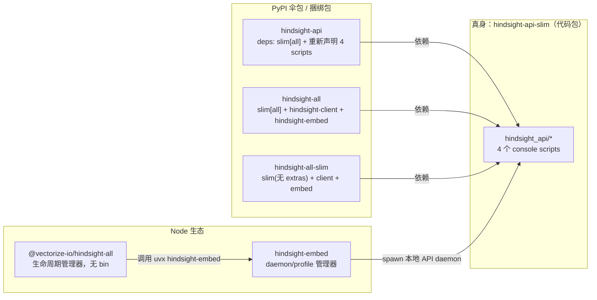
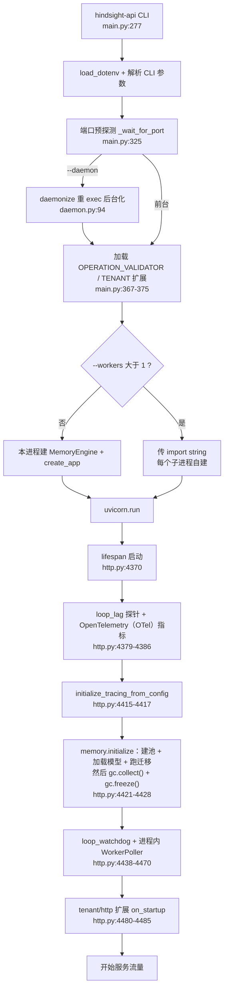
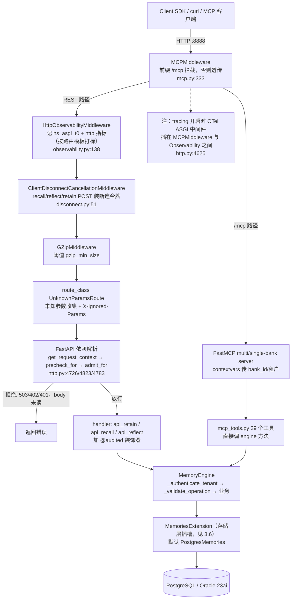
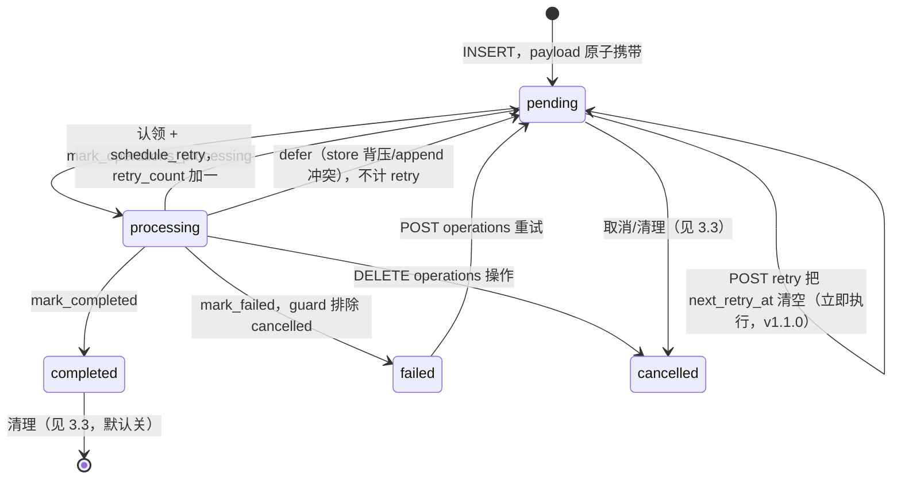
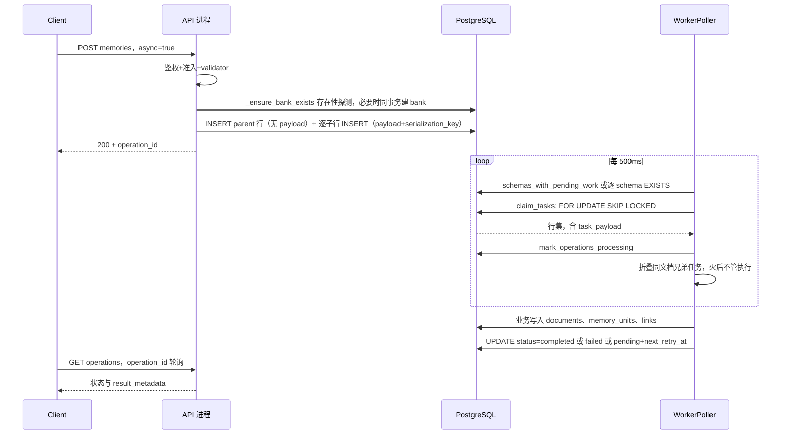
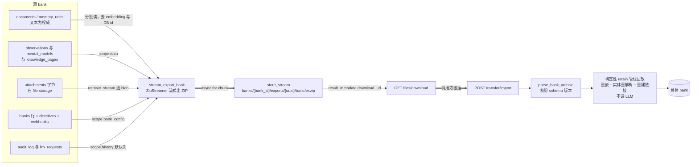
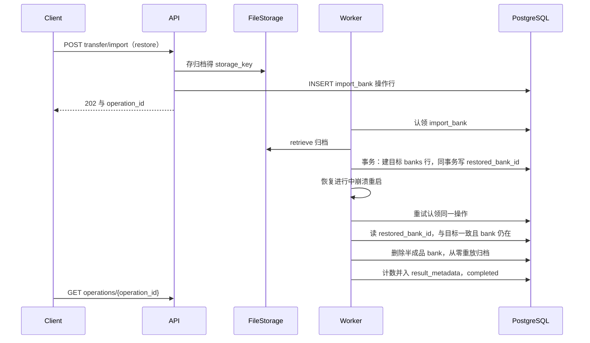

# 06 · API 层与服务形态

> 代码基线：`eebe3ab19`（2026-11，**`85ab32ebe` 之后 3 个提交**，27 文件 / +978 −303）。本篇相关面：`api/http.py` **零 diff**、`mcp_tools.py` 零 diff、`worker/poller.py` 零 diff、扩展槽位零 diff；动到的只有 `engine/db/*`（6 文件，+185/−73，队列认领协议）、`engine/memories/pg/graph.py`（+45/−15）、`engine/transfer/importer.py`（+2/−1）与两个 LLM 层文件。**本窗口既没有新增 REST 路由，也没有新增 MCP 工具名或扩展槽位，API 面完全不动**；落到本篇的只有三件事：① 迁移 **117→118**（`graph_maintenance_queue.claimed_at`，§3.9 迁移面）；② transfer 导入端把这一列显式置 NULL（§3.9 导入语义）；③ 两个 LLM 提交只改错误面与文档里的契约文本，在本篇只记边界（`reflect` 的失败清单由 04 篇 §2.1 与 05 篇 §3.1 展开）。**上一窗口（`85ab32ebe`，73 提交，394 文件 / +18532 −4451）** 的变化集中在"运维命令面"与"契约细节"，分五类：
> ① **`hindsight-admin reembed`：在线换 embedding 模型重嵌（#6372）**——新命令 + 新模块（`admin/reembed.py`），把"停服→重算全部向量→换维度"换成七步可续跑流程：加 `embedding_next` 侧列 → 装触发器（行文本/向量一变就清侧列）→ 删旧向量索引 → 键集分页重嵌 → CONCURRENTLY 建新索引 → 短写锁下换列、把触发器改成**写闸** → `reembed --finish` 摘闸（1.2、3.8、3.11）。服务端配套三件：每条连接用 `SET hindsight.embedding_model` 自报模型（`memory_engine.py:6592`）、写闸拒绝时 HTTP **503 + `Retry-After: 30`**（`http.py:386`）、worker 把这种拒绝当 **defer**（`memory_engine.py:5300`）。
> ② **MCP：多 bank 变体的结果只发一次（#6392 / #6279）**——所有 `-> str` 的工具加 `output_schema=None`（`mcp_tools.py` 里 37 个装饰器，另 1 处是 docstring），否则 FastMCP 会额外塞一份 `structuredContent: {"result": "<同一段 JSON，转义后>"}`，同时展示两者的客户端就此看到两份（1.3）。
> ③ **SIGTERM 立即停止认领（#6377 / #6021）**——API 进程在 uvicorn 的 SIGTERM 处理器外套一层：先 `poller.begin_shutdown()` 再交回原处理器；drain 预算从**信号那一刻**起算，并改成配置项 `HINDSIGHT_API_WORKER_SHUTDOWN_DRAIN_SECONDS`（默认 **20s**，替换写死的 30s）（2.2、3.3、3.8）。
> ④ **扩展接口两处扩张（#6400 / #6386）**——`filter_retain_facts` / `filter_consolidation_actions` 两个"写入前审核"钩子（只能丢弃条目或换 tag）；`validate_mental_model_candidate` 支持 `reject(reason, retry=True)` 要求立刻重写一版草稿（3.6）。
> ⑤ **API 契约细节**：文档 PATCH 新增 `add_tags`/`remove_tags`（#6339）；`GET .../stats` 新增 `paused_mental_models`（#6077）；aiohttp 出站请求带 `User-Agent: hindsight/<version>`（#6414）；`HINDSIGHT_API_DATABASE_CONNECT_HOOK` 让每个新物理连接走可替换的 `asyncpg.connect`（#6376）；embedding 后端确定不可达时 retain 在花 LLM token **之前**停手，HTTP 503（#6370/#5999）。
> ⑥ **计数**：REST **102 → 102**（按 `(方法, 路径)` 集合做差，两侧皆空）、MCP 工具名 **39 / 单 bank 36**（连续第五个窗口零变动）、扩展槽位 **8**、迁移 **116 → 117**（新增 `d3f8a1c6e9b2`：Oracle 复合外键索引，PG 侧是空操作）。**本窗口（`eebe3ab19`）**：REST **102 → 102**、MCP **39 / 36**、扩展槽位 **8** 全部不变，迁移 **117 → 118**（新增 `d3e8a1f5c7b2`：`graph_maintenance_queue.claimed_at`，两方言各加一列、无索引、无新表）。
>
> 再上一窗口（`33524bd33`，v1.2.0 发布之后 8 个提交）涉及本篇的是"id 与生成预算的入口契约收紧"（#6235：`id_problem` 新增"不许含 `/`"，`max_tokens` 收进 `ge=256, le=8192`）、`hindsight-admin cloud` 去掉 `hidden=True`、以及 OpenAPI/四语言 SDK 的再生成——路由 102→102、MCP 名字不变。再上一窗口（`bc5ea195a` → `2c00b59ae`，v1.2.0）是发布刷版 + 错误码面（#6276：不可存文本 400、非法 id 400、priority 越界 422）+ 指标四值枚举（#6256）+ `BankIdSpanProcessor`（#6269）。更早两个窗口（`b4a0da1e9`、v1.1.0 的 `5331da2f4`）的变更保留在正文对应小节：MCP 审计去重与 `rerank` 参数、客户端断连指标、llm-requests 读面三维度、关停预算、模块边界重构（#5993）、operation runs、API 面 +2 路由。
>
> 研究对象：`hindsight-api-slim/hindsight_api/`（api/、worker/、admin/、main.py、server.py、daemon.py、mcp*.py、metrics*.py、tracing.py、liveness.py、loop_watchdog.py、cancellation.py、operation_runs.py、schema_context.py）、`hindsight-extensions/`、发布包链（hindsight-api-slim → hindsight-api → hindsight-all* → npm 包）。
> 方法：全部论断均直接读码核实，标注 `文件:行号`（行号以 `85ab32ebe` 快照为准）。**本窗口把"所有发生变更的文件"里的引用逐条按符号重取了**——先取旧树的原文，再到新树按函数名/语句内容定位，写回真实行号（`http.py`、`memory_engine.py`、`config.py`、`mcp_tools.py`、`worker/poller.py`、`extensions/loader.py`、`extensions/operation_validator.py`、`engine/db/ops_postgresql.py`、`engine/transfer/importer.py`、`engine/response_models.py`、`engine/consolidation/consolidator.py`、`engine/memories/pg/curation.py`、`engine/bank_templates.py`、`engine/db/ops.py`、`engine/db/postgresql.py`、`engine/retain/bank_utils.py`、`admin/cli.py`、`main.py`、`worker/main.py`）。**不使用任何"整体 +N"的假设**：本窗口 `http.py` 的偏移是一条阶梯（+54 → +56 → +58 → +61 → +65，见 1.4），`memory_engine.py` 更不恒定。未变更文件（`metrics.py`、`tracing.py`、`operation_runs.py`、`api/admission.py`、`api/observability.py`、`api/disconnect.py`、`unknown_params.py`、`task_backend.py`、`engine/llm_trace.py`、`api/mcp.py`、`schema_context.py` 等）的行号沿用上一版。**读正文时的口径**：未加限定的"本轮"指上一窗口的改动；本窗口的改动一律带"本窗口"或 issue 号。为省版面，`hindsight-api-slim/hindsight_api/` 前缀在多数引用里省略（`http.py` 即 `api/http.py`、`poller.py` 即 `worker/poller.py`、`memory_engine.py` 即 `engine/memory_engine.py`），其他目录写全路径。无法确认的条目在文末单独列出。

---

# 第 1 层【全景】

## 1.1 一句话形态

Hindsight 的服务形态是一个**单体 FastAPI 进程**：`hindsight-api` 一个入口同时承载 REST HTTP 面、MCP 协议面（同进程 ASGI 中间件拦截 `/mcp*`——ASGI：Python 的异步 Web 服务接口标准，应用与中间件都是接收 scope 上下文和 receive/send 两条原始请求/响应字节流通道的可调用对象，中间件即包在应用外的另一层）、以及**默认开启**的后台任务执行器（进程内 `WorkerPoller`，`config.py:2102` `DEFAULT_WORKER_ENABLED = True  # API runs worker by default (standalone mode)`）。数据库（PostgreSQL/Oracle 23ai）既是存储也是任务队列；需要水平扩容时，把 `HINDSIGHT_API_WORKER_ENABLED=false` 关掉 API 内的 poller，另起独立的 `hindsight-worker` 进程，二者通过 `async_operations` 表解耦协作。

三种典型运行形态：

| 形态 | 进程拓扑 | 典型入口 |
|---|---|---|
| 单机内嵌 | 一个 daemon 进程（API+MCP+poller）+ pg0 嵌入式 Postgres | `hindsight-embed` / `hindsight-local-mcp` |
| Docker 单容器 | `hindsight-api` + Next.js 控制面（`start-all.sh` 同容器两个子进程），worker 在 API 进程内 | `docker/standalone/start-all.sh:354`（API 子进程）、`:389`（node 控制面） |
| Kubernetes 分离 | API Deployment（worker 关闭）+ Worker StatefulSet（`command: ["hindsight-worker"]`）+ 控制面 Deployment | `helm/hindsight/templates/worker-statefulset.yaml:44` |

## 1.2 发布包层级：slim 是唯一的"真身"

整条发布链里**只有 `hindsight-api-slim` 装代码**，其余都是依赖伞或生命周期壳：



要点（均已在 pyproject 中核实）：

- **hindsight-api-slim**（`hindsight-api-slim/pyproject.toml:177-180`）声明四个入口，全部落在 `hindsight_api` 包内：
  ```toml
  [project.scripts]
  hindsight-api = "hindsight_api.main:main"
  hindsight-worker = "hindsight_api.worker.main:main"
  hindsight-local-mcp = "hindsight_api.mcp_local:main"
  hindsight-admin = "hindsight_api.admin.cli:main"
  ```
- **hindsight-api**（`hindsight-api/pyproject.toml:12-14,26`）`dependencies = ["hindsight-api-slim[all]==1.2.0"]`，且 `packages = []` —— 纯依赖伞，唯一作用是给"想要开箱即用（含本地 ML 模型 + pg0）"的用户一个名字；四个 scripts 在它这里重新声明一遍，保持 CLI 命令与包名一致。
- **hindsight-all / hindsight-all-slim**（`hindsight-all/pyproject.toml:12-16`、`hindsight-all-slim/pyproject.toml:12-16`）**不依赖 hindsight-api**，直接拉 `hindsight-api-slim`（all 版带 `[all]` extra，slim 版不带 extras）+ `hindsight-client` + `hindsight-embed`；它们提供的是 Python 库形态的嵌入式用法（`hindsight-all/hindsight/embedded.py` 的 `HindsightEmbedded`，自动拉起本地 daemon）。v1.1.0 起三个包的版本号统一钉在同一个版本上，v1.2.0 窗口一起刷到 `1.2.0`（`hindsight-api-slim/hindsight_api/__init__.py:43` 的 `__version__` 同步改；`hindsight-all`/`hindsight-all-slim` 的 `hindsight-api-slim==1.2.0`、`hindsight-embed==1.2.0` 也一并钉住）。
- **@vectorize-io/hindsight-all**（`hindsight-all-npm/package.json:2-3`，无 `bin`）是程序化生命周期管理器：`src/command.ts:19-25` 返回 `["uvx", "hindsight-embed@<version>"]`（uvx：uv 生态的 npx——临时运行 PyPI 包的命令），`src/server.ts` 依次执行 profile 创建 → `daemon start` → 轮询 `http://127.0.0.1:8888/health`（30s 预算）。
- **hindsight-embed**（`hindsight-embed/pyproject.toml:18`，入口 `hindsight_embed.cli:main`）负责本地 daemon/profile：数据库默认 `pg0://hindsight-embed-{profile}`，API 默认 8888，控制面端口 = API 端口 + 10000；找 API 命令的顺序是：dev 仓库 `uv run` → 已安装的 `hindsight-api` 可执行文件 → 兜底 `uvx hindsight-api@<version>`（`hindsight_embed/daemon_embed_manager.py:493-549`）。
- **`hindsight-admin` 的子命令面**：Typer app 上挂着一批运维子命令（`run-db-migration`、`repair-bank`、`rename-bank`、`export-bank`/`import-bank`、`decommission-worker(s)`、`worker-status`、**本窗口新增的 `reembed`** 等），其中只有两个是"登录第三方 provider"的转发壳：`chatgpt`（`admin/cli.py:1821-1829`）与 `cloud`（`:1832-1840`）。它们的共同写法是 `context_settings={"allow_extra_args": True, "ignore_unknown_options": True, "help_option_names": []}`——把参数原样转交给自己的 argparse（`chatgpt` → `engine/providers/chatgpt_auth.py`、`cloud` → `engine/providers/cloud_auth.py` 的 `main`），所以子命令自身**不接受** `--help`（`help_option_names` 被清空就是这个原因）。`cloud` 此前还多一个 `hidden=True`（Typer 的"注册但不出现在 `--help`"），上一窗口（`ad2ccbb94`）把它删掉，于是 `hindsight-admin --help` 里现在能看到它——**改的只是一个可见性参数：命令签名、`login | status | logout` 的转发、凭据落盘（`~/.hindsight/cloud/credentials.json`，0600）都没有变化**（diff 只有 `hidden=True` 与上面那行 `# Not listed in --help yet.` 两条删除）。取舍：`hidden=True` 大概是"功能未定型，先别写进帮助"，但一个只有读过源码的人才知道的登录入口，等于把"怎么用 Hindsight Cloud"变成了口口相传；列出来之后 `--help` 与文档（provider 配置段）才指向同一个名字。

- **本窗口新增 `reembed`（#6372）**：`@app.command(name="reembed")`（`admin/cli.py:1757`，实现 `_run_reembed` 在 1721）与 `cloud`/`chatgpt` 不同——它不是转发壳，而是真的干活：用**新模型**的 `HINDSIGHT_API_EMBEDDINGS_*` 环境变量跑，服务继续用旧模型；`--schema <name>` 或 `--all-schemas` 二选一（否则 exit 2），`--finish` 摘写闸，`--batch-size/--concurrency/--sleep` 控制压力。拒绝三种情形：没有 database URL、Oracle（`is_oracle_url`）、以及 `memories` 扩展 `store_owned`（向量归 store 自己管，CLI 不该替它重嵌）。实现全在新模块 `admin/reembed.py`（470 行），流程见 3.11。

> 命名注意：`hindsight-api-slim` 的 "slim" 指**不带重量级可选依赖**（torch/本地模型等在 extras 里），而不是功能精简——核心引擎代码 100% 在这个包里。

## 1.3 对外协议面：REST + MCP，同一个进程、同一个 engine

先明确两个贯穿全文的名词：**bank**（记忆库）是 Hindsight 的隔离存储单元，相当于一个 agent 独立的"大脑"，URL 中的 `{bank_id}` 即其标识；**租户（tenant）**是 bank 之上的部署级隔离，映射到独立的数据库 schema。

- **REST**：全部业务路由挂在 `/v1/default/banks/{bank_id}/...` 前缀下（`default` 是租户占位段——`TenantExtension` 决定它映射到哪个 schema），仅两条例外：bank 前缀之外的 `GET /v1/default/chunks/{chunk_id:path}`（7462）与 `GET /v1/default/files/download/{key:path}`（8801）；另有 `/health`、`/health/ready`、`/health/live`、`/metrics`、`/version`（+ `/v1/version` 别名）、`/v1/bank-template-schema`。扩展 HTTP 路由挂 `/ext/`（http.py:4601-4612）。
- **MCP**：FastMCP 实现的 streamable HTTP/SSE 服务，挂在**同一个 FastAPI app 之外包一层 ASGI 中间件**（`api/__init__.py:94-107`），路径 `/mcp`（多 bank 模式，39 个工具）与 `/mcp/{bank_id}`（单 bank 模式，36 个工具，见 `api/mcp.py:131-169`）。工具清单在 `mcp_tools.py:51-93` 的 `_ALL_TOOLS`（39 个）：`retain`/`sync_retain`/`recall`/`reflect`、mental-model 全套 CRUD+`refresh`/`clear`、directives、memories/documents/operations/tags 的 list-get-update-delete、bank 管理、knowledge-base 树与页 CRUD。**v1.1.0 窗口内工具名集合一字未变**（逐名比对基线 39/36），变化都在行为层：`update_memory` 新增 `mentioned_at`（#5750，改一条事实的"提及时间"）；时间戳解析用 `stored_dates.is_placeholder_date` 拒绝公元 1/9999 年这类占位日期（`mcp_tools.py:36` 引入、511 判定），否则一次 `retain` 会把无法参与时序检索的假日期写进库。工具 schema 有一处刻意的"去类型化"：mental-model 触发器的 `tag_groups` 参数在 schema 里是普通 JSON 对象数组（`list[dict]`，`mcp_tools.py:178`）而非嵌套 Pydantic 模型——TagGroup 自引用（and/or/not 递归持有子组）会让 JSON Schema 递归、部分 LLM provider 因此拒收整个工具清单（#5013/#5244），形状校验改由 `field_validator` 把 dict 回穿 TagGroup 适配器完成（`mcp_tools.py:254-261`，适配器 34 行）。0.10.3 起 recall 工具的返回改紧凑 JSON（去掉 `indent=2`——缩进约占 recall 响应体积的五分之一，而该响应整体落进调用方 agent 的上下文，`mcp_tools.py:1369` 附近的注释仍在原地），工具 docstring 也澄清 `max_tokens` 只计每条结果的 `text`（`mcp_tools.py:1270-1272`）。六个 include 选项与各自的 token 预算参数原样保留：`include_chunks`/`max_chunk_tokens`（默认 8192）、`include_entities`/`max_entity_tokens`（500）、`include_source_facts`/`max_source_facts_tokens`（4096），两个工具变体分别在 `mcp_tools.py:1261-1266` 与 `1399-1404`。
- **本轮：recall 接受 `rerank`，与 HTTP 对齐（#6195）**。两个 recall 变体的签名都在 `temporal_window` 之后多了 `rerank: dict | None`（`mcp_tools.py:1258`、`1396`），取值形如 `{"prune": true, "dedup": true}`，原样交给 `RerankOptions.model_validate` 再把两个字段摊进 `recall_kwargs`（`mcp_tools.py:1362-1364`、`1498-1500`）。**为什么是 `dict` 而不是嵌套模型**：与 `tag_groups`/`min_scores`/`temporal_window` 同一套做法——工具 schema 里只出现普通 JSON 对象，避免嵌套模型让 JSON Schema 递归/膨胀（#5013/#5244），形状校验留给 `model_validate`。语义与兼容性：两个键都可省，省略即用 bank/全局的 `recall_decision_model_prune`/`_dedup`；`prune` 不额外花一次模型调用，`dedup` 会多一次（`engine/response_models.py:369-387` 的字段说明）。**仍未对齐的两处**（本轮逐字段比对）：HTTP 有 `trace` 与 `include.max_tokens_per_observation`，MCP 不暴露；MCP 多一个 `bank_id`（仅 `include_bank_id_param` 的变体）。
- **上一窗口（#6282）：MCP 面只改了两行文档，规则却真的落到了这条路上。** `_ALL_TOOLS` 的 39 个名字与基线逐名相同（**本窗口已是连续第五个窗口工具名零变动**；单 bank 变体 36 = 39 − 3）。真正的改动是 `create_mental_model` 工具 docstring 里 `mental_model_id` 那两行（`mcp_tools.py:2049`、`:2115`，两个变体各一份）：`"Optional custom ID (alphanumeric lowercase with hyphens)"` → `"Optional custom ID (same rules as a bank id: at most 192 bytes of UTF-8, no '/' and no control characters)"`。为什么这不算"只是注释"：工具 description 就是 MCP 客户端与模型看到的 schema，它既是文档也是提示词——把它写成"小写字母加连字符"而服务端不再校验这条，模型会继续按旧格式生成，而真正拦人的是引擎里那句 `check_mental_model_id`（`memory_engine.py:18007-18008`）。落到调用方身上的形态也不同：MCP 这条工具用 `_run_tool(..., value_error="expected")`（`mcp_tools.py:2149`），所以 `ValueError` 被当成"正常的否定回答"——回一个 `{"error": "Mental model id must not contain '/': it would split the URL path"}` 且**不记日志**（`_run_tool` 的 `except Exception` 分支，`:464-471`），而 HTTP 那条路是 Pydantic 的 **422**。
- **本窗口（#6392）：多 bank 变体的结果只发一次。** FastMCP 对 `-> str` 的工具会自动派生"包装结果"的 output schema，于是同一个结果在响应里出现两份：`content` 里的文本块，加上 `structuredContent: {"result": "<同一段 JSON，转义后>"}`；同时渲染两者的客户端就把每个结果画两遍（#6279）。修法是给这些工具显式 `output_schema=None`（`output_schema=None` 在 `mcp_tools.py` 里 38 处文本、其中 37 个是装饰器——`mcp_tools.py:419` 那处是 `_run_tool` 的 docstring；37 个里 36 个返回 `-> str`，加上 recall 多 bank 变体的 `str | dict`。`-> dict` 的变体与 `retain`/`sync_retain` 本来就只发结构化内容，不动）。取舍是"放弃一份包装 schema，换回单份结果"：`-> str` 的契约本来就是"文本里是一段 JSON"、调用方自己 `json.loads`，多出来的 `structuredContent` 只是把同一段字面量再包一层。`test_no_tool_wraps_its_json_text_in_structured_content` 钉住这条；`extensions/mcp.py:34-38` 的扩展示例也同步改成 `@mcp.tool(output_schema=None)`，否则第三方扩展会重新引入同一问题。
- **MCP 审计：一个入口、一份黑名单（#5961；演进史容易读错）**。基线其实有**两条分支**：FastMCP 2.x 走 `mcp._tool_manager`、给每个工具对象的 `run` 套包装（按 `_AUDITABLE_MCP_TOOLS` 白名单），3.x 已经包装 `mcp.call_tool` 这一个入口（基线 `mcp_tools.py:925-981`，`_apply_audit_logging` 到 `object.__setattr__(mcp, "call_tool", _call_tool)`）。v1.1.0 的真实增量是四件事：① **删掉 2.x 那条逐工具分支**，只保留单入口包装（现 `mcp_tools.py:929-985`）；② 白名单反转成 `_UNAUDITED_MCP_TOOLS` 黑名单（只列 16 个只读工具，`mcp_tools.py:907-926`）——新加的写工具默认就被审计，不需要谁记得去加名单；③ 用 `audit_logger.destructive_op(...)` 包住调用，破坏性工具无论审计开关如何都落一条 INFO（见 3.5.3）；④ `finally` 里无条件打一行 `mcp tool=<name> bank=<bank> status=<ok|error> duration_ms=<n>`——MCP SDK 自己只记 `Processing request of type CallToolRequest`，不知道调用的是哪个工具（#5960）。

**本轮：一次工具调用只写一条审计行（#6071/#6142）**。FastMCP 3（上一窗口随依赖抬到 3.4.11，#6113；其后的窗口 `pyproject.toml` 只改了版本号）在中间件链之后会带着 `run_middleware=False` **再次进入** `mcp.call_tool`，而包装器正是装在 `call_tool` 上的——于是每次工具调用都被记两遍：两条审计行、两行 `mcp tool=...` 日志。修法是一行提前返回：`if kwargs.get("run_middleware") is False: return await original_call_tool(name, arguments, **kwargs)`（`mcp_tools.py:937-938`），内层调用不再记账，外层那次照旧。取舍：这把"一次调用"的判定交给了 FastMCP 的一个内部关键字——它不是公开 API，升级 FastMCP 时若改了名，症状是审计行悄悄翻倍而不是报错，所以本轮把它列进"未能确认"（第 5 层第 10 条）。
- **MCP 关闭时不再加载 fastmcp（#6001）**：`create_app` 里 `from .mcp import ...` 本来就在 `if mcp_api_enabled` 分支内（`api/__init__.py:51-59`），漏的是扩展侧——`extensions/mcp.py` 曾在模块级 `from fastmcp import FastMCP`，而 `hindsight_api.extensions` 被引擎与指标模块无条件 import，于是不起 MCP 的进程也要付 fastmcp 的导入代价、装坏了还会带崩整个服务。现在该 import 移进 `if TYPE_CHECKING`（`extensions/mcp.py:18-23`）。MCP 与 REST 共享同一个 `MemoryEngine` 实例，不是独立服务。
- **根级 `mcp_local.py`**：不是独立 MCP server，而是给本机 Claude Code 用的"一条命令起全家"薄壳——默认 `pg0://hindsight-mcp` 数据库，然后直接调用 `hindsight_api.main.main()`（`mcp_local.py:29-40`），完整 API 跑在 8888，MCP 端点是 `http://localhost:8888/mcp/`（HTTP transport，见其 docstring 1-24 行；`mcp_tools.py` 顶部 docstring 仍称它为 stdio transport，与实际实现不符，属文档残留）。

## 1.4 REST 端点地图（按资源分组）

以下为 `_register_routes`（http.py:4720 起）注册的全部业务路由（省略共同前缀 `/v1/default`；方法后为 handler 名，**所有数字统一为 handler `def` 行**，装饰器到 def 差 6–32 行（`/v1/version` 这个堆叠别名只差 1 行））。**计数方法**：`_register_routes` 内 `@app.<method>(` 装饰器行共 **102** 个（脚本解析每条装饰器的路径 + 其后的 `def` 名；按 `(方法, 路径)` 去重后仍是 102，按 `def` 去重是 101）。**口径陷阱**：`/version` 与 `/v1/version` 是同一个 `version_endpoint` 上的两个堆叠装饰器（http.py:4968、4981；`def` 在 4982），按"每个 def 一条"去数会得 101——两种数法都跑过，以装饰器行数为准。口径说明：**含 4 条恒返 410 的退役路由**（bank profile 读写、bank background、同步 document-transfer 导出），含 1 条 `include_in_schema=False` 的 `/v1/version` 别名；不含扩展经 `include_router` 动态挂到 `/ext` 的路由，也不含 `/mcp*`（MCP 走中间件）。

**本窗口（`85ab32ebe`）再次 102 → 102**：按 `(方法, 路径)` 集合做差两侧为空集；`http.py` 10120 → **10185** 行（+74/−9：三处模型字段 + 一个 lifespan 辅助函数 + 一个 except 分支）。handler 行**不是常数偏移，而是五级阶梯**——到 `api_stats` 为止 +54（`:195` 附近的 import、`_store_unavailable` 里多的一条 503、`UpdateDocumentRequest` 的两个新字段、`BankStatsResponse` 的 `paused_mental_models`，以及 `_stop_claiming_on_sigterm`）；从 `api_bank_llm_health`（5982）起 +56（stats handler 里 `paused_mental_models` 的取值 + 一行注释 = +2）；`PATCH .../documents/{id}` 自身 +58（它的 decorator 描述多两行）；`DELETE .../documents/{id}` 起 +61（PATCH handler 里那句"至少给一个字段"的判断与 422 detail 被拆成多行，+3）；`api_retain` 自身 +61（def 本身）；retain 内多出的 `except EmbeddingsUnavailableError` 分支让 def 之后的行再 +4，于是 `api_file_retain` 起的 7 个 handler 是 +65（见 2.4）。下表已按新树逐条重取。再往前一版基线 `33524bd33` 是 102 条（`http.py` 10109→10120，全部 +11）；`2c00b59ae` 是 102 条且 handler 行整体后移 48–75 行不等。**本窗口路由数不变，但三条端点的契约变了**：`PATCH .../documents/{document_id:path}` 接受 `add_tags`/`remove_tags`（部分改 tag，不能与 `tags` 同时给）；`GET .../stats` 的响应多一个 `paused_mental_models`；`POST .../memories`（retain）在 embeddings 后端不可达时新增 503 + `Retry-After: 60`。每条路由只归属一组：`POST .../clone` 归 Banks 组（它是 bank 管理动作，只是实现走 transfer），Transfer 组不再重列。

**监控/元信息**（7 条）
- `GET /health`、`GET /health/ready`（就绪，查数据库，4940）、`GET /health/live`（存活，不碰数据库，4959）、`GET /metrics`（Prometheus，5019，渲染已移出事件循环，见 3.5）、`GET /version` 与 `GET /v1/version`（同一 handler `version_endpoint`，4982；`/v1` 别名刻意 `include_in_schema=False`——只经 `/v1` 转发的反代会把裸 `/version` 打到控制面上，客户端探测能力标志会静默拿到"不支持"，#5286）、`GET /v1/bank-template-schema`（8859）

**Banks 与配置**（19 条，含 3 条退役）
- `GET /banks`（列表，5893）、`PUT /banks/{bank_id}`（创建或更新，7996，`@audited("create_bank")`）、`PATCH /banks/{bank_id}`（8041）、`DELETE /banks/{bank_id}`（8088）
- `GET /banks/{bank_id}/aliases`（7882）、`POST /banks/{bank_id}/aliases`（7908，201）、`PATCH /banks/{bank_id}/aliases/{alias}`（7939，设展示别名）、`DELETE /banks/{bank_id}/aliases/{alias}`（7972）——bank 别名全套（见 3.9）
- `GET /banks/{bank_id}/stats`（5919，本窗口响应多一个 `paused_mental_models`，见 3.7）、`GET /banks/{bank_id}/stats/memories-timeseries`（6014）、`GET/PATCH/DELETE /banks/{bank_id}/config`（9026/9055/9091，层级配置，写受 `HINDSIGHT_API_ENABLE_BANK_CONFIG_API` 控制，DELETE 重置）、`POST /banks/{bank_id}/clone`（8678，整库克隆，202 异步）、`GET /banks/{bank_id}/tags`（7398）、`POST /banks/{bank_id}/health/llm`（5982，刻意做成 POST——会真实调用一次 provider）
- legacy 的 `GET/PUT /banks/{bank_id}/profile`（7814/7827）与 `POST /banks/{bank_id}/background`（7847）已退役（保留路由恒返 410）

**Memory 写入与查询**（13 条）
- `POST /banks/{bank_id}/memories`（retain，同步/异步二合一，9481）、`POST .../memories/dry-run-extract`（5217）、`GET .../memories/list`（5109，列表+全文搜索）、`POST .../files/retain`（9794，文件转换后 retain）、`GET /v1/default/files/download/{key:path}`（8801，附件/导出 ZIP 下载）
- `POST .../memories/recall`（检索，5466）、`DELETE /banks/{bank_id}/memories`（清空 bank 全部记忆，9940）
- `GET .../memories/{memory_id}`（5334；详情视图带 `consolidated_at`/`consolidation_failed_at`，见 3.7）、`GET .../memories/{memory_id}/history`（5428，观察历史）、`PATCH .../memories/{memory_id}`（5370，update_memory；**invalidate 也是 PATCH**，body 带 `state: "invalidated"`——没有独立 DELETE 单条路由；可改 `mentioned_at`，#5750）、`DELETE .../memories/{memory_id}/observations`（8993，清空该记忆的观察）
- `POST /banks/{bank_id}/reflect`（处置感知推理，5714）、`GET /banks/{bank_id}/graph`（5048，bank 级图；结果由 orjson 直出，见 3.5）

**文档/实体/观察**（15 条）
- `GET /banks/{bank_id}/documents`（7144，`q` 搜索计数封顶 1000，命中即 `total_is_estimate: true`；每条带 `matched_fields`；`q` 是未建索引的扫描，docstring 明说只供浏览 #5758）、`GET/PATCH/DELETE .../documents/{document_id:path}`（7358/7519/7572；PATCH 接受 `tags`、`add_tags`/`remove_tags` 或 `observation_scopes`，**四者全不给才 422**；`tags` 与 `add_tags`/`remove_tags` 互斥，同时给同样 422）、`GET .../documents/{document_id:path}/chunks`（7218）、`POST .../documents/{document_id:path}/reprocess`（7318）、**`GET .../documents/{document_id:path}/history`（7286；v1.1.0 新增 #5638：按 operation 重建的文档变更史，见 3.10）**、`GET /banks/{bank_id}/attachments/{attachment_id}`（8754，附件元数据读取）
- `GET /v1/default/chunks/{chunk_id:path}`（7462，bank 外的 chunk 寻址读）
- `GET /banks/{bank_id}/entities`（6049，支持 tag 过滤）、`GET .../entities/graph`（6097）、`GET .../entities/{entity_id}`（6138）、`POST .../entities/{entity_id}/regenerate`（6196）——实体为只读派生数据，无更新/删除端点
- `DELETE /banks/{bank_id}/observations`（清空观察，8872）、`GET /banks/{bank_id}/observations/scopes`（8904）

**Mental Models / Directives / Knowledge Base**（22 条）
- `GET/POST /banks/{bank_id}/mental-models`（6221/6379）、`GET/PATCH/DELETE .../mental-models/{mental_model_id}`（6288/6552/6594）、`POST .../{id}/refresh`（6430，异步任务）、`POST .../{id}/clear`（6521）、`POST .../{id}/dry-run-refresh`（6478）、`GET .../{id}/history`（6344）——共 9 条
- `GET/POST /banks/{bank_id}/directives`（6953/7034）、`GET/PATCH/DELETE .../directives/{directive_id}`（7001/7069/7107）——共 5 条
- `GET .../knowledge-base/tree|search|export`（6635/6793/6747，树与搜索支持 tag 过滤；export 返回 `index.md` + 每页 `<id>.md` + 历史日志的 markdown bundle）、`POST .../knowledge-base/folders`（6662）、`POST .../knowledge-base/pages`（6695）、`GET .../knowledge-base/pages/{page_id}`（6824；`body` 是原始内容——空页即空串，`markdown` 由 `render_document(..., notice_when_empty=True)`（http.py:3683）渲染，空页会带一句说明）、`PATCH/DELETE .../knowledge-base/nodes/{node_id}`（6856/6920；全空 body 的 PATCH 被 engine 以 400 拒绝在任何 bank 读取之前）——共 8 条
- 注意：**知识页/mental model 的"下载 PDF / Markdown"不是 REST 端点**。它是控制面在前端做的（`hindsight-control-plane/src/lib/page-download.tsx` 的 `printPage:47`/`downloadMarkdown:22`，页面按钮见 `components/knowledge-base-view.tsx:704-711`、`components/mental-model-detail-modal.tsx:1100-1103`）；PDF 走浏览器打印，Markdown 走本地生成文件。API 只提供内容。

**异步操作管理（任务系统的 API 面）**（5 条）
- `GET /banks/{bank_id}/operations`（7610）、`GET .../operations/{operation_id}`（7659）、`DELETE .../operations/{operation_id}`（取消 pending/processing，7702）、`POST .../operations/{operation_id}/retry`（7736；对"已 defer、`next_retry_at` 还在未来"的 pending 操作也生效——立即执行，#5772，见 3.3）、`DELETE .../operations/{operation_id}/delete`（7766，删除终态记录）

**Consolidation**（3 条）
- `POST /banks/{bank_id}/consolidate`（9117，手动触发整合）、`POST .../consolidation-strategies/preview`（8937，试跑整合策略）、`POST .../consolidation/recover`（8970）

**Bank Transfer（整库搬运，见 3.9）**（5 条）
- `POST .../transfer/export`（8482，202 异步导出，三个 include 标志 + 可选 `document_id` 子集）、`POST .../transfer/import`（8567，202 异步导入，`mode=restore|merge`）
- 文档级历史端点：`POST .../document-transfer`（8406，异步文档导入提交）、`POST .../document-transfer/export`（8345，异步文档导出提交）、`GET .../document-transfer`（8309，同步全量导出已退役，恒返 410）
- `POST .../clone` 见 Banks 组（8678）
- 轮询走 `GET .../operations/{operation_id}`（7659），ZIP 经 `GET /v1/default/files/download/{key:path}`（8801）下载——transfer 面没有 GET 形态的提交端点

**Bank 模板（配置面，非归档）**（2 条）
- `GET /banks/{bank_id}/export`（8207，导出模板 manifest：config + mental models + directives）、`POST .../import`（8139，导入模板 manifest；重导入跳过未变更的 mental models/directives）——这两个是**模板**交换，与 Bank Transfer 的整库归档无关；实现已在 `engine/bank_templates.py`（见 2.2）。

**Webhooks / 审计 / LLM 观测 / 提示词**（11 条）
- `GET/POST /banks/{bank_id}/webhooks`（9242/9181）、`PATCH/DELETE .../webhooks/{id}`（9335/9304，无单条 GET；读取靠列表与 deliveries）、`GET .../webhooks/{id}/deliveries`（9417）——每个投递行携带 `event_id`：一个逻辑事件在多 webhook 扇出与重试间共享同一 id，接收端靠它去重（`webhooks/models.py:81`，`operation_id` 做不了这件事——一次批量 retain 会对多个文档在同一 operation 下各发一个事件）
- `GET /banks/{bank_id}/audit-logs`（9986，**只返回摘要、不含 request/response 体**）、`GET .../audit-logs/stats`（10027）、**`GET .../audit-logs/{log_id}`（10060；v1.1.0 新增 #5826：单条带完整请求/响应体）**、`GET .../llm-requests`（10090，可按 `call_type=llm|embedding|rerank|decision` 过滤，#5835；响应带 `retention_days`）、`GET .../llm-requests/stats`（10155，`period=1d` 按小时分桶，`split_by=model|operation` 与逐桶 `series`，响应带 `retention_days`，#6222）、`POST /banks/{bank_id}/prompts/preview`（5277）

分组小计：7 + 19 + 13 + 15 + 22 + 5 + 3 + 5 + 2 + 11 = **102**。

MCP 端能做的操作与上述 REST 面**大体对应**（共享 engine），差异只在工具粒度：MCP 没有 export/import/transfer/clone/consolidate 这类管理型操作，也没有文档变更历史、审计与 LLM 请求历史；反向地，MCP 的 `list_banks`/`create_bank`/`get_bank`/`get_bank_stats` 直连 engine，没有一一对应的 REST 形态——**没有 `GET /banks/{bank_id}` 单体读取端点**；bank 详情从 `GET /banks` 列表与 `/stats`、`/config` 获取，PATCH/DELETE 只承担写。

# 第 2 层【主流程】

## 2.1 服务启动：从 `hindsight-api` 到 uvicorn.run

`hindsight_api/main.py:277` 的 `main()` 按以下顺序装配（`hindsight_api/server.py` 则是给 `uvicorn hindsight_api.server:app` 用途准备的模块级等价物）：

1. `load_dotenv_for_entrypoint()` 加载 .env → `_get_raw_config()` 读配置；
2. 解析 CLI 参数（`_parse_cli_args`，`--host/--port/--workers/--daemon/...`）；
3. **端口预探测**：`_wait_for_port`（main.py:325 调用，定义 172-180，对 EADDRINUSE 做 5s 宽限重试）在昂贵的初始化（pg0 启动、模型加载、迁移）**之前**试绑定端口，避免"初始化 10 秒后才发现端口被占"造成的重启风暴（main.py:142-152 注释引用 #4281）；
4. daemon 模式：`daemonize()`（daemon.py:94-147）用 `subprocess.Popen` + `_HINDSIGHT_DAEMON_CHILD` 环境变量**重 exec 自己**进入后台（不用 double-fork，注释写明原因是 macOS 上 fork 不 exec 会破坏 Apple 框架状态导致 PyTorch/MPS SIGBUS）；
5. 加载两个由环境变量指定的扩展：`OPERATION_VALIDATOR` 与 `TENANT`（main.py:367-374）；
6. 构建 `MemoryEngine` + `create_app`（仅单 worker 模式，main.py:400-418），多 worker/reload 模式改为传 import string `"hindsight_api.server:app"`，由每个 uvicorn 子进程自行导入（uvicorn_config 组装处 main.py:456）；
7. `uvicorn.run(...)`（main.py:500）。

main.py 顶部有一段关键的懒加载设计（main.py:45-59）：`create_app`/`MemoryEngine`/扩展机制**不在模块级导入**，通过模块 `__getattr__`（PEP 562）在首次使用时解析：

```python
# hindsight_api/main.py:60-66
_LAZY_IMPORTS: "dict[str, tuple[str, str]]" = {
    "MemoryEngine": (".", "MemoryEngine"),
    "create_app": (".api", "create_app"),
    "OperationValidatorExtension": (".extensions", "OperationValidatorExtension"),
    "TenantExtension": (".extensions", "TenantExtension"),
    "load_extension": (".extensions", "load_extension"),
}
```

逐点讲解：
- 原因是 uvicorn 多进程 supervisor 用 **spawn**：每个子进程会重跑 `sys.argv[0]`（pip console-script 包装器），其首行就是 `from hindsight_api.main import main`——这个模块 import 什么，**每个子进程就都要付一次代价**。注释里给了实测：`.api` 导入约 6.2s、`.extensions` 约 2.6s，把这两者移出模块级后整条命令的导入从 6578ms 降到 312ms（main.py:51-52）。
- 子进程导入若超过 supervisor 的 5s 健康检查会被 SIGKILL 无限重生（这正是被修掉的 respawn bug）。
- 走 `main()` 时通过 `sys.modules[__name__]` 属性访问触发懒导入（main.py:359-364），而不是裸 `from .x import y`——后者会屏蔽测试对模块属性的 patch。

v1.0.0 把同一思路推进到了引擎内部的重型依赖（#5479/#5686）：**启动只为进程真正要用的东西付费**。此前每个进程（连 `--help` 都算）都要加载全部 LLM provider 的 SDK——仅 google-genai 约 4s、openai 约 2s（`engine/providers/__init__.py` 模块 docstring 的实测）；现在 providers 包按名 PEP 562 懒加载（`engine/providers/__init__.py:31` 起 docstring 说明，各 provider 只在 `llm_wrapper` 分发选中时 import），`sentence_transformers`（会拖进 torch，约 15s）与 onnxruntime 的存在性检查改用 `importlib.util.find_spec` 而非 import（`config.py:4632-4655` 的两处检查；`engine/llm_wrapper.py:22` 一处 `find_spec("google.oauth2")`），config 导入链上的 sqlalchemy 延迟到用到处（`_vector_index.py` 顶部注释：config.py import 它，省 ~0.5s/进程），OTel SDK 与 OTLP exporter 移进 `initialize_tracing()`（tracing.py:150 起、SDK import 在 173——tracing 默认关，此前每个进程白付），`provider_auth.py` 从 `engine/` 挪到包根并 re-export 兼容旧导入路径。`fact_extraction` 的模块级 openai 导入（batch 结果用量读取用）也改为用到处再 import（#5686 的 rebase 补丁）。

uvicorn 配置里两个值得注意的点（main.py:452-456）：`ws="wsproto"`（避开 websockets 的弃用告警）、`timeout_graceful_shutdown=5`（优雅关闭上限 5s，二次 Ctrl+C 强杀）；`--workers N` 时把 N 写回 `os.environ[ENV_WORKERS]`（main.py:463-467），让每个子进程按 CPU 预算分摊准入限额（见 3.4）。

**启动的 LLM 探测是并行且有界的（#6219，引擎侧）**。`MemoryEngine.initialize` 里的 `verify_llm()` 仍然只 warn、不阻塞启动，但探测本身从"逐个 await、没有超时"换成了 `verify_llm_connections()`（memory_engine.py:1018-1062）：所有配置并发探（多模型链按**成员**展开，而不是只探主模型），每个 `asyncio.wait_for(..., timeout=_LLM_PROBE_TIMEOUT_SECONDS)` 封顶 10s（memory_engine.py:436），去重键从 `(provider, model)` 扩到 `(provider, model, base_url)`——同一模型挂在两个网关上的故障切换配置因此两个都会被探到。动机写在 docstring 里：探测失败本来就只是 warn，一个排队很深的 backend 却能把启动拖满整个模型初始化预算、最后还判失败；而只探链首会让一个慢的 failover 成员永远藏着。

`server.py`（94 行）是 import-string 模式的目标模块：模块级 `load_dotenv_for_entrypoint()`（server.py:25-27）放在 **import MemoryEngine 之前**——引擎子模块（如 llm_wrapper）在 import 时就会按配置创建信号量，而配置来自环境变量，所以必须先加载 .env，配置才能读到；随后是 profiling 装配（29-40）、扩展加载（58-65）、以及**模块级**构建 `MemoryEngine(run_migrations=config.run_migrations_on_startup)` 与 `app = create_app(...)`（70-87）——注释说明迁移是幂等的，多 worker 各自导入也安全。

### 启动时序（含 FastAPI lifespan）



其中 N 节点（`loop_watchdog + 进程内 WorkerPoller`，http.py:4438-4470）自 0.10.3 起：进程内 poller 与独立 worker 一样，启动恢复不再阻塞轮询（见 3.3 的 #5411）。

## 2.2 create_app：一个 app、三层装配

真正的 app 由两段代码拼成：

**第一段（`api/__init__.py:17-109`，统一入口）**：`create_app(memory, http_api_enabled, mcp_api_enabled, mcp_mount_path, initialize_memory)`——先建两个 FastMCP server（多 bank / 单 bank），再调 `api/http.py` 的 `create_http_app` 建 REST app，然后：① 用 `chained_lifespan`（`api/__init__.py:79-92`）把两个 MCP server 的 lifespan 包在 REST app 的 lifespan 外层——启动时先起 MCP、再起 REST，关闭顺序相反（lifespan 即 FastAPI/ASGI 的应用启动/关闭生命周期钩子）；② `app.add_middleware(MCPMiddleware, ...)` 把 MCP 中间件包在最外层（`api/__init__.py:94-107`）。注释解释不用 Starlette Mount 的原因：Mount 会让无尾斜杠的 `/mcp` 吃 307 重定向。`from .mcp import ...` 在 `if mcp_api_enabled` 分支内（51-59 行），`except ImportError` 会明确提示 `pip install hindsight-api[mcp]`。

**第二段（`api/http.py:4332-4627`，本文件也叫 `create_app`，`api/__init__.py` 里以 `create_http_app` 别名导入）**：`create_app` 依次做入口处 profiling 装配（4356-4362，保证 `--workers N` 时每个子进程也装上 cProfile；`install()` 幂等）、HTTP 扩展加载（4365）、延迟到 lifespan 的初始化（见上）、`FastAPI(...)` 构造（4532，`root_path=config.base_path`）、route_class 两段式设置（先 `ExcludeNoneRoute`（4549，必须在任何路由注册前设好）再 `UnknownParamsRoute`（4589））、GZip（4561，阈值可配，负值整体关闭）、OpenAPI ValidationError 补丁（4564-4581）、**准入控制器**挂 `app.state.admission`（4593）、注册全部路由（4596）、`/ext/` 扩展路由挂载（4601-4612，include_router 前先 `use_unknown_params_routes` 让扩展路由也走 UnknownParamsRoute）、两个纯 ASGI 中间件（见下）、OTel ASGI instrumentation（4625）。

**本窗口（#6377）：进程内 poller 的 SIGTERM 抢在服务器前面。** uvicorn 的 SIGTERM 处理器在 lifespan 之前就装好，而 poller 的关闭写在 lifespan 的 teardown 里——teardown 要等 uvicorn 自己的 HTTP drain 走完才执行。这中间 poller 仍在认领新任务，而这些任务之后只剩宽限期剩下的一点时间。`_stop_claiming_on_sigterm`（http.py:4310-4329）包住 uvicorn 已装的处理器：收到信号先 `loop.call_soon_threadsafe(poller.begin_shutdown)`，再把信号原样交回服务器。三个前置判断写在开头——必须在主线程（`signal.signal` 的限制，测试客户端与工作线程里直接跳过）、取到的处理器必须可调用（否则是默认"直接杀"，没有 drain 可提前）、并且用 `call_soon_threadsafe` 进入事件循环（信号处理器里唯一安全的入口）。接线在 `poller_task` 创建之后一行（http.py:4469），而 lifespan 里的 `shutdown_graceful` 现在读配置（http.py:4496，见 3.8）。

```python
# hindsight_api/api/http.py:4615-4625
    # Client-disconnect cancellation for recall/reflect. Added LAST so it sits
    # OUTSIDE the @app.middleware("http") (BaseHTTPMiddleware) layers above —
    # that placement is mandatory: BaseHTTPMiddleware breaks
    # Request.is_disconnected(), so the only way to observe an abandoned request
    # is to own the raw ASGI receive channel from outside it (issue #2122).
    app.add_middleware(ClientDisconnectCancellationMiddleware)
    # Pure ASGI, so unlike the BaseHTTPMiddleware it replaces it adds no task hop:
    # records the request metrics and attaches X-Ignored-Params for the route class.
    app.add_middleware(HttpObservabilityMiddleware)

    _instrument_app_for_tracing(app, config)
```

逐点讲解：
- Starlette 的 `add_middleware` 是插到栈顶（最后添加者在最外层），所以**自外向内**的完整顺序是：`MCPMiddleware` → `HttpObservabilityMiddleware` → `ClientDisconnectCancellationMiddleware` → `GZipMiddleware` → route_class（`UnknownParamsRoute`）→ FastAPI 依赖解析 → handler。上述是 tracing 关闭（默认）时的全部；**tracing 开启时** OTel ASGI 中间件经 `_instrument_app_for_tracing`（http.py:4674-4717）注入，位于 HttpObservability 之外、MCPMiddleware 之内——即 MCP → OTel → Observability → Disconnect → GZip。
- 两个 ASGI 中间件都是纯 ASGI 实现，刻意替换掉了原来的两个 `@app.middleware("http")`（BaseHTTPMiddleware）：注释给出量级——BaseHTTPMiddleware 的每请求子任务 + memory-stream 中转在便宜路由上吃掉约 3 倍吞吐（4582-4588 的注释块）；`api/observability.py:5-9` 记录 `/health/live` 从约 1500 rps 升到 5100 rps、p99 159ms→33ms。
- `ClientDisconnectCancellationMiddleware` 的位置约束是"必须能读到原始请求字节流（receive 通道）"：任何包装 receive 的层（BaseHTTPMiddleware、OTel 的 receive span）都在它之外才能感知断连。它外面的 `HttpObservabilityMiddleware` 只包 send 不包 receive，OTel 又显式 `exclude_spans=["receive","send"]`（http.py:4712），所以最外层是 MCP → observability、断连中间件在第三层也依然有效。

### 模块边界：引擎不再认识 API 层（v1.1.0 重构 #5993）

v1.0.0 的依赖方向是双向的：`api/http.py` 一万行，而 `engine/memory_engine.py` 又在三处回头 import API 层——`from ..api.page_markdown import EMPTY_PAGE_NOTICE`（基线 213 行）、`from hindsight_api.api.http import load_default_bank_template_manifest`（基线 15060）、以及同一文件的 bank 模板应用逻辑（基线 15103）。模板应用既要在 HTTP handler 里跑，又要在"新建 bank 时套用服务器默认模板"时跑，于是引擎只能反向依赖路由文件；这也让 `hindsight_api.api` 的任何 import 副作用都传染进引擎与 worker。

v1.1.0 把"引擎需要的、住在 API 文件里的东西"整体下沉，方向变为单向（api → engine）：

| 原位置 | 新位置 | 职责 |
|---|---|---|
| `api/page_markdown.py`（192 行） | `engine/page_markdown.py`（`R100` 纯改名） | 知识页/mental model 的 markdown 渲染与文件名规则 |
| `api/http.py` 的 bank 模板函数（`validate_bank_template`/`apply_bank_template_manifest`/`apply_default_bank_template_resources`/`_mental_model_matches_template`/`_directive_matches_template`，约 700 行） | `engine/bank_templates.py`（786 行，`load_default_bank_template_manifest` 450、`apply_bank_template_manifest` 462、`apply_default_bank_template_resources` 621） | 模板 manifest 模型、校验、套用；HTTP 的 import/export 与引擎的"新 bank 套默认模板"共用 |
| `api/http.py` 的 `_migrate_entity_labels_input` / `FieldWithDefault` | `engine/retain/entity_labels.py:107`（改名 `migrate_entity_labels_input`）/ `engine/response_models.py` | 纯数据模型与迁移辅助 |
| `engine/memory_engine.py` 的 `_current_schema` / `get_current_schema` / `fq_table` | `schema_context.py:13-26`（两个 ContextVar）/ `engine/schema.py:46`（`fq_table`） | 租户 schema 与当前 bank 的上下文；`schema_context` 只依赖 `config`，成为最底层叶子，`config.py:2371-2372` 反过来用它 |
| ——（新） | `engine/document_history.py`（292 行）、`engine/stored_dates.py`（占位日期判定） | 文档变更史（见 3.10）与"公元 1/9999 年"这类非法日期 |

结果：`grep -rn 'hindsight_api\.api' hindsight-api-slim/hindsight_api/engine/` 现在**零命中**；`http.py` 从 10875 行降到 10009 行（v1.1.0 窗口 −1060/+194；此后 10009→10049→10109→10120→10185）。`engine/__init__.py:10-17` 也把 `get_current_schema`/`fq_table` 的再导出改到新位置，老的 `from hindsight_api.engine import fq_table` 仍然可用。

### lifespan 里的三项固定动作（**基线已有**，上一窗口只随文件搬移，本窗口未改；本窗口只在 poller 启动后多接了一行 SIGTERM，见上）

下面三件事都常被误当成 v1.1.0 的新增——它们逐字存在于基线 `5331da2f4` 的 `api/http.py`（当时同一文件），上一窗口只是行号平移，本窗口未改，逻辑一行未改：

1. **`memory.initialize()` 之后冻结 GC**（基线 5265-5268 → 现 http.py:4423-4428）：

```python
# hindsight_api/api/http.py:4421-4428
            # Startup leaves ~800k long-lived objects (models, config, pools). Left
            # tracked, every full GC pass walks them all, which turns a request that
            # allocates heavily (a 1000-memory graph read) into 2-3x its real cost.
            # Freezing moves them out of the collector's view; they live forever anyway.
            gc.collect()
            gc.freeze()
```

   启动后常驻的对象（模型权重、配置、连接池）约 80 万个，全留在 GC 的跟踪集合里会让每一次 full GC 都遍历它们；`gc.freeze()` 把它们移出收集器视野，反正它们本来也不回收。

2. **还原被顶替的 metrics collector**（基线 5364 → 现 http.py:4525）：启动时记下 `previous_metrics_collector`（现 4343），关停时 `reset_metrics_collector(previous_metrics_collector)`。collector 是模块级全局，一个启动又停止的 app 会把自己的 collector（握着一个已关闭的 DB 池）留给进程里后续的所有使用者（#3780）。

3. **tracing 由配置驱动**（基线 5255-5257 → 现 http.py:4415-4417）：API 与独立 worker 入口都调 `initialize_tracing_from_config(config)`，共用同一份配置解读。

## 2.3 请求 → 中间件 → 依赖 → engine：分层机制图



依赖链的三个环节是理解每条重路由的关键（都在 `_register_routes` 内定义）：

1. **`get_request_context`**（http.py:4726-4759）：从 `Authorization` 头取 API key（支持 `Bearer <key>` 与裸 key），并把 `HINDSIGHT_API_EXTENSION_PASSTHROUGH_HEADERS` 白名单中的头收进 `RequestContext.extra_headers`（默认空名单）。两处新东西：① 第一行 `request.scope.setdefault("hs_deps_t0", time.perf_counter())` 是依赖段计时埋点（recall 用它把"路由+中间件/依赖/读 body"拆开，见 3.5）；② **一个请求一个 `RequestContext`**，缓存在 `request.state.hs_request_context`（4754-4759）——别名解析在路由层就建过一个，`precheck_for` 与端点自己还会再要，共享同一对象才使 `authenticated_schema` 的 memo 生效，一个请求只做一次租户鉴权。
2. **`precheck_for(operation)`**（http.py:4823-4888）：FastAPI **先解析依赖、后反序列化 body**，所以它先 `memory._authenticate_tenant(request_context)`，再调 `OperationValidator.precheck`（带 `content_length`，扩展可以据此在没读 body 时判断体积）——扩展可在这里以 402/429 等拒绝请求，而请求体从未被读进内存。**仍挂在 8 条计费路由上**：dry-run-extract、recall、reflect、mental-model 创建/刷新/dry-run-refresh、retain、files/retain（`Depends(precheck_for(...))` 声明行 5222/5471/5719/6383/6435/6482/9486/9799，对应 handler def 5217/5466/5714/6379/6430/6478/9481/9794）。成功时写 `request.scope["hs_deps_done"]`（4886）供 recall 分段计时。
3. **`admit_for(operation)`**（http.py:4783-4820）：yield 风格依赖，`async with controller.admit(...)` 让准入许可覆盖整个请求生命周期；排队期间如果客户端断连（`AdmissionAbandoned`）直接 499 关闭，超时（`AdmissionRejected`）回 503 + `Retry-After`。
4. **请求体校验站在哪一层（上一窗口的 id/`max_tokens` 收紧就落在这里）**：FastAPI 的顺序是"解析路径参数 → 解析依赖（含 `get_request_context`/`precheck_for`/`admit_for`）→ 反序列化并校验 body → 进 handler"。所以上一窗口新增的 `field_validator("id")`（`http.py:3716-3720`）与 `max_tokens` 的 `ge/le`（`:3501`/`:3523`）**排在 precheck 与准入之后、`validate_bank_write` 之前**：一次到不了 402/429 的调用才轮得到 422；而一旦 422，操作校验器（403）与 tag-scope 检查都不会跑——`tests/test_knowledge_base.py` 里那条"falsy 但确实给了"的用例因此把 `{"max_tokens": 0}` 换成了 `{"source_query": ""}`（`test_empty_but_supplied_values_still_authorize`），因为 `max_tokens: 0` 现在根本到不了授权那一步。这不是漏洞：422 只泄露语法，不泄露 bank 是否存在；但它解释了"为什么同一个坏参数在 MCP 上是 error payload、在 HTTP 上是 422、在引擎里是 `ValueError`/400"——三层各有各的校验者，见 1.3 的 MCP 段与 01 篇 §3.5。

依赖之外还有一条挂在 `app.state` 上的**别名解析钩子**：`create_app` 在 `_register_routes` 里把 `_resolve_bank_alias`（http.py:4761-4781）装到 `app.state.resolve_bank_alias`，路由类 `UnknownParamsRoute` 在 FastAPI 取路径参数**之前**回调它（见 3.9）。

## 2.4 贯穿例子 A：一次 POST retain 的完整 HTTP 旅程

请求：`POST /v1/default/banks/my-bank/memories`，body `{"items":[{"content":"..."}],"async":true,"operation_id":"<client uuid>"}`。

1. **中间件段**：MCPMiddleware 前缀不匹配直接透传；HttpObservabilityMiddleware 记 `scope["hs_asgi_t0"]` 并把请求按**路由模板**计入 `hindsight.http.duration`（见 3.5）；断连中间件的监控面是 `/memories/recall`、`/reflect` 结尾的路径加上 **`POST /memories`**（0.10.3 起 #5358：同步 retain 没有操作行也没有应答，一旦开始就没有别的东西能停它——被放弃的同步 retain 曾实测跑满 1880s、全程占着一个 LLM 槽，还往一个中途被删的 bank 里提交，issue #4526）；GZip 视大小压缩请求响应。
2. **依赖段**：`get_request_context` 提取 API key → `precheck_for(RETAIN)`：租户鉴权（`_authenticate_tenant`，把 `_current_schema` ContextVar——请求作用域的上下文变量，可理解为协程版的 thread-local——设为租户 schema）+ validator `precheck`（可 402 拒费）→ `admit_for(RETAIN)` 拿准入许可（默认 32/核并发、排队上限 2s）。
3. **body 解析**：`RetainRequest` 校验（items/document_tags/async_/operation_id...）。
4. **handler `api_retain`**（http.py:9481 起，`@audited("retain")` 在 9480）：
   - 多模态内容先规范化：`canonicalize_item_content` 把图片块落成内容寻址附件、正文替换占位符（9524-9532），并处理"文档重发旧占位符"的编辑场景——只在该文档确实写过占位符形态内容时才多查一次 `attachments_for_documents`（9505-9522），否则编辑一段文字就会把文章里的截图全部抹掉；附件按文档归属入库（`store_retain_attachments`，9548-9550），validator 拒绝时的附件回收在 engine 侧（`memory_engine.py:8644` `_discard_unreferenced_attachments`）。
   - items 按 `strategy` 分组，逐条拼 `content_dict`（timestamp→event_date、context、metadata、document_id、entities、tags、observation_scopes、update_mode...，9552 起）。
   - **async=true 分支**：每个策略组调一次 `memory.submit_async_retain(...)`（9616），返回 `RetainResponse{success, bank_id, items_count, async: true, operation_id(s)}`。注意：**HTTP 状态是 200**（路由未设 202），异步语义靠 body 里的 `async: true` + `operation_id` 表达，客户端轮询 operations 端点。
   - **async=false 分支**：若 batch API 开启则强制拒绝同步模式（400）；否则逐组 `retain_batch_async` 同步执行（9660），聚合 token usage 后返回。整个同步执行被包进 `run_task_cancellable_on_disconnect`（9684，http.py:493-544 定义）：与 recall/reflect 的"阶段边界轮询令牌"不同，同步 retain 的墙钟几乎全花在**单个 await 上**（先排队 LLM 并发信号量、再等 provider 响应），检查点永远轮不到，只有真正的任务取消能解锁它；取消路径是管线本就支持的形态（worker 的绝对 wall 上限、orchestrator 的 finally 提交已产出子批并停掉在飞抽取任务——见 02 篇 3.11 的 #5372/#5387）。异步路径不受影响——它在任何抽取开始前就返回，`DELETE /operations/{id}` 负责停它。
5. **错误映射**（http.py:9700-9736）：validator 拒绝→其自带 status_code（9700-9701）；operation_id 冲突→409（9705）；视觉不支持→422（9709）；参数错误→400（9716-9720）；`MemoryDefenseAllBlockedError`→422 + violations 明细（9726-9730）；**embeddings 后端不可达**（#6370/#5999）→ **503 + `Retry-After: 60`**（`except EmbeddingsUnavailableError`，http.py:9710-9713）——在抽取开始前就停手，不花 LLM token；判定靠进程内一张 `weakref.WeakSet` 记的"上次真实调用是瞬时错误"，下次 retain 先发一个 `["ping"]` 探活，成功就清标记、失败才拒（`engine/retain/embedding_utils.py` 的 `ensure_embeddings_reachable`）；catch-all 先沿异常链找 `StoreWriteUnavailable`（"此刻不能收写"，如 store 正在搬迁该 bank）转 503 + `Retry-After` 而非 500——客户端读 500 会把批量摄取整个停掉，而甩载条件 store 自己会恢复（#5527）。现在 catch-all 调的是 `_expected_failure`（http.py:361-363）= `_store_unavailable`（:366-385）或 `_unstorable_text`（:347-359），同一形状出现在 retain 9731、recall 5688、reflect 5869 三处。**#6276 新增第三类"不是服务器 bug 的失败"**：数据库存不下的客户端文本——NUL 字节（SQLSTATE 22021）、数据库编码里没有的字符（22P05）、以及 asyncpg 在查询发出前就编不出来的孤立代理对（`UnicodeEncodeError.reason == "surrogates not allowed"`，没有 SQLSTATE）——统一 400。白名单是 `_UNSTORABLE_TEXT_SQLSTATES`（http.py:344），判定沿整条 `__cause__ or __context__` 链走且防环；`_exception_chain`（:332-343）上一窗口从 `_store_unavailable` 里抽出来给两者共用。测试覆盖三个入口（directive 名、recall 的 tags、bank 名）、query/path 里的 NUL、以及 JSON 客户端才会发出的孤立代理对（`tests/test_malformed_input_4xx.py`）。同一提交还把另外两类"客户端错误被当成 500"堵在入口：**非 UUID 的 id**——directive 的 GET/PATCH/DELETE 与 `DELETE .../memories/{id}/observations` 在 engine 里先 `uuid.UUID()` 解析、失败抛 `ValueError`（`memory_engine.py:12831, 22012, 22129, 22213`），路由的 `except ValueError` 转 400（`http.py:7018-7020, 7051-7053, 7092-7094, 7124-7126, 9008-9010`）；**超出 INT 的 directive priority** 由请求模型的 `ge/le` 拦成 422（`http.py:3288-3290, 3300-3306`；常量 `DIRECTIVE_PRIORITY_MIN/MAX` 是 INT 两端，`response_models.py:33-34`），MCP 这类绕过请求模型的入口由 engine 的 `_check_directive_priority` 抛 `ValueError`→400（`memory_engine.py:1874-1877`；调用点 `:22063` 创建、`:22127` 更新），bank 模板的 `BankTemplateDirective` 同样带边界（`engine/bank_templates.py:293-298`）。口径细节：`uuid.UUID` 接受 `{...}` 与 `urn:uuid:...` 两种拼法，它们被规范化成 canonical 后照常查询并回 404，不是 400——只有真正解析不了的才 400（`test_other_uuid_spellings_reach_the_lookup`）。此外还有一道**应用级异常处理器**兜底（http.py:4901-4907）：万一异常跳出路由（而不是被 catch-all 捕获），`StoreWriteUnavailable` 直接回 503 + `Retry-After`（默认 30s），不再落成 500；其余异常→500（附输入摘要与 traceback）。

`submit_async_retain`（memory_engine.py:23542 起；其前的 `_resolve_retain_replay` 定义在 23487）内部：租户鉴权 → validator `validate_retain`（23582 起，可改写 `contents`）→ `_check_retain_writes`（写作用域校验，定义在 3852）→ `sanitize_value` 清洗（防 U+0000/孤立代理对让 jsonb INSERT 直接炸，23606-23608）→ **`_validate_retain_update_modes`**（23609 调用，方法定义 23516；`update_mode='append'` 不带 `document_id` 提交即 400）→ **幂等快路径**（23623-23627）→ 拒绝重复 document_id（仅异步路径，23629 起）→ 按 token 预算 `_split_contents_into_async_children` 切子批（23659，函数定义 1617）→ 总是建 parent operation（23677-23679，"even for single batch - simpler, more reliable code path"；客户端给的 id 直接当 parent id）→ parent+子操作同一事务逐个入库（parent INSERT 23731-23733，子 INSERT 23785-23787）→ 通知 task backend（23824-23829 注释：必须在事务提交**之后**，否则 SyncTaskBackend 会去认领还没提交的行）。

幂等键机制的完整规则：

```python
# hindsight_api/engine/memory_engine.py:23487-23496（节选）
    async def _resolve_retain_replay(self, operation_id: uuid.UUID, bank_id: str) -> dict[str, Any] | None:
        """Resolve a caller-supplied async retain operation_id to a prior submission.

        Returns the replay response when the id is this bank's own batch_retain
        parent (a retried submission after a lost acknowledgement — no new work),
        ``None`` when the id is unused (free to create), and raises
        RetainOperationConflictError when the id is already used by a different
        bank or a different operation type.
        """
```

逐点讲解：
- 客户端可自选 UUID 作 `operation_id`；重发同一 id 时若该 id 已是**本 bank 的 batch_retain parent**，直接回放原响应（`items_count` 存在 parent 的 `result_metadata` 里），**不产生新工作**——这是"丢失应答后重试不重复入库"的保证（`RetainOperationConflictError` 定义在 memory_engine.py:574）。
- id 被其他 bank 或其他操作类型占用 → `RetainOperationConflictError` → HTTP 409（http.py:9702-9705）。
- 该 SELECT 刻意不在创建事务里（23614-23622 注释）：并发首次提交靠主键冲突兜底，快路径只为常见的顺序重试省事。
- 其他异步操作（consolidate、refresh_mental_model、export/import 等）没有客户端幂等键，靠的是**提交期去重**（`dedupe_by_bank` / `dedupe_in_flight_payload_key`，见 3.1）。

## 2.5 贯穿例子 B：worker 认领一次 retain 任务的数据库操作全程

前置：API 已把任务写入队列。worker 侧（`worker/main.py:246` 的 `main()`，或 API 进程 lifespan 里的同款 `WorkerPoller`）以 `poll_interval_ms`（默认 500ms，config.py:2104）循环执行。

**步骤 1 — 找有活的 schema**（多租户时）：`_scan_active_schemas`（poller.py:496-532）优先调用服务端例程 `SELECT * FROM public.schemas_with_pending_work()`（529 行，一次往返替代 N 次逐 schema EXISTS）。注意这个例程**不由 Hindsight 安装**——`engine/db/optional_routines.py` docstring 明言 API 与迁移都不装、由运维带外安装（如 Helm hook）；未安装时回退 `_scan_active_schemas_by_exists`（534 起）的 per-schema `EXISTS`（单 schema 部署即如此）。

**步骤 2 — 计算本进程可用槽位**：`_get_available_slots`（poller.py:552-582）。`max_slots` 默认 10（config.py:2108），预留池默认 `{"consolidation": 2}`（config.py:1074-1079 的 `WORKER_SLOT_TYPE_DEFAULTS`）—— 预留池保底、剩余进共享池。

**步骤 3 — 声明式认领**（`claim_batch` → `_claim_batch_for_schema_inner`，poller.py:610/756-819）：整轮复用一条池化连接（claim_batch 内注释：每次 acquire/release 都有 session GUC + RESET ALL 仪式，逐 schema 取连接会把 2 条有效查询放大成约 12 条语句，#3499），但每个 schema 的认领**各自开事务**（774 行），行锁只到本 schema 认领提交为止。认领 SQL 由 `backend.ops.claim_tasks` 生成（ops_postgresql.py:1966-2039），核心是 `FOR UPDATE SKIP LOCKED`（已被其他 worker 锁住的行直接跳过、不等待，所以多 worker 并发认领互不阻塞）：先按预留池逐类型认领（consolidation 走优先级分层的 `_claim_consolidation_tasks`），再认领共享池。**v1.1.0 新增**：一拿到行就把所在 schema 记进 `self._claimed_schemas`（791 行，注释："Before anything below can fail: once claimed, the row is ours to release"）——关停时的回滚只走这份集合（见 3.3 的 #6047）。

示例（字段名与代码一致）：`async_operations` 中一行。`serialization_key` 是认领层的串行化分组键：同组作业不并发（异步 retain 按文档 id 填入，consolidation 按 bank 填入），折叠也按它找兄弟。
```
operation_id=7f3c...  bank_id='my-bank'  operation_type='retain'
status='pending'  task_payload={"type":"batch_retain","operation_id":"7f3c...","bank_id":"my-bank",
              "contents":[{"content":"..."}],"_traceparent":"00-4bf9..."}
serialization_key='doc-42'  retry_count=0  next_retry_at=NULL
```
共享池认领 SQL（ops_postgresql.py:1937-1965，rot/fifo 两 CTE 一条语句）：

```sql
WITH rot AS (                       -- 轮转层：bank_id 严格大于游标的第一行
    SELECT o.operation_id, 0 AS tier, o.created_at
    FROM async_operations o
    WHERE o.status='pending' AND o.task_payload IS NOT NULL
      AND o.operation_type != 'consolidation'
      AND (o.next_retry_at IS NULL OR o.next_retry_at <= NOW())
      AND {bank_serialization_sql} AND {document_serialization_sql}
      AND o.bank_id > $1            -- $1 = 上轮服务到的 bank 游标
    ORDER BY o.bank_id LIMIT 1
), fifo AS (                        -- FIFO 层：其余按 created_at 补满
    SELECT o.operation_id, 1 AS tier, o.created_at
    FROM async_operations o
    WHERE <同上谓词> AND NOT EXISTS (SELECT 1 FROM rot WHERE rot.operation_id = o.operation_id)
    ORDER BY o.created_at LIMIT $2
), cand AS (                        -- 两层合并（轮转行优先）
    SELECT * FROM rot UNION ALL SELECT * FROM fifo
)
SELECT ... FROM cand c JOIN async_operations o ON o.operation_id = c.operation_id
WHERE <谓词再次成立>                 -- FOR UPDATE 下重查，防双认领
ORDER BY c.tier, c.created_at LIMIT $2
FOR UPDATE OF o SKIP LOCKED
```

随后（仍在 claim 事务内）：`_fold_retain_peers`（poller.py:820-930）把同一 `serialization_key`（同一文档）排队中的兄弟 retain **折叠**进本次执行——`fetch_foldable_retain_peers`（ops_postgresql.py:2060 起，同样 `FOR UPDATE SKIP LOCKED`）取 peers，`plan_retain_fold` 按 token 预算规划，失败则退回单任务执行。落账分两次：主行在 `claim_tasks` 末尾统一 `mark_operations_processing`（ops_postgresql.py:2037 调用，定义 1955-1973），折叠并入的 peers 由 `_fold_retain_peers` 再补一次 mark。落账语句：

```sql
UPDATE async_operations
SET status = 'processing', worker_id = $1, claimed_at = now(), updated_at = now()
WHERE operation_id = ANY($2)
```

**步骤 4 — 执行**：poller 把行包成 `ClaimedTask`（payload 反 JSON、注入 `_retry_count/_operation_id`、DB 权威的 `operation_type`，poller.py:810-817；v1.1.0 起多带一个 `queued_at`，取自行的 `created_at`，用于 operation run 计算排队时长），`asyncio.create_task` 火后不管（1194，完成回调 1211），经 `_run_executor` 的 wall-clock 上限包装（retain 绝对上限、consolidation 是"无进展才计时"的空闲上限，poller.py:107-123 与 1226-1283）调 `MemoryEngine.execute_task`。`_execute_task_inner`（1286）在进入业务前做两件 v1.1.0 的新事：`mark_background_task()`（1317，见 3.3 的 #5928）与 `with worker_task(task.operation_id, task.queued_at)`（1332，把任务 id/入队时间绑进 ContextVar，operation run 由此拿到 `task_id`/`queued_at`，见 3.5）。engine 侧：`execute_task`（memory_engine.py:5142）先用 `extract_task_trace_context` 恢复 payload 里的 traceparent 接回原 trace（5158-5169），`_execute_task`（5171）设 `_schema` ContextVar（5177-5179）、**先查行状态是否已被取消**（5181-5192），然后按 `type` 分发到 `_handle_batch_retain`（4517）等处理器（`_dispatch_task`，5211-5237）。

**步骤 5 — 终态**：成功 → `_mark_all_completed`（poller.py:931）经 `_write_terminal` 落盘（fold 的全部 operation_id 一起终态，同时置 `error_message=NULL` 清掉陈旧错误，#4880；该写本身也带限期重试，见 3.3）；失败 → `_mark_failed`（poller.py:965，`WHERE status <> 'cancelled'` 防把取消改成失败）；二者都在事务内做 batch_retain 父子聚合 `_maybe_update_parent_operation`（memory_engine.py:6124，FOR UPDATE 在 6168：锁父行，全部子件到达终态时父行置 completed/failed/cancelled，failed 优先且继承最高频子错误）。

**步骤 6 — 客户端收尾**：`GET /banks/{bank_id}/operations/{operation_id}` 轮询（http.py:7659）；失败后可 `POST .../retry` 重排队（7736，v1.1.0 起对 defer 中的 pending 也能"立即执行"），pending/processing 可 `DELETE .../{operation_id}` 协作式取消（7702：pending 永不启动，processing 由执行中任务在下个检查点停下）。

### 任务状态机



### 提交 → 认领 → 执行时序



---

# 第 3 层【机制深潜】

## 3.1 任务队列：`async_operations` 就是队列

任务队列的三个核心设计在代码中逐一坐实：`async_operations` 表就是队列（下文表结构）；三种 task backend 分的是"提交侧如何通知"的工（下表）；认领用 `FOR UPDATE SKIP LOCKED` SQL（3.2 展开）。

**表结构**：初始迁移建表（`alembic/versions/5a366d414dce_initial_schema.py:217-243`）只有 `operation_id(UUID PK)/bank_id/operation_type/status/created_at/updated_at/completed_at/error_message/result_metadata(jsonb)`，status CHECK 约束限定 `('pending','processing','completed','failed')`。任务化所需的列由后续迁移分批补齐：`l7g8h9i0j1k2_add_worker_columns.py:40-69` 加 `worker_id/claimed_at/retry_count/task_payload(jsonb)` 四列（并建 `worker_id` 部分索引，79 行附近）；`next_retry_at` 由 `e4f5a6b7c8d9_add_webhooks_tables.py:49-55` 添加（连同 `(status, next_retry_at)` 轮询索引）；`d9c1a7b4e2f6_async_operations_serialization_key.py:54-61` 加 `serialization_key` 与 `(bank_id, serialization_key)` 的**部分（非唯一）索引**——`CREATE INDEX`，WHERE 还含 `serialization_key IS NOT NULL AND status IN ('pending','processing')`。同文档 retain 的串行化保证来自认领谓词 `bank_serialization_sql`（见 3.2）而非数据库唯一约束，这个索引只是让谓词查得快；折叠（3.3 之前例 B）同样按它定位兄弟行。（`cancelled` 状态由代码写入，CHECK 约束在 `i4j5k6l7m8n9_add_cancelled_status_to_async_operations.py:28-31` 扩为五值；api-slim 迁移目录里另有 `add_scheduled_mental_model_refresh_routine`、`schemas_with_expired_operations` 等服务端例程迁移。）

**operation_type 清单**（代码中出现者）：`retain`（= batch_retain 子件，payload 的 `type` 字段为 `"batch_retain"`，`memory_engine.py:23777`）、`batch_retain`（父聚合行，payload 为 NULL 不可认领）、`file_convert_retain`、`consolidation`、`refresh_mental_model`、`webhook_delivery`、`import_documents`/`export_documents`/`import_bank`/`export_bank`、`clone_bank`（`memory_engine.py:8563`，处理分支 5236-5237）、`graph_maintenance`、`vector_index_maintenance`。

**三种 task backend**（`engine/task_backend.py`，本窗口无改动）——注意它们的分工是"提交侧如何通知"，不是三套队列：

| backend | 类位置 | `submit_task` 行为 | 使用者 |
|---|---|---|---|
| `BrokerTaskBackend` | task_backend.py:153 | 对已有行补写 `task_payload`（`WHERE ... AND task_payload IS NULL` 防覆盖，224-246；兼容路径，见下）；无 operation_id 时自行 INSERT（242-256） | API 进程默认（memory_engine.py:3502-3510，由 backend 决定） |
| `WorkerTaskBackend` | task_backend.py:126-147 | **no-op**："row already exists in async_operations; a worker will claim it" | `hindsight-worker` 独立进程（worker/main.py:358-367）——worker 执行中触发的子任务（如 retain 触发的 consolidation）行已入库，交给下一轮轮询，避免阻塞父任务 |
| `SyncTaskBackend` | task_backend.py:95-124 | 立即内联执行（`_execute_task`） | 测试/嵌入用法 |

关键演进点（memory_engine.py:23278-23281 注释）：早期 INSERT 不带 payload、靠 `submit_task` 二次 UPDATE 补——两次写之间崩溃会留下"payload 为 NULL 的行"，而认领查询要求 `task_payload IS NOT NULL`，该行永远无人认领。现在 payload 与行**同一 INSERT 原子写入**（23282 起构造、23461 落库、23479 通知 backend），UPDATE 只作兼容。

**提交期去重**（`_submit_async_operation`，memory_engine.py:23223-23481）：retain 之外的异步提交都走这个通用入口，两级去重避免重复任务堆积——`dedupe_by_bank`（23326 起）按 bank+operation_type 查 pending（可选含 processing）行，命中则复用既有 operation_id 直接返回 `deduplicated=True`，适用于"一个 bank 同时只该有一个"的作业（如手动 consolidate）；`dedupe_in_flight_payload_key`（23406 起）更细，按 `task_payload->>'<key>'` 匹配同一负载主体（如同一 `mental_model_id`）的在途任务。去重开启时提交会先对 banks 行加 `FOR NO KEY UPDATE` 锁（23300-23320，注释给出"为何不是 FOR UPDATE"的 FK FOR KEY SHARE 冲突分析，clause 按 `serialize` 条件拼接在 23317-23320），把"查重→插入"串行化，防两个并发提交都看不到对方（#1842）。

## 3.2 认领 SQL 的核心逻辑与公平性

`claim_tasks`（ops_postgresql.py:1966-2039）两阶段：Phase 1 按预留池逐类型认领（consolidation 有专属路径与 bank 优先级分层，`_claim_consolidation_tasks`，ops_postgresql.py:1636-1718）；Phase 2 认领共享池——2a 非 consolidation 走 rot/fifo 一条语句，2b consolidation 补位。认领完统一 `mark_operations_processing`（ops_postgresql.py:2041-2059）。

**公平性是三层旋转的叠加**：

1. **租户层轮转**（poller.py:665-736）：pass 1 只扫"有活"的 schema、每个池每 schema 至多认领 1 条；pass 2 才向有活的 schema 回填剩余槽位（pass 结构在 `_claim_batch_on_conn`，poller.py:652 起）。`_next_schema_idx` 指针在轮末推进到"最后服务的 schema 之后"（734-736），让忙租户不能永远排在队首。
2. **bank 层轮转**（rot/fifo，ops_postgresql.py:1871-1916 `_claim_shared_tasks` docstring；`_claim_reserved_tasks` 在 1798）：全局 FIFO 会让一个正在批量灌入库的 bank 占满所有槽、别的 bank 排队（#3861）。`rot` CTE 是"bank_id 严格大于游标的第一行"（tier 0），`fifo` 兜底补满（tier 1）；游标 `_next_bank_cursor` 从结果里免费带回（claim_tasks:2017），空 rot 层即游标到头自动重开。单 bank 部署只多付一次空 seek。注释给出实测：5 万 pending 行时 rot seek 0.10ms vs 裸 FIFO 0.02ms，且轮转与 FIFO 合并成一条语句、无额外往返。
3. **bank 串行化谓词**（`bank_serialization_sql`，engine/db/ops.py:157-240，该谓词本窗口未改）：每个查询都带这个谓词，保证**同一 bank 的同类作业（consolidation/graph_maintenance）全局至多一个 in-flight**——两个并发 consolidation 会读到同一批未整合记忆并重复喂给 LLM（#3700）。谓词有两个分支：`processing` 分支禁止与在跑的作业并发；"严格更老的 pending"分支防止一个批次的认领把同 bank 的多行全拿走（含"对端已认领未提交"的窗口）。它是**谓词而非独立认领阶段**，理由写在注释里：graph_maintenance 没有预留槽（默认 0），fairness pass 只给 `shared_limit=1`，若做成独立阶段会被一条排队的 retain 无限期饿死。

**重查为什么必要**：外层查询在 `FOR UPDATE` 下重申全部谓词（1901-1910 注释）——CTE 读行时未加锁，两个 worker 并发时，被对端先锁住的行会在重查时落选而不是被认领两次。代价是 SKIP LOCKED 偶尔让本轮少拿几行，下一轮自愈。

## 3.3 失败恢复与重试

执行期的五条出路（`_execute_task_inner`，poller.py:1286-1413；所有终态写库都经 `_write_terminal` 包装，见下）：

| 异常 | 处理 | 写库效果 |
|---|---|---|
| 正常完成 | `_mark_all_completed`（poller.py:931，fold 的全部 operation_id 一起终态，同时置 `error_message=NULL` 清掉陈旧错误，#4880）；调用点特意放在 `else` 子句（try/except 域之外）——工作已经跑完，completed 写失败绝不能被改判成 failed | `status='completed'` |
| `_WallTimeoutExceeded` | 失败 + 引擎回调 `on_task_wall_timeout`（补发 consolidation 失败 webhook） | `status='failed'` + 可读原因（含 stage 与 env 变量名） |
| `DeferOperation` | `_defer_all` → `_defer_operation`（poller.py:1146-1182） | 回 pending + `next_retry_at`，**不**加 retry_count、不写 error_message（"intentional backpressure, not a failure"）；UPDATE 同时把 `metadata` 合并进 `result_metadata`（`COALESCE(result_metadata,'{}') \|\| $3::jsonb`）——反复 defer 的操作由此保持可见 |
| `RetryTaskAt` | `_schedule_retry`（poller.py:1098-1125） | 回 pending + `next_retry_at` + `retry_count+1` + `worker_id=NULL, claimed_at=NULL`；并把本次错误存进 `result_metadata.last_retry_error`——完成时会清 error_message，重试历史改由这里保留（#4858） |
| 其他异常 | 先判 `is_store_backpressure`（存储端因索引落后而甩负载→defer，不烧重试预算）；再判 `is_append_conflict`（append 输了竞态→带退避的 defer，见下）；否则 `_mark_all_failed` | `status='failed'` 或回 pending（defer） |

**v1.1.0 新增：defer 中的操作可以"立即执行"（#5772）**。此前 `POST /operations/{id}/retry` 只认 `failed`/`cancelled`；一个因为 provider 配额重置而被 defer 到几小时后的合法 pending 操作，调用方只能干等。`retry_operation`（memory_engine.py:22609 起）的幂等 UPDATE 现在多认一个分支：

```sql
-- hindsight_api/engine/memory_engine.py:22646-22654（节选）
                WHERE operation_id = $1
                  AND bank_id = $2
                  AND (
                      status IN ('failed', 'cancelled')
                      -- Deferred (e.g. parked until a provider-reported quota
                      -- reset): retrying runs it now instead of waiting it out.
                      OR (status = 'pending' AND next_retry_at > NOW())
                  )
                  AND NOT (operation_type = 'batch_retain' AND task_payload IS NULL)
```

命中后把 `next_retry_at`/`worker_id`/`claimed_at`/`error_message` 一并清空、`retry_count=0`，下一轮轮询立刻可认领；`batch_retain` 父行（无 payload 的聚合行）被排除在条件更新外，改为"重排它的 failed/cancelled 子件、再复活父行"，仍活的 processing 子件一根手指都不碰（否则同一个 `document_id` 会被两个 worker 抢，#1795）。

**backpressure：两个"该等而非该败"的判定**（`worker/backpressure.py`，本窗口无改动）。模块 docstring 给出的动机：worker 给失败任务的尝试次数很少、总共只有几分钟，一次大摄入若 store 的索引积压超过这个窗口才能排干，任务会在 store 仍在正常甩负载时**耗尽重试被永久标记 failed**——大语料导入就此丢掉积压越界那一刻恰好在途的文档，即**整次运行的尾部静默消失**，只留下一行读起来像"内容有错"的 failed。所以两类错误都分类为背压、走 `DeferOperation`（"not yet, try later"，不加 retry_count）：

- `is_store_backpressure`：**按消息文本匹配**（`_BACKPRESSURE_MARKERS`：`fold behind`/`write bound`/`writes are shed`/`StatusCode.UNAVAILABLE`，backpressure.py:33-38）。不按类型匹配的理由写在 docstring：store 说 gRPC、provider 把 `AioRpcError` 原样重抛，没有可 catch 的共享异常类，发明一个意味着与 store 客户端协同改代码；这些串就是 store 自己的拒绝文案，且**误报的代价只是一次 defer**——真坏掉的任务下次重试时消息不再匹配、照常失败。
- `is_append_conflict`：**按异常类型匹配**（`ConcurrentAppendConflict`/`StoreWriteConflict`，backpressure.py:58-81）——与 store 的 gRPC 拒绝不同，这两个是自己的类。append 输掉竞态是"文档动过了，重读一遍"：前置条件整体拒绝写入、什么都没落库，重做永远安全；在这里判失败就是**丢掉它携带的那一轮对话**（issue #5393）。
- 两个判定都沿 `__cause__`/`__context__` 链下钻——provider 会先包一层，标志通常不在最外层异常上。
- append 冲突的 defer 带抖动指数退避（poller.py:60-65）：首次 2s、逐次翻倍、上限 300s，乘 `uniform(0.5, 1.5)` 抖动防同时输家再次对齐相撞；**刻意不设次数上限**——无限 defer 表现为一行变老的 pending 操作加持续上涨的 defer 计数（可恢复），上限则是丢一轮。defer 次数记在 `result_metadata.append_conflict_defers`（`_append_conflict_defer_count` 读取，读失败回落 0 而非失败任务，poller.py:1127-1144），日志带 bank 与文档清单。
- 引擎侧并非直接把竞态交给 worker：管线内 `_retain_batch_with_append_retry` 先抖动重试 3 次（02 篇 3.11），会话提交层的 `StoreWriteConflict` 也走同样的原地重做——到达 worker 意味着争用活过了这两层，延后再试通常就能清掉。

**终态写库本身也可能失败**（`_write_terminal`，poller.py:1432-1480）：终态 UPDATE 是一次 DB 调用，DB 不健康（池耗尽、连接重置、主库故障切换）时它一样失败——放弃会把行留在"worker 还活着却已忘掉它"的 processing（#3228），而旧的两条兜底各有缺陷：#3228 时代失败 failed 写库时的一次性 requeue 撞的是同一个死库，completed 写失败则会落进失败路径、把跑完的工作记成 failed。现在改为**限期重试**（首延迟 1s、指数退避、上限 30s，总期限 `TERMINAL_WRITE_DEADLINE_S = 300s`——长到能骑过一次 Postgres 主库故障切换），期限已过仍不可达则**worker 自杀**（`_exit_process`，poller.py:1501，`os.kill(pid, SIGTERM)`）：重启后 `recover_own_tasks` 把行还回 pending。重入队列本身也是错的目标——它会重跑已经跑过（且未必幂等）的工作。

**v1.1.0 新增：写入"已删 schema"的终态直接丢弃，而不是拖死整个 worker（#5813）**。上面那条"限期重试→自杀"的兜底有个盲点：如果任务跑着跑着租户被删、schema 连 `async_operations` 表一起没了，终态写**永远不可能成功**，重试只是耗满 300s 再把 worker 杀掉——连带杀掉同进程里其他任务。`_write_terminal` 现在每失败一次先问 `_operations_table_dropped`（poller.py:1482-1503）：① `_is_missing_relation`（poller.py:246-256）沿异常链找 `42P01`/`3F000` 或 `ORA-00942`（取值表在 233-234 行）；② **仅凭缺表错误还不够**——这次写可能还碰了别的表，那里缺表是 bug 该暴露，所以再对 `async_operations` 做一次 `SELECT 1 ... WHERE 1 = 0` 探针确认；探针因别的原因失败（库本身不健康）算"未证实"，继续重试。确认表没了就返回 False 并打一条 warning 丢掉任务——行已随 schema 消失，没有可恢复的东西。

**崩溃恢复的三条线**（收口在 `_reclaim_own_processing_tasks`，poller.py:1505-1590）：

- 启动时 `recover_own_tasks`（poller.py:1591-1644）。#5411（issue #5407）起**恢复与轮询并行**：`run()`（1891-1998）先读一次 DB 时钟（`SELECT now() AT TIME ZONE 'UTC'`，1907），把恢复作为后台 task 拉起（`_run_recovery`，1920；`create_task` 在 1913）、随即进入 `_poll_loop`（1928）——此前恢复在轮询之前 await，数万租户 schema 的扫描要几分钟，重启要等它走完才开始抢单。`claimed_before` 贯穿到 `_recover_batch_operations`（1682）与 `_reclaim_own_processing_tasks` 的谓词（`claimed_at < $1`），恢复只碰**启动之前**认领的行，与本轮轮询新认领的行无竞态；Oracle 读回的是 `SYS_EXTRACT_UTC(SYSTIMESTAMP)` 的 naive UTC 时间戳（方言层为此新增 `NOW() AT TIME ZONE 'UTC'` 重写，db/oracle.py:441，#5437——直译会是带时区名的时间戳、thin 驱动解不出 DPY-3022），补上 UTC tzinfo 后与认领行比较。长扫描每 1000 个 schema 打一条进度日志（`_RECOVERY_PROGRESS_EVERY`，150 行与 1620），结尾汇报耗时。恢复内容不变：把**本 worker_id**名下 `processing` 的行——低于重试上限的回 pending（`retry_count+1`）、达到上限的置 failed（防"认领→磨死→回收"死循环，#2675/#2834）——外加 batch API 行恢复（`_recover_batch_operations`，1682-1761，按 `result_metadata->>'batch_id'` 识别；其 UPDATE 带 `AND status='processing'` + `claimed_at` 截止的双重复查，防另一个重启中的 worker 已重置并重新认领）与孤儿 parent 收敛（`_reconcile_orphaned_parents`，1762-1889）。**孤儿 parent** 指 batch_retain 父行在子件已全部终态后仍卡在 pending/processing——崩溃发生在子件终态提交与父行更新之间，或子件压根没提交，状态图里 `pending --> cancelled` 的"清理"即指此收敛。#5178 起该 pass 改为**预过滤查询 + 行锁下复查**：`fetch_reconcilable_batch_parents`（engine/db/ops.py:946）一条 SQL 找出"无未完结同 bank 子件"的候选父行，只有候选才逐个锁行复查——发现查询只是预筛不是裁决，可能交回其实健康的父行（锁下复查放行），但绝不漏掉该修的。
- 关停时 `release_own_tasks`（poller.py:1645-1681）：drain 超时后把仍归自己的行还回 pending。动机：默认 worker_id 派生自 hostname，容器里**永不复现**，没有这条路径那些行会永远卡在 processing（#3228）。**v1.1.0 起只走本进程真正认领过的 schema**（#6047）：`for schema in list(self._claimed_schemas)`（1674）——此前这里先 `_get_schemas()` 遍历全部租户，上千个 schema 的走查比终止宽限期还长，进程走到一半被杀，恰是这条路径要防的"遗留行"；上一轮同 worker_id 留在别处的行归启动恢复管。`stop()` 里还会先取消仍在走 schema 的启动恢复 task，防它与下面的 release 竞态。
- 运行中兜底：终态写库失败由 `_write_terminal` 的限期重试接住（见上），不再有单行抢救路径。

**v1.1.0：空闲轮询被"任务完成"唤醒（#5755）**。`_poll_loop` 原来的等待是 `asyncio.wait_for(self._shutdown.wait(), timeout=poll_interval)`——一个任务刚跑完、腾出槽位，仍要睡满 500ms 才去拿下一单。现在一个任务结束时置 `self._slot_freed`（poller.py:1224），等待变成 `asyncio.wait([shutdown, slot_freed], FIRST_COMPLETED, timeout=...)`（1977-1985），并在每次认领前 `clear()`（1941，注释："a slot freed during it re-arms the wait below"）。**新提交刻意不唤醒**：等待期正是重复 refresh/consolidation 提交折进同一条 pending 操作的机会（#4335），醒得太勤反而制造多行。

**v1.1.0：worker 任务标记为后台，让在线请求优先拿 LLM 槽（#5928）**。`_execute_task_inner` 第一行调 `mark_background_task()`（poller.py:1317），写的是 `worker/background.py:15` 的 ContextVar——落在**任务自己的协程上下文**里（不是派发它的代码），所以任务 await 或 spawn 出去的一切都看得见、在线 HTTP 请求永远看不见。LLM 信号量据此让排队中的在线请求插到后台工作前面（`engine/llm_wrapper.py:170-178`，`sem.acquire(background=background)`）。刻意不复用 `StageHolder`：stage 只是日志面包屑，poller 可以跳过绑定，"有 stage"不等于"是后台"（`worker/background.py:8-10`）。

**wall-clock 上限**（poller.py:107-123 `_WALL_CEILINGS`，`_wall_timeout_for` 150 起）：retain 类是**绝对**上限（一个文档跑一小时必有蹊跷）；consolidation 是**空闲**上限——每个提交批次推进 stage 都会 `asyncio.timeout(...).reschedule()` 重置时钟（1226-1283 内，reschedule 在 1252-1258 附近），只有真正停滞才触发。`refresh_mental_model` 借用 reflect 的 `reflect_wall_timeout`（poller.py:120-122）——没有上限的卡死刷新会一直占着 worker 槽直到重启（#4581）。触发时取消执行器，因此引擎自己的 except 块（会发 webhook）不会跑，poller 用 `on_wall_timeout` 回调代为通知（`_notify_wall_timeout`，1271；v1.1.0 起回调多带一个 `stage` 参数，让引擎能说清卡在哪一步）。设计动机：卡死的任务会永占 worker 槽、操作停在 API 既不重试也不可取消的 `processing`（#3002）。

**本窗口（#6140）：排队等 LLM 许可的时间不计入墙钟。** `refresh_mental_model` 的墙钟上限原来把"排队等共享 LLM permit"的时间也算在内——一批刷新同时提交、而每个操作的 LLM 并发上限又很小时，健康的刷新会在队列里被判超时取消，连带把它的页面停掉。新增的 `engine/permit_wait.py`（77 行）是一个可组合的时钟暂停器：上限通过 `excluding_permit_wait(limit, max_wait)` 进入（`poller.py:1261` 那行 `with ... if ceiling.excludes_permit_wait else nullcontext()`），LLM 包装器在每次 permit acquire 外面套 `waiting_for_permit()`（`engine/llm_wrapper.py:173-180`）；第一个排队调用开始时把 deadline 往后推 `max_wait`，队列结束时按实际用掉的时间推回、没用到的部分还回去。取舍写在模块 docstring：等待若**超过** `max_wait`，时钟照样走完，所以"永远拿不到的 permit"仍会被抓；并行调用的重叠等待只暂停一次（`queued_calls` 计数）。**retain 不启用**——它的上限是"一个文档跑一小时必有蹊跷"的绝对上限，把排队算进去是有意的；`_WallCeiling.excludes_permit_wait` 只有 refresh 那一项为 True（`poller.py:99-104`、`:120-122`）。

**v1.1.0：校验器能看到它正在裁决的 operation id（#5807）**。worker 派发任务时构造的 `RequestContext` 有两种新字段可用：`retry_count`（`_retry_count`）与 **`operation_id`**（`_operation_id`，如 memory_engine.py:4119 的 import-documents 处理器；各任务处理器同构），字段定义在 `models.py:30-42`。动机写在字段注释里：validator 想"这次失败就取消这条操作，而不是让它再失败一次"时，不必再靠 bank + 状态去猜是哪一行；被折叠执行的一批 retain 里，这个 id 是**主**操作的 id。同一对象上还有 `user_initiated`（来自 HTTP 提交的异步任务）与 `cancellation`。

**worker 与 API 的关系总结**：同一张队列表、同一份认领代码（`WorkerPoller`）。默认 API 进程内嵌一个 poller（standalone）；`hindsight-worker` 是同构的独立进程，区别仅在 task backend 用 no-op 的 `WorkerTaskBackend`、且 `run_migrations=False`（worker/main.py:358-367：`MemoryEngine(` 307、`run_migrations=False` 308、`WorkerTaskBackend()` 309），启动前会检查 `supports_worker_poller`（324 起，不支持的 backend 直接退出而非悄悄同步执行）。`--max-retries`/`--log-level` 两个 CLI 旗标已退役（0.10.3 #5190）：它们从来只改启动 banner、够不着 poller/engine/日志——仍被接受以免既有启动命令失效，但会向 stderr 打印"set HINDSIGHT_API_WORKER_MAX_RETRIES / HINDSIGHT_API_LOG_LEVEL instead"（worker/main.py:286-298）。**v1.1.0 修了"一次 SIGTERM 跑两遍优雅关停"（#5747）**：worker 自己的 asyncio 信号处理器收到 SIGTERM 后置 `should_exit`，而 uvicorn 的 `capture_signals` 在 server 停下后会把捕获到的信号**重新 raise** 一次——第二次进处理器就走强退路径，drain 与任务归还全被跳过。`_http_server`（worker/main.py:114-128）把 `server.capture_signals` 换成 `contextlib.nullcontext`，信号只归 worker 自己管；在没有 asyncio 信号处理的平台（Windows）Ctrl+C 仍走默认 `KeyboardInterrupt`。`hindsight-admin` 另有 `decommission-worker(s)`/`worker-status` 命令按 worker_id 清理遗留行；`repair-bank` 在 v1.1.0 多了两项清理：删掉源事实已消失的孤儿 observation（#5937）与重建其 VectorChord 关键词索引（#5299），并单独统计 `banks_scanned`（`admin/cli.py` 的 `RepairSweep` 模型）。

## 3.4 admission 准入控制：限"等待"而非限"并发"

`api/admission.py` 的 docstring 把问题定义得很清楚：裸信号量是背压不是准入——2 vCPU 容器上 1024 并发 recall 撞 32 许可的信号量，p50 变 12.8s，**延迟没有消失，只是从事件循环搬进了信号量队列**，服务器还在为早已放弃的客户端算响应（admission.py:5-9）。所以每个 lane——车道：每类高成本操作一条独立的"并发 + 排队"通道——只有两个数：`max_in_flight`（并发）+ `max_wait_seconds`（**排队上限**），超时立即 503 + `Retry-After`。

```python
# hindsight_api/api/admission.py:259-275
def build_controller_from_config(config) -> AdmissionController:
    """... Only the three high-volume operations get a lane. ...
    A lane resolving to 0 in-flight is off (set its env var negative)."""
    return AdmissionController(
        {
            "recall": LaneConfig(config.admission_recall_max_in_flight, config.admission_recall_max_wait_seconds),
            "reflect": LaneConfig(config.admission_reflect_max_in_flight, config.admission_reflect_max_wait_seconds),
            "retain": LaneConfig(config.admission_retain_max_in_flight, config.admission_retain_max_wait_seconds),
        }
    )
```

逐点讲解：
- **什么条件下拒绝**：lane 启用（`max_in_flight > 0`）且请求在队列里等了超过 `max_wait_seconds` → `AdmissionRejected` → handler 依赖层转 **503 + `Retry-After`**（http.py:4814-4819）。默认值（config.py:1798-1819）：recall 16/核、等 30s；reflect 16/核、等 5s；retain 32/核、等 2s。`max_in_flight` 环境变量为**负数**才关闭 lane（0 表示"按核数推导"）；`max_wait_seconds=0` 是"绝不排队"模式——内部仍走 acquire，只是 deadline 设成 0.001s（admission.py:215），继续走同一条 acquire 路径，统计不失真。
- **等待是可中断的**：`_acquire_unless_abandoned`（109-152）用 `asyncio.wait` 让"拿许可"与"断连令牌"赛跑；客户端先走则抛 `_ClientGone` → **499** 关闭（http.py:4813），既不占槽也不造响应。取消 pending acquire 后若许可恰好已到手，会立刻 `semaphore.release()` 归还防泄漏（142-148）。
- **为什么按操作分 lane 而不是全局限流**：同一 API 上操作成本跨三个量级（/health/live 约 0.1ms、bank stats 约 0.5ms、recall 约 23ms，admission.py:26-31）——按 recall 校准的全局限流会掐死健康检查。
- **限额是每 worker 进程一份**（admission.py:33-35）：`--workers N` 时全局预算 = N × max_in_flight。main.py:463-467 把 N 写回环境变量，让子进程各自分摊 CPU 预算。
- 拒绝点在 FastAPI 依赖里，**body 反序列化之前**——最便宜的拒绝位置（http.py:4808-4819）。

## 3.5 可观测性与运行时安全

### 3.5.1 v1.1.0 新增：operation runs——一次操作的墙钟花在哪（#6048）

`hindsight_api/operation_runs.py`（216 行）回答一个此前只能靠拼指标回答的问题：**一次 retain/recall/reflect/consolidation/mental-model 刷新，墙上时间到底花在模型调用、存储调用还是引擎自己的阶段上**。它不写表、不做 I/O，只在调用路径上做内存记账，结束时把一条 `OperationRun` 交给引擎安装的 sink。

三个 ContextVar 承载全部状态（`operation_runs.py:59-62`）：`_current`（当前 run）、`_task`（所在队列任务）、`_in_store`（正在 store 调用内，防止 store 内部再调用自己被重复计数）。

```python
# hindsight_api/operation_runs.py:93-117（节选）
@contextmanager
def timed_operation(operation: str, bank_id: str | None) -> Iterator[None]:
    """Time one operation run and hand it to the sink when it ends, successful or not."""
    parent = _current.get()
    task = _task.get()
    run = _Run(
        id=str(uuid.uuid4()),
        parent_id=parent.id if parent else None,
        ...
        task_id=task.id if task else None,
        queued_at=task.queued_at if task and parent is None else None,
        ...
    )
```

逐点讲解：
- **入口**：引擎的五个公开方法用 `@timed_operation_method("…")` 装饰（它是 `operation_runs.py:204` 的 `timed` 在 `memory_engine.py:675` 起的别名；从第一个位置参数或 `bank_id` 关键字取 bank）：`retain`（即 `retain_batch_async`，memory_engine.py:7044-7046）、`recall`（9528）、`reflect`（16044）、`mental_model_refresh`（19252）、`mental_model_dry_run_refresh`（19552）；consolidation 不是引擎方法，自己在 `engine/consolidation/consolidator.py:1863` 用 `timed_operation("consolidation", bank_id)` 开 run。
- **嵌套**：run 里再开 run（mental-model 刷新内部那一趟 reflect）是**独立的 run，父 id 指外层**；花费只记在内层，所以"父 + 子"相加不会重复计数（docstring 9-11 行）。
- **模型调用**：`ModelCallRecorder.record_llm_call` 每次结束调 `add_model_call(duration, input_tokens, output_tokens + thoughts)`（`extensions/model_call.py:227`），把次数/累计毫秒/token 记进当前 run；同一条 `ModelCall` 的 `operation_id` 字段（声明在 `extensions/model_call.py:65`，赋值在 205）就是 run id，两者可 join。并发调用会重叠，所以 `model_ms` 可能大于墙钟——字段注释明说。
- **存储调用**：`time_store_calls(store)`（`operation_runs.py:172-182`）在 store **实例上**逐个包装公开的 async 方法（不是套代理，store 的类型与 `isinstance` 判断都不变），`engine/memories/__init__.py:52-63` 在构造 store 时套上——因此任何 memories 扩展都自动被计时，不管它是不是 Postgres。
- **阶段**：`add_phase(name, seconds)`（166）由 metrics collector 调用——注意 **NoOpMetricsCollector 也调**（metrics.py:452/459），所以关掉指标的部署照样有分阶段数据；`MetricsCollector` 在 928/949 同样先 `add_phase` 再走 OTel。
- **队列维度**：worker 侧 `with worker_task(task.operation_id, task.queued_at)`（poller.py:1332）把任务 id 与入队时间绑进上下文，顶层 run 因此能报 `task_id` 与 `queued_at`——`started_at - queued_at` 就是排队时长；`ClaimedTask.queued_at` 取自行的 `created_at`（poller.py:810-817）。
- **出口**：`_emit`（120-154）把内部 `_Run` 转成 pydantic 的 `OperationRun` 交给 `_sink`；sink 由引擎在装载 MODEL_CALL 扩展时设为 `extension.record_operation`（memory_engine.py:3630）。没有扩展就没有 sink，`_emit` 直接返回。整段包在 `try/except` 里：记账失败绝不影响被记账的操作。
- 若一次 run 在 worker 里跑，`_emit` 从 `schema_context.get_current_schema()` 取租户——这是 `schema_context` 作为叶子模块存在的直接理由（见 2.2）。

字段全集见 `extensions/model_call.py:96-128`：`parent_id/operation/tenant/bank_id/task_id/queued_at/started_at/ended_at/duration_ms/success/error/model_calls/model_ms/input_tokens/output_tokens/store_calls/store_ms/phases_ms`。

### 3.5.2 metrics

**metrics（metrics.py，1384 行）**：OpenTelemetry API + Prometheus reader，`/metrics` 暴露。核心 instruments（metrics.py:492 起）：`hindsight.operation.duration/.total`（取消与 validator 拒绝都计入 total，分别标 `success="cancelled"`/`"rejected"`——见本节末；`_outcome_of_error`，metrics.py:84-123 沿 `__cause__` 链识别 `OperationCancelledError` 与 `OperationValidationError`）、`hindsight.llm.duration/tokens.*`（推理令牌单独入账，`tokens.cached_input`/`tokens.thoughts`）、`hindsight.http.duration/.requests.total/.in_progress`、`hindsight.db.pool.acquire_wait` + size/idle/min/max/**waiting**、recall/retain/validator 分阶段直方图、`hindsight.event_loop.stalls/stall_duration/lag`。

**v1.1.0：断连的"硬取消"不再算失败（#5955）**。`run_task_cancellable_on_disconnect` 走的是任务取消，没有 `OperationCancelledError` 可以重抛，于是它曾直接抛一个裸 `HTTPException(499)`——指标只能看状态码，而按状态码判会把任何 499 都当取消（会误分类无关的 499），于是这条路径的请求全被记成 failed。现在它 `raise ... from OperationCancelledError(token.reason)`（http.py:532-534），`_outcome_of_error` 沿 cause 链就能认出"客户端走了"，与协作取消路径（`run_cancellable_on_disconnect` 的 `raise ... from e`，http.py:488-490）一致。同时解释了一件事：retain 的同步取消从 #5358 起就走这条硬取消路，所以此前每一次被放弃的同步 retain 都在 `hindsight.operation.total` 里记了一次失败。

**#6212 → #6256：`success` 从 bool 变成一个四值枚举。** 起点是断连取消：#6212 之前 `record_operation` 在 `finally` 里判 `if not cancelled:` 才落库，被放弃的请求在 `hindsight.operation.total` 里**完全消失**（#2185 的本意是"既不算成功也不算失败"），代价是看不到客户端多常放弃、放弃前等了多久；现在它总是落一条，取消标 `success="cancelled"`。**#6256 把同一把尺子用到 validator 拒绝上**：`OperationValidationError` 是"服务器在干活之前就决定不做"（配额、策略、tag scope 不允许），此前被记成 `success="false"`——一个被反复拒绝的客户端会把该操作的失败率推到它的流量占比。于是布尔量换成了枚举（`metrics.py:68-82`）：

```python
# hindsight_api/metrics.py:76-82（节选）
    SUCCESS = "true"
    FAILURE = "false"
    # The client disconnected before a recall/reflect finished (#2122).
    CANCELLED = "cancelled"
    # The operation was refused before it did any work (OperationValidationError): an
    # OperationValidatorExtension rejected it, or the caller's tag scope does not allow it.
    REJECTED = "rejected"
```

`record_operation_result` 的签名从 `success: bool, cancelled: bool = False` 改成 `outcome: OperationOutcome`（`metrics.py:756`；异常路径上由 `_outcome_of_error` 分类，`metrics.py:737`），标签只写 `outcome.value`（`metrics.py:782`）。`OperationValidationError` 的 docstring 也同步写明了这个契约（`extensions/operation_validator.py:18-25`）。取舍：`hindsight.operation.total` 的分子分母同时变大——按 `success="true"` 占比算成功率的看板会看到一次下探，按 `success="false"` 算失败率的不受影响；`operation.duration` 里也多了一批"只跑到断连为止"的短样本，会把 P99 拉低。**边界**：只有 API 的 `record_operation` 上下文管理器做这套分类；worker 直接调 `record_operation_result` 的路径显式传 `OperationOutcome.SUCCESS/FAILURE`（`worker/poller.py:1425`），所以 worker 里被 validator 拒绝的任务**仍算失败**——本轮读代码看到的口径差异，注释没有说明是否有意。

**recall 的分段计时（基线已有，非上一窗口新增，本窗口未改）**：`http_to_handler` 曾是一整块，只有鉴权被单独计时，Starlette 路由、两个依赖、从 socket 读 body 全糊在一起；拆分在基线就做了（基线 5581/5699-5726/6320-6327），上一窗口只是行号平移，本窗口未改。现在 `get_request_context` 记 `hs_deps_t0`、`precheck_for` 记 `hs_deps_done`，recall handler 开头把它们拆成 `mw_and_routing`/`deps_total`/`body_parse`（http.py:5485-5496）；依赖内部的鉴权与 precheck 另记 `dep_auth`/`dep_precheck`（http.py:4859-4879）。这些 phase 同时进 OTel；v1.1.0 的增量是它们**也进 operation run 的 `phases_ms`**（metrics collector 里加 `add_phase`，见 3.5.1）。

**HTTP 指标的 `endpoint` 标签用路由模板（#5063）**：`http_endpoint_label`（`api/observability.py:93-117`，本窗口无改动）按 Starlette 路由器的方式走一遍展平后的路由表：第一个 FULL match 返回其 `path_format`，否则第一个 PARTIAL match（405），全不中返回常量 `unmatched`；命中无模板的路由用 `unknown_route`。基数由路由数量界定。FastAPI ≥0.137 的 `include_router` 只挂没有路径模板的 `_IncludedRouter` 节点，须用 `iter_route_contexts()` 展平（`_flatten_routes`，observability.py:73-84）；标签在**请求运行前**解析，in-progress 计数才与扣减同标签。可选 backlog gauge（默认关，`HINDSIGHT_API_METRICS_BACKLOG_ENABLED`）由 30s 后台循环跨所有 schema COUNT `async_operations`（`_setup_backlog_metrics`，metrics.py:1164——v1.1.0 修了它问 store 时没设请求 schema 的问题，见下）。

**v1.1.0：backlog gauge 带上请求 schema（#5757）**。store-owned 后端从**请求 schema** 推导一个 bank 的记忆存在哪；后台循环此前没设 `_current_schema`，于是每个 schema 的 bank 都按默认 schema 解析、从 gauge 里整批消失。现在循环体用 `token = _current_schema.set(schema)` 包住两次计数调用、`finally` 里 reset（metrics.py:1317-1339）。

**/metrics 的渲染移出事件循环（#4617）**：`generate_latest()`（多 worker 模式下还有 `WorkerMetrics.render()`，带文件 I/O）是同步的，序列化成本随基数增长；内联 await 会把 asyncio 循环整个冻住。现在 `await asyncio.to_thread(render)`（http.py:5036）；worker 进程的 `/metrics` 同样处理（worker/main.py:214-226）。移出线程不等于免费：纯 Python 渲染握着 GIL，但循环从"全程冻结"变成按 5ms 时间片让出。

**大图读取：取消是基线已有，v1.1.0 只换了序列化（#5703）**。`GET /graph` 从基线起就用 `run_task_cancellable_on_disconnect(..., operation="graph")`（基线 5905），并在返回前查断连令牌、已走则抛 499（基线 5922-5924；`api/disconnect.py:63-65` 也早把 `/graph` 纳入监控面），控制面切页签即弃读。**v1.1.0 的增量只有一处**：返回值曾是 FastAPI 的 response_model 校验对象——上千节点逐字段验证要一秒以上、且校验是同步的，会把事件循环冻住；现在 handler 直接用 `orjson.dumps(data)` 出 `Response`（http.py:5088；注释说明引擎已按 `GraphDataResponse` 的形状组装，`tests/test_graph_assembly.py` 守住这一点），序列化前的令牌检查仍在（5082-5084）。

**时长一律单调时钟（#5662）**：全部耗时测量两端都用 `time.perf_counter()`，ruff 规则 **TID251**（pyproject.toml:250、271-272）在 `hindsight_api` 内禁用 `time.time()`/`time.time_ns()`——只有真绑实时钟值的场景保留并逐处 `# noqa: TID251` 说明理由（如 `metrics_multiworker.py:165` 的快照新鲜度比较）。新增计时代码写回墙钟会直接挂 lint。

**`memories_backend` 标签（#5129，opt-in）**：`MemoriesExtension.backend_name_for(bank_id)`（memories/base.py，默认返回空串=不加标签）给出 store 名后：`hindsight.operation.*` 挂 `memories_backend`（每次操作解析一次，metrics.py:727-740）；operation 内记录的 recall 分阶段经 ContextVar `_current_memories_backend`（metrics.py:49）继承同一标签；retain 阶段的 `store` 标签优先用这个名字。

**多 worker 指标（metrics_multiworker.py）**：`--workers N` 时一次抓取只会打到随机一个 worker。方案不是 OTel 多进程模式（PrometheusMetricReader 跨进程不可合并），而是：每个 worker 用非阻塞 `flock` 认领槽位 0..N-1（内核在进程死亡时自动放锁，重启 worker 复用槽号、标签有界）→ 守护线程每 5s 原子写 `worker-<slot>.prom` 快照到以 supervisor pid 命名的临时目录 → `/metrics` 把自己 + 15s 内新鲜的其他槽快照合并，所有样本贴 `api_worker="<slot>"` 标签，**不求和**（metrics_multiworker.py:96-98）。开关 `HINDSIGHT_API_METRICS_WORKER_LABEL`（默认 false）。

### 3.5.3 tracing 与审计

**tracing（tracing.py）**：OTLP HTTP exporter，`HINDSIGHT_API_OTEL_TRACES_ENABLED` + `HINDSIGHT_API_OTEL_EXPORTER_OTLP_ENDPOINT`（默认均关；SDK 与 exporter 延迟到 `initialize_tracing()` 才 import，tracing.py:177-198）。API 与 worker 共用 `initialize_tracing_from_config`（tracing.py:246）。span 层级：HTTP server span 按操作**改名**（`hindsight.recall/retain/...`，`_name_server_span_after_operation` http.py:4643-4672，匹配表 `_TRACED_OPERATION_ROUTES` 4634-4641，让 trace 标题是操作而非 URL 模板）→ engine 的 `hindsight.*` 父 span → GenAI 语义规范的模型子 span → reflect 的 per-tool span。**v1.1.0 两处扩展**：① `genai_operation_name(scope)`（`engine/llm_trace.py:637`）从 scope 判定 `chat`/`embeddings`/`rerank`/`decision`，embedding 与 rerank 调用不再冒充 `chat` 操作名（tracing.py 里的调用点注释）；② 可选属性 `hindsight.provider.served_by`——网关（OpenRouter）把请求路由到的上游，让失败率能归因到单个 endpoint（#5612；`served_by` 也接受失败异常的 `served_by` 属性）。跨进程续 trace：入队时把 W3C traceparent 注进 payload 的 `_traceparent` 键，worker 的 `execute_task` 用 `extract_task_trace_context` 解出并 `otel_context.attach`（memory_engine.py:5141-5168）。

**#6269：每个 span 都带 `hindsight.bank_id`。** 此前只有**操作级的那几条 span** 带这个属性，而且没有一条是统一机制、全是各自手写：HTTP server span 由 `_name_server_span_after_operation` 从匹配到的路由路径里把 bank 抄进 `hindsight.bank_id`（`api/http.py:4670`）；recall 自己开的 `hindsight.recall` 根 span（`engine/memory_engine.py:9805`）与它下面四个阶段 span（`recall_embedding` :10101、`recall_retrieval` :10276、fusion :10591、rerank :10626）各 `set_attribute` 一遍；consolidation 的批量 recall 同款（`consolidation/consolidator.py:3766`）。六七个手写点之外全凭自觉——**缺口正好落在 provider 的 model-call span**：它们开在引擎更深处（`operation_run` 之下、GenAI 子 span），没人手写这一行，而按 bank 路由的 collector 真正想归因的恰恰是这些**带 token 计数的 span**，于是一次 retain 的成本全落到兜底项目。修法是一个 `SpanProcessor`（`tracing.py:150-174`）：`on_start` 里若 span 已有 `hindsight.bank_id` 就保留（显式标注优先），否则读 `current_trace_context().bank_id`（`operation_run` 绑的那个），再退到 `get_current_bank_id()`（`schema_context` 的 ContextVar，worker 的 `_bind_bank_id` 在还没有 operation run 时就绑它）；两个都没有就不打——启动探针这类 span 不该被硬塞一个 bank。它在 `BatchSpanProcessor` **之前**注册（`tracing.py:232-233`），因此每个 span 在进导出队列前就已盖好章。取舍：每开一个 span 多一次 ContextVar 读和一次属性判断，相对 span 本身的创建成本可忽略；处理器只在 tracing 打开时构建（SDK 仍延迟 import），关掉 tracing 的进程一分钱不付。测试用 `InMemorySpanExporter` 钉住四条：操作内的父子 span 都带 bank、只有 `_bind_bank_id` 也带、操作外不带、显式标注不被覆盖（`tests/test_tracing_bank_attribute.py`）。

**审计日志（engine/audit.py）在 v1.1.0 的三处变化**：
1. **列表只返回摘要，单条才带正文（#5826）**：`AuditLogListResponse.items` 的元素类型从 `AuditLogEntry` 改为 `AuditLogSummary`（`audit.py:70-89`）——一个请求/响应体可以有兆字节，一页几十条足以把 API 进程的内存吃光。完整正文改走新增的 `GET .../audit-logs/{log_id}`（http.py:10060，`engine.get_audit_log`，memory_engine.py:14889：按 UUID 解析、先做 bank 存在性与 tag-scope 检查，再按 `id + bank_id` 取一行）。控制面的预览也因此不再拿到被截断的空壳。
2. **破坏性操作无条件留痕（#5961）**：`DESTRUCTIVE_ACTIONS`（`audit.py:34-52`）列了 14 个动作（删 bank/清记忆/删文档/删 mental model/knowledge 节点/directive/别名/webhook、清观察、三种导入）。`AuditLogger.destructive_op`（`audit.py:217-253`）是一个上下文管理器：**不看审计开关**，动作一结束就打一行 INFO，含 action/bank/transport/tenant/schema/api_key_id/status/duration_ms——"谁删了我的 bank"在审计关闭时也有答案（#5960）。tenant 与 schema 在**结束时**读，因为租户扩展是在调用过程中才把它们填上的。HTTP 的 `@audited` 装饰器先套这一层再判是否写行（http.py:4228-4237），MCP 同理（3.1 已述）。
3. **动作过滤覆盖全部已审计动作（#5834，控制面侧）**：审计过滤下拉曾硬编码 17 个动作，而服务端写入的动作远多于此；现在补齐并加了守卫测试——API 上新增一个 `@audited` 路由而过滤列表漏了它就会失败。**口径提醒**：提交说明里的 "49 个" 是全部来源（HTTP 路由、worker 任务、memory defense）的合计，不能直接与路由数对齐——`api/http.py` 里 `@audited("...")` 实际覆盖 **41** 个路由动作，控制面下拉当前有 **55** 个动作值（含 `all`）。

**LLM 请求历史（`llm_requests`）纳入全部模型调用（#5835）**：`record_llm_call` 现在也收 embedding、rerank、decision 三类调用，`LLMCallType = Literal["llm","embedding","rerank","decision"]`（`engine/llm_trace.py:632`）是**从 `scope` 派生**的 SQL 分类（`_CALL_TYPE_SQL`，`engine/llm_trace.py:622-632`），不新增列——旧行也按同样规则分类。列表端点相应多了 `call_type` 过滤（http.py:10095，透传在 10058）。`HINDSIGHT_API_LLM_TRACE_EXCLUDE_SCOPES`（逗号分隔、支持 `prefix*`）是 v1.1.0 新增的静态配置：命中的 scope 永不落表（config.py:4012、5916）。bank 删除时它的 `llm_requests` 行一并删掉（#5948，见 3.7）。

**本轮：读面的三个新维度，以及"删文档就连带删请求历史"（#6222 / #6218 / #6221）**。先说口径：这些都是 **dataplane 的 REST 端点**（`api/http.py` 的两条 `llm-requests` 路由）与引擎读方法，不是控制面新增的接口；控制面只是消费者（`src/lib/api.ts` 的 `LLMRequestsResponse`/`LLMRequestStatsResponse` 同步加了字段，`components/llm-requests-view.tsx` 跟着改渲染，控制面的 recall 代理也把 `rerank` 透传下去）。

- **保留天数进响应**。两条端点的响应模型都新增 `retention_days: int | None`（`engine/llm_trace.py:558`、`603`），值来自 `MemoryEngine._llm_trace_retention_days()`（memory_engine.py:14531-14537）：只有"保留清理开着（`retention_sweep_interval_seconds > 0`）+ 追踪开着 + 天数 > 0"才给出天数，否则 `None` 表示永不删除。动机是让调用方知道"你要的 30 天窗口里其实只有 1 天有数据"——默认 `HINDSIGHT_API_LLM_TRACE_RETENTION_DAYS=1`（config.py:2237），而 `period` 仍接受 1d/7d/30d。两条端点的描述文案同步写明了这一点（http.py:10081-10084、10082-10084）。
- **`period=1d` 改按小时分桶**。此前 `trunc` 恒为 `day`（现行 `memory_engine.py:14714`；上一棵树 `2c00b59ae` 里同行在 14492），默认保留期下 1d 视图只有一个点。现在 1d 用 `date_trunc('hour')`，起点先对齐到整点再回退 23 小时——恰好 24 个桶，而不是首尾同名的 25 个（memory_engine.py:14714-14720）。
- **`split_by=model|operation`**。新查询参数（缺省不拆），类型 `LLMStatsSplit = Literal["model","operation"]`（`engine/llm_trace.py:634`）；每个时间桶因此多一个 `series: {名称: {calls, tokens}}`（`LLMRequestSeriesSums`，`engine/llm_trace.py:574-579`；tokens 计 `total + thoughts`，memory_engine.py:14788-14792）。列名是 Literal，所以直接拼进 SQL（注释原话：`split_by is a Literal, so interpolating the column name is safe`），空值折成 `unknown`。**同一处修掉的隐患**：分组键多一维后，同一个 `status` 会落在多行里，累加必须从 `=` 改成 `+=`（14788-14792），否则每个桶只会留下最后一个 series 的计数。
- **删文档连带删请求历史（opt-in，#6218）**。新静态开关 `HINDSIGHT_API_LLM_TRACE_DELETE_WITH_DOCUMENT`（默认 false，config.py:1207/2239/4015；**不在** `_CONFIGURABLE_FIELDS` 里，bank 改不了）。打开后 `delete_document` 在**同一事务**里删掉三类行：`metadata->>'document_id'` 命中该文档、或 `metadata->'memory_ids'` / `metadata->'source_memory_ids'` 与该文档的 memory id 有交集（memory_engine.py:11654-11669）。两处配套：① 删之前先 `await self._llm_recorder.flush()`（11581）——recorder 最多缓冲 0.5s（`FLUSH_INTERVAL_SECONDS`，`engine/llm_trace.py:704`），刚应答的 retain 否则会在 DELETE 之后才落行、活过它所属的文档（#6221）；② 删行与 bank 删除、memory-id 补丁一样，先经 `llm_requests_locked_in_id_order()` 生成的 `WITH target AS MATERIALIZED (SELECT id ... ORDER BY id FOR UPDATE)` 锁目标行（`engine/llm_trace.py:70-82`）——bank 删除按 `(bank_id, started_at DESC)` 扫、memory-id 补丁按 `started_at` 升序扫，两边以相反顺序锁同一批行会死锁（#6191/#6006）。**边界**：flush 只覆盖本进程的缓冲，worker 里在飞的调用仍可能晚落，由保留期清理兜底（代码注释自述）。

**liveness vs readiness（liveness.py + 路由）**：`/health/live` 只回答"进程是否 wedged"，**永不触库**（模块 docstring：一个 `SELECT 1` 存活探针会把数据库退化放大成全量重启风暴）；`/health`/`/health/ready` 查 `memory.health_check()`，不健康回 503，用于**挡流量**而非重启进程。worker 侧同款三分法，外加 `seconds_since_last_poll` 仅供告警、永不影响状态码。

**loop_watchdog（独立线程）**：worker 和 API 共用一个事件循环，同步调用卡住循环时 `/health` 无法调度。看门狗运行在**另一个 OS 线程**，每 250ms `loop.call_soon_threadsafe` 投一个 ping，1s 内未被服务就 `sys._current_frames()` 抓循环线程栈打 `[EVENT LOOP BLOCKED]` 告警并计 `hindsight.event_loop.stalls`——只观察、不动循环，uvloop 兼容（loop_watchdog.py:9-16, 107-163）。

**loop_lag（进程内探针）**：每 50ms tick 测"睡过头"多少，采样进 `hindsight.event_loop.lag` 直方图并按窗口打 p50/p90/p99 日志；动机：分阶段计时器只覆盖自己 await 的部分，"可运行却没在跑"的协程不可见（实测分阶段计时只覆盖 recall 墙钟的 10%，loop_lag.py:1-13）。默认关闭。

### 3.5.4 取消传播

**cancellation（三跳传播，cancellation.py + api/disconnect.py）**：① `ClientDisconnectCancellationMiddleware`（纯 ASGI，装在 BaseHTTPMiddleware 之外，因为后者的内存流会让 `is_disconnected()` 永远不触发，#2122）在 `/memories/recall`、`/reflect` 以及 **`POST /memories`**（#5358，方法判定防误伤同路径的 DELETE；`_should_monitor`，disconnect.py:51-67）上监听原始 `receive` 的 `http.disconnect`；② 令牌挂 `scope["hindsight.cancellation_token"]`，recall/reflect 的 handler 经 `run_cancellable_on_disconnect`（http.py:451-490）注入 `RequestContext.cancellation`，engine 在**阶段边界**轮询 `raise_if_cancelled()`。这条路是**双保险**：`run_cancellable_on_disconnect` 内部直接骑在 `run_task_cancellable_on_disconnect`（http.py:493-544）上——协作检查点负责停 worker 线程里的图扩展/重排（任务取消打不断它们），任务级取消负责停"卡在单个 await 上"的段（被弃的 reflect 曾在收尾 `done` 调用与 provider 重试里挂满 ~270s 才撞墙钟上限）；**同步 retain 走同一条任务级路**：客户端先走就 `task.cancel()` 并**等待收尾**（unwinding 的任务仍会提交部分工作、拆自己的子任务），`finally` 里补 `task.cancel()` 防服务器关停时留下"没人应答还在跑"的同步 retain（`finally` 在 http.py:535-542）；bank 级图 `GET /graph` 也用了同款任务级取消（http.py:5065-5073，控制面切页签即弃读）；③ 捕获 `OperationCancelledError`/取消转 HTTP 499，且两条路都 `from OperationCancelledError(...)` 抛出，指标才分得清"被放弃"与"失败"（见 3.5.2）。`OperationCancelledError` 刻意继承 `Exception` 而非 BaseException——引擎里大量 `except Exception` 需要显式重抛它，且 `gather(return_exceptions=True)` 的结果分类依赖 isinstance（cancellation.py:25-40）。

**本窗口（#6414）：出站请求自报身份。** 所有经 `engine/aiohttp_session.py` 的 `LoopLocalSession` 建立的出站连接（embedding/rerank/LLM provider、webhook 投递）现在默认带 `User-Agent: hindsight/<version>`（常量 `HINDSIGHT_USER_AGENT`，`aiohttp_session.py:43`；注入在构造函数里，`:171-182`）。取舍两点：① **调用方自己的 UA 优先**——`headers` 里已有（大小写不敏感）`user-agent` 就不覆盖，否则会给本来要伪装成浏览器/网关白名单的调用改坏标识；② 这是**给对端看的**，不是给自家指标用的——出问题时 provider 侧能按 UA 认出流量来自哪个 Hindsight 版本，而不用去猜"那堆 aiohttp/x.y 是谁"。`trust_env`（系统代理）仍按原来的规则只在 `http_proxy`/`https_proxy` 设置时才打开：aiohttp 在 `trust_env` 下每次请求都要跑 netrc 与 `getproxies()`，而这两个变量在 embedding/rerank/LLM 热路径上每次调用都要付一次。

**profiling 与 http_probe**：`HINDSIGHT_API_PROFILE`（JSON）驱动进程级 cProfile 周期性把**窗口增量**打进日志流（理由：`kubectl logs --previous` 比 file 活得久）；`create_app` 也装一次 profiling（`http.py:4356-4362`：注释 4303-4306、`from hindsight_api.profiling import install as _install_profiling` 4307、`_install_profiling()` 4309）——`--workers N` 时 uvicorn 子进程 import app 但从不跑 `main()`，只在 main 装会 profile 到什么也不干的 supervisor；`http_probe.py` 是 stdlib-only 的探活小工具（禁止 import 引擎/三方包，有测试守卫），替换掉运行时镜像里的 curl（消 9 个 HIGH CVE）。

## 3.6 扩展槽位：8 个插口、一条加载协议

加载协议（`hindsight_api/extensions/loader.py:76` 起）：读 `HINDSIGHT_API_{PREFIX}_EXTENSION` 环境变量 → 值为 `"module.path:ClassName"` → importlib 导入并校验 `issubclass(base_class)` → 把**所有** `HINDSIGHT_API_{PREFIX}_*` 环境变量（去掉 `_EXTENSION` 本身）剥前缀小写成 config dict → 实例化并 `set_context`。**槽位清单是一张数据表**：`EXTENSION_KINDS`（loader.py:176-183）逐个列出 8 个 `ExtensionKind(prefix, module_path, class_name)`，供"收集各扩展自带的 Alembic 版本目录"（`collect_alembic_version_locations`，188 起）遍历——漏列一个的代价是静默（那个扩展的迁移永不执行、也不报错），所以有测试守着"每个基类都在表里"。这张表不是 v1.1.0 新引入的：基线已有同样的结构、7 项，v1.1.0 只是加入 `MODEL_CALL` 成 8 项。**本轮复核仍是 8 项、与上一版逐项相同**（`loader.py:176-183` 逐行比对，本窗口没有新增槽位）。

加载点分布：**TENANT 在四个入口**加载（main.py:374、server.py:63、worker/main.py:349、admin/cli.py:309/573/689），**OPERATION_VALIDATOR 只在前三个入口**（main.py:367、server.py:58、worker/main.py:353）——admin CLI 全文没有 validator 的加载；HTTP 在 create_http_app（http.py:4365）；MCP 在 `create_mcp_server`（api/mcp.py:201）；MEMORY_DEFENSE、MEMORIES、LLM_REQUEST 与 **MODEL_CALL** 由 engine 自己加载兜底（memory_engine.py:3604/3623/3634、engine/memories/__init__.py:56）。

| 槽位 | 抽象类（file:line） | 钩子 | 官方实现 |
|---|---|---|---|
| TENANT | `TenantExtension`（extensions/tenant.py:54） | `authenticate`（返回 TenantContext.schema_name）、`authenticate_mcp`、`list_tenants`（worker 轮询/迁移扇出）、`get_tenant_config`/`get_allowed_config_fields`（层级配置与写权限）、`extra_bank_tables`/`provision_bank_tables` | 内置 `DefaultTenantExtension`（无鉴权）、`ApiKeyTenantExtension`（单共享密钥）；registry 包 `static-keys-tenant`（env 声明 user:key 对→每用户 schema）、`supabase-tenant`（JWKS 验 JWT） |
| OPERATION_VALIDATOR | `OperationValidatorExtension`（extensions/operation_validator.py:803） | `precheck`（8 条计费路由、body 未读）；`validate_retain/recall/reflect/create_bank`；`validate_bank_read`/`validate_bank_write`（engine 内分别 22/42 个调用点，枚举面 `BankReadOperation` 33 / `BankWriteOperation` 40 个操作名，v1.1.0 新增的 `GET_DOCUMENT_HISTORY` 把文档变更史也纳进读授权；0.10.3 起 `import_documents` 也过 `validate_bank_write`——`_ensure_bank_exists` 只对缺 bank 的导入跑 `validate_create_bank`，导入进既有 bank 此前完全不触任何 validator 钩子，#5308/#5137；v1.0.0 起 #5663 再补三个缺口：dry-run-extract 走 `validate_bank_read(GET_BANK_CONFIG)`（与读 config/预览 prompts 同一道闸）、prompts/preview 与 GET /banks 的 catch-all 保留 validator 拒绝的自带 status_code 而非升格 500、以及删除从未被读取的 `RequestContext.allowed_bank_ids` 字段——它给扩展一种"设了就隔离"的错觉，实际无任何隔离效果，bank 级收窄只该走 `validate_*` 钩子与 `bank_list_scope`）；`on_*_complete`（ret/recall/reflect/... 完成回调，计费计量面）；`filter_bank_list`/`filter_mcp_tools`（只减不增）；**本窗口新增三个钩子**：`filter_retain_facts`（抽取后、embedding 与落库前）、`filter_consolidation_actions`（consolidation 决定完 create/update 之后、写事务之前）、`validate_mental_model_candidate`（刷新产出替换已存文档之前），见下方专段 | 无内置实现（云版计量/配额面）；`validate_consolidate`/`on_consolidate_complete` 在 api-slim 内无调用点 |
| LLM_REQUEST（v1.0.0 新增，#5578） | `LLMRequestExtension`（extensions/llm_request.py:113） | 每次 LLM 调用前被问一次（带租户 schema、bank、操作名——retain/reflect/consolidation/mental-model refresh，API 进程与 worker 同样生效），答 `LLMRequestOverrides`（换凭据/换整个 LLM）或 `None`（用服务器自己的），raise 即拒绝该调用；选择只来自服务端状态，API 调用方碰不到这个钩子 | 无内置实现（网关分账、按 bank/操作选型的接缝） |
| **MODEL_CALL（v1.1.0 新增，#5936/#6048）** | `ModelCallExtension`（extensions/model_call.py:131） | `record(call: ModelCall)`（抽象，**同步跑在调用路径上，只许缓冲**）；`record_operation(run: OperationRun)`（可选钩子，操作结束时一次）。每次 LLM/embedding/rerank/decision 调用（成功与失败）都交一次，带租户、bank、操作、trace、provider/model、token、耗时、请求与响应正文、tool_calls；与 `llm_requests` 表吃的是同一批 GenAI recorder，但**不依赖那张表是否开启**。`on_shutdown` 里 flush。实现细节：`ModelCallRecorder`（`extensions/model_call.py:146` 起）负责把 recorder 的入参拼成 `ModelCall`，引擎装载后同时 `register_span_recorder(...)` 与 `set_operation_sink(...)`（memory_engine.py:3628-3630）——**operation runs 不是第 9 个扩展槽**，它挂在这个槽的 `record_operation` 上（见 3.5.1） | 无内置实现（对象存储/数仓/可观测产品的外部逐调用账本） |
| HTTP | `HttpExtension`（extensions/http.py:19） | `get_router`（挂 `/ext`）、`get_root_router`（挂根）、生命周期钩子 | 无 |
| MCP | `MCPExtension`（extensions/mcp.py:26） | `register_tools(mcp, memory)` 追加工具 | 无 |
| MEMORY_DEFENSE | `MemoryDefenseExtension`（extensions/memory_defense.py:336） | `screen(policy, bank_id, document_id, content, tags)` → allow/redact/block | 内置 `MemoryDefenseRegexExtension`（约 40 模式的密钥/PII 目录 + Luhn 卡号校验） |
| MEMORIES | `MemoriesExtension`（engine/memories/base.py:1117） | 整个存储+检索面（写入路径、recall 各臂、寻址读、维护），`store_owned` 极性标志 | 默认 `PostgresMemories`（v0.10.2 起实现拆在 `engine/memories/pg/` 包内，#4969/#4979） |

实例化后的全程装配：`MemoryEngine.__init__` 给 validator 套计时 instrumentation（validator_instrumentation.py:66，逐钩子记 `hindsight.validator.phase.duration`）、给 tenant/validator 补 `set_context`（它们在 engine 之前构造）、构建 `DefaultExtensionContext`（给扩展受控的 `run_migration`/`get_memory_engine` API；基类 `ExtensionContext` 在 context.py:11，默认实现 `DefaultExtensionContext` 在 context.py:76）。四个由引擎加载的扩展集中在同一段（memory_engine.py:3604-3640）：LLM_REQUEST 装成进程级（3604，注释说明"provider 漏接这个句柄就会用服务器自己的 key 计费"）、MODEL_CALL（3623，见上表）、MEMORY_DEFENSE（3634，未配置时回落到正则实现）；MEMORIES 在 `engine/memories/__init__.py:56` 由 `create_memories` 加载并套上计时包装。memory defense 在 retain 编排器里逐内容项执行（engine/retain/orchestrator.py）：REDACT 会重写内容对象与原始 dict（落库前），BLOCK 累积违规，全阻断 → `MemoryDefenseAllBlockedError` → HTTP 422。

**注意两处"看着像扩展、其实不是"**：① operation runs（3.5.1）挂在 MODEL_CALL 的可选钩子 `record_operation` 上，没有自己的槽位与 env 变量；② 审计（audit logger）是 `MemoryEngine` 直接持有的组件（`memory.audit_logger`，`create_app` 里挂到 `app.state.audit_logger`，http.py:4554），不是扩展槽。

**本窗口：validator 从"事前问一句"扩到"写入前审一遍"（#6400 / #6386）。** 三个新钩子都挂在 OPERATION_VALIDATOR 上，但语义与既有的 `validate_*` 不同——它们看的是**已经算完的中间产物**，所以只能做减法（丢条目、换 tag），不能改文本：

- `filter_retain_facts`（`operation_validator.py:1065`）：入参 `RetainFactsContext`（`:418`，`bank_id`/`document_id`/`request_context` + 一批 `ReviewedFact{text, fact_type, tags, entities}`），返回**与 facts 等长**的 `MemoryReview` 列表（`None` = 全留）；`resolve_reviews`（`:464`）在长度不匹配时直接 `ValueError`——"答非所问"是扩展的 bug，不该被静默吞掉。调用点在 `engine/retain/orchestrator.py:1497-1536` 的 `RetainFactFilter.review`，位置是**抽取之后、`augment_texts_with_dates` + embedding 之前**：这样被丢弃的事实不花 embedding，而留下的可以换 tag。代价是**因果关系的序号要重排**——`causal_relations` 按 fact 序数指人，丢一条就得把指向它的边删掉、其余重新编号（`_remap_causal_relations`，orchestrator.py:1538 起），否则一个关系会悄悄指到"下一个幸存者"身上。
- `filter_consolidation_actions`（`operation_validator.py:1076`）：入参 `ConsolidationActionsContext`（`:452`，一批 `ReviewedConsolidationAction{kind, text, tags, source_memory_ids, observation_id, merge_into}`），调用点在 `engine/consolidation/consolidator.py:3103`，注释写明位置的理由——**在所有慢步骤之后**（这样扩展看到的是最终决定，含 dedup 折叠 `merge_into`）、**在写事务之前**（这样慢扩展不持锁）。被丢弃的 action 不把源事实送回队列：它们随本批一起标为已整合（`ConsolidationActionsContext` docstring 明说）。
- `validate_mental_model_candidate`（`operation_validator.py:1225`）：#6386 的落点。它拿到的是**最终会被存的 markdown**（delta 应用完、渲染完），`MentalModelCandidateContext`（`:675`）带 `current_content`/`candidate_content`/`candidate_structured`/`refresh_mode`/`attempt`/`previous_rejections`。拒绝默认是**终局**（记 `failure_reason == "candidate_rejected"`，自动刷新就此暂停）；`reject(reason, retry=True)` 则要求**立刻重写一版全量草稿**，把 reason 加进 prompt，最多 3 次（`_MAX_CANDIDATE_REDRAFTS`，memory_engine.py:1783；重写循环在 `memory_engine.py:19305-19380`，每次重写都强制 `mode="full"`——delta 只会改被拒的那份，而且 delta 门控可能直接跳过带反馈的 reflect）。

**为什么热路径不为空钩子付钱**：`_validator_with_hook(name)`（memory_engine.py:8247-8259）对比"扩展类上的实现"与基类的默认实现，相同就返回 `None`，调用方连 context 都不构造。docstring 明说这是为"每个 retain 批次、每个 consolidation 批次"准备的——审核钩子的默认实现是 `return None`（全留），所以没写这个钩子的部署一分钱不付。**边界**：三个钩子都只跑在 server 进程的写入路径上，drain/重试语义仍归 worker（`filter_consolidation_actions` 的拒绝不会被审计成"操作失败"，因为它在业务事务之前、且默认实现不抛）；扩展抛异常则整批失败——`resolve_reviews` 的长度校验也是同样的"fail loud"取向。

**本轮补一句 MODEL_CALL 的 `tool_calls` 从哪来**：原生 tool calling 退场后（#6176，所有 provider 改走 response schema），工具轮次对 provider 来说就是一次普通 `call`，记录里只剩 JSON 回复。于是 `ModelCallRecorder.record_llm_call` 在调用路径上读一个新增的 ContextVar `current_schema_tool_turn()`（`SchemaToolTurn{tools, tool_choice}`，`engine/llm_trace.py:328-352`），再用 `calls_from_reply(reply, turn.tools, turn.tool_choice)` 把回复还原成 `tool_calls`（`extensions/model_call.py:183-190`）。对扩展而言字段集合没变——变的只是它不再来自 provider 的原生结构。

## 3.7 bank 隔离在 API 层的体现

- **HTTP 面**：所有业务路由的 `{bank_id}` 是显式路径参数；请求进入 engine 前第一个引擎级动作是 `_authenticate_tenant`（memory_engine.py:4047-4093）：`request_context.internal`（后台/worker 任务）与 `mcp_authenticated`（传输层已验）直接复用当前 schema，否则调 `tenant_extension.authenticate` 并把 `_current_schema` ContextVar 设为租户 schema——之后**所有** SQL 通过 `fq_table` 按此 contextvar 加 schema 前缀。鉴权结果还缓存在 `request_context.authenticated_schema` 上（4084-4086）：别名解析（route class）、`precheck_for`、端点自身调用会连续触发鉴权，缓存让第二个及以后的调用直接复用 schema，省掉重复的租户查询。**这条缓存 v1.1.0 起才真正生效**——`get_request_context` 改成每请求一个 `RequestContext`（见 2.3），此前三个入口各自 new 一个对象，memo 永远是空的。engine 内该鉴权调用有 97 处（每个公开引擎方法开头）。
- **MCP 面**：bank_id 解析链 = 路径段（单 bank 模式）> `X-Bank-Id` 头 > `HINDSIGHT_MCP_BANK_ID`（默认 "default"）；鉴权成功后 `_current_schema.set(tenant_context.schema_name)`（api/mcp.py:490），随后把 bank_id/租户/密钥/额外头全部放入 ContextVar（api/mcp.py:549-561），工具执行时经 resolver 组装 `RequestContext`。
- **Worker 面**：租户扩展的 `list_tenants()` 每轮轮询动态发现 schema（poller.py:492）；认领的行带着 `schema` 上下文，执行前 `task.task_dict["_schema"] = task.schema`（poller.py:1331），engine 的 `_execute_task` 弹出并设 ContextVar（memory_engine.py:5177-5179）。worker/main.py 注释警示：租户扩展必须在建 engine 之前加载（294 行），否则 `_authenticate_tenant` 会把 schema 重置回 "public"，worker 写入落错 schema。
- **存在性守卫与缓存 TTL（#5432）**：读端点不回答从未创建的 bank（`_require_bank_exists`，memory_engine.py:15110；200 的空计数与健康的空 bank 无法区分，#4175），但 profile 行缓存在**每进程**的 `bank_info_cache` 里、`delete_bank` 只失效服务它的那个进程——TTL 内另一个进程会把对已删 bank 的请求放行到 store，而 store 的存储已被删除动作清掉，调用在第一条触库的语句上失败。修法是把"bank 没了"的追问下沉到**唯一看得见所有这类失败的地方**：`raise_if_bank_gone`（engine/memories/__init__.py:85-104）由 store 在"一次调用发现该 bank 无存储"后调用，经引擎启动时装上的 `_raise_if_bank_deleted`（memory_engine.py:15128，`set_bank_gone_check` 在 6403；关停时摘除 6901）给出与存在性守卫相同的 404；bank 仍活着则原样重抛 store 自己的错误（活 bank 无存储是真故障）。一次调用成功时零成本，路由、工具与后台工作一齐被覆盖。
- **删除一个 bank 要清干净（#5948/#5958/#5805）**：`delete_bank`（memory_engine.py:12336 起）的 docstring 列了它要带走的东西——记忆、实体、链接、共现，**以及 bank 自己的 LLM 请求历史**（12500-12511：`llm_requests` 存着该 bank 的提示词与模型输出、没有指向 banks 的外键，等保留期清理等于把内容留在原地，#5839/#5948）。v1.1.0 补的另一半是**测试**：一个 bank 删除后，任何表里都不该留下它的行——此前维护队列（`graph_maintenance_queue`、`entity_maintenance_queue`）会被漏下（#5958），它们按 `bank_id` 作用域、没有级联外键，靠 `purge_bank_rows` 与扩展声明表的清扫显式删除（`extra_bank_tables` 循环在 12473-12495）。失败信息也改了：`Failed to delete agent data: {type}: {e}`（12531）——锁等待超时或取消的 `str()` 是空的，只有异常类型能说明问题（#5805）。
- **本窗口：`GET .../stats` 多了"被暂停的自动刷新"（#6077）**。`paused_mental_models` 的定义是一条共享 SQL 谓词 `_MM_REFRESH_PAUSED_SQL`（memory_engine.py:285-287）：`last_refresh_failed_at IS NOT NULL AND (last_refreshed_at IS NULL OR last_refresh_failed_at > last_refreshed_at)`——"最后一次刷新失败、之后没成功过"。**一条谓词两处用**：调度器"该不该跳过这个模型"与 stats 的计数读同一串，所以两者不可能对"暂停"给出不同答案（注释原话）。计算在 `_compute_bank_stats` 里一次 `COUNT(*)`（memory_engine.py:17140-17143），进 `BankStatsResponse.paused_mental_models`（http.py:3166-3172）；路由侧用 `.get(..., 0)` 兜住旧版本写进缓存的行（http.py:5961-5962）——缓存是 JSONB，升级不会自动补字段。取舍：把"沉默的停更"做成可告警的数——此前一个模型的自动刷新停了，只能点进它的历史才看得出来。同一窗口还修了同一响应里 `link_counts` 的实体链接算法：每个有 n 个 unit 的实体贡献 `n × min(n−1, cap)` 条（每行都连它的 n−1 个邻居），而此前算的是 `min(n−1, cap)`（counts.py:113，#6430）。
- **统计缓存的写回也看 bank 是否还在（#6333）**：`DistributedBankStatsCache.get_or_load` 现在在**同一次往返**里取 `now()` 与缓存行（`bank_stats_cache.py:237`），写回时加 `WHERE EXISTS (SELECT 1 FROM banks WHERE bank_id = $1 AND created_at <= $3)`（`:257`）——一次在 bank 被删之前开始的计算，不能把已删 bank 的统计写到"同 id 重建"的新 bank 头上（否则新 bank 会整个 TTL 显示旧数据）。失败语义不变：读失败 → 直接算、不缓存；写失败 → warning 后照常返回。
- **`GET /memories/{id}` 与列表读出同样的整合状态（#5767）**：详情视图（`engine/memories/pg/curation.py:339` 的列清单、返回值 392-393）此前既不选 `consolidated_at` 也不选 `consolidation_failed_at`，而同一条记忆的列表行两者都有——同一个 id，换个端点就看不出它是否已整合、是否整合失败。现在两个视图对同一批共享字段（system-tests 的 `SHARED_FIELDS`）给出相同答案。
- **id 的形状校验（#5673 立规，#6235 收编）**：判定本体已搬进 `engine/response_models.py:971-985` 的 `id_problem`（空 id、超 192 字节 UTF-8、含控制字符 `unicodedata.category == 'Cc'`、**含 `/`**），bank id 的包装 `validate_new_bank_id`（bank_utils.py:335-345）在此之上再加 **`_` 前缀**禁令——那是给 store-owned 后端保留的自有记账对象命名空间（`_index`/`_meta` 等，与 bank 对象并列存放）；已有 bank 一律不回查。192 的来历是存储键：百分号编码后每字节最多膨胀 3 倍，192×3=576 仍要塞进 S3 的 1024 字节键上限。银行别名走同一条（`bank_aliases.py:206-209`），整库导入也覆盖：`import_bank_async` 对不存在的目标 bank 补跑（restore/clone/admin CLI import-bank 全覆盖，`memory_engine.py:8470`（clone）、`:8529`（clone 的校验调用）、`:9255`（导入路径）、`:15235`（惰性创建）），所以非法 id 在 HTTP 上是 400 而不是"一轮失败的操作"（细节与规则表见 01 篇 §3.5）。**注意**：v1.1.0 changelog 把它列为 BREAKING，但那条行为在 v1.1.0 之前的基线里就已存在——该窗口只是把它写进了发布说明（见第 5 层第 6 条）；上一窗口改的是"规则被搬到一处、并加了 `/`"，不是"新加校验"。
- **tag-scoped 调用方与全 bank 操作（v1.0.0，#5463，BREAKING）**：被 `resolve_tag_scope`/`resolve_write_tag_scope` 收窄到若干 tag 的调用方，此前能调用一批"答案覆盖整个 bank"的操作。现在 `_refuse_bank_wide_if_scoped`（memory_engine.py:4010）在 engine 的 30+ 个入口统一以 **403** 拒绝（`OperationValidationError`），覆盖：bank 统计与 freshness、operations 列表与 cancel/retry/delete、webhooks 与其投递记录（投递载荷带记忆内容）、审计日志与 LLM 请求日志（含 stats——它们载有每个调用方的请求载荷与提示词）、bank 别名的建/设主/删、bank config 与 disposition/mission 的修改、模板导入导出、export/clone/import、清空与删除 bank。未收窄的调用方不受影响。配套一处内部改道：reflect 读 bank freshness 曾走公开的 `get_bank_freshness`——拒绝 scoped 调用方读统计的 validator 会连 reflect 一起拒掉，尽管 reflect 本身已按 scope 收窄；现在 reflect 改走内部 `_bank_freshness`（memory_engine.py:17200）用自己的授权。v1.1.0 新增的 `retry_operation` 与 `get_audit_log` 也各加了一道同样的拒绝（22609 起、14889 起）。
- **维护扇出**：迁移（`hindsight-admin run-db-migration` 遍历 base + 全部租户 schema）、备份/恢复、`delete_bank` 的扩展表清扫（`extra_bank_tables` 声明 `BankScopedTable` 描述符）都沿租户列表循环。
- bank 间无交叉查询；bank 级调度公平（3.2 的 bank 轮转）与 bank 级串行化（bank_serialization_sql）都在 SQL 谓词层实现，而非进程锁。

## 3.8 生产部署形态与多副本注意

- **单进程能跑**：`hindsight-api` + `HINDSIGHT_API_DATABASE_URL=pg0://...`（embedded Postgres，需 `embedded-db` extra，且要求 `pg0-embedded>=0.15.2`——0.10.2 后期 #5194 抬高的最低版本）即全家桶——REST、MCP、poller、迁移（`run_migrations_on_startup` 默认开）都在一个进程。Docker standalone 镜像即此形态（外加同容器的控制面 node 进程）。
- **多副本要留意**：
  1. 迁移幂等，多个 uvicorn child 各自 import `server.py` 时都会跑一遍（server.py:69 注释明说 safe）；多副本 API 无共享内存状态（准入/信号量均为进程内 asyncio 对象），可横向扩。分布式互斥靠 schema 级 advisory lock（migrations.py:535，`pg_try_advisory_lock` 轮询而非阻塞——持锁连接不能留未提交事务，否则 CREATE INDEX CONCURRENTLY 死锁）；v0.10.2 起迁移失败也会释放锁：先回滚中止的事务再 `pg_advisory_unlock`、解锁失败只记日志不吞原始错误，等待方现在会周期性打出持锁者信息（pg_locks + pg_stat_activity）而非无声挂起（#4623/#4611）。
  2. 准入限额按进程计（admission.py:33-35），容量规划按 `副本数 × 每进程限额`。
  3. `--workers N` 的 `/metrics` 需要 `HINDSIGHT_API_METRICS_WORKER_LABEL=true` 才能看到全部 worker 的序列（3.5）。
  4. worker 拆分：API 侧 `HINDSIGHT_API_WORKER_ENABLED=false` + 独立 `hindsight-worker`（helm 默认 worker.enabled=false，`helm/hindsight/values.yaml:169-171`，副本数 2）；worker_id 默认取 hostname，StatefulSet 用稳定 pod 名显式注入（worker-statefulset.yaml:66-69，`HINDSIGHT_API_WORKER_ID` ← `metadata.name`），容器里随机 hostname 会导致崩溃后"自己的行没人认领"（#3228，由 shutdown release + admin decommission 兜底）。
  5. 槽位是每 worker 进程的：`max_slots=10`、预留 `{consolidation: 2}` 是**单进程**值；扩 worker 数即可扩总并发。
  6. 超时族：`timeout_graceful_shutdown=5`（HTTP）、`shutdown_graceful(HINDSIGHT_API_WORKER_SHUTDOWN_DRAIN_SECONDS)`（poller drain，默认 20s，worker/main.py:473 与 http.py:4496）、retain/consolidation wall ceiling、池获取侧两级慢阈值——`HINDSIGHT_API_DB_ACQUIRE_WARN_THRESHOLD_MS`（默认 1000ms，喂给池 instrumentation 的 acquire 计时告警，engine/db/postgresql.py:301）与 `HINDSIGHT_API_DB_POOL_SLOW_ACQUIRE_THRESHOLD_SECONDS`（默认 0.05s、0 关闭）：后者驱动 `acquire_with_retry` 的 `[DB POOL] Slow acquire` 日志（engine/db_utils.py 的 `_is_slow_acquire`——读缓存版 `_get_raw_config()` 而非 `get_config()`，后者每次构造代理约 0.3ms，而这跑在**每一次**取连接上）。分层关停先 drain 任务、再归还行、再刷 tracing span（worker/main.py:473-504 附近）。v1.1.0 修的 SIGTERM 双跑见 3.3。

**上一窗口：关停预算——60s 交还、5s 取消、120s 兜底（#6092 / #6162）**。问题的起点是 `hindsight-worker` 的关停顺序：drain poller（当时的写死值 30s）→ 归还行 → `memory.close()`；而 `MemoryEngine.close()` 的第一件事是停维护循环（`close()` 在 memory_engine.py:6862，停循环在 6656-6658），一次维护 tick 里可能正在跑"遍历很多 mental model 的定时刷新"或"遍历很多 bank 的 reconcile"。旧 `MaintenanceLoop.stop()` 是 `await self._task`（等当前 tick 跑完），于是关停会一直等一个长任务——而平台在终止宽限期结束时会照样 SIGKILL，所谓优雅只是把被砍的时间点往后挪。

三处改动，逐层收口：

1. **维护循环可被切断**（`engine/maintenance.py:164-193`）：置停止位后先给 5s（`_STOP_GRACE_SECONDS`）让当前作业走到下一个停止点；到点 `task.cancel()`，再给 5s（`_STOP_CANCEL_GRACE_SECONDS`）等取消落地，仍不停就**丢下它**并打 warning。配套在逐目标循环里加 `if self._stop.is_set(): break`（maintenance.py:496、641，保留批循环 345 也有一个），把"每处理一个目标"变成可停点。取舍写在 docstring 里：每个工作单元自成一个事务，没走到的下一轮 tick 仍会到期，丢下是安全的。
2. **`memory.close()` 有界**（`worker/main.py:42-96`，调用 493）：`_close_within()` 用 `asyncio.wait(..., timeout=60)` 而不是 `asyncio.wait_for`——后者到点取消后还要**无界**地等取消落地，一个吞掉 `CancelledError` 的 close 照样能拖住（注释原话：`that cancels at the timeout and then waits for the cancel to land, unbounded`）。现在是 60s 未完成 → `task.cancel()` → 再等 5s → 记 warning 继续往下走。
3. **硬退兜底**（`worker/main.py:52-96`、429）：收到第一个 SIGTERM 就起一个 daemon `threading.Timer`，120s 后若进程还在就 flush 日志并 `os._exit(1)`。它覆盖上面两条管不到的部分（例如 `asyncio.run` 自己的收尾会等所有残留 task）。前提写在注释里：在飞任务在这之前已经还回 `pending`，退出不丢工作。

部署侧同时把宽限期调大（#6162）：`docker/standalone/start-all.sh` 的清理等待 30s→60s（start-all.sh:313-319，注释写明 API 最坏约 45s＝drain 30s + 取消 5s + 还行），15 个 `docker/docker-compose/*` 都加了 `stop_grace_period: 75s`（示例 `docker/docker-compose/external-pg/docker-compose.yaml:37`，注释：`outlasts start-all.sh's 60s shutdown wait`），Helm 的 API 与 worker 模板都透传 `terminationGracePeriodSeconds`，values 默认 60（`helm/hindsight/values.yaml:23`、`175`；模板 `api-deployment.yaml:40`、`worker-statefulset.yaml:32`）。注意 75s 与 60s 是两个不同预算：前者要盖住 start-all 脚本自己的 60s 等待，后者直接盖住进程。本窗口只把注释里的 30s 改成 20s（见下），这两个等待时间本身不变。

**本窗口（#6377）：drain 预算从"信号"起算，而不是从"进入 teardown"起算。** 上一窗口的三条兜底假定"收到 SIGTERM 之后 drain 就开始了"，但 API 进程里这个假定不成立：uvicorn 要先做完自己的 HTTP drain 才进入 lifespan teardown，poller 的 `shutdown_graceful` 在那之后才被调用——期间 poller 还在认领新任务，而这些任务只剩宽限期剩下的时间。两处改动把它掰正：① `WorkerPoller.begin_shutdown()`（poller.py:1999-2016）幂等地记下第一次调用时的 loop 时间，`shutdown_graceful` 的等待循环以它为起点（poller.py:2025-2031）——所以"信号后 N 秒"与"进入 teardown 后 N 秒"是同一个起点；② API 进程的 SIGTERM 包装器（`_stop_claiming_on_sigterm`，http.py:4310-4329，见 2.2）在信号到达那一刻就调 `begin_shutdown`，认领立刻停。预算本身从写死的 30s 变成 `HINDSIGHT_API_WORKER_SHUTDOWN_DRAIN_SECONDS`（默认 **20s**，config.py:2109-2112；静态配置，不进 `_CONFIGURABLE_FIELDS`），API 与 worker 两个入口读同一个字段（http.py:4496、worker/main.py:473）。取舍：默认值从 30s **降到** 20s 是故意的——"drain + ~5s 取消 + ~2s 归还"约 27s，装得进 Kubernetes 默认的 30s 宽限；30s 的 drain 反而把宽限期吃光，剩下的 cancel/release 只能撞 SIGKILL。docker/helm 的注释同步改成 20s（start-all.sh:313-319、values.yaml:20-23 与 172-175），等待时间 60s/75s 不变。

**本窗口（#6376）：每个新物理连接都过一次可替换的 `connect`。** asyncpg 的池复用同一条 DSN 建新连接，`HINDSIGHT_API_DATABASE_CONNECT_HOOK`（`module.path:function`，签名同 `asyncpg.connect`）让运维在"密码轮换/短时凭据"（RDS IAM、Secrets Manager）下不必重启：`resolve_connect_hook()`（`engine/db/postgresql.py:227-249`）只 import 类不构造实例，加载失败或不可调用都**立即抛 `ValueError`**（配置写错在启动时炸，而不是在第一次取连接时）；池构造把它作为 `connect=` 传入（`:352`）。同一函数还给了 `connect_direct()`（`:252-255`），给那些"绕过池、自己开一条连接"的路径（如向量索引维护，memory_engine.py:24316-24318）用——否则这些路径会在轮换后继续拿旧 DSN。取舍：hook 在**每条**新连接上跑，所以它必须是快的（取一次缓存里的凭据），慢 hook 会直接抬高池扩容与重连的延迟。

**依赖下限：`asyncpg>=0.32.0`（#6107）**。`hindsight-api-slim/pyproject.toml:18` 从 `>=0.30.0` 抬起。动机写在注释里：0.32 之前，一条查询在连接上超时、而该连接随后断开时，这条连接上**之后的所有查询**（包括事务收尾的 ROLLBACK）会永远 await——worker 的认领循环就此卡死（#6067）。0.30 那条理由保留：`Connection.get_reset_query()` 是池在 release 时跳过 reset 的唯一受支持方式（`engine/db/postgresql.py`）。

**v1.1.0 的部署面变化**：

- **Helm（chart 1.1.0）四个新旋钮**（`helm/hindsight/values.yaml:68-94`，模板在 `templates/api-deployment.yaml`）：`api.startupProbe`（默认空；慢启动——下模型、跑迁移——不再被 liveness 杀掉，因为 liveness/readiness 要等它通过）、`api.command`（默认空，用镜像自带启动脚本；给出后可把服务输出接进日志过滤器）、`api.strategy`（默认空即 RollingUpdate；单副本挂 ReadWriteOnce 卷时要 `Recreate`）、`api.automountServiceAccountToken`（默认不设；API 从不调 Kubernetes API，硬化的集群可设 false）。注意 `gatewayApi`/`revisionHistoryLimit`/`extraObjects` 这三项 **v1.1.0 changelog 里也提到了，但基线快照里早已存在**（见第 5 层第 6 条），不是该窗口的代码变更。
- **控制面镜像改从根 lockfile 安装（#5959/#5987）**：`docker/standalone/Dockerfile` 的 `cp-builder` 阶段此前只拷 `hindsight-control-plane/package.json` 跑 `npm install`——每次构建重新解析版本（npm 一发新版就可能挂，`#5785`）、丢掉根 `package.json` 的安全 override、且只装 glibc 的 sharp 而 cp-only 镜像是 musl。现在 `npm ci -w @vectorize-io/hindsight-control-plane` 基于根 `package.json` + `package-lock.json`（lockfile 记着两套原生绑定的哈希），并对 `lightningcss`/`@tailwindcss/oxide`/`@swc/core` 做三选一的存在性检查 + 重试——`npm` 下载失败的可选依赖会被静默跳过，`next build` 才炸"Failed to load native binding"（#5975）；最后在 cp-only 阶段 `require('sharp')` 断言 musl 绑定确实在包里。
- **CPU 预算读进程自己的 cgroup 祖先（#5725）**：`_thread_limits.py` 原来只读 `/sys/fs/cgroup/cpu.max`（挂载根）。systemd 单元的 `CPUQuota=` 写在 `/system.slice/<unit>/` 下，根上读不到，于是每个进程都按**宿主机**核数给自己的池/线程定额——正是这段代码要防的超订。现在沿进程自己的 cgroup 路径逐级向上读（v2 `cpu.max` / v1 `cfs_quota_us`+`cfs_period_us`），取 CPU 亲和集、cgroup 配额、`os.cpu_count()` 三者最小。ONNX Runtime 的 CPU 池**不读** `OMP_NUM_THREADS`（它按宿主物理核数自定），所以每个 `ort.SessionOptions` 必须过 `bound_onnx_session()` 才拿到同一个上限。
- **准入限额的"每核"就按这个预算算**：`--workers N` 时 main.py:463-467 把 N 写回环境变量，子进程再各自按上一条的 CPU 预算分摊（见 3.4）。

## 3.9 Bank 可携性：transfer/ 子系统与 bank 别名（v0.10.2 头部特性）

v0.10.2 把"搬一个 bank"收敛成一套词汇：**一个归档格式**（transfer ZIP，`engine/transfer/`）、**一个提交面**（`POST transfer/export`、`POST transfer/import`、`POST clone`，全部 202 异步 + operation_id 轮询）、**一个存储面**（FileStorage 流式读写）。归档里只有事实的**文本形态**：embedding 与 DB id 永不携带，导入端用目标 bank 的 embedding 模型重嵌、重解析实体、按目标 bank 现有记忆重建链接——不调 LLM，所以导入零 token 成本、不发明新事实。



**API 面**（http.py，见 1.4 的 Bank Transfer 组）：`transfer/export`（8482）三个 include 标志（`include_data/include_bank_config/include_history`，默认 true/true/false），传 `document_id` 则退化为文档子集（此时禁 bank 级 section，400）；`transfer/import`（8567）分 `mode=restore`（默认，**目标 bank 必须不存在**——恢复而非合并）与 `mode=merge`（文档并入本 bank，`document_conflict=skip|replace|new-id`；merge 拒绝一切 scope 标志，只吃文档）；`clone`（8678）= 导出+导入背靠背且归档不出进程，受 export/import 两个开关共同把门（任一半关即 404）。旧文档级端点 `document-transfer{,/export}`（8406/8345）保留原形状，同步 `GET`（8309）恒 410。

**归档格式与表分类**（transfer/export.py、schema.py）：每个 bank-scoped 表必须落入三类之一（`test_export_bank_covers_schema` 守卫，export.py:57-58——未来迁移加的表不可能被静默漏出归档）：

- **回放类**（documents/chunks/memory_units/entities/unit_entities/memory_links/entity_cooccurrences/observation_history）：文本随 `TransferDocument` 进 documents.json；实体、链接、共现是派生数据，目标端回放重建，observation_history 因观察 id 会再生而无从挂回（`_REPLAYED_TABLES` 及理由注释 export.py:68-84）。
- **原样携带类**：bank 行（banks/directives/webhooks 随 `bank_config`）；mental_models 与 knowledge_pages 随 **data** 走——合成物跟着被合成的东西：模型的 `based_on` 按 id 直指事实（export.py:86-95）；操作日志/附件行/invalidated_memory_units 进 `data/`；audit_log 与 llm_requests 进 `history/`（仅 `scope.history`）。
- **永不导出**：`embedding`/`search_vector` 派生列（`_DERIVED_COLUMNS`，export.py:127，目标端重算）；`bank_aliases`（路由身份不是 bank 内容——带过去会在同实例抢走源 bank 的流量，export.py:122 所在的排除清单）；`file_storage` 表（blob 以 `blobs/000001.bin` 归档条目旅行，attachments.json 给映射）。

**流式导出（#4689）**：`stream_export_bank`（export.py:528）与 `stream_export_documents`（export.py:274）把 ZIP 作为 `AsyncIterator[bytes]` 产出，直接喂 `FileStorage.store_stream`——大 bank 不再把整个归档攒在内存里（旧实现的多 GB ZIP 触发过容器 OOM）。底层 `ZipStreamer`（stream_archive.py:107-348，约 270 行、只依赖 struct/zlib）手写 PKZIP：**Bit 3（0x0008）Data Descriptor** 让 CRC/尺寸在数据之后补发、全程不 seek——标准 zipfile 需要可 seek 文件，而流式响应、S3 上传、DB 管道都不可 seek；Zip64 透明支持 4GB/65535 项；附件按 DEFLATE level-0 包装（帧自终止，兼容 ZipInputStream/funzip 顺序读者，又不浪费 CPU 重压已压缩图片）；喂压缩器的块一律切到 64KB，压缩输出不随 blob 涨；每约 1MB `asyncio.sleep(0)` 让出事件循环。一致性取舍写在 docstring：导出按 section/批次**借多条短连接**（附件复制多久连接就借多久——长持连接会饿死池子），代价是"多时间点快照"；clone 不同，它复制活 bank 且不出进程，在**单事务**里读源端（`_handle_clone_bank`，memory_engine.py:4357 起、事务在 4405：`async with conn.transaction()`）。

**异步任务化**：`export_bank`/`import_bank`/`clone_bank` 三个 operation_type（memory_engine.py:8423/8500/8563 提交，4215/4279/4357 执行）。export handler 流式写 file storage（storage_key `banks/{bank_id}/exports/{uuid}/transfer.zip`，4140），用 `ByteStreamCounter` 顺带量出 byte_size，`result_metadata` 记 storage_key/download_url/byte_size/filename；import handler 取回归档、恢复、把各组件计数并入 `result_metadata`，最后删归档。submit 侧把归档**先验证再入库**（坏 zip 立刻 400 而不是变成后台任务失败），归档本体不 base64 进操作行——按 storage_key 引用。v1.0.0 起导入端不再把整个归档读进内存：`iter_archive_documents`（importer.py:297）把 ZIP 当迭代器逐文档产出，**流式解包发生在 `engine/transfer/importer.py` 内部**；`import_bank_async`（memory_engine.py:9195）自己只做提交期校验，随后直接 `return await import_bank(...)`（9047）。历史行也逐行流式重定目标（#5524/#5696，配 #5661 的有界批次）。（`memory_engine.py:9384-9386` 是另一回事：`_validate_import`（9186）在提交前逐个解析文档、只把 `(id, text)` 交给 validator 门槛。）

**v1.1.0：会随活动增长的表改为键集分页导出（#5737/#5918）**。流式导出解决了"归档本体不驻留内存"，但**读表**本身还是整取：`async_operations` 单独就能有上百万行、每行还带着自己的 `task_payload`，一次 `SELECT *` 曾把 API 进程 OOM 掉。现在五张"随活动增长"的表按主键分页读（第 5 张 `mental_model_history` 是 v1.2.0 加的，#6259）：

```python
# hindsight_api/engine/transfer/export.py:445-454
_PAGED_ROW_KEYS = {
    "async_operations": "operation_id",
    "graph_maintenance_queue": "unit_id",
    "audit_log": "id",
    "llm_requests": "id",
    # Every refresh stores a full snapshot of the model: megabytes a row, gigabytes a bank (#6259).
    "mental_model_history": "id",
}
#: Rows per page. Small, because one operation row carries its whole task payload.
_ROW_PAGE = 100
```

`_iter_bank_row_pages`（457 起）用 `db_utils.iter_keyset_pages`（db_utils.py:243）逐页产出、顺手剥掉 `_DERIVED_COLUMNS`；每页 100 行是刻意偏小——一行 operation 可能就是一整份载荷。`as_connection`（db_utils.py:229）取代了 export.py 里原来的私有 `_as_connection`，与 stream 侧共用。stream 导出走分页迭代，clone 因为不出进程则用 `_collect` 把页收齐。另一半是 #5918：整集读取要**翻到最后一页**（曾经的环路在"本页不满"处提前退出，大 bank 的尾部丢行），而 `document_id` 子集导出只读它自己那几个文档、不再顺带扫全 bank。

**v1.2.0：`mental_model_history` 单独走页流（#6259/#6274）。** 它和上面四张表不同：不是"行多"，而是**行大**——每次刷新都会把整份模型内容存一条快照，一行可以是几 MB，一个 bank 可以是几 GB。所以处理方式也不同：它不在 `_dump_history_rows` 里整表读（旧的 `SELECT * ... WHERE bank_id=$1 ORDER BY changed_at, id` 会把整张表攒成 list），而是新写 `_iter_history_row_pages`（`export.py:515-525`）按 `id` 顺序分页产出、逐行剥掉代理主键（让目标库按自己的 IDENTITY 序列重发，否则序列不前进、后续写入撞 id），再经 `write_row_pages` **逐页写进 ZIP**——而且这一步被移出了 `as_connection` 块（`export.py:645-651`），所以它不再在导出整张表期间一直握着一条连接（`conn_or_backend` 是单连接的 admin CLI 模式除外——那里本来就只有一条）。导入端对称：`mental_model_history` 不再预读进 `bank_rows`，而是用 `_iter_json_array(zf, "mental_model_history.json")` 流式取（`importer.py:1394, 1436-1443`），经 `_retargeted_history`（换 bank_id）与 `_remapped_evidence`（把 `based_on` 里的源 bank 事实 id 换成目标 bank 的 id；`importer.py:2074-2080` 把原来对 list 的原地改写拆成"逐行生成器 + 单行改写"）后才交给 `_restore_rows`。取舍：这次读的不是"一次快照"，而是**多时间点**——导出期间新写入的历史行可能落在页边界之外；这与流式导出对文档的既有取舍一致（见上），且 restore 的语义本来就是"搬走导出那一刻的 bank"。

**导入端的有界批次（#5661/#5696）**：`importer.py` 在 `import_bank`（1172 起）内部逐文档从 `iter_archive_documents`（297）取、边解边写，历史行也逐行流式重定目标；文档 50 个一事务（importer.py:87）、embedding 128 个一批（82），避免进程内 provider 峰值内存。

**导入语义**（importer.py:1172 起 `import_bank`）：

- restore 拒绝已存在的目标 bank；迁移恢复**精确状态**——不发 retain webhook、不触发 consolidation/graph 维护（observations/mental models 按导出原样恢复）。
- 文档按 **50 个/事务**批量写（`_DOCUMENT_BATCH_SIZE`，importer.py:87；此前一文档一事务=一轮 embedding+一轮实体解析+一次 commit，#5091）；observation/mental-model 的整体列表按 128/批切片再喂 provider（`_EMBED_BATCH_SIZE`，importer.py:82，防进程内 provider 峰值内存，#3891）。
- 换 id 恢复（restore 到新 target_bank_id）会全行重写 bank_id，全局唯一列（directives/webhooks/history 的 id、operation_id）drop 掉让目标重发；`internal_id`（仅用于 per-bank 索引命名的全局随机标识）一定 drop，否则同实例再导入时 banks INSERT 被 `ON CONFLICT DO NOTHING` 静默跳过、子件全部撞 FK（importer.py:1275 附近，#3270）。**本窗口（#6417）多一条"状态不能跟着搬"的列**：恢复 `graph_maintenance_queue` 行时把 `claimed_at` 显式写成 `None`（`importer.py:1078-1079`，注释原文 "A claim belongs to a worker on the source deployment; here the row is just queued."）。理由是认领是**源部署里某个 worker** 的一次性租约；把它抄到目标库，要么让目标库在一段时间内看不到这些待办（认领未过期），要么让一份正常归档携带一个指向不存在 worker 的戳。归档仍是行级 dump（export 用 `SELECT *`，`transfer/export.py:437`），所以新归档的行会多带 `claimed_at` 一个字段；旧归档没有该字段时按列默认 NULL 恢复（`_restore_rows` 按目标表的列裁剪，见第 5 层第 24 条）。
- Oracle（#4636）：`_restore_rows` 原来靠 information_schema 读列型——Oracle 没有；现在读 `all_tab_columns` + `SYS_CONTEXT('USERENV','CURRENT_SCHEMA')`（importer.py:674-677），识别 `timestamp(6) with time zone`，并把 Oracle 折成大写的标识符加引号（真正逻辑在 importer.py:717-718 的 `col_list = ", ".join(f'"{c.upper()}"' if oracle else f'"{c}"' for c in cols)`；634 附近是 `_restore_mental_models` 的 docstring）。
- v1.0.0 起 restore 对**新建的目标 bank** 也跑 `validate_new_bank_id`（#5673，见 3.7）——目标 id 非法直接 400，而不是一单失败的操作。

**崩溃重试（#5091）**：worker 在 import-bank 中途重启会留下"半恢复的目标 bank"，重试直接撞 `target bank already exists`。修复分两半：
1. **记录与存在原子**：恢复在建 banks 行的同一事务里执行 `on_bank_created` 回调，把 `restored_bank_id` 写进操作的 `result_metadata`（importer.py:1227 调用位，`import_bank_async` 里的 `on_bank_created` 在 memory_engine.py:9243-9250）；
2. **重试只清自己造的孽**：重试时仅当操作的 `restored_bank_id` 与目标一致**且**该 bank 仍在，才删除半成品从零重放；操作未曾创建的 bank 永不触碰（memory_engine.py:9235-9241）。



**bank 别名（#4706/#4724）**：`bank_id` 是所有 bank-scoped 表的文本外键，改名=全表重写+停机（`hindsight-admin rename-bank`）。别名是零停机替代：`bank_aliases` 表（迁移 `c8d1e4f7a20b`，alias 为 PK 天然防两 bank 抢名；`d4f8b1c6e903` 加 `is_primary`，一个 bank 至多在一个别名下展示）让一个 bank 同时应答多个 id。解析做在两个**入口边**：
- REST：`UnknownParamsRoute.get_route_handler` 在路由已解析、FastAPI 取路径参数**之前**把别名重写回 canonical id（unknown_params.py:132-172）。必须在 engine 之外做：大量按 `bank_id` 过滤的 SQL 从不经过 engine 的 bank 助手（`unknown_params.py:143-146` 的注释写的是 ~337，属历史值；本轮实测 `bank_id = $1` 字面 **270** 处、含 `$N` 参数形式 **391** 处）；解析失败静默吞掉（解析不了不得把真 bank 变 500，未解析 id 行为与无别名时代完全一致；未鉴权请求的解析失败降为 debug 日志——鉴权稍后反正会拒掉它们，unknown_params.py:163-166 与 api/mcp.py:540-543）。旧 id 记进 scope 的 `SCOPE_RESOLVED_ALIAS`（observability.py:48）供日志/追踪辨认调用方发的是哪个 id。
- MCP：连接进入时解析一次（api/mcp.py:526-545），此后 contextvar 里只有 canonical id。这次查找本身会**重新鉴权**（`resolve_bank_alias` 先跑 `_authenticate_tenant`，memory_engine.py:21705-21724，定义在 21433、鉴权调用在 21452，别名按 schema 存放、schema 来自鉴权）——0.10.2 后期起（#5240）该查找的 `RequestContext` 会带上白名单透传头（`extra_headers=dict(passthrough_headers)`，api/mcp.py:531-539）：此前靠头鉴权的租户扩展在别名查找里拿不到头、查找抛错，连接退回"按原样使用 id"，真 bank 的别名就此解析失败；透传后查找与工具执行看到同一套头。
- 兼容：别名不随归档导出（见上）；`hindsight-admin rename-bank` 按目录里 bank_id 列名枚举表，rename 天然保留别名。
- **本窗口（#6318）：clone / transfer import 也不能抢占别名。** `refuse_alias_as_bank_id_on_conn`（`engine/bank_aliases.py:139-152`）把"这个 id 已是别人的别名"从返回布尔改成直接抛 `OperationValidationError(..., status_code=409)`，并挂在**每条写 banks 行的路径**上：建 bank（`engine/retain/bank_utils.py:374`）、clone（memory_engine.py:8434）、transfer import（`importer.py:1317`，它写入的是归档里那一行）。此前只有建 bank 检查，于是一条带别名的归档 restore 进来会**静默接管**那个名字——解析器优先真 bank，原主人就此被顶掉。`hindsight-admin rename-bank` 补齐了两半（`admin/cli.py:1102-1112`）：目标名是**别人的**别名 → `RenameBankError`；是**自己的**别名 → 先删掉它再改名（"别名就是它的 id 了，迁移到此结束"），dry-run 一起回滚。
- **本窗口（#6408/#6409）：两个 restore 抢同一个新 bank id 时，输家明确拒绝。** `import_bank` 在建目标行之后、`on_bank_created` 之前复查"目标已存在"（`importer.py:1312-1347`）：赢家已把该 id 建出来时，输家抛错并说明"什么都没恢复"，而不是把两份归档并进同一个 bank。归档对象也搬进 bank 自己的 storage 前缀（`bank_storage_prefix(bank_id)`，memory_engine.py:8483/9326），下载/复制时的路径校验同时接受新前缀与旧的 `banks/{bank_id}/`（8592 起）——旧归档仍可导入，新归档不再落在公共前缀下。

**模板重导入的幂等（#5404）**：`POST /banks/{bank_id}/import` 重放同一份模板 manifest 时，已存在且**内容未变**的 mental model/directive 直接跳过（`_mental_model_matches_template`/`_directive_matches_template`，v1.1.0 起随模板逻辑搬进 `engine/bank_templates.py:656`/`677`；跳过点 707/752）——此前每次重放都对每个已存在项走一遍 `update_mental_model`，即一次纯属浪费的 LLM 重生成（#5271）。"未变"的判定镜像更新会写的字段（name/source_query/max_tokens/trigger/非空 tags），两处刻意的不对称：manifest 的 tags 为空表示"保留存储侧现状"、永不计为差异；存储侧 trigger 先过 `MentalModelTrigger.model_validate` 拿到与 manifest 相同的缺省值再比（解析不了的旧 trigger 视为已变）。配套把读取现有模型的 `list_mental_models(detail=...)` 从 `metadata` 升到 `config`（http.py:8242）——不带回 trigger 就没法比。

**迁移面**：迁移目录 113→116 个文件（更早窗口）；`85ab32ebe` 时复核 **117 个**；**本窗口（`eebe3ab19`）复核：118 个**（`ls alembic/versions/*.py | wc -l`，118 个文件都含 `revision` 行），HEAD 是 `d3e8a1f5c7b2`。本窗口新增 1 个：`d3e8a1f5c7b2_add_graph_maintenance_queue_claimed_at.py`（61 行，`down_revision = d3f8a1c6e9b2`），**两方言各一个槽、做同一件事**——给 `graph_maintenance_queue` 加 `claimed_at`（PG `TIMESTAMPTZ`，Oracle `TIMESTAMP WITH TIME ZONE`），无索引、无默认值、不建表；PG 用 `ADD COLUMN IF NOT EXISTS`，Oracle 用 `EXECUTE IMMEDIATE` + `SQLCODE = -1430` 吞掉"列已存在"，让部分失败后的重跑安全。上一窗口新增的那 1 个仍在：`d3f8a1c6e9b2_oracle_index_composite_foreign_keys.py`（77 行，`down_revision = c7e2f9a4d1b8`），**只在 Oracle 生效**（`upgrade()` 里 `run_for_dialect(oracle=_oracle_upgrade)`，PG 槽位故意缺席——PostgreSQL 靠外键不拿表锁，没索引只是慢，不会死锁）。它给 `chunks`/`memory_units`/`invalidated_memory_units` 的 `(document_id, bank_id)`、`knowledge_pages` 的 `parent_id` 与 `(mental_model_id, bank_id)` 建复合索引，并删掉被它们覆盖的单列 `document_id` 索引；动机是 Oracle 只把"以全部外键列打头"的索引当作已索引，缺了它每次 `DELETE FROM documents` 都要对三张子表取表级共享锁，两个不同 bank 的 retain 于是一个持行锁、一个等共享锁，撞出 ORA-00060 并以 HTTP 500 冒出来（#6434）。v1.1.0 新增 3 个（见 01 篇 3.1 的详表）：`c7e2f9a4d1b8`（清掉 `memory_units.event_date` 里的公元 1/9999 占位值——PG16 及更早在 retain 时会直接报错）、`e8c1a4f7b2d9`（per-bank 向量后端上删除残留的全局 `memory_units` 向量索引）与 `f2a9c4e7b1d3`（加宽引用 `mental_models.id` 的列）。三者都是"修补历史数据/索引"型迁移，`async_operations` 无列变化。上一版（v1.0.0）新增的 2 个仍在：`b2429c65cc20`（PG-only，重写服务端例程 `banks_needing_consolidation()`——consolidation 积压时旧 `GROUP BY` 会让规划器放弃 `idx_memory_units_unconsolidated` 而整表顺序扫；改从 banks 出发逐 bank 探测，只用现成部分索引，#5672）与 `d4f7a2c9e1b5`（PG 加 `idx_mental_models_full_refresh_cron` 部分索引并重建 `mental_models_with_cron()` 例程、两方言给 `mental_models.last_full_refreshed_at` 列——delta 模型可另挂 `full_refresh_cron` 定期全量刷新清漂移，#5674）。v1.1.0 还新增了 `alembic/_new_schema_indexes.py`（新 schema 建索引用"平常"形式而非等待其他事务，避免 provisioning 卡住，#5700）。

### 文件存储后端与 store-owned 读取（与 05 篇分工）

`engine/storage/` 是 blob 层（FileStorage：postgresql/s3/gcs/azure/native），后端选型与驱动细节归 05 篇；本篇只记 API/服务视角的三点：
- **流式接口成为一等公民（#4689）**：`FileStorage` 基类新增 `store_stream`/`retrieve_stream`（base.py:37-53/70-77；默认实现 buffer 后转调 store/retrieve）与 `get_size`（base.py:129）；S3/GCS/Azure 共享 `ObstoreFileStorage` 基类（base.py:150 起），`store_stream` 走 `open_writer_async` 分片上传——失败路径放弃 writer 并尽力删半成品，桶侧必须配 `AbortIncompleteMultipartUpload` 生命周期规则清孤儿分片（base.py:176-183 注释）。transfer 是第一个流进流出的客户：导出 `store_stream`，`_stream_attachments` 导出侧逐 blob `retrieve_stream`。
- **store-owned bank 的读不占池（#4620）**：MEMORIES 扩展接管存储的 bank，记忆不在 SQL 里，但七条引擎路径原先还是开一条池化连接"递给"远端读——槽位被占满整次调用。`_store_read_conn`（memory_engine.py:6780）对 store-owned bank yield `None`、其余照旧借池；仅覆盖"连接除了被 store 读忽略外别无用途"的块，store 自己仍要 SQL 的调用（实体名、图视图）保留 `acquire_with_retry`。
- **store-owned bank 不建 per-bank 向量索引（#4659）**：这类 bank 的 memory_units 恒空，三个 partial HNSW 空索引不免费——一个 27315 个 store-owned bank 的租户带着 82795 个空索引，为共享表上每条语句多付约 975ms 规划时间；`create_bank_vector_indexes` 现在跳过 store-owned bank（guard 在被调方，restore/import 路径同享）。

## 3.10 文档变更历史：没有新表，写在 operation 上（v1.1.0，#5638）

`GET /banks/{bank_id}/documents/{document_id:path}/history`（http.py:7286）回答"这份文档被改过什么、每次改动影响了哪些事实与观察"。它**没有自己的表**。

动机写在 `engine/document_history.py` 的模块 docstring 里：observation 是派生数据，任何底层事实变化都会重建它，重建**直接删除旧版本**（保留每一版比它解释的知识贵得多）。于是"这些观察曾经存在过"、"一次重建把两件无关的事合并了"这类问题事后完全无法追查。方案是把变更记在**承载它的那条 async operation** 上——`result_metadata.document_events` 列表（`document_history.py:9-13`）：

- 事件只有 **id 与计数，绝不含文本**，每个 id 列表上限 `MAX_IDS = 100`（`document_history.py:45`；`ObservationIdSample.of` 去重排序后截断，`count` 始终精确）。
- 一次 retain/append 落在自己的 operation 上，一次 consolidation 落在自己的 operation 上；一次事实编辑/失效/改 tag 则落在它排队的那条 consolidation operation 上（"重建了什么就记在谁身上"）。
- 记录分两半（docstring 16-22 行）：管线深处（stale-observation 清扫、consolidation 的 create/update/delete）把动过的观察记到 `track_observation_changes()` 绑定的 `ObservationChanges` 上（ContextVar 在 `document_history.py:163`，**不绑定就是 no-op**，所以热路径零成本）；绑定它的 operation 知道自己是关于哪份文档的，提交之后 best-effort 调 `append_operation_events`（197 起）落盘——历史记录失败绝不能反过来搞坏它描述的那次变更。
- **读取**（`list_document_events`，250 起）就是对该 bank operations 的一次查询：PG 用 `result_metadata->'document_events' @> $2::jsonb`，Oracle 用 `JSON_EXISTS(... PASSING ...)` 的方言形式（263-266）。返回 `DocumentHistoryResponse`（`document_history.py:93-102`），`total/limit/offset` 数的是 **operation 而不是事件**——一次超长 retain 切片会在同一条 operation 上给同一文档留多个事件。
- **边界是设计的一部分**：历史只能回溯到 operation 被保留的时长（`HINDSIGHT_API_OPERATION_RETENTION_DAYS`）；**没有 operation 的变更不在其中**——同步 retain、或关掉 auto-consolidation 时的一次编辑，都不会出现在历史里。
- 引擎侧入口 `get_document_history`（memory_engine.py:14335-14343）；授权走 `BankReadOperation.GET_DOCUMENT_HISTORY`（v1.1.0 新增的读操作名，见 3.6），因此 tag-scoped 调用方同样只能看到自己范围内的文档。

---

## 3.11 在线换 embedding 模型：`hindsight-admin reembed`（本窗口，#6372）

换 embedding 模型过去是一次停机作业：所有 `memory_units.embedding` / `mental_models.embedding` 都要用新模型重算，旧向量在新空间里没有意义，而服务只要还在跑就会继续拿旧模型写向量。`hindsight-admin reembed`（`admin/cli.py:1757`）把这件事拆成"服务不停、逐步换列、最后一道写闸"：

1. **加侧列**（`reembed.py:400-420`）：给 `memory_units` 与 `mental_models` 加可空的 `embedding_next vector(dim)`。加可空无默认值的列只改 catalog，不复制表。若侧列存在但维度不同（上次为别的模型跑了一半），先 DROP 再建——那些向量已经没用。
2. **装清列触发器**（`_fill_body`，`reembed.py:135-138`）：行文本或向量一变就把 `embedding_next` 置 NULL，于是填充期间落地的写会被"下一趟"重新嵌入，而不是漏掉。
3. **删旧向量索引**：每行都要被 UPDATE 一次，HNSW 索引还在表上时每次 UPDATE 都要付一次索引插入。代价是这段窗口里 recall 仍能用旧向量、只是没有索引（docstring 第 3 条明说）。
4. **键集分页填充**（`_texts` 231-275、`_fill_pass` 277-340）：按主键 `(memory_units.id)` / `(mental_models.bank_id, id)` 翻页——mental model 的 id 只在 bank 内唯一，只按 `id` 分页会把一个 bank 的向量写进另一个 bank 的同 id 模型。每批一个事务；**embedding 调用并发、数据库写串行**（`asyncio.Semaphore(concurrency)` + 一把 `asyncio.Lock` 包住唯一那条 asyncpg 连接）。写回时带 `x.xmin::text = v.version`：读之后被改过的行不写，留给下一趟。第 4 步的文本与写路径**逐字一致**：事实用 `fact_embedding_text`（日期 + 实体名，`reembed.py:199-216`），观察只用 text，mental model 用 `name + " " + content`——否则重嵌出来的向量和新写入的向量不在同一形态上。
5. **在侧列上建索引**（`_build_next_indexes`，352-367）：CONCURRENTLY，名字沿用 `idx_<table>_embedding_<type>`——第 6 步的列改名会把索引一起带过去。行数太少时沿用 `should_defer_index_creation` 跳过；per-bank 向量后端（VectorChord）改为逐 bank 重建。
6. **短写锁下换列**（`_swap`，369-398）：`LOCK TABLE ... IN SHARE ROW EXCLUSIVE`（挡写、放读）+ `SET LOCAL lock_timeout='5s'`，拿不到就退避重试，最多 20 次（`_SWAP_LOCK_ATTEMPTS`，`reembed.py:64`）。锁内先把最后一撮行嵌完，再 `DROP COLUMN embedding` + `RENAME embedding_next TO embedding`——两者都是 catalog 变更。然后把触发器换成**写闸**（`_guard_body`，140-152）：连接的 `current_setting('hindsight.embedding_model', true)` 与本次模型 id 不一致、且这次写带非空向量时，抛 SQLSTATE `HS503`。
7. **`reembed --finish`**（`finish_schema`，463-469）：等所有服务器都用新模型重启后，删触发器与函数，写闸消失。

服务端配套三件，缺一不可：

- **自报模型**：每条连接初始化时 `SET hindsight.embedding_model = <provider:model:dim>`（memory_engine.py:6592，常量在 `engine/embeddings.py:2526`；`embedding_model_id` 在 2547 起——split 部署取 passage 侧，因为只有它会写向量）。没有写闸时没人读这个 GUC。
- **HTTP 503**：`_store_unavailable` 里新增一条（http.py:386）——`is_embedding_model_mismatch`（`engine/embeddings.py:2533-2545`）认 `HS503`，也认换列后 pgvector 的"维度不同"错误（那个检查先于触发器），返回 503 + `Retry-After: 30`。都是"重启到新模型就好"的暂时状态，所以不该是 500。
- **worker defer**：`_execute_task` 的通用异常分支先问 `is_embedding_model_mismatch`，命中就抛 `DeferOperation(+60s)` 而不是记失败（memory_engine.py:5298-5303）——旧模型的 worker 重试到服务器全部重启为止，任务不丢。

**取舍与边界**：① **PostgreSQL only**（`is_oracle_url` 直接拒绝；pg0 嵌库同样可用）；② `memories` 扩展 `store_owned` 时拒绝——向量归 store 自己管，CLI 替它重嵌会写出两套事实；③ pgvector HNSW 上限 2000 维，新模型超了在动手之前就报错（`reembed.py:416-417`）；④ 每一步都可续跑：中断后重跑，第 1/2 步幂等、第 4 步按 `embedding_next IS NULL` 续、第 5 步会替换上次留下的 invalid 索引（`_create_index`，169-186）；⑤ 换列之后、所有服务器重启之前，recall 仍用**旧**模型嵌查询——docstring 明说这段窗口的召回质量会差，这是"不停服"的价格；⑥ 触发器的清列条件包含 `embedding` 本身，所以服务端只改向量不改文本的写也会被重嵌。

# 第 4 层【必答问题速答】

1. **REST 端点地图 / MCP 工具**：见 1.4（**102 条路由**，10 大组；**连续三个窗口 102→102**，本窗口按 `(方法, 路径)` 集合做差新增/删除/改名皆为空，变的是三条端点的契约：文档 PATCH 的 `add_tags`/`remove_tags`、stats 的 `paused_mental_models`、retain 的 embeddings-down 503）与 1.3（MCP **39** 工具全量 / 单 bank **36**，**连续第五个窗口名字零变动**；本窗口改的是结果形态——多 bank 的 `-> str` 变体全部 `output_schema=None`，同一个结果不再既进 `content` 又进 `structuredContent`）。
2. **retain/recall/reflect 同异步**：recall、reflect 只有同步形态（disconnect 可取消）；retain 是同步/异步二合一（`async` 参数），异步路径 HTTP 200 + body `async:true` + `operation_id`，客户端轮询 operations。幂等键仅 async retain 有（客户端自选 UUID 作 parent operation_id，重放不重复入库，memory_engine.py:23487-23539）；其他异步操作靠提交期 dedupe（bank 级或 payload 键级）。
3. **任务系统**：队列表 `async_operations`（3.1）；认领 = 轮询 schema 扫描 + rot/fifo 单语句 `FOR UPDATE SKIP LOCKED` + `mark_operations_processing`（3.2）；失败恢复 = retry/defer（store 背压与 append 冲突都不计重试）/wall-timeout/终态写库限期重试否则自杀/已删 schema 直接丢弃/启动后台恢复 + 关停只归还本进程认领过的 schema（3.3）；defer 中的操作可被 retry 立即执行；import-bank 的崩溃重试语义见 3.9。worker 与 API 共表共代码，默认同进程、可分离。
4. **扩展槽位**：**8 个**（TENANT / OPERATION_VALIDATOR / **MODEL_CALL** / LLM_REQUEST / HTTP / MCP / MEMORY_DEFENSE / MEMORIES），env-var 驱动的 import-string 加载协议 + config 前缀收集，`EXTENSION_KINDS` 固化成表供迁移收集（3.6）。operation runs 不是第 9 个槽，它挂在 MODEL_CALL 的 `record_operation` 上（3.5.1）。
5. **生产形态**：单进程可跑（pg0 内嵌）；多副本注意迁移幂等、准入按进程、metrics 多 worker 合并、worker_id 稳定性、按副本放大槽位；v1.1.0 加了 helm 的 `startupProbe`/`command`/`strategy`/`automountServiceAccountToken`，并把 CPU 预算改成读进程自己的 cgroup 祖先。本窗口把 drain 预算变成配置（`HINDSIGHT_API_WORKER_SHUTDOWN_DRAIN_SECONDS`，默认 20s、**从 SIGTERM 起算**），并给池加了可替换的 `HINDSIGHT_API_DATABASE_CONNECT_HOOK`（轮换凭据不重启）（3.8）。
6. **admission 拒绝条件**：lane 启用且排队超 `max_wait_seconds`（recall 30s / reflect 5s / retain 2s 默认）→ 503 + Retry-After；排队中客户端断连 → 499；负数 env 关 lane；限额按 worker 进程计（3.4）。store 甩载（`StoreWriteUnavailable`）也是 503 + Retry-After，但那是"稍后能成"的语义；v1.1.0 起它还有应用级异常处理器兜底（3.5.2）。
7. **怎么把一个 bank 搬到别处/换 id**：整库走 `POST transfer/export` → `POST transfer/import`（restore）；同实例换 id 走别名零停机迁移（`POST aliases`）；本实例复制走 `POST clone`（3.9）。搬完后"谁在什么时候改过哪份文档"用 `GET .../documents/{id}/history` 追（3.10），但历史本身不随归档搬走（它挂在 operation 上，而 operation 的 `document_events` 只在 `include_data` 里随 `data/` 走）。
8. **一次操作的时间去哪了**：看 MODEL_CALL 扩展的 `OperationRun`（3.5.1）——墙钟、模型调用次数/累计时间/token、store 调用次数/累计时间、引擎分阶段毫秒，worker 里还带 `task_id` 与排队时长。
9. **换 embedding 模型要不要停机**：不用。`hindsight-admin reembed --schema/--all-schemas` 在旧向量继续服务的同时把新向量写进侧列，最后在短写锁下换列；此后到所有服务器重启前，旧模型服务器写向量会被 SQLSTATE `HS503` 的写闸拦下（HTTP 503 / worker defer），全部重启后 `reembed --finish` 摘闸（3.11）。**PostgreSQL only**，`store_owned` 的 memories 扩展会被拒绝。

# 第 5 层【未能确认 / 存疑】

1. （已结案）`async_operations.status` 的 CHECK 约束扩入 `cancelled`：初始迁移只列四态（`5a366d414dce_initial_schema.py:237-239`），`i4j5k6l7m8n9_add_cancelled_status_to_async_operations.py:28-31` 以 DROP 旧约束 + ADD 新约束的方式扩为五值。`cancelled` 的写入点（新行号）：worker 侧父聚合置 cancelled 在 `worker/poller.py:1076`，API 侧 `cancel_operation` 在 `engine/memory_engine.py:22528` 起（条件 UPDATE 在 22582，`status IN ('pending','processing')` 守卫重查）。
2. `OperationValidatorExtension.validate_consolidate / on_consolidate_complete`：接口已发布，api-slim 全库 grep **仍无调用点**（本轮复核）；推测为闭源云版使用，无法在 OSS 内证实。
3. （已结案）`mcp_tools.py` 顶部 docstring 称 `hindsight-local-mcp` 为 stdio transport，与 `mcp_local.py` 自身 docstring（HTTP transport，8888 端口）矛盾——本轮复核 `mcp_local.py:1-24` 仍明确写 HTTP，`mcp_tools.py:1-6` 的 "stdio" 仍是过时残留，按实现判定为 docstring 错误。
4. `hindsight-all-npm` 的 `server.ts` 流程（profile create → daemon start → /health 轮询）与 `hindsight-embed` 的端口/命令解析顺序仍未逐一复跑（本轮 `hindsight-all-npm` 无代码变更；embed 除 #6158/#6193 的数据库 URL 与控制中心修复外，上一窗口还改了 `_find_api_command` 的 venv 定位（#6272，见 07 篇））。
5. `_claim_reserved_tasks`（非 consolidation 的预留池认领 SQL，ops_postgresql.py:1843）仍未逐行核对，仅核实了共享池与 consolidation 两条认领路径及统一的 `claim_tasks` 两阶段结构。
6. （已结案）**v1.1.0 changelog 与"当窗口代码变更"不是一回事**。发布说明覆盖的是 v1.0.0 tag 之后的全部提交，而本篇基线 `5331da2f4` 已在 tag 之后；因此 changelog 里有些条目在基线快照中**已经存在**，逐行 diff 为空。当窗口核实到的此类条目至少包括：bank 导入拒绝非法 id / `_` 前缀（BREAKING，四处 `validate_new_bank_id` 调用与校验函数本身在基线完全相同）、文档搜索的 1000 条计数上限与 `matched_fields`、Helm 的 `gatewayApi`/`revisionHistoryLimit`/`extraObjects`、webhook 投递的 `event_id`、reflect 断连取消、时长单调时钟。判断某条是否属于当窗口，请以 `_tools/diff.sh` 为准，不要以 changelog 的分节为准。
7. **MCP 工具数没有变（连续五轮）**：v1.1.0 加了知识库/文档历史/搜索，`rerank` 参数与 directive priority 边界也没动名字，本窗口只改了结果形态（`output_schema=None`），但 `_ALL_TOOLS` 与 `_SINGLE_BANK_TOOLS` 的名称集合与基线**逐名相同**（多 bank 39 / 单 bank 36；单 bank 是前者的子集，差 3 个）。计数方法：正则取 `mcp_tools.py` 的 `_ALL_TOOLS` frozenset 与 `api/mcp.py` 的 `_SINGLE_BANK_TOOLS` frozenset 内的字符串，与旧树同法解析后做对称差（两者皆为空集）。文档变更历史**没有**对应的 MCP 工具。
8. **"知识页/mental model 下载 PDF" 不是 API 端点**：全仓 `application/pdf` 的命中只有附件 MIME 与解析器测试，API 与 MCP 都没有 PDF 出口；控制面用浏览器打印生成 PDF（`hindsight-control-plane/src/lib/page-download.tsx:47` 的 `printPage`），Markdown 也是前端拼文件下载（同文件 `downloadMarkdown`，22 行）。因此新增路由清单里不应出现它。
9. REST 路由计数口径：`_register_routes` 内 `@app.<method>(` **装饰器行**逐条解析得 102，与按 10 个资源分组求和一致（7+19+13+15+22+5+3+5+2+11）。**方法上的坑**：若按"每个 handler `def` 一条"去数只会得 101——`/version` 与 `/v1/version` 是 `version_endpoint`（http.py:4982）上的两个堆叠装饰器（http.py:4968、4981）。本窗口（`85ab32ebe`）再对 102 条按 `(方法, 路径)` 与 `33524bd33` 做集合差，新增/删除/改名仍均为空；handler 行是五级阶梯（+54 → +56 → +58 → +61 → +65，见 1.4），差异来自 `UpdateDocumentRequest` 的两个新字段、`BankStatsResponse.paused_mental_models`、`_stop_claiming_on_sigterm` 与 retain 的新 except，不是路由变化。口径**包含 4 条**恒返 410 的退役路由（`api/http.py:7814/7827/7847/8309`）与 1 条 `include_in_schema=False` 的 `/v1/version` 别名，**不含** `/ext` 的动态挂载与 `/mcp*`。分组时 `POST .../clone` 只计入 Banks 组（历史版本曾在 Banks 与 Transfer 各计一次，靠"少 1 重 1"凑出假一致）。
10. **FastMCP 的 `run_middleware` 关键字不是公开契约**：MCP 审计去重依赖 `kwargs.get("run_middleware") is False` 这一 FastMCP 3 内部约定（`mcp_tools.py:937-938`）。它在 FastMCP 文档里查不到，本轮也没做版本矩阵验证；升级 FastMCP 时若改名，症状是审计行悄悄翻倍（而不是报错）。
11. **删文档连带删请求历史的跨进程窗口未实测**：代码注释承认 `flush()` 只覆盖本进程缓冲，worker 中在飞的调用可能晚于 DELETE 落行，只能靠保留期清理。本轮未在"API + 独立 worker 同时有在飞调用"的拓扑下实测残留行数与存活时长。

12. **`llm-requests` 新字段在控制面的呈现只核对了类型层**：`src/lib/api.ts` 的 `retention_days`/`LLMStatsSplit`/`series` 与端点一致，`components/llm-requests-view.tsx` 有 313 行改动；本轮未逐屏核对图表在 24 小时桶与空 `series` 下的渲染。

13. **validator 拒绝的 `rejected` 只覆盖 API 路径**：`_outcome_of_error` 由 `record_operation` 上下文管理器调用（metrics.py:737），worker 的终态统计显式传 `OperationOutcome.SUCCESS/FAILURE`（`worker/poller.py:1425`），所以同一扩展拒绝在 API 上记 `rejected`、在 worker 里仍记 `false`。注释没有说明这是取舍还是遗漏；本轮未在"API + 独立 worker"拓扑下对比两边的计数。
14. **#6276 的 400 覆盖面以路由的 `except ValueError` 为准**：engine 只是把"不是 UUID"翻译成 `ValueError`，若某条路由没有这条 except，它仍会落到 500。上一窗口补的是 directive 四条（GET/POST/PATCH/DELETE，`http.py:7018/7051/7092/7124`）+ memory observations 一条（`9008`）；`uuid.UUID` 的其他使用点（entity id、unit id 等）是否也有对应的 400 路径未逐一核对。
15. **`_unstorable_text` 依赖驱动的 SQLSTATE**：`22021`/`22P05` 是 Postgres 的码；Oracle 上同类错误的码不同（且未必以 `sqlstate` 属性暴露），所以这套 400 在 Oracle 后端可能不生效——本轮未在 Oracle 上验证。

16. **id / `max_tokens` 的边界只在"请求模型"这一层**：引擎的 `create_mental_model`（`memory_engine.py:17978` 起）只校验 `mental_model_id`，**不校验 `max_tokens`**；`create_knowledge_page` / `update_knowledge_node` 两个引擎方法连 id 都不校验（页面 id 由引擎生成，节点 id 是 `kn-`/`kp-` 前缀）。所以约束的完整性取决于入口：HTTP 四件套已全覆盖，MCP 的 `create_mental_model` 由 `_validate_mental_model_inputs`（`mcp_tools.py:1790-1800`）覆盖，**MCP 的 `create_knowledge_page` / `update_knowledge_node` 仍把 `max_tokens` 原样透传**（`mcp_tools.py:2999`/`:3130` 起两个 `_run`，不做范围检查）。本轮没有实测经由 MCP 传 `max_tokens=2^40` 会不会真的 500（代码路径上会走到 `mental_models.max_tokens` 的 `INT` 列），也没有找到注释说明这是有意还是漏了一处。
17. **422 与 precheck/准入的先后只按 FastAPI 的解析顺序推定**：本篇按"路径参数 → 依赖 → body 校验 → handler"推断出"precheck（402/429）先于 422"，但没有写一条测试把它钉住；`tests/test_knowledge_base.py` 的 `test_empty_but_supplied_values_still_authorize` 只证明了"body 校验先于 `validate_bank_write`"（把 `max_tokens: 0` 换成 `source_query: ""` 之后仍能走到 403）。若将来把某个 422 字段挪进依赖或在中间件里提前读 body，这个顺序会变。
18. **`hindsight-admin cloud` 只验证到"可见性"**：上一窗口只核对了 `hidden=True` 的移除与 `--help` 的注册方式，**没有实跑** `hindsight-admin cloud login`（它要开本地回调端口并拉起浏览器），也没有核对 `engine/providers/cloud_auth.py` 的登录流程与 05 篇 provider 面的描述是否仍然一致。命令本体自那次可见性改动后零改动，所以风险只在于"文档第一次把它写进正文"。

19. **`reembed` 只做了代码侧核实，没有实跑**：本篇读完了七步流程、写闸、GUC 自报与 503/defer 三条服务端配套，也读了它的测试（`tests/test_admin_reembed.py`、system-tests 的 `test_57_reembed.py`），但本轮没有在真库上跑一次"换模型 → 重启 → --finish"的完整流程，因此**换列窗口里 recall 的实际延迟退化**（旧向量无索引）与**大 bank 的填充时长**都没有实测数字。
20. **`output_schema=None` 依赖 FastMCP 的 wrap-result 行为**：修法假设 FastMCP 3 对 `-> str` 的工具会派生包一层 `{"result": ...}` 的 output schema 并同时填 `structuredContent`。这不是 MCP 规范强制的行为，而是 SDK 的实现选择；本轮没有做 FastMCP 版本矩阵（2.x / 3.x 各版本），只核对了当前锁定版本的代码路径与守卫测试（`test_no_tool_wraps_its_json_text_in_structured_content`）。
21. **20s drain 与平台宽限期只做了预算算术**：20s + ~5s 取消 + ~2s 归还 ≈ 27s，装进 Kubernetes 默认 30s；但 docker/helm 的等待仍是 60s/75s（注释已改、数值未动），本轮没有在"API 内嵌 poller + 一个长 retain"的拓扑下掐表验证 SIGTERM 到退出墙钟。
22. **写闸的可见面只核对了三条路径**：HTTP（503，http.py:386）、worker（defer，memory_engine.py:5298-5303）与连接 GUC（memory_engine.py:6592）。其它写向量的路径（例如 import/restore 的批量嵌入、admin 自己的 repair-bank）是否都经过同一条连接初始化、从而带上 `hindsight.embedding_model`，本轮没有逐条追。
23. **`permit_wait` 的 `max_wait` 取的是整个墙钟上限**：`excluding_permit_wait(cm, wall_timeout)`（poller.py:1261）意味着一次排队最多把 deadline 推迟"一个完整上限"，而不是一个独立的排队预算。模块 docstring 说这是有意的（"a permit that never frees is still caught"），但多刷新并发、每刷新多次排队时的累计语义没有实测。
24. **`claimed_at` 在归档里的跨版本往返没有实跑，但代码是容错的**：export 用 `SELECT *`（`transfer/export.py:437`），所以新归档的 `graph_maintenance_queue` 行会带上 `claimed_at`；导入端显式覆写成 `None`（`importer.py:1078-1079`）。`_restore_rows` 不是按归档里的列硬拼 INSERT，而是先读目标表的列集合、再 `cols = [c for c in row if c in col_types]`（`importer.py:687`），所以两种跨版本组合都不会报错：新归档进旧库会静默丢掉这一列（那些行在旧协议下本来就是"待认领"），旧归档进新库会走列默认 NULL（同样正确）。未实测的是这条路径的实际运行——本篇只读代码，没有真的用一份旧归档导入新库。
