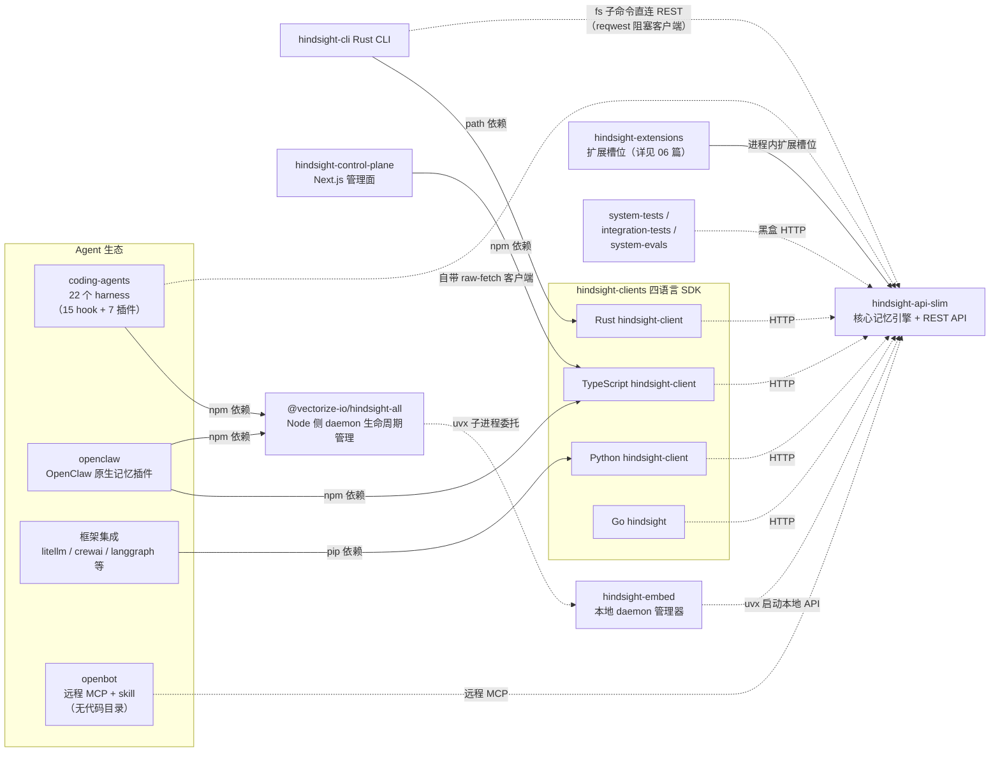
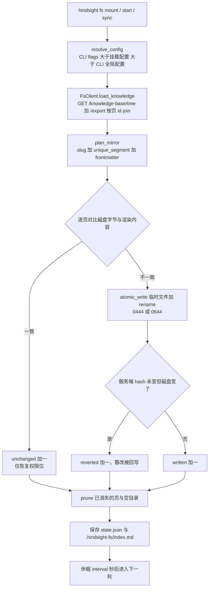
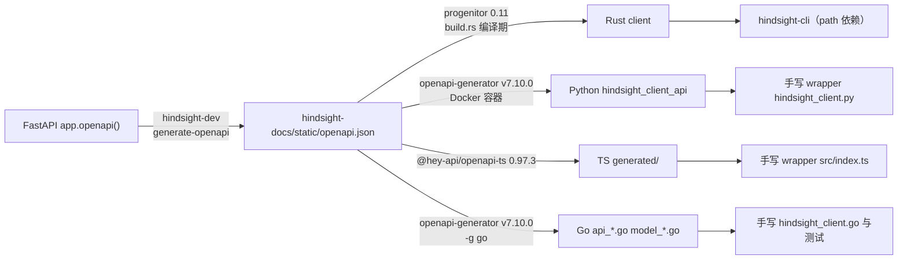
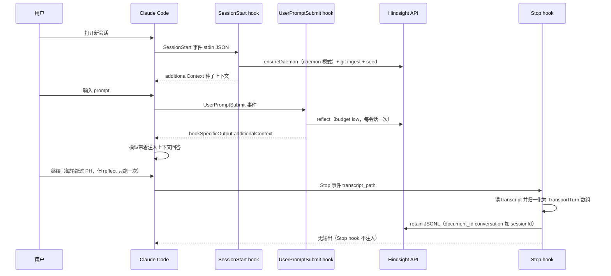

# 07 · 外围生态：CLI / SDK / 集成 / 控制面 / 测试体系

> 代码基线：`eebe3ab19`（2026-11，**`85ab32ebe` 之后 3 个提交**；树差分 27 个文件 / +978 −303）。**本窗口没有外围包改动**：Rust CLI、四语言 SDK、集成目录、控制面、embed 全部零 diff，OpenAPI spec 与生成客户端也没有再生成（没有 API 变更）。落到本篇的只有三处：① **文档站两页各改一句**（§9）——`docs/developer/api/reflect.mdx` 把"模型不守 schema 就失败"扩成"先纠正一次、仍错才失败"，`docs/developer/models.mdx` 给 Ollama Cloud 加一句"不强制 response schema"；两处都随 `skills/hindsight-docs/references/` 的镜像同步（那是 `scripts/generate-docs-skill.sh` 的生成物，手改会被覆盖）。② **系统测试的 stub 与校验器收紧**（§8.1）——`validation.py` 现在主动拒绝相邻两条 user 消息，`stub_server.py` 的具名回合正则改成 `MULTILINE` 并取最后一次匹配，因为请求现在会被合并进一条更长的 user 回合（核心改动 #6349，见 04/05 篇）。③ 其余 21 个文件全在核心（含 7 个 api-slim 测试），见 01–06 篇。**上一窗口（`85ab32ebe`，73 提交，394 文件 / +18,532 −4,451）的主角是两处外围发版与一条契约的四端扩散**：coding-agents 0.8.5 → **0.8.6**（#6378 把上一窗口刚打开的“借用别的 agent 跑调查”重新关掉，§4.1(7)）、hermes 1.2.3 → **1.2.4**（#6137/#6297/#6299 三处运行时修复，§4.2）；核心没有发版（全仓仍是 1.2.0），但 document PATCH 新增 `add_tags`/`remove_tags`、bank 统计新增 `paused_mental_models`、mental model 失败原因新增 `candidate_rejected`，于是四语言 SDK 与 OpenAPI 再生成 **16 个文件**（§3.3），CLI、控制面、文档三条消费端各自跟上（§2.2、§5.1）；发布侧第一次给出 **Windows x64 原生 CLI 二进制**（§2.2）。再上一窗口（`33524bd33`，2026-11-03，8 提交）是“发布窗口”：外围只发 coding-agents 0.8.4 → 0.8.5，核心只把 id 与 `max_tokens` 的入口契约收紧；更早的 `2c00b59ae`（2026-11-03，15 提交）是 v1.2.0 发布（全仓版本 1.1.0 → 1.2.0、四语言 SDK 463 个文件再生成、docs 删 `version-0.9` 加 `version-1.2`）；更早的 `bc5ea195a`（2026-11-01，69 提交）内容仍保留在正文。**读正文的口径**：「本窗口」= `eebe3ab19`（当前）；「上一窗口」= `85ab32ebe`；「再上一窗口」= `33524bd33`；更早的窗口按 sha 称呼。上一版正文里写作“本窗口/上一窗口”的段落已按新口径换算，历史叙述里的窗口名一律以 sha 为准。

> 本篇是《Hindsight 源码庖丁解牛》的第 07 篇，覆盖核心引擎（01-06 篇）之外的一切：Rust CLI、四语言 SDK、coding-agent 与框架集成、Next.js 控制面、内嵌 daemon，以及三层测试体系（上一版还覆盖的 agent 工具 SDK hindsight-tools 已在 1.0.0 窗口删除，见 §7；v1.1.0 窗口又把 claude-code、cline、codex、copilot-cli、cursor-cli、opencode、zcode 七个 per-agent 包整体删除，统一由 coding-agents 承载，见 §4.2）。外围包的共同点是：**它们都不含记忆引擎逻辑，全部通过核心 REST API（`/v1/default/banks/...`）消费 Hindsight**，因此每个包的价值都在于"如何把记忆接进自己的世界"。

**30 秒引擎词汇表**（全篇反复出现的核心词）：bank＝一个隔离的记忆库（一个 agent 一个）；retain＝写入记忆，recall＝检索，reflect＝基于整库记忆的综合问答；observation＝从内容中抽取的单条记忆；mental model（知识页）＝由事实自动聚合刷新出的合成文档；consolidation＝后台的整合刷新。

---

## 1. 生态全景

先看全景，顺带当图例用：实线＝编译期包依赖，虚线＝运行时调用（HTTP 或子进程）。



图中 coding-agents 节点的 "22 个 harness"，指它承载的宿主编码 agent（Claude Code、Cursor、Codex 等，§4.1 详解）。**这个数字在 v1.1.0 窗口没变，但来源变了**：七个 per-agent 包（claude-code、cline、codex、copilot-cli、cursor-cli、opencode、zcode）在 #6008 里被整体删除，22 个 harness 如今只由 coding-agents 一个包声明（计数方法见 §4.1）。图上有三条不同性质的连线：**npm/path 包依赖**（控制面与 openclaw 绑定 TS SDK wrapper——openclaw 还依赖 hindsight-all 拉起本地 daemon；coding-agents 的 npm 依赖也指向 hindsight-all——一个负责拉起本地 daemon 的 Node 管理器，其记忆 HTTP 客户端是自带的，不经任何 SDK）、**HTTP 运行时调用**（SDK 与核心之间永远只走 REST；OpenBot 走远程 MCP，也是这一类，没有自己的包）、以及 **hindsight-extensions**——它是唯一进程内接进核心的方式，机制在 06 篇展开，本篇不重复。本篇 1.0.0 窗口的一处生态变化：上一版还画在图里的 `hindsight-tools`（agent_knowledge_* 工具包）已整体删除（#5462，§7），它的生态位由 openclaw 插件与各宿主自带的知识工具分担。另注意 openclaw 的 npm 依赖 pin 在上一轮检查时只对齐了一半（本窗口 openclaw 无改动）——`hindsight-client` 跟到了 ^1.1.0，`hindsight-all` 仍停在 ^0.6.2（见 §4.2）。

更早那个 82 提交的窗口（其中 13 个是依赖锁文件升级）核心没有发版，全仓版本仍是 1.1.0——外围唯一发布的是 coding-agents 0.8.3 → 0.8.4（§4.1）。**随后 `33524bd33`（8 提交）把同一节奏又走了一遍，只是发布方仍是 coding-agents（0.8.4 → 0.8.5，§4.1(6)），核心依旧只动契约、不发版**：mental model id 规则与 knowledge page 的 `max_tokens` 边界在 HTTP/MCP/docs 三处同时改口径，四语言 SDK 与 `openapi.json` 跟着重生成（§3.3）。所以生态层面的变化不是"新增了哪些包"，而是**同一个契约变更沿消费端扩散**：上一窗口扩散的是 recall 请求的 `rerank` 对象（决策模型排序器的 `prune`/`dedup`），它在一周内出现在 HTTP（`api/http.py`）、MCP 工具（`hindsight_api/mcp_tools.py:1254`）、四语言 SDK 的生成层（新增 `RerankOptions` 模型，§3.3）、控制面的 BFF 路由（§5.2）与文档（`docs/developer/api/recall.mdx`）里，而 CLI 明确选择**不**暴露它（§2.2）。同一份契约在五个消费端有五种取舍，这比"谁又加了一个集成"更能说明外围层的实际工作方式。另有两处结构性变化只发生在上一窗口的外围：评测体系被重构成"一个操作一个文件、用例带 category"（§8.3），测试桩改成"工具调用即响应 schema 的回复"（§8.1）。

**上一窗口（`33524bd33`，8 提交）是"发布窗口"而不是"契约窗口"**：更早那条 recall `rerank` 契约已经扩散完毕，这一周外围的工作几乎全是版本与快照的机械同步——包版本、生成物、docs 版本快照——加上一处 embed 的入口查找修复（#6272）与一处 docs 站的纯 CSS 进度条（#6285）。值得记的只有两个"规模"数字：SDK 生成物 463 个文件里 **TypeScript 只有 1 个**（`package.json`）——TS 生成器不把 spec 版本写进产物，也不为整数边界生成运行时校验，所以这次"全量重生成"在 TS 侧等于没发生；而 Python/Go 每改一次 spec 版本都要重写每个文件的头注释（232 / 230 个）。这不是质量问题，是四个生成器对"文档版本"这件事的处理不同；CI 的 `verify-generated-files` 只看有没有 diff、不看 diff 的内容。

**本窗口（`85ab32ebe`，73 提交）没有新包、没有新 harness、没有新集成目录**；它做的是三件“往回看”的事。第一，**推翻上一窗口的一个修复**：0.8.5 让没有调查配方的宿主借用别的已安装 agent 跑 codebase survey（#6251），0.8.6 改成只认宿主自己的 CLI——理由是那次借用会把 pi / Kilo / OpenCode v2 用户的调查跑在**他们的 Claude 账号**上（§4.1(6)(7)）。第二，**把“连接断开”这一类故障从 local_embedded 推广到全部模式**，同时给不可安全重放的写操作留下例外（hermes 1.2.4，§4.2）。第三，**把一条既有契约铺到所有消费端**：document PATCH 的 `add_tags`/`remove_tags` 在服务端、四语言 SDK、CLI（`--add-tags`/`--remove-tags`）、控制面（只发改动的差集并回读结果）四处同时出现。这三件事共同说明外围层的一个常态：**外围的“新功能”多半是把核心已有能力接到更多入口，真正的设计工作在于每个入口的取舍**——CLI 用 `conflicts_with_all` 拒绝歧义组合，控制面用差集避免覆盖别人同时加的 tag，hermes 用 `operation_id` 决定一次写能不能重试。


一个值得先立住的全局观察：**核心（hindsight-api-slim）对外只暴露一种协议**——`/v1/default/banks/{bank_id}/...` 上的 REST + SSE + MCP。CLI、控制面、coding-agents 集成、评测套件没有一家走 SQL 或进程内 import（extensions 除外），这让"换一家部署形态"（云、自托管、本地 daemon）对上层完全透明，也是全篇反复出现的模式。

---

## 2. hindsight-cli：Rust CLI

### 2.1 职责与技术底座

`hindsight-cli` 编译出名为 `hindsight` 的单二进制（`hindsight-cli/Cargo.toml:2-3`，版本 1.2.0；`[[bin]]` 块在 :9-11），定位是"漂亮的 CLI for Hindsight"。它不是脚手架玩具，而是一个覆盖核心 API 全部资源的运维界面，外加一个 k9s 风格的 TUI 探索器和本篇的重点：`hindsight fs mount`。

技术底座三层分工明确（`hindsight-cli/Cargo.toml:13-52`）：

| 依赖 | 用途 |
|---|---|
| `hindsight-client = { path = "../hindsight-clients/rust" }` | API 调用走 **progenitor 生成的 Rust SDK**（progenitor：从 OpenAPI spec 生成 Rust 客户端代码的工具，§3.2 详述；path 依赖，不单独发布 crates.io） |
| `clap 4.5`（derive + env） | 命令面；全局 `--output pretty/json/yaml`、`--verbose`、`-p/--profile` |
| `ratatui` + `crossterm` | `hindsight explore` 交互式 TUI |
| `reqwest` | **blocking client 仅 fs 子命令用**（同步镜像引擎刻意避开异步 SDK）；async client 用于 timeout 配置与 multipart 文件上传（`Cargo.toml:23-25`） |
| `sha2` + `libc` | fs 的内容哈希与 POSIX daemon 控制 |

配置解析优先级在 `main.rs:145` 的 after_help 里写死：环境变量 `HINDSIGHT_API_URL`/`HINDSIGHT_API_KEY` > 命名 profile（`~/.hindsight/cli-profiles/<name>.toml`，`hindsight profile create/list/show/delete`）> `~/.hindsight/config` > 默认 `http://localhost:8888`。

### 2.2 命令面盘点

`src/main.rs:74-159` 的 `Commands` 枚举即全部命令面，与核心 API 资源一一对应：

| 命令 | 子命令 | 备注 |
|---|---|---|
| `bank` | list/create/update/profile/stats/mission/graph/delete/alias | create 带 `--skepticism/--literalism/--empathy`（1-5），直接映射 Bank Config 的 disposition 三特征；`alias`（`main.rs:459-500`）管理 bank 别名——给同一 bank 挂额外 id 并可指定对外展示的主别名，对应 0.10.2 新增的 aliases API |
| `memory` | list/get/recall/reflect/retain/clear | recall 支持 `--fact-type`、`--budget low/mid/high`、`--tags`、`--query-timestamp`、`--window-start/end`、`--prefer-observations`（`main.rs:536-597`），几乎完整暴露 recall 语义；v1.1.0 把 `-q/--query` 的帮助文案从"全文检索"改成"记忆文本与 context 的子串过滤，未建索引，仅供浏览"（#5758）——它是 SQL 扫描，不是 recall |
| `document` / `chunk` / `entity` / `tag` | list/get/history/delete、get、list/get/regenerate、list | 数据面逐层下钻；`document update` 改 `tags`/`observation_scopes`（#5668，`commands/document.rs:334`）；v1.1.0 新增 `document history`（#5638，`commands/document.rs:237`，客户端在 `api.rs:540`）——按操作分页读 `/documents/{id}/history`，逐行打印这次变更给事实加/减了多少、给观测新建/更新/删除了多少，依据 `DocumentEventKind` 上色 |
| `operation` | list/get/cancel/retry/delete | 异步操作队列管理 |
| `mental-model` / `knowledge-base` | （各 500-1000 行实现） | `knowledge-base` 的模块头写明与 `fs` 的关系："A page is a mental model with document-shaped defaults plus a place in the tree... `hindsight fs` mirrors the same knowledge base read-only onto disk; these commands are the read/write side"（`commands/knowledge_base.rs:1-7`）。mental-model 的刷新触发设置由 1.0.0 窗口补上 cron 调度（consolidation 后刷新与定时全量刷新二选一，#5674，`main.rs:1175`/`:1182` 的 `trigger_refresh_cron` 与 `trigger_full_refresh_cron` 两个 flag） |
| `directive` / `webhook` / `audit` | —、—、list/get/stats | 行为规则、回调、审计日志；`audit get`（v1.1.0，#5822，`commands/audit.rs:79`）取单条并带完整 request/response 体——列表刻意不带体，详见 §5.1 |
| `fs` | mount/start/stop/restart/sync/status/list/logs/unmount | §2.4 深讲 |
| `configure` / `profile` | — | 配置 API URL/key 与命名连接档案（`main.rs:147, 158`），配置优先级见 §2.1 末段；二者不依赖 API 客户端 |
| `health` / `metrics` / `version` | — | `metrics` 直接拉 Prometheus 文本 |
| `explore`（别名 `tui`） | — | ratatui 全屏 TUI，1766 行，是单文件最大的命令 |
| `ui` | — | 不连 API，直接 `Command::new("npx").arg("@vectorize-io/hindsight-control-plane")` 拉起控制面（`main.rs:2523-2525`）——CLI 自己不做 UI，复用 npm 包 |

- **上一窗口的客户端侧配套**：`directive create/update` 的 `--priority` 从 `i64` 收成 `i32`（`main.rs:1431`（`priority: i32`）/`:1456`（`Option<i32>`）、`commands/directive.rs:112/163`）——服务端 `directives.priority` 是 Postgres `INT`，超范围的数现在在 CLI 解析参数时就失败，而不是发到服务端再吃 422/400（#6276）。
- **本窗口的客户端侧配套（#6339/#6411）**：`document update` 新增 `--add-tags` / `--remove-tags`（`main.rs:815-821`），与 `--tags` **互斥**（`conflicts_with_all = ["add_tags", "remove_tags"]`，`main.rs:812`）——全量替换与增量修改同时给，语义会互相覆盖，所以让 clap 在解析参数时就拒绝。三个可选列表被打包成一个 `TagChange`（`api.rs:163-167`）再经 serde 填进生成的 `UpdateDocumentRequest`（`api.rs:1653-1664`）；空串过滤沿用 `--tags ""` 清空的老约定（`main.rs:1934-1945`）。CLI 的覆盖清单 `.openapi-coverage.toml` 本窗口没有改动：`update_document` 不在被覆盖操作集里，新增字段不会让 `check-cli-coverage` 变红——这也是“覆盖清单只守它列出的操作”的一个边界样本。
- **本窗口的发布形态（#6382）**：release workflow 的 CLI 矩阵新增一项 `x86_64-pc-windows-msvc`，产物名 `hindsight-windows-amd64.exe`（`.github/workflows/release.yml:317-320`），并在发布作业里下载、拷进 release assets（`:623-626`、`:655`）。两处细节：打包步骤改用 `shell: bash`、只在非 Windows 上 `chmod +x`（`:365-374`）——Git Bash 下 `chmod` 对 `.exe` 无意义但会报错；`test.yml` 新增 `build-rust-cli-windows` job（`.github/workflows/test.yml:3104-3145`），在每次 CLI 变更时于 `windows-latest` 上真编译并跑 `--version` 与 `memory retain/recall/reflect --help`，把“只在 Unix 上编译得过”挡在发布日之前。**边界**：二进制不等于全功能——`fs mount` 在 Windows 只能前台运行，`fs start`/`mount --detach` 仍 Unix-only（`hindsight-docs/docs/sdks/cli.mdx:18-25`），因为后台 daemon 走 `setsid`（§2.4(4)）。


更早的 `bc5ea195a` 窗口 recall 多了一个 `rerank` 参数（决策模型排序器的 `prune`/`dedup`，§3.3），CLI 的处理是**刻意不暴露**：`memory recall` 与 explore TUI 都传 `rerank: None`（`commands/memory.rs:362`、`commands/explore.rs:332`），理由写进了覆盖清单——"Per-call override of the bank's recall_decision_model_prune / _dedup; operators set those once per bank (config API / control plane) rather than per CLI invocation."（`hindsight-cli/.openapi-coverage.toml:169`）。这份清单正是 CI `check-cli-coverage` 的输入：没覆盖的字段必须写明理由，漏一个就红，所以"CLI 暂不支持"和"CLI 忘了加"在仓库里是两个可区分的事实。

`main.rs:1465-1479` 的 `main()` 还处理了一个发布级细节：release profile 用 `panic = "abort"`，而 Rust 启动时忽略 SIGPIPE，管道下游提前关闭（`hindsight ... | head`）会变成 SIGABRT 静默崩溃，所以在 Unix 上恢复 `SIGPIPE` 默认处置。

### 2.3 API 客户端：生成代码之上的"humanized"错误层

`src/api.rs` 是 1919 行的薄封装：类型直接 `pub use hindsight_client::types;` 转出（`api.rs:7`），调用是同步桥接异步。它解决的核心痛点是 progenitor 生成的错误把响应体吞掉：

```rust
// hindsight-cli/src/api.rs:37-67
async fn humanize_client_error<E>(err: ClientError<E>) -> anyhow::Error
where
    E: serde::Serialize + std::fmt::Debug + Send + Sync + 'static,
{
    match err {
        ClientError::ErrorResponse(rv) => {
            let status = rv.status();
            let body = rv.into_inner();
            let body_str = serde_json::to_string(&body).unwrap_or_else(|_| format!("{:?}", body));
            anyhow::anyhow!("API request failed ({}): {}", status, body_str)
        }
        ClientError::UnexpectedResponse(response) => {
            let status = response.status();
            let body = response.text().await.unwrap_or_default();
            if body.is_empty() {
                anyhow::anyhow!("API request failed ({})", status)
            } else {
                anyhow::anyhow!("API request failed ({}): {}", status, body)
            }
        }
        ClientError::InvalidResponsePayload(bytes, src) => {
            let body = String::from_utf8_lossy(&bytes);
            anyhow::anyhow!(
                "{}: {}\nResponse was: {}",
                crate::errors::INVALID_RESPONSE_PAYLOAD,
                src,
                body
            )
        }
        other => anyhow::anyhow!("{}", other),
    }
}
```

- 原始错误渲染为 `Unexpected Response: Response { ... }`，不带服务端返回的校验细节（注释引用了 issue #1007 与 #4049，见 `api.rs:36, 73`）。摘录第三分支的 `Response was:` 标记正是 `errors.rs:270-281` 做失败归类时切分的锚点（#5515）。
- `Humanized` 扩展 trait（`api.rs:75`）让每个生成客户端调用都能写成 `call(..).humanized().await?`，把 HTTP 状态码 + 响应体带进 anyhow 错误。
- 极少数 OpenAPI 未覆盖的端点（如 `AgentStats`）在 `api.rs:92` 起手写 struct，注释自嘲 `// Types not defined in OpenAPI spec (TODO: add to openapi.json)`。
- 0.10.3 修了这条链下游的**归类**（#5179）：`errors.rs` 的 `format_error_message` 现在只拿 `split_http_error` 切出的 `"<what> failed (<status>)"` 标题段判连接拒绝/超时/DNS，不看服务端 body——body 里恰好提到 timeout、DNS 或资源数字不该改变分类（一个快速 400 的校验错误曾因 body 里的 "timeout" 字样被误标成传输超时）。1.0.0 窗口再补一刀（#5515）：**解码失败就是解码失败**，不再拿 body 文本猜——服务端加了一个新响应字段导致旧 CLI 反序列化失败时，报"响应无法解码"而不是被误判成超时/DNS 错误（`errors.rs` +56 行）。

### 2.4 `hindsight fs mount`：把 knowledge base 挂载成文件树（重点）

**动机**：knowledge base 是核心引擎里"auto-refreshing 的合成文档树"（mental model 页 + 文件夹）。`fs mount` 把这棵树镜像成普通 markdown 文件夹，让 `ls / cat / grep / rg / fzf` 等一切 shell 工具、以及任何会读文件的 agent，无需知道 Hindsight API 就能消费记忆。`commands/fs/mod.rs:1-6` 自述是从独立的 TS 工具 `hindsight-fs` 移植进 Rust CLI。

**模块划分**（共 1889 行）：`mod.rs`（命令分发 + 刷新循环）、`client.rs`（极简 REST 读客户端）、`format.rs`（树→镜像计划）、`sync.rs`（同步引擎）、`state.rs`（state.json）、`daemon.rs`（后台进程）、`config.rs`/`paths.rs`/`health.rs`（配置、控制目录、健康检查）。

#### (1) 数据获取：一次同步 = 两次 HTTP

`client.rs:1-8` 的注释把设计说透了——不逐页拉取，只调两个端点再按页 id join：

- `GET /v1/default/banks/{bank_id}/knowledge-base/tree` → 文件夹/页层级（无正文）；
- `GET /v1/default/banks/{bank_id}/knowledge-base/export` → 一个 bundle，含每页 `<page-id>.md`、`index.md`、`<page-id>.log.md`（历史）。

```rust
// hindsight-cli/src/commands/fs/client.rs:136-153
// The bundle holds `<page-id>.md` (the page doc), `index.md`, and
// `<page-id>.log.md` (history). We only want the page docs.
let mut content = HashMap::new();
for file in bundle.files {
    if file.path == "index.md" || file.path.ends_with(".log.md") {
        continue;
    }
    if let Some(id) = file.path.strip_suffix(".md") {
        content.insert(id.to_string(), file.content);
    }
}

Ok(KnowledgeSnapshot {
    roots: tree.roots,
    content,
})
```

于是"任意大小的 bank 都只要两次 HTTP"。这个客户端不走生成的 SDK，而是一个 169 行的阻塞 `reqwest` 封装——注释明说是为了"让同步引擎保持纯同步代码"（`client.rs:1-3`）。

#### (2) 镜像规划：文件夹→目录，页→`.md`

`format.rs:206-243` 的 `plan_mirror` 递归 `walk_plan`，把树压平成"要建的目录列表（父先子后）+ 要写的文件列表"。三个工程细节：

- **slug 化**（`format.rs:92-126`）：页名/文件夹名转小写、非 `[a-z0-9._-]` 连续字符折叠成单个 `-`、点号去重；全不安全字符则回退 `untitled`。单元测试直接锁行为：`slug("Net-30 / Terms!") == "net-30-terms"`（`format.rs:326-331`）。
- **撞名消解**（`format.rs:129-153`）：兄弟节点同名时用节点 id 的末 6 位字母数字做后缀，保证路径唯一。
- **正文回退**（`format.rs:172-197`）：页还没被 LLM 合成出来时，写一个带 YAML frontmatter（`id/type: knowledge-page/title/tags/timestamp`）+ 占位文案 `_This page has not been generated yet._` 的文件——mount 一个空 bank 也能得到结构可读的骨架。

frontmatter 序列化器是手写的极简版（`format.rs:64-87`），`is_plain_safe`（`format.rs:26-52`）决定标量是否需要引号：含 `:#[]{}` 等字符、疑似布尔/数字/日期的一律用 JSON 字符串语法（合法 YAML 子集）转义。

#### (3) 同步引擎：单向镜像的"以磁盘为准"哲学

`sync.rs:5-12` 的模块注释是理解整个设计的钥匙——镜像是**严格单向（API → 磁盘）**的，靠两个机制保证：

1. 镜像文件写成只读（Unix `0444`，除非 `--writable` 则 `0644`，`sync.rs:26-29`），普通编辑直接 EACCES；
2. **每一轮都拿磁盘上的字节和最新渲染内容做全量对比**，任何漂移——被篡改、被强 chmod 改写、写了一半——下一轮都会被覆写回服务器版本。

```rust
// hindsight-cli/src/commands/fs/sync.rs:120-143
for page in &plan.files {
    let hash = hash_content(&page.content);
    let prev = state.files.get(&page.rel_path);
    let abs_path = config.dir.join(&page.rel_path);
    if let Some(parent) = abs_path.parent() {
        fs::create_dir_all(parent)?;
    }

    // Source of truth is the bytes on disk — so a local edit is detected
    // and overwritten even when the page is identical to last time.
    let on_disk = read_file_or_none(&abs_path);
    match &on_disk {
        Some(disk) if disk == &page.content => {
            set_mode(&abs_path, mode);
            unchanged += 1;
        }
        _ => {
            atomic_write(&abs_path, &page.content, mode)?;
            written += 1;
            if on_disk.is_some() && prev.map(|p| p.hash == hash).unwrap_or(false) {
                reverted += 1;
            }
        }
    }
    // ... 记入 next_files
}
```

逐点看：

- **判断基准是磁盘字节，不是 state 里的 hash**。重写分两种情形：服务端内容确实变了（普通 written），或服务端没变、只是本地文件被动过（计入 reverted，即篡改回写）。
- **`atomic_write`**（`sync.rs:72-78`）：先写 `<file>.<pid>.tmp` 再 `rename`，读方（编辑器/agent）永远不会看到半页文件；写完立即设权限位。
- **失败不破坏现场**：`run_sync` 在 fetch 失败时只更新 `state.last_sync_ok=false` 就返回错误（`sync.rs:96-105`），注释强调"修剪只发生在成功 fetch 之后，瞬时网络错误绝不清空镜像"（`sync.rs:86-87`）。
- **删除同步**：state 里记录的、本轮不再出现的文件被删（先解除只读位再 unlink，`sync.rs:153-159, 203-207`）；消失的空目录按路径从深到浅 `remove_dir`（只删得动空的，`sync.rs:162-173`）。
- 产出物还包括控制目录里的 `.hindsight-fs/index.md`——带 frontmatter（bank/api_url/folders/pages）+ 树状总览的导览文件（`sync.rs:187-191`，`format.rs:246-292`）。

**state.json**（`state.rs:24-58`）：`.hindsight-fs/state.json` 记录 `bankId/apiUrl/lastSyncAt/lastSyncOk/lastError`、每页 `rel_path → {file, sha256}`、已建目录列表。它的目的注释写得很直白：让未变页面不被重写，**保住 mtime 稳定**——这样编辑器的 file watcher、`ls -la`、agent 的增量读取都不会被每 30 秒的轮询骚扰。

一轮同步的完整路径：



#### (4) 后台 daemon 与健康检查

`daemon.rs:1-6` 明确 **POSIX-only**：`fs start` 用 `setsid` 脱离控制终端，spawn 自身执行隐藏子命令 `fs run`（`FsCommands::Run` 标了 `hide = true`），stdout/stderr 追加进 `<dir>/.hindsight-fs/daemon.log`，pid 与元数据写 `daemon.pid`。停止时先 SIGTERM、轮询 5 秒、再 SIGKILL（`daemon.rs:158-174`）；Windows 上 `start_daemon` 直接返回错误而非假装可用（`daemon.rs:125-130`）。

`fs status` 汇总 daemon 活性 + 最近同步年龄，同步超过 `max(interval×3, 15s)` 视为 stale，**不健康时进程以非零码退出**（`mod.rs:390-392`）——这是给 cron/监控用的设计。

**示例**：典型使用流程与输出（依据 `mod.rs`/`sync.rs`/`format.rs` 的真实文案格式整理）：

```text
$ hindsight fs mount -b my-agent ~/mem
Mounted bank "my-agent" at ~/mem in background (pid 41230).
Logs: ~/mem/.hindsight-fs/daemon.log — stop with: hindsight fs stop ~/mem

$ tree ~/mem -a -I '.hindsight-fs'
~/mem
├── engineering/            ← 文件夹节点 "Engineering"（slug 化）
│   └── api-retry-policy.md ← 页节点，正文 = 服务端合成的 markdown
└── product/
    └── billing-rules.md

$ cat ~/mem/product/new-page.md        ← 尚未合成的页
---
id: kp_8f3d2c
type: knowledge-page
title: New Page
tags: [billing]
timestamp: null
---

_This page has not been generated yet._

$ hindsight fs status ~/mem
Mount:    ~/mem
Bank:     my-agent
API:      http://localhost:8888
Mode:     read-only (edits blocked)
Daemon:   running (pid 41230)
Interval: 30s (started 2026-10-02T09:12:44.123Z)
Last sync: 2026-10-02T09:14:20.512Z (12s ago)
Mirrored: 3 file(s)
Health:   ok
```

（若此时手改 `billing-rules.md` 再等一轮，daemon 日志会记 `synced 3 pages / 2 folders — 1 updated, 2 unchanged, 0 removed, 1 reverted`——`reverted` 即篡改回写，对应 `commands/fs/mod.rs:204-212` 的日志行。）

---

## 3. hindsight-clients：四语言 SDK

### 3.1 结论先行：生成 + 手写混合，且生成物全部入库

四语言客户端**全部由同一份 OpenAPI spec 生成**，但每家都在生成层之上保留一个**手工维护的 wrapper 层**（高层类、README、测试）。反直觉的一点：生成代码**被 git 跟踪**，`hindsight-clients/.gitignore:15` 注释写明 "Generated code is tracked in git to see API changes"——API 变更必须在 code review 里可见。

### 3.2 生成链路

下图是整条链：中间那份 `openapi.json` 是唯一的上游，四路客户端都从它长出来。



链路两步（`scripts/generate-openapi.sh` 仅 20 行、`scripts/generate-clients.sh` 640 行）：

1. **spec 导出**：`generate-openapi.sh` 实际执行 `cd hindsight-dev && uv run generate-openapi`，入口 `hindsight-dev/hindsight_dev/generate_openapi.py:42-73`——用 `MemoryEngine(db_url="mock")` 起一个真实 FastAPI app 调 `app.openapi()`（`:60`），落盘到 `hindsight-docs/static/openapi.json`（spec 存在 docs 包里，供文档站和所有客户端共用）。其中 `_restore_binary_format`（:16-39）把 OpenAPI 3.1 的 `contentMediaType: application/octet-stream` 改写回 `format: binary`，因为 openapi-generator v7.10.0 不认前者。
2. **四路生成**（`scripts/generate-clients.sh:9-14` 声明了版本 pin `OPENAPI_GENERATOR_VERSION="v7.10.0"`）：
   - **Rust 最特殊**：脚本不写任何生成代码，只 `cargo build` 触发 `hindsight-clients/rust/build.rs`（320 行，`main()` 在 :229）——读 spec、做 OpenAPI 3.1→3.0.3 降级转换（string-anyOf 折叠、剔除 multipart 端点，:252），再用 progenitor 0.11 生成进 `$OUT_DIR`，`src/lib.rs:23` 用 `include!` 引入。生成物不落盘。
   - **Python/Go**：Docker 跑 `openapitools/openapi-generator-cli:v7.10.0`（Python 加 `--platform linux/amd64` 保证 macOS arm64 与 CI amd64 输出一致，`generate-clients.sh:119-125`）。生成前备份手写文件（wrapper、README、测试、**go.mod/go.sum**——保留它们防止 `go mod tidy` 拉新依赖导致 CI 漂移），生成后恢复，再做小 patch（Python 给 `rest.py` 打延迟 aiohttp 会话初始化；Python 再 patch 内容联合模型 `content_any_of_inner.py` 的构造器以正确反序列化块状 dict 载荷；Go 把 union 类型的 `MarshalJSON` 指针接收器改值接收器；1.0.0 起再从全部生成模型里剥掉 `decoder.DisallowUnknownFields()`——服务端**新增**响应字段不再炸旧 Go 客户端，patch 在 `generate-clients.sh:593-606`）。
   - **TypeScript**：本地 `npx @hey-api/openapi-ts`（版本锁 0.97.3，pin 在 `hindsight-clients/typescript/package.json:38`）输出 `generated/`，再 patch `client.gen.ts` 剔除 `RequestInit.client` 字段以兼容 Deno。

### 3.3 分层与入口（生成层 vs 手写层）

| 语言 | 生成层 | 手写层（"MAINTAINED and NOT auto-generated"） |
|---|---|---|
| Python（PyPI `hindsight-client`） | `hindsight_client_api/`（17 个 `api/*.py`、210 个 `models/*.py`、`rest.py`） | `hindsight_client/hindsight_client.py` **3367 行**：高层类 `Hindsight`（`:197`），方法 `retain/retain_batch/retain_files/recall/reflect/list_memories/create_bank/update_bank_config/export_bank/clone_bank/search_knowledge_base/get_knowledge_base_tree` 等，每个同步方法都有 async 对应（`aretain/arecall/areflect`） |
| TypeScript（npm `@vectorize-io/hindsight-client`） | `generated/`（`client.gen.ts`、`sdk.gen.ts`、`types.gen.ts`，四家里生成物文件数最少的一家——v1.1.0 窗口 6 个、v1.2.0 窗口 1 个（只有 `package.json`）） | `src/index.ts` **2230 行**：类 `HindsightClient`（`:345`）+ 错误类 `HindsightError`（`:189`），方法 `retain/recall/reflect/listMemories/...` |
| Rust | 编译期进 `OUT_DIR`，不落盘 | `src/lib.rs` 204 行：User-Agent 辅助 + 内嵌集成测试（包版本仍 0.1.0——它只作为 CLI 的 path 依赖存在，不单独发布；v1.1.0 窗口唯一的改动是内嵌测试的请求字面量补了一行（v1.2.0 窗口零文件） `rerank: None`） |
| Go（`go get` 直接取用） | `api_*.go` ×16、`model_*.go` ×209 | `hindsight_client.go`（`NewAPIClientWithToken/NewAPIClientWithTimeout` 等）+ 4 个手写测试 |

**上一窗口（`33524bd33` 窗口内的 #6282）的 SDK 再生成是一次"约束进 spec"的样本**：核心只改了 `CreatePageRequest`/`UpdateNodeRequest` 的 `max_tokens`（`ge=256, le=8192`）与三处 id 的字段描述，OpenAPI 里就多出 `"maximum": 8192.0, "minimum": 256.0` 与新的 description 文本，生成层随之在 8 个文件里跟着动：Python 4（`models/create_page_request.py`、`update_node_request.py`、`create_bank_alias_request.py`、`bank_template_mental_model.py`）、Go 3（`api/openapi.yaml` + 同名的两个 model）、TS 1（`generated/types.gen.ts`），Rust 0。**没有任何手写层文件被改**——这正是"生成 + 手写"分层的收益：约束写在 Pydantic 模型上，一路自动流到四语言客户端的类型里，不需要任何人记得去改客户端。附带一处容易漏的生成物：`hindsight-docs/static/bank-template-schema.json` 也随 `BankTemplateMentalModel` 的描述重新生成——它是端点返回的那份 schema 的**静态副本**（端点本身在 `api/http.py:8800` 现算 `BankTemplateManifest.model_json_schema()`，文件供文档站与离线工具使用），两者必须同步，否则读文件的人看到的 id 规则会比服务端旧。

一个链条上的角色分工示例：同一份 spec 的 `retainMemories` 操作，Python 侧生成层在 `hindsight_client_api/api/memory_api.py`，TS 侧是 `generated/sdk.gen.ts` 的同名导出函数。控制面（§5）npm 依赖 TS 包，同时用生成层函数式 `sdk` 出口与手写类 `HindsightClient` 实例；**coding-agents 不消费该包**——它的 `package.json` 依赖里没有 `@vectorize-io/hindsight-client`（只有 `@vectorize-io/hindsight-all` 等），`src/` 下也无任何 SDK import，而是在 `src/core/hindsight.ts` 自带一个同名 `HindsightClient` 的 raw-fetch 客户端类（文件头自述 "Harness-agnostic Hindsight HTTP client (raw fetch, no SDK dep)"，:2-4），npm 依赖 `@vectorize-io/hindsight-all` 只为拉起本地 daemon（`src/daemon-start.ts:29`）。

0.10.3 窗口给 Python 手写层补了四个修复，全部在"wrapper 与生成层身份一致性"这个主题上：base URL 统一 `rstrip("/")`——带尾斜杠复制的 URL 此前只对生成路由生效（#5138）；bank 配置助手（create/update/reset bank config）改用 `self._api_client.default_headers.copy()` 而非自拼一个 Authorization 头——SDK 的 User-Agent（集成归因）与已配置的其余头不再在这些裸 aiohttp 路径上丢失，失去读者的 `self._api_key` 一并删除（#5139）；`list_memories/alist_memories` 暴露服务端早已支持但 wrapper 漏传的 `document_id/state/consolidation_state` 过滤（#5140）；单条 `retain/aretain` 补上 `strategy` 与 `observation_scopes` 参数——此前只有 `retain_batch` 的 item dict 能带（#5156）。

1.0.0 是四语言 SDK 的又一次全量再生成（`hindsight-clients` 466 个文件变更，绝大多数是生成产物；Python/TS 包版本随 1.0.0 发布刷到 1.0.0，Rust 客户端仍 0.1.0——见上表，仅 path 依赖不单独发布），生成层之外手写侧有三笔值得记住：**Go 客户端学会容忍加法字段**——#5515 从生成模型里剥掉 `DisallowUnknownFields`（patch 进了生成脚本，见上节），服务端加字段不再让老客户端解码失败；**export 轮询的超时语义收紧**——同在 #5515，Python/TS 的 export 轮询让 timeout 真正罩住在途的 status 请求与 poll 之间的 sleep，#5568 又把 Windows 粗时钟下"余量还能塞一次 poll"的边界堵上（睡眠可能提前约 16ms 醒来，导致超时后又多发一次请求；现在余量不够一个间隔就立刻超时，TS wrapper 镜像同修）；**Rust 生成层同名内联枚举分流**——同名但取值不同的内联枚举此前会并成一类，`RefreshMentalModelOperationDetails` 因此收不下 `refresh_failed_error`（#5515，build.rs 侧修复）。

v1.1.0 窗口又是一次全量再生成：`hindsight-clients` 472 个文件变更，分布很有信息量——Python 235、Go 228、TypeScript 只有 9，**Rust 零文件**（它的生成物从不落盘，`build.rs` 在编译期重跑一遍就等于完成）。各包版本再次统一：PyPI `hindsight-client`、npm `@vectorize-io/hindsight-client`、控制面、embed、CLI 全部 1.1.0，**唯独 Rust 客户端还是 0.1.0**——它只作 CLI 的 path 依赖，不进 crates.io，所以每轮再生成都不会碰它的版本号。生成层新增 6 个模型（Python `models/` 202→208、Go `model_*.go` 201→207，两边一一对应）：

| 新模型 | 来源 |
|---|---|
| `DocumentEvent` / `DocumentEventKind` | 文档变更历史（#5638）：一条 retain/append/reprocess/retag/fact_edited/fact_invalidated/fact_restored/fact_deleted/observations_cleared/consolidation 记录 |
| `DocumentHistoryResponse` | 上面那条流的分页外壳（`items` + `total`） |
| `AuditLogSummary` | 审计日志列表项：列表**不带** request/response 体，体只在单条里（#5822，§5.1） |
| `DefaultObservationScopes` | bank 级默认观测作用域（#5666）：一个模式名，或一组 `key:*` 通配 tag 列表 |
| `ObservationIdSample` | 变更事件里对观测 id 的抽样（`count` + `ids`），CLI 的 `document history` 正是拿它印 `+n ~n -n` |

手写层的同步只有参数级的小步：Python `Hindsight.retain` 落在 `hindsight_client.py:471`、`retain_batch` 在 `:543`（行号随再生成漂移，签名不变）。上一轮还印证了 §3.4 那条守门链的价值——生成层加了 6 个模型，手写 wrapper 一行没动也不会误报，因为 coverage 检查盯的是"被覆盖操作的 request-body 参数"，不是模型文件数量。

更早一窗口（2026-11，`bc5ea195a`）的再生成小得多：`hindsight-clients` 只有 **31 个文件**变更（`diff -rq` 旧树/新树；Python 14、Go 9、TypeScript 6、Rust 2），因为上游只加了一个请求字段和一组统计字段（OpenAPI 的 79 条 path / 101 个操作一条没变，schema 201→203）。生成层新增 2 个模型（Python `models/` 208→210、Go `model_*.go` 207→209，两边一一对应）：

| 新模型 | 来源 |
|---|---|
| `RerankOptions` | recall 请求里的 `rerank: {prune, dedup}`（#6131/#6139）：决策模型排序器可以**丢结果**而不只是排序——`prune` 丢掉被判"对这个问题没帮助"的结果（复用排序时的答案，不发第二次请求，且最好的一条永远保留），`dedup` 丢掉"与更靠前的一条重复"的结果（排在排序请求之后再发一次决策模型请求）。两者默认都跟随 bank 配置，未配决策模型时无效 |
| `LLMRequestSeriesSums` | LLM 请求统计新增 `split_by`（`model` 或 `operation`）后，每个时间桶里的 `series`（#6222，控制面侧见 §5.1） |

手写层这次不是"一行没动"。Python wrapper 的 `recall`/`arecall` 把 `rerank` 收成 `dict[str, bool | None]`（`hindsight_client.py:661`），再显式构建 `RerankOptions`，且对未知键**直接抛错**——与相邻的 `min_scores` 同一理由：拼错的键不会报错，只会让调用方以为过滤生效、实际用着 bank 默认值：

```python
# hindsight-clients/python/hindsight_client/hindsight_client.py:1450-1461
        rerank_obj = None
        if rerank is not None:
            from hindsight_client_api.models.rerank_options import RerankOptions

            unknown_rerank = set(rerank) - {"prune", "dedup"}
            if unknown_rerank:
                # Fail loud, as for min_scores: a misspelled key would leave the bank's default on.
                raise ValueError(f"Unknown rerank keys: {sorted(unknown_rerank)}. Allowed keys: ['dedup', 'prune'].")
            rerank_obj = RerankOptions.from_dict(rerank)
```

两个手写层各配了一个映射测试（Python `tests/test_recall_rerank.py`、TypeScript `tests/recall_rerank_mapping.test.ts`），因为嵌套对象是手写层最容易静默丢弃的形状——平铺参数漏了会被 coverage 检查抓到，嵌套对象整体没传则只会表现为"过滤没生效"。TypeScript `src/index.ts` 的 `recall` 同样把 `rerank` 透传进生成层（`bc5ea195a` 窗口 +16 行）。

**v1.2.0 窗口（`2c00b59ae`）：一次只为版本号与两个整数边界的再生成。** spec 的 path 仍是 **79**、operation **101**、schema **203**（逐项数 `paths`/方法键/`components.schemas`，与旧树完全相同），变的两处只有：`info.version` 1.1.0→1.2.0，以及 directive 请求模型 `priority` 的 `minimum`/`maximum`（`CreateDirectiveRequest`、`UpdateDirectiveRequest`、bank 模板的 `BankTemplateDirective`，即 `-2147483648`/`2147483647`，来自 #6276 的 `ge`/`le`）。但生成器把版本写进**每个文件头**，于是 `diff -rq` 出来 **463 个文件变更**：Python **232**、Go **230**、TypeScript **1**、Rust **0**（`diff -rq next2/tree/hindsight-clients next3/tree/hindsight-clients`，无新增/删除）。TypeScript 那 1 个是 `package.json`——它的生成器（`@hey-api/openapi-ts`）不把 spec 版本写进 `generated/*.ts`，也不为 `minimum`/`maximum` 生成运行时校验，所以"全量重生成"在 TS 侧没有产物差异；Rust 的生成物本来就不落盘（`build.rs` 编译期跑），同样零文件。**生成模型数不变**（Python `models/` 目录 210 个文件——含 `__init__.py`，模型类 209；Go `model_*.go` 209），手写层三个文件的行数也一字未动（v1.2.0 时 Python 3367、TS 2217、Rust 204），Python/TS wrapper 里也没有为新参数加任何映射——Python 生成模型把边界写成 `Annotated[int, Field(le=2147483647, strict=True, ge=-2147483648)]`（`models/create_directive_request.py:32`），Go 生成模型不带校验（越界仍由服务端 422），手写层只透传 `priority` 这个整数。这也是本篇要区分"文件数"与"变更量"的原因：463 个文件里真正携带契约变化的只有 Python 的 `directive` 相关模型与 Go 的对应 `model_*.go`，其余是版本注释。

**本窗口（`85ab32ebe`）：核心不发版，SDK 仍要再生成 16 个文件。** spec 的 path/operation/schema 仍是 **79/101/203**，`info.version` 仍是 **1.2.0**（逐项数 `paths`/方法键/`components.schemas`），所以这次不是版本注释的机械同步，而是三处**语义**变更加一处描述订正：① document PATCH 的 `UpdateDocumentRequest` 增加 `add_tags`/`remove_tags`（§2.2/§5.1）；② bank 统计响应增加 `paused_mental_models`（自动刷新被暂停的 mental model 数，#6375）；③ mental model 刷新结局与失败原因各增加 `candidate_rejected` / `refresh_failed_candidate_rejected`（操作验证器拒收，#6386）；④ `reflect_default_options` 与 reranker `min_scores` 的描述改口径（前者不再作用于 mental-model 刷新，后者把 decision model 也列入“按名次打分、拒绝分数地板”的情形）。16 个文件按语言是 **Go 4 / Python 8 / TypeScript 4，Rust 0**（`tree_diff --name-status -- hindsight-clients/`）：Go 是 `api/openapi.yaml` + 两个 model + `api_documents.go`；Python 是生成模型/API 4 个 + `pyproject.toml` + 2 个测试 + wrapper 的 1 行 docstring；TS 是 `sdk.gen.ts`、`types.gen.ts`、手写 `src/index.ts` 与新测试。手写层的差异值得记：**TypeScript 补了映射，Python 没有**——TS 的 `updateDocument` 原本只收 `tags`，现在收 `addTags`/`removeTags`/`observationScopes` 并原样转成 snake_case（`src/index.ts:1839-1867`），配一个“camelCase 必须落到 API 名”的映射测试（`tests/update_document_mapping.test.ts`）；Python wrapper 根本没有 `update_document` 高层方法（全文件搜不到），所以这次只有一处 docstring 跟随 spec 改写，调用方直接用生成层 `DocumentsApi`。Python `pyproject.toml` 的另一处改动与契约无关：pytest 单测超时 120s → **300s**（`pyproject.toml:47-50`），因为 CI 共用的推理端点会回 429、服务端自己会按 8 次退避重试，120s 会把一次健康的 retain 判超时（#6393）。


### 3.4 新增 API 参数后 SDK 怎么同步？

开发者的操作只有一步：本地跑 `./scripts/generate-openapi.sh && ./scripts/generate-clients.sh` 并提交产物。真正的防线在 CI（`.github/workflows/test.yml`）的四个守门 job：

1. **`verify-generated-files`**（test.yml:5627-5714）：重跑全部生成脚本后 `git status --porcelain` 非空即失败——忘了再生就直接红。
2. **`check-openapi-compatibility`**（:5715-5779）：从 PR merge-base 取旧 spec 与新 spec 对比，拦截破坏性变更。
3. **`check-cli-coverage`**（:5780-5819）：CLI 侧的对应检查（实现 `hindsight-dev/hindsight_dev/cli_coverage_check.py`，即 §9 所列脚本之一），与下面的 client coverage 合成两端防线。
4. **`check-client-coverage`**（test.yml:5820-5858；实现 `hindsight-dev/hindsight_dev/client_coverage_check.py`（454 行，1-34 行为模块 docstring））：专盯**手写 wrapper 的漂移**——扫描 `hindsight_client.py` 与 TS `src/index.ts` 的调用点，断言每个被覆盖操作的 request-body 参数（snake_case↔camelCase 自动换算）都出现在 wrapper 里，防止"生成层已更新、手写层漏字段"。

0.10.1 → 0.10.2 的一次真实再生成可以当这条链路的样例看：spec 新增 bank 别名端点（`/aliases`、`/aliases/{alias}`），并把 consolidation 策略从内联 dict 类型化为 `ConsolidationStrategySpec`/`ConsolidationScopePattern` 模型，四语言生成层随之各多出若干模型文件（Go 192→199 个 model），Python wrapper 补了 `search_knowledge_base`/`get_knowledge_base_tree` 两个高层方法与 tag 过滤选项——生成物入库 + CI 四守门保证这次变更在 review 里逐文件可见。

**示例**：Python 高层客户端的一次 retain（字段名与 `hindsight_client.py` 一致）：

```python
from hindsight_client import Hindsight

hs = Hindsight(base_url="http://localhost:8888", api_key="sk-...")
# 单条：retain(bank_id, content, ...) —— 签名见 hindsight_client.py:471
#（0.10.3 起单条 retain 也接受 strategy 与 observation_scopes）
result = hs.retain(
    bank_id="my-agent",
    content="User prefers functional programming patterns",
    context="paired-programming session",
    document_id="conversation:abc123",
    tags=["source:chat", "harness:claude-code"],
    metadata={"harness": "claude-code", "session_id": "abc123"},
)
# 批量：retain_batch(bank_id, items, document_tags=...)（hindsight_client.py:543）——
# strategy 是 item dict 内的键（docstring :553），顶层参数是 document_tags 而非 tags：
result = hs.retain_batch(
    bank_id="my-agent",
    items=[{"content": "...", "context": "...", "strategy": "conversation"}],
    document_id="conversation:abc123",
    document_tags=["source:chat"],
)
# 异步对应：await hs.arecall(...) / hs.areflect(...)
```

---

## 4. hindsight-integrations

### 4.1 coding-agents（重点深讲）

`hindsight-integrations/coding-agents`（npm 包 `@vectorize-io/hindsight-coding-agents`，上一窗口发到 **v0.8.5**（`package.json:3`、`plugin.json:3`、`package-lock.json` 三处同步），再上一个窗口是 0.8.4，本窗口发到 **0.8.6**（§4.1(7)））是全部集成里最重的一个：README 开篇即定位——"Long-term project memory for **coding agents**... One package, several agents: a shared reflect-and-inject core with a thin entry point per agent"（`README.md:3-4`），共 22 个编码 agent（0.10.3 窗口新增 WorkBuddy 与 CodeBuddy 两个，#5263；**此后三个窗口都没有再加新 harness**）。它的前提假设：一个真实修复的大头能从代码推出来，但**最后一公里往往取决于一个不在代码里的项目决策**（舍入规则、重试白名单、平局策略），这些活在 git 历史和历史会话里。

**"22 个 harness"怎么数出来的**：`hook-lifecycle.ts:25-40` 的 `HookHarnessName` 联合类型 15 项 + `registry.ts:108` 的 `PLUGIN_ENTRYPOINTS` 7 项（`opencode`/`opencode2`/`kilo`/`cline-cli`/`pi`/`prime-agent`/`dsh`），合起来正好是 `registry.ts:41` 的 `HARNESS_NAMES` 22 项；`registry.ts:86` 的 `HOOK_BINS` 也是 15 项，与联合类型一一对应。v1.1.0 窗口删掉了 claude-code/cline/codex/copilot-cli/cursor-cli/opencode/zcode 七个**独立包**（#6008），但这七个 id 在这里一个都没少——它们是同一个包里的 harness，不是七个包；文档站的 `CODING_AGENT_HARNESSES` 与控制面的 `HARNESS_LOGO_REGISTRY` 也各是 22 个在用的 id（§5.4）。所以"集成目录 55 → 48"与"harness 22 → 22"两个数字并不矛盾。

#### (1) 三段生命周期：每个 hook 型 harness 的统一契约

先立住术语：**harness 指承载集成的宿主编码 agent**（Claude Code、Cursor、Codex 等），分两类——**hook 型**（宿主在生命周期事件时以子进程运行集成提供的 hook 脚本）与**常驻插件型**（集成以宿主原生插件形式常驻）。先看前者的统一契约。

`src/harness/hook-lifecycle.ts:1-6` 的文件头说明了这个文件的角色："The single lifecycle contract for every hook-based harness... Adding a harness means adding one complete declaration here; its lifecycle cannot silently drift between the runtime and installer."

契约是三段固定生命周期（`hook-lifecycle.ts:41`）：`sessionStart`（种子注入）→ `prompt`（召回注入）→ `stop`（transcript 写回）。每个 harness 用一个 `HookHarnessSpec` 声明：宿主事件名、入口 js、超时、hook 配置风格（`nested`/`flat`/`process`/`toml-array`，对应 Claude Code 的 matcher 组、Cursor 的扁平对象、ZCode 的无 shell argv 拆分、以及 Kimi Code 的严格四键 TOML 表——多写第五个键会以 warning 告警并丢弃整个文件里的每个 hook，`hook-lifecycle.ts:42-54`）、stdin 事件字段怎么 `parse`、上下文怎么 `emit` 回宿主，以及专属 transcript 读取器。

**15 个 hook 型 harness**（`HookHarnessName`，`hook-lifecycle.ts:25-40`）：

| harness | 三段事件（start/prompt/stop） | 值得注意的差异 |
|---|---|---|
| `claude-code` | SessionStart / UserPromptSubmit / Stop（30s/30s/60s） | 协议基准，其余 harness 逐字段向它看齐 |
| `codex` | 同上 | 读 Codex rollout JSONL（`type:"response_item"`），加密 reasoning 直接丢弃 |
| `dcode` | 同上 | 以 Dcode 原生 Agent Plugin 形态安装（plugin.json + hooks/hooks.json + MCP） |
| `antigravity-cli` | PreInvocation / PreInvocation / Stop | PreInvocation 是唯一能注入上下文的生命周期点，首轮兼任 SessionStart（`:352-356`） |
| `cursor-cli` | sessionStart / beforeSubmitPrompt / stop | emit `{continue:true, additional_context}` |
| `copilot-cli` | sessionStart / userPromptTransformed / agentStop | userPromptTransformed 是**替换**而非追加模型可见内容，所以要拼 `modifiedTransformedPrompt = transformedPrompt + "\n\n" + context`（`:196-201`） |
| `devin-cli` | SessionStart / UserPromptSubmit / Stop | 无 transcript 文件，读 sessions.db，`transcriptPath` 干脆传 sessionId（`:468-474`） |
| `grok-build` | SessionStart / UserPromptSubmit / Stop | wire 包裹是 camelCase；transcript 路径由 `cwd+sessionId` 拼出 |
| `qwen-code` | 同 claude 事件名 | **timeout 单位是毫秒**（Qwen 把值直塞 `setTimeout`，30 意味着 30ms 即死），且用 `submitted_prompt` 而非 `prompt`——工具调用结束后模型续答的那一轮里 prompt 字段也非空，会导致每轮误召回（`:129-150` 的类型注释与 `:531` 起的 spec） |
| `factory-droid` | SessionStart / UserPromptSubmit / Stop + 额外 Notification | 用户取消时 Droid 发 `Notification(idle_prompt)` 而非 Stop，用 `accept` 门在事件级过滤（spec :562 起，门在 `:580`） |
| `zcode` | 同 claude 事件名 | **timeout 单位同为毫秒**（`hook-lifecycle.ts:602-644`，qwen 提示注释在 `:604` 明说 "see the qwen-code note above for the same trap"）。宿主不留持久 transcript：Stop 携带 `responseText` + 一个**返回即删**的临时 transcript。是用插件**自记 turn journal** 做 retain 的第一个 harness（`:619-631`） |
| `traecode` | SessionStart / UserPromptSubmit / Stop | Trae CN 的 agent，hook 协议同 Claude Code，注册在 `~/.trae-cn/hooks.json`。同 zcode 一样无 transcript（会话在加密本地库或云端），是第二个用 turn journal 做 retain 的 harness——Stop 的 `last_assistant_message` 扮演 zcode `responseText` 的角色（spec :657 起，读取在 `:694`）。SessionStart 还要给每个 repo 的工作区文件补 MCP 注册：Trae 从 Electron 进程 cwd（home）启动用户级 MCP server，optInOnly 配置在那里会自失效（`traecode-mcp.ts`） |
| `kimi-code` | SessionStart / UserPromptSubmit / Stop | 第四种 hook 配置风格 `toml-array` 的由来：Kimi 的 `~/.kimi-code/config.toml` 只接受严格四键的 `[[hooks]]` 表，多一键就丢弃**整个文件**的 hook，所以安装器自己写块（spec :699 起）。注入通道是顶层 `message` 而非 additionalContext；SessionStart 纯副作用（emit 空对象）。Stop 不带 transcript 路径，读取器拿 sessionId 拼出会话目录、读目录下每个 agent 的 wire.jsonl |
| `workbuddy` | SessionStart / UserPromptSubmit / Stop（30s/30s/60s） | 腾讯的 AI 工作台，与 CodeBuddy 共用 `@genie/agent-cli` 引擎。讲 Claude 协议但有两个怪癖（`genieSessionStart`/`geniePrompt` 统一处理，`:240-261`）：hook 输出没有 `additionalContext` 时引擎会把原始 stdout（JSON、彩色 banner）直接贴进模型上下文，所以 emit 一律带 `suppressOutput` 关掉这个回退；SessionStart 载荷没有 `cwd`，靠引擎给每个 hook 设置的 `CODEBUDDY_PROJECT_DIR` 环境变量。transcript 是自有 schema——`type:"message"` 记录顶层 `role`/`content`、epoch 毫秒时间戳、用户 prompt 包在 `<user_query>` 里、`<cb_summary>` 等机器用户记录剔除（`transcript-workbuddy.ts`）——Stop 真带 `transcript_path`，按文件型宿主走 `readTranscript` 而非 journal（spec :767 起） |
| `codebuddy` | 同 workbuddy | 同一引擎、只换产品目录（`~/.codebuddy`；WorkBuddy 仅重命名 home 目录）：hook 名与载荷形状完全一致，spec 只差安装器写的文件和 retain 落库的 harness 名（spec :787 起）。真正不同的是**双宿主 transcript**：CodeBuddy Code（CLI）写 WorkBuddy 的 JSONL，而 CodeBuddy IDE 交给 Stop hook 的是它自己的 `<conversation>/index.json` 目录布局——index 只记顺序不带正文，正文在兄弟 `messages/<messageId>.json` 里且是转义过的 JSON 字符串。读取器按拿到的形状分发（`transcript-codebuddy-ide.ts`），否则 JSONL 读取器一行 `type:"message"` 都匹配不上、写回静默 no-op。MCP 注册走 CodeBuddy 的优先级链：推荐 `~/.codebuddy/.mcp.json`，存在弃用的 `~/.codebuddy/mcp.json` 或遗留 `~/.codebuddy.json` 时合并而非遮蔽 |

`timeoutUnit` 字段（`hook-lifecycle.ts:59-75`，字段声明在 `:75`）本身是个防御机制：把"这家的 timeout 不是秒"变成可被生命周期测试归一化校验的声明，而不是一条会腐烂的注释。

**7 个常驻插件型 harness**（`src/harness/registry.ts:108-116` 的 `PLUGIN_ENTRYPOINTS`）：`opencode`（`src/index.ts`）、`opencode2`、`kilo`、`cline-cli`、`pi`、`prime-agent`、`dsh`。它们不跑 hook 二进制，而是以宿主原生插件 API 加载 `dist/<name>.js`，由插件入口直接调用共享核心（播种/召回/写回），不经 stdin/stdout。`registry.ts:41-84` 的 `HARNESS_NAMES` 共 22 项 = 15 hook 型 + 7 插件型，是**全仓库 harness id 的权威清单**（workbuddy/codebuddy 的 registry 注释也点明：两者是同一 `@genie/agent-cli` 宿主、CodeBuddy CLI 写 WorkBuddy 的 transcript 格式、IDE 另有读取器）。安装侧由 `installer.ts` 的 `genieInstaller` 工厂共用：hooks 合并进各自 `<home>/settings.json`，MCP 落在 `mcpPaths` 优先级链里**已存在的第一个**文件（卸载时全链清扫，防止高优先级文件后来才出现时留下休眠副本）。

#### (2) 数据流：一次 Claude Code 会话如何变成记忆

先看时序（以默认 autoInject=reflect 为例），再拆代码：



**种子半边**（`src/core/session-start.ts:1-22`）：SessionStart 做两件事——冷 bank 的 git 历史后台播种 + 向宿主注入一条可见提示与知识页 roster。冷判定是**三态**而非布尔：`listDocumentIds` 抛错（服务器不可达）→ 不播种也不写状态（下个会话重试）、非空（已热）→ 只记 `seededAt`、空（真冷）→ 后台播种并注入提示。注释里保留了设计演化的证据：早期让 agent 自己问用户"要不要播种"再执行命令的方案实测失效（模型问了但不执行），改成 hook 直接播种。

v1.1.0 把这条播种链的两端都改了。**写端从"每次整篇重发"变成"只追加新提交"**（#5711，`core/git.ts`）：`syncGitLog`（`git.ts:459`）先问 `gitLogIsCurrent`，不 current 就走 `appendGitLog`（`git.ts:385`）——从文档的 `gitlog-head:<sha>` tag 取出基准提交，`gitLogRecordsSince`（`git.ts:241`）先用 `merge-base --is-ancestor` 确认它是 HEAD 的祖先，再 `git log --no-merges --reverse base..HEAD` 只取缺的那几条，以 `update_mode=append` + 确定性 `operation_id`（`uuidV5(bank\ncanonical\nappend\nbase\ncontent)`）发出。为什么值得这么绕：服务端的 delta retain 只在"前面的文本没变"时保留已存 chunk，任何让文本移动的事——一个合并进日期序中间的提交、窗口起点前移——都会让整篇日志重新抽取一遍；追加不会移动已存内容，新记录落在末尾，只抽取它们。退回整篇重发（`ingestGitLog`，`git.ts:337`）有四个明确条件：没有文档或没有 gitlog-head tag（首次播种）、基准不是 HEAD 的祖先（rebase / force-push / 分叉的 worktree）、新提交比 `seedLimit` 还多、或服务端不能安全 append。追加正文刻意以 `GITLOG_DIVIDER.slice(1)` 开头（`git.ts:407`）——服务端拼接 append 时只补一个 `\n`，这样接缝与其它记录之间的分隔符逐字节相同。整篇重发时会 `log` 一句"丢掉了最老的 N 个提交"，因为落到窗口外的提交会连同事实一起消失（#5708）。另有一处小防御：读回 bank 里存的 sha 时走 `gitLocal`（`git.ts:42`，`GIT_NO_LAZY_FETCH=1`），否则 partial clone 会为了一个它从来没有的提交去问 remote，每次白等几秒才失败（#5606）。

**调查（survey）端则从"每个会话都重跑"变成"每个提交最多三次"**（#6054 落地 #5623）：`startCodebaseSurvey` 新增的 `sha` 参数（`survey.ts:362`）把启动次数记在租约旁边一个小文件里（`survey.ts:336` 的 `surveyAttempts`），`SURVEY_MAX_ATTEMPTS = 3`（`survey.ts:328`）用尽即跳过——一次失败（没有可用的 agent CLI、预算被 kill、抽取服务故障）不会每个会话再全量重跑一遍。计数放本地而不是 bank，是因为失败的常常是服务端的抽取，写进 bank 的计数会连已经拿到的发现一起丢。同一个 PR 修了两处 Windows 启动：`binOnPath` 现在返回**解析到的完整路径**并支持 `exts` 收窄（`util.ts:18`；不带 shell spawn 时只认 `.exe`，而 npm 放在 shim 旁那个无扩展名文件是 `#!/bin/sh` 脚本，spawn 根本跑不了），codex 的 `-c key=value` 改用 `smol-toml` 序列化（`survey.ts:206` 的 `tomlValue`）——此前把 `C:\Users\…` 原样插进 TOML 基本字符串，`\U` 是非法转义，codex 直接拒绝配置退出（#5710）。失败现在都会留一行 `[survey]` 日志（`survey-lease.ts:193-206`），因为 agent 输出是 `stdio: "ignore"`，否则一次从没跑起来的调查什么痕迹都不留。

**召回半边**（`src/core/hook.ts`）：`runHook`（`hook.ts:428`）从 stdin 读事件、`spec.parse` 取字段、空 prompt 直接静默退出；`HINDSIGHT_DISABLE_HOOKS` 环境变量是防递归开关（代码库自己的 headless 会话靠它不让 hook 记自己）。注入源由 `cfg.autoInject` 决定（`hook.ts:245-345`）：`reflect`（每会话首轮做一次 reflect 综合，`budget:"low"` + `reflectTimeoutMs`）、`pages`（知识页搜索）、`recall`（观测召回）或 `none`（纯工具模式）。关键取舍写在注释里：**hook 注入的上下文落在用户消息里、会随 transcript 持久累积，所以 reflect 块只在运行的那一轮注入一次**，绝不按节奏重播（`hook.ts:245-253`）；知识页则不自动注入，只把"页清单 + 工具名"作为 roster 刷新，让 agent 用 `hindsight_search_knowledge_pages` 工具主动拉取（`hook.ts:347-353`）。

v1.1.0 改的是**同一块内容往哪儿落**（#6053 落地 #5914）：hook 型宿主本来就把注入放进 `additionalContext`（即用户消息侧），但三个常驻插件型宿主此前把它推进 system prompt——opencode 的 `experimental.chat.system.transform`、opencode2 的 `context` hook、pi/Prime Agent 的 `systemPrompt`。块的内容逐轮变化（recall 一轮只跑一次，roster 按节奏刷新），放在 system prompt 里就等于**每次请求的 system 段都不一样**，从那一轮起供应商的前缀缓存全部失效。现在三者一律把块追加到本轮的 user 消息：opencode 在 `chat.message` 里 `unshift` 一个带 `prt-hindsight-<messageId>` id 的 synthetic text part（`harness/opencode.ts:112-131`，id 前缀用 `prt-` 而非宿主的 `prt_`，因为宿主回读时按 part id 排序，这样无论是实时列表还是存下来的列表，块都在最前），opencode2 调 `ctx.session.synthetic({..., resume: false})`（`harness/opencode2.ts:184-207`，`resume: false` 让它不自起一次 run），pi 把注入作为一条 `customType: "hindsight"` 的 message 返回（`harness/pi-extension.ts:168`），事件上的 `systemPrompt` 字段直接删掉。`RuntimeCore.getInjection` 也随之收窄（`runtime.ts:237`）：只按 sessionId 取，**删掉了 `lastInjection` 那个"最近一块"的兜底**——它当初只为 opencode 那个不带 sessionId 的 system.transform 而生，现在没有消费者了。同一处还有一条容易忽略的清理：某一轮 prompt 为空（纯工具续答）时直接 `delete(sessionId)`（`runtime.ts:171-176`），否则上一轮的块会被再发一次——每个宿主的块现在都会持久化进 user 消息，重发就是真的重复。

**工具面的两条可靠性规则**（0.10.2 期间补齐，全部在共享核心层，所有 harness 同时受益）：

- **crediting（署名）是义务，不是判断题**（#4677）：agent 用知识页搜索写答案时曾出现"搜了十个相关页、一字不提来源、被追问才承认出处"的失败模式——等 guide 在长上下文里滚远时，规则已经无法执行。修法是让提醒**跟着搜索结果一起返回**：`hindsight_search_knowledge_pages` 的返回负载带一个 `crediting` 字段（`knowledge-tools.ts:241`），措辞是常量 `CREDIT_REMINDER`（`:66-72`）——"只要结果对你的回复有任何贡献（引用、转述、甚至只是印证了你要说的话），就用规定的 markdown blockquote 开头署名；自己改写过的句子不因此变成你的"。工具描述里复用同一常量（`:214`，宿主列出工具时看到的就是它），#4791 又补了一句定位："这些是过往记录——'已修复/可用'的断言先对代码验证再采信"，并加了 `toolGuideExtra` 配置项让团队附加自己的工具指南（`:128-129`）。
- **瞬时故障不再把知识页判死刑**（#4712）：修的是三件事。其一，bank 尚不存在时的 404 曾被当成"服务器没有 knowledge-base API"而把能力**终身锁死**（bank 由第一次 retain 铸出，所以新 bank 的首个会话必然先读页后建库），现在 `isEndpointMissing` 只认 FastAPI 路由未命中的裸 `{"detail":"Not Found"}`（`hindsight.ts:201-218`）——措辞对不上的 bank 错误让能力保持"未知"、下次调用重试，宁可错在安全的方向；`searchKnowledgePages` 这条漏网路径同样处理（`:870-877`）。其二，autoInject 三个注入源曾把"跑过但没结果"和"失败"折叠成同一个值缓存——一次首轮超时废掉整个会话的记忆；现在 `resolveInjection`（`hook.ts:120`，预算 `HOOK_INJECT_ATTEMPTS = 2` 个轮次、常量在 `:105`）把失败留作可重试。其三，常驻插件的开机前言改为**每会话从当次 roster 重建**，不再缓存进程级副本（消灭"前言说 0 个页、同轮却递来 3 个页 id"的自相矛盾）。

**写回半边**（`src/core/retain-hook.ts` + `chat.ts`）：Stop 事件到达后，`buildRetain`（`retain-hook.ts:99` 起）读 transcript 归一化成 `TransportTurn[]`（`{role, content, timestamp?}`），无可用轮次（纯工具调用）就 no-op，失败永远 fail-open 不抛。归一化后调 `retainLiveSession`（`chat.ts:273`），核心语义是**增量 upsert 一个会话文档**。发送前先解决三件状态事（`chat.ts:329-364`）：append 探测的"是"缓存在 cursor 上（hook 型宿主每个 Stop 都是全新进程，不缓存则每轮重问，#4560）；cursor 里挂着的失败 append 先结算再发新的（settleOps）；多 transcript 会话（side session）用 `cursor.paths` 记住文档现有哪几个文件，replace 只重建本次这一个文件、其余的留给下一轮 append 回来（#5508）。然后构造载荷：

```typescript
// hindsight-integrations/coding-agents/src/core/chat.ts:377-411
  /** Identity of ONE payload: a resubmission of the same bytes is collapsed server-side into the
   *  original operation instead of extracting (or appending) twice. */
  const opId = (mode: string, content: string) =>
    uuidV5(`${client.bank}\n${refId}\n${mode}\n${content}`);
  const submit = (content: string, operationId: string, append: boolean) =>
    client.retain(
      content,
      // Configured context wins. Extraction reads this to decide whose claim a sentence is, so the
      // default names both speakers: the previous "coding agent session" said nothing about
      // authorship and let an assistant's proposal be recorded as the user's decision.
      stamp?.context ?? DEFAULT_RETAIN_CONTEXT,
      refId,
      // Configured tags first, built-ins last and deduped: `source:chat` and `harness:<id>` are what
      // the documents list filters and draws its agent logo from, so a template cannot displace them.
      [
        ...new Set([
          ...(stamp?.tags ?? []),
          "source:chat",
          ...(harness ? [`harness:${harness}`] : []),
        ]),
      ],
      "conversation",
      {
        timestamp: startTs,
        updateMode: append ? "append" : undefined,
        operationId,
        metadata: {
          ...stamp?.metadata, // configured first: the built-ins below win on any key collision
          source: "chat",
          session_id: sessionId,
          ref_id: refId,
          ...(harness ? { harness } : {}),
        },
      }
    );
```

逐点讲解：

- **document_id 稳定**：整个会话始终 upsert 在 `conversation:<sessionId>` 下；已有 cursor 且服务端支持幂等 retain 时走 `updateMode:"append"` 只发新增轮次，否则整体 replace（`chat.ts:335-346`）。
- **operation_id 幂等**：`uuidV5(bank\nrefId\nmode\ncontent)`——同样的字节重投会被服务端折叠进原操作，而不是重复抽取或重复 append。这是 append 语义敢在网络重试下存在的前提。
- **cursor 状态机**（`chat.ts:415-470` + `retain-cursor.ts:89`）：发送前先写 cursor（带着待发字节，标 dirty/pending），宿主中途杀进程也能留下可重放缓冲而非永远重发全量；确认后逐项清空。另有一条"是否仍归我们重试"的 staleness 检查（`chat.ts:429-435` 的 `stillOurs`）：如果游标已被更靠后的写入认领，本次重试直接放弃——新写入包含旧内容。
- **跨 bank 移动只保存自己那一段**（#6052 落地 #5812）：cursor 原本只有一个 `bank` 字段，而 bank 是**每次 hook 调用按当次 cwd 重新推导**的——会话 `cd` 进另一个仓库（或跨过 `mapPathToBank` 的前缀）就换了 bank。旧行为是"换 bank 就整篇 replace"，于是同一个会话每碰一个 bank 就把整段对话复制一份进去，包括那些本就该留在别的项目里的话。现在 cursor 多了 `segments?: CursorSegment[]`（`retain-cursor.ts:107`，"某一段 transcript 从第几轮起属于哪个 bank"），`advanceSegments`（`retain-cursor.ts:145`）在换 bank 时追加一段、回到旧 bank 时不追加，`bankTurns`（`retain-cursor.ts:154`）在 replace 时只渲染本 bank 名下那几段；`planRetain` 的换 bank 分支也据此分流（`retain-cursor.ts:207-210`）：**从没写过的** bank 走 replace（只写它那一段），**回来**的 bank 走普通 append——否则 replace 会把之前那一段清掉。同时 `moved` 为真时既不去结算旧 bank 留下的 ops，也不把旧 bank 的 pending outbox 重放进新文档（`chat.ts:339-355`），那些 op 是另一个文档的账。还有一个相邻的幂等漏洞（#5845）：replace 的 `operation_id` 原本只由 `content` 决定，而会话回到更早的分支时（A → B → A）正文会重复，服务端对一个"已完成"的 id 直接应答而不重放，于是磁盘上留着 B 的内容；现在 id 里编进了上一位置的 `${cursor.turns}\n${cursor.fingerprint}`（`chat.ts:447-449`），重试仍带同一个 base，不同位置自然不同 id。
- **归因由此写入**：tag `harness:<id>` 与 metadata `harness` 字段都在这一次 retain 调用里落库；用户自定义 `retainTags/retainMetadata` 模板排在前面但内建键碰撞时内建胜（`chat.ts:388` 注释），且 `source:`/`harness:` 是保留命名空间，用户模板里配了会被丢弃并告警（`retain-stamp.ts:29, 106-107`）。

**内容形态**：turns 被 `renderSessionJsonl`（`chat.ts:42-47`）渲染成 JSONL——**一行一 turn**，行首是一个 `REF-ID:` system turn；工具活动被各 transcript 读取器压缩成 `role:"action"` 的紧凑 turn（工具名 + 主目标，不保留参数），函数输出整体丢弃（`transcript-codex.ts:15-17`）。选 JSONL 的理由写在 `chat.ts:36-41`：追加不重写文档，且服务端结构化分块把每行当原子单位，turn 不会被拦腰截断。

**0.8.1 的一批修复**（1.0.0 窗口，2026-10-10 前后连发）：#5509 修 HTTP 错误处理一串——drain 失败、reflect 长调用、页 latch、append 探测，并一并带入**永久性 4xx 立刻决议**（注定每次都失败的调用不再烧掉会话的第二次重试预算，`hook.ts:322-327`；行为归属 #5207，随本 PR 落地）与 reflect 长调用失败后的检索回退（机制是 #4324 引入的 `reflectFallback`，调用在 `hook.ts:341-344`，回退体与 reflect 答案一样只注入一次）；#5508 让 retain 在 pi 多轮运行、失败操作、中途退出与 side session 之间保持会话完整（即上文 outbox/paths 机制）；#5514 修长 prompt 下的注入、空首轮 recall、dsh 重复与 Grok Build；#5510 修 session-start 的 survey/reflect 门控、共享 bank 的页作用域与 initiative 标记；#5511 修 Windows 下的 hook 与 spawn、pi 会话 cwd、git log 解析。另有 #5506 给 claude-code 集成补全 chunks + 时间戳、cursor 修 BOM stdin 并支持 `workspace_roots` 派生 bank、zed 换原生 URL server。

**0.8.2 的一批修复**（v1.1.0 窗口，2026-10-19 至 10-23 连发）：四处较大的改动分别写在上面的"种子半边""召回半边""写回半边"里（git-log 只追加新提交 #5711、调查每提交最多三次 #6054、注入块改落 user 消息 #6053、跨 bank 移动只存自己那一段 #6052）。另外几处散在各宿主适配层（#6050 是其中一批小修）：#6003 让 opencode 2.1 按**包名**加载——包新增 `exports["./server"]`（`package.json:59`），`src/opencode2.ts:37-39` 导出的对象同时带 `server: createPluginEntry("opencode")`；v2 拿到非绝对路径的包名会先读这个 export，否则落到 `exports["."]`、拿到 v1 的函数并拒绝加载（#5823），而 v1 1.18+ 读同一个 export、也接受带 `server()` 的对象。（opencode v2 从 2.2 起连"按名解析"的触发条件也变了——目录只要有 `name` 和 `exports` 就按包名走，于是这条 `./server` 路成了主路；`exports["."]` 必须继续留给 v1，见 (5)。）同一个 PR 把 Antigravity 的命令字符串改成**按需加引号**（`installer.ts:235` 的 `nodeCommand`）：Antigravity 在 Windows 上不带 shell 跑 hook，引号会成为路径的一部分，node 把 `"C:\…"` 当相对路径报 MODULE_NOT_FOUND（#5913）；cursor-cli/copilot-cli 共用的 flat 分支走 shell，两种写法等价。Antigravity 的 prompt 包装也修了（注释记 #5791）：agy 把每条 prompt 包成 `<USER_REQUEST>…</USER_REQUEST>` 外加 `<ADDITIONAL_METADATA>` 块，读取器现在只留 request（`transcript-antigravity.ts:7-13`），否则召回与 retain 看到的都不是用户原话。claude-code 的 Stop 现在也读 `last_assistant_message`（`hook-lifecycle.ts:306`，注释记 #5790）——Stop 紧跟一次工具调用触发时，transcript 里可能还没有最终回复；dsh 的 fork 只保存自己新增的轮次（`dsh.ts:154` 的 `ownEvents` 按 `inheritedEventCount` 切片），并把"上一块注入是什么"从进程内 map 改成**从会话历史里读**（`dsh.ts:264` 的 `lastInjectedText`）——fork 换了 session id、重启清空 map，两者都会让同一个 roster 被重复追加（#5940）。另有一处容易漏的探活语义：`supportsIdempotentRetain` 现在**只缓存"是"**（`hindsight.ts:542`），一次探到正在重启的服务端，不会让这个长驻插件在余下的进程寿命里一直退回整篇 replace（#5735）。

**示例**：一次 Claude Code 会话结束后 retain 的文档数据形态（字段名与 `chat.ts`/`retain-hook.ts` 一致，内容为虚构示例）：

```text
document_id:  conversation:2f0a9c1e-77aa-4d02-a5b6-0d9c11f0e123
context:      "conversation between the user and you (the coding agent): user turns are the user's
              words and decisions, assistant turns are yours. …"（DEFAULT_RETAIN_CONTEXT，#4584）
tags:         ["project:hindsight", "source:chat", "harness:claude-code"]
metadata:     { "source": "chat", "session_id": "2f0a9c1e-...", 
                "ref_id": "conversation:2f0a9c1e-...", "harness": "claude-code" }
strategy:     conversation

content（JSONL，一行一 turn）:
{"role":"system","content":"REF-ID: conversation:2f0a9c1e-...","timestamp":"2026-10-02T09:00:00.000Z"}
{"role":"user","content":"为什么 recall 的重试要检查 isStillNewest？","timestamp":"2026-10-02T09:00:05.312Z"}
{"role":"action","content":"Read hindsight-integrations/coding-agents/src/core/chat.ts","timestamp":"2026-10-02T09:00:07.881Z"}
{"role":"assistant","content":"因为另一个写入可能已经认领了 cursor……","timestamp":"2026-10-02T09:00:21.004Z"}
```

之后同一会话的下一轮 Stop 只 append 新增行（`updateMode:"append"`），服务端拼接后重新分块抽取。

#### (3) daemon 模式：记忆可以不部署

`src/core/daemon.ts:1-38` 是一个把"本地 daemon 作为第三种部署形态"讲透的文件。三档连接模式按序解析：外部 API（Cloud/自托管）> 端口上已健康的现成服务器（直接采纳，永不重启）> 启动 daemon（实际由 `@vectorize-io/hindsight-all` 负责 uvx——uv 工具链的临时运行器，从 PyPI 拉包执行——拉起、profile 创建、就绪轮询）。

**时序是唯一约束**：冷启动要付 uvx 下载 + 模型加载（数十秒），而 prompt hook 必须按时返回——所以只有两个点保证 daemon 存活：SessionStart（预算 `DAEMON_WAIT_SESSION_START_MS = 12_000`）和 Stop（`DAEMON_WAIT_RETAIN_MS = 40_000`，预算最长且无人等结果），prompt 路径完全不碰 daemon。一个宕掉的 daemon 不被任何下游特殊对待：不可达的本地端口与不可达的云端产生同一种连接错误和同一条 `retain_failed` 诊断。

#### (4) README 作为单一源：两份生成物 + 三道防漂移测试

CLAUDE.md 的规则在代码里有完整的执行机制：

- `npm run skill:build`（`package.json:92` → `scripts/build-skill.mjs`）把 README 中 `<!-- skill:begin title="..." -->` / `<!-- skill:end -->` 区域（README 中共 **4** 个真实区域：`:48`、`:534`、`:553`、`:1149`；`:1134` 那处是讲解用散文，`scripts/build-skill.mjs:41` 的行首锚点不认它）拼上 `skill-src/preamble.md`（agent 专属的工具/署名/纠错说明），生成 `skill/SKILL.md`。
- `node hindsight-docs/scripts/sync-coding-agents-doc.mjs` 把同一 README 同步进文档站页面（hermes 集成后来照搬了这一模式，见 §4.2）。
- 防漂移测试三道：`src/docs-freshness.test.ts`（137 行）在 skill 过期或有未文档化 `RawConfig` 字段时失败；`src/docs-harness-roster.test.ts` 断言文档站 `hindsight-docs/src/lib/coding-agent-harnesses.ts` 的 harness 名单与本包 `HARNESS_NAMES` **排序后完全一致**（`:40-41`）且每个 logo 文件真实存在（`:50`），README 开篇段落和每家独立安装小节也被绑定校验（`:64, :72`）；控制面侧另有 registry 一致性测试（见 §5.4）。

#### (5) 0.8.3/0.8.4：一个包被三代宿主加载

更早连发两版（0.8.3 / 0.8.4），合计只碰了四个源文件（`index.js` 与 `opencode2.ts` 的注释、`pi-extension.ts`、`auto-update.ts`），但每一处都是"宿主版本变了"这类最难在 CI 里复现的问题。

**OpenCode 的入口解析现在有三条路。** v1 与 v2 读同一份 `~/.config/opencode/opencode.json`，而 v1 看到 v2 的 `plugins` 键会**拒绝整个文件**，所以不能给两代宿主各写一条配置；只能让同一个包目录在两种解析器下都落到对的插件。三条路分别是：v1 跟随 `package.json` 的 `main`（→ `dist/index.js`，v1 插件）；v2 到 2.1 为止找 `<dir>/index.js`（包根那个再导出 `opencode2` 的文件）；v2 2.2 起改为"有 `name` 和 `exports` 的目录按包名解析"，于是读 `exports["./server"]`——三条路最终都指向同一个实现，但**只有 `exports["."]` 还留在 v1 插件上**时，那些"按名解析又不读 `./server`"的 v1 宿主才不会拿到 v2 的定义（`src/opencode2.ts:12-19`、`index.js:4-11`）。这条约束没有类型系统保护，靠 `src/opencode-entry.test.ts:5-14` 把三个值钉死：`exports["./server"] === "./index.js"`、`main === "dist/index.js"`、`exports["."].default === "./dist/index.js"`。取舍很清楚：一个包要伺候三代解析器，注释就是规范；任何"把 `.` 统一指向 v2"的清理都会静默打断一批 v1 用户。

**pi 的 run 有两种触发。** pi 1.3+ 的 `before_agent_start` 是一个联合类型：用户 prompt 的 run 带 `prompt`，而 `pi.sendMessage(…, {triggerTurn: true})`（pi 自己的 goal resume）带 `message`、没有 prompt（`harness/pi-extension.ts:26-33`）。旧代码直接 `event.prompt.trim()`，于是这类 run 在插件里抛异常，整轮失败（#5592）。现在非字符串一律按空 prompt 处理（`harness/pi-extension.ts:160`）——而"空 prompt"在共享核心里本来就有确定语义：丢弃上一轮注入的块（`runtime.ts` 的 `delete(sessionId)`，见 (2)），所以 custom message 既不会触发召回，也不会把旧块重复注入。测试断言的是两次调用的实参：`["s", ""]` 与 `["s", "next"]`（`src/harness/pi-extension.test.ts`）。

**npm 12 把单字段 `--json` 改成了数组。** 自动更新用 `npm view <pkg> version --json` 取最新版本；npm 12 起同样的命令返回 `["0.8.2"]` 而不是 `"0.8.2"`，`JSON.parse` 后不是字符串，函数返回空串，于是**自动更新静默地永远不触发**（#6135）。修法是解一层单元素数组（`src/core/auto-update.ts:328-331`），同时保留后面的发布号白名单正则——这个值最终会进 `spawn` 的 argv，`"1.2.3 && calc"` 这类字符串必须挡在门外。

顺带把版本史对齐：0.8.3 的发布说明覆盖的多是**合并于更早窗口**的改动（调查在 Windows 上启动与重试上限、每个会话轮次只存一次的分段、注入块进 user 消息、恢复 OpenCode 2.1 支持），只有"保证 OpenCode 2.2 下正确加载"这一条来自上一窗口的注释提交（c12f29430）；0.8.4 才是那两处代码修复（pi custom message、npm 12）的发布。这是"发布滞后于合并"的一个具体样本：只看 changelog 判断某行为何时上线，会晚一个窗口。

#### (6) 0.8.5：调查重新从每个宿主出发，且不再带着用户的终端身份

上一版（(5)）修的是"一个包被三代宿主加载"；这一版修的是**"调查在有些宿主上根本没跑"**，外加两处"给终端准备的东西漏进了不该去的通道"（子进程 env 与 ANSI 转义）。三处修复都在本窗口内合并、随后发版，与 0.8.3/0.8.4 那种"滞后一个窗口"的发布正好相反。

**A. 没有自己调查配方的宿主，不再让整条链静默失败（#6251；0.8.6 删掉了这里的“借用下一个 agent”，见 (7)）。** 0.8.5 的调查 agent 按一张优先级表依次试：`preferred` 是**当前宿主的 id**，后面依次是 claude-code、codex、antigravity-cli、opencode——而调用方是 `harness as SurveyHarness`（`session-start.ts:284`、`:322` 两处），把任意宿主 id 强转进来。**在 #6251 之前**，`resolveAgentBin` 的 `switch` 只列了 5 个分支、没有 `default`，于是 pi / opencode2 / kilo 这类没有专属配方的宿主走到函数末尾：类型标着 `string`，运行时是 `undefined`。下一行 `resolveBin(name)` 把它交给 `binOnPath`，后者在"没有名字"时直接抛 `TypeError`——测试把这个契约写成了注释："binOnPath's contract: a name in, a path or undefined out — it throws on no name at all"（next5 的 `survey.test.ts` 注释）。而这个异常又被 `startCodebaseSurvey` 最外层的 `catch { /* best-effort: a failed spawn must not break the caller */ }` 吞掉（本窗口仍在，`survey.ts:477-480`），函数返回 `false`：**没有日志、没有计数、没有下一次重试**——因为抛出点在尝试计数之前，连"每提交最多三次"那个预算都不会被消耗。0.8.5 的修法两行：给 `switch` 补 `default: return undefined` 并把返回类型改成 `string | undefined`（**next5 树里已经在**，本窗口仍是 `survey.ts:120-133`），以及循环里的 `if (!name) continue`（next5 在，本窗口随顺序表一起删除）。取舍很清楚：`default` 分支意味着**以后新增宿主、忘了写配方不会报错**，只会退化成"用下一个 agent 跑"；0.8.5 用测试把"pi 宿主交给 codex 执行"钉住，0.8.6 把这条测试反成"pi 宿主不 spawn"（见 (7)）。

**B. 调查不再继承用户终端管理器的 pane 身份（#6075）。** 调查子进程的 env 以前是 `{...process.env, HINDSIGHT_DISABLE_HOOKS: "1", ...}`（`buildSurveyPlan` 的 env 字面量，`survey.ts:223-234`）。问题在于**终端管理器会用环境变量给 agent 命名它所在的 pane，并 hook agent 的 Stop 事件**：`ORCA_*`/`HERDR_*` 被调查 agent 继承之后，它看起来就是用户自己那个 pane 的会话——于是 Orca 把用户的 pane 关掉、Herdr 把 pane 重绑到调查的 session。修法一行：`...Object.fromEntries(Object.entries(process.env).filter(([k]) => !/^(ORCA|HERDR)_/.test(k)))`（`survey.ts:227`，理由写在 :224-226 的三行注释里）。**边界要看清**：正则带下划线，所以 `ORCAS`、`MY_HERDR_X` 这类"名字里含 ORCA/HERDR 但不是 pane 变量"的照样保留，`PATH`（agent 靠它找自己）与 `HINDSIGHT_DISABLE_HOOKS`（防递归）也不受影响——测试把这四个都断言了。取舍：这是一张**按前缀的黑名单**，下一个终端管理器得再加一个前缀；代价是调查进程从此看不到用户 pane 的任何信息，而它本来也不需要。

**C. OpenCode 的 toast 不再显示 ANSI 转义（#6257）。** 同一个 `runtime.ts` 里，种子横幅那条路早就把转义剥掉了（`out.systemMessage.replace(/\x1b\[[0-9;]*m/g, "")`，`runtime.ts:152`），而首轮 recall 的 notice 只做了空白折叠（`replace(/\s+/g, " ")`）。notice 是画给终端上色的，OpenCode 的 `client.tui.showToast` 把它当纯文本渲染，于是用户看到一屏 `\x1b[2m…\x1b[0m`。修法是补上同一句正则（`runtime.ts:211-218`），顺序是**先剥转义、再折叠空白、再截 140 字符**——先剥再折很重要，否则 `\x1b[` 与 `2m` 之间一旦被空白规则切开就再也匹配不上。测试断言 toast 文本里不含 `\x1b`（`runtime.test.ts` 的 `shows the recall toast as plain text`）。

**版本**：`package.json:3`、`plugin.json:3`、`package-lock.json` 三处一起从 0.8.4 走到 0.8.5；changelog 页（`hindsight-docs/src/pages/changelog/integrations/coding-agents.md`）由发布脚本写入，三条 bug fix 全部指向 `a70b1966b`。

#### (7) 0.8.6：调查只在自己的 CLI 下跑（上一窗口的修复被推翻）

0.8.6 在行为上只做一件事，而且是把 0.8.5 的方向反回来：**codebase survey 不再借别的已安装 agent 的 CLI**。上一版 (6)A 的修法是“宿主没有调查配方时，按 `claude-code → codex → antigravity-cli → opencode` 的顺序借用下一个”（#6251）；这一版把整张顺序表删掉，只留宿主自己（`survey.ts:377-397`）：

```typescript
// hindsight-integrations/coding-agents/src/core/survey.ts:377-389
    // The survey runs under the current harness's own CLI and nothing else: borrowing another
    // installed agent ran a Pi or Kilo user's survey on their Claude account.
    const harness = opts.harness ?? "claude-code";
    const name = resolveAgentBin(harness, opts.claudeBin);
    if (!name) {
      log.info("survey", `${harness}: no headless survey for this agent, skipping the survey`);
      return false;
    }
    const bin = resolveBin(name);
    if (!bin) {
      log.info("survey", `${harness}: ${name} not found, skipping the survey`);
      return false;
    }
```

**动机**是账号归属，不是能力：调查是一个会花模型预算的后台进程，借用 claude 的 CLI 意味着一个 pi / Kilo / OpenCode v2 用户的仓库结构被抽取到了**他的 Claude 账号**上——用户既没有预期，也无法从自己的宿主配置里看出这件事（注释原话，`survey.ts:377-378`；changelog 的措辞是 “never borrows another installed agent”，`hindsight-docs/src/pages/changelog/integrations/coding-agents.md:19`）。**实现**是删掉 `startCodebaseSurvey` 里的候选顺序表与 for 循环——next5 的 `order = [preferred, "claude-code", "codex", "antigravity-cli", "opencode"]`、`seen`/`continue` 在 next6 全不存在，函数缩成“解析一次、三次早退、一次 spawn”（`survey.ts:377-397`）。`resolveAgentBin` 本身两棵树完全相同（都是 `default: return undefined`，只有注释从“交给下一个 agent”改成“没有调查”），变的只是调用方不再有“下一个”。**取舍**很直白：pi、opencode2、kilo、cline、cursor、dcode 这些没有配方的宿主**从此完全没有调查**（README 的配置表 `README.md:682` 与 Dcode/opencode2 两节 `:112-113`、`:136-139` 都改成这个说法），而 git-log 播种不受影响——调查本来就是“bonus”，少了它只是冷 bank 少一份结构页。测试把这个契约钉成三条：`it.each(["pi", "opencode2", "kilo"])` 断言不 spawn（`survey.test.ts:229`）、宿主自己的 CLI 缺失时即使装了别的 agent 也不 spawn（`:335`）、以及原有的 Orca/Herdr 环境变量剥离用例（`:246`）继续保留。

**版本与配套**：`package.json:3`、`plugin.json:3`、`package-lock.json` 三处一起 0.8.5 → 0.8.6；README 的两处生成物（`skill/SKILL.md`、文档站 `docs-integrations/coding-agents.md`）同步。另一处与行为无关：`undici ^6.29.1` 进 devDependencies，因为 `hindsight.test.ts` 不再伸手去改 `Symbol.for("undici.globalDispatcher.1")`，改用公开的 `getGlobalDispatcher()` / `setGlobalDispatcher()`（`src/core/hindsight.test.ts:6`、`:698-710`）——测试跑在 Node 自带的 undici 上时，直接写内部符号会在版本变化后失效。


### 4.2 其余框架集成（每家 2-3 句）

`hindsight-integrations/` 下现在是 **48 个集成目录**（`ls hindsight-integrations | wc -l` = 49，减去 1 个 `README.md`；等价于 `find hindsight-integrations -maxdepth 1 -mindepth 1 -type d | wc -l` = 48）。**v1.1.0 之前是 55；#6008 之后 48，上一窗口与当前窗口都是 48**——v1.1.0 窗口的 #6008 一次删掉七个 per-agent 编码包——claude-code、cline、codex、copilot-cli、cursor-cli、opencode、zcode——它们的能力全部由 `coding-agents/` 一个包承载（§4.1），所以这里是"目录少 7 个、harness 数不变"。目录清单：ag2、agent-framework、agent-plugin、agentcore、agno、ai-sdk、aider、autogen、chat、claude-agent-sdk、cloudflare-oauth-proxy、coding-agents、composio、continue、crewai、cursor、devin-desktop、dify、eliza、eve、flowise、gemini-spark、github-copilot、google-adk、grok-bot、haystack、hermes、langgraph、litellm、llamaindex、meta-muse、n8n、nemoclaw、obsidian、omo、openai-agents、openclaw、openhands、paperclip、pipecat、pydantic-ai、roo-code、smolagents、strands、superagent、vapi、zapier、zed。模式高度一致：要么提供 retain/recall/reflect 三件套的**工具函数**（agent 决定何时用记忆），要么做成**回调/存储后端**（框架自动调用）。1.0.0 窗口起所有集成都以自己的 User-Agent 标识调用（#5466），便于服务端按来源归因与排障。**上一窗口目录数不变（48），也没有删除**——更早唯一的新集成 OpenBot 没有代码目录（见下），所以 `ls` 与 `VALID_INTEGRATIONS`（仍 47 项，`scripts/release-integration.sh:16`）都不动。**本窗口仍是 48 个目录、47 项 `VALID_INTEGRATIONS`**，但目录里第一次出现真实代码改动（§4.1(7)、§4.2）。代表：

- **openbot**（无集成目录，#6160/#6161/#6188）：OpenBot（在本机跑一队常驻 AI agent 的产品）的记忆接入，形态是**远程 MCP + skill，不带任何包**——文档站新增 `docs-integrations/openbot.md`（页面数 62→63）、一份 `static/skills/openbot/hindsight-memory/SKILL.md`、`src/data/integrations.json` 里一张 `category: "mcp"` 的官方卡片（条目 69→70），外加一篇 blog。它因此**不满足** CLAUDE.md "每个新集成必须有测试 + CI job + `VALID_INTEGRATIONS` 条目"的三条硬规则——但那三条假定集成有自己的运行时；这里能力完全由 API 内置的 MCP server 提供，仓库里没有可测的代码。真正要解决的问题写在 skill 正文第一条：OpenBot 自带 `remember`/`search_memories` 一套 per-agent 小存储，接上 Hindsight 后两套工具并存，模型会**继续写内建的那套**；所以 skill 不解释安装（那是文档页的事），只规定习惯——"Do not use those"，写一律走 `sync_retain`，读走 `recall`，综合走 `reflect`。这与 §4.1 的 crediting 是同一类结论：**能力接进来不等于行为会发生**，要靠随工具一起到达的文本把默认路径掰过去。
- **openclaw**（`openclaw/`，npm `@vectorize-io/hindsight-openclaw`，v1.1.0 窗口 1.0.0 → v1.2.0）：OpenClaw（前身 Moltbot）的原生记忆插件，1.0.0 窗口升为一等公民——#5535 把它注册为 OpenClaw 的 **native memory provider**：当 Hindsight 占住 OpenClaw 的 memory slot，宿主自己的记忆面（Memory 页、`doctor.memory.status`、网关 `memory.status`/`memory.search`）经插件提供的 `providerRuntime` 读 Hindsight（`src/memory-provider.ts:1-21`）。这个面**刻意只读且窄**：search/get/health，不做自动召回候选（会与插件的 auto-recall hook 重复）、不做 compaction 前冲刷（每轮都已 retain）；访问规则按 bank 粒度推导——agent 级 bank 只允许看得见该 agent 全部会话的调用方读，user/channel 级 bank 干脆拒绝 search 而不是猜。写侧走**持久化 JSONL 队列**（`retain-queue.ts`，崩溃后重放），recall 带截止时间与惰性取消（`recall-deadline`/`recall-lazy-cancellation` 专属测试），会话身份在 `message_received` 钩子捕获（`index.ts:2666`，Goals 功能依赖它）、结束 transcript 经 OpenClaw 自带读取器解析（#5522）；bank 粒度由 agent id 派生（`deriveBankId`，定义在 `src/index.ts:1638`、调用在 :703），`npx hindsight-openclaw-setup` 向导提供 cloud/external API/embedded daemon 三种模式（README:18-22）。它的 npm 依赖是 `@vectorize-io/hindsight-all` ^0.6.2 与 `@vectorize-io/hindsight-client` ^1.1.0（package.json:51-52）：client 已跟到 1.1，`hindsight-all` 仍停在 0.6——插件按 semver 消费发布版，属现状而非遗漏。它还吞并了 hindsight-tools 的遗产并随后删除了知识工具（#5462，见 §7）。其余修复：从插件副本 retain 那些 OpenClaw 从未启动的会话（#5517）、`bankMission` schema 默认值不再覆盖用户 bank mission（#5512）、`logLevel`/`logSummaryIntervalMs` 生效（#5532）。

v1.1.0 窗口它连发三版（v1.1.0 → v1.1.1 → v1.2.0），主线是"把 Hermes 那套工具搬过来，并把运行边界划准"。#5635 新增 `src/tools.ts`（461 行，`index.ts:3439` 注册）：按 Hermes 的名字、描述与参数提供 `hindsight_retain`/`hindsight_recall`/`hindsight_reflect` 加七个知识库工具（`HINDSIGHT_TOOL_NAMES`，`tools.ts:18-30`），同样受 `memoryMode` 门控（除 `context` 外都提供），**每个工具都不收 bank 参数**——一律落到这次会话自动召回/自动 retain 用的那个 bank（`bankFor` 走与自动召回完全相同的身份解析），所以模型没有办法读写别的 agent 或用户的记忆。只读（stateless）会话拿不到 `WRITE_TOOLS` 里的五个写工具（`tools.ts:32`、判定在 `:458`），`delete_knowledge_node` 还要额外开 `allowKnowledgeDelete`——它删的是整棵子树且不可撤销。#5915 让 cron、heartbeat、subagent 会话可以被选择性纳入记忆：默认仍跳过，`skipOperationalSessions: false` 才收（`index.ts:1554`，正则 `/^agent:[^:]+:(cron|heartbeat|subagent):/`）。#5994 修了"从哪里开始保存"——`before_prompt_build` 给每个会话记一次本次 run 的起点（`index.ts:2729-2736`，判定函数 `runStartMarker` 在 `:3617`），`agent_end` 取走并清除（`:3039-3042`）；一次 run 内部 prompt 会因工具循环、用户插话被重建多次，所以只认第一次。依赖只对齐了一半：`@vectorize-io/hindsight-client` 已跟到 ^1.1.0，`@vectorize-io/hindsight-all` 仍 ^0.6.2（`package.json:51-52`）。
- **hermes**（`hermes/`，Python 插件包，v1.2.4）：Nous Research Hermes Agent 的官方 memory-provider 插件——曾经内嵌在 Hermes 仓里，被移出核心树后由本仓维护、Hermes 插件目录（catalog）按 commit pin 指到本仓，`hermes plugins install hindsight` 即装。三种模式：cloud（API key）、local_external、local_embedded（`hermes memory setup` 向导装 hindsight-all 拉起内嵌 daemon）；实现 Hermes 的 `MemoryProvider` 接口（`__init__.py:1-10` 自述），配置按 `$HERMES_HOME/hindsight/config.json` → `~/.hindsight/config.json` → 环境变量逐级解析。0.10.3 窗口经历一轮大改：空 bank 的 recall/reflect 不再把 404 当工具错误抛给模型（按 per-user/per-session bank 模板，新用户的第一次调用曾回 "Failed to search memory: (404)" 而非 "No relevant memories found."，#5059）；集成可给 retain 命名 strategy（`MemoryItem.strategy`，#4570）且 retain_context、双指示器与 recall_sync 都能从环境读取（#5060）；Hermes 内建 MEMORY.md 的 add/replace 写入镜像进 bank（打 `builtin-memory`/`builtin-target:`/`builtin-action:` 标签），条目后来从限量文件里被剪掉也不丢事实（#5216）；reflect 加 `recall_min_scores` 分数地板滤掉离题记忆（#5087）。最大的一块是**多 bank 路由**（#4686）：主 bank 按"受信仓库的 `.hindsight/config.toml` → `bank_id_template`（新 `{project}` 占位符＝git 仓库名，worktree 同名、仓库外为空）→ `bank_id`"解析；`mirror_to_own_bank`/`additional_banks`/`recall_additional_banks` 控制写入与召回扇出（recall 并发查全部 bank、按序合并去重，reflect 只用主 bank），失败的额外 bank 冷却 5 分钟、超时 80% 即判失败不拖累主 bank；`trusted_project_dirs` 默认为空，克隆来的仓库不能重定向你的记忆。1.0.0 窗口续修三笔：`observation_scopes` 默认改为 **shared**——不共享作用域时跨会话的观测各自为政，consolidation 永远没机会把它们合并（#5629）；cron 触发的会话跳过 retain、尊重 `HINDSIGHT_BANK_ID`、新增 `reflect_tags`、对不可达服务器重新探测而非永久放弃（#5538）；外加两批无行为变化的小修（#5523、#5534）与一份补全纠错的配置参考文档（#5521）。它的文档页也是生成的：`hindsight-docs/scripts/sync-hermes-doc.mjs` 从 README 重写 `docs-integrations/hermes.md`（两份手写页曾漂移到"文档写了 15 个插件根本不读的键"，README 从此是唯一源）；`scripts/test-hermes-compat.sh` 是兼容门——Hermes 对依赖精确 pin，本仓任何放宽版本的声明都可能让两者无法共存（#3251）。

**上一窗口（v1.2.0 之后）三笔 Hermes 修复**（#6290/#6291/#6292）：接 `hindsight-client`/`hindsight-embed` 的 1.x 版本区间、append 时不再重写整个会话的记忆、`hindsight_client` 导入失败时按"provider 不可用"上报而不是抛栈。这三笔只改 `hindsight-integrations/hermes/` 与其文档/skill 副本，核心与计数不变。

**本窗口另一处发版（§4.1 之外）是 hermes：1.2.3 → 1.2.4**（`pyproject.toml:3`、`plugin.yaml:2`，uv.lock 跟随）。三处修复正好覆盖“部署形态”的三个断点，且都不是 happy path：

- **控制面代理后的版本探测（#6137，集成侧回合 #6296）**。`_fetch_hindsight_api_version` 原本按 `/v1/version` → `/version` 试探，两个 404 就判断“服务端太老、不支持 append”。但一个把控制面挂在根路径、只把 `/v1` 转给 dataplane 的代理，会让 `/version` 落到控制面的 404；控制面自己恰好有 `/api/version` 并在那里转发 dataplane 的版本。第三条路径因此排在最后（`__init__.py:195-196`、`:210`），语义不变：**只有全部路径都 4xx 或都没有版本字段才判“老”**，任何连接错误/超时/5xx 仍是“未知”、下次再问（docstring `:197-200`；测试 `tests/test_provider.py` 的 `test_version_falls_back_to_the_control_plane_path`）。
- **stale keep-alive 在所有模式下重试一次（#6297）**。原来的重试只在 `local_embedded`、且错误文本命中 daemon 连接标记时发生；云端/外部 API 模式下，aiohttp 池里一条被服务端关掉的空闲连接会让这一轮 recall/retain 直接失败。现在判据拆成两支（`__init__.py:1004-1017`）：`stale_daemon`（local_embedded + 旧标记）或 `repeatable and "server disconnected" in text`（新常量 `_STALE_KEEPALIVE_MARKER`，`:480`）。**关键取舍是 `repeatable`**：连接在服务端读完之后断开时，写可能已经落库，重发会存两次，所以只有**可安全重放**的操作才重试——retain 的重放资格由 `operation_id` 决定（`:1916-1920`），异步 retain 总有幂等 id，同步 retain 没有就不重试，错误照实返回（测试 `test_a_sync_retain_is_not_resent_after_a_dropped_connection` 断言 `fake.retains == []` 且错误里带 `Server disconnected`）。
- **告诉被拉起的 daemon 用户数据库在哪（#6299）**。`local_embedded` 模式下 Hermes 自己写 profile env 再拉起 daemon；此前用户设的 `HINDSIGHT_API_DATABASE_URL` 到不了 daemon，daemon 就用自带的 pg0，于是“上一次 daemon 留下的集群还在跑”时每次启动都报 “Instance already running”。现在 `_embedded_database_url` 按 `HINDSIGHT_EMBED_API_DATABASE_URL` → `HINDSIGHT_API_DATABASE_URL` 取 scoped secret，取不到再读 profile env 里已有的值（保证手写 URL 不被重写覆盖），并以**旧版 embed 也认得的名字** `HINDSIGHT_EMBED_API_DATABASE_URL` 写回（`embedded.py:414-426`；键加进 `_PLUGIN_PROFILE_ENV_KEYS` 白名单 `:365`，否则 drift 检查会把用户配置当“外来键”清掉）。README 新增一段说明（`README.md:56-58`）。

**发布口径**：1.2.4 的 changelog 还列着上一窗口合并的 #6290/#6291/#6292（1.x 依赖区间、append 不重写整段会话、client 导入失败按 provider 不可用上报）——又是“发布滞后于合并”：代码在上一窗口的树里，版本号在本窗口才动。


v1.1.0 窗口两笔都在"别丢东西"上。#6000 六个小 bug：`plugin.yaml` 读取显式 `encoding="utf-8"`（`__init__.py:98`，Windows 的 cp936/cp932 locale 下原来直接解码失败）；版本探针 `resp.read(65536)` 封顶（`:214`，#5598，一个跑偏的代理不该让探针把整个响应读进内存）；Kanban worker 靠 `HERMES_KANBAN_TASK` 环境变量识别成 `kanban` 上下文（`:1291`），与 subagent 一样**不自动 retain**——它们报告给负责保存自己轮次的父会话（#5555）；迟到的 prefetch 调用不再污染当前会话（`:1829-1840` 的 generation 守卫，#5628）；另两处是 `retain_cron` 与空 bank 提示的边角。#6013 是结构性的：写线程改成 `_run_retains`（`:1065`），瞬时失败（不可达、超时、5xx）把这一条**和它之后所有条目**留在 `_retain_backlog` 里、下次写时先重放——同步 retain 的回复若丢失可能重存一次，这被明确判定为比丢掉好；永久性 4xx 立刻丢弃，最多 5 次（`_RETAIN_MAX_ATTEMPTS`，`:295`）、backlog 上限 100。配套的 `_settle_retain_ops`（`:1128`）盯住每个"被服务端接受但最终 failed"的异步操作，用 `POST /operations/{id}/retry` 让**服务端**重排（最多 3 次，`:300`，调用在 `:1169`）——服务端还握着 payload，从这里重发是白费；第一个状态查询就出错时整轮提前结束，因为那通常意味着服务器已经挂了，再查只是多付一次超时。还有一个真实世界的坑（#5599）：`store_document_text` 关掉的 bank 会接受一个会话的**第一次** append（顺手建了文档）、此后每次 append 都 400；现在认这个特定 400 后停用 append，并把这批轮次写成自己的独立文档（`own_document_id`，`:1947`；回退发送在 `:1996`）。CI 侧 #5974/#6014 把 hermes job 从"在仓内直接 pytest"改成"按用户的方式装"——真装 Hermes、真跑 `scripts/test-hermes-compat.sh`。
- **obsidian**（`obsidian/`，npm `@vectorize-io/hindsight-obsidian`，v1.1.0 窗口 0.3.1 → v0.4.0）：把 vault 当唯一真值单向同步进 bank 的 Obsidian 插件。v1.1.0 两笔实质修改。#5967 让**已经删掉的文档不再卡住同步**：reconcile 清理时 DELETE 一个服务端已不存在的文档会 404，旧实现把它当错误抛，于是每次同步都在同一篇上重试、永远收敛不了；现在 `send()` 多了一个 `tolerate` 谓词（`src/client.ts:52-66`），`deleteDocument` 只对 `detail === "Document not found"` 的 404 放行（`src/client.ts:97-107`）——缺 bank 之类的其它 404 照旧抛。同一 PR 加了"按什么时间给事实定日期"：`src/settings.ts:158` 一个下拉，取值 `TimestampSource = "created" | "updated"`（`src/types.ts:89`），`updated` 用 frontmatter 的 `updated`、退而用文件 mtime（`src/sync.ts:177-180`），适合长期改写的笔记；默认 `created` 保持旧行为，且只影响此后同步的笔记（#5712）。发布流程也修了（#5972，随 0.4.0 落地）：`package.json` 的 `version` 脚本指向新增的 `version-bump.mjs`，Obsidian 要求的 `manifest.json` 与 `versions.json` 随 `npm version` 一起更新——此前两处版本号会与 package.json 漂移。
- **eve**（`eve/`，npm，v0.3.1）：Vercel Eve agent 的 memory provider——接进 Eve 的一等公民"memory slots"机制，让模型**不用决定是否调用工具**：`turn.started` 时按锁定的 scope（user/tenant/channel）召回注入上下文，`turn.completed` 时保留当轮对话（幂等 id），每个 scope 一个独立 bank（`src/memory-provider.ts`/`provider-core.ts`），另暴露 `<slot>__reflect` 工具供模型主动提问。
- **grok-bot**（`grok-bot/`，#5069）：xAI Grok Bot（及 Cursor）的"无代码"插件——目录里没有运行时源码，只有 `mcp.json`（直连 Hindsight Cloud 的远程 MCP，OAuth 授权，无 API key）加六个 skill 目录（`memory-setup/retain/reflect/context`、`routine-memory`、`bot-handoff`），靠 skill 文本教会 Bot 何时读写记忆；tests 里断言 manifest 与 skill 的形状。
- **meta-muse**（`meta-muse/`，Python 包 `hindsight_meta_muse`，#4684）：Meta 的个人 AI agent Muse 的接入层。Muse 跑在 Meta 云端、无插件宿主，所以走"自定义 connector + 远程 MCP"形态：Muse 保留自己的 `muse` bank，又经 recall/reflect/`get_mental_model` 读用户的其他 bank；包内主要是 `preflight.py`（连接预检）与 connect 引导提示。
- **paperclip**（`paperclip/`，npm，v0.4.2）：Paperclip agent 平台的插件——每次 run 前按 issue 标题+描述召回并缓存，每条评论后保留全文，并给 agent 发 `hindsight_recall/retain` 两个 mid-run 工具（`src/worker.ts`）。0.4.1（0.10.3 窗口）修了两组问题：#5266 纠正 README 三处与 worker 矛盾的说法——`autoRetain` 实际门的是 issue 评论处理器（`agent.run.finished` 是 no-op，Paperclip 的载荷根本不带 agent 输出）、"记忆跨公司持久"与默认 `bankGranularity=["company","agent"]`（每公司隔离）矛盾、"`companyId+agentId` 键"只是默认而非固定规则；#5268 把 `enabledAgentIds` 白名单扩展到两个工具——它此前只门三个事件处理器，被排除的 agent 依然能调 `hindsight_recall/retain` 烧同样的 LLM 钱（#2724 当年只圈"真实 LLM 成本操作"是漏了工具路径），现在两个工具 handler 直接返回拒绝文案，manifest 里 autoRetain 的标签也改成 "Auto-retain Issue Comments"。0.4.2 随 1.0.0 窗口的版本对齐批次发布。
- **litellm**（`litellm/`，Python `hindsight_litellm`）：LiteLLM `CustomLogger` 回调 + monkeypatch 包装——请求前注入 recall/reflect 结果、响应后异步 retain 对话；公开 `enable()/disable()/completion()/acompletion()`（`hindsight_litellm/__init__.py:669,762`），也可作 LiteLLM proxy callback。经 LiteLLM 即给 100+ 提供商加记忆。
- **crewai**（`crewai/`）：实现 CrewAI ExternalMemory 的 `HindsightStorage`（`hindsight_crewai/storage.py`）+ 显式 reflect 工具 `HindsightReflectTool(BaseTool)`（`tools.py:30`）——少数"存储后端替换型"集成。
- **langgraph**（`langgraph/`）：两种粒度——仅依赖 langchain-core 的工具 `create_hindsight_tools`（`tools.py`），与图节点 `create_recall_node/create_retain_node`（`nodes.py`，langgraph 是可选依赖、惰性导入）。
- **pydantic-ai**（`pydantic-ai/`）：async-native，`create_hindsight_tools`（`tools.py:53`）返回 pydantic_ai 原生 `Tool`（`hindsight_retain/recall/reflect`），另可自动注入 `memory_instructions`。
- **ag2**（`ag2/`）：`create_hindsight_tools`（`tools.py:22` 起，全文件 250 行）生成带 `Annotated` 注解的普通函数，`register_hindsight_tools(...)` 一键注册。
- **agent-plugin**（`agent-plugin/`）：按 AWS/Cursor/GitHub/OpenAI/Vercel 的 vendor-neutral "Agent Plugins 1.0.0" 标准，把 MCP server（指向 API 内置 MCP）+ skill 打包成一个可移植插件，一次接入 ChatGPT/Codex、Cursor、Copilot、Kiro、VS Code。**MCP 没有独立目录**——MCP 形态由 API 内置 server + 此包的 `mcp.json` + coding-agents 包自带的 stdio MCP server（`dist/mcp-server.js`，`plugin.json` 里按 `${PLUGIN_ROOT}` 注册）分担；claude-code 包删除后，第三条腿换了主人。
- **claude-code（目录已删除，#6008）**：曾是"与 coding-agents 并列的旧版单 agent 插件"（`npx hindsight-cc`，hook 自动捕获 + 自带 `scripts/mcp_server.py` stdio MCP server）。v1.1.0 窗口它被整体删除——连同 `.claude-plugin/marketplace.json`（Claude Code 的 marketplace 清单，里面还挂着 `hindsight-memory`/`hindsight-zcode` 两条 plugin 源）、它的 `hooks/hooks.json`、`settings.json`、`skills/` 与 13 个测试文件；文档站保留一页"Retired"说明改指向 coding-agents（`docs-integrations/claude-code.md` 开头，`src/data/integrations.json` 里该条 category 改成 `legacy`）。**但"Claude Code 作为 LLM provider"完全是另一回事、也完全没删**，它活在引擎侧：claude-code provider 在 0.10.3 补了 **server-held 认证**（#4796）：配置了 API key（`HINDSIGHT_API_LLM_API_KEY` 或 per-operation/per-bank key）时，key 作为 `claude setup-token` 令牌经 `CLAUDE_CODE_OAUTH_TOKEN` 传给 spawn 的 CLI，且刻意丢掉隔离环境里的 `CLAUDE_SECURESTORAGE_CONFIG_DIR=""`——否则 CLI 的 keychain 查找会优先命中宿主的 `claude auth login` 会话、令牌被静默忽略（无效令牌现在 401 而非搭宿主登录的便车）；无 key 时行为不变，认证失败提示也按模式分流（`claude_code_llm.py` 的 `_claude_env`）。1.0.0 窗口又堵了一个递归回环（#5691）：daemon 从 `$HOME` 启动时，spawn 出来做 LLM 调用的 claude CLI 会从 cwd 读到项目级 `./.claude/settings.json`——在 $HOME 下那正是宿主装着 hindsight hook 的 `~/.claude/settings.json`，LLM 子进程自己的 transcript 又被 Stop hook retain 回同一 bank；现在子进程固定 `cwd=CLAUDE_CONFIG_DIR`（空隔离目录）并传 `setting_sources=[]`，一个 settings 文件都不加载。
- **codex / cursor-cli / copilot-cli / cline / opencode / zcode（目录已删除，#6008）**：这六个单宿主包曾与 coding-agents 并行维护，各自实现同一套三段 hook。删除后它们只剩 `HookHarnessName` 里的 id（`codex`、`cursor-cli`、`copilot-cli`、`zcode`）和 `PLUGIN_ENTRYPOINTS` 里的 `opencode`、`cline-cli`（§4.1 的表），安装方式统一成 `npx @vectorize-io/hindsight-coding-agents install <agent>`；README 的集成表把六行并成了一行 "Coding Agents"。
- **n8n**（`n8n/`，npm `@vectorize-io/n8n-nodes-hindsight`）：`Hindsight implements INodeType`（`nodes/Hindsight/Hindsight.node.ts:31`）提供 Retain/Recall/Reflect 三操作，HTTP 走 n8n 内置认证请求，零运行时依赖。

再上一窗口其余集成目录的改动全是依赖卫生，没有行为变化（上一窗口 `hindsight-integrations` 零文件改动）：litellm 与 google-adk 各自加了 `[tool.uv]` 段——前者把开发锁文件限制到 Python ≥3.11，否则 filelock 会留在有 GHSA 的 3.x（`litellm/pyproject.toml:82-90`）；后者用 `override-dependencies` 把 opentelemetry-api/-sdk 顶到 1.45.1 以上，因为 google-adk 到 2.13.0 仍钉在 `<=1.44`，而那个版本带 GHSA-xcq7-p3pf-p88h（`google-adk/pyproject.toml:57-65`）。paperclip 跟到新的 plugin SDK、flowise 从 zod 3 跳到 4、根 `package.json` 的 npm overrides 抬了 qs/undici/serialize-javascript/fast-uri/body-parser——都属于"锁文件里的一次性修复"，不改变集成契约。本窗口该目录有 **21** 个文件改动：coding-agents 10（§4.1(7)）、hermes 8（§4.2）、三个锁文件各 1（crewai 的 oauthlib、google-adk 的 joserfc/pyasn1、superagent 的 pypdf）——锁文件之外没有别的集成改代码。

所有集成的共同契约（CLAUDE.md "Adding New Integrations"）：必须有模拟外部系统的测试、CI job（`.github/workflows/test.yml` + `detect-changes` 输出）、`scripts/release-integration.sh` 的 `VALID_INTEGRATIONS` 条目，三者缺一不得合入。v1.1.0 的删除动作在这三处都留了痕：`test.yml` 的 `detect-changes` 去掉 7 个输出与对应 path filter、7 个 `test-*-integration` job 整段删除；`VALID_INTEGRATIONS` 也从 54 项降到 47 项（`scripts/release-integration.sh:16`）——顺带一提，48 个目录里只有 `zapier` 不在这个数组里，属历史遗漏，不是任何一次窗口改动引入的。

---

## 5. hindsight-control-plane：Next.js 管理面

### 5.1 定位与目录结构

`hindsight-control-plane` 是 Hindsight 的 Web 管理界面（npm 包 `@vectorize-io/hindsight-control-plane`，可被 CLI `hindsight ui` 直接 `npx` 拉起）。页面层极薄——`src/app/[locale]/` 下只有四个 `page.tsx`（banks 列表、`banks/[bankId]` 详情、dashboard、login），真正的工作量在 `src/components/`（v1.1.0 起 75 个 tsx：bank-config-view、constellation 图谱、audit-logs-view、content-composer、document-history 等）和 `src/app/api/`（**70 个 route.ts**，计数方式 `find src/app/api -name 'route.ts' | wc -l`；上一轮 68，v1.1.0 新增 `documents/history` 与 `audit-logs/[logId]`）。**上一窗口这两个数都没变**（70 route / 75 tsx，同一方法重数；`hindsight-control-plane` 上一窗口只改了 `package.json` 的版本号，`src/components` 与 `src/app/api` 零改动），没有新增页面骨架。

route 层在 0.10.2 有一个值得一提的结构变化：`documents/[documentId]/route.ts`（详情/chunks/reprocess 三个动态路由）被**删除**，改为在 `documents` 集合路由上用查询参数取单个文档（`GET /api/documents?document_id=...`，chunks/reprocess 同理）。注释写明了动机——document id 是任意字符串、**经常含 `/`**，作为 path 段编码费解（`documents/route.ts:21-23`）；另一组新增是 `banks/[bankId]/aliases` 两个路由，把 dataplane 的 bank 别名 CRUD 带进控制面。

0.10.3 窗口还恢复了 Reflect 答案的 Markdown 排版（#4777）：根因是 Tailwind v4 不再自动加载 `tailwind.config.ts`，typography 插件从未注册——`prose` 类名都在、样式全是死的，之前有人用 79 行手写 `.prose table` 覆盖硬扛。修法是在 `globals.css` 里显式 `@plugin "@tailwindcss/typography"`、删掉手写覆盖、只留 `.reflect-answer { overflow-wrap: break-word }`；think-view 的答案卡回到 `prose-base` + 标题字号阶梯，表格包进稳定组件 identity 的 `overflow-x-auto` 容器（`ReflectMarkdownTable`，控件切换不丢滚动位置）。新增的 `tests/styles/typography.test.ts` 用 postcss+tailwind **编译**样式表后断言 `:where(p/h2/ol/ul)` 规则真的生成了——防止"类名在、样式 inert"这种 v3 时代测不出的回归。

1.0.0 窗口的功能批次（八个 PR）：**失败可重试**（#5689）——documents-view 给失败上传加重试按钮、bank-operations-view 一键重试全部失败操作；**失败上传不再无声消失**（#5310/#5643）——上传卡片保留到它排队的 retain 真正结束，机制在新模块 `lib/pending-uploads.ts`；**知识页/mental model 导出**（#5457）——PDF 或 Markdown 下载，逻辑在新模块 `lib/page-download.tsx`（118 行）；**时间线 newest/oldest 切换**（#5681，data-view）；**大 bank 的 Memories 标签秒切**（#5692）——三层合力：graph 路由透传浏览器中断信号、**不解析直接流式转发**响应体（大 bank 一次好几 MB，解析再序列化白费半秒）并顺手 gzip（#5548，图谱 JSON 缩约 13 倍）、新增客户端缓存 `lib/graph-cache.ts`（30 秒内直接复用、过期后台刷新、去重在途请求、至多留 9 份）让 tab 切回时显示上次内容而非转圈；**401 语义分离**（#5452，见 §5.3）；实体标签编辑器两处修复（#5518 next build 类型错误、#5450 根级无操作的 `+field` 按钮隐藏）。#5674 的 cron 触发设置也拿到了控制面侧的配套编辑 UI（`components/mental-model-trigger-fields.tsx`，该窗口 +106/-29 行）。

v1.1.0 窗口有四条主线。

**① 手机上能用**（#5776）。做法不是给每个组件写响应式分支，而是四条**全局兜底规则**，写在 `globals.css:360-394`、**刻意留在任何 `@layer` 之外**（无层级 CSS 胜过 Tailwind 工具类，一次生效于所有组件）：`html, body { overflow-x: clip }` 让页面本身永不横向滚动（超宽内容必须在自己容器里滚，比如表格、tab 行）；`@media (hover: none)` 下把所有 `opacity-0` + `group-hover` 的控件强制成 `opacity: 1`——Tailwind v4 只在能 hover 的设备上应用 `hover:`，否则这类控件在触屏上永远不出现；iOS Safari 给日期/时间输入框一个原生最小宽度，`w-full` 压不下去，于是 `input[type=date|time|datetime-local] { min-width: 0 }`；`@media (pointer: coarse)` 把输入控件字号抬到 `max(16px, 1em)`，否则 iOS 一聚焦就放大页面且不缩回。知识页那个 Obsidian 式工作区在窄屏改成上下堆叠（`knowledge-base-view.tsx:540-542`，高度用 `100dvh` 而不是 `100vh`，手机浏览器地址栏收起/展开才不会把内容顶出屏幕）。侧栏在窄屏变成左侧抽屉：头部的 `SidebarMenuButton` 发一个 `hindsight:open-nav` 事件（`md:hidden`），`Sidebar` 用 Radix Dialog 接住（`role="dialog"`），`drawer-in` 动画（`globals.css:599`）在 `prefers-reduced-motion` 下关闭。这些规则由 `tests/styles/mobile-safety-nets.test.ts` 用 postcss+tailwind **编译**样式表后断言存在，并专门检查它们"不在 layer 里"——搬进 `@layer` 就会静默失效。

**② 键盘与读屏可达**（#5741）。侧栏原本是一个 `role="button"` 的 `<aside>` 包住整组链接——读屏软件看不到里面的 nav，点 aside 空白处还会误折叠。现在 aside 不带 button 角色，唯一的折叠控件是底部按钮（`aria-expanded` + `aria-controls="bank-sidebar-nav"`），每个链接有 `aria-label`、当前项带 `aria-current="page"`；`tests/components/sidebar.test.tsx` 把这三条钉死（"总共只有 1 个 button"、"nav 不在任何 button 里"、"8 个 link"）。banks 列表的选择器改成 `role="combobox"` + `aria-expanded`（`bank-selector.tsx:636-637`）。

**③ 文档变更历史**（#5638）。新增 `src/app/api/documents/history/route.ts`（转 dataplane 的 `documents/{id}/history`）与 `components/document-history.tsx`（297 行）；文档详情 tab 从 3 个变 4 个（`documents-view.tsx:1957` 的 `grid-cols-4`），每行显示这次操作给事实加/减多少、给观测新建/更新/删除多少，被删的观测 id 以红色删除线列出。它填的是一个具体盲区：编辑一条事实（哪怕只改日期）会删掉所有基于它的观测再由 consolidation 重建，被删的行从此无迹可寻——重建把两件不相关的事合并了，也没有任何地方能查。

**④ 两条"轻/重分离"**。审计日志（#5822/#5826/#5834）：列表**不再返回 request/response 体**——一条 retain 的审计行存着提交的全部内容，几页大 retain 就能把 API 进程拖垮；行先出现，点开才按 id 拉全文（新增 `app/api/banks/[bankId]/audit-logs/[logId]/route.ts`），动作过滤补上了"全部"以及服务端会写的每一个动作名（HTTP 路由的 `@audited(...)`、worker task 类型、memory_defense 三处都进 i18n；MCP 调用按工具名记，不在此列）。LLM 请求页（#5835）的描述改成"每一次模型调用——LLM、embeddings、reranker 与 decision model"，因为这三类调用也开始进请求历史：每种调用一个带计数的小徽章（`Embedding | 5`），而 trace 对话框里的"Input"仍只汇总 LLM 调用——把 embedding 的输入 token 加进同一个 Input 会被读成 prompt token。

另有几件小事：`next lint` 在 Next 16 被移除，`npm run lint` 改成 `eslint .`，配置换成 `eslint-config-next/core-web-vitals` + `/typescript` 的 flat config，并接上 react-hooks v7 的 React Compiler 规则（`set-state-in-effect`/`purity`/`immutability`/`preserve-manual-memoization`/`refs` 先设 warn，等存量重构完再提 error），同时删掉 `.eslintrc.json` 与 `eslint-plugin-react`/`eslint-plugin-react-hooks`/`typescript-eslint` 依赖（#6049）；Inter 与 JetBrains Mono 从 `next/font/google` 换成 `next/font/local`、woff2 入库（#5765——`next/font/google` 在构建时下载，CI 网络一抖就失败）；新增 `public/manifest.json` + `apple-touch-icon.png`/`icon-512.png`，iOS 加到主屏时才有图标与主题色（`src/app/layout.tsx:11-13`）；知识页与独立 mental model 在 UI 上分开（#5665/#5759，`mental-models` 路由透传 `exclude_knowledge_pages`，Mental Models 页多一个 "Hide knowledge pages" 开关（`mental-models-view.tsx:337`），默认关——知识页本身也是 mental model，不隐藏就一并列出）；bank 配置里新增 "Default observation scopes" 编辑器（#5666，`lib/observations-config.ts` 的 `ObservationScopes` 与 `scopesToText`——一行一个作用域、tag 用逗号分隔），文案在 #5827 改成中性描述。

再上一窗口（`2c00b59ae`）的界面改动有三处，都在"把已有的数据多露一点"，没有新增页面：

- **LLM 请求页多了两个维度**（#6222）。服务端现在返回 `retention_days`（`null` = 永久保留），列表与统计**只覆盖保留窗口**，于是 30 天周期里一条平线不再等于"没有调用"；统计接口多一个 `split_by=model|operation`，每个桶带 `series`（每个模型/操作的 calls 与 tokens），前端 `llm-requests-view.tsx` 据此把 24 小时图拆成多条线。动机很具体：请求历史里 LLM、embedding、reranker、decision model 四类调用混在一起，总量曲线看不出是谁在花钱。
- **知识页的证据图片**（#6217）。页面背后的 mental model 的 `reflect_response.based_on` 里，每条事实已经带 `attachments`；原来只数条数，现在把附件按 id 去重后铺成一条 strip（同一张截图被多条事实引用只显示一次），并在"下载 PDF"时追加到正文之后——**Markdown 导出刻意不带**，因为一个 `.md` 文件没有可移植的地方指向这些图（`lib/page-download.tsx:12-14` 的注释）。切换页面时先清空再加载，否则会短暂显示上一页的图。
- **Windows 下不再弹控制台窗口**（#6104）。`npx` 起动器 `bin/cli.js` 用 `spawn('node', …)` 拉起 Next 的 standalone server，在 PM2/服务这类**没有控制台**的父进程下，Windows 会给子进程新开一个可见窗口；加 `windowsHide: true` 即可（`bin/cli.js:99`），日志仍走 `stdio: "inherit"` 回到父进程。

**本窗口控制面动了两处，都是“把已有能力接到 UI”，不是新端点**（route.ts 70 / 组件 tsx 75 两个数不变）。

- **recall 的 prune/dedup 开关进 bank 配置（#6312）**。这两个开关在更早的 `bc5ea195a` 窗口就已经进了 dataplane 的 bank config（`recall_decision_model_prune` / `_dedup`），控制面此前只在单次 recall 的 `rerank` 对象里透传。现在它们和四个检索阶段、`prefer_observations` 一起被收进 `lib/recall-config.ts`：`RECALL_FIELDS` 是**七项**（4 个 stage + prefer_observations + prune + dedup），每项三态（`null` 继承服务端默认，`true/false` 覆盖本 bank），`recallSlice` 只从 bank override 里挑这七项（`recall-config.ts:11-33`）。`bank-config-view.tsx` 的保存路径与渲染循环都改成遍历同一张表（`:750`、`:1414`）——此前这两处各有一份手写清单，正是加字段时最容易漏一处的地方。**这个改动没有新增 API**：新测试直接读 `openapi.json` 的 `BankTemplateConfig.properties`，断言七项都是服务端接受的 per-bank 配置（`tests/lib/recall-config.test.ts:17-21`），并断言默认语言里每项都有 label 与 description（`:24-33`）——把“UI 敢显示”与“服务端肯接受”绑在一条测试里。文案解释了代价：prune 不额外发模型调用，dedup **每次 recall 多发一次决策模型调用**（`src/messages/en.json` 的 `recallDecisionModelDedupDescription`）。
- **文档标签的增量修改（#6339/#6411）**。服务端 `add_tags`/`remove_tags` 一落地，控制面就把“编辑标签”从“整表替换”改成“只发改动”：`lib/tag-change.ts` 的 `tagChange(current, next)` 返回 `{add_tags, remove_tags}` 两个差集（15 行，纯函数，3 个单测），`documents-view.tsx` 保存时只发差集、**再从服务端回读一次**（`:1179-1191`）——回读不是多余：别人同时加上的 tag 会被保留，本地 `next` 未必等于最终集合；回读失败才退回本地值。`lib/api.ts` 的 `updateDocument` 类型补了 `add_tags`/`remove_tags`（`:1149-1156`）。这条链与 §2.2 的 CLI、§3.3 的 SDK 是同一份契约的另外两个入口。
- 另有一处小同步：mental model 详情页的失败原因多一个 `candidate_rejected` 文案（`mental-model-detail-modal.tsx:182`、`lib/api.ts:330`），对应 §3.3 的 spec 枚举新增；10 个 locale 文件同时补键。


### 5.2 BFF 代理链：route.ts → 生成 SDK → dataplane

每个 API 路由都是同一个模式的手写 BFF（Backend for Frontend，专为自家前端服务的中间层）：解构请求体 → 用 TS 生成 SDK 的函数式出口 `sdk` 调 dataplane → 序列化返回（多数路由按需裁剪字段；recall 在 0.10.3 之后改为**整包透传**，见下）：

```typescript
// hindsight-control-plane/src/app/api/recall/route.ts:5-55（节选）
export async function POST(request: NextRequest) {
  try {
    const body = await request.json();
    const bankId = body.bank_id || body.agent_id || "default";
    const {
      query,
      types,
      fact_type,
      prefer_observations,
      rerank,
      max_tokens,
      trace,
      budget,
      include,
      query_timestamp,
      tags,
      tags_match,
      tag_groups,
      min_scores,
      temporal_window,
    } = body;

    const response = await sdk.recallMemories({
      client: lowLevelClient,
      path: { bank_id: bankId },
      body: {
        query,
        types: types || fact_type,
        prefer_observations,
        rerank,
        max_tokens,
        trace,
        budget: budget || "mid",
        include,
        query_timestamp,
        tags,
        tags_match,
        tag_groups,
        min_scores,
        temporal_window,
      },
    });
    // ...
    // Pass the whole body through: a hand-picked projection silently dropped
    // fields the caller asked for (source_facts, source_facts_truncated).
    return NextResponse.json(response.data, { status: 200 });
```

要点：

- **`rerank` 是 CLAUDE.md 那条三步清单的又一个实例**：dataplane 的 recall 请求体多了一个可空的 `rerank` 对象（`prune`/`dedup`，§3.3），控制面要做的正是三件事——route 解构并透传（`recall/route.ts:14`、`:34`）、`lib/api.ts` 的 `recall()` 参数类型加 `rerank?: { prune?: boolean; dedup?: boolean }`（`api.ts:658`）、把嵌套对象原样交给生成层，而不是在这里展开成两个布尔参数。嵌套对象值得保留原形：服务端每加一个决策模型开关，BFF 与类型都不用再改。
- **recall 的整包透传是 0.10.3 的教训**（#5410）：这个路由原本手挑字段组响应 JSON，调用方通过 `include.source_facts` 要的字段被静默丢掉（`source_facts`、`source_facts_truncated`）；现在 `response.data` 原样下发——BFF 的默认应当是"透传"，要裁剪就得显式列出并说明为什么。
- **客户端实例集中在 `src/lib/hindsight-client.ts`**：`DATAPLANE_URL` 来自 `HINDSIGHT_CP_DATAPLANE_API_URL`（默认 `http://localhost:8888`，`:15`）；三个客户端各有用途——`hindsightClient`（手写类实例，供高层语义调用）、`lowLevelClient`（生成层客户端，作为 `sdk` 调用的传输层传入）、`sdk`（生成层函数式出口，路由直接调操作）；dataplane 的 API key 由服务端环境变量 `HINDSIGHT_CP_DATAPLANE_API_KEY` 注入 Bearer 头，**浏览器永远见不到**。1.0.0 窗口起所有发往 dataplane 的请求都带 `hindsight-control-plane` User-Agent（#5536，`:25`），服务端日志可按来源区分控制面流量。
- `src/lib/api.ts`（2635 行）是给 React 组件用的第二层：文件头注明 "Client for calling Control Plane API routes (which proxy to the dataplane via SDK) / This should be used in client components, not the SDK directly"（`api.ts:1-3`）——即组件 → CP 路由 → dataplane 的两级结构。
- 这正是 CLAUDE.md "Control Plane API Routes" 清单的由来：dataplane 加参数时，route.ts 解构、SDK 传参、`lib/api.ts` 类型三处都要同步。

### 5.3 认证：单访问密钥 + HMAC 会话 cookie，鉴权全在 CP 层

**先回答一个自然会问的问题：控制面没有自己的存储**（全包搜不到 sqlite/prisma/任何数据库依赖），它是纯 BFF + 静态 UI；**鉴权也只发生在控制面这一层**，dataplane 只认 Bearer key（且该 key 只配在服务端）。

- 配置 `HINDSIGHT_CP_ACCESS_KEY` 即启用认证；**未配置时所有路由直接放行**（`src/middleware.ts:32-34`）——单机本地开发零配置。
- 登录（`src/app/api/auth/login/route.ts`）：常量时间比较提交的 key，通过后下发 cookie `hindsight_cp_access`，有效期 `SESSION_MAX_AGE_SECONDS = 24h`。
- 会话令牌是无状态 HMAC（`src/lib/auth/session.ts:10-16`）：`<issuedAtSeconds>.<base64urlHMAC-SHA256(issuedAt, accessKey)>`——拿 access key 当 HMAC 密钥，令牌不可伪造，**轮换 key 即吊销全部会话**，无服务端会话表；校验含时钟偏移容忍 60s 与常量时间比较（`session.ts:23-42` 的 `verifySessionToken`，`constantTimeEqual` 在 :88）。
- `middleware.ts` 统一把关：`/api/*` 未认证回 401 JSON（带 i18n 本地化错误键），页面路由未认证重定向 `/login?returnTo=...`，然后才委托 next-intl 做语言协商；静态资源与 `/api/health`、`/api/version` 在 `PUBLIC_PATTERNS` 白名单。1.0.0 窗口补了一个重要区分（#5452）：middleware 自己发的 401（**UI 会话**缺失/失效）现在带 `SESSION_REQUIRED_HEADER = "x-hindsight-session-required"` 响应头（`session.ts:5`），`lib/api.ts` 只有见到这个头才把浏览器送去登录页——dataplane 透传回来的 401（比如 dataplane 侧 key 配错）显示为错误而不是把一个有效的 UI 会话拉去重新输 key；顺带已登录访问 `/login` 时按 `returnTo` 直接送回原目标。
- 这是**单访问密钥模型**：一人一库的自托管场景，而非多用户 RBAC——"多用户"的隔离由 dataplane 侧的 bank 隔离与 extensions 层（06 篇）承担，CP 本身不区分用户身份。

### 5.4 harness-logo 解析链：归因数据的消费端

CLAUDE.md 中 "Harness Attribution" 一节说的控制面侧实现就是这条链：

1. **数据来源**：§4.1 里 coding-agents 写入的双重归因——`metadata.harness`（权威）+ tag `harness:<id>`（可过滤）。`lib/harness-logo.ts:4-28` 的注释明确了约定方向："The convention is set by the writers, not by this UI"。
2. **`documentHarness(metadata, tags)`**（`harness-logo.ts:152-167`）：metadata 有非空 `harness` 字符串就用它，否则扫 tags 找 `harness:` 前缀——metadata 胜出的原因写在注释里：tag 是它的投影，且可被用户在 UI 里手改。
3. **`resolveHarnessLogo(value)`**（`harness-logo.ts:138-145`）：trim + 小写 + `[\s_]+ → '-'` 归一化后查 `HARNESS_LOGO_REGISTRY`（`:46-127`）——因为 harness 值也可能来自用户自己的 `harness` 配置键，`Claude_Code`、`claude code` 都要落到 `claude-code`。注册表 22 个 id 与 coding-agents 的 `HARNESS_NAMES` 一一对应（0.10.2 随集成新增 `kimi-code`/`traecode`，0.10.3 新增 `workbuddy`/`codebuddy`，图标进 `public/img/harness/`），另含一个**退休条目** `gemini`（被 `antigravity-cli` 取代，但老 bank 里的文档还要显示 logo）——这就是 CLAUDE.md 说的 "an explicit list of retired ids"。opencode2 与 opencode 共用同一商标（同一产品的两个二进制）；pi 没有品牌标，用的是同风格单字母 monochrome 标。
4. **渲染**：`components/ui/harness-logo.tsx` 一个 16px ``（刻意不用 next/image——几 KB 的静态资产，loader 白付），`invertOnDark` 标记的 monochrome 标在暗色主题加 `dark:invert`；**未知 harness 不渲染 logo 也不报错**，原始值照常显示为普通 metadata chip。
5. **防漂移**：控制面侧的测试（`hindsight-control-plane/tests/lib/harness-logo.test.ts:42`）断言 registry 与测试内**固化的 emitted-set 快照**完全一致——`EMITTED_HARNESSES`（22 项，:42-67，按集成包 `hook-lifecycle.ts`/`registry.ts` 手工维护，0.10.3 已同步加入 `workbuddy`/`codebuddy`）加退休名单 `RETIRED_HARNESSES: ["gemini"]`（`:68`），多注册一个没人写入的 id 就会红。这是快照对账而非跨包运行时校验：集成包那边另有 `docs-harness-roster.test.ts` 把文档站名单绑到 `HARNESS_NAMES`，两道测试各守各的岸。空 logo 不报错，但注册错误 id 是违规。

---

## 6. hindsight-embed：内嵌 Python CLI 与本地 daemon 管理器

`hindsight-embed`（PyPI 侧包，版本随核心发布统一，本窗口为 1.2.0；运行时仅依赖 `aiohttp` + `rich`）解决"零服务器本地记忆"的最后一环。它有两个身份：**daemon/UI 生命周期管理器**，以及一个**转发前端**——除自身命令外的所有记忆操作（`memory retain/recall/reflect`、`bank list`……）原样转发给 hindsight Rust CLI，`main()` 经 `daemon_client.run_cli`（`daemon_client.py:247-309`，转发点 `cli.py:1595`）自动安装 CLI（curl 安装脚本）、确保 daemon 在跑并注入 `HINDSIGHT_API_URL`。

自身命令面：profile 侧 `list/create/set-env/remove-env/delete/set-active/show`（`cli.py:1067-1104`）；组件侧是三个组件各带同一组 start/stop/status/logs：daemon、ui、control（控制中心）（`cli.py:1509-1553` 分派处）；另有 `configure --web` 走 Web 配置向导（`:1463`）。0.10.3 统一了 profile 解析：`main()` 开头一次性 `resolve_active_profile()`（`cli.py:1506`），把**解析结果**（而非原始 flag）传给 daemon/ui 子命令与转发 CLI——此前各命令拿原始 flag 会绕过 env/active-profile 优先级链，同一进程里配置与目标可能指向不同 profile；`--profile default` 与 `HINDSIGHT_EMBED_PROFILE=default` 也从此显式选中默认 profile，不再落回 active-profile 文件。1.0.0 窗口又修了两处 profile 机制：`--profile` 的值现在存进 `profile_manager` 的模块级 `_cli_profile_override`（`cli.py:1454` 写入）而不是 cli.py 自己的全局变量——以 `python -m hindsight_embed.cli` 方式运行时（launchd/systemd/cron/容器入口点的常见姿势）cli.py 会被加载两份（`__main__` 与模块名各一份），全局变量一份写一份读互相看不见，profile_manager 只加载一次（#5694）；profile `.env` 文件的读取统一进 `profile_manager` 并剥离手写值里的包裹引号——`KEY="value"` 从此得到 `value` 而不是连引号一起当凭据（#5301，`profile_manager.py:213-229`）。

**连本地 API 还是外部 API**：决策在 `hindsight_embed/daemon_client.py:280-298`——设了 `HINDSIGHT_EMBED_API_URL` 就直接用外部 API（跳过 daemon；`HINDSIGHT_EMBED_API_TOKEN` 映射为 `HINDSIGHT_API_KEY`，:296-298）；否则 `ensure_daemon_running()` 启动/复用本地 daemon。

**用哪个数据库：用户的覆盖优先于 pg0**（#6158 落地 #6065）。旧实现直接把 `HINDSIGHT_API_DATABASE_URL` 改写成 `pg0://hindsight-embed-<profile>`，于是在 pg0 起不来的机器上（缺二进制、受限容器、公司策略）**没有任何办法**让本地 daemon 连外部 Postgres；用户设了也被覆盖。现在解析集中到一个方法，按 `HINDSIGHT_EMBED_API_DATABASE_URL` → `HINDSIGHT_API_DATABASE_URL` 的顺序找，每一个都先看 profile `.env`、再看进程环境，两个都没有才回落到 per-profile pg0（`daemon_embed_manager.py:326-343`）：

```python
# hindsight-embed/hindsight_embed/daemon_embed_manager.py:338-343
        for key in ("HINDSIGHT_EMBED_API_DATABASE_URL", "HINDSIGHT_API_DATABASE_URL"):
            url = config.get(key) or os.getenv(key)
            if url:
                return url
        return self.get_database_url(profile)
```

取舍是**两层变量名**：embed 专属变量优先（它更具体），API 的同名变量作为兼容入口——否则所有已经按 API 文档配好数据库的人，在 embed 下都会发现配置被无声忽略。`cli.py` 的 `daemon status` 与控制中心的 `get_profile_paths` 都改调这一个方法（`cli.py:602`、`control_center/service.py:430`），避免"显示的数据库"和"实际连的数据库"再次分叉。

**daemon 管理机制**（`hindsight_embed/daemon_embed_manager.py`，`DaemonEmbedManager` 实现 `embed_manager.py` 的抽象 `EmbedManager`：`ensure_running/get_url/stop/is_running`）：

- **端口分配**：default profile 固定 8888，命名 profile 在 8889-9888 内按名字哈希分配（`PROFILE_PORT_BASE=8889`、`PROFILE_PORT_RANGE=1000`，`profile_manager.py:195-196, 638-647`）；UI 端口 = daemon 端口 + 10000（`profile_manager.py:200`）。
- **启动**：per-profile 文件锁（flock/msvcrt）串行化并发启动，锁内复查 `is_running()` 短路（`daemon_embed_manager.py:806-840`）；环境合并 profile `.env` 与进程环境，数据库由 `resolve_database_url` 决定（默认才是 per-profile 的 `pg0://hindsight-embed-<profile>`，见上），然后 `subprocess.Popen` 脱离父进程（spawn 点在 `:1055`）——POSIX `start_new_session`，Windows `CREATE_NO_WINDOW|CREATE_NEW_PROCESS_GROUP` 且优先 `pythonw.exe` 避免弹终端窗（`_detach_popen_kwargs` :189-225；0.10.3 从 `DETACHED_PROCESS` 换成 `CREATE_NO_WINDOW`——DETACHED 让 uvx 这类控制台启动器没有自己的控制台、其子孙反而能各自弹出可见窗口，且两标志同设时 Windows 直接忽略 `CREATE_NO_WINDOW`，#4562，经 #5291 落地）。0.10.2 补了一个环境卫生问题：embed 自身从别的 Python 环境（如 Hermes 的 venv）被拉起时，继承的 `PYTHONPATH/PYTHONHOME/PYTHONSAFEPATH/VIRTUAL_ENV` 会让 uvx 的 3.12 解释器 import 到宿主环境的 pydantic 等库——spawn 前现在用 `_strip_parent_interpreter_env`（`:169-188`）把 `_PARENT_INTERPRETER_ENV` 里的这 4 个变量剥掉，且只对"命令行里有 uv/uvx 形态"（`_runs_a_foreign_interpreter`，`:154-168`）的情况下手，以免破坏 `pip install --target` 布局对 PYTHONPATH 的合法依赖（#1240）。
- **API 进程命令解析链**（`_find_api_command`，`:493-535`）：开发模式用 `uv run --project <repo>/hindsight-api-slim --extra all hindsight-api`；发布安装优先找与 embed 同环境的 `hindsight-api` 入口二进制——查三个地方：① sysconfig scripts 目录（pip/venv 安装，#1401）；② **本文件所在 venv 的 scripts 目录**（按 `__file__` 上两级 `site-packages` 的父目录里有没有 `pyvenv.cfg` 认出来，上一窗口新增 #6272）；③ `__file__` 相对路径（`pip install --target` 布局，#1240）。**fallback 是 `uvx hindsight-api@<version>`**（`:549`）。触发 fallback 的条件不只"找不到二进制"：`_can_use_installed_api_binary`（`:479`）发现默认 `local` embeddings/reranker 需要 sentence-transformers 而当前环境没有时，主动放弃 slim 二进制退回 uvx 并打 warning。
  **#6252/#6272：被别的解释器加载时，仍要找到"装我的那个 venv"。** sysconfig 报的是**当前解释器**的 scripts 目录，而 venv 的 site-packages 可以被另一个基础解释器加载（Hermes 启动器就是这么干的：基础 Python + `site.addsitedir`）。此时 sysconfig 指向基础环境的 `bin`/`Scripts`，`hindsight-api` 不在那里，于是静默退到 `uvx`——一个已经 `pip install` 过的用户会看到它去下载一份全新的包。修法是把 `__file__` 上两级的 `site-packages` 认出来，再在它上面两级内找带 `pyvenv.cfg` 的目录，拼出 `<venv>/bin` 或 `<venv>/Scripts`，与 sysconfig 的结果**去重后合并**成候选列表（`daemon_embed_manager.py:515-524`）；`installed[0]` 也就是 sysconfig 的那个仍优先，所以常规 venv 的行为不变。
  两个刻意的边界：**只走两级**（Windows `<venv>/Lib/site-packages` 与 POSIX `<venv>/lib/pythonX.Y/site-packages`），不遍历所有父目录——否则一个外层 venv 会遮住 `--target` 装在自己目录里的 bundle（#1240）；**`--target` 的兄弟二进制仍然优先**（`:541-546`），注释写明退回 uvx 会重新引入 #1240。测试三条：Windows venv 布局、POSIX 布局（且缺本地 ML 依赖时仍回退 uvx）、以及"外层 venv 里的 `--target` bundle 用自己的兄弟二进制"（`tests/test_embed_manager.py`）。0.10.3 还修了 Windows 下 uv venv 的 GUI 启动路径（#4974/#5025，随 #5360 落地）：uv venv 的 `Scripts/pythonw.exe` 只是个 trampoline，会 CreateProcess `pyvenv.cfg` 里记录的基础解释器——现在 `_windows_gui_api_command`（`:415`，由 `_windows_gui_interpreter` 改名并改为返回命令列表）在 trampoline 情形下直接跑基础 `pythonw.exe`，并用 `_VENV_SITE_BOOTSTRAP`（`:259-262`：`site.addsitedir` 后 `runpy.run_module('hindsight_api.main')`）挂上 venv 的 site-packages——.pth 文件（pywin32、fastmcp）得以执行，旧的 PYTHONPATH 方案只保证 importable。UI 同理：优先 monorepo 源码，否则 `npx -y @vectorize-io/hindsight-control-plane@<ver>`（`_find_ui_command` :1231）。
- **健康探测与进程安全**：热路径 `is_running()` 用 2s 活性超时；判定性检查 `_port_health_ok`（`:823`）只探 `http://127.0.0.1:{port}/health`，要求返回 `status=="healthy"` **且** `database=="connected"`；`127.0.0.1`+`::1` 双栈探测不在这函数里——它属于端口占用检查 `_is_port_in_use` 与 UI 存活检查 `_reachable_ui_host`（`LOOPBACK_HOSTS` :118；Next.js 以 `--hostname localhost` 启动时只绑 `::1`，#3527）；启动超时 180s（`DAEMON_STARTUP_TIMEOUT` :72）。杀进程只基于端口占用 + 命令行指纹 `DAEMON_PROCESS_MARKERS = ("hindsight-api","hindsight_api")`（:123）——只按"谁占着端口"选目标曾误杀无关服务（#3520），无法识别身份的进程拒绝杀（`_owned_pid_on_port` :785-821）；Windows 命令行查询先走进程内的 `NtQueryInformationProcess`（见下），失败才退回 wmic/PowerShell Get-CimInstance；POSIX 走 lsof/ss/procfs（`:574-680`）。健康 daemon 占着端口时直接复用不杀（`_clear_port` :859）。
- **控制中心的三处"按真实状态判断"**（#6193）。其一，profile 名可以是中文，UI 用 `encodeURIComponent` 编码后发来 `%E5%B7%A5`，服务端原先按未解码的段匹配，于是这类 profile 在列表里点不开；现在每段 `unquote` 一次再比较，**同时**把解码后仍是路径片的段（`%2F`、`%5C`、`.`、`..`）整条判 404（`control_center/server.py:75-85`）——只解码一次，既支持 Unicode 又不引入穿越。其二，停止/重启不再先用 `/health` 判断"在不在跑"：一个忙到探针超时的 daemon 仍然是活的，旧逻辑会直接回"本来就没在跑"，用户永远停不掉它；现在无条件交给 manager（它按端口占用判断），并用 `running = not ok` 表示失败（`control_center/service.py:355-374`）——一次失败的停止意味着进程还在。其三，删除 profile 时如果 daemon 或 UI 任一停不下来就**保留 profile**（`:504-521`），因为配置、日志、pid 文件正是用户找出那个"停不掉的进程"所需要的；先删配置再发现进程还在，等于把现场毁了。
- **Windows 上先问内核再起子进程**（#6017）。判断"端口上的进程是不是我们的"要读命令行；旧路径走 `wmic`（新镜像里已移除）再退到 PowerShell，冷启动在负载高的机器上可能超过任何固定超时，而超时被调用方读成"不是我们的进程"，于是 manager **拒绝停掉一个确实属于自己的 daemon**。现在先用 `NtQueryInformationProcess(ProcessCommandLineInformation)` 在本进程内读（`daemon_embed_manager.py:700-760`，Windows 8.1+ 可用，同用户进程只需 limited query 权限），子进程探测降为兜底。这是"调用外部命令来做系统查询"的典型代价：答案正确但延迟不可控，而不可控的延迟在这里被当成了否定事实。
- **空闲退出**：代码默认 `DEFAULT_DAEMON_IDLE_TIMEOUT = 0` 即**禁用**自动退出（`daemon_embed_manager.py:74`），可用 `HINDSIGHT_EMBED_DAEMON_IDLE_TIMEOUT` 打开——注意 embed 包 README 写的"5 分钟自动退出"与代码默认不符，以代码为准。
- **与 coding-agents 的关系**：§4.1 的 daemon 模式把生命周期完全委托给 `@vectorize-io/hindsight-all`（它内部再落到 hindsight-embed），自身只决定"何时启动、带什么环境"（`coding-agents/src/core/daemon.ts:4-7`）。即链路是 coding-agents → hindsight-all → hindsight-embed → uvx/本机 `hindsight-api`。

---

## 7. hindsight-tools：agent-sdk 包已删除（1.0.0 窗口）

上一版记载的 `hindsight-tools/hindsight-agent-sdk`（npm `@vectorize-io/hindsight-agent-sdk` v0.1.1，单文件 389 行、8 个 `agent_knowledge_*` 工具的"框架中立工具原语层"）**在 1.0.0 窗口被整体删除**（d29b842de，#5462，2026-10-09），仓库里 `hindsight-tools/` 目录不复存在。决策链完整写在该 commit 信息里：这个包当初从 openclaw 拆出去是为了跨 harness 共享，但 **openclaw 始终是它唯一的用户**——于是第一步把代码内联回 openclaw 插件（`src/knowledge-tools.ts`），第二步在同一个 PR 里把 `agent_knowledge_*` 工具从 openclaw 里也整个拿掉，只保留自动召回。删工具的理由同样具体：这组"可选知识工具"从未离开 alpha，自带独立 client、无视插件自己的 recall 配置（#5057），实际只有 self-driving-agents CLI 在用；留下 `enableKnowledgeTools` 键在 openclaw 配置 schema 里标 deprecated 且忽略，是因为根 schema `additionalProperties: false`，直接删键会让带该键的老配置整个被拒。

外围清理一并完成：`release-tool.yml` 发布工作流（-65 行）与对应 CI job、lint/lockfile 特例删除，CLAUDE.md 与知识页文档里的 agent-sdk 表述改掉。"框架中立知识工具"这个生态位此后由两处分担：**coding-agents 自己的 `src/core/knowledge-tools.ts`**（§4.1，服务它注册的 22 个 harness）与 **API 内置 MCP server + agent-plugin 打包**（§4.2，面向任何讲 MCP 的宿主）。

v1.1.0 窗口给这段历史加了一个回环，值得记一笔：openclaw 在 1.0.0 窗口把知识工具整个拿掉，v1.1.0 又把它们**以 Hermes 的形态装了回去**（#5635 加 #6004，`openclaw/src/tools.ts`，§4.2）——同一个包、第二批工具，但这次不是"框架中立原语层"，而是"照抄 Hermes 的工具契约、只服务 openclaw 一个宿主"。差别正是 hindsight-agent-sdk 失败的教训：抽出来共享时只有一个用户，内联回去反而活得下去。同窗口还有一次**规模更大的删除**：七个 per-agent 编码包（claude-code/cline/codex/copilot-cli/cursor-cli/opencode/zcode，#6008）被 coding-agents 完全取代，集成目录 55 → 48——这是"一包多 harness"对"一宿主一包"的最后一次收编。

上一窗口这个位置没有任何变化（没有新包、也没有新删除）；本窗口同样没有新包、没有删除，唯一的结构性变化发生在两处集成内部（§4.1(7)、§4.2）。生态位如今由三方分担：coding-agents 的 `knowledge-tools`（服务它注册的 22 个 harness）、API 内置 MCP server + agent-plugin、以及上一窗口新增的"远程 MCP + skill"（OpenBot，§4.2）——三者都不需要一个新的 npm/PyPI 包，这也是 hindsight-agent-sdk 那条路走不通之后，仓库对"跨宿主共享"给出的第三种答案。

---

## 8. 测试金字塔三件套

三件套的分工可以先用一张表立住（依据各自 README）：

| | hindsight-system-tests | hindsight-integration-tests | hindsight-system-evals |
|---|---|---|---|
| 被测对象 | 真实 `hindsight-api` 进程 | 活服务器 / docker-compose 部署 | 真实 `hindsight-api` + **真实模型** |
| 驱动方式 | **仅发布版 Python 客户端**，无 engine import、无 SQL | 直接 httpx / MCP client，不走 SDK | **仅发布版 Python 客户端** |
| 模型 | stub（OpenAI chat/embeddings + Cohere rerank 兼容） | 真实 | 真实 provider（必需；recall 的冻结归档臂与 BEIR 例外） |
| 断言 | 精确相等 | 精确相等 | **LLM-as-judge**（独立模型，多数票去噪）+ 少量确定性锚点 |
| 组织单位 | 一文件一 story（**108** 个） | 3 个文件 | 一操作一文件（**6** 个文件 / **5** 个操作 / **44** 个 `operation:category` 组） |
| 密钥 | 无，**fork PR 也能跑** | 视测试而定 | 需要 → **不在 PR 上跑**（无模型的 recall/BEIR 臂除外） |
| CI 位置 | `test.yml:3672` 的 `test-system (blackbox)` job（**故意不设 secrets 门控**） | `test.yml:3550` 的 `test-integration`（`has_secrets` 门控） | `perf-test.yml`（每日 06:00 UTC）的 `system-evals`（:336）与 `amb` 矩阵 job（:141；AMB 见 §8.3） |

### 8.1 hindsight-system-tests：黑盒 + stub 的"story"层

它存在的理由（README 开篇）：`hindsight-api-slim/tests` **706 个 test 文件**（`find hindsight-api-slim/tests -maxdepth 1 -name 'test_*.py' | wc -l` → 706，与 `ls hindsight-api-slim/tests | grep -cE '^test_.*\.py$'` 交叉一致；上一窗口 684，本窗口 +22）各测一个机制，抓不住**组合** bug——"consolidation 把事实擦掉、delta 刷新漏掉回填窗口、transfer 丢掉证据"这类活在步骤**接缝**上的缺陷。组织方式就是"story"：一个文件一个故事，共 **108** 个（`find hindsight-system-tests/tests -maxdepth 1 -name 'test_*.py' | wc -l` → 108，与 `ls | grep -cE '^test_.*\.py$'` 同值；上一窗口 100，本窗口 +8 个新文件，另有 2 个故事加在既有文件里）。**上一窗口零增删**（只在 `test_30_mental_models.py` 末尾加了一个测试函数 `test_a_chosen_id_stays_reachable_and_exportable`）；**更早的 `bc5ea195a` 窗口 +5 −1**：新增 `test_18_timezones`、`test_19_reranker_failover`、`test_25c_consolidation_answer_per_fact`、`test_65c_logged_out_llm_failover`、`test_95c_document_delete_traces`，删除 `test_39_refresh_document_shape`。

编号仍是**人类阅读顺序而非执行顺序**，复用继续变多：19/22/47/65 各三个，18/24/45/70 各两个（39 删除后只剩一个）；字母后缀已成常规插队手段（`25b`、`25c`、`95b`、`95c`）。每个测试必须能单独跑。

更早的 `bc5ea195a` 窗口五个新故事，每一个都恰好落在两套机制之间：

- **18_timezones**（#6208/#6224）：抽取模型把内容里的 "the job started at 09:44:23" 原样抄成 `occurred_start="2026-01-05T09:44:23"`，**没有偏移**。旧实现当 UTC 存，上海的客户端写的事实整体前移 8 小时，于是"发生时间"晚于"学到它的时间"。新语义是：这样的钟点读在 **retain item 自己的 timestamp 偏移** 里，没有就用 bank 的 `default_timezone`，都没有才按 UTC。故事在两个时区下各 retain 一次再读回，断言的是接缝处的换算而不是解析器本身。
- **19_reranker_failover**（#6072/#6154）：failover 链的不同成员分数不可比，客户端要对 `scores.reranker` 设阈值，就必须知道这一次是谁打的；而 trace 里的 `reranker_provider` 默认关闭（它暴露服务端 reranker 配置）。同一个 bank 的记忆分别过一次普通服务（flag 关）和一次 `failover_server`（主 reranker 指向 discard 端口 9，`rrf` 顶上，flag 开），断言 trace 点名了成员、且 failover 的 warning 行带着与该次 recall 的 start 行相同的 id——并发时能把散落的日志 join 回一次请求。
- **25c_consolidation_answer_per_fact**（#6164）：consolidation 的回答从"一串 creates/updates 列表"改成"**每条新事实一条裁决**（repeats / changes / ends / unrelated）"，因为小模型会在列表里丢条目。对 bank 的 API 不变：一次调用里旧观测就地结束、新观测记录、闲聊什么都不留。故事断言的是写入形状（`FactConsolidation`、`ObservationJudgement`、`batch_fact_id` 这几个 payload 原语），也就是"模型的输出格式换了，落库语义没换"。
- **65c_logged_out_llm_failover**（#6095/#6108）：ChatGPT 计划登录可以在运行中被撤销（refresh 返回 `invalid_grant`，本地会话被清空）。运行中的服务还能靠 failover 撑住，**一重启就再也起不来**——构造 primary 时抛异常，启动失败，容器无限重启，连完全不需要模型的 recall 也一起下线。故事的 server 以"空凭据目录作 member 0、stub 作 member 1"启动：能起来就证明修好了一半，之后的 retain/recall 证明链上后面那位确实在服务。
- **95c_document_delete_traces**（#6098/#6218）：`HINDSIGHT_API_LLM_TRACE_DELETE_WITH_DOCUMENT=true` 时，删文档要连它的请求历史一起删——该文档的 retain 调用，以及消费过它记忆的 consolidation 调用；同 bank 另一份文档的历史必须原样留着。flag 是 server 级，所以故事自带 server 与独立 schema，避免别的故事的 worker 认领它的任务。

**上一窗口这一个故事，正好落在"创建 × 导出"的接缝上**：`test_30_mental_models.py::test_a_chosen_id_stays_reachable_and_exportable`（#6235）。它先把两条旧 bug 当作断言写死：① 用 `id="team/standup"` 建模型 → 期望 `ApiException` 且 `status == 422`，随后 `list_mental_models` 里**一条都没有**（"拒绝了就不许留半行"）；② 用 `id="Team Notes"`（大写 + 空格，旧模板正则不认）建出来、等 bank 静默（`settled`）后按 id 读回，再用 `BankTemplatesApi.export_bank_template` 导出，断言 `template.mental_models` 的 id 列表就是 `["Team Notes"]`——也就是"旧正则下建得出来、导不出去"与"带斜杠建得出来、读不回也删不掉"这两条同时被钉死。**为什么必须是黑盒故事**：422 来自 FastAPI 的路径段匹配（`/mental-models/{id}` 遇到 `/` 根本路由不到），导出是另一个端点对同一行数据的**再校验**，两者之间隔着一张表；api-slim 的单元测试只能分别测两个 validator，碰不到这条接缝。

**本窗口 +8 个 story 文件，另在 `test_55_bank_aliases.py` 与 `test_73_decision_model_recall.py` 里各加一个测试**——每一个都踩在两个能力的接缝上：

| 新 story | 接缝（为什么必须是黑盒） |
|---|---|
| `test_100_rollout_hands_back_work.py` | 进程内 **HTTP drain 与 worker drain 的先后顺序**：旧实现先等 HTTP 请求排空、再开始 worker 的固定预算 drain，于是 SIGTERM 后交还任务落在 grace period 之外（#6021/#6377）。story 用 4s drain / 8s grace 等比缩小，开一个 5s 慢请求占住 HTTP，再用真 SIGTERM 停进程 |
| `test_101_label_tags_outlive_their_group.py` | **实体标签配置变更 × 文档 retag**：`tag: true` 的标签组从配置移除后，已抽取事实的 tag 不能在下一次 retag 时被当成“调用方 tag”清掉（#6336）；只有“先抽取、再改配置、再 retag”这条序列能暴露 |
| `test_34b_refresh_publication_rules.py` | **操作验证器 × 自动刷新**：验证器拒收时上一版页面保留、刷新永久失败不重试；要求重写时同一 run 内重写并带上拒收理由（#6386）。用 `server_extensions` 里 29 行的验证器把“拒收”变成确定性输入 |
| `test_55_bank_aliases.py`（+42 行） | **别名 × 写入路由**：迁移期间两个 id 同时可读、写必须落到同一个 bank；别名移除后旧名恢复“不存在”（#6280/#6318） |
| `test_57_reembed.py` | **运维命令 × 在线服务**：`hindsight-admin reembed` 换向量模型时旧服务器改回 503、不能重启；新服务器能读旧记忆（#6372）。唯一需要 `run_hindsight_admin` 的 story |
| `test_73_decision_model_recall.py` | **决策模型 × recall 排序**：模型的逐条裁决必须原样成为客户端收到的顺序，且模型被告知的是**这次提问的日期**而非服务器时钟（#6131/#6389） |
| `test_78_split_embeddings.py` | **query/passage 双 embedder**：写入走 passage、检索走 query，且一条记忆能穿过另一侧被找到（#6078/#6380）；stub 记录每次 embeddings 请求的 model，才能断言“没有一条查询漏到文档侧” |
| `test_92b_concurrent_same_retain.py` | **并发幂等**：同一文档同时 retain 两次，按文本比对分不清两次运行，必须靠“谁先写到这个 chunk”（#6337） |
| `test_95d_memory_review_extension.py` | **两个验证器串联**：retain 评审丢掉的内容 consolidation 看不到，最终观测带上两次评审的 tag（#6400） |
| `test_99b_custom_llm_provider.py` | **按类路径加载 provider × 每一次模型调用**：`HINDSIGHT_API_LLM_PROVIDER=package.module:ClassName` 后，抽取请求真的带上自定义 provider 的 header（#6384） |

这些 story 也把测试基础设施往前推了一步：`server.py` 新增 `run_hindsight_admin`（按运维方式跑一条 admin 命令，与服务器共用同一 scratch/env，`server.py:228-250`）与 `terminate_like_a_platform(grace)`（SIGTERM → 超时后对**整个进程组** SIGKILL，`server.py:106-125`，`start_new_session=True` 在 `:309`），stub 的 keep-alive 从 uvicorn 默认 5s 抬到 60s（`:75-78`，否则 aiohttp 池 15s 的连接会被 stub 先关掉，#6298），embeddings 桩接受任意维度并记录 `EmbeddingCall(model, inputs)`（`rulebook.py:464-483`、`stub_server.py:225-237`）——reembed 与 split-embeddings 两个故事都靠它。


删除的 `test_39_refresh_document_shape.py` 是 0.10.2 那个"refresh 的 `done` 返回错误形状的块必须重问而不是把 Python repr 存进页面"的故事（#4910），**没有同名替代**；同主题现在只剩 api-slim 的机制测试（如 `test_reflect_document_answer.py`、`test_delta_operation_parse.py`）。这是更早的 `bc5ea195a` 窗口唯一一处 story 覆盖变薄的地方（此后三个窗口 system-tests 都没有删文件）。

**桩本身在再上一窗口（`2c00b59ae`）换了协议**，因为生产端换了（#6176："every tool call through a response schema; drop native tool calling"）：Hindsight 不再发原生 `tools`，工具调用是**对响应 schema 的回复**。于是 `stub_server.py` 不再从 `body["tools"]` 取函数名，而是按 schema 形状认两种轮次——自由轮 `{"call": {name, arguments}}`（`properties == {"call"}` 且带 `anyOf`），强制轮是文本 ``Call `X` now`` 加该函数的参数 schema；规则簿照旧用内容脚本化工具调用，桩把它写回成 schema 要求的 JSON 文本、`finish_reason` 改成 `stop`（`stub_server.py:47-84`、`:134-136`）。如果桩还按 `tools` 匹配，所有 scripted 工具故事会**静默通过**——它们会落到"没有工具调用"的那条默认路径上。

配套的三处变化：规则簿新增 `has_result_of(tool)`，利用"工具结果被回放成一条以 “Result of `<tool>`:” 开头的 user 轮"来回答"这轮之前调过 X 吗"，不必看请求体（`rulebook.py:56-62`）；`RerankStub` 新增 `repeats` 集合与 `repeat(a, b)`，桩对同时带 `memory_a`/`memory_b` 的 `noul` 问题返回 0.9/0.1，供 recall dedup 故事用（`rulebook.py:506` 的 `repeats`、`:521-522` 的 `repeat()`，`stub_server.py:293-298`）；triage 的 `keep_as`/`fits` 被删掉，因为决策模型不再决定观测文本怎么写（#6211），只回答关系，文本由代码写。

新增的 story 也解释了 conftest 为什么越来越重：`decision_model_prune_server`、`logged_out_primary_server`、`failover_server` 三个 session 级 fixture 各起一个进程（`tests/conftest.py`）；本窗口又加四个（`split_embeddings_server`、`custom_llm_server`、`decision_model_fallback_server`、`publishing_server`），session 级 fixture 从 13 个变成 **17** 个，因为这些开关都是 server 级、且不能与主服务器共用——这是"每个能力都要一个真实进程"的直接成本。

与"仅发布客户端"相配的一个细节：`pyproject.toml:19,27` 把 `hindsight-client` 以 **editable 方式指向 `../hindsight-clients/python`**——注释说用发布副本会"悄悄测试过期的客户端快照"。运行机制（均出自 `hindsight_system_tests/server.py` 与 `tests/conftest.py`）：

- 被测服务器是子进程里按运维方式启动的 `uv run --project hindsight-api-slim hindsight-api`，数据库用**独立 pg0 实例** `pg0://hindsight-systest:15499`；session 级 fixture 启动前先清掉上次残留的 `systest-` bank；
- **空 `.env` 技巧**：在 scratch 目录放一个空 `.env` 再启动——因为 `hindsight-api` 会 `load_dotenv(override=True)`，否则开发者的 `.env` 会覆盖测试注入的环境变量（server.py:244-252，空 `.env` 在 :252 写出）；
- stub server 是测试进程内的**真实 FastAPI/uvicorn 服务**（`stub_server.py`，七个端点：OpenAI 兼容 `/v1/chat/completions` :92、`/v1/embeddings` :215，Anthropic 兼容 `/v1/messages` :172 与 `/v1/oauth/token` :154，systemone（typed-question 型 rerank 端点）:258，Cohere 兼容 `/rerank` :340，外加 webhook 接收端 :245）。**用普通环境变量把被测服务器指过去，不改一行生产代码**；
- 规则簿（`rulebook.py:1-16`）两条铁律：按**内容**（pipeline step 锚点短语 + 测试提供的 prompt 子串）匹配而非请求体匹配；**未被规则覆盖的调用 = 测试失败**（返回 400 并记录一条可直接粘贴的规则，`:443`），绝不以"貌似合理的默认值"作答。另有 `llm.hold("<step>")` 把某一步扣住直到测试放行（`:409`）与 `llm.fails_with_status(status)` 让桩按指定状态码答错（`:167`）；
- embeddings 是**确定性词法哈希向量**（384 维、词→稀疏向量归一化、cosine 跟随词重叠、CJK 逐字 token，tokenizer 在 `lexical.py:33-42`、向量在 `:65`）——整套测试不装 torch、不下模型；
- 请求严格校验（`validation.py`）：真 OpenAI 会 400 的请求 stub 也 400；两个 autouse 守卫把"未匹配调用"与"被拒请求"变成测试失败（`tests/conftest.py:448`、`:460`）；
- 异步侧不关闭而是**等待**：`waiting.py:33-55` 通过公开的 operations API 轮询 bank 直到连续两轮无 pending/processing，失败操作直接报错；
- 断言风格是**全量 pin**：如 `test_01` 把 recall 响应的排序、四个分数的小数位、`chunk_id` 复合格式全部钉死。

前提：只需 `hindsight-api-slim` 的 `--extra embedded-db`（pg0），无 provider secrets；README 特别警告不要用 xdist（session 级单服务器使它无意义，本包也未装 pytest-xdist）。

**按后端可移植性分层**（1.0.0 起的 `memory_backend_incompatible` 标记）仍在：v1.1.0 实测 104 个文件带标记，本窗口 706 个测试文件里 **111** 个（上一窗口 105）（`grep -rl memory_backend_incompatible --include=*.py hindsight-api-slim | wc -l`）——凡断言或播种 Postgres 内部状态的测试（裸 `memory_units`/`memory_links`/`unit_entities`/`documents`/`chunks` 行、内部列），都是"在量存储布局而不是行为"，用 `-m 'not memory_backend_incompatible'` 摘掉后仍须在 Postgres 上跑。

**本窗口（核心改动 #6349 的测试侧）stub 从"宽容的假 provider"变成"会拒绝非法对话的假 provider"。** 两处配套：① `validation.py` 在 `validate_chat` 的逐条消息循环里新增一条拒绝——第 i 条是 `user` 而第 i−1 条也是 `user` 时报 `messages[{index}]: consecutive user turns; roles must alternate (roles: [...])`（`hindsight_system_tests/validation.py:82-88`）。它复现的正是 Gemma chat template 在 llama.cpp / vLLM 下的行为；把这条规则放进 stub，等于让**每一个** story 都顺带验证"任何一次请求都不含相邻 user"，而不是只在新写的 story 里验证。② `stub_server.py` 的具名回合识别从 `re.match`（只看开头）改成 `re.findall(..., re.MULTILINE)` 并取最后一个匹配（`stub_server.py:46`、`:77-79`）：既然请求现在会被合并成一条更长的 user 回合，`^Call \`x\` now` 不再位于字符串开头，注释写明了原因——"The request closes the last user turn, after the question or the previous result it is joined onto (Hindsight sends no two user turns in a row, #6349), so it is the last line that opens this way." 这是"契约改动先在黑盒层的假服务里落成一条可执行的断言"的一个小样本：核心只改了发送侧的拼装，测试侧则把"角色必须交替"变成所有 story 的公共前提。

### 8.2 hindsight-integration-tests：要活服务器的部署层

上一窗口零改动；本窗口同样零改动：仍 3 个测试文件（`test_mcp_e2e.py`、`test_base_path_deployment.py`、`test_hermes_embedded_smoke.py`）、无 conftest，且**不走 hindsight-client**（直接 httpx/MCP）。三类分别是外部服务器型（先 `./scripts/dev/start-api.sh` 再以 `HINDSIGHT_API_URL` 用 MCP client 测端点）、自包含型（自管服务器生命周期并用 docker-compose 起 Nginx 反代，验证 base-path 部署等**部署形态**问题）、以及 Hermes 的 local_embedded 冒烟（**按需运行、不在 CI**，缺真实 LLM key 自动 skip）。CI 的 `test-integration` 被 `has_secrets` 门控，fork PR 直接 skip——与 `test-system` 的无密钥策略恰成对照。

### 8.3 hindsight-system-evals：质量评测（LLM-as-judge）

README 的第一张表仍是定海神针：system-tests 把每个 LLM 调用指到 stub 换来确定性；**eval 不能 stub——stub 模型就只能评出 stub 的好**。所以它继承黑盒形态但放弃确定性机制，连带两个后果：断言只能交给 judge，且单次红只是"重跑信号"，不是回归证据。落地时的三个工程细节支撑这句话：

- **judge 与被测模型强制分离**：`hindsight_system_evals/judge.py:1-9` 要求两者独立配置（同模型自评等于自我认同），fixture 在相同时告警（`evals/conftest.py:44-71`）；judge 后端走 `google-genai`（Gemini API key 或 VertexAI 服务账号），**从不经过 hindsight_api**。CI 配置即一例：被测 `gemini-2.5-flash-lite`，judge `gemini-2.5-flash`（perf-test.yml:348-354）。
- **温度去噪，且方向要对**：temperature-0 判出的单个 "not met" 会在更高温度下重问 `_CONFIRMATIONS`（默认 2，`judge.py:31`）次，**多数票才能维持一次失败**（`judge.py:123-145`）。再上一窗口改的是判据提示本身：JSON 字段顺序从 `{"meets_criteria": …, "reasoning": …}` 翻成 `{"reasoning": …, "meets_criteria": …}`（`judge.py:34-44`）——**生成顺序就是字段顺序**，verdict 在前时 judge 会先下结论、再写出相反的推理：一个 horse-farm trap 被 3 个 judge 里的 2 个判为"命中"，而它们自己的推理写着"没有任何观测断言了用户未明确提到的马匹数量"，于是一次正确的运行被判红。trap 判据的极性仍是反的——"命中"才是失败，所以 `evaluate(..., confirm_met=True)` 重问的是那个 "met"（`judge.py:116-131` 的 docstring 写明理由：平滑错了一侧，会把一次正确的 "not met" 用两次更宽松的重问推翻）。
- **每次运行全新数据库**：服务器默认起全新 pg0 实例（`hindsight-system-evals-<uuid>`，结束即 drop，`server.py:45-60`）——上一轮残留 bank 的排队任务若被 worker 认领会烧掉真模型的 token；也可 `--api-url` 指向在跑的服务器。

**再上一窗口把这个包整个重组了**（#6118，64 文件 +5376/−2093）。旧结构是 `evals/test_00…test_11` 十三个文件、按"主题"分；新结构是 **一个操作一个文件**：`evals/<operation>/test_<operation>.py`，操作共五个——`retain`、`recall`、`consolidation`、`reflect`、`refresh-pages`（`misc/` 另有 `test_coding_agents_metric.py` 的 6 个确定性测试，不走 `case_params`，不计入用例总数）。文件数从 13 降到 **6**（`find evals -name 'test_*.py' | wc -l`），但**用例没有减少**：它们被拆成带 category 的参数化用例，test id 就是 `<category>/<case id>`（例如 `test_retain[temporal/no-event-date]`）。

这个 id 形状不是装饰，它是整条报告链的主键。`case_params`（`hindsight_system_evals/report.py:112-121`）把每个 case 包成 `pytest.param(case, id=f"{case.category}/{case.id}", ...)`，不在最小验收集合里的再打一个 `full` 标记；所以同一个 id 同时服务三件事：`-k "temporal/"` 选一组跑；`--full` 只放开"非最小验收"的那些（默认跑 minimum，`full` 标记在 `evals/conftest.py:97-112` 被 skip）；运行结果按"操作 × category"聚合成 `by_category`（`report.py:98-102`），再被新命令 `eval-table` 并排成一张多模型对比表（`table.py:20-39`，入口在 `pyproject.toml` 的 `[project.scripts]`）。**为什么值得这么改**：旧的十三个套件只能回答"这套过没过"，而一个模型往往在某类能力上强、另一类上弱（README 的 retain 表就是 35 个用例在六个模型上的分布），没有 category 就没有可比性；而 category 又必须至少有两条用例，才不至于把一次抽样噪声读成能力差异——`tests/test_categories.py` 用 `pytest --collect-only` 把这条下限变成测试（`thin` 集合非空即失败）。

**规模重数**（方法：每个操作的用例数 = 该操作所有 test 文件参数化出来的 case，逐文件读源码清点；category 数 = 各文件里出现的不同 `category=` 取值）：

| 操作 | 用例数 | category 数 | 构成 |
|---|---|---|---|
| retain | 42 | 12 | 能力 35（`retain_capabilities.py` 的 `CASES`）+ 语言 4 + 不编造 3 |
| recall | 23 | 9 | 能力 19（`hindsight_system_evals/recall_capabilities.py` 的 `CASES`）+ 独立重复 1（`duplicates/same-sentence-four-documents`）+ `PRUNE_CASES` 3（1 个 `duplicates` + 2 个 `distinct`） |
| consolidation | 25 | 9 | `SCENARIOS` 19 + `SCALE` 3 + `REPETITION` 3（`test_consolidation.py:74`、`:595`、`:606`；第三项是 `repetitive_service_bank()`，在 `hindsight_system_evals/consolidation.py:684` 定义、`:739` 返回 `category="repetition"` 的 Scenario） |
| reflect | 17 | 7 | 语料 7 + 来源权威 6 + 页 2 + 决策编排 2（`FOLLOW_UP_CASES`） |
| refresh_pages | 20 | 7 | 语料（作为页）7 + delta 8 + 永不塌缩 1 + 一致性 2 + 决策编排 2（同一组 `FOLLOW_UP_CASES`） |
| **合计** | **127** | **44** | 按 pytest 实际收集的用例实例与 `operation:category` 组计；`misc/` 6 个确定性测试不走 `case_params`，不计入 |

**口径**：`FOLLOW_UP_CASES`（`hindsight_system_evals/orchestration.py:127-157`，2 个 `category = "orchestration"` 的用例）在 `evals/reflect/test_reflect.py:521` 与 `evals/refresh-pages/test_refresh_pages.py:690` 各参数化一次，所以同一组 2 个用例会在两个操作下各跑一遍。上表按 **pytest 实际收集** 计：**127 个测试实例、44 个 `operation:category` 组**——用例数 42+23+25+17+20 = 127，组数 12+9+9+7+7 = 44（`tests/test_categories.py:70-87` 正是用 collect-only 按这个键分组校验"每组至少两例"）。本卷其余地方引用总数时统一用 127/44；跨操作复用的那 2 个用例计入两个操作的小计。

**retain：能力即用例**（`hindsight_system_evals/retain_capabilities.py`）。35 个用例覆盖 11 个 category（selectivity 3、completeness 2、attribution 4、temporal 4、language 3、fidelity 5、mission 2、mode 4、entities 2、entity_labels 3、inputs 3），每个都注明它来自哪条 prompt 规则、哪个 issue 或 commit。判定是双轨的：**judge** 看渲染后的事实（带 type、日期、实体），先判 `traps`（"事实说出了那个具体的错东西"，任一命中即失败）再判 `must`（"必须记下什么"，每条独立一次 judge 调用，所以失败能指名丢了哪条主张）；**确定性**的部分（实体、`key:value` 标签、tag、逐字文本、事实条数）直接断言，不花 judge。九条进最小验收。README 里那张"每个模型过了多少"的表是这个套件的**交付物之一**：它证明失败的是模型而不是用例（`gpt-6.1-sol` 35/35，`gemma-4-26b-a4b` 27–33/35）。

**recall：排序被测，且不花模型调用**。19 个能力用例，每个只在自己那几条记忆里搜索，但 bank 里另有约 300 条"别人的生活"作干草堆（`recall_haystack.py:31` 的 `HAYSTACK_SIZE` 默认 300，正好等于 reranker 的默认候选上限）——四个记忆的 bank 里任何保住正确事实的排序都及格，300 条里才分得出 RRF 与 cross-encoder。公平性由两条不变量守住、并由单测检查（`tests/test_recall_haystack.py`）：池子里的记忆**不得出现任何用例用于判分的词**，**不得落在某个时序用例所问的时间窗内**；每个用例还另带 decoys（只靠单路检索就会选中的错答案：日期在窗口内、共享 query 词、说的是别人）。用例的记忆由真实模型抽取一次后**冻结成 zip**（`fixtures/recall-cases/<case id>.zip`，19 个，`manifest.json` 记模型与录制时间），运行时导入归档、干草堆按原文写入（chunks 抽取、不调模型），所以一次运行**零 LLM 调用**就能评排序——分数动了，只能是排序动了。这也让"换 ranker"变成可 A/B 的变量：README 实测本地 cross-encoder 6/19、纯 RRF 10/19、决策模型 19/19。`prune`/`dedup` 两个开关的池子用例都在 `PRUNE_CASES` 里（3 个：1 个 `duplicates` + 2 个 `distinct`）：剪枝下"像但不同"的事实必须全留、无关的大多要走；去重下改写过的一次陈述要合成一条。

**consolidation：25 个场景，每个都复刻一次真实翻车**。事实按波 retain，每波等真实 consolidation 跑完，再评剩下的观测；用例分三处定义——`SCENARIOS` 19 个（`:74-575`）、`SCALE` 3 个（`:595`，30 个近似服务、20 个名字近似的人、以及同一批服务在 mission 下再跑一次）、`REPETITION` 3 个（`:606-724`，其中两个字面 `Scenario`，第三个是 `repetitive_service_bank()` 构造的 `repetitive-service-catalogue`）；category 九组（merge 3、update 4、recency 2、counts 2、entities 2、language 2、mission 4、scale 3、repetition 3），合计 25。除 judge 外每波都有确定性检查：证据存在且与 `proof_count` 相符（#4955）、日期来自证据（#501/#3477）、prompt 元数据不漏进正文（#2544）、每条持久事实都被引用（#5054）、纯复述的一波不新增观测。成本也一并记录（`HINDSIGHT_EVAL_CONSOLIDATION_COST=FILE` 每场景一行 JSON：调用数、输入/缓存/输出 token、LLM 秒数、从 retain 到稳定的墙钟），因为"更便宜的配置只有在同等质量下才算便宜"；triage 请求以 `decision_consolidation_triage` 单独计入，不和 LLM 调用混在一起。README 末尾那张"consolidation 能力清单"把每条规则标注为由 eval（真模型）、system-test（桩）、还是 unit test（api-slim）把守——三层的分工在这里第一次被逐条写死。

**reflect / refresh_pages：语料是生成器与 gold 一起产出的**。`corpus.py` 的每个事实属于一个共享 gold 词汇的簇，near-miss 只差一个属性（版本、环境、日期、数字、极性、实体）；七个问题覆盖 precision 3、update 1、aggregation 1、no_overreach 2。`sources.py` 再加六个来源权威问题（guide 与 chatter 冲突、只有 guide 能答、只有 chatter 能答、一次带日期的会议决定推翻 guide、规则加例外），于是 reflect 自有 15 个 case、6 个 category；refresh_pages 用同一批语料（作为页）加 `delta_updates.py` 的 8 个更新场景、`page-never-collapses` 与两个一致性场景，共 18 个、6 个 category。两者再各自挂上同一组 2 个决策编排用例（`FOLLOW_UP_CASES`，category `orchestration`），所以按收集口径分别是 17/7 与 20/7（见上表口径说明）。页与 reflect 的每个问题都判两次：先 `trap`（答案说出了被钓的那个具体假话），再 `correct`（答案不完整也算失败）。

**BEIR 从独立套件挪进了 recall 操作**，但性质没变：仍是唯一**不发任何 provider 调用**、也不需 judge 与密钥的一套（README 的说法是 "makes no model call"，指没有生成式模型调用；排序仍用本机 embedder/reranker），recall 直接对 SciFact 自带的相关性标注打分（k=1/3/5/10/20/100 的 nDCG/MAP/Recall/P/MRR/Hit + 无截断 MRR + R-precision，定义与 `pytrec_eval` 对拍——那个对拍抓出过 nDCG 用了指数增益而非线性）。语料仍是"构建一次、评测多次"：500 篇摘要抽成 **1,812** 条记忆（`fixtures/beir-scifact-bank.json` 记录 `documents: 500, queries: 50, facts: 1812`，模型 `gemini-3.1-flash-lite`、concise 抽取），冻结成 zip；评测期 `HINDSIGHT_EVAL_LLM_PROVIDER=none` 恢复归档、跑 50 条 query。指标地板与两道管线健全性断言（多数 query 须命中任一 gold；非剪枝模式下平均返回文档数须 >100）原样保留，定位仍是**基线不是 CI 门**。

**新模块 `orchestration.py`（157 行）解决一个很窄的问题**：decision-orchestrated reflect 先搜一次、问决策模型"这些证据够不够"、答"不够"就强制 LLM 再搜一次。LLM 是否**服从**这个强制轮，是模型与调用方式的属性，不是 bank 的属性——在小 bank 上第一轮通常就含答案，评答案根本看不出强制轮有没有发生。于是这个模块提供一个**脚本化决策模型**：对"证据是否充分"永远答 "partly"（中间档），并计数它被问了几次——只有在第二轮搜索真的跑过之后，才会被问第二次。其余问题一律给出"保持检索原样"的答案（候选按来序、全留、页全部相关）。这组用例（`FOLLOW_UP_CASES`，2 个）不在最小验收里，且每个用例**自起一个服务**（脚本化决策模型是 server 级配置），所以只在 `--full` 跑。它们几乎不评答案本身：建一个小 bank、retain 几条事实，让 reflect（以及 refresh-pages 里"把同一问题写成页"的那次刷新）跑一次，然后数决策模型被问了几次——`verdicts >= 2` 才算强制轮真的发生；模型若用 `done` 敷衍这一轮，桩只听到一次裁决。这是"要测的是机制而不是答案"的极端例子：把被测对象换成一个可数的副作用。

**发布契约**：运行结果写 JSON（`--output`），字段是仪表盘的契约（`report.py:1-5` 明说），含 `model_config`（序列化别名）、`by_kind` 与新增的 `by_category`；`mode` 记录这次是 `full` 还是 `minimum-acceptance`。`pytest_sessionfinish` 在**红色运行也照写**——对质量指标，红跑本身是数据点。CI 侧 `perf-test.yml:395-396` 默认 `--full`，手动 dispatch 可切 `minimum`；本包的 `tests/` 另有几个不花模型的单测（category 下限、表格式、A/B 开关透传、干草堆公平性、检索指标对拍），CI 把 `tests` 排在 `evals` 前面跑，因为"它们只要几秒，而那里坏了后面的评测结果就不作数"。


---

## 9. 一笔带过

- **hindsight-docs**：Docusaurus 站（`docs/`、`docs-integrations/`、版本化的 `versioned_docs/`——0.10.3 时存 0.7/0.8/0.9/0.10 四个快照，1.0.0 窗口加 `version-1.0`，v1.1.0 窗口**删掉 0.7 与 0.8**（#6031）并加 `version-1.1`；v1.2.0 窗口**删掉整个 `version-0.9`**（#6284）并加 `version-1.2`，现存 `versioned_docs/version-{0.10,1.0,1.1,1.2}` 四个，`versions.json` 为 `["1.2","1.1","1.0","0.10"]`——仍是四个快照，但最老的一档从 0.9 挪到了 0.10；新快照 45 页，与 `version-1.1` 同构（`sdks/` 下 cli/embed/go/hindsight-all/hindsight-all-npm/nodejs/python 七页齐全），`version-0.9-sidebars.json` 重命名为 `version-1.2-sidebars.json`），静态资产里躺着全仓唯一 OpenAPI spec（`static/openapi.json`）与 harness 图标（`static/img/icons/`）。文档站的 harness 名单仍是 22 条（`src/lib/coding-agent-harnesses.ts` 的 `CODING_AGENT_HARNESSES`），**上一窗口与本窗口都没有变化**——这与 §4.1 的结论互为印证：删的是包，不是 harness。上一窗口文档侧四处变化：新增 OpenBot 集成页（页面 63 篇）与它的 skill；blog 175→177（Cloud 十月月报、OpenBot 长文）；`models.mdx` 被改写——**"原生工具调用不再使用"成为对模型的前置要求**（"What a model needs is to follow a JSON schema... native tool calling is not used"），`gpt-4.1-nano` 在推荐表里换成 `gpt-6-luna`，Responses API 的说明从"推理模型 + 工具只能用它"降级为"两者都行"。
- **上一窗口的文档站（#6284/#6285）**：版本快照换代（0.9 删、1.2 加，见上），`docs/` 与 `docs-integrations/` 的页面数不变（108 个 md/mdx 文件，blog 仍 177 篇），所以这是一次纯快照操作、没有新内容页。另一处是**阅读进度条**：导航栏底边一条渐变条随页面滚动填充，实现是纯 CSS 的 scroll-driven animation——`@supports (animation-timeline: scroll())` 包住 `.navbar::after`，`animation-timeline: scroll(root block)` + `transform: scaleX()` 从 0 到 1（`src/css/custom.css:173-196`），**没有一行 JS**；不支持该特性的浏览器（Firefox 仍默认关闭）只是不显示这条进度条，不影响任何功能。取舍是"零脚本、零布局抖动"换"部分浏览器没有"——对一个文档站，这个交换划算。
- **本窗口的文档站是外围改动最大的一块：99 个文件**（`tree_diff --numstat` 中 `hindsight-docs/` 前缀 99 行，含 38 个新增图片二进制、61 个文本文件）。页面数：`docs/` 45 → **46**（新增 `developer/decision-models.mdx`，149 行）、`docs-integrations/` 仍 **63**、blog 177 → **179**（新增 v1.2.0 发布文与 Hindsight Models 长文）、`figures/` 19 → **23**（四张 decision-model 交互图）。版本快照仍是四个（`version-{0.10,1.0,1.1,1.2}`），但这次**没有新增快照**：`versioned_docs/version-1.2/` 被就地更新（configuration/models/decision-models 等 12 个文件），也就是“当前版本”与“1.2 快照”在本窗口内保持同构。内容上的四件大事：① **decision models 独立成页**，把 recall/consolidation/reflect/refresh-pages 四处“判断题”的模型契约写在一起，并给出 `hindsight-admin cloud login` + `HINDSIGHT_API_DECISION_MODEL_PROVIDER=hindsight` 的接法（`decision-models.mdx:11-30`）；② `models.mdx` 大改（+791/−442）——provider 列表从静态表格换成可筛选的 `ModelProviderSearch` 组件 + `modelProviders.ts` 数据 + 一套 provider 图标，并补了 OpenRouter 的**宿主路由**说明（Hindsight 对要 JSON 的调用设 `provider.require_parameters=true`，用户自配的 `provider` 键保留且优先，`models.mdx:271-273`）；③ 安装页新增 **Intel Mac 指南**（`installation.md:22-44`）：PyTorch 2.2.2 之后没有 x86_64 macOS 轮子，所以改走 `hindsight-api-slim[local-onnx]` + flashrank，且 ONNX Runtime 最后一代 Intel-Mac 构建只支持 Python ≤3.13；④ `admin-cli.md` 补 `reembed`（迁移 schema 的向量模型，含“半途停下怎么办”）与 `cloud` 两节（+107 行），`extensions.md` 新增自定义 LLM provider 一节并扩写 operation validator 示例（+101 行），`configuration.mdx` 补 `HINDSIGHT_API_DATABASE_CONNECT_HOOK`（凭据轮换）与 query/passage 双 embedding（+158/−63）。另有一条纯 CSS 修复：窄屏下 `table` 改 `display:block; overflow-x:auto`、`td code` 允许任意断行（`src/css/custom.css:945-965`），否则一个长 env var 会把整页撑宽。公告条也从 Memlake 换成 Models（`docusaurus.config.ts:15`）。
- **本窗口（`eebe3ab19`）的文档站只动了 4 个文件（2 个源页 + 2 个 skill 镜像），且都是"契约的措辞"而不是新页面**：`docs/developer/api/reflect.mdx` 的失败清单里，"模型不守 response schema → 500"这一条被改写为"一个不构成调用的回复（没点名函数，或参数不在该在的位置）会被退回一次、并附上确切的错误；第二次仍错、或回复始终解析不出一次调用，才响亮地失败"（`reflect.mdx:303`，镜像 `skills/hindsight-docs/references/developer/api/reflect.md:479`）；`docs/developer/models.mdx` 的 Ollama Cloud 小节从一句 "Hosted Ollama." 扩成 "Hosted Ollama. Ollama Cloud does not enforce a response schema..., so the reply is held only by the prompt and checked afterwards: pick a model that follows a JSON schema reliably."（`models.mdx:325`，镜像 `.../models.md:319`）。这条文档与代码是**同一次改动**的两面：在 #6420 之前，Ollama Cloud 上的一次扁平 `done` 是"成功但没答案"，文档只能说"选个守 schema 的模型"；现在代码里有了 `reply_violation` 的一次纠正（05 篇 §3.1），文档才把"事后检查"写成一条可恢复的路径。页面数不变（docs 46、docs-integrations 63、blog 179），版本快照不动（仍是 `version-{0.10,1.0,1.1,1.2}`）。

- **cookbook**：仓库里只有一个 README 指向外部仓 `vectorize-io/hindsight-cookbook`（示例与教程在外）。
- **docker/ 与 helm/**：`docker/docker-compose`（多容器编排）与 `docker/standalone`（单容器镜像）加 `helm/hindsight` chart，覆盖从本机到 K8s 的自托管谱系。**再上一窗口的主题是优雅停机**（#6162 落地 #6068）：API 关停时会先等**在飞任务 30 秒**、再取消最多 5 秒、把没做完的交还 `pending`，最坏约 45 秒；而 Docker 默认 `stop_grace_period` 是 10 秒，会在半途 SIGKILL。于是 standalone 的 `start-all.sh` 等待窗口 30s → **60s**（`docker/standalone/start-all.sh:319`，注释同时把 75s 的建议写进 compose），15 个 compose 文件各加一行 `stop_grace_period: 75s  # outlasts start-all.sh's 60s shutdown wait`（如 `docker/docker-compose/tei/docker-compose.yaml:86`）——**容器编排的等待必须比脚本的等待更长**，否则脚本根本没机会把手上的任务交还。v1.1.0 窗口修的是 standalone 镜像里 control-plane 构建阶段的两个"每次构建都可能不一样"（#5959）：它原本只拷 CP 的 `package.json` 跑 `npm install`——每次构建重新解析所有版本（一个新发的 npm 包就能弄红 CI，#5785）、绕过根 `package.json` 的 overrides（安全 pin）、且只装到 glibc 版 `sharp` 而最终镜像是 musl；现在拷根 `package.json`+`package-lock.json` 跑 `npm ci`（lockfile 里记了 lightningcss/tailwind oxide 的 linux glibc/musl 原生绑定），并在 `npm ci` 后用 `node -e require(...)` 逐个验证 lightningcss、`@tailwindcss/oxide`、`node_modules/next-intl` 下的 `@swc/core` 真能加载、缺了就重试最多三次（npm 会静默跳过下载失败的 optional dependency，一次网络抖动就能让 `next build` 报"Failed to load native binding"，#5975）；最终镜像再加一句 `node -e "require('/app/control-plane/node_modules/sharp')"`，把"musl 镜像里没有 musl sharp"变成构建期失败而不是运行期。**本窗口核心改了停机预算，外围注释必须跟着改**：#6377 让 worker 从收到 SIGTERM 起算 drain，默认 **20s**（`HINDSIGHT_API_WORKER_SHUTDOWN_DRAIN_SECONDS`，`config.py:2112`），最坏约 **27s**（20s drain + 5s cancel + 余量），于是 `start-all.sh:313-318` 与 helm `values.yaml:20-23`、`:172-175` 的注释从“30s / 45s”改成“20s / 27s”；60s 的脚本等待与 75s 的 `stop_grace_period` 没动——预算变小后它们更宽裕，而不是更紧。这个改动在黑盒层的证据是新 story `test_100_rollout_hands_back_work.py`（§8.1）。
- **monitoring/**：Grafana 看板，配套 CLI `metrics` 命令与核心的 Prometheus 输出。
- **scripts/**：`dev/`（start.sh、setup.sh 等开发循环）、`hooks/`（lint.sh、check-unused.sh——CLAUDE.md 的强制门槛）、`benchmarks/`（性能测试）、`generate-*.sh`（§3.2 生成链）、`release-integration.sh`（集成发布）。本窗口 `scripts/` 三处：`setup-hooks.sh` 改写成**相对** `core.hooksPath=.githooks`（#6381，绝对路径会被所有 worktree 共享的 `.git/config` 一起改掉）、新增 `test-setup-hooks.sh`（41 行）与 CI job `test-setup-hooks-script`（`test.yml:1645`）、`generate-docs-skill.sh` 在生成时剥掉 `ModelProviderSearch` 组件（交互控件在纯文本 skill 里没有意义）。再上一窗口两处开发者体验改动（上一窗口 `scripts/` 只改了 `dev/setup.sh` 两行，把默认 reranker 模型换成 `hindsight-ai/hs-rerank-1`）：`scripts/dev/start-docs.sh` 默认进**轻量模式**（`DOCS_LIGHT=true`，`--full` 才回到旧行为），配 `hindsight-docs/plugins/dev-light/index.js` 用 rspack 的 `lazyCompilation` 让页面**首次打开才编译**、关掉 source map、并把按页 CSS 单独切出来（Docusaurus 把所有 CSS 合成一个 styles.css，懒编译的页面打开时那份已加载完，页面会短暂无样式）——实测常驻内存 ~3.6 GB → ~1 GB；`scripts/hooks/lint.sh` 重写后快 5–10 倍但检查项不变（#6194），同时修了 `reflect done()` 的崩溃。
- **skills/**：五个 Claude Code 技能包（`hindsight-architect`：理解应用后产出 bank 配置 + tag schema + 代码的实施计划；`hindsight-cloud` / `hindsight-local` / `hindsight-self-hosted`：三种部署形态的落地技能；`hindsight-docs`：文档检索）——是"把 Hindsight 装进 agent"的 agent 侧知识，与各宿主自己的知识工具互补。1.0.0 窗口该目录动了 41 个文件（+1142 行；v1.1.0 窗口又动 31 个，全部是集成 changelog 快照、developer API 参考与 openapi.json 的例行刷新，无结构性改动）：`hindsight-docs` 新增 `references/cloud-enterprise/` 三篇参考文档（overview/hindsight-cloud/enterprise，随 610c135b6 的 v1.0.0 文档快照进入）与 meta-muse 的 changelog 页，其余 37 个是全集成 changelog 快照、developer API 参考与 openapi.json 的例行刷新。再上一窗口该目录只动了一处：`hindsight-docs` 的参考文档多了一页 OpenBot 集成（与文档站同源），openapi 参考随 spec 刷新；上一窗口该目录动 6 个文件，全部是参考文档随 spec 1.2.0 的例行刷新（`references/developer/{configuration,extensions,models,monitoring,multilingual}.md` 与 `references/openapi.json`）。本窗口该目录动 **23** 个文件：`references/openapi.json`（+43/−4）、`references/sdks/cli.md`、两份集成页与三份 changelog 是例行刷新，`references/developer/decision-models.md` 是新增页，`models.md` 则重写了 806/536 行——它们由 `scripts/generate-docs-skill.sh` 从文档站生成，手改会在重生成时被覆盖。
- **hindsight-interfig**（已删除）：曾是仓库内使用的交互式流程图 React 库、docs 站动图的主角；1.0.0 窗口内被 **Giotto** 取代（65c92ba05，#5386）——仓库里 `hindsight-interfig/` 目录不复存在，13 个动图场景改为 `hindsight-docs/figures/*.json` 数据文件（现 19 个），由 docs 站的 `giotto-player` web component 渲染（`src/components/Figure.tsx:6-14`：`<giotto-player doc={JSON.stringify(doc)} />`）。
- **hindsight-dev**：开发工具包（README 仅一行 "Memory Dev/Utils scripts"）：`generate_openapi.py`、`check_openapi_compatibility.py`、`client_coverage_check.py` / `cli_coverage_check.py`（§3.4 四守门中两个的实现地）、`generate_changelog.py`、`generate_llms_full.py`、`generate_bank_template_schema.py`、`sync_cookbook.py`、`obs_dedup`，另有 `benchmarks/`（LoComo 等的历史基准）与 `upgrade_tests/`。再上一窗口 `benchmarks/perf/system_perf.py` 的 mock consolidation 跟着新协议改：不再从 prompt 里扒 36 位事实 id 拼 creates 列表，而是解析 `[F1] fact text` 形式的批量事实、按 `_FactBatchResponse` 的"每条事实一条裁决"回答（`system_perf.py:1219-1238`）——性能基准的 mock 一旦落后于真实响应形状，测出来的就不是这条管线的性能。本窗口 `upgrade_tests/` 修了三处基础设施：`_clean_database` 改成 `DROP SCHEMA public CASCADE` 再重建（只删表会留下上一版创建的函数，旧迁移的 `CREATE OR REPLACE` 撞上“cannot change return type”）、`version_runner` 先 `uv export --frozen` 出该版本自己的约束再装旧发布（否则今天的 FastMCP 3 / SQLAlchemy 2.1 会让 v0.3.0 起不来），以及“Alice 是否被抽出”从硬断言改成“旧版本存了才要求新版本仍能搜到”（#6397）。
- **helm/**：chart 版本与 appVersion 随核心发布一起刷（v1.2.0 窗口 1.1.0 → 1.2.0，`Chart.yaml` 的 `version` 与 `appVersion` 同值）。1.0.0 窗口的三件套仍在——`revisionHistoryLimit` 可全局可按组件覆盖（`values.yaml:562` 与 :23/:291）、**Gateway API HTTPRoute** 作为 Ingress 之外的流量入口（`values.yaml:429` 的 `gatewayApi` 块）、`extraObjects`（`values.yaml:594`）在 release 里塞任意额外 manifest（#5695、#5687）。v1.1.0 窗口新增四个**运维口子**（#5988，全部默认不设、因而行为不变）：`api.command`（覆盖镜像自带启动脚本，比如把 stdout 管道接给日志过滤器）、`api.startupProbe`（不配时沿用原来的 liveness/readiness；配了则两者等它通过——慢启动（下模型、跑迁移）的部署不会再被 liveness 误杀）、`api.strategy`（想用 `Recreate` 的单副本 + RWO 卷场景）、`api.automountServiceAccountToken`（api 从不调 K8s API，硬化的集群可以设 false）。模板侧对应 `templates/api-deployment.yaml:15-17`（strategy）、`:37-39`（automount，注意用了 `kindIs "bool"` 守卫，否则 `false` 与"没配"在模板里分不开）、`:52-54`（command）、`:110-112`（startupProbe）。再上一窗口把同一个停机预算带进 K8s：`api.terminationGracePeriodSeconds` 与 `worker.terminationGracePeriodSeconds` 默认各 60（`values.yaml:22`、`:173`），模板里落到 pod spec（`templates/api-deployment.yaml:40`、`templates/worker-statefulset.yaml:32`）；按组件分开而不是全局，是因为 API 与 worker 的排空预算不同、且 values 里两者本来就是两个块。`test.yml` 的 helm job 新增一条渲染断言：默认两份模板各出现一次 `terminationGracePeriodSeconds: 60`，覆盖成 90 时出现 90——这是把"默认值"本身当成被测契约。本窗口 chart 只改了两处注释（drain 预算从 30s 改口径为 20s，见上条），版本仍是 1.2.0。

---

## 10. 必答问题速答

1. **coding-agent 集成的数据流？** 三段 hook 生命周期：SessionStart 注入种子（含 git 历史 ingest 与 daemon 冷启动）、UserPromptSubmit 注入 reflect 综合（每会话一次，budget low）或页/召回结果、Stop 读宿主 transcript 归一化为 `TransportTurn[]` 后以 JSONL 增量 upsert 到 `conversation:<sessionId>`（append 靠 cursor + `operationId` uuidV5 幂等）。harness 归因在这次 retain 里同时写入 tag `harness:<id>` 与 `metadata.harness`，控制面据此渲染 logo（§4.1、§5.4）。v1.1.0 在这条链上加了四个约束：git 日志只追加新提交（不再整篇重发）、调查每个提交最多启动三次、常驻插件型宿主把注入块放进本轮 **user 消息**而非 system prompt（否则逐轮变化的块会让供应商的前缀缓存每轮失效）、会话换 bank 时按 `segments` 只保存新 bank 名下那一段、回到旧 bank 走 append 而不是 replace（§4.1 的"种子半边""召回半边""写回半边"）。上一窗口又补了两处宿主边界：pi 的 custom-message run 没有 `prompt`（按空 prompt 处理，正好复用"空 prompt 丢弃上一轮注入块"的语义），OpenCode 2.2 起按包名解析并读 `exports["./server"]`——但 `exports["."]` 必须继续指向 v1 插件，否则按名解析的 v1 宿主会拿到 v2 的定义（§4.1(5)）。本窗口的 0.8.6 又把上一版 (6)A 的借用顺序推翻：没有自己配方的宿主不再借别的 CLI（§4.1(7)）。
2. **SDK 纯生成还是混合？** 混合：四语言全部由 `hindsight-docs/static/openapi.json` 生成底层，Python/TS 各有 **3367/2230** 行手写 wrapper 高层类，Go/Rust 手写部分极薄。**本窗口的再生成是 16 个文件**（Go 4 / Python 8 / TypeScript 4 / Rust 0），而 spec 的 path/operation/schema 仍是 **79/101/203**、`info.version` 仍是 1.2.0——变的是 document PATCH 的 `add_tags`/`remove_tags`、bank 统计的 `paused_mental_models`、mental model 的 `candidate_rejected` 与两处描述（§3.3）。手写层两边处理不同：TS 的 `updateDocument` 补了 `addTags`/`removeTags`/`observationScopes` 映射与一个映射测试，Python 因为根本没有 `update_document` 高层方法，只改了一行 docstring。上一窗口（v1.2.0）的再生成波及 **463** 个文件（Python 232、Go 230、TypeScript 1、Rust 0），几乎全是版本注释；更早一窗口 31 个文件（Python 14、Go 9、TypeScript 6、Rust 2）并多出 2 个模型。新参数同步靠"生成物入库 + CI 四守门"（test.yml:5627/5715/5780/5820：verify-generated-files 无 diff 校验、openapi 兼容性检查、CLI 覆盖检查、client coverage 检查手写层漏参）（§3.2-3.4）。
3. **fs mount 怎么映射文件树？** knowledge-base 的文件夹→目录、页→`slug(name).md`（撞名加 id 后缀），正文取 export bundle；一次同步 = tree+export 两次 HTTP；以磁盘字节为真值做漂移回写，`0444` 只读 + 原子写 + 失败不修剪；后台 daemon 是 `setsid` 的自身进程（POSIX only），state.json 保 mtime 稳定（§2.4）。
4. **control-plane 纯 BFF 还是有存储？多用户鉴权在哪做？** 纯 BFF，无任何自有存储；鉴权是**单访问密钥**（`HINDSIGHT_CP_ACCESS_KEY`）+ 无状态 HMAC 会话 cookie，在 CP 的 middleware 完成，dataplane 只见服务端注入的 Bearer key。未配置密钥时全放行（本地单机模式）(§5.3)。dataplane 的新参数（如 recall 的 `rerank`）在 CP 只做透传：route 解构、`lib/api.ts` 加类型、原样交给生成层（§5.2）。
5. **三层测试的分工与运行前提？** 先看规模（本窗口重数）：api-slim 单元/集成 **706** 个测试文件（`find tests -maxdepth 1 -name 'test_*.py' | wc -l` → 706，递归同值；上一窗口 684，本窗口 +22；其中 **111** 个带 `memory_backend_incompatible` 标记（`grep -rl … | wc -l`），在替代存储上应被 deselect）、system-tests **108** 个 story 文件（本窗口 +8，另在 `test_55_bank_aliases.py`/`test_73_decision_model_recall.py` 各加一个测试）、system-evals **6** 个文件 / **5** 个操作 / **44** 个 `operation:category` 组 / **127** 个收集到的用例（44 组 = 12+9+9+7+7；BEIR 与若干 benchmark 不算 case；本窗口 `evals/` 与 `tests/` 零代码改动，数字沿用上一版的静态清点）。system-tests：stub 全接管 LLM/embeddings/rerank + pg0 内嵌库 + editable 发布客户端，无需密钥，fork PR 可跑（CI `test-system` `:3672`，故意不设 secrets 门控）；本窗口桩新增"任意维度 embeddings + 调用记录"与"决策模型可整体报错"两个能力，并把 keep-alive 抬到 60s（§8.1）。integration-tests：要活服务器或 docker-compose，测 MCP/部署形态（CI `test-integration` 需 secrets，`:3550`），本窗口零改动。system-evals：真实模型 + 独立 judge（多数票去噪，trap 判据反向确认）+ 每轮全新 pg0，需要密钥；默认只跑 minimum 集（`full` 标记的用例被 skip），CI 的 `perf-test.yml:395-396` 默认 `--full`，手动 dispatch 才切 `minimum`；recall 的 19 个能力用例与 BEIR 一套**零 LLM 调用**（记忆冻结在归档里，排序仍走本机 embedder/reranker），因此不需要 provider 密钥，是唯一能在无密钥环境跑的两块。LoComo/LongMemEval/BEAM/PersonaMem/sde-bench 的数据与评分完全外包给 AMB 仓，`run-amb` 只是适配入口（§8.3）。
6. **hindsight-embed 的 daemon 管理？** profile 隔离（default 固定 8888，命名 profile 哈希分 8889-9888，UI = daemon + 10000），外部 API 由 `HINDSIGHT_EMBED_API_URL` 直连跳过 daemon；API 进程命令按"开发 uv run → 已安装二进制（sysconfig/--target 两条查找路径 + ML 依赖可用性检查）→ uvx fallback"解析；`127.0.0.1`+`::1` 双栈探测、per-profile 文件锁防并发启动、杀进程前按命令行标记验证身份防误杀；`--profile` 在 `python -m hindsight_embed.cli` 方式下也生效（override 存在 profile_manager，#5694）；除自身管理命令外，记忆操作整体转发给 Rust CLI。本窗口又修了 API 入口查找：`_find_api_command` 在 sysconfig 之外补认"装我的那个 venv"（按 `__file__` 的 `site-packages` 找 `pyvenv.cfg`），否则被基础解释器加载时会静默退到 `uvx`（#6272）；上一窗口修了数据库来源：`resolve_database_url` 按 `HINDSIGHT_EMBED_API_DATABASE_URL` → `HINDSIGHT_API_DATABASE_URL`（各先看 profile `.env` 再看进程环境）解析，两者都没有才回落到 per-profile pg0——此前 API 变量会被静默改写成 pg0，pg0 起不来的机器就没有任何办法接外部 Postgres（§6）。本窗口 embed 只同步了 `.env.example` 的 7 处新注解（`HINDSIGHT_API_DATABASE_CONNECT_HOOK`、query/passage embeddings、decision model 与 shutdown drain 的口径，`hindsight_embed/env.example` +22/−3），另修了一处 Windows 进程命令行探测测试的假阳性（#6396）。

---

*本篇所有代码论断均核实自新代码快照 commit `85ab32ebe`（2026-11-10，**73 个提交**；树差分 394 个文件 / +18,532 −4,451）。**本窗口没有核心发版**：核心 `hindsight-api-slim`/`hindsight-api`/`hindsight-all`/`hindsight-all-slim`/`hindsight-embed`/Python 与 TS clients/控制面/CLI（Cargo）/helm chart 全部停在 **1.2.0**（逐处核对 `__version__`、各 `pyproject.toml`、`package.json`、`Cargo.toml`、`Chart.yaml`）；Rust client 仍是 **0.1.0**。外围**发了两版**：coding-agents **0.8.5 → 0.8.6**（§4.1(7)）、hermes **1.2.3 → 1.2.4**（§4.2）；其余不变：openclaw 1.2.0、obsidian 0.4.0、paperclip 0.4.2、eve 0.3.1。删除清单：**本窗口什么也没删**（没有集成目录、没有 harness、没有 story、没有文档快照）。计数方法统一写在正文里：集成目录 **48**（`ls -1d hindsight-integrations/*/ | wc -l` = 48，`find -maxdepth 1 -mindepth 1 -type d | wc -l` 同值；**连续第六个窗口不变**）、harness **22**（`HookHarnessName` 15 + `PLUGIN_ENTRYPOINTS` 7 = `HARNESS_NAMES` 22，逐名解析；不变）、控制面 route.ts **70** / 组件 tsx **75**（`find` 重数，与上一窗口同值）、REST 路由 **102**（见 06 篇 §1.4）、api-slim 测试 **706**（上一窗口 684，+22 个新文件；其中 111 个带 `memory_backend_incompatible`）、system-tests **108** 个文件（上一窗口 100，+8；另有 2 个故事加在既有文件里）、system-evals 6 个文件 / 5 个操作 / 44 个 operation:category 组 / 127 个收集用例（本窗口零代码改动）、SDK 生成模型 **Python 210 / Go 209**（不变）、SDK 变更文件 **16**（`tree_diff --name-status -- hindsight-clients/`：Go 4、Python 8、TypeScript 4、Rust 0）。上一窗口的量级记在这里备查：coding-agents 0.8.5、SDK 变更 8 个文件、api-slim 684、stories 100。

存疑/以代码为准的十四处：① **CI 到底跑 eval 的哪一档，仓库里有两个说法**——system-evals 的 README 与 `evals/conftest.py:103` 的 docstring 都说“CI runs the minimum set”，而 `perf-test.yml:395-396` 的实际默认是 `FLAG="--full"`，手动 dispatch `minimum` 才去掉它；以 workflow 为准。② **127/44 是静态清点**（逐文件数 `Case(...)`/`Scenario(...)`/`Question(...)` 与参数化列表：用例 42+23+25+17+20、组 12+9+9+7+7），本机没有该包的 venv，未用 `pytest --collect-only` 实测；本窗口 `hindsight-system-evals` 只有 `uv.lock` 变更，数字未重算。③ `evals/refresh-pages/test_refresh_pages.py:57,61` 的 docstring 仍指向 `test_11_delta_updates.py`——重组后不存在的路径，属陈旧注释，不影响收集（本窗口仍在）。④ **OpenBot 不满足 CLAUDE.md 的集成硬规则**（无集成目录、无 CI job、不在 `VALID_INTEGRATIONS`），但它在 `integrations.json` 里标为 `type: "official"`；本篇按“远程 MCP + skill 型集成”记录，不计入 48 个目录。⑤ `test_39_refresh_document_shape.py` 被删除且无同名替代，同主题只剩 api-slim 的机制测试（本窗口未变）。⑥ hindsight-embed 包 README 称 daemon“5 分钟空闲自动退出”，但代码默认 `DEFAULT_DAEMON_IDLE_TIMEOUT = 0`（禁用），以代码为准。⑦ **docs 文件数线索与实测不符**：任务书给的“81 个文件”与 `tree_diff --numstat` 里 `hindsight-docs/` 的 **99** 行对不上；99 含 38 个图片二进制、61 个文本文件。两种口径都能解释，本篇统一用**整窗 99**。⑧ **`version-1.2` 是就地更新、不是新快照**：本窗口 12 个 `versioned_docs/version-1.2/` 文件随 `docs/` 一起改，`versions.json` 仍是 `["1.2","1.1","1.0","0.10"]`；哪一页是 1.2.0 独有、哪一页只是跟随主线，需要逐页 diff 才能确认，本轮只核了目录形状与文件计数。⑨ **docs 的窄屏表格规则只核了 CSS**：`custom.css:945-965` 的 `@media (max-width: 996px) { table { display:block; overflow-x:auto } }` 与 `td code { overflow-wrap: anywhere }` 是全部实现，未在真机窄屏上回归。⑩ **openclaw 的版本对齐**：`hindsight-client ^1.1.0` / `hindsight-all ^0.6.2` 的 pin 本轮仍没有复核（openclaw 目录无改动）。⑪ **0.8.6 的“曾经跑在 Claude 账号上”只有注释与 changelog 的说法**：代码层面能确认的只是 0.8.5 的候选顺序表会把别的 agent 的 CLI 选进来、0.8.6 删掉了它（§4.1(7)）；“实际跑在用户 Claude 账号并计费”没有真机复现，且快照没有 `.git`，无法独立定位行为引入版本。⑫ **终端管理器前缀黑名单只覆盖两家**：`/^(ORCA|HERDR)_/` 按当前已知的两个终端管理器写死（§4.1(6)B），测试只钉住“这两家被剥、近似名保留”。⑬ **Windows 二进制只核了 workflow**：`release.yml` 的矩阵、打包与上传步骤齐全，但本轮没有一次真实 release 运行可验证 asset 真的出现在 release 页；`fs` 的后台 daemon 仍 Unix-only（CLI 文档明说），所以“Windows 原生二进制”不等于“Windows 全功能”。⑭ **hermes 1.2.4 的发布范围来自 changelog**：#6290/#6291/#6292 的代码在上一窗口的树里，1.2.4 才打版本号；“哪条修复属于哪个窗口”以提交清单为准，changelog 不区分。
