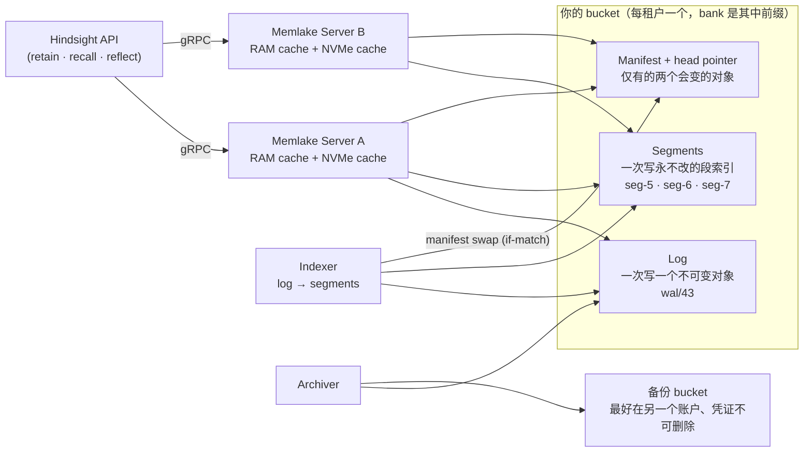
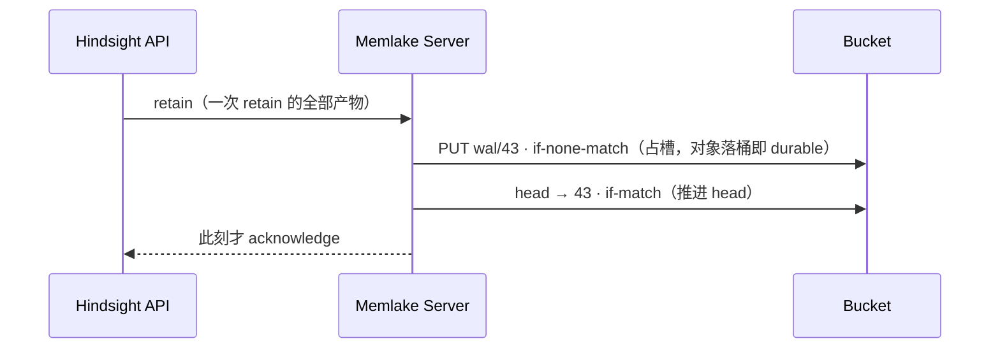

# 08 · Memlake —— 对象存储原生的企业级记忆引擎

> 代码基线：`5331da2f4`（v1.0.0，2026-10-16）；本篇随 1.0.0 增量更新轮新增（Memlake 于 2026-10-13 与 v1.0.0 同日发布，素材由 commit `610c135b6` 落库）。
> **消歧**：本篇分析的是 **Hindsight 官方的企业版存储引擎**（Hindsight Memlake），与同名开源项目 easy12138s/MemLake（团队级 MCP 记忆网关，见竞品分析文档 §3.7）无关。
> **证据等级声明（先读这段）**：Memlake 引擎是闭源 Rust 程序，**不在开源仓库里**（全仓 grep 26 个命中文件全部是文档与配图，引擎代码零命中）。因此本篇论断分三级标注：`[blog]`=官方发布博客 `hindsight-docs/blog/2026-10-13-memlake.md`（含 11 条脚注）；`[文档]`=`hindsight-docs/docs/cloud-enterprise/`；`[图]`=6 张 Giotto 架构动画的 JSON 元数据与博客 SVG 内嵌文本（`hindsight-docs/figures/memlake-*.json`）；唯一的 `[代码]` 级内容是**开源仓库里的接缝**（memories store 抽象，§10）。博客是厂商叙述：机制描述与营销数字混排，本篇把每个数字的测量条件一并抄录，无法核实的内部实现一律写"未确认"。
> 研究方法：2 名研究员独立提取 + 2 名交叉审核员逐字回源核验（研究底稿见 `_memlake-research/`）。

---

## 1. 它是什么：一句话与三层定位

Memlake 是 Hindsight 的**企业版存储引擎**：把"记忆"从 Postgres 搬进对象存储（S3/GCS/认证过的 S3 兼容存储），桶是唯一真相源，服务器只是可丢弃的缓存；用 Rust 写成（为可预期的内存占用与"召回路径上没有 GC 停顿"）`[blog §Introducing]`。它通过 Hindsight 的数据库层接缝接入，"你的 agent、SDK 和 API 调用完全不变" `[blog §Introducing]`。

三层定位（`[文档]` overview.md 的部署对比表）：

| 形态 | 记忆存储 | 说明 |
|----|----|----|
| 自托管（开源，MIT） | PostgreSQL（或 Oracle） | 开源版只认关系库——**Memlake 不涉 Oracle** |
| Hindsight Cloud | Vectorize 托管 | "大多数组织已经在跑 Memlake" `[blog §Availability]` |
| Hindsight Enterprise | PostgreSQL **或 Memlake**（对象存储） | 专属云/BYOC/本地四种形态（§15） |

一句话的动机：开源 Hindsight 的引擎、巩固、检索工程全部照旧（01-07 篇的所有结论不变），**只有"记忆行放在哪"这一层被换掉**。

## 2. 为什么 Postgres 会疼：官方的测量（动机侧）

`[blog §Object storage is all you need]` + 脚注 pg（经 Hindsight API 端到端测量，dev 集群，2026-09；链接表占比一项来自托管集群）。五条痛点：

1. **recall 随 bank 变慢**：4-vCPU 主库，33k 记忆 7.0 queries/s → 164k 只剩 1.9；加并发只加排队。
2. **关键词搜索没为大队列设计**：PG 内置 FTS 给**每条匹配行**打分；210k 记忆的 bank 一条查询几乎命中全表——**即使 Hindsight 默认的"只保留 16 个最稀有查询词"上限已开**。换关键词引擎（vchord/pg_textsearch/pgroonga）能改善这一项，但救不了下面的写与链接成本 `[脚注 pg]`。
3. **写打爆 WAL**：每条记忆约 **190 KB WAL**（向量+链接+全文索引合计）；摄入封顶 **55–80 条/s**。
4. **多 bank 也疼**：某 1,000 个小 bank 的组织只撑到 ~2 recalls/s——每条查询都要在数千个 per-bank 索引上做计划。
5. **字节大头是链接**：托管集群里，记忆互链表占库 **65%**，其中 **3/4 是索引而不是数据**。

`[代码]` 佐证（这些痛点在开源代码里有原文级痕迹）：`engine/search/bm25_term_selection.py` 的模块 docstring 记录了整条链路——长查询被 tokenize 后 **OR-join** 成一个 tsquery，native 后端 `@@` 门命中大半 bank，`ts_rank_cd` 无 IDF 且无索引支撑，曾造成 **+60 秒的生产 BM25 挂起**；对策 `DEFAULT_BM25_MAX_QUERY_TERMS=16`（`config.py:1391`）+ `DEFAULT_BM25_SELECTIVE_TERMS=True`（按 pg_stats 文档频率保留最稀有词，`config.py:1396`，服务器级静态配置、不在 `_CONFIGURABLE_FIELDS`）。可选关键词引擎即 `VALID_TEXT_SEARCH_EXTENSIONS = ("native","vchord","pg_textsearch","pgroonga","pg_search")`（`config.py:1580`）。

官方的结论很克制：Postgres 没做错什么，是工作负载形状特殊（只增不减的小记录 × 每次召回四路搜索 × 写入即刻可见）；水平扩展 Postgres（Citus/Aurora Limitless/AlloyDB）买的是余量，不改设计——"每条链接仍是一行、每次召回仍是跨索引查询"。所以他们为这个数据形状造了一个专用存储 `[blog §Object storage]`。

## 3. 设计目标六条（写代码前立下、每次变更仍对照评审）

`[blog §Goals]`：

1. **对象存储是记忆的唯一真相源**——Memlake 自己没有数据库、没有共识集群、桶旁边没有第二个有状态系统；持久性/复制/可用性全部来自 S3/GCS；租户的每一字节记忆都在租户自己控制的桶里。
2. **确认前已持久，确认后即可见**（durable before acknowledged, visible once acknowledged）——Hindsight 确认一条记忆已保存时，它已经在对象存储里，且下一次 recall 从任何服务器都能找到它。
3. **一切增量**——写、索引、召回路径上没有任何一步会重处理整个 bank；retain 的成本与 bank 是一千条还是一亿条无关；recall 对对象存储的往返次数有界。
4. **一份拷贝、四种搜索**——每条记忆只存一份，同时服务向量/关键词/图/时间四路；没有需要保持同步的独立向量库+搜索引擎+图库。
5. **计算可丢弃**——服务器只持缓存；丢一台只损失延迟，绝不损失数据；扩容=加服务器。
6. **有界设计**——缓存与"未索引写"的读取都跑在固定内存预算上；写入快于索引时，Memlake 用**可重试错误**让写方减速，而不是放任内存增长。

## 4. 架构总览：四个活动部件，其中一个是你的桶

读法 `[blog §Architecture; 图:memlake-architecture.json]`：

- **桶是唯一的状态**："Everything durable lives in your bucket, per tenant and bank: a log with one object per write, immutable segment indexes, and a manifest whose head is the only object that changes."
- **服务器是纯缓存**："Servers A and B each keep a RAM and an NVMe cache, and hold no durable state of their own"；"Any server can answer any request, so there is no primary"；"Memlake's servers never talk to each other"——**没有主从、没有互连**，协调全部发生在桶上的条件写里（§5）。
- **indexer 与 archiver 是后台部件**（§8）。gRPC 只存在于 Hindsight API ↔ Memlake servers 之间（引擎级压测也直走 gRPC，`[脚注 engine]`）。

**哪些数据进桶、哪些留在 Postgres** `[blog §Introducing]`：

| 进桶（记忆所在处） | 留在 Postgres（运维面） |
|----|----|
| memories、links、索引、documents 本体、mental models 与 knowledge pages（其文本入索引） | banks 与设置、后台任务队列（async_operations）、审计 log、Cloud 账户数据 |

"那部分数据小且天然关系型（有更新、有 join、有事务），留在 Postgres 让 Hindsight 能继续在普通表上做功能，也让每个系统做它最擅长的事。"

## 5. bucket 对象模型：三类对象

每个租户一个桶，每个 memory bank 是桶内的一个前缀，前缀下三类对象 `[blog §The bucket]`：

1. **Log（日志）**："Every write becomes one new, immutable file. The log holds recent memories until they're indexed." 一次写 = 一个新的不可变对象；图数据显示对象键形如 `wal/43`，并同屏出现三态标注：`wal/41 indexed`、`wal/42 committed`、`wal/43 claimed · durable` `[图:writes]`（是否线上真实键名未确认，图属示意）。log 被索引后的删除时机**素材未说明（未确认）**。
2. **Segments（段）**："Small, self-contained indexes over a slice of the bank, **written once and never modified**. Inside a segment, each memory type (facts, experiences, observations) has its own **vector clusters, full-text index, entity index, time index and links**." 段内按记忆类型（facts/experiences/observations）各配五套结构；图数据里段名 `seg-<N>`，状态从 "built · not yet published" 到进入 manifest 的 live 清单（`seg-5 · seg-6 · seg-7`）`[图:indexing]`。
3. **Manifest + head pointer**：**每 bank 前缀内**三类对象中仅这两个会变（多 bank 的桶里各 bank 有自己的 manifest/head 对）；manifest 列出 live segments，head 标记 log 已提交到哪。

关键不变式："Because nothing is overwritten in place, **a reader always sees a complete version of a bank, never something in between**." `[blog §Architecture]`

## 6. 条件写协议：全部协调机制就这一招

`[blog §Architecture]`："the two objects that change are only ever replaced with a **conditional write**: the store accepts the new version only if nobody changed it first. **That is the whole coordination story.** There's no database, lock service or leader beside the bucket."

四个使用点：

| # | 场景 | 条件写形态 | 语义 |
|---|------|-----------|------|
| 1 | retain 占 log 槽位 | `PUT wal/43 · if-none-match`（conditional create） | 两个写者永远抢不到同一槽位 `[blog §Writes]` |
| 2 | 推进 head pointer | `head → 43 · if-match` | 条目 durable 后 head 才前移 |
| 3 | 索引发布 | manifest swap（if-match） | 双 indexer 无锁竞争同一 bank：一个 swap 成功，另一个的文件"从不被引用、随后被 GC"——GC 判据："removes only what no manifest points to" `[blog §Indexers; 图:indexing]` |
| 4 | GC 决策本身 | 条件写 | "what garbage collection may delete comes down to a conditional write that the bucket either accepts or rejects" `[blog §Architecture]` |

**写入时序**（一次 Hindsight retain = 新事实 + 替换旧事实 + 新见实体，打包成**单条 log entry**，"lands entirely or not at all"）：

`[blog §Writes; 图:writes beats 2-4]`。commit 约 0.25 秒，被 Hindsight 的异步 retain 挡在 agent 主路径之外 `[blog §Performance]`。

## 7. 读写语义与 recall 全序

**三条保证的达成方式**：

- **durable before acknowledged**：ack 之前对象已经条件写进桶（占槽成功 = 对象已在 bucket）；持久性由对象存储背书（"Durability, replication and availability come from S3 or GCS"）。
- **visible once acknowledged / 写不等索引**："Writes don't wait for indexing: the next recall, from any server, reads the part of the log that hasn't been indexed yet."——图数据显示 recall 有专门一步"扫 log 未索引尾段"（`wal/43 scanned`），且"查 head"是热查询固定的一次请求（"the one request a warm query always makes"——图数据独有细节）`[blog §Writes; 图:recall beats 2-3]`。
- **读者总见完整版本**：见 §5 末不变式；索引发布同理——"Readers see the old version or the new one — never half." `[图:indexing]`

**recall 全序**（`[图:recall beats 1-6]` + `[blog §Servers]`）：

1. Hindsight 发 recall，**附带 ranking policy**（图标注三组成：fusion · rerank · budget）；
2. 服务器查 manifest/head（最新写入了什么）；
3. ranged reads 读 segments 里需要的块（主要命中缓存）+ 扫 log 未索引尾部；
4. 在**同一份数据上**并行跑四路搜索（§9）；
5. **在数据旁边**应用 Hindsight 送来的 ranking policy（"the server ranks next to the data"）；
6. 只返回达标的记忆："Only the memories that make the cut leave the server."

## 8. servers / indexers / archiver

**servers** `[blog §Servers; 图:architecture/failover]`：

- **粘性路由**：负载均衡把每个 bank 固定到同一台 server，内存 + 本地 NVMe 两级缓存常热；"since objects never change, that cache **never needs invalidating**"（段不可变 + head/manifest 条件写版本化）。
- **扩容 = 摊开 banks**："A bank's index lives on one server at a time"——而 agent 记忆天然按 agent/user/project 切分，所以水平扩展顺手。容量：每 server 约 **8–14 warm recalls/s/vCPU**，随服务器线性增长。
- **failover**：server 消失后另一台直接接手其 banks——"no handover, no replica to promote"，边服务边从桶热身；"Every acknowledged write is still there: it was never on the lost server." `[图:failover]`
- **冷启动代价（重要 tradeoff）** `[blog §The cold-start tradeoff]`：首次打开 bank 要从桶加载索引元数据——10M 记忆 bank **8.6s p95**（每 server 一次，非每查询）；数据块未缓存前查询 p99 约 1 秒；1M bank 靠流量自然变热：1.7s → 74ms p99。缓解：server 打开 bank/接手新索引时**后台预载**；bank 粘性路由使冷启动很少发生；还可以**提前发一枪 recall** 预热（"a user logging in, an agent starting a job"）。
- **反压**：写快于索引时，写方收到**可重试错误**而非无限内存增长 `[blog §Goals]`。

**indexers** `[blog §Indexers]`：

- 与应答查询的 servers 分离运行；读新 log 条目 → **折叠成新 segment，途中派生记忆间链接** → swap manifest 发布 → 后台 compaction 合并小段（触发条件/参数：未确认）。
- **增量性**："Adding a hundred memories to a bank of a hundred million **builds a hundred-memory segment**"——索引成本跟随新增而非存量；"the work that grows with the data happens here rather than at query time."
- **无锁双 indexer**：两个 indexer 同 bank 竞争不需要锁——赢者换 manifest，输者的文件无人引用、后被 GC（TLA 性质之一，§10）。

**archiver** `[blog §Archiver]`：

- **opt-in**（"When backups are on"）：持续跟随 log 复制 + 每日快照，到独立备份桶，"ideally in another account with credentials that can't delete"。
- **PITR**：bank 可恢复到任意时点；"every restore is verified before traffic moves to it"（验证内容未确认）。

## 9. 四路检索：一份拷贝，四种搜索

`[blog §The four searches]`。全部四路读同一份存储的记忆：

| 路 | 实现 | 要点 |
|----|------|------|
| 语义（by meaning） | IVF 簇索引，查询只扫最近的簇 | **每条向量存两份**：RaBitQ 压缩到约 **60 字节**（384 维 embedding 下，比原始小 **25×**）做快速第一遍 + **全精度副本**对最佳候选精确重排 |
| 关键词（by keyword） | BM25 over [tantivy](https://github.com/quickwit-oss/tantivy)，随 segment 存储 | **含中文分词**（word segmentation for Chinese） |
| 关系（through relationships） | 从最佳向量匹配**一步出边** | 共享实体 / 语义相近 / **caused or were caused by**（因果）/ 时序紧邻（right before or after） |
| 时间（through time） | 每 segment 一个时间索引 | 带时间窗的查询**只读该范围** |

`[代码]` 对照（开源侧语义一致性）：`memory_links` 表的 check 约束恰好是 `'temporal','semantic','entity','causes','caused_by','enables','prevents'` 七种链接类型（alembic `5a366d414dce_initial_schema.py:471`），与关系路描述吻合；图臂以语义命中为种子（`engine/memories/base.py:796` `GRAPH_SEED_LIMIT = 20`）。

**exact vs approximate 的口径**（这是评估任何 ANN 引擎的关键，官方给了明确边界）：

- **精确的部分**：跨 segment 分数可比——"merging each segment's reranked top results gives the same top results as reranking the same candidates in one place"（合并的是**重排后**结果，不是粗排分数）。
- **近似的部分**：segment **内**找候选是近似的（任何聚类索引皆然）。
- **质量检查手段**：测试中用"探遍所有簇"的搜索对 brute force，要求**完全一致**；BEIR 上检查压缩首过找出的 top 10 与 8-bit 向量的 top 10 一致。
- **成本模型**：设计预期段内搜索成本随段大小 **√N** 增长；实测（bank 扩 30×，recall 慢 ~6×，√30≈5.5）接近该曲线 `[blog §The four searches; 脚注 sweep]`。

## 10. 与开源引擎的接缝：本篇唯一的 [代码] 级内容

Memlake 引擎本体不在开源仓库，但"插进 Hindsight 数据库层"的接缝在开源代码里完整可见 `[代码]`：

1. **store 抽象**：`hindsight-api-slim/hindsight_api/engine/memories/base.py:1073` 定义 `MemoriesExtension(Extension, ABC)`（约 4400 行、~180 个方法）；`extensions/loader.py:174` 注册 `MEMORIES` 扩展槽；`engine/memories/__init__.py:49-60` 的工厂 `create_memories()` 先尝试 `load_extension("MEMORIES", ...)`（加载时打日志 `"[memories] store=%s (memory rows do not go to postgres)"`），未配置则回落 `PostgresMemories`。企业版 Memlake 就是这个槽位的另一个实现（此句为接口契约推论，实现本身未确认）。
2. **表集合精确对应**：`engine/schema.py:15` 的 `STORE_TABLES = {memory_units, memory_links, unit_entities, documents, chunks, entities, entity_cooccurrences, invalidated_memory_units}`——这就是 blog 所说"记忆所在处"的开源清单；`base.py` 模块 docstring 原文："Banks, operations and the other engine tables stay in Postgres either way"（bank/操作队列等运维表两种存储下都留 Postgres）。
3. **接口已为"网络型 store"备好形状**：
   - `store_owned`（base.py:1128）：store 拥有全部记忆行 + 文档/chunk 本体 + retain 的原子服务端提交（返回 `seq/unit_ids/new_entities`）；`store_owned_for(bank_id)`（:1130）支持**按 bank 路由不同后端**——docstring 明说支持"banks live in different backends"，这正是博客"迁移任务逐组织搬迁"的接缝。
   - `assert_writable` + `StoreWriteUnavailable`（base.py:69-81，映射 503+Retry-After）：docstring 原文即 "migrating a bank between backends holds it for a few seconds"——**bank 在两后端间搬迁时冻结数秒**已代码化；`StoreWriteConflict`（:84-95）则是**条件写输掉竞争**的异常形状（"the state it was based on moved before it committed……the caller has to re-read and redo the work"）——与 Memlake 的条件写协议同构。（注：这是 OSS 存储契约的事实，不据此推断 Memlake 内部实现。）
   - `begin_retain` → `RetainSession`（流式收 part）；`allocate_unit_ids`（"rather than by an INSERT's RETURNING clause"发 ID——不再依赖 Postgres）；`FactRecord` 内联携带 `entity_ids` + `causal_edges`（base.py:594-598："what would have become `memory_links` / `unit_entities` rows"）——链接可以不落 SQL 行。
   - **recall 两级接缝**：`recall_unified`（base.py:1801，一次调用返回四臂结果，"a store that owns its index answers every arm from a single query with no per-arm round-trips"）与 `full_recall`（base.py:1841，store 整包接下融合/重排/新近度/预算——"A store that owns its index can do all of it where the data already is"）。引擎侧 `memory_engine.py:9581-9620` 已有 "Store-answered recall" 分支：记录 store 上报的分阶段耗时与 `store_hop_overhead`，注释明写 "**our gRPC client**"——网络型 store 的观测位已就绪。
4. **一个 blog 表述最粗的地方（接口 docstring 甄别）**：blog 笼统说 mental models 与 knowledge pages "move to the bucket"；但接口 docstring（base.py:901 附近 `KnowledgePageEntry`）明确：**页面的行（name/body/folder/trigger/history）仍留 Postgres 且是权威，store 只持有派生的索引副本**（"this is the derived half"）。两者可相容（索引进桶、行留 PG），但"整页搬进桶"是博客的粗化。
5. **边界执法**：运行时 `fq_table` 拒绝 store 表名、store 专属 `fq_store_table`；AST 级测试 `tests/test_store_table_boundary.py` 禁止 store 表出现在 store 之外的 SQL 里。

## 11. 性能与成本台账（每个数字都带测量条件）

> 全部 recall 数字**不含 cross-encoder 重排器**（开着时重排主导 recall 时间，受重排器 GPU 容量限制而非 store）`[脚注 nocross]`。所有数字为 `[blog]`/`[图:SVG]` 级自报数据，本系列无法独立复测。

**Postgres 痛点基线**：见 §2。

**Head-to-head**（同集群同数据同 driver 无 LLM，2026-09-15；Postgres 为 4-vCPU 主库且与开发租户共享——**非同硬件**）`[脚注 presets]`。**吞吐口径：单 bank = 16 并发稳态；多 bank = 最高稳态速率**（图注原文，两类口径不同）。定性结论：小 bank 上 Memlake 快 3–5 倍、扛 10 倍流量；大 bank 上差距两个数量级 `[blog §Performance]`。封面图的第三条参照线（单 bank 从 4k 增长到 3M 的外推）：PG recall p99 0.5s → 930ms@50k → 5.3s@210k、月成本 $7.4k@210k → 外推 **$73.3k@3M**；Memlake 平坦在 ~90ms p99 / ~$1.7k/月：

| 工作负载 | Postgres | Memlake | 单查 p99 PG | 单查 p99 ML |
|----|----|----|----|----|
| 1 bank · 4k 条 | 19/s | 207/s | 513 ms | 106 ms |
| 1 bank · ~150–210k 条 | 0.45/s | 106/s | 5,300 ms（主因关键词搜索 `[脚注 fts]`） | 113 ms |
| 100 banks · 共 422k | 4/s | 113/s | — | — |
| 1,000 小 bank | 2/s | 113/s | — | — |

两点诚实限定：① PG 大 bank 延迟主要是关键词搜索（`ts_rank_cd` 对几乎全表的匹配行逐行打分）——"视为 Hindsight 今日 Postgres 配置的成本，不是 Postgres 最优形态的成本" `[脚注 fts]`；② **113/s 是该测试环境的上限而非引擎上限**——Memlake 服务器远未饱和，瓶颈疑似在 store 之外（"most likely per-request billing on the organization's account row"）`[脚注 cap]`。

**引擎级扩展性**（gRPC 直连、无 Hindsight API；`[脚注 sweep/engine]`）：

- bank 100k→3M（30×）重载下 recall 慢 **~6×** ≈ √N（2026-08，6-vCPU，本地 S3 兼容存储，真实语料，16 并发，非全热：0.1–0.3 次对象往返/召回）。
- **1 亿条记忆 / 20 banks / 4 台 6-vCPU**（≈1500 员工一年的 agent 量）：1→200 recalls/s 延迟平坦，p50 40–43ms，p99 73–80ms（该 fleet 与 10M 单 bank 用了**另一朵云**的对象存储，fleet 为**合成数据**）。
- 单 3M bank：p50 71ms / p99 90ms（**空载、更晚的另一版引擎跑在 GCS、单请求串行**——与 √N sweep 非同一引擎/存储）。
- 最大单 bank：**1000 万条**（≈自主 agent 不间断两年）。

**写**：单 bank **1,200–1,500 条/s** 随 bank 规模平坦（Postgres 的 15–27×）；commit ~0.25s。写很少成为瓶颈——每个 retain 先过 LLM，速度受 LLM 约束而非 store `[blog §Performance]`。

**冷启动**：见 §8。

**检索质量（BEIR）** `[脚注 beir]`：SciFact + NFCorpus，nDCG@10，两系统同用 bge-small-en-v1.5，**2026-07 引擎、官方注明正在用当前引擎重跑**；BEIR 无实体无时间戳——只测"存储引擎不损失质量"，不测图/时间检索的增益。结果：与一个成熟向量库对比，Memlake **从未落后超过 0.3%**（最大落后 0.27%，SciFact hybrid 0.7345→0.7325），两处对比反而领先（SVG 内嵌精确值——SciFact：向量库 0.7127/0.683/0.7345 vs Memlake 0.7127/0.6907/0.7325，即 BM25 +1.1%；NFCorpus：0.3436/0.3236/0.3626 vs 0.3429/0.3244/0.3638，即 hybrid +0.33%）；加图检索 NFCorpus hybrid 升至 **0.3645**。

**成本模型** `[脚注 cost]`——**Modelled, not billed**（内部 sizing calculator：整个 GKE 部署、GCP list prices、12 个月增长后、按 recall p99 ≤1s@峰值定规格；排除 LLM 与 embedding/reranker GPU——$1.1–2.3k/月两边相同；Hindsight 其余组件 $0.6–2k/月两边相同；Postgres 单次 recall 已超 1s 的大 bank 加硬件无解——单 primary——只按流量定规格并如实报告慢；Memlake 的 0.35s 是"默认缓存设置的预算值"而非实测；自治 bank ~5M 超 API 实测最大 151k、PG 超 ~210k 均为外推）：

- 存储单价：桶内 **4–5 KB/条** + 文档本体；员工 agent 一年 ≈ **350 MB**，S3 上**每月不到 1 美分**。
- 四场景（一年后的月度集群总成本，去 LLM/GPU）：

| 场景 | 记忆量 | Memlake | Postgres | p99 Memlake | p99 Postgres |
|----|----|----|----|----|----|
| 1,000 员工 | 68M | $3.2k | $4.6k | 0.35s | 2.4s |
| 10,000 员工 | 680M | $15.1k | $58.4k | 0.35s | 9.1s |
| 100 自治 agent | 490M | $11.1k | $146k | 0.35s | 5.2s |
| 1,000 自治 agent | 4.9B | $94k | $2.46M | 0.35s | 11.1s |

- 核心结论：**总量不是 Postgres 贵的原因，bank 的大小和数量才是**。小 bank 两边接近（小部署 Postgres 可能更便宜）；官方给的阈值："banks stay under ~50k memories each → Postgres is great, and it's not going anywhere"。
- hosted fleet 实际形状：存储层 Memlake 便宜 2.2×，整部署 1.5×。
- 写入量模型 `[脚注 usage]`：员工 agent ~68k 条/年（每工作日 10 次对话 × 实测 ~27 条/次）；自主 agent ~5M/年（500 任务/天）；万人公司 + 千个自治 agent ~5.5B 条/年。

## 12. TLA+：协议小到可以证明

`[blog §Verified, not just tested]`——因为正确性归结于少数几个条件写，"the protocol is small enough to prove"：

- 写、索引、GC 三协议用 **TLA+** 规约；模型检查器**穷举所有交错**：多 writer/indexer 竞争、server 任意步崩溃、响应丢失、进程任意长停顿。
- **五条被证明的性质**：① 已 ack 的写永不丢失，log 槽位永不复用；② 任何查询从任何 server 都能看到每条已 ack 的写；③ 读者总见完整索引，从不见半个更新；④ GC 永不删除仍在使用的东西；⑤ 双 indexer 无锁竞争同一 bank 仍安全。
- **防实现漂移四件套**：CI 里每次协议变更重跑规约；对照**故意写错的变体**验证检查器必须能抓出来；**真实引擎的执行记录（trace checks）对照规约**；注入存储故障的 property-based 测试 harness。
- 诚实限定 `[脚注 tla]`：模型检查是**有界范围内**的穷举（少量 writer/indexer/log 位置——"which is where interleaving bugs live"）；它验证的是**规约本身**；规约与代码的纽带是 trace checks + 故障注入 harness；细节在白皮书（`vectorize.io/memlake/whitepaper`，仓库外，未读未确认）。

## 13. blog 与 enterprise.md 的差异（同日落库，无先后可考）

| 项 | blog | enterprise.md |
|----|------|---------------|
| 存储后端清单 | S3、GCS、"**certified** S3-compatible"；on-prem 需条件写认证 | S3、GCS、**Azure Blob Storage**、on-prem S3 兼容（列了 Azure、未提 certified） |
| bucket 粒度措辞 | per-**tenant** | per-**organization**（同义异词） |
| 备份 | opt-in（"When backups are on"） | 无条件句式（"continuously backed up"）——未写前提 |
| 可用形态 | 四种（含 Cloud） | 仅 private cloud / BYOC / on-premises（文档视角）；另提 air-gapped、PrivateLink/PSC/Azure Private Link |
| 私有网络 | 未提 | PrivateLink / PSC / Azure Private Link |
| 性能数据 | 全套 | 除"100M <100ms p99 @4 servers"一句外无细节 |

## 14. 未能确认清单（本篇诚实边界）

1. 引擎内部实现（Rust 代码、gRPC schema、缓存替换策略、compaction 触发条件与合并参数）——闭源。
2. log 对象被索引后的删除时机与 GC 细则（GC 判据只有一句："removes only what no manifest points to"）。
3. indexer/archiver 进程自身是否有内部状态（图上未画）。
4. 恢复验证的具体内容；迁移任务的具体机制（blog 只说"keeps every memory ID, and verifies the copy before switching"）。
5. `wal/`、`seg-` 命名是否线上真实对象键（图为示意）。
6. 白皮书与 docs.hindsight.vectorize.io/enterprise/memlake 四个页面的内容（仓库外未读）。
7. 全部性能/成本数字的独立复测（本系列无该环境）。

## 15. 可用性四形态与迁移 `[blog §Availability]`

1. **Hindsight Cloud**："Most organizations already run on Memlake"，无需设置。
2. **专属云实例**：Vectorize 代管的单租户——独立 cloud project/cluster/bucket、自选 region、自己的域名、按你排期升级。
3. **你的云（BYOC）**：你自己的 AWS 或 GCP 账户，S3/GCS，用你 bucket 的加密与密钥（enterprise.md 口径含 Azure）。
4. **本地机房**：你自己的 S3 兼容存储，**需通过 Memlake 依赖的条件写认证**；官方与存储硬件 design partner 合作建设（一家用自家 flash 跑全栈含模型，blog 未点名厂商）。

**从 Postgres 迁移**：迁移任务逐组织搬迁，**保留每条 memory ID**，**验证副本后才切换流量**——切换窗口对应开源接口的 `StoreWriteUnavailable`（503+Retry-After，见 §10）。

## 16. 本篇与全系列的关系（收束）

Memlake 不改变 01–07 篇的任何结论：开源 Hindsight 1.0 的引擎、巩固、四臂检索、reflect、配置体系原样运行在 Postgres 上（"the API is a promise"）。它示范的其实是三件对理解这个系统更重要的事：

1. **存储层是被刻意抽象掉的**——05/06 篇讲过的 `MemoriesExtension` 接口（§10）就是为这一天准备的：`store_owned`/`store_owned_for`/`recall_unified`/`full_recall`/`StoreWriteConflict` 这些接口形状，与 Memlake 的架构需求（按 bank 路由、单查询四臂、条件写冲突、搬迁冻结）一一对应。读接口就知道闭源引擎长什么样的大致轮廓。（接入方式：`HINDSIGHT_API_MEMORIES_EXTENSION=module:Class` 环境变量，其余 `HINDSIGHT_API_MEMORIES_*` 变成该实现自己的配置——base.py 模块 docstring 的契约。）
2. **协调机制的极简主义**——不用数据库、不用锁服务、不用 leader，全部协调归结为对象存储上的条件写（if-none-match 占槽 / if-match 推进或发布），并用 TLA+ 把"协议小到可以证明"变成工程事实。
3. **官方对数字的口径纪律**——几乎每个性能数字的脚注都主动交代对己不利的条件（非同硬件、测试环境瓶颈、外推段、modelled not billed、BEIR 正在重跑）。引用这些数字时，请连同脚注一起引用。

> 2.0 展望（`[blog §What's next]`，路线图非 Memlake 本体）：围绕 **decision models** 重建 retain/recall/consolidation/reflect/knowledge pages（[代码] 侧已有落点：consolidation triage #5664、三个 `*_use_decision_model` 配置）；知识与经验合一（文档/wiki/runbook 并入同一系统）；对通用与编码 agent 的更深集成与专用基准。
